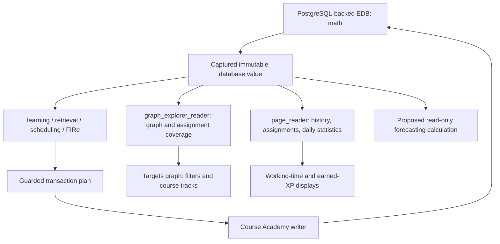

# Pace, workload growth, and completion forecasting: technical handoff

Prepared for ChatGPT Pro on 2026-10-21. Project: Course Academy. This is a research and design brief, with verified implementation details and a complete catalog of the domain schema declared in this repository. It is not an implemented forecasting feature or a calculated completion-date forecast.

## 1. The assignment for ChatGPT Pro

Develop a defensible way to estimate the learner's remaining workload, the rate at which that workload grows, the completion date at the learner's current pace, and the pace needed to be ready by a chosen future date. Report both overall and per-course results. The courses of interest are MTH 255 (Vector Calculus II), MTH 256 (Applied Differential Equations), and MTH 341 (Linear Algebra I), using their current database titles.

The learner's first approximation is:

- Measure completed base XP and actual working time, including recent seven-day averages.
- Identify targeted, queued, and prerequisite topics per course; estimate the remaining lesson XP.
- Add assessment and review overhead. A preliminary assessment approximation was one quiz per 150 XP of progress, costing roughly 15 XP.
- Estimate average weekly additions of targets, queue topics, and prerequisites, including their XP, then express growth per day.
- Compare capacity with growing demand rather than dividing today's backlog by today's pace and assuming the backlog is fixed.

These are starting ideas, not requirements for a particular formula. Evaluate their assumptions and recommend improvements. The implementation facts below constrain what can be measured; the modeling suggestions are options to assess.

### Clarifications from the learner

**Estimate average weekly growth using observations only up to the current date.** Future weeks are not observations and must not enter the historical average or its denominator. Specify the observation window, its actual coverage, and how the current partial week is handled. Forecast future arrivals from that historical estimate, with uncertainty.

**Use the same filters and topic-selection rules as the Targets graph.** In particular:

- Targets and queue topics are the roots.
- Expand prerequisites upstream to depth 2, with roots at distance 0.
- Exclude displayed layers L29 and below; retain L30 and above.
- Use the graph's course filters, queue switch, assignment-week filtering, special handling of unassigned targets, and course-track placement rules.
- Apply equivalent scope rules to historical observations, not just today's workload. Do not estimate growth from an unfiltered topic list and compare it with a filtered backlog.

The graph includes studied topics. Scope membership and remaining work therefore need separate definitions: identify the graph-matching set first, then account for completed learning and partially completed attempts within it. Explain any difference between the visible topic count and the number of lessons still needed.

No deadline, required confidence level, or future daily time budget has been supplied. Treat these as inputs. Do not invent them.

## 2. What is established, and what still needs measurement

| Category | Status in this handoff |
|---|---|
| Domain attributes, enums, validation specifications | Cataloged from repository schema files in Appendix A |
| Current graph selection and course placement | Traced in the actual UI implementation; algorithms described below |
| XP, working time, lesson stopping, quiz cadence, FIRe state | Traced in Rust engine and application code |
| Current graph inventory and assignment coverage | Read-only database snapshot at basis **5382**; census in Appendix B |
| Actual recent base-XP throughput and its uncertainty | Not calculated here; extraction contract provided |
| Historical filtered weekly additions and growth | Not calculated here; requires historical membership/graph/assignment observations |
| Remaining lesson XP, future reviews, completion date | Not calculated here |
| Full installed database schema, including retired legacy definitions | Not independently enumerated here; Appendix A covers all current domain declarations in source |

Source comments and older README statistics describe earlier migrations. They are not current database counts. Runtime code takes precedence where an older description differs. The audit snapshot is a point in time, not a promise that the database will remain at that basis.

## 3. Database and application architecture

The active local logical EDB database is `math`, backed by PostgreSQL under `/media/jake/SSD/EDB/math`. The application normally connects through the Unix socket directory `/tmp/edb-math`, PostgreSQL port `55432`, role `edb_peer`. Writes go through the pinned Course Academy writer at `/tmp/edb-math/writer.sock`. Environment variables can override these defaults. Older `course-academy` and `course-academy-v2` references in migration documents are historical; do not query them as though they were today's active dataset.

EDB is the Rust temporal fact database used by this project, not EnterpriseDB PostgreSQL. PostgreSQL is its storage backend. Domain access uses EDB datoms, identities, Datalog, Pull, immutable database values, and transaction history.



An EDB fact is conceptually `(entity, attribute, value, transaction, source, added-or-retracted)`. Numeric `:db/id` values are entity IDs within the database. Stable domain identities such as `:topic/id` and `:activity/id` are UUIDs; `:learner/id` and `:progress/id` are strings. Math Academy IDs are separate optional external identifiers. Match entities across exports by stable identity, and retain database lineage/basis when using numeric IDs.

Capture one database value and one explicit forecast clock for related calculations. Retained history permits as-of reconstruction and inspection of additions/retractions. A plain `since` view is not a complete event stream: retracted facts can disappear from it. Use history or the transaction log for arrival/removal analysis. Logical transaction order and event time must both be retained; multiple transactions can share a wall-clock instant.

The engine is the Rust library `course-academy-engine`, exposed by the `fire` binary and embedded application helpers. The live app uses the generic activity/step/task/item model. Older type-specific runtime interfaces remain for replay and diagnostic tooling; they are not the best starting point for a new app forecast.

Forecasting should read or clone state. Live task preparation and completion can write activities, reservations, clocks, XP, and FIRe progress. Do not start tasks or refresh a mutating scheduler merely to count hypothetical work. Native transaction plans use explicit sources, request keys, basis guards, and idempotent retries; simulation must not submit those plans.

## 4. The entity relationships that determine workload

```text
course-group --courses--> course --units--> unit --modules--> module --topics--> topic
topic --next--> dependent topic                     [prerequisite -> dependent]
topic --knowledge-points--> KP
topic --encompasses--> owned coverage record --topic/weight--> component topic
KP --canonical-example--> question
KP --questions--> ordinary question pool
KP --key-prerequisites--> topics                    [targeted repair, separate graph]
KP --question-generator--> generator script

activity --type/course/due/scope--> definition metadata
activity --steps/first-step--> step --content--> tutorial / KP / question /
                                                 multistep / assigned-problem
step --next--> sibling step
multistep --steps/first-step--> nested steps
assigned-problem --content--> question or multistep
assigned-problem --topic-coverage--> mapped topics

learner --targets/queue--> shared topics
learner --assignments--> shared assignment activities
learner --knowledge-profile--> owned progress --topic--> shared topic
learner --performance--> owned overall accuracy record
learner --activity--> learner-task --activity--> shared activity definition
learner-task --items--> owned presentation items --content/responses--> content/answers
learner-task --retake-of/remediation-for--> originating learner-task
progress --policy--> FIRe policy --question-selection-weights--> owned weight records
```

Collection membership is generally unordered. Authored lesson order comes from `activity/first-step` and `step/next`; presentation order comes from `task-item/next`. Course/unit/module navigation links do not create topic readiness requirements.

There are three distinct relationship systems:

1. `topic/next`: prerequisite DAG, used for global layers and prerequisite expansion.
2. `topic/encompasses`: weighted implicit practice coverage, used by FIRe; it can reduce review demand without finishing another lesson.
3. Assignment coverage and curriculum membership: course/deadline associations, used for filtering, prioritization, and track placement.

A course is not an owner of its topics. A topic, a lesson, and learner progress can be shared across courses. Summing independently expanded course workloads without deduplication can count the same physical learning work several times.

## 5. Exact Targets graph scope

Authoritative implementation: `ui/Math-Academy-Graph-Explorer.html`, especially `installSnapshot`, `targetTopicVisible`, `courseFilteredTargetIds`, `unassignedTargetIds`, `targetIdsForWeek`, `buildActiveSet`, and `targetCourseBands`; calendar helpers are in `ui/target-weeks.js`.

### Layers and prerequisite depth

Compute global layers on the **full** `topic/next` DAG. Internally roots have layer 0 and each node receives the longest incoming-path rank. Displayed layer is internal rank plus one. The cutoff is therefore `node.layer >= 29`, meaning displayed L30 or higher. Do not recompute layers after hiding low-layer topics, course filtering, or selecting a week. A cycle is a data error.

Retain eligible roots first. Breadth-first expansion follows incoming prerequisite edges only, using the shortest distance from any selected root. A topic appears once even when several roots or paths reach it. At depth 2, include distances 0, 1, and 2. The graph skips excluded low-layer prerequisites during expansion. It does not expand into dependents or siblings. Edges displayed afterward are the original prerequisite edges whose endpoints both remain visible.

### Course, queue, and week rules

- The course switches are MTH 255, MTH 256, MTH 341, in that order. Their membership projection combines `course/units -> unit/modules -> module/topics` with assignment-covered target topics.
- With all three switches enabled, all saved targets with valid topic entities are considered, subject to the layer cutoff. With a subset enabled, course-associated targets must match an enabled course.
- A saved target with **no membership in any curriculum and no assignment coverage** remains visible across course and week filters. Classification uses all known courses and all linked assignment coverage, not merely enabled courses or assignments with valid due dates.
- Queue is an independent source. When its switch is on, retained queued topics bypass course and assignment-week filters. Queue membership itself is not changed by a visibility switch.
- Weeks run Sunday–Saturday in `America/Los_Angeles`. `All`, `Unscheduled`, or a selected week/range filters associated targets by assignment due dates. `Unscheduled` means no valid dated assignment in the calendar; it is broader than “no course association.”
- A topic can be targeted and queued; the graph deduplicates it. Due-target and queue readouts are separate category counts and can overlap.
- Prerequisite expansion is performed on the resulting roots. A course filter is not a second filter that removes supporting prerequisites belonging to another course.

Browser preferences store enabled courses, Queue visibility, week selection, and split layout in local storage, not EDB. A forecast request must carry a scope descriptor. The audit census below uses an explicit reproducible descriptor—All courses, Queue on, All weeks, depth 2, displayed L30+—and does not claim to have read the learner's current browser preferences.

```json
{
  "courses": ["MTH 255", "MTH 256", "MTH 341"],
  "includeQueue": true,
  "weekSelection": {"kind": "all"},
  "prerequisiteDepth": 2,
  "minimumDisplayedLayer": 30,
  "courseAssignmentPolicy": "current-targetCourseBands",
  "historicalGrowthThrough": "forecast clock, never future observations"
}
```

An exact chosen week range can deliberately suppress most assignment workload. Show that selection in any result. For a report intended to describe all three courses' workload, All weeks is the explicit census setting rather than an unnoticed browser setting. Pro should preserve the requested filter behavior and state how historical week selections are interpreted.

For an implementation, prefer one shared scope calculation or explicit parity checks against these UI functions. A second approximation that happens to use “depth 2” can still disagree on root filtering, legacy course associations, unassigned targets, or week selection. Carry the scope descriptor into every saved observation and result.

### Course-track placement

Split layout currently has only the three course tracks. There is no Shared or Other track. Placement is a reporting/layout allocation, not a mutation of course membership or a scheduler restriction.

The current algorithm is:

1. Build direct associations from each of the three courses' curriculum topics, assignment-covered target topics, and linked assignments' coverage. A topic with exactly one such course is anchored to it.
2. Compute undirected shortest-edge distances over the full prerequisite graph from the fixed anchors for each course. Traversing either direction is for course placement only; prerequisite expansion still follows incoming edges only.
3. Collect all unique saved target/queue topics at L30+. Their count determines workload for tie-breaking, including saved roots hidden by a course/week/Queue visibility filter. Topics in both lists count once. Prerequisite-only topics do not increase these counts.
4. Count directly anchored roots, then place roots with a unique nearest eligible course. Shared topics restrict their candidates to their directly associated courses; unassociated topics can use any of the three.
5. Place equally near or disconnected roots in numeric entity-ID order, choosing the least-loaded candidate track and incrementing its root count. Exact workload ties use track order: 255, 256, 341.
6. Recompute distances with placed roots also serving as anchors. Assign visible prerequisite-only topics by the same nearest-course/lightest-workload rule. They do not increment root workload counts. Thus expansion does not change existing placements; disconnected components with a placed root can have their prerequisites follow it.

The full graph, including hidden low layers, remains available for placement distance calculations. The L29 cutoff applies to displayed topics and counted root workload; it is not a deletion from the underlying graph.

Preserve this allocation for graph-matching per-course totals. Also retain each topic's full set of supported courses, roots, assignments, and deadlines. A single display track cannot represent every deadline obligation. In the audited data, “The Determinant of a 2x2 Matrix” (`:db/id 17592186049044`, topic UUID `d58eda6d-18a9-51fc-a2ae-3720429fd25b`) anchors to MTH 255 through **MTH 255 — OHW-8**, although it is one prerequisite edge from “Introduction to Matrices,” an MTH 341 anchor. A subject-matter guess must not silently replace the implemented association rule.

### Scope is not automatically remaining work

The graph does not remove topics merely because they are learned, already completed, or currently due for review. Course-track labels count visible topics, not unfinished lessons or XP. Separate at least:

- Selected graph scope and course allocation.
- Already learned/completed topics within that scope.
- Remaining first-learning lessons and any active partial lessons.
- Required relearning/remediation obligations.
- Ordinary review and assessment overhead.
- Missing or unusable lesson/question content.

## 6. The actual scheduler has a different planning boundary

The UI depth and layer cutoff are display rules. They have not been installed as engine-wide study restrictions. A forecast must reproduce the requested graph scope for its headline estimate, then disclose whether real scheduling can require additional work outside it.

In self-directed mode, Study combines explicit queue lessons, target preparation, ongoing work, and retrieval obligations. Only `learner/targets` initiates automatic target-prerequisite preparation. Queue and Study-now requests can request their specific lessons without normal prerequisite eligibility; they do not automatically request the queue topic's full prerequisite ancestry in the way targets do.

`learning::known_topic_ancestry` considers explicitly learned progress, positive repetitions on legacy records without a learned flag, and completed lesson/review evidence. It also treats ancestors of historically known topics as covered for preparation. This inference does not write mastery and does not cancel reviews. Target preparation expands unfinished ancestry without the graph's fixed depth-2 cap and stops at that known boundary.

`learning::progress_ready` is a separate retention/readiness test. Complete operational states must be learned and have decayed memory above the review threshold; partial legacy states can fall back to positive repetitions. A zero repetition value, learned=false, missing progress, and overdue learned knowledge are different states.

New lessons require appropriate authored content and fresh gradable practice supply. Explicit queue and new target-preparation lessons require five fresh usable questions per KP. An active lesson can defer a KP when supply runs short, continue other stages, and resume outstanding practice later. Supply shortages are blockers, not zero-cost work or proof of mastery.

Required assessment remediation takes precedence. Eligible required assessments narrow the plan after 150 cadence XP; ongoing tasks remain resumable. Ordinary reviews are optional, although they can dominate the recommendations. The UI shows only five activities. A bounded review-preparation pass does not enumerate the entire eventual review bill. After three finalized ordinary reviews since the last ordinary lesson offer, an optional lesson can be offered. Review diversity ordering uses graph distance among tied review candidates.

Target priority incorporates distinct supported targets, unfinished closure size, nearest target distance, and earliest linked assignment deadline. Completing an assignment does not automatically remove targets or their deadline context. Removing a target is explicit. Do not use queue position or the five visible cards as a remaining-work inventory.

## 7. XP accounting and time accounting

### Four quantities that must not be conflated

| Quantity | Meaning and source |
|---|---|
| Lesson base XP | Estimated content workload. Prefer the frozen attempt's `learner-task/xp-base` for that attempt; for new work use `base_xp::activity_base`. |
| Earned XP | Actual award, `learner-task/xp-earned`; can be negative or exceed base XP. This powers the current daily XP display and assessment cadence. |
| Measured working time | Sum of observed active presentation intervals, excluding pauses and post-submission processing waits. |
| FIRe speed | Accuracy-derived repetition-credit multiplier. It is not XP/hour or the learner's wall-clock reading/solving speed. |

A second distinction is essential: completed base XP of all attempts measures service effort, while remaining first-learning backlog falls only when needed learning is actually completed. A failed attempt, a repeated review, and a quiz consume time but do not each remove that much first-learning backlog. Pro should define both empirical throughput and successful acquisition throughput rather than silently equating them.

### Lesson base XP

For an activity with stored `activity/expected-seconds`, `activity_base` uses:

```text
base = max(1, floor(expected_seconds / 60 + 0.5))
```

Otherwise it calculates the lesson content estimate. The formula version is `lesson-content-expected-distribution-v1`. For normalized expected easy/moderate/hard probabilities `pe, pm, ph`:

```text
S = 0.7727506490727063 * solution_math_100 * (pe + 2*pm + 4*ph)
  + 0.07513004637186382 * reading_100
  + 0.001586056170966394 * question_steps
  + 0.034422123109798704 * example_steps
  + 2.7349018409710975 * question_math_100
  + 0.06047150091696244 * extra_fields
  + 0.5742034148595132 * blank_kp
  + 0.8708735238642493 * pm * kp_count
  + 2.041850919949942 * ph * kp_count

lesson_base = max(7, floor(topic_difficulty * S + 0.5))
estimated_seconds = 60 * lesson_base
```

Default expected lesson weights are 60/30/10. `topic/difficulty` is a positive content-workload multiplier, default 1.0. Neither learner outcomes nor individual question difficulty labels enter this lesson-content formula. Per-KP practice features use averages over the catalog pool, then aggregate over KPs; tutorial/canonical-example reading and example steps also contribute. Math-token counts use the implementation's Markdown/LaTeX parser, not arbitrary text length. For captured ordered evidence, a first-two-per-KP mode exists; catalog estimates use the whole unordered practice pool. A missing ordinary question solution can use its KP canonical solution as a proxy, which should be marked as estimate uncertainty.

Stored activity duration is the current authoritative/cache value. The attempt base is frozen on start. A changed lesson, difficulty multiplier, or content formula must not silently rewrite historical attempt bases. Do not derive an old base by dividing earned XP by a guessed bonus. Missing lesson definitions, ambiguous lesson choices, or missing bases require explicit handling.

### Earned-XP rules

Let `B` be base XP, `p = correct/total`, and `R(x) = floor(x + 0.5)`. Question occurrences are equally weighted; answer-field count and difficulty do not reweight accuracy. Instruction and canonical examples are excluded. The implementation uses exact rational arithmetic and rounds once.

| Activity | Final earned XP |
|---|---|
| Lesson | `p < .5`: -1; perfect: `R(1.25 B)`; otherwise `R(B * min(1, 1.5p - .30))` |
| Review | `p < .5`: -1; perfect: `B+2`; `p >= 2/3`: B; remaining band: final incorrect/skipped gives 0, final correct gives `R(Bp)` |
| Assessment/quiz | `p < .2`: -1; otherwise `max(0, R(1.2 B (p-.35)/.65))` |
| Multistep formula | `max(-1, R(B(2.25p-1)))`; distinguish this engine formula from whether a particular assignment player actually awards XP |

Assessment accuracy includes every assigned question in the denominator, including unanswered questions at expiry. That does not create fictitious answer or FIRe evidence. Diagnostics use separate placement rules. Historical observed/imported awards remain authoritative. A finished failed lesson/review can receive calculated XP; task outcome and learning credit are separate.

The school-assignment interaction path records responses, active time, and completion, but its current completion code does not itself add an XP award or grant topic mastery from coverage. Assignment coverage is a preparation/deadline relationship. External homework time can therefore be genuine study time without corresponding base/earned XP; keep it identifiable in speed estimates.

### Actual working time

`task-item/status` history supplies starts, pauses, resumes, and terminal transitions. `task-item/elapsed-seconds` is accumulated active time; `learner-task/elapsed-seconds` is its task-level aggregate. Do not sum both. The application allows at most one actively timed item per learner. Instructional reading can be real active time even when it produces no answer.

`task-item/working-ended-at` is the server-observed submission cutoff. It excludes admission/grading/database wait after submission even if the status commits later. Apply it when splitting daily intervals. Imported saved durations can exist without reconstructible start history; current lifetime duration may be known while its daily allocation is unknown. Do not allocate an import's entire duration to its import date, or add imported checkpoints and reconstructed intervals twice.

`learner-task/finished-at` preserves an original migrated completion/failure date when recovered. Otherwise terminal status history supplies the date. Tasks recorded only at import with no recovered original date can contribute to lifetime XP but are deliberately excluded from dated XP in `study_stats`. Missing values are not zeros. An unfinished attempt has no finalized award even though its working time is real.

### Recent speed estimates

Provide clearly named quantities such as:

```text
working_minutes_per_calendar_day = sum(observed active seconds) / 60 / days
completed_base_xp_per_day         = sum(valid finished-attempt bases) / days
completed_base_xp_per_work_hour   = matched completed bases / matched active hours
successful_acquisition_xp_per_day = newly completed needed lesson base / days
earned_xp_per_day                = sum(final awards) / days
```

Define whether failed attempts enter completed-base throughput; report outcomes separately. Match the numerator and denominator cohorts. If service includes review/quiz time, include their service work too; if estimating lesson-only productivity, exclude unrelated time from that denominator and add review/quiz time separately to the forecast. Do not deduct overhead twice.

A seven-calendar-day window should include genuine zero-study days. Seven completed local dates avoids a partially elapsed today; a trailing seven-date view including today needs elapsed exposure or an explicit partial-day label. Report the choice and compare longer windows when available. Ratios of totals and averages of daily ratios answer different questions. For historical date splits use local civil midnights; DST days can have 23 or 25 hours.

The existing `/api/study-stats?dayStarts=...` accepts eight consecutive local boundaries and returns seven days of **earned** XP, working seconds, and finished activity counts. It does not provide daily base XP. `ui/study-stats.js` renders a rolling seven-day set in fixed Mon–Sun positions, while its separate “This week” number remains current Monday–today. Neither the bar positions nor the calendar-week number is a ready-made seven-day base-XP speed estimate.

## 8. Reviews, quizzes, failures, and retention overhead

### Lesson and review stopping

Each lesson KP advances after two consecutive correct answers, fails the lesson after two consecutive incorrect/skipped answers, or advances after five presentations without either streak. Fresh-supply exhaustion can defer practice instead of completing it. Reviews pass after three consecutive correct answers and fail at five presentations without that streak. These adaptive stopping rules make duration and attempt count variable.

Failed lessons can create retry delays and targeted repairs. Repeated failure at the same KP can escalate to that KP's key prerequisite topics. Assessment misses create review obligations; failed remediation reviews can require relearning. Retakes are linked to the exact original task and remain optional after required repairs. Count this work by obligation and attempt provenance rather than creating one extra review for every incoming graph edge.

The current assessment lifecycle examines every assigned assessment step. A step without a correct recorded outcome can create a repair obligation even though an unanswered/unpresented step creates no fabricated wrong-answer FIRe evidence. Preserve that distinction when estimating the consequences of expiry.

### Assessment cadence is global and uses earned practice XP

`scheduling::lifecycle` reconstructs cadence from finalized lesson/review/assignment awards. An ordinary assessment completion or expiry resets its running practice-XP total; retakes do not reset it the same way. Assessment awards themselves are not added as ordinary practice XP in this counter. Negative awards and overshoot affect cadence.

An ordinary assessment becomes available at 120 practice XP and required at 150 **when eligible**. It also needs at least five distinct never-assessed topics that are explicitly learned, have recorded successful learning at least 48 hours earlier, and each have a fresh rated usable question. Without that supply, learning can continue beyond 150 XP. Assessment selection is learner-wide, not independently per course; new ordinary assessment definitions omit `activity/course`.

Assessment assembly selects one question per topic, mixes new and previously assessed topics, and uses a maximum 15-minute wall-clock budget. Provisional question estimates are 60/120/180 seconds for easy/moderate/hard. Actual assembled expected duration determines base XP through `duration_base`; it need not be exactly 15. Perfect earned XP is `R(1.2B)`, not B. The wall-clock limit keeps running during pauses and is distinct from active working time.

Thus `course_lesson_XP / 150 * 15` can be a rough labeled sensitivity case, but it is not the implemented mechanism. It uses base XP in a counter driven by earned XP, treats a global cadence as separate course cadences, ignores current counter position/eligibility/overshoot, and assumes a fixed quiz cost. If quiz burden is attributed to courses, allocate one global quiz across its sampled topics or another explicit accounting rule; do not instantiate three copies of it.

### FIRe state and future review demand

Each learner/topic progress record may contain repetitions `r`, memory `m`, anchor time `a`, interval `I`, separate assessment/practice accuracies and evidence masses, learned status, last direct practice, and policy. Missing/legacy partial records do not support every calculation. Repetitions are fractional model state, not an integer count of remaining reviews. Memory is not a calibrated probability.

In units of days, the current model uses:

```text
memory(t) = m * 2^(-(t-a)/I)
due when learned and memory(t) <= threshold
next_due = a                              if m <= threshold
           a + I*log2(m/threshold)        otherwise

I(r) = min(maximum_interval, base_interval * interval_growth^r)
effective_accuracy = (assessment_accuracy + practice_accuracy)/2
FIRe_speed = clamp((effective_accuracy/prior_accuracy)^speed_exponent,
                   minimum_speed, maximum_speed)
early_discount = clamp((restored_memory-memory_now) /
                       (restored_memory-threshold), 0, 1)^discount_power
```

Do not confuse FIRe_speed with measured time efficiency. Successful practice can credit encompassed component topics, using weighted graph coverage and early-practice discount; the runtime can gate positive implicit credit when that topic's FIRe speed is below one. Failures can reduce repetitions, with stronger penalties when overdue. Accuracy and retention are updated through separate paths, so one observed answer must not be replayed twice.

Under the usual decay-before-add policy, the core update uses signed quality × coverage × discount for retention credit, adjusts repetitions using FIRe speed and a failure multiplier, and recalculates interval when appropriate. Initial successful learning establishes a retention anchor. A completed failed direct review also gets a small memory refresh: runtime `failed_review_refresh_fraction = 0.01` by default, with no corresponding declared EDB attribute. With seeded parameters, repeat demand can return in minutes after failures. Persisted policy values must be exported; seeded defaults are not proof of live settings.

Reviews are learner-wide. `retrieval::due_topics` needs explicitly learned, complete retention state and checks decayed memory. New review preparation requires five fresh usable questions across the topic. A new ordinary review has expected working duration 270 seconds; duration-to-base rounding gives base 5, so a perfect review awards 7 under current XP rules. This is a provisional duration model, not measured duration.

Do not count only reviews due today or only the first due date per topic. During a forecast horizon, existing topics decay again, newly learned topics become reviewable, and reviews/lessons/assessments can postpone future due dates through direct or implicit credit. Some due reviews will not surface immediately, and the learner may skip optional recommendations. Report a review-adherence assumption and distinguish due, prepared, recommended, and actually completed reviews. Required remediation needs separate treatment.

Tag review work as inside the selected topic scope or outside it. The engine can surface reviews/remediation for topics excluded from this graph, including low-layer topics. If the forecast assumes the learner follows those recommendations, their time is a separate interruption/overhead budget; it must not silently reintroduce excluded topics into the graph-matching lesson inventory. If the learner elects to ignore optional outside-scope reviews, that is an explicit behavioral scenario.

## 9. Historical weekly growth using the same scope

The primary requested estimate is **average weekly growth observed through the forecast cutoff**, per course, in both topic counts and base-XP workload. Historical additions of prerequisites are derived changes in the scoped graph, not a separate `learner/prerequisites` collection.

### Reconstruct observations rather than dividing today's count by elapsed weeks

For each historical observation, capture or reconstruct the learner's targets/queue, linked assignments and their coverage, curriculum associations, prerequisite graph, lesson estimates, and available progress at that point. Apply the same scope descriptor, depth, L30 cutoff, and track policy. Preserve enough history to distinguish additions, removals, completions, mapping edits, and changes in workload estimates.

For scoped set `S(t)`, use set differences between observations. For remaining-work set `U(t)`, remove completed acquisition only under an explicit mastery/completion rule. “Target added” does not necessarily mean “new physical lesson required”: the topic might already be queued, already in the depth-2 closure, already learned, below the cutoff, or covered by another assignment. A new root can also bring several additional prerequisites.

Publish both graph-scope growth and additional required-work growth if needed. The latter is the demand term for a remaining-work forecast: newly visible but already learned topics should not automatically add a full lesson's base XP. Conversely, a target that was already a displayed prerequisite can add zero new first-learning workload while changing its deadline or importance. Changes in `U(t)` caused by completed study are service, not negative arrivals.

Keep explanatory source categories (target, queue, prerequisite-only), but deduplicate the total. A prerequisite becoming a target is a category transition, not a new lesson. Use an explicit precedence or marginal-allocation convention if additive category totals are wanted. Keep gross additions, gross removals, and net backlog change separate. Net backlog decline is not the arrival rate, because it includes learning service.

Per-course placement can shift after additions because the algorithm balances root counts. Such a move is a transfer between tracks, not a new global topic. Separate true global arrivals from per-course reassignment; otherwise one course appears to grow while another magically finishes. Overall physical workload must remain invariant under a pure allocation change.

### Dates, windows, and bulk imports

EDB membership history supplies the time a target/queue assertion was recorded; there is no dedicated target-added-at, queue-added-at, academic release date, or prerequisite-added-at attribute in the current domain schema. Assignment due date is a deadline, not a release or import timestamp. Original completion dates can also differ from their transaction dates.

Choose and name the historical clock being estimated. Operational list-growth uses actual membership assertions and reconstructed scoped additions through now. An academic-demand arrival estimate may need assignment release evidence or, if unavailable, a clearly labeled due-week proxy using only elapsed weeks. They are different measurements. Do not silently switch clocks to obtain a more attractive growth rate.

The importers can add coverage targets for newly linked assignments in one transaction. Re-importing an existing assignment should preserve explicit target removals rather than restoring them. A one-day batch may represent weeks of academic workload. Identify migration/import bursts and report how much they affect the average; do not quietly discard genuine demand or infer a steady weekly rate from the initial population transaction alone.

For a fully observed window of `d` calendar days through now:

```text
average_weekly_arrival_base_XP = 7 * sum(marginal_new_scoped_base_XP) / d
average_daily_arrival_base_XP  = average_weekly_arrival_base_XP / 7
```

Equivalent means over complete seven-day bins are possible. Include observed zero-growth weeks. Do not treat unobserved pre-import weeks as known zeros. Normalize or separately display the partial current week; do not average it as a complete week. Consider uncertainty, nonstationarity, limited sample size, and sensitivity to the start date. Use only information available at each historical cutoff when backtesting.

### Work already loaded for future deadlines

Assignments due in the future can already have contributed targets to today's selected backlog. They stay in the current All-weeks scope because that is how the graph works. Do not add the same known topics again when forecasting future arrivals. The historical average must still stop at now; future due weeks do not become historical observations merely because their definitions were pre-imported.

At audited basis 5382, all mapped topics of the linked assignments are already targets. MTH 255 has preloaded assignments extending into December, whereas the linked MTH 256/MTH 341 schedules end in October. This is incomplete/uneven **known schedule coverage**, not evidence of different long-run academic growth. An unlinked or unmapped assignment is not zero work.

The forecast should explain how it avoids applying a historical growth rate on top of future work already included in `W0`. Possible decompositions are current known commitments versus still-unseen incremental demand, with separate sensitivity cases. Pro should choose the accounting convention and show that every physical topic's first-learning workload enters once.

## 10. Forecast structures to evaluate

Start with an auditable baseline before choosing a more elaborate model. A deterministic calculation with visible assumptions can expose unit errors and data gaps; an event simulation can then account for endogenous reviews, eligibility, and failures. These are alternatives to evaluate, not a required architecture.

### Fixed-backlog and growing-backlog baselines

For compatible workload units and a stationary approximation:

```text
fixed backlog:  T = W0 / service_rate
growing backlog: T = W0 / (service_rate - arrival_rate), if service_rate > arrival_rate
required service by horizon H: approximately W0/H + arrival_rate
```

These formulas require careful definition of service. If W0 contains only first-learning lessons, service must be successful first-learning progress after overhead. If work units include all anticipated review/quiz/retry effort, use matching total service capacity. Do not add overhead to W0 and then subtract it from capacity again. Known future arrivals should not also be hidden in W0.

If capacity does not exceed ongoing demand under the assumed regime, report no finite catch-up time under that regime rather than clipping the denominator to a small positive number. A semester ends, courses saturate, topic overlaps increase, and demand need not grow linearly forever; show the horizon over which a constant historical growth approximation is credible.

### Deadline readiness

Finishing every current selected topic, catching up with a growing stream, meeting each assignment deadline, and retaining material for an exam are different goals. Define which completion event the date represents. A single portfolio average can conceal missing an early deadline in one course.

Translate work into hours using observed productivity and daily study availability. Allow weekday variation, no-study days, and course/activity-specific speed when data supports it. A target date can require both more study time and a different allocation among courses. The graph's lightest-track rule is a display allocation, not a due-date-optimal schedule.

### Event simulation and uncertainty

A candidate simulation would clone a captured engine state and advance through study sessions, task outcomes, new filtered workload arrivals, assessment eligibility times, deadlines, and memory decay. It should account for:

- Active partial tasks and stochastic remaining duration.
- Successful acquisition, failed attempts, retry gates, repairs, optional retakes.
- A single global quiz cadence and its current counter state.
- Repeated review arrivals and implicit review compression through encompassing coverage.
- Fresh-question shortages and content-generation latency.
- Unseen target/queue arrivals sampled from historical growth through now, with overlap and finite curriculum limits.
- Extra engine-required work outside the graph's depth/layer reporting scope.

Outcome probabilities need empirical calibration. Do not interpret `progress/memory` as a recall probability or the FIRe speed multiplier as a solve-time multiplier. State independence assumptions if using simple streak models. Without enough data, expose ranges rather than an unjustified precise distribution.

Useful outputs include a central completion estimate, a plausible range or calibrated quantiles, probability of meeting a deadline, and the daily minutes/base-XP acquisition needed for a selected confidence target. Backtest on historical cutoffs using only then-available data; compare a simple baseline against any sophisticated model before claiming an improvement.

## 11. Data extraction contract for a numerical forecast

The graph endpoint alone is insufficient: it exposes topology, membership, assignment coverage, repetitions, and learned flags, but not all attempt timing, frozen bases, retention fields, or history needed below. The brief contains schema/algorithm context and a census; a real numerical forecast still needs the measurements in this contract.

| Dataset | Required fields or evidence |
|---|---|
| Manifest | Capture UTC time and local timezone, database/lineage, basis T, code/formula/policy versions, learner identity, scope descriptor, historical window, requested deadline |
| Graph | Every topic stable ID/EID/title, every direct `topic/next` edge, full-graph layer, encompassing edges/weights, KP key prerequisites |
| Associations | Complete course membership, linked assignment identities/courses/deadlines, nested assigned-problem coverage, mapping gaps |
| Membership history | Target/queue/assignment additions and retractions with logical T, tx instant, source, and original academic dates where actually known |
| Lesson catalog | Topic-to-lesson identity, current expected seconds/base estimate, formula/multiplier provenance, alternate/missing lessons and shortages |
| Attempts | Owned task identity, activity/type/scope/course, status history, original completion if available, base/earned XP, elapsed time, retake/remediation links |
| Presentation history | Item identity/content/status transitions, measured intervals, working-ended-at, saved duration provenance, deferred/resumed KP stages, question outcomes |
| Knowledge | Full per-topic progress state and policy ref, partial-record flags, historical completions, current repairs/retakes and assessment history |
| Policy and supply | Actual persisted policy and difficulty weights, runtime-only defaults, fresh usable question counts, active reservations, relevant generator-blocking state |
| Derived observations | Daily matched time/base/earned XP; periodic filtered graph scopes; first-learning completions; deduplicated marginal additions; track-transfer ledger |

Do not require full question prose, answer text, or generator source just to summarize pace. Those become relevant only when recalculating uncached lesson bases, verifying usable supply, or inspecting content blockers. This is a learner-owned projection; question-bank scans should be avoided where indexed entity/ref queries suffice.

### Existing useful read paths

- `/api/graph-explorer`: `scripts/graph_explorer_reader.rs`. Builds graph membership and linked assignment coverage against one captured basis; curriculum and assigned coverage are distinct projections.
- `/api/activity` and `?beforeTaskId=...`: `scripts/activity_history.rs`. Finished attempt history, paginated 40 at a time, includes base XP, earned XP, status, dates, duration, and recorded-only flags. Fetch every page before claiming a complete history. A task-detail request can include presentations.
- `/api/study-stats?dayStarts=...`: earned XP and active-time daily splits. Extend or reproduce its ownership/timing logic for base XP; do not relabel earned XP as base XP.
- `/api/assignments` and `/api/assignment?assignment=...`: assignment definitions, mapped coverage, and learner task context. Definition presence is not task completion or measured effort.
- Native EDB read helpers and `EntitySnapshot`: required for exact history, policy, retention, scope reconstruction, and complete projections beyond these page endpoints.

The local app's configured native reader can be run read-only using `build_reader` and `database_environment` in `scripts/serve_graph_explorer.py`. The standalone graph reader takes `DATABASE LEARNER_ID`. Use the existing configured peer/CLI; do not introduce a guessed SQL schema or another database implementation.

### EDB query examples and pitfalls

These are templates for an engineer with access to the database, not executed numerical results. Bind the learner ID separately. Prefer explicit Pull fields and unlimited many-valued selectors where a complete export is necessary: default Pull collections can truncate at 1,000 values.

```clojure
;; Current root memberships. The references do not contain added-at timestamps.
[:find (pull ?l [:db/id :learner/id :learner/self-directed
                [:learner/targets :limit nil]
                [:learner/queue :limit nil]
                [:learner/assignments :limit nil]])
 :in $ ?learner-id
 :where [?l :learner/id ?learner-id]]

;; Lesson definition metadata; missing expected seconds must remain missing.
[:find ?topic ?activity ?type
 :where [?activity :activity/type ?type]
        [?type :db/ident :activity.type/lesson]
        [?activity :activity/scope ?topic]]

;; Example history query: bind $history to the captured value's history view.
;; Numeric learner entity input avoids dependence on an identity in a since view.
[:find ?topic ?tx ?source ?added ?instant
 :in $history ?learner-eid
 :where [$history ?learner-eid :learner/targets ?topic ?tx ?source ?added]
        [$history ?tx :db/txInstant ?instant]]
```

Run a separate queue-history query or use a correctly bound union; never infer prerequisite additions from a nonexistent stored prerequisites list. Reconstruct history at transaction boundaries and deduplicate actual membership transitions. Repeated source assertions do not necessarily mean the learner added the topic again. Current entity IDs in a foreign backup or migrated database may not identify the same logical topic.

EDB as-of reads and history are distinct: Pull requires a point-in-time value, while history exposes events. Use logical T for exact boundaries; transaction IDs and T are not interchangeable. Retained history after migration may begin with a bulk current-state import. Source, original time, recorded time, and data completeness must travel with every historical metric.

## 12. What the current schema does not directly store

There is no durable forecast, estimated completion date, daily base-XP counter, target creation date, queue creation date, per-course study-time total, academic release date, course-track allocation, or prerequisite-depth preference in the declared domain model. Some can be derived from retained facts/history; others need explicit product inputs or optional future instrumentation.

Useful additions to consider only if evidence is insufficient include versioned forecast snapshots, a derived daily work ledger, provenance-aware workload arrival records, explicit original release dates, a consistent course-attribution ledger, estimate quality flags, and measured content-generation wait. These are proposals, not existing fields or changes made for this handoff. Prefer derived projections when retained EDB history already supplies the needed information.

## 13. Questions and deliverables requested from Pro

Please provide a recommendation that addresses:

1. The precise meaning of readiness/completion and the matching units of demand and capacity.
2. A reproducible graph-matching scope and remaining-work definition, including learned/legacy/partial/blocked topics.
3. Historical weekly growth through now using those filters, with gross/net/category/track-transfer accounting and a justified observation window.
4. Time and base-XP speed estimators, handling current partial days, failures, mixed activity types, imports, missing data, and uncertainty.
5. An assessment/review/remediation overhead model grounded in the actual engine rather than assuming every 150 base XP causes an independent 15-XP course quiz.
6. A treatment of already-loaded future commitments that avoids counting them again as future arrivals.
7. A simple baseline and, if justified, a more sophisticated model with concrete equations or pseudocode, input/output shapes, and calibration/backtesting plans.
8. Per-course and portfolio completion estimates, deadline feasibility, and required daily pace/time, with appropriate uncertainty and explanations of the main drivers.
9. A ranked list of missing evidence and the smallest useful implementation changes. Separate facts from assumptions, and essential measurements from optional refinement.

Validation should check: L29 excluded/L30 retained; depth 2 uses shortest upstream distance; roots/diamonds/target-queue overlap deduplicate; shared physical work is counted once; every topic has one track; reassignment is not growth; historical filters and versions are explicit; learned topics are not automatically charged a full new lesson; task/item time is not double-counted; import dates are not original study dates; mixed base/earned units are rejected; future weeks never enter historical averages; all observed zero-growth days/weeks are handled consistently; missing evidence is not zero; and a rate at or below demand does not yield a fictitious finite catch-up date.

## 14. Source map

Paths below are relative to the repository root. The report carries the schema and relevant algorithms so it remains useful when uploaded alone; these links are for verification or implementation in a repository-enabled environment.

| Source | What to inspect |
|---|---|
| [Schema index](schema/README.md), Appendix A | Current declared domain attributes; migration descriptions in the index are historical |
| [Targets graph](ui/Math-Academy-Graph-Explorer.html) | `installSnapshot`, `buildActiveSet`, layer cutoff, scope functions, `targetCourseBands`, initial depth |
| [Target calendar](ui/target-weeks.js) | Civil-day Sunday–Saturday assignment-week selection |
| [Graph reader](scripts/graph_explorer_reader.rs) | Full graph, curriculum, learned/repetition projection, nested assignment coverage |
| [Learning planner](engine/rust/learning.rs) | `topic_layers`, target/queue scope, known ancestry, eligibility, `PlannedActivity`, lesson credit |
| [Scheduling](engine/rust/scheduling.rs) | Lifecycle/cadence, repairs, retries, required/optional filtering, review diversity |
| [Retrieval](engine/rust/retrieval.rs) | Due reviews, ordinary assessment eligibility/definition, retakes, question/time estimates |
| [Assessment sampling](engine/rust/assessment_sampling.rs) | Global topic/question selection, duration budget, difficulty/KP preferences |
| [Inventory](engine/rust/inventory.rs) | Fresh question requirements, shortages, generator demand, assessment waiting reasons |
| [Base XP](engine/rust/base_xp.rs) | Formula, content features, cached expected seconds, frozen baseline semantics |
| [Earned XP and stopping](engine/rust/activities.rs) | Exact award formulas and adaptive terminal prefixes |
| [FIRe core](engine/rust/core.rs), [accuracy](engine/rust/calibration.rs) | Retention updates, encompassing propagation, accuracy channels, speed, review ranking |
| [Engine schema boundary](engine/rust/schema.rs) | `EntitySnapshot`, runtime hydration, time units, policy translation, guarded writeback |
| [Timing](engine/rust/timing.rs) | Active intervals, imported checkpoints, original finish dates, submission cutoffs |
| [Study statistics](scripts/study_stats.rs), [sidebar](ui/study-stats.js) | Daily earned-XP/time calculation and fixed-weekday rolling display |
| [Activity history](scripts/activity_history.rs), [page reader](scripts/page_reader.rs) | Learner-owned small read projections, history pagination, missing-time/base fields |
| [Learning API](scripts/learning_api.rs) | Queue preparation, task start/frozen base, player, exact-basis transactions |
| [Assignment reader](scripts/assignment_reader.rs), [interaction](scripts/assignment_interaction.rs) | Coverage versus response/timing/completion semantics |
| [Assignment import](scripts/import_school_assignments.py), [sync](scripts/sync_f26_assignments.py), [remaining import](scripts/prepare_remaining_f26_assignments.py) | Newly linked assignment targets, source provenance, deadlines, preservation of removed targets |
| [Engine overview](engine/rust/README.md), [app setup](README.md) | Operational orientation; confirm current details against runtime code |


## Appendix A. Complete declared domain schema
This catalog covers every `:db/ident` declaration in the repository’s schema EDN files: **174 attributes, 29 entity validation specifications, and 34 enum/documentation identities**. Native EDB built-ins are described separately below. Types, cardinality, uniqueness, components, indexes, documentation, and validation requirements come from the source declarations. Seed transactions contain values and relationship instances rather than additional domain attributes. Older installed aliases or retired definitions require a live schema inventory if they matter to an export.
An ordinary ref does not establish ownership. `component` marks owned children; `identity` marks a unique identity; `index` records an explicit source index declaration. A validation specification is opt-in through `:db/ensure`; its existence does not imply every imported entity is complete or every target/reference contract is automatically enforced. Source documentation occasionally mentions old filenames; the linked current schema file is authoritative for this catalog.

### `schema/data/1-1-course-group.edn`

| Attribute | Type / cardinality | Other declarations | Schema documentation |
|---|---|---|---|
| `:course-group/id` | uuid / one | identity | Stable identity of this course group. |
| `:course-group/title` | string / one | — | Catalog group title, for example High School - Traditional or Mathematical Foundations. |
| `:course-group/courses` | ref / many | — | Courses included in this catalog group. Ordinary refs define unordered membership without owning or duplicating courses. Reverse lookup supplies a course's groups. Course/next supplies progression independently; topic/next remains the prerequisite graph. Validate referenced courses separately. |

**Validation `:course-group/validate`**: Requires identity, title, and at least one course ref when explicitly ensured. Nonempty titles and reference target types require application validation.

Required attributes: `[:course-group/id :course-group/title :course-group/courses]`.

### `schema/data/2-course.edn`

| Attribute | Type / cardinality | Other declarations | Schema documentation |
|---|---|---|---|
| `:course/id` | uuid / one | identity | Stable course identity assigned by our application, independent of Math Academy's identifier. |
| `:course/math-academy-id` | long / one | identity | Optional original Math Academy course identifier, taken from course-id in DATA/Courses.csv. Omit for independently created courses. |
| `:course/title` | string / one | — | Course title without its code, for example Algebra I or Vector Calculus II. |
| `:course/code` | string / one | — | Optional short course code, for example AG1 or MTH 255. |
| `:course/school` | string / one | — | Optional name of the school offering the course, for example Oregon State University. |
| `:course/description` | string / one | — | Optional Markdown description of the course's purpose and overall scope. Corresponds to the Course Description section in a course map; store the section body without its heading. |
| `:course/overview` | string / one | — | Optional Markdown overview of what students study and how the major areas connect, including teaching progression where established. Corresponds to the Course Overview section in a course map; store the section body without its heading. |
| `:course/outcomes` | ref / many | component | Optional owned course outcomes, defined in 2-2-course-outcome.edn. Sort by course-outcome/index for display order; each outcome may have a category heading. Writers must separately ensure course-outcome/validate on each outcome. |
| `:course/units` | ref / many | — | Units belonging to this course. At least one is required when course/validate is explicitly ensured. These ordinary refs define unordered membership; unit/next supplies navigation between units. Topic/next supplies the underlying knowledge dependencies. Referenced units must be validated separately. |
| `:course/next` | ref / many | — | Optional direct downstream courses for curriculum navigation. Ordinary refs preserve shared courses; reverse lookup supplies preceding courses. These links present progression between topic collections. Topic/next remains the authoritative prerequisite graph; course links do not impose additional whole-course completion requirements. |
| `:course-outcome/id` | uuid / one | identity | Stable identity of a learning outcome owned by one course. |
| `:course-outcome/index` | long / one | — | 1-based display order across all outcomes in the course, continuing across category headings. Must be positive and unique within that course, not globally unique. |
| `:course-outcome/category` | string / one | — | Optional category heading, for example Differentiation. Omit for an ungrouped outcome. This is a display grouping within the course, not a reference to a curriculum unit or module. |
| `:course-outcome/text` | string / one | — | The course-level capability stated by one outcome bullet, stored as Markdown supporting LaTeX. Excludes the bullet marker, category heading, and shared introductory sentence. |

**Validation `:course/identity-validate`**: Requires only identity for a placeholder course when explicitly ensured. Use course/validate after filling in its required data.

Required attributes: `[:course/id]`.

**Validation `:course/validate`**: Requires our identity, a title, and at least one unit ref when explicitly ensured. The Math Academy identifier, course code, school, description, overview, outcomes, and next courses are optional. Nonempty titles, reference target types, outcome indexes unique within this course, and prevention of self-links and cycles require application validation.

Required attributes: `[:course/id :course/title :course/units]`.

**Validation `:course-outcome/validate`**: Requires identity, index, and outcome text when explicitly ensured. Category is optional. Nonempty text and category labels, positive indexes, index uniqueness within the course, and ownership by exactly one course require additional validation.

Required attributes: `[:course-outcome/id :course-outcome/index :course-outcome/text]`.

### `schema/data/3-unit.edn`

| Attribute | Type / cardinality | Other declarations | Schema documentation |
|---|---|---|---|
| `:unit/id` | uuid / one | identity | Stable unit identity assigned by our application, independent of Math Academy's identifier and the unit's order within its course. |
| `:unit/math-academy-id` | long / one | identity | Optional original Math Academy unit identifier, taken from unit-id in DATA/Units.csv. Omit for independently created units. |
| `:unit/title` | string / one | — | Unit title, taken from unit-name in DATA/Units.csv, for example Operations & Algebraic Thinking. |
| `:unit/modules` | ref / many | — | Modules belonging to this unit. At least one is required when unit/validate is explicitly ensured. These ordinary refs define unordered membership; module/next supplies navigation between modules. Referenced modules must also ensure module/validate. |
| `:unit/next` | ref / many | — | Optional direct downstream units for curriculum navigation. Ordinary refs preserve shared units; reverse lookup supplies preceding units. These links present progression between topic collections. Topic/next remains the authoritative prerequisite graph; unit links do not impose additional completion requirements. |

**Validation `:unit/identity-validate`**: Requires only identity for a placeholder unit when explicitly ensured. Use unit/validate after filling in its required data.

Required attributes: `[:unit/id]`.

**Validation `:unit/validate`**: Requires our identity, a title, and at least one module ref when explicitly ensured. The Math Academy identifier and next units are optional. Nonempty titles, reference target types, and prevention of self-links and cycles require application validation. Referenced modules must be validated separately.

Required attributes: `[:unit/id :unit/title :unit/modules]`.

### `schema/data/4-module.edn`

| Attribute | Type / cardinality | Other declarations | Schema documentation |
|---|---|---|---|
| `:module/id` | uuid / one | identity | Stable module identity assigned by our application, independent of Math Academy's identifier and the module's order within its unit. |
| `:module/math-academy-id` | long / one | identity | Optional original Math Academy module identifier, taken from module-id in DATA/Modules.csv. Omit for independently created modules. |
| `:module/title` | string / one | — | Module title, taken from module-name in DATA/Modules.csv, for example Operations on Numbers. |
| `:module/topics` | ref / many | — | Topics belonging to this module. At least one is required when module/validate is explicitly ensured. These ordinary refs permit topic reuse across modules without cascading deletion. References define unordered membership; topic/next supplies direct downstream dependencies across the shared topic graph. Referenced topics must also ensure topic/validate. |
| `:module/next` | ref / many | — | Optional direct downstream modules for curriculum navigation. Ordinary refs preserve shared modules; reverse lookup supplies preceding modules. These links present progression between topic collections. Topic/next remains the authoritative prerequisite graph; module links do not impose additional completion requirements. |

**Validation `:module/identity-validate`**: Requires only identity for a placeholder module when explicitly ensured. Use module/validate after filling in its required data.

Required attributes: `[:module/id]`.

**Validation `:module/validate`**: Requires our identity, a title, and at least one topic ref when explicitly ensured. The Math Academy identifier and next modules are optional. Nonempty titles, reference target types, and prevention of self-links and cycles require application validation. Referenced topics must be validated separately.

Required attributes: `[:module/id :module/title :module/topics]`.

### `schema/data/5-1-topic.edn`

| Attribute | Type / cardinality | Other declarations | Schema documentation |
|---|---|---|---|
| `:topic/id` | uuid / one | identity | Stable topic identity, independent of its course memberships. |
| `:topic/math-academy-id` | long / one | identity | Optional original Math Academy topic identifier, taken from topic-id in DATA/Topics.csv or DATA/Lesson-Data tables. Omit for independently created topics. |
| `:topic/title` | string / one | — | Name of the topic, for example Integration by Substitution. |
| `:topic/difficulty` | double / one | — | Optional positive finite lesson workload multiplier, default 1.0. Multiply the unrounded expected-distribution content score before rounding base XP. Calibrate from an authoritative Math Academy lesson base denominator and the first two questions per KP. Values above one are allowed. This is not accuracy and never enters retention or learning speed. |
| `:topic/next` | ref / many | — | Direct downstream topics that require this topic. A next C means A is a direct prerequisite of C; reverse lookup of topics pointing to C supplies C's prerequisites. This is the authoritative topic dependency graph across all courses. Store direct edges; derive transitive dependencies by traversal. These ordinary refs do not establish ownership. Reference target types and prevention of self-dependencies and cycles require application validation. Distinct from encompassing weights and knowledge-point/key-prerequisites used for targeted remediation. |
| `:topic/encompasses` | ref / many | component | Optional owned encompassing records, each identifying a component topic and its coverage weight. The containing topic supplies the source: practicing it exercises the referenced topics' skills. Defined in this file. Writers separately ensure encompassing/validate on each record. Relationships are distinct from prerequisites; duplicate targets, self-links, cycles, and ownership require additional validation. |
| `:topic/knowledge-points` | ref / many | — | Knowledge points taught within this topic; at least one is required when topic/validate is explicitly ensured. Their question pools are associated with the knowledge points. Instructional order will be defined separately; these references are unordered. |

**Validation `:topic/identity-validate`**: Requires only identity for a placeholder topic when explicitly ensured. Use topic/validate after filling in its required data.

Required attributes: `[:topic/id]`.

**Validation `:topic/difficulty-validate`**: Requires a topic identity and a strictly positive finite workload multiplier. Does not require a fully populated curriculum topic.

Required attributes: `[:topic/id :topic/difficulty]`.

Application predicate: `course-academy.topic/valid-difficulty?`.

**Validation `:topic/validate`**: A curricular topic, shared across courses and containing knowledge points. Explicit db/ensure requires identity, title, and at least one knowledge-point reference. The predicate checks difficulty when present. Referenced knowledge points and encompassing records must be validated separately.

Required attributes: `[:topic/id :topic/title :topic/knowledge-points]`.

Application predicate: `course-academy.topic/valid-difficulty?`.

### `schema/data/5-2-encompassing.edn`

| Attribute | Type / cardinality | Other declarations | Schema documentation |
|---|---|---|---|
| `:encompassing/topic` | ref / one | — | The component topic whose skills are practiced implicitly. This ordinary ref preserves the topic when the encompassing record is deleted. Validate the referenced topic separately. |
| `:encompassing/weight` | double / one | — | Coverage fraction from 0 to 1 describing how much practice the containing topic provides for the component topic. Distinct from learner accuracy and final repetition credit; the engine applies performance and timing rules separately. |
| `:encompassing/rationale` | string / one | — | Optional explanation of which component skills the containing topic exercises and why this coverage weight was chosen. |

**Validation `:encompassing/validate`**: Requires a component topic and weight when explicitly ensured. A valid topic target, finite weight in [0,1], and relationship consistency require additional validation.

Required attributes: `[:encompassing/topic :encompassing/weight]`.

### `schema/data/6-knowledge-point.edn`

| Attribute | Type / cardinality | Other declarations | Schema documentation |
|---|---|---|---|
| `:knowledge-point/id` | uuid / one | identity | Stable identity of the knowledge point, independent of an individual learner's progress or question occurrences. |
| `:knowledge-point/title` | string / one | — | Name of the instructional skill or case demonstrated by the worked example, corresponding to captured example titles. |
| `:knowledge-point/key-prerequisites` | ref / many | — | Optional references to prerequisite topics whose skills are most directly used in this KP, supporting targeted remedial reviews. Distinct from the containing topic's general prerequisites. These ordinary refs do not establish ownership; omit when no links are known. |
| `:knowledge-point/canonical-example` | ref / one | — | Required reference to the canonical worked example question demonstrating this KP. The target must have question/id, a problem, and a nonempty worked solution. This reference establishes its worked-example role. This ordinary ref permits content reuse without cascading deletion. Canonical-example targets cannot belong to any KP practice question pool. |
| `:knowledge-point/questions` | ref / many | — | Required pool containing at least one ordinary gradable question associated with this KP. Any question referenced through knowledge-point/canonical-example is excluded, including examples of other KPs. Lesson practice, reviews, and assessments select appropriate items from the pool using learner history. This collection is unordered; question selection and avoidance of already-answered lesson items belong to the engine. |
| `:knowledge-point/question-generator` | ref / one | — | Optional reference to a question-generator entity holding a Python script that produces new questions for this KP. The application invokes the generator when more questions are needed, validates its output, and adds accepted questions to the KP's pool. |

**Validation `:knowledge-point/identity-validate`**: Requires only identity for a placeholder knowledge point when explicitly ensured. Use knowledge-point/validate after filling in its required data.

Required attributes: `[:knowledge-point/id]`.

**Validation `:knowledge-point/validate`**: Native EDB specification requiring KP identity, title, a canonical example question ref, and at least one practice question ref when explicitly ensured. Writers ensure question/validate for both examples and practice questions, along with child specifications. The application checks target types, nonempty canonical worked solutions, disjointness of all canonical targets from every practice pool, mathematical correctness, and selection rules.

Required attributes: `[:knowledge-point/id :knowledge-point/title :knowledge-point/canonical-example :knowledge-point/questions]`.

### `schema/data/7-question-generator.edn`

| Attribute | Type / cardinality | Other declarations | Schema documentation |
|---|---|---|---|
| `:question-generator/id` | uuid / one | identity | Stable identity of a validated question generator registered through knowledge-point/question-generator. |
| `:question-generator/script` | string / one | — | Reference to the validated Python generator: generators/<prefix>/<sha256>/<entrypoint> resolves below EDB_MATH_ROOT to an immutable content-addressed package; legacy repository-relative paths remain supported. Its package records supported templates, difficulty capabilities, finite limits, dependencies and reproducible CLI usage. Registration does not certify arbitrary generated output; generation must pass the content validation and durable commit workflow. |

### `schema/content/0-activity.edn`

| Attribute | Type / cardinality | Other declarations | Schema documentation |
|---|---|---|---|
| `:activity/id` | uuid / one | identity | Stable identity of the activity definition, independent of learner attempts. |
| `:activity/math-academy-id` | long / one | — | Optional verified Math Academy activity-definition identifier. Captured taskId values belong on learner-task; do not substitute a topic or content ID. |
| `:activity/title` | string / one | — | Display title of the activity. |
| `:activity/type` | ref / one | — | Activity-type enum selecting the application's lesson, review, assessment, diagnostic, or assignment rules. An assignment may contain one multistep problem or several problems. |
| `:activity/course` | ref / one | — | Optional course this activity belongs to, such as the school course assigning homework. References a course entity. Independent of the content targeted by activity/scope and assigned-problem/topic-coverage; does not restrict supporting topics to this course. |
| `:activity/due` | instant / one | — | Optional calendar deadline, such as an assignment due date. Distinct from a time limit measured after starting. |
| `:activity/scope` | ref / one | — | Optional curriculum content targeted by this activity. Lessons and reviews target a topic; diagnostics may target a course, unit, module, or topic. Omit when scope is fully described by the selected content. Course affiliation belongs on activity/course; assignment problem coverage belongs on assigned-problem/topic-coverage. This ordinary ref preserves shared curriculum. |
| `:activity/time-limit-seconds` | double / one | — | Optional positive finite wall-clock limit for the whole activity, measured from the task's first start. Pausing does not extend this limit. |
| `:activity/expected-seconds` | double / one | — | Optional positive finite estimate of the activity's total working time, including adaptive practice. Omit when calculated directly from step estimates. |
| `:activity/steps` | ref / many | component | Immediate steps owned by this activity. The collection is unordered; first-step and the steps' continuation links define the route. Steps inside referenced multistep content belong to that multistep instead. Validate steps and their referenced content separately. |
| `:activity/first-step` | ref / one | — | Entry point into the activity; must be a member of activity/steps. This ordinary ref adds no second ownership relationship. Application stopping rules may finish an attempt before every step is presented. |

- `:activity.type/lesson`.

- `:activity.type/review`.

- `:activity.type/assessment`.

- `:activity.type/diagnostic`.

- `:activity.type/assignment`.

**Validation `:activity/validate`**: Requires identity, title, type, steps, and an entry point. The application checks enum values, step ownership and routing, positive finite timings, and type-specific requirements: topic scope for lessons/reviews and curriculum scope for diagnostics. Assignment deadlines are optional.

Required attributes: `[:activity/id :activity/title :activity/type :activity/steps :activity/first-step]`.

### `schema/content/1-step.edn`

| Attribute | Type / cardinality | Other declarations | Schema documentation |
|---|---|---|---|
| `:step/id` | uuid / one | identity | Stable identity of a stage in one activity or multistep problem. |
| `:step/math-academy-id` | long / one | identity | Optional verified Math Academy step or placement ID. Not a question or content ID. |
| `:step/content` | ref / one | — | Tutorial, question (including a worked example), multistep, assigned problem, or knowledge point presented at this stage. An assigned problem references its question or multistep and carries its topic mapping. A multistep expands into its own steps; a knowledge point expands into its canonical example question and adaptive practice. Removing the step preserves its content. |
| `:step/time-limit-seconds` | double / one | — | Optional positive finite maximum duration for the whole stage, including any expanded practice. Actual learner timing belongs to task records. |
| `:step/expected-seconds` | double / one | — | Optional positive finite expected workload for the whole stage, including any expanded practice. This estimate is not an enforced limit. |
| `:diagnostic-probe/on-correct` | ref / one | — | Next step in the same activity after a correct answer. Omit when this outcome ends the diagnostic. |
| `:diagnostic-probe/on-incorrect` | ref / one | — | Next step in the same activity after an incorrect answer when no retry is taken. Omit when this outcome ends the diagnostic. |
| `:diagnostic-probe/on-skipped` | ref / one | — | Next step in the same activity when the learner explicitly skips the presented question. Omit when this outcome ends the diagnostic. Unpresented questions do not take this branch. |
| `:diagnostic-probe/on-silly-mistake` | ref / one | — | Optional alternate step in the same activity taken when the learner accepts a retry after a submitted incorrect answer. Use a different question on the same topic at the same difficulty, distinguishable from the ordinary incorrect continuation. The completed retry replaces the original result for frontier placement; both presentations remain in history. The application offers the available retry without a timing gate; skips receive no retry. Omit this branch on the alternate step to allow only one retry. |
| `:step/next` | ref / one | — | Optional next sibling step under the same activity or multistep owner. The final inner step returns to the enclosing step's continuation. This is presentation order, not a prerequisite edge. Diagnostic steps use outcome branches instead of this linear continuation. |

**Validation `:step/validate`**: Requires identity and content when explicitly ensured. The application checks exactly one owner through activity/steps or multistep/steps, reference targets, positive finite timings, and valid continuation links. Containment must be acyclic. Validate content separately.

Required attributes: `[:step/id :step/content]`.

### `schema/content/2-tutorial.edn`

| Attribute | Type / cardinality | Other declarations | Schema documentation |
|---|---|---|---|
| `:tutorial/id` | uuid / one | identity | Stable identity of instructional content, independent of its placement in a lesson. |
| `:tutorial/math-academy-id` | long / one | identity | Optional MA tutorial content ID: contentid on a tutorial step in source HTML, or content_id in lesson JSON. |
| `:tutorial/title` | string / one | — | Title of the instructional section, such as Introduction or A Note on Differentiability. |
| `:tutorial/content` | string / one | — | Complete tutorial body as Markdown with LaTeX, tables, lists, and image links at their intended locations. Document order preserves the sequence of explanation, equations, and illustrations. Tutorials have no fixed problem/solution structure and do not require a gradable response. |

**Validation `:tutorial/validate`**: Native EDB specification requiring identity, title, and instructional content when explicitly ensured. Nonempty content, valid assets, and mathematical correctness require additional validation.

Required attributes: `[:tutorial/id :tutorial/title :tutorial/content]`.

### `schema/content/4-question.edn`

| Attribute | Type / cardinality | Other declarations | Schema documentation |
|---|---|---|---|
| `:question/id` | uuid / one | identity | Stable identity of a question or worked example. Individual presentations and submissions have separate identities; changing option order does not create a new question. |
| `:question/math-academy-id` | string / one | identity | Optional prefixed Math Academy content identifier: q-N for a source question ID or e-N for a source example content ID. The prefixes prevent overlap in this unique attribute. Identifies content, not a presentation or learner attempt. Omit for independently created content. |
| `:question/difficulty` | ref / one | — | Optional reference to an E/M/H difficulty enum entity observed in completed MA activity: :question.difficulty/easy, /moderate, or /hard. This is distinct from aggregate topic difficulty and learner ability. Omit when unknown; allowed values require validation. |
| `:question/requires-calculator` | boolean / one | — | Whether a calculator is required to answer the question. Captured MA instructions all express a requirement, sometimes specifying a scientific or graphing calculator. This boolean records the requirement only. False means not required, not forbidden; omit when unknown. Absence of a captured instruction alone does not establish false. |
| `:question/retired` | boolean / one | — | True withdraws this question from fresh adaptive lesson, review, assessment and inventory selection. Retain its content, answer banks, KP ownership and learner presentations for historical grading and replay. False or absence leaves normal eligibility checks in effect. |
| `:question/problem` | string / one | — | Problem statement, stored as Markdown supporting LaTeX and image links. For gradable questions, named field locations correspond to answer-field/key on this question's fields. For examples, this is the demonstrated problem. |
| `:question/answer-fields` | ref / many | component | Owned answer fields. A question may mix radio, blank, select, checkbox, and free fields. Each blank/select has its own key and bank. Each authored checkbox option has its own field, key, two text answers true/false, and one canonical answer. All required fields together form one question; grading produces one question correctness observation. Free fields collect responses and may reveal an optional reference without automatic correctness evidence. Fieldless school prompts remain displayable without grading or mastery credit. |
| `:question/worked-solution` | string / one | — | Worked solution for the whole problem, stored as Markdown supporting LaTeX and image links. Required for worked examples; optional for ordinary questions. |

- `:question.difficulty/easy`.

- `:question.difficulty/moderate`.

- `:question.difficulty/hard`.

**Validation `:question/validate`**: Requires identity and problem when explicitly ensured. The application requires complete answer fields before automatic grading, and a worked solution for canonical examples, validates any present fields and answer values, and derives example roles from knowledge-point/canonical-example and excludes those targets from every practice pool. A fieldless school problem may be displayed through assigned-problem without grading or awarding mastery.

Required attributes: `[:question/id :question/problem]`.

### `schema/content/5-answer-field.edn`

| Attribute | Type / cardinality | Other declarations | Schema documentation |
|---|---|---|---|
| `:answer-field/id` | uuid / one | identity | Stable identity of a field owned by one question. |
| `:answer-field/type` | ref / one | — | Interaction type for this field: :answer-field.type/radio, /checkbox, /blank, /select, or /free. The application checks supported enum membership and type-specific interaction rules. Registering a type does not supply application rendering or evaluation. |
| `:answer-field/key` | string / one | — | Key unique within the question, binding the field to a problem location such as x or y. A single radio field can use selection without an inline placeholder. |
| `:answer-field/choices` | ref / many | component | All answer values owned by this field, including authored options, canonical or reference answers, and verbatim learner-entered blank/free responses. Each answer belongs to one field; reuse identical typed values within that field. Radio/select display authored options; blank/free display editors without the bank. Each checkbox option is a separate field owning two text values, true and false. An optional free reference, or the required canonical answer for another type, must belong to this bank. An unanswered free field may have no bank members. Preserve values referenced by task-item/responses. |
| `:answer-field/correct` | ref / one | — | One canonical answer, required for radio, select, blank, and checkbox fields; optional reference answer for a free field. When present, it must belong to the field's choices bank. Free references are revealed for comparison without automatic grading. This ordinary ref does not add ownership. |

- `:answer-field.type/radio`.

- `:answer-field.type/blank`.

- `:answer-field.type/select`.

- `:answer-field.type/checkbox`.

- `:answer-field.type/free`.

**Validation `:answer-field/validate`**: Requires identity, key, and type when explicitly ensured. The type-specific predicate validates owned answer values and canonical membership. Radio, select, blank, and checkbox require a nonempty bank and one canonical answer. Free permits an empty bank and no reference answer. Checkbox banks contain exactly two text answers, true and false. Writers also ensure answer/validate. Question field-key uniqueness, immutable referenced values, entered-answer reuse, and response completeness require application handling.

Required attributes: `[:answer-field/id :answer-field/key :answer-field/type]`.

Application predicate: `[course-academy.answer-field/valid?]`.

### `schema/content/6-answer.edn`

| Attribute | Type / cardinality | Other declarations | Schema documentation |
|---|---|---|---|
| `:answer/id` | uuid / one | identity | Stable identity of a field-scoped answer value. Reuse this entity for repeated identical values within its field; do not share it across fields. |
| `:answer/type` | ref / one | — | Representation: answer.type/math, answer.type/text, or answer.type/image. |
| `:answer/value` | string / one | — | Exact answer content: learner-entered strings are retained verbatim, including empty or malformed math input. Authored math values may use LaTeX without Markdown delimiters; text and image values hold their respective content. Evaluation and normalization are separate from storage. |
| `:answer/feedback` | string / one | — | Optional feedback associated with this answer value, such as an explanation for a radio or select option. |

- `:answer.type/math`.

- `:answer.type/text`.

- `:answer.type/image`.

**Validation `:answer/validate`**: Requires identity, type, and a string value when explicitly ensured. The application checks supported answer types and field-scoped deduplication, keeps referenced values immutable, and may validate authored image availability. Do not reject an entered value solely because its math syntax is malformed.

Required attributes: `[:answer/id :answer/type :answer/value]`.

### `schema/content/7-multistep.edn`

| Attribute | Type / cardinality | Other declarations | Schema documentation |
|---|---|---|---|
| `:multistep/id` | uuid / one | identity | Stable identity of a reusable multipart problem. |
| `:multistep/context` | string / one | — | Optional shared setup, data, diagrams, or instructions in Markdown with LaTeX and image links. Kept available throughout this problem's parts; omit when parts share no setup. |
| `:multistep/steps` | ref / many | component | Immediate generic steps owned by this problem. The collection is unordered; first-step and step/next define presentation order. Do not also add these steps to the enclosing activity's steps. |
| `:multistep/first-step` | ref / one | — | Starting step; must be a member of multistep/steps. This ordinary ref adds no second ownership relationship. |

**Validation `:multistep/validate`**: Requires identity, steps, and an entry point. The application checks single step ownership, a connected acyclic sibling sequence, and acyclic content nesting. Validate steps and their content separately.

Required attributes: `[:multistep/id :multistep/steps :multistep/first-step]`.

### `schema/content/8-assigned-problem.edn`

| Attribute | Type / cardinality | Other declarations | Schema documentation |
|---|---|---|---|
| `:assigned-problem/id` | uuid / one | identity | Stable identity of an externally supplied problem, independent of its placement in an assignment. |
| `:assigned-problem/topic-coverage` | ref / many | — | Optional mapped topics needed for this problem. The scheduler combines these targets with the enclosing assignment's deadline and learner progress to prioritize preparation. Derive prerequisites from topic/next. Absent coverage means the problem is not yet mapped; coverage does not establish question-bank membership or award mastery. |
| `:assigned-problem/content` | ref / one | — | Question or multistep containing the problem itself. This ordinary ref preserves reusable content when the assigned-problem entity is removed. |

**Validation `:assigned-problem/validate`**: Requires identity and content when explicitly ensured. Coverage may be added later. The application checks that content references a question or multistep and coverage references topics; validate the referenced content separately.

Required attributes: `[:assigned-problem/id :assigned-problem/content]`.

### `schema/learner/1-1-learner.edn`

| Attribute | Type / cardinality | Other declarations | Schema documentation |
|---|---|---|---|
| `:learner/id` | string / one | identity | Stable learner identity used by the FIRe engine; not a login credential. |
| `:learner/name` | string / one | — | The learner's display name. |
| `:learner/course` | ref / one | — | Optional course currently selected in the UI. References a shared course entity. |
| `:learner/self-directed` | boolean / one | — | Whether Study uses the learner's explicitly selected topic queue instead of engine recommendations. Applications should treat an absent value as false. |
| `:learner/daily-xp-goal` | long / one | — | Optional positive integer daily earned-XP goal across all courses. Days use the learner's local calendar. Absence means no goal has been set. Today and weekly totals are derived from task history, not stored as learner counters. |
| `:learner/queue` | ref / many | — | Unordered topics explicitly selected by the learner for self-directed study. References shared topics across courses. Adding a topic requests preparation from its existing database lesson content regardless of the selected Study mode. When learner/self-directed is true, Study serves these prepared activities even without engine prerequisite eligibility, without marking them unlocked. Ongoing attempts come first, followed by lower global topic/next layers and then higher scheduling priority within a layer. An empty queue does not fall back to engine recommendations. These ordinary refs do not establish ownership. Removing a queued topic preserves the topic and all learner history. Distinct from learner/targets, which records longer-term study destinations. |
| `:learner/targets` | ref / many | — | Longer-term study destinations selected by the learner, displayed with their prerequisite graph. These ordinary refs point to shared topics across courses. Immediate self-directed activities come from learner/queue. Removing a target preserves its topic and all learner history. |
| `:learner/assignments` | ref / many | — | Assignments associated with this learner. References activities whose activity/type is activity.type/assignment. |
| `:learner/performance` | ref / one | component | Optional owned overall performance record, defined in 1-learner.edn. Holds accuracy and evidence mass across topics. Find its learner through learner/_performance; no duplicate learner ref is needed. Ensure performance/validate separately on each performance write. Retracting the learner also retracts this record. |
| `:learner/knowledge-profile` | ref / many | component | Owned, unordered collection of current progress records, one per topic. Find the learner through the reverse reference learner/_knowledge-profile. Ensure learner/validate when changing membership. Partial imports may contain only known progress facts; ensure progress/validate when writing complete operational state for the engine. Retracting the learner also retracts these records, but not their shared topics. |
| `:learner/activity` | ref / many | — | Optional collection of learner-specific tasks, including attempts and their history. Each task references a shared activity definition and records its status, elapsed working time, and XP. Status includes completed and failed; there is no separate task outcome. Tasks are defined in 3-learner-task.edn and own the items defined in 3-learner-task.edn. Calendar timestamps and history order come from status transactions. Validate each task and its learner association separately. These ordinary refs do not establish component ownership. |

**Validation `:learner/validate`**: Learner identity and knowledge-profile ownership/uniqueness. Overall performance is optional and its child record must be separately ensured with performance/validate. This spec does not validate performance ownership or values.

Required attributes: `[:learner/id]`.

Application predicate: `course-academy.progress/valid-profile?`.

### `schema/learner/1-2-learner-performance.edn`

| Attribute | Type / cardinality | Other declarations | Schema documentation |
|---|---|---|---|
| `:performance/assessment-accuracy` | double / one | — | Learner-global assessment-only exponentially weighted accuracy in [0,1]. Equal averaging with practice accuracy is described publicly; the precise update rate and prior are local parameters. Update from direct observed answers once, not from every propagated topic update. |
| `:performance/practice-accuracy` | double / one | — | Learner-global non-assessment exponentially weighted accuracy in [0,1], kept separate so repeated lesson/review work does not swamp assessment evidence. Update from direct observed answers once, not from every propagated topic update. |
| `:performance/assessment-mass` | double / one | — | Learner-global nonnegative effective assessment evidence mass under the local update, distinct from assessment accuracy. Update from direct observed answers once, not from every propagated topic update. |
| `:performance/practice-mass` | double / one | — | Learner-global nonnegative effective non-assessment evidence mass under the local update, distinct from practice accuracy. Update from direct observed answers once, not from every propagated topic update. |

**Validation `:performance/validate`**: Requires all four values for the complete overall performance estimate. Effective accuracy is the mean of the two accuracy fields; do not persist another independently mutable copy. The writer checks exactly one learner owner, finite accuracy in [0,1], and finite nonnegative evidence mass. Update the existing child through learner/performance rather than replacing it for each observation.

Required attributes: `[:performance/assessment-accuracy :performance/practice-accuracy :performance/assessment-mass :performance/practice-mass]`.

### `schema/learner/1-3-learner-progress.edn`

| Attribute | Type / cardinality | Other declarations | Schema documentation |
|---|---|---|---|
| `:progress/id` | string / one | identity | Stable state identity; update it rather than creating another profile for the same learner-topic pair. |
| `:progress/topic` | ref / one | index | Existing topic entity, shared across course contexts. |
| `:progress/repetitions` | double / one | — | Nonnegative fractional repetition position. Operational state is clamped at zero; it is not an integer count of reviews. |
| `:progress/memory` | double / one | — | Nonnegative model memory value anchored at memory-at. It is not a probability and need not be at most one. |
| `:progress/memory-at` | instant / one | — | Time at which the stored memory value applies. Compute elapsed days from this anchor once. |
| `:progress/interval-days` | double / one | — | Positive finite interval used to decay this anchored memory until the next update. The local interval function determines its value. |
| `:progress/assessment-accuracy` | double / one | — | Assessment-only exponentially weighted accuracy in [0,1]. Equal averaging with practice accuracy is described publicly; the precise update rate and prior are local parameters. |
| `:progress/practice-accuracy` | double / one | — | Non-assessment exponentially weighted accuracy in [0,1], kept separate so repeated lesson/review work does not swamp assessment evidence. |
| `:progress/expected-assessment-accuracy` | double / one | — | Optional initial assessment accuracy forecast in [0,1], frozen before the first local outcome. Direct prerequisite assessment accuracies are weighted by their positive assessment masses; fallback is the learner's mass-weighted topic assessment accuracy, then policy/initial-accuracy. This forecast creates no evidence and does not overwrite observed accuracy. Backfilled values are migration-time estimates. |
| `:progress/expected-practice-accuracy` | double / one | — | Optional initial practice accuracy forecast in [0,1], frozen before the first local outcome. Direct prerequisite practice accuracies are weighted by their positive practice masses; fallback is the learner's mass-weighted topic practice accuracy, then policy/initial-accuracy. Separate from assessment and from the shared topic workload multiplier. Backfilled values are migration-time estimates. |
| `:progress/assessment-mass` | double / one | — | Nonnegative effective assessment evidence mass under the local update, distinct from assessment accuracy. |
| `:progress/practice-mass` | double / one | — | Nonnegative effective non-assessment evidence mass under the local update. |
| `:progress/learned` | boolean / one | — | Whether this topic is admitted to retention tracking after a mastery-learning or explicit initialization decision. True alone does not establish current recall. |
| `:progress/last-direct-at` | instant / one | — | Last direct qualifying practice time, when known; implicit credit does not replace it. |
| `:progress/policy` | ref / one | — | Policy used to compute this state, identified by policy/id. Historical reads at the state-change transaction recover the settings used then; current policy values may have been adjusted since. |

**Validation `:progress/validate`**: Requires one learner owner, one record per topic in that profile, and complete operational state. Ability can exist while learned=false, including after failed initial lessons. Effective accuracy is the mean of the two accuracy strata. Initialization values are explicit local choices, not inferred from XP.

Required attributes: `[:progress/id :progress/topic :progress/repetitions :progress/memory :progress/memory-at :progress/interval-days :progress/assessment-accuracy :progress/practice-accuracy :progress/assessment-mass :progress/practice-mass :progress/learned :progress/policy]`.

Application predicate: `course-academy.progress/valid-progress?`.

### `schema/learner/2-1-learner-task.edn`

| Attribute | Type / cardinality | Other declarations | Schema documentation |
|---|---|---|---|
| `:learner-task/id` | uuid / one | identity | Stable identity of this attempt, independent of external identifiers. |
| `:learner-task/math-academy-id` | long / one | — | Optional Math Academy taskId. Reconcile within the learner's history; global uniqueness across learners is not established. |
| `:learner-task/activity` | ref / one | — | Shared activity definition for this learner task. Resolve its title, type, and intended scope through this reference. |
| `:learner-task/retake-of` | ref / one | — | Optional reference from an assessment retake task to the exact original assessment task. This is an attempt relationship, not activity ownership. The application checks assessment task kinds, prevents self/cyclic links and duplicate generated retakes, selects never-presented questions from the original knowledge points, and offers the retake only after required remediation succeeds. The retake remains optional; this relationship alone does not schedule or require it. |
| `:learner-task/remediation-for` | ref / many | — | Optional references from a review or replacement relearning task to the assessment or failed lesson task(s) that triggered required practice through incorrect/unanswered assessment questions or repeated failure at a key knowledge point. One practice task may address obligations from several assessments. The application matches the task topic to each originating topic obligation and clears it only after qualifying successful practice; prior or unrelated practice does not count. These links preserve trigger provenance, are not component ownership, and do not themselves enforce scheduling or record invented wrong answers. |
| `:learner-task/status` | ref / one | — | Locked means not yet eligible for an engine-selected start; unlocked means engine-eligible but not started. Explicit self-directed queue selections may start a prepared locked task directly without an intermediate unlock. Preparation does not start a clock or establish mastery. A lesson opened without completing its first presentation returns to locked when paused; its presentation and elapsed time remain saved and are reused on the next start. Started means in progress; paused means suspended and unfinished, including a lesson route whose completed presentations retain deferred practice markers while waiting for fresh questions. Completed means finished under the activity's completion rules; failed means an explicit task-level failure condition ended the attempt. Status transaction history supplies calendar timestamps, including the first start and terminal transition. Pausing does not extend a timed exam's deadline. Question correctness is recorded by task-item/status; no separate task outcome is stored. |
| `:learner-task/priority` | double / one | — | Numerical scheduling priority; higher values are served first. Eligible unfinished tasks at or above the application's threshold are required. The application calculates finite values and defines the scale and threshold. |
| `:learner-task/active-item` | ref / one | — | Optional current presentation for freely navigable assessments. References an item owned by this task. Visit order remains in task-item/next; navigation and editable draft responses do not grade a question. The application checks membership and stops edits at whole-assessment submission or expiry. |
| `:learner-task/offered-at` | instant / one | — | Latest ordinary queue offer for this task. Records actual inclusion among the five displayed recommendations, rather than preparation alone. Used with finalized review history to derive periodic optional lesson availability; no separate review counter is stored. |
| `:learner-task/elapsed-seconds` | double / one | — | Accumulated working seconds, calculated by summing task-item/elapsed-seconds across this task's items. The application updates this total with the item durations; it is not an independently edited value or the timed-exam deadline. Omit when durations are unknown. |
| `:learner-task/finished-at` | instant / one | — | Optional original completion or failure instant recovered from migrated task history. Used for lifecycle ordering, assessment learning age, and dated XP/history instead of the import transaction time. Requires a completed or failed task and must not be later than its recorded terminal status. Omit when the original date is unknown; ordinary task completion uses status transaction history. This does not assert a start or replay learning credit. |
| `:learner-task/xp-earned` | long / one | — | XP awarded for this attempt, including penalties and bonuses. May be negative or exceed xp-base. Omit when unknown. |
| `:learner-task/xp-base` | long / one | — | Optional nonnegative baseline XP for this attempt, before bonuses or penalties. The displayed denominator is not a maximum. |
| `:learner-task/items` | ref / many | component | Owned question, tutorial, and example presentations, linked in order through task-item/next. The reference collection itself is unordered. Repeated presentations have separate item identities. |

- `:learner-task.status/locked`.

- `:learner-task.status/unlocked`.

- `:learner-task.status/started`.

- `:learner-task.status/paused`.

- `:learner-task.status/completed`.

- `:learner-task.status/failed`.

**Validation `:learner-task/validate`**: Requires identity, activity, and lifecycle state. The application checks one learner association, valid content, enums, and timing; validate child records separately.

Required attributes: `[:learner-task/id :learner-task/activity :learner-task/status]`.

### `schema/learner/2-2-learner-task-item.edn`

| Attribute | Type / cardinality | Other declarations | Schema documentation |
|---|---|---|---|
| `:task-item/id` | uuid / one | identity | Stable identity of this presentation, separate from the content ID. |
| `:task-item/content` | ref / one | — | Question, worked example question, or tutorial presented. May be absent when historical content identity is unknown. |
| `:task-item/status` | ref / one | — | Started means actively working; paused suspends the working timer. Completed ends a tutorial, worked example, or submitted question containing free fields whose responses are saved without automatic grading. Correct, incorrect, and skipped end automatically evaluated ordinary question attempts. Retained status history supplies timing. Free response completion does not assert correctness, performance, or mastery credit. Questions never presented do not create task items. Valid transitions and type-specific completion require application validation. |
| `:task-item/responses` | ref / many | — | Answer entities submitted for this question: entered blank/free values, selected radio/select options, and explicit true or false answers for every checkbox field. Unchecked checkbox options submit false and are not unanswered. Recover each answer's field through reverse answer-field/choices ownership. At most one response per field; identical typed entered values are reused within that field and original strings are preserved. These ordinary refs do not own answers. A free response does not itself assert correct or incorrect. |
| `:task-item/elapsed-seconds` | double / one | — | Accumulated seconds spent in started, calculated from this item's status transaction history. Paused intervals are excluded. The application updates this value and the parent task's elapsed total together, with at most one actively timed item per learner. Imported observed durations may be retained when their status history is unavailable. |
| `:task-item/performance` | double / one | — | Calculated performance magnitude used by the engine. Positive and finite; may exceed one. Distinct from correctness and XP. Omit until evaluated; the application checks the range. |
| `:task-item/working-ended-at` | instant / one | — | Optional server-observed submission instant for a terminal question item. Working time ends here, excluding subsequent admission, grading, and database waits even when the status transaction commits later. Absent on older items. Imported duration checkpoints already contain this cutoff when present; dated summaries only count observed started intervals up to this instant. |
| `:task-item/next` | ref / one | — | Optional next presentation in the same learner task. Omit on the last item. This ordinary ref orders the task's existing members; learner-task/items remains their component owner. Derive the first item from the member with no incoming next link. The application checks that all members form one chain without cycles, merges, or links outside the task. |
| `:task-item/deferred-step` | ref / one | — | Authored knowledge-point stage deferred after this completed example or answered question because no fresh gradable questions were available. Keeps the practice unfinished while later lesson stages proceed; never a skip, failure, or mastery assertion. Application validates same-activity membership and exhaustion. |
| `:task-item/resumed-step` | ref / one | — | Authored knowledge-point stage revisited by this canonical-example presentation after finishing a lesson route with deferred practice. Replay resumes only outstanding stages and retains prior question outcomes and exposure history. Application validates that the stage was deferred in this task. |

- `:task-item.status/started`.

- `:task-item.status/paused`.

- `:task-item.status/completed`.

- `:task-item.status/skipped`.

- `:task-item.status/correct`.

- `:task-item.status/incorrect`.

**Validation `:task-item/validate`**: Requires presentation identity and status. The next link is optional; historical content may be unknown. Task membership, chain consistency, status transitions, and derived elapsed totals require application validation.

Required attributes: `[:task-item/id :task-item/status]`.

### `schema/engine/1-fire-policy.edn`

| Attribute | Type / cardinality | Other declarations | Schema documentation |
|---|---|---|---|
| `:policy/id` | uuid / one | identity | Stable identity of this parameter set. Edit its settings under this identity; retained EDB history records previous values. Independent of the engine runtime fingerprint. |
| `:policy/base-half-life-days` | double / one | — | Starting retention half-life in days before repetition credit increases it. Must be finite and positive. |
| `:policy/interval-growth` | double / one | — | Half-life multiplier per unit of repetition credit. Must be finite and greater than one. |
| `:policy/maximum-half-life-days` | double / one | — | Finite upper bound on retention half-life, at least base-half-life-days. |
| `:policy/review-threshold` | double / one | — | Retention score at or below which an established topic is due for review. Positive and below initial-retention; not a recall probability. |
| `:policy/initial-retention` | double / one | — | Retention score assigned on initial learning and reference level used to discount early practice. Positive and finite; later practice can produce a larger score. |
| `:policy/early-practice-discount-power` | double / one | — | Positive exponent controlling how repetition credit increases as retention falls toward the review threshold. |
| `:policy/initial-accuracy` | double / one | — | Fallback starting accuracy when learner and prerequisite evidence is unavailable, and normalization baseline for learner-topic repetition speed. Strictly between zero and one. |
| `:policy/accuracy-update-rate` | double / one | — | Weight assigned to a new direct answer in the accuracy estimate. Greater than zero and at most one; fractional evidence adjusts this rate in application code. |
| `:policy/speed-exponent` | double / one | — | Nonnegative finite exponent controlling how learner-topic effective accuracy relative to initial-accuracy changes repetition speed. Topic workload difficulty does not enter this calculation. |
| `:policy/minimum-speed` | double / one | — | Positive lower bound on the repetition-credit multiplier; at most one. |
| `:policy/maximum-speed` | double / one | — | Finite upper bound on the repetition-credit multiplier; at least one. |
| `:policy/overdue-failure-slope` | double / one | — | Nonnegative finite rate at which the failure penalty increases with overdue half-lives. |
| `:policy/maximum-failure-multiplier` | double / one | — | Finite upper bound on the failure penalty multiplier; at least one. |
| `:policy/gate-slow-implicit` | boolean / one | — | Whether positive implicit retention credit is withheld when the topic repetition-credit multiplier is below one. |
| `:policy/retention-update-order` | ref / one | — | Supported update order: policy.retention-update/decay-before-add or /add-before-decay. The engine applies the selected ordering explicitly. |
| `:policy/future-horizon-days` | double / one | — | Nonnegative finite horizon used to compare how much candidate activities postpone upcoming reviews. |
| `:policy/question-selection-weights` | ref / many | component | Optional owned question-weight records, defined in 2-question-weights.edn. Each record supplies initial and remedial difficulty distributions for one activity type. Keep at most one record per activity type in this policy; find the policy through the reverse ref. Ensure question-weights/validate on each child. Selection and missing-configuration handling belong to application code. |
| `:policy/description` | string / one | — | Optional explanation of the settings and their intended use. |

- `:policy.retention-update/decay-before-add`.

- `:policy.retention-update/add-before-decay`.

**Validation `:policy/validate`**: Requires identity and all FIRe retention settings. The registered predicate checks the update-order enum, finite numeric ranges, and relationships between those settings. Optional question-selection records require their own validation; the application checks their ownership and unique activity types. Formulas and applying changed settings to existing progress belong to application code.

Required attributes: `[:policy/id :policy/base-half-life-days :policy/interval-growth :policy/maximum-half-life-days :policy/review-threshold :policy/initial-retention :policy/early-practice-discount-power :policy/initial-accuracy :policy/accuracy-update-rate :policy/speed-exponent :policy/minimum-speed :policy/maximum-speed :policy/overdue-failure-slope :policy/maximum-failure-multiplier :policy/gate-slow-implicit :policy/retention-update-order :policy/future-horizon-days]`.

Application predicate: `course-academy.policy/valid?`.

### `schema/engine/2-question-weights.edn`

| Attribute | Type / cardinality | Other declarations | Schema documentation |
|---|---|---|---|
| `:question-weights/activity-type` | ref / one | — | Activity-type enum selecting the distribution's use: activity.type/lesson, activity.type/review, or activity.type/assessment. Reuses the enums defined in content/0-activity.edn. |
| `:question-weights/initial-easy` | double / one | — | Relative weight for choosing Easy questions in the initial set. Must be finite and nonnegative; zero excludes this band. |
| `:question-weights/initial-moderate` | double / one | — | Relative weight for choosing Moderate questions in the initial set. Must be finite and nonnegative; zero excludes this band. |
| `:question-weights/initial-hard` | double / one | — | Relative weight for choosing Hard questions in the initial set. Must be finite and nonnegative; zero excludes this band. |
| `:question-weights/remedial-easy` | double / one | — | Relative weight for choosing Easy questions in the remedial set. Must be finite and nonnegative; zero excludes this band. |
| `:question-weights/remedial-moderate` | double / one | — | Relative weight for choosing Moderate questions in the remedial set. Must be finite and nonnegative; zero excludes this band. |
| `:question-weights/remedial-hard` | double / one | — | Relative weight for choosing Hard questions in the remedial set. Must be finite and nonnegative; zero excludes this band. |

**Validation `:question-weights/validate`**: Requires an activity type and all six weights when explicitly ensured. The application supports lessons, reviews, and assessments and checks finite nonnegative weights, a positive finite total for each distribution, exactly one policy owner, and one record per activity type in that policy. Lessons and reviews choose the phase using their stopping rules; ordinary assessments use initial weights throughout, while a designated assessment retake/recheck explicitly requests remedial weights. Weights are normalized across eligible bands before selecting a fresh question within the chosen band; an unavailable question supply is not learner failure. Stopping rules and retake scheduling remain application code.

Required attributes: `[:question-weights/activity-type :question-weights/initial-easy :question-weights/initial-moderate :question-weights/initial-hard :question-weights/remedial-easy :question-weights/remedial-moderate :question-weights/remedial-hard]`.

### `schema/engine/3-xp-weights.edn`

- `:xp-weights/lesson-v1`: Completed lesson: if p < 0.50, XP = -1; else if p = 1, XP = R(1.25 B); else XP = R(B min(1, 1.5 p - 0.30)). Use all ordinary question occurrences across the task, not average per-KP accuracy. A failed completed task still receives this formula's award; unfinished tasks receive no final award..

- `:xp-weights/review-v1`: Completed review, in order: p < 0.50 -> -1; p = 1 -> B + 2; p >= 2/3 -> B; otherwise final ordinary question incorrect/skipped -> 0; otherwise R(B p). The final outcome must be known in the partial-credit band. The perfect bonus is additive two XP, not a percentage..

- `:xp-weights/assessment-v1`: Completed or expired quiz/assessment: p < 0.20 -> -1; otherwise max(0, R(1.20 B (p - 0.35) / 0.65)). N is the full assigned question count; C counts correct submissions. Unanswered questions receive no correct credit. Perfect work earns R(1.20 B). Diagnostic placement is a separate policy and does not use this rule..

- `:xp-weights/multistep-v1`: Completed multistep activity: XP = max(-1, R(B (2.25 p - 1))). Count ordinary question occurrences once regardless of answer-field count. Perfect work earns R(1.25 B). The negative floor applies after rounding..

### Native EDB metadata relevant to this analysis

`db/id` identifies an entity. `db/ident` identifies attributes/enums/specifications by keyword. Attribute entities use `db/valueType`, `db/cardinality`, `db/unique`, `db/isComponent`, `db/index`, and `db/doc`; entity specifications use `db.entity/attrs` and optional `db.entity/preds`. `db/ensure` requests validation during a transaction rather than representing learner mastery. `db/txInstant` supplies a transaction's recorded time. Datom transaction, source, and added/retracted flags support provenance and historical membership reconstruction. Native built-ins and retained old schema are broader than the current domain catalog; do not manufacture extra domain columns from database internals.

The repository omits retired domain definitions such as `question/is-example` and `course/level`; some installed aliases/retired schema may remain. Worked-example role now comes from incoming `knowledge-point/canonical-example` references in the captured value. A missing or retired current attribute is not a valid current forecast input merely because an old export contains it.

### Schema and seed file inventory

The following includes data/relationship seeds as well as definitions. Existing live data can have been reconciled after these seed files were produced.

| File | Role in this repository |
|---|---|
| [schema/content/0-activity.edn](schema/content/0-activity.edn) | Domain attributes, enums, specifications, or documented XP rule identities (cataloged above) |
| [schema/content/1-step.edn](schema/content/1-step.edn) | Domain attributes, enums, specifications, or documented XP rule identities (cataloged above) |
| [schema/content/2-tutorial.edn](schema/content/2-tutorial.edn) | Domain attributes, enums, specifications, or documented XP rule identities (cataloged above) |
| [schema/content/4-question.edn](schema/content/4-question.edn) | Domain attributes, enums, specifications, or documented XP rule identities (cataloged above) |
| [schema/content/5-answer-field.edn](schema/content/5-answer-field.edn) | Domain attributes, enums, specifications, or documented XP rule identities (cataloged above) |
| [schema/content/6-answer.edn](schema/content/6-answer.edn) | Domain attributes, enums, specifications, or documented XP rule identities (cataloged above) |
| [schema/content/7-multistep.edn](schema/content/7-multistep.edn) | Domain attributes, enums, specifications, or documented XP rule identities (cataloged above) |
| [schema/content/8-assigned-problem.edn](schema/content/8-assigned-problem.edn) | Domain attributes, enums, specifications, or documented XP rule identities (cataloged above) |
| [schema/data/1-1-course-group.edn](schema/data/1-1-course-group.edn) | Domain attributes, enums, specifications, or documented XP rule identities (cataloged above) |
| [schema/data/1-2-course-groups.edn](schema/data/1-2-course-groups.edn) | Seed curriculum identities, metadata, or membership relationships; not a live workload/history snapshot |
| [schema/data/2-3-courses.edn](schema/data/2-3-courses.edn) | Seed curriculum identities, metadata, or membership relationships; not a live workload/history snapshot |
| [schema/data/2-4-oregon-state-courses.edn](schema/data/2-4-oregon-state-courses.edn) | Seed curriculum identities, metadata, or membership relationships; not a live workload/history snapshot |
| [schema/data/2-course.edn](schema/data/2-course.edn) | Domain attributes, enums, specifications, or documented XP rule identities (cataloged above) |
| [schema/data/3-2-units.edn](schema/data/3-2-units.edn) | Seed curriculum identities, metadata, or membership relationships; not a live workload/history snapshot |
| [schema/data/3-3-course-units.edn](schema/data/3-3-course-units.edn) | Seed curriculum identities, metadata, or membership relationships; not a live workload/history snapshot |
| [schema/data/3-unit.edn](schema/data/3-unit.edn) | Domain attributes, enums, specifications, or documented XP rule identities (cataloged above) |
| [schema/data/4-2-modules.edn](schema/data/4-2-modules.edn) | Seed curriculum identities, metadata, or membership relationships; not a live workload/history snapshot |
| [schema/data/4-3-unit-modules.edn](schema/data/4-3-unit-modules.edn) | Seed curriculum identities, metadata, or membership relationships; not a live workload/history snapshot |
| [schema/data/4-module.edn](schema/data/4-module.edn) | Domain attributes, enums, specifications, or documented XP rule identities (cataloged above) |
| [schema/data/5-1-topic.edn](schema/data/5-1-topic.edn) | Domain attributes, enums, specifications, or documented XP rule identities (cataloged above) |
| [schema/data/5-2-encompassing.edn](schema/data/5-2-encompassing.edn) | Domain attributes, enums, specifications, or documented XP rule identities (cataloged above) |
| [schema/data/5-3-topics.edn](schema/data/5-3-topics.edn) | Seed curriculum identities, metadata, or membership relationships; not a live workload/history snapshot |
| [schema/data/5-4-module-topics.edn](schema/data/5-4-module-topics.edn) | Seed curriculum identities, metadata, or membership relationships; not a live workload/history snapshot |
| [schema/data/5-5-prerequisites.edn](schema/data/5-5-prerequisites.edn) | Seed topic prerequisite relationships; actual current topology must come from EDB |
| [schema/data/6-knowledge-point.edn](schema/data/6-knowledge-point.edn) | Domain attributes, enums, specifications, or documented XP rule identities (cataloged above) |
| [schema/data/7-question-generator.edn](schema/data/7-question-generator.edn) | Domain attributes, enums, specifications, or documented XP rule identities (cataloged above) |
| [schema/engine/1-fire-policy.edn](schema/engine/1-fire-policy.edn) | Domain attributes, enums, specifications, or documented XP rule identities (cataloged above) |
| [schema/engine/2-question-weights.edn](schema/engine/2-question-weights.edn) | Domain attributes, enums, specifications, or documented XP rule identities (cataloged above) |
| [schema/engine/3-xp-weights.edn](schema/engine/3-xp-weights.edn) | Domain attributes, enums, specifications, or documented XP rule identities (cataloged above) |
| [schema/engine/4-default-fire-policy.edn](schema/engine/4-default-fire-policy.edn) | Seed policy values and owned question-weight records |
| [schema/learner/1-1-learner.edn](schema/learner/1-1-learner.edn) | Domain attributes, enums, specifications, or documented XP rule identities (cataloged above) |
| [schema/learner/1-2-learner-performance.edn](schema/learner/1-2-learner-performance.edn) | Domain attributes, enums, specifications, or documented XP rule identities (cataloged above) |
| [schema/learner/1-3-learner-progress.edn](schema/learner/1-3-learner-progress.edn) | Domain attributes, enums, specifications, or documented XP rule identities (cataloged above) |
| [schema/learner/2-1-learner-task.edn](schema/learner/2-1-learner-task.edn) | Domain attributes, enums, specifications, or documented XP rule identities (cataloged above) |
| [schema/learner/2-2-learner-task-item.edn](schema/learner/2-2-learner-task-item.edn) | Domain attributes, enums, specifications, or documented XP rule identities (cataloged above) |

## Appendix B. Dated graph census and known schedule coverage

This census is derived from one read-only graph-reader response at EDB basis **5382**, then replaying the current full-graph layer calculation, depth-2 scope, L30 cutoff, and actual `targetCourseBands` function. It uses all three courses, Queue on, All weeks, and no mastery filtering. It is a reproducibility check and a concrete starting inventory, **not an estimate of remaining lessons or remaining XP**.

Capture time: `2026-10-21T20:28:55+00:00`. Learner ID: `59d5cf13-351c-4114-be19-4c3bb64ee051`. Self-directed mode: `true`.

The captured graph contains **3,020 topics, 6,560 prerequisite edges, and 93 displayed global layers**. The learner has **164 saved targets and 43 queued topics**, with **2 topics in both**. Their deduplicated retained root set has **205 topics**. Depth-2 expansion produces **487 distinct visible topics**.

| Course track | Visible topics | Unique target/queue roots | Target memberships | Queue memberships | Prerequisite-only topics | Explicit learned=true | Legacy positive reps, no learned flag |
|---|---:|---:|---:|---:|---:|---:|---:|
| MTH 255 | 198 | 92 | 82 | 10 | 106 | 2 | 34 |
| MTH 256 | 156 | 57 | 31 | 28 | 99 | 22 | 29 |
| MTH 341 | 133 | 56 | 51 | 5 | 77 | 26 | 47 |

The root counts sum to 205 and the visible counts sum to 487. Target/queue membership columns can overlap; prerequisite-only means membership in neither list. Learned/legacy counts are evidence categories, not deductions already applied to workload, and do not establish current recall or full operational retention state. A topic can be a known ancestor without having its own complete progress record.

### Linked assignment coverage by course

| Course | Linked assignments | Latest known local due date | Assignments with no mapped topics |
|---|---:|---|---:|
| MTH 255 | 19 | 2026-12-03 | 0 |
| MTH 256 | 8 | 2026-10-20 | 0 |
| MTH 341 | 14 | 2026-10-21 | 1 |

All covered topics of these linked assignments are already in the learner's target set at this basis. Do not count those same topics as future additions simply when their due dates arrive. This schedule is the set linked to this learner, not a verified complete semester syllabus. A missing mapping or a gap in the imported schedule has unknown workload.

The following local due dates are deadline evidence, not release dates or historical target-added dates. Per-assignment topic counts are not additive because coverage overlaps.

| Local due date (America/Los_Angeles) | Assignment | Mapped distinct topics | Already targeted |
|---|---|---:|---:|
| 2026-09-29 | MTH 255 — R-1 | 13 | 13 |
| 2026-09-29 | MTH 256 — R-1 | 6 | 6 |
| 2026-10-01 | MTH 255 — OHW-1 | 10 | 10 |
| 2026-10-01 | MTH 255 — OHW-2 | 6 | 6 |
| 2026-10-01 | MTH 255 — WHW-1 | 14 | 14 |
| 2026-10-02 | MTH 256 — OHW-1 | 6 | 6 |
| 2026-10-02 | MTH 256 — WHW-1 | 8 | 8 |
| 2026-10-02 | MTH 341 — Post-reading Questions: §§1.2.2–1.2.3 | 4 | 4 |
| 2026-10-02 | MTH 341 — Week 1 Graded Group Discussion | 6 | 6 |
| 2026-10-06 | MTH 255 — R-2 | 6 | 6 |
| 2026-10-06 | MTH 256 — SG-1 | 4 | 4 |
| 2026-10-06 | MTH 341 — Post-reading Questions: §§1.2.3–1.2.4 | 6 | 6 |
| 2026-10-07 | MTH 341 — Post-reading Questions: §§2.1.1–2.1.3 | 7 | 7 |
| 2026-10-07 | MTH 341 — WHW-1 | 8 | 8 |
| 2026-10-08 | MTH 255 — OHW-3 | 7 | 7 |
| 2026-10-08 | MTH 255 — WHW-2 | 9 | 9 |
| 2026-10-09 | MTH 341 — Post-reading Questions: §§2.1.3–2.1.7 | 8 | 8 |
| 2026-10-09 | MTH 341 — Week 2 Graded Group Discussion | 4 | 4 |
| 2026-10-13 | MTH 341 — Post-reading Questions: §§2.1.7–2.1.8 | 3 | 3 |
| 2026-10-14 | MTH 256 — R-3 | 5 | 5 |
| 2026-10-14 | MTH 341 — Post-reading Questions: §§2.1.9–2.1.10 | 0 | 0 |
| 2026-10-14 | MTH 341 — WHW-2 | 29 | 29 |
| 2026-10-15 | MTH 255 — OHW-4 | 10 | 10 |
| 2026-10-15 | MTH 255 — R-3 | 8 | 8 |
| 2026-10-15 | MTH 255 — WHW-3 | 7 | 7 |
| 2026-10-16 | MTH 256 — WHW-2 | 3 | 3 |
| 2026-10-16 | MTH 341 — Mini Exam 1 Review | 10 | 10 |
| 2026-10-18 | MTH 256 — OHW-2 | 9 | 9 |
| 2026-10-20 | MTH 255 — R-4 | 12 | 12 |
| 2026-10-20 | MTH 256 — SG-2 | 11 | 11 |
| 2026-10-20 | MTH 341 — PRQ-7 | 4 | 4 |
| 2026-10-21 | MTH 341 — PRQ-8 | 4 | 4 |
| 2026-10-21 | MTH 341 — WHW-3 | 8 | 8 |
| 2026-10-22 | MTH 255 — OHW-5 | 3 | 3 |
| 2026-10-22 | MTH 255 — WHW-4 | 13 | 13 |
| 2026-10-29 | MTH 255 — OHW-6 | 4 | 4 |
| 2026-11-05 | MTH 255 — OHW-7 | 2 | 2 |
| 2026-11-12 | MTH 255 — OHW-8 | 7 | 7 |
| 2026-11-19 | MTH 255 — OHW-9 | 6 | 6 |
| 2026-11-26 | MTH 255 — OHW-10 | 4 | 4 |
| 2026-12-03 | MTH 255 — OHW-11 | 2 | 2 |

No seven-day base-XP speed, historical weekly arrival rate, remaining-XP sum, or future completion date is implied by this table. The current graph projection does not contain all the measurements needed for those quantities. In particular, future due-date rows must not enter the historical growth average requested by the learner.

## Appendix C. Seeded policy and selection defaults

These are source defaults, not a readout of the persisted policy at basis 5382. Export the active policy and its historical values for an actual forecast. The failed-review-refresh fraction is a runtime default rather than a declared policy attribute.

| Policy quantity | Seed/runtime default |
|---|---:|
| Base interval / half-life | 1 day |
| Interval growth per repetition | 2 |
| Maximum interval | 36,500 days |
| Due threshold | 0.5 |
| Restored initial memory | 1.0 |
| Early-practice discount exponent | 1 |
| Prior accuracy | 0.8 |
| Accuracy update rate | 0.2 |
| FIRe speed exponent | 2 |
| Minimum / maximum FIRe speed | 0.25 / 4 |
| Overdue failure slope | 1 |
| Maximum failure multiplier | 4 |
| Gate slow implicit positive retention credit | true |
| Retention ordering | decay-before-add |
| Review-ranking future horizon | 7 days |
| Failed-review log-memory refresh fraction (runtime) | 0.01 |

| Activity | Initial easy/moderate/hard weights | Remedial easy/moderate/hard weights |
|---|---|---|
| Lesson | 60 / 30 / 10 | 45 / 55 / 0 |
| Review | 40 / 40 / 20 | 90 / 10 / 0 |
| Assessment | 50 / 40 / 10 | 45 / 40 / 15 |

Weights normalize to probabilities; they need not sum to 100 in custom policies. Ordinary previously assessed topics use an additional easy/moderate/hard preference multiplier 0.4 / 1.25 / 3.0, yielding 20/50/30 under the seeded assessment distribution. This is a repeat preference, not escalation on every quiz. Retakes use their explicit remedial phase. Assessment KP selection gives later KPs in the latest completed authored lesson a linear weight from 1 to 2; a one-KP lesson has weight 1 and malformed/missing legacy order gets neutral weights. Available difficulty bands and the time budget constrain realized composition.

The learner's daily earned-XP goal is a preference, not service capacity. The seeded `policy/future-horizon-days` is the engine review-ranking lookahead, not a forecast horizon chosen by the learner. Neither setting supplies the missing deadline or a committed daily study budget.

## Appendix D. Reproduction and source fingerprints

The analysis used repository source plus a read-only captured EDB graph response. No learner facts, XP, policies, memberships, task status, or application behavior were changed to create this handoff. The only requested deliverable is this Markdown report; the temporary audit files are not required to understand its algorithms and schema catalog.

Repository HEAD at report assembly: `dcd1458ece404d3944b216142a1c00e84a2eab41`. Working-tree source can include the changes discussed in the accompanying session; hashes below identify the actual inspected bytes rather than asserting that HEAD alone contains them.

| Source | SHA-256 prefix (16 hex characters) |
|---|---|
| `ui/Math-Academy-Graph-Explorer.html` | `caacd3d5733ec421` |
| `ui/target-weeks.js` | `5ee0ad9b83e8971f` |
| `ui/study-stats.js` | `858d0fc012439a22` |
| `scripts/graph_explorer_reader.rs` | `65aeac0c918de4e8` |
| `scripts/learning_api.rs` | `c924a4dae73aa20e` |
| `scripts/study_stats.rs` | `bb38c4cdaf92d6f1` |
| `scripts/assignment_interaction.rs` | `2c5b26dec1541b1c` |
| `scripts/sync_f26_assignments.py` | `07d7500031e52bda` |
| `engine/rust/base_xp.rs` | `c576d94966c3cf3a` |
| `engine/rust/activities.rs` | `d35539dd28d09dbe` |
| `engine/rust/learning.rs` | `ea714a6bf2de9836` |
| `engine/rust/scheduling.rs` | `53682b2affeb44f9` |
| `engine/rust/retrieval.rs` | `623c04ac38d7917c` |
| `engine/rust/core.rs` | `d444d1c88941020f` |
| `engine/rust/timing.rs` | `1093c6cd3c371b34` |
| `schema/engine/4-default-fire-policy.edn` | `02905691ca92262d` |

Recompute the numerical census if any source affecting topology, scope, assignment coverage, or placement changes, or if the database basis changes. For later forecasts preserve a versioned manifest with an observation clock, scope descriptor, source/policy versions, and data-completeness flags. Reusing a current edited graph to describe an older arrival is a deliberate modeling choice that needs a label; it is not exact historical replay.
