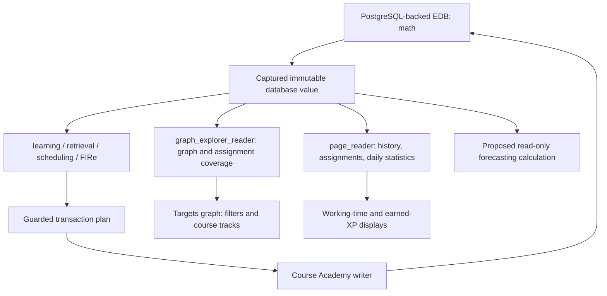

# Pace, workload growth, and completion forecasting: technical handoff

Prepared for ChatGPT Pro on 2026-10-21. Project: Course Academy. This is a research and design brief, with verified implementation details and a complete catalog of the domain schema declared in this repository. It is not an implemented forecasting feature or a calculated completion-date forecast.

## 1. The assignment for ChatGPT Pro

Develop a defensible way to estimate the learner's remaining workload, the rate at which that workload grows, the completion date at the learner's current pace, and the pace needed to be ready by a chosen future date. Report both overall and per-course results. The courses of interest are MTH 255 (Vector Calculus II), MTH 256 (Differential Equations), and MTH 341 (Linear Algebra).

The learner's first approximation is:

- Measure completed base XP and actual working time, including recent seven-day averages.
- Identify targeted, queued, and prerequisite topics per course; estimate the remaining lesson XP.
- Add assessment and review overhead. A preliminary assessment approximation was one quiz per 150 XP of progress, costing roughly 15 XP.
- Estimate average weekly additions of targets, queue topics, and prerequisites, including their XP, then express growth per day.
- Compare capacity with growing demand rather than dividing today's backlog by today's pace and assuming the backlog is fixed.

These are starting ideas, not requirements for a particular formula. Evaluate their assumptions and recommend improvements. The implementation facts below constrain what can be measured; the modeling suggestions are options to assess.

### Clarifications from the learner

**Estimate average weekly growth using observations only up to the current date.** Future weeks are not observations and must not enter the historical average or its denominator. Specify the observation window, its actual coverage, and how the current partial week is handled. Forecast future arrivals from that historical estimate, with uncertainty.

**Use the same filters and topic-selection rules as the Targets graph.** In particular:

- Targets and queue topics are the roots.
- Expand prerequisites upstream to depth 2, with roots at distance 0.
- Exclude displayed layers L29 and below; retain L30 and above.
- Use the graph's course filters, queue switch, assignment-week filtering, special handling of unassigned targets, and course-track placement rules.
- Apply equivalent scope rules to historical observations, not just today's workload. Do not estimate growth from an unfiltered topic list and compare it with a filtered backlog.

The graph includes studied topics. Scope membership and remaining work therefore need separate definitions: identify the graph-matching set first, then account for completed learning and partially completed attempts within it. Explain any difference between the visible topic count and the number of lessons still needed.

No deadline, required confidence level, or future daily time budget has been supplied. Treat these as inputs. Do not invent them.

## 2. What is established, and what still needs measurement

| Category | Status in this handoff |
|---|---|
| Domain attributes, enums, validation specifications | Cataloged from repository schema files in Appendix A |
| Current graph selection and course placement | Traced in the actual UI implementation; algorithms described below |
| XP, working time, lesson stopping, quiz cadence, FIRe state | Traced in Rust engine and application code |
| Current graph inventory and assignment coverage | Read-only database snapshot at basis **5382**; census in Appendix B |
| Actual recent base-XP throughput and its uncertainty | Not calculated here; extraction contract provided |
| Historical filtered weekly additions and growth | Not calculated here; requires historical membership/graph/assignment observations |
| Remaining lesson XP, future reviews, completion date | Not calculated here |
| Full installed database schema, including retired legacy definitions | Not independently enumerated here; Appendix A covers all current domain declarations in source |

Source comments and older README statistics describe earlier migrations. They are not current database counts. Runtime code takes precedence where an older description differs. The audit snapshot is a point in time, not a promise that the database will remain at that basis.

## 3. Database and application architecture

The active local logical EDB database is `math`, backed by PostgreSQL under `/media/jake/SSD/EDB/math`. The application normally connects through the Unix socket directory `/tmp/edb-math`, PostgreSQL port `55432`, role `edb_peer`. Writes go through the pinned Course Academy writer at `/tmp/edb-math/writer.sock`. Environment variables can override these defaults. Older `course-academy` and `course-academy-v2` references in migration documents are historical; do not query them as though they were today's active dataset.

EDB is the Rust temporal fact database used by this project, not EnterpriseDB PostgreSQL. PostgreSQL is its storage backend. Domain access uses EDB datoms, identities, Datalog, Pull, immutable database values, and transaction history.



An EDB fact is conceptually `(entity, attribute, value, transaction, source, added-or-retracted)`. Numeric `:db/id` values are entity IDs within the database. Stable domain identities such as `:topic/id` and `:activity/id` are UUIDs; `:learner/id` and `:progress/id` are strings. Math Academy IDs are separate optional external identifiers. Match entities across exports by stable identity, and retain database lineage/basis when using numeric IDs.

Capture one database value and one explicit forecast clock for related calculations. Retained history permits as-of reconstruction and inspection of additions/retractions. A plain `since` view is not a complete event stream: retracted facts can disappear from it. Use history or the transaction log for arrival/removal analysis. Logical transaction order and event time must both be retained; multiple transactions can share a wall-clock instant.

The engine is the Rust library `course-academy-engine`, exposed by the `fire` binary and embedded application helpers. The live app uses the generic activity/step/task/item model. Older type-specific runtime interfaces remain for replay and diagnostic tooling; they are not the best starting point for a new app forecast.

Forecasting should read or clone state. Live task preparation and completion can write activities, reservations, clocks, XP, and FIRe progress. Do not start tasks or refresh a mutating scheduler merely to count hypothetical work. Native transaction plans use explicit sources, request keys, basis guards, and idempotent retries; simulation must not submit those plans.

## 4. The entity relationships that determine workload

```text
course-group --courses--> course --units--> unit --modules--> module --topics--> topic
topic --next--> dependent topic                     [prerequisite -> dependent]
topic --knowledge-points--> KP
topic --encompasses--> owned coverage record --topic/weight--> component topic
KP --canonical-example--> question
KP --questions--> ordinary question pool
KP --key-prerequisites--> topics                    [targeted repair, separate graph]
KP --question-generator--> generator script

activity --type/course/due/scope--> definition metadata
activity --steps/first-step--> step --content--> tutorial / KP / question /
                                                 multistep / assigned-problem
step --next--> sibling step
multistep --steps/first-step--> nested steps
assigned-problem --content--> question or multistep
assigned-problem --topic-coverage--> mapped topics

learner --targets/queue--> shared topics
learner --assignments--> shared assignment activities
learner --knowledge-profile--> owned progress --topic--> shared topic
learner --performance--> owned overall accuracy record
learner --activity--> learner-task --activity--> shared activity definition
learner-task --items--> owned presentation items --content/responses--> content/answers
learner-task --retake-of/remediation-for--> originating learner-task
progress --policy--> FIRe policy --question-selection-weights--> owned weight records
```

Collection membership is generally unordered. Authored lesson order comes from `activity/first-step` and `step/next`; presentation order comes from `task-item/next`. Course/unit/module navigation links do not create topic readiness requirements.

There are three distinct relationship systems:

1. `topic/next`: prerequisite DAG, used for global layers and prerequisite expansion.
2. `topic/encompasses`: weighted implicit practice coverage, used by FIRe; it can reduce review demand without finishing another lesson.
3. Assignment coverage and curriculum membership: course/deadline associations, used for filtering, prioritization, and track placement.

A course is not an owner of its topics. A topic, a lesson, and learner progress can be shared across courses. Summing independently expanded course workloads without deduplication can count the same physical learning work several times.

## 5. Exact Targets graph scope

Authoritative implementation: `ui/Math-Academy-Graph-Explorer.html`, especially `installSnapshot`, `targetTopicVisible`, `courseFilteredTargetIds`, `unassignedTargetIds`, `targetIdsForWeek`, `buildActiveSet`, and `targetCourseBands`; calendar helpers are in `ui/target-weeks.js`.

### Layers and prerequisite depth

Compute global layers on the **full** `topic/next` DAG. Internally roots have layer 0 and each node receives the longest incoming-path rank. Displayed layer is internal rank plus one. The cutoff is therefore `node.layer >= 29`, meaning displayed L30 or higher. Do not recompute layers after hiding low-layer topics, course filtering, or selecting a week. A cycle is a data error.

Retain eligible roots first. Breadth-first expansion follows incoming prerequisite edges only, using the shortest distance from any selected root. A topic appears once even when several roots or paths reach it. At depth 2, include distances 0, 1, and 2. The graph skips excluded low-layer prerequisites during expansion. It does not expand into dependents or siblings. Edges displayed afterward are the original prerequisite edges whose endpoints both remain visible.

### Course, queue, and week rules

- The course switches are MTH 255, MTH 256, MTH 341, in that order. Their membership projection combines `course/units -> unit/modules -> module/topics` with assignment-covered target topics.
- With all three switches enabled, all saved targets with valid topic entities are considered, subject to the layer cutoff. With a subset enabled, course-associated targets must match an enabled course.
- A saved target with **no membership in any curriculum and no assignment coverage** remains visible across course and week filters. Classification uses all known courses and all linked assignment coverage, not merely enabled courses or assignments with valid due dates.
- Queue is an independent source. When its switch is on, retained queued topics bypass course and assignment-week filters. Queue membership itself is not changed by a visibility switch.
- Weeks run Sunday–Saturday in `America/Los_Angeles`. `All`, `Unscheduled`, or a selected week/range filters associated targets by assignment due dates. `Unscheduled` means no valid dated assignment in the calendar; it is broader than “no course association.”
- A topic can be targeted and queued; the graph deduplicates it. Due-target and queue readouts are separate category counts and can overlap.
- Prerequisite expansion is performed on the resulting roots. A course filter is not a second filter that removes supporting prerequisites belonging to another course.

Browser preferences store enabled courses, Queue visibility, week selection, and split layout in local storage, not EDB. A forecast request must carry a scope descriptor. The audit census below uses an explicit reproducible descriptor—All courses, Queue on, All weeks, depth 2, displayed L30+—and does not claim to have read the learner's current browser preferences.

```json
{
  "courses": ["MTH 255", "MTH 256", "MTH 341"],
  "includeQueue": true,
  "weekSelection": {"kind": "all"},
  "prerequisiteDepth": 2,
  "minimumDisplayedLayer": 30,
  "courseAssignmentPolicy": "current-targetCourseBands",
  "historicalGrowthThrough": "forecast clock, never future observations"
}
```

An exact chosen week range can deliberately suppress most assignment workload. Show that selection in any result. For a report intended to describe all three courses' workload, All weeks is the explicit census setting rather than an unnoticed browser setting. Pro should preserve the requested filter behavior and state how historical week selections are interpreted.

### Course-track placement

Split layout currently has only the three course tracks. There is no Shared or Other track. Placement is a reporting/layout allocation, not a mutation of course membership or a scheduler restriction.

The current algorithm is:

1. Build direct associations from each of the three courses' curriculum topics, assignment-covered target topics, and linked assignments' coverage. A topic with exactly one such course is anchored to it.
2. Compute undirected shortest-edge distances over the full prerequisite graph from the fixed anchors for each course. Traversing either direction is for course placement only; prerequisite expansion still follows incoming edges only.
3. Collect all unique saved target/queue topics at L30+. Their count determines workload for tie-breaking, including saved roots hidden by a course/week/Queue visibility filter. Topics in both lists count once. Prerequisite-only topics do not increase these counts.
4. Count directly anchored roots, then place roots with a unique nearest eligible course. Shared topics restrict their candidates to their directly associated courses; unassociated topics can use any of the three.
5. Place equally near or disconnected roots in numeric entity-ID order, choosing the least-loaded candidate track and incrementing its root count. Exact workload ties use track order: 255, 256, 341.
6. Recompute distances with placed roots also serving as anchors. Assign visible prerequisite-only topics by the same nearest-course/lightest-workload rule. They do not increment root workload counts. Thus expansion does not change existing placements; disconnected components with a placed root can have their prerequisites follow it.

The full graph, including hidden low layers, remains available for placement distance calculations. The L29 cutoff applies to displayed topics and counted root workload; it is not a deletion from the underlying graph.

Preserve this allocation for graph-matching per-course totals. Also retain each topic's full set of supported courses, roots, assignments, and deadlines. A single display track cannot represent every deadline obligation. In the audited data, “The Determinant of a 2x2 Matrix” (`:db/id 17592186049044`, topic UUID `d58eda6d-18a9-51fc-a2ae-3720429fd25b`) anchors to MTH 255 through **MTH 255 — OHW-8**, although it is one prerequisite edge from “Introduction to Matrices,” an MTH 341 anchor. A subject-matter guess must not silently replace the implemented association rule.

### Scope is not automatically remaining work

The graph does not remove topics merely because they are learned, already completed, or currently due for review. Course-track labels count visible topics, not unfinished lessons or XP. Separate at least:

- Selected graph scope and course allocation.
- Already learned/completed topics within that scope.
- Remaining first-learning lessons and any active partial lessons.
- Required relearning/remediation obligations.
- Ordinary review and assessment overhead.
- Missing or unusable lesson/question content.

## 6. The actual scheduler has a different planning boundary

The UI depth and layer cutoff are display rules. They have not been installed as engine-wide study restrictions. A forecast must reproduce the requested graph scope for its headline estimate, then disclose whether real scheduling can require additional work outside it.

In self-directed mode, Study combines explicit queue lessons, target preparation, ongoing work, and retrieval obligations. Only `learner/targets` initiates automatic target-prerequisite preparation. Queue and Study-now requests can request their specific lessons without normal prerequisite eligibility; they do not automatically request the queue topic's full prerequisite ancestry in the way targets do.

`learning::known_topic_ancestry` considers explicitly learned progress, positive repetitions on legacy records without a learned flag, and completed lesson/review evidence. It also treats ancestors of historically known topics as covered for preparation. This inference does not write mastery and does not cancel reviews. Target preparation expands unfinished ancestry without the graph's fixed depth-2 cap and stops at that known boundary.

`learning::progress_ready` is a separate retention/readiness test. Complete operational states must be learned and have decayed memory above the review threshold; partial legacy states can fall back to positive repetitions. A zero repetition value, learned=false, missing progress, and overdue learned knowledge are different states.

New lessons require appropriate authored content and fresh gradable practice supply. Explicit queue and new target-preparation lessons require five fresh usable questions per KP. An active lesson can defer a KP when supply runs short, continue other stages, and resume outstanding practice later. Supply shortages are blockers, not zero-cost work or proof of mastery.

Required assessment remediation takes precedence. Eligible required assessments narrow the plan after 150 cadence XP; ongoing tasks remain resumable. Ordinary reviews are optional, although they can dominate the recommendations. The UI shows only five activities. A bounded review-preparation pass does not enumerate the entire eventual review bill. After three finalized ordinary reviews since the last ordinary lesson offer, an optional lesson can be offered. Review diversity ordering uses graph distance among tied review candidates.

Target priority incorporates distinct supported targets, unfinished closure size, nearest target distance, and earliest linked assignment deadline. Completing an assignment does not automatically remove targets or their deadline context. Removing a target is explicit. Do not use queue position or the five visible cards as a remaining-work inventory.

## 7. XP accounting and time accounting

### Four quantities that must not be conflated

| Quantity | Meaning and source |
|---|---|
| Lesson base XP | Estimated content workload. Prefer the frozen attempt's `learner-task/xp-base` for that attempt; for new work use `base_xp::activity_base`. |
| Earned XP | Actual award, `learner-task/xp-earned`; can be negative or exceed base XP. This powers the current daily XP display and assessment cadence. |
| Measured working time | Sum of observed active presentation intervals, excluding pauses and post-submission processing waits. |
| FIRe speed | Accuracy-derived repetition-credit multiplier. It is not XP/hour or the learner's wall-clock reading/solving speed. |

A second distinction is essential: completed base XP of all attempts measures service effort, while remaining first-learning backlog falls only when needed learning is actually completed. A failed attempt, a repeated review, and a quiz consume time but do not each remove that much first-learning backlog. Pro should define both empirical throughput and successful acquisition throughput rather than silently equating them.

### Lesson base XP

For an activity with stored `activity/expected-seconds`, `activity_base` uses:

```text
base = max(1, floor(expected_seconds / 60 + 0.5))
```

Otherwise it calculates the lesson content estimate. The formula version is `lesson-content-expected-distribution-v1`. For normalized expected easy/moderate/hard probabilities `pe, pm, ph`:

```text
S = 0.7727506490727063 * solution_math_100 * (pe + 2*pm + 4*ph)
  + 0.07513004637186382 * reading_100
  + 0.001586056170966394 * question_steps
  + 0.034422123109798704 * example_steps
  + 2.7349018409710975 * question_math_100
  + 0.06047150091696244 * extra_fields
  + 0.5742034148595132 * blank_kp
  + 0.8708735238642493 * pm * kp_count
  + 2.041850919949942 * ph * kp_count

lesson_base = max(7, floor(topic_difficulty * S + 0.5))
estimated_seconds = 60 * lesson_base
```

Default expected lesson weights are 60/30/10. `topic/difficulty` is a positive content-workload multiplier, default 1.0. Neither learner outcomes nor individual question difficulty labels enter this lesson-content formula. Per-KP practice features use averages over the catalog pool, then aggregate over KPs; tutorial/canonical-example reading and example steps also contribute. Math-token counts use the implementation's Markdown/LaTeX parser, not arbitrary text length. For captured ordered evidence, a first-two-per-KP mode exists; catalog estimates use the whole unordered practice pool. A missing ordinary question solution can use its KP canonical solution as a proxy, which should be marked as estimate uncertainty.

Stored activity duration is the current authoritative/cache value. The attempt base is frozen on start. A changed lesson, difficulty multiplier, or content formula must not silently rewrite historical attempt bases. Do not derive an old base by dividing earned XP by a guessed bonus. Missing lesson definitions, ambiguous lesson choices, or missing bases require explicit handling.

### Earned-XP rules

Let `B` be base XP, `p = correct/total`, and `R(x) = floor(x + 0.5)`. Question occurrences are equally weighted; answer-field count and difficulty do not reweight accuracy. Instruction and canonical examples are excluded. The implementation uses exact rational arithmetic and rounds once.

| Activity | Final earned XP |
|---|---|
| Lesson | `p < .5`: -1; perfect: `R(1.25 B)`; otherwise `R(B * min(1, 1.5p - .30))` |
| Review | `p < .5`: -1; perfect: `B+2`; `p >= 2/3`: B; remaining band: final incorrect/skipped gives 0, final correct gives `R(Bp)` |
| Assessment/quiz | `p < .2`: -1; otherwise `max(0, R(1.2 B (p-.35)/.65))` |
| Multistep formula | `max(-1, R(B(2.25p-1)))`; distinguish this engine formula from whether a particular assignment player actually awards XP |

Assessment accuracy includes every assigned question in the denominator, including unanswered questions at expiry. That does not create fictitious answer or FIRe evidence. Diagnostics use separate placement rules. Historical observed/imported awards remain authoritative. A finished failed lesson/review can receive calculated XP; task outcome and learning credit are separate.

The school-assignment interaction path records responses, active time, and completion, but its current completion code does not itself add an XP award or grant topic mastery from coverage. Assignment coverage is a preparation/deadline relationship. External homework time can therefore be genuine study time without corresponding base/earned XP; keep it identifiable in speed estimates.

### Actual working time

`task-item/status` history supplies starts, pauses, resumes, and terminal transitions. `task-item/elapsed-seconds` is accumulated active time; `learner-task/elapsed-seconds` is its task-level aggregate. Do not sum both. The application allows at most one actively timed item per learner. Instructional reading can be real active time even when it produces no answer.

`task-item/working-ended-at` is the server-observed submission cutoff. It excludes admission/grading/database wait after submission even if the status commits later. Apply it when splitting daily intervals. Imported saved durations can exist without reconstructible start history; current lifetime duration may be known while its daily allocation is unknown. Do not allocate an import's entire duration to its import date, or add imported checkpoints and reconstructed intervals twice.

`learner-task/finished-at` preserves an original migrated completion/failure date when recovered. Otherwise terminal status history supplies the date. Tasks recorded only at import with no recovered original date can contribute to lifetime XP but are deliberately excluded from dated XP in `study_stats`. Missing values are not zeros. An unfinished attempt has no finalized award even though its working time is real.

### Recent speed estimates

Provide clearly named quantities such as:

```text
working_minutes_per_calendar_day = sum(observed active seconds) / 60 / days
completed_base_xp_per_day         = sum(valid finished-attempt bases) / days
completed_base_xp_per_work_hour   = matched completed bases / matched active hours
successful_acquisition_xp_per_day = newly completed needed lesson base / days
earned_xp_per_day                = sum(final awards) / days
```

Define whether failed attempts enter completed-base throughput; report outcomes separately. Match the numerator and denominator cohorts. If service includes review/quiz time, include their service work too; if estimating lesson-only productivity, exclude unrelated time from that denominator and add review/quiz time separately to the forecast. Do not deduct overhead twice.

A seven-calendar-day window should include genuine zero-study days. Seven completed local dates avoids a partially elapsed today; a trailing seven-date view including today needs elapsed exposure or an explicit partial-day label. Report the choice and compare longer windows when available. Ratios of totals and averages of daily ratios answer different questions. For historical date splits use local civil midnights; DST days can have 23 or 25 hours.

The existing `/api/study-stats?dayStarts=...` accepts eight consecutive local boundaries and returns seven days of **earned** XP, working seconds, and finished activity counts. It does not provide daily base XP. `ui/study-stats.js` renders a rolling seven-day set in fixed Mon–Sun positions, while its separate “This week” number remains current Monday–today. Neither the bar positions nor the calendar-week number is a ready-made seven-day base-XP speed estimate.

## 8. Reviews, quizzes, failures, and retention overhead

### Lesson and review stopping

Each lesson KP advances after two consecutive correct answers, fails the lesson after two consecutive incorrect/skipped answers, or advances after five presentations without either streak. Fresh-supply exhaustion can defer practice instead of completing it. Reviews pass after three consecutive correct answers and fail at five presentations without that streak. These adaptive stopping rules make duration and attempt count variable.

Failed lessons can create retry delays and targeted repairs. Repeated failure at the same KP can escalate to that KP's key prerequisite topics. Assessment misses create review obligations; failed remediation reviews can require relearning. Retakes are linked to the exact original task and remain optional after required repairs. Count this work by obligation and attempt provenance rather than creating one extra review for every incoming graph edge.

### Assessment cadence is global and uses earned practice XP

`scheduling::lifecycle` reconstructs cadence from finalized lesson/review/assignment awards. An ordinary assessment completion or expiry resets its running practice-XP total; retakes do not reset it the same way. Assessment awards themselves are not added as ordinary practice XP in this counter. Negative awards and overshoot affect cadence.

An ordinary assessment becomes available at 120 practice XP and required at 150 **when eligible**. It also needs at least five distinct never-assessed topics that are explicitly learned, have recorded successful learning at least 48 hours earlier, and each have a fresh rated usable question. Without that supply, learning can continue beyond 150 XP. Assessment selection is learner-wide, not independently per course; new ordinary assessment definitions omit `activity/course`.

Assessment assembly selects one question per topic, mixes new and previously assessed topics, and uses a maximum 15-minute wall-clock budget. Provisional question estimates are 60/120/180 seconds for easy/moderate/hard. Actual assembled expected duration determines base XP through `duration_base`; it need not be exactly 15. Perfect earned XP is `R(1.2B)`, not B. The wall-clock limit keeps running during pauses and is distinct from active working time.

Thus `course_lesson_XP / 150 * 15` can be a rough labeled sensitivity case, but it is not the implemented mechanism. It uses base XP in a counter driven by earned XP, treats a global cadence as separate course cadences, ignores current counter position/eligibility/overshoot, and assumes a fixed quiz cost. If quiz burden is attributed to courses, allocate one global quiz across its sampled topics or another explicit accounting rule; do not instantiate three copies of it.

### FIRe state and future review demand

Each learner/topic progress record may contain repetitions `r`, memory `m`, anchor time `a`, interval `I`, separate assessment/practice accuracies and evidence masses, learned status, last direct practice, and policy. Missing/legacy partial records do not support every calculation. Repetitions are fractional model state, not an integer count of remaining reviews. Memory is not a calibrated probability.

In units of days, the current model uses:

```text
memory(t) = m * 2^(-(t-a)/I)
due when learned and memory(t) <= threshold
next_due = a                              if m <= threshold
           a + I*log2(m/threshold)        otherwise

I(r) = min(maximum_interval, base_interval * interval_growth^r)
effective_accuracy = (assessment_accuracy + practice_accuracy)/2
FIRe_speed = clamp((effective_accuracy/prior_accuracy)^speed_exponent,
                   minimum_speed, maximum_speed)
early_discount = clamp((restored_memory-memory_now) /
                       (restored_memory-threshold), 0, 1)^discount_power
```

Do not confuse FIRe_speed with measured time efficiency. Successful practice can credit encompassed component topics, using weighted graph coverage and early-practice discount; the runtime can gate positive implicit credit when that topic's FIRe speed is below one. Failures can reduce repetitions, with stronger penalties when overdue. Accuracy and retention are updated through separate paths, so one observed answer must not be replayed twice.

Under the usual decay-before-add policy, the core update uses signed quality × coverage × discount for retention credit, adjusts repetitions using FIRe speed and a failure multiplier, and recalculates interval when appropriate. Initial successful learning establishes a retention anchor. A completed failed direct review also gets a small memory refresh: runtime `failed_review_refresh_fraction = 0.01` by default, with no corresponding declared EDB attribute. With seeded parameters, repeat demand can return in minutes after failures. Persisted policy values must be exported; seeded defaults are not proof of live settings.

Reviews are learner-wide. `retrieval::due_topics` needs explicitly learned, complete retention state and checks decayed memory. New review preparation requires five fresh usable questions across the topic. A new ordinary review has expected working duration 270 seconds; duration-to-base rounding gives base 5, so a perfect review awards 7 under current XP rules. This is a provisional duration model, not measured duration.

Do not count only reviews due today or only the first due date per topic. During a forecast horizon, existing topics decay again, newly learned topics become reviewable, and reviews/lessons/assessments can postpone future due dates through direct or implicit credit. Some due reviews will not surface immediately, and the learner may skip optional recommendations. Report a review-adherence assumption and distinguish due, prepared, recommended, and actually completed reviews. Required remediation needs separate treatment.

## 9. Historical weekly growth using the same scope

The primary requested estimate is **average weekly growth observed through the forecast cutoff**, per course, in both topic counts and base-XP workload. Historical additions of prerequisites are derived changes in the scoped graph, not a separate `learner/prerequisites` collection.

### Reconstruct observations rather than dividing today's count by elapsed weeks

For each historical observation, capture or reconstruct the learner's targets/queue, linked assignments and their coverage, curriculum associations, prerequisite graph, lesson estimates, and available progress at that point. Apply the same scope descriptor, depth, L30 cutoff, and track policy. Preserve enough history to distinguish additions, removals, completions, mapping edits, and changes in workload estimates.

For scoped set `S(t)`, use set differences between observations. For remaining-work set `U(t)`, remove completed acquisition only under an explicit mastery/completion rule. “Target added” does not necessarily mean “new physical lesson required”: the topic might already be queued, already in the depth-2 closure, already learned, below the cutoff, or covered by another assignment. A new root can also bring several additional prerequisites.

Keep explanatory source categories (target, queue, prerequisite-only), but deduplicate the total. A prerequisite becoming a target is a category transition, not a new lesson. Use an explicit precedence or marginal-allocation convention if additive category totals are wanted. Keep gross additions, gross removals, and net backlog change separate. Net backlog decline is not the arrival rate, because it includes learning service.

Per-course placement can shift after additions because the algorithm balances root counts. Such a move is a transfer between tracks, not a new global topic. Separate true global arrivals from per-course reassignment; otherwise one course appears to grow while another magically finishes. Overall physical workload must remain invariant under a pure allocation change.

### Dates, windows, and bulk imports

EDB membership history supplies the time a target/queue assertion was recorded; there is no dedicated target-added-at, queue-added-at, academic release date, or prerequisite-added-at attribute in the current domain schema. Assignment due date is a deadline, not a release or import timestamp. Original completion dates can also differ from their transaction dates.

Choose and name the historical clock being estimated. Operational list-growth uses actual membership assertions and reconstructed scoped additions through now. An academic-demand arrival estimate may need assignment release evidence or, if unavailable, a clearly labeled due-week proxy using only elapsed weeks. They are different measurements. Do not silently switch clocks to obtain a more attractive growth rate.

The importers can add coverage targets for newly linked assignments in one transaction. Re-importing an existing assignment should preserve explicit target removals rather than restoring them. A one-day batch may represent weeks of academic workload. Identify migration/import bursts and report how much they affect the average; do not quietly discard genuine demand or infer a steady weekly rate from the initial population transaction alone.

For a fully observed window of `d` calendar days through now:

```text
average_weekly_arrival_base_XP = 7 * sum(marginal_new_scoped_base_XP) / d
average_daily_arrival_base_XP  = average_weekly_arrival_base_XP / 7
```

Equivalent means over complete seven-day bins are possible. Include observed zero-growth weeks. Do not treat unobserved pre-import weeks as known zeros. Normalize or separately display the partial current week; do not average it as a complete week. Consider uncertainty, nonstationarity, limited sample size, and sensitivity to the start date. Use only information available at each historical cutoff when backtesting.

### Work already loaded for future deadlines

Assignments due in the future can already have contributed targets to today's selected backlog. They stay in the current All-weeks scope because that is how the graph works. Do not add the same known topics again when forecasting future arrivals. The historical average must still stop at now; future due weeks do not become historical observations merely because their definitions were pre-imported.

At audited basis 5382, all mapped topics of the linked assignments are already targets. MTH 255 has preloaded assignments extending into December, whereas the linked MTH 256/MTH 341 schedules end in October. This is incomplete/uneven **known schedule coverage**, not evidence of different long-run academic growth. An unlinked or unmapped assignment is not zero work.

The forecast should explain how it avoids applying a historical growth rate on top of future work already included in `W0`. Possible decompositions are current known commitments versus still-unseen incremental demand, with separate sensitivity cases. Pro should choose the accounting convention and show that every physical topic's first-learning workload enters once.

## 10. Forecast structures to evaluate

Start with an auditable baseline before choosing a more elaborate model. A deterministic calculation with visible assumptions can expose unit errors and data gaps; an event simulation can then account for endogenous reviews, eligibility, and failures. These are alternatives to evaluate, not a required architecture.

### Fixed-backlog and growing-backlog baselines

For compatible workload units and a stationary approximation:

```text
fixed backlog:  T = W0 / service_rate
growing backlog: T = W0 / (service_rate - arrival_rate), if service_rate > arrival_rate
required service by horizon H: approximately W0/H + arrival_rate
```

These formulas require careful definition of service. If W0 contains only first-learning lessons, service must be successful first-learning progress after overhead. If work units include all anticipated review/quiz/retry effort, use matching total service capacity. Do not add overhead to W0 and then subtract it from capacity again. Known future arrivals should not also be hidden in W0.

If capacity does not exceed ongoing demand under the assumed regime, report no finite catch-up time under that regime rather than clipping the denominator to a small positive number. A semester ends, courses saturate, topic overlaps increase, and demand need not grow linearly forever; show the horizon over which a constant historical growth approximation is credible.

### Deadline readiness

Finishing every current selected topic, catching up with a growing stream, meeting each assignment deadline, and retaining material for an exam are different goals. Define which completion event the date represents. A single portfolio average can conceal missing an early deadline in one course.

Translate work into hours using observed productivity and daily study availability. Allow weekday variation, no-study days, and course/activity-specific speed when data supports it. A target date can require both more study time and a different allocation among courses. The graph's lightest-track rule is a display allocation, not a due-date-optimal schedule.

### Event simulation and uncertainty

A candidate simulation would clone a captured engine state and advance through study sessions, task outcomes, new filtered workload arrivals, assessment eligibility times, deadlines, and memory decay. It should account for:

- Active partial tasks and stochastic remaining duration.
- Successful acquisition, failed attempts, retry gates, repairs, optional retakes.
- A single global quiz cadence and its current counter state.
- Repeated review arrivals and implicit review compression through encompassing coverage.
- Fresh-question shortages and content-generation latency.
- Unseen target/queue arrivals sampled from historical growth through now, with overlap and finite curriculum limits.
- Extra engine-required work outside the graph's depth/layer reporting scope.

Outcome probabilities need empirical calibration. Do not interpret `progress/memory` as a recall probability or the FIRe speed multiplier as a solve-time multiplier. State independence assumptions if using simple streak models. Without enough data, expose ranges rather than an unjustified precise distribution.

Useful outputs include a central completion estimate, a plausible range or calibrated quantiles, probability of meeting a deadline, and the daily minutes/base-XP acquisition needed for a selected confidence target. Backtest on historical cutoffs using only then-available data; compare a simple baseline against any sophisticated model before claiming an improvement.

## 11. Data extraction contract for a numerical forecast

The graph endpoint alone is insufficient: it exposes topology, membership, assignment coverage, repetitions, and learned flags, but not all attempt timing, frozen bases, retention fields, or history needed below. The brief contains schema/algorithm context and a census; a real numerical forecast still needs the measurements in this contract.

| Dataset | Required fields or evidence |
|---|---|
| Manifest | Capture UTC time and local timezone, database/lineage, basis T, code/formula/policy versions, learner identity, scope descriptor, historical window, requested deadline |
| Graph | Every topic stable ID/EID/title, every direct `topic/next` edge, full-graph layer, encompassing edges/weights, KP key prerequisites |
| Associations | Complete course membership, linked assignment identities/courses/deadlines, nested assigned-problem coverage, mapping gaps |
| Membership history | Target/queue/assignment additions and retractions with logical T, tx instant, source, and original academic dates where actually known |
| Lesson catalog | Topic-to-lesson identity, current expected seconds/base estimate, formula/multiplier provenance, alternate/missing lessons and shortages |
| Attempts | Owned task identity, activity/type/scope/course, status history, original completion if available, base/earned XP, elapsed time, retake/remediation links |
| Presentation history | Item identity/content/status transitions, measured intervals, working-ended-at, saved duration provenance, deferred/resumed KP stages, question outcomes |
| Knowledge | Full per-topic progress state and policy ref, partial-record flags, historical completions, current repairs/retakes and assessment history |
| Policy and supply | Actual persisted policy and difficulty weights, runtime-only defaults, fresh usable question counts, active reservations, relevant generator-blocking state |
| Derived observations | Daily matched time/base/earned XP; periodic filtered graph scopes; first-learning completions; deduplicated marginal additions; track-transfer ledger |

Do not require full question prose, answer text, or generator source just to summarize pace. Those become relevant only when recalculating uncached lesson bases, verifying usable supply, or inspecting content blockers. This is a learner-owned projection; question-bank scans should be avoided where indexed entity/ref queries suffice.

### Existing useful read paths

- `/api/graph-explorer`: `scripts/graph_explorer_reader.rs`. Builds graph membership and linked assignment coverage against one captured basis; curriculum and assigned coverage are distinct projections.
- `/api/activity` and `?beforeTaskId=...`: `scripts/activity_history.rs`. Finished attempt history, paginated 40 at a time, includes base XP, earned XP, status, dates, duration, and recorded-only flags. Fetch every page before claiming a complete history. A task-detail request can include presentations.
- `/api/study-stats?dayStarts=...`: earned XP and active-time daily splits. Extend or reproduce its ownership/timing logic for base XP; do not relabel earned XP as base XP.
- `/api/assignments` and `/api/assignment?assignment=...`: assignment definitions, mapped coverage, and learner task context. Definition presence is not task completion or measured effort.
- Native EDB read helpers and `EntitySnapshot`: required for exact history, policy, retention, scope reconstruction, and complete projections beyond these page endpoints.

The local app's configured native reader can be run read-only using `build_reader` and `database_environment` in `scripts/serve_graph_explorer.py`. The standalone graph reader takes `DATABASE LEARNER_ID`. Use the existing configured peer/CLI; do not introduce a guessed SQL schema or another database implementation.

### EDB query examples and pitfalls

These are templates for an engineer with access to the database, not executed numerical results. Bind the learner ID separately. Prefer explicit Pull fields and unlimited many-valued selectors where a complete export is necessary: default Pull collections can truncate at 1,000 values.

```clojure
;; Current root memberships. The references do not contain added-at timestamps.
[:find (pull ?l [:db/id :learner/id :learner/self-directed
                [:learner/targets :limit nil]
                [:learner/queue :limit nil]
                [:learner/assignments :limit nil]])
 :in $ ?learner-id
 :where [?l :learner/id ?learner-id]]

;; Lesson definition metadata; missing expected seconds must remain missing.
[:find ?topic ?activity ?type
 :where [?activity :activity/type ?type]
        [?type :db/ident :activity.type/lesson]
        [?activity :activity/scope ?topic]]

;; Example history query: bind $history to the captured value's history view.
;; Numeric learner entity input avoids dependence on an identity in a since view.
[:find ?topic ?tx ?source ?added ?instant
 :in $history ?learner-eid
 :where [$history ?learner-eid :learner/targets ?topic ?tx ?source ?added]
        [$history ?tx :db/txInstant ?instant]]
```

Run a separate queue-history query or use a correctly bound union; never infer prerequisite additions from a nonexistent stored prerequisites list. Reconstruct history at transaction boundaries and deduplicate actual membership transitions. Repeated source assertions do not necessarily mean the learner added the topic again. Current entity IDs in a foreign backup or migrated database may not identify the same logical topic.

EDB as-of reads and history are distinct: Pull requires a point-in-time value, while history exposes events. Use logical T for exact boundaries; transaction IDs and T are not interchangeable. Retained history after migration may begin with a bulk current-state import. Source, original time, recorded time, and data completeness must travel with every historical metric.

## 12. What the current schema does not directly store

There is no durable forecast, estimated completion date, daily base-XP counter, target creation date, queue creation date, per-course study-time total, academic release date, course-track allocation, or prerequisite-depth preference in the declared domain model. Some can be derived from retained facts/history; others need explicit product inputs or optional future instrumentation.

Useful additions to consider only if evidence is insufficient include versioned forecast snapshots, a derived daily work ledger, provenance-aware workload arrival records, explicit original release dates, a consistent course-attribution ledger, estimate quality flags, and measured content-generation wait. These are proposals, not existing fields or changes made for this handoff. Prefer derived projections when retained EDB history already supplies the needed information.

## 13. Questions and deliverables requested from Pro

Please provide a recommendation that addresses:

1. The precise meaning of readiness/completion and the matching units of demand and capacity.
2. A reproducible graph-matching scope and remaining-work definition, including learned/legacy/partial/blocked topics.
3. Historical weekly growth through now using those filters, with gross/net/category/track-transfer accounting and a justified observation window.
4. Time and base-XP speed estimators, handling current partial days, failures, mixed activity types, imports, missing data, and uncertainty.
5. An assessment/review/remediation overhead model grounded in the actual engine rather than assuming every 150 base XP causes an independent 15-XP course quiz.
6. A treatment of already-loaded future commitments that avoids counting them again as future arrivals.
7. A simple baseline and, if justified, a more sophisticated model with concrete equations or pseudocode, input/output shapes, and calibration/backtesting plans.
8. Per-course and portfolio completion estimates, deadline feasibility, and required daily pace/time, with appropriate uncertainty and explanations of the main drivers.
9. A ranked list of missing evidence and the smallest useful implementation changes. Separate facts from assumptions, and essential measurements from optional refinement.

Validation should check: L29 excluded/L30 retained; depth 2 uses shortest upstream distance; roots/diamonds/target-queue overlap deduplicate; shared physical work is counted once; every topic has one track; reassignment is not growth; historical filters and versions are explicit; learned topics are not automatically charged a full new lesson; task/item time is not double-counted; import dates are not original study dates; mixed base/earned units are rejected; future weeks never enter historical averages; all observed zero-growth days/weeks are handled consistently; missing evidence is not zero; and a rate at or below demand does not yield a fictitious finite catch-up date.

## 14. Source map

Paths below are relative to the repository root. The report carries the schema and relevant algorithms so it remains useful when uploaded alone; these links are for verification or implementation in a repository-enabled environment.

| Source | What to inspect |
|---|---|
| [Schema index](schema/README.md), Appendix A | Current declared domain attributes; migration descriptions in the index are historical |
| [Targets graph](ui/Math-Academy-Graph-Explorer.html) | `installSnapshot`, `buildActiveSet`, layer cutoff, scope functions, `targetCourseBands`, initial depth |
| [Target calendar](ui/target-weeks.js) | Civil-day Sunday–Saturday assignment-week selection |
| [Graph reader](scripts/graph_explorer_reader.rs) | Full graph, curriculum, learned/repetition projection, nested assignment coverage |
| [Learning planner](engine/rust/learning.rs) | `topic_layers`, target/queue scope, known ancestry, eligibility, `PlannedActivity`, lesson credit |
| [Scheduling](engine/rust/scheduling.rs) | Lifecycle/cadence, repairs, retries, required/optional filtering, review diversity |
| [Retrieval](engine/rust/retrieval.rs) | Due reviews, ordinary assessment eligibility/definition, retakes, question/time estimates |
| [Assessment sampling](engine/rust/assessment_sampling.rs) | Global topic/question selection, duration budget, difficulty/KP preferences |
| [Inventory](engine/rust/inventory.rs) | Fresh question requirements, shortages, generator demand, assessment waiting reasons |
| [Base XP](engine/rust/base_xp.rs) | Formula, content features, cached expected seconds, frozen baseline semantics |
| [Earned XP and stopping](engine/rust/activities.rs) | Exact award formulas and adaptive terminal prefixes |
| [FIRe core](engine/rust/core.rs), [accuracy](engine/rust/calibration.rs) | Retention updates, encompassing propagation, accuracy channels, speed, review ranking |
| [Engine schema boundary](engine/rust/schema.rs) | `EntitySnapshot`, runtime hydration, time units, policy translation, guarded writeback |
| [Timing](engine/rust/timing.rs) | Active intervals, imported checkpoints, original finish dates, submission cutoffs |
| [Study statistics](scripts/study_stats.rs), [sidebar](ui/study-stats.js) | Daily earned-XP/time calculation and fixed-weekday rolling display |
| [Activity history](scripts/activity_history.rs), [page reader](scripts/page_reader.rs) | Learner-owned small read projections, history pagination, missing-time/base fields |
| [Learning API](scripts/learning_api.rs) | Queue preparation, task start/frozen base, player, exact-basis transactions |
| [Assignment reader](scripts/assignment_reader.rs), [interaction](scripts/assignment_interaction.rs) | Coverage versus response/timing/completion semantics |
| [Assignment import](scripts/import_school_assignments.py), [sync](scripts/sync_f26_assignments.py), [remaining import](scripts/prepare_remaining_f26_assignments.py) | Newly linked assignment targets, source provenance, deadlines, preservation of removed targets |
| [Engine overview](engine/rust/README.md), [app setup](README.md) | Operational orientation; confirm current details against runtime code |

