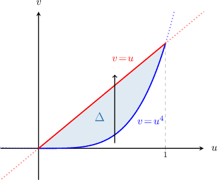
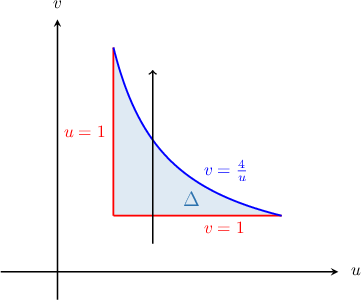
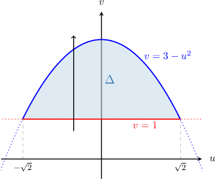
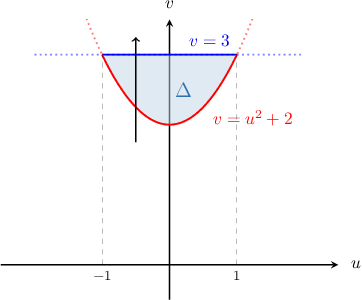
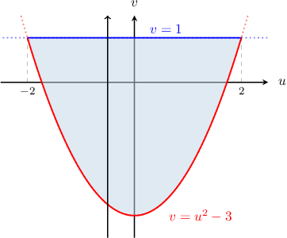
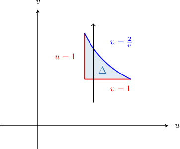

# Type I area generator review

Raw captured source evidence is in source.json. Raw profiles are ineligible, with omissions preserved.

## Original q-38374

Using the change of variables

$u = x - y, v = y$,
calculate the area of the finite region $D$ bounded by the curve $(x - y)^{2} - y = 0$ and the line $y = 1$.

Bank for field 0: \frac{2}{3}, 1, 2, \frac{4}{3}, \sqrt{2}; correct ref absent

Worked solution absent; difficulty and correct designation also absent.

### Generated authored method bank simple {'a': 4, 'h': 9, 'k': 0}

Using the change of variables 

$$
u=x - 4 y,\,v=y,
$$

calculate the area of the finite region $D$ bounded by the curve $(x - 4 y)^{2}-(y)=0$ and the line $y=9.$

- $54$
- $18$
- $36$
- $-36$
- $72$

The area of the required region is given by

$$
{∬}_{D}dxdy.
$$

Let's define a transformation $T$ as follows: 

$$
T:[\begin{aligned}u \\ v\end{aligned}]\to [\begin{aligned}x(u,v) \\ y(u,v)\end{aligned}]
$$

This transformation maps some region $Δ$ in the $uv$-plane to our region $D$ in the $xy$-plane.

To compute the required area, we will use the change of variables formula

$$
{∬}_{D}dxdy={∬}_{Δ}|\frac{∂(x,y)}{∂(u,v)}|\text{ }dudv
$$

where $\frac{∂(x,y)}{∂(u,v)}$ is the Jacobian determinant corresponding to $T.$  

Note that the changes of variables

$$
u=x - 4 y,\,v=y
$$

 

gives us the *inverse* function ${T}^{-1},$ that is

$$
{T}^{-1}:[\begin{aligned}x \\ y\end{aligned}]\to [\begin{aligned}u(x,y) \\ v(x,y)\end{aligned}].
$$

To compute the required area, we proceed in four steps:

**Step 1**: Find $Δ,$ which is the image of $D$ under the action of ${T}^{-1}.$

Substituting $x - 4 y=u$ and $y=v$ into the equation of the first curve, we get

$$
(x - 4 y)^{2}-(y)=0\,⟹\,u^{2}-v=0\,⟹\,v=u^{2}.
$$

while substituting $y=v$ into the equation of the second curve, we obtain

$$
v=9.
$$

To find the intersections of the curves in the $uv$-plane, we solve the following system:

$$
\begin{aligned}\left\{\begin{aligned}v=u^{2} \\ v=9\end{aligned}\right.\,⟹\,u=\pm 3\end{aligned}
$$

So, the intersection points are $(\pm 3,9).$

Therefore, our domain in the $uv$-plane has the type I representation

$$
Δ=\{(u,v)\,:\,-3\le u\le 3,\,u^{2}\le v\le 9\}.
$$

**Step 2**: Compute the Jacobian determinant corresponding to ${T}^{-1}:$

The Jacobian determinant corresponding to ${T}^{-1}$ is

$$
\begin{aligned}\frac{∂(u,v)}{∂(x,y)} & =\left|\begin{matrix}\frac{∂u}{∂x}&\frac{∂u}{∂y}\\\frac{∂v}{∂x}&\frac{∂v}{∂y}\end{matrix}\right| \\ &=\left|\begin{matrix}1&-4\\0&1\end{matrix}\right| \\ &=1\end{aligned}
$$

**Step 3**: Compute the Jacobian determinant corresponding to $T:$

The Jacobian determinant corresponding to $T$ is

$$
\frac{∂(x,y)}{∂(u,v)}={(\frac{∂(u,v)}{∂(x,y)})}^{-1}=(1)^{-1}=1.
$$

Note that $\frac{∂(x,y)}{∂(u,v)}\ne 0$ everywhere inside $Δ.$  In other words, $T$ has no critical points inside $Δ.$

**Step 4**: Compute the required area.

We calculate the required area by performing the change of variables:

$$
\begin{aligned}\iint_D dxdy &=\iint_Δ |\frac{∂(x,y)}{∂(u,v)}|\,dudv \\ &=\iint_Δ |1|\,dudv \\ &=1\int_{-3}^{3}[\int_{u^{2}}^{9}dv]du \\ &=1\int_{-3}^{3}[v]_{u^{2}}^{9}du \\ &=1\int_{-3}^{3}(9)-(u^{2})du \\ &=1\int_{-3}^{3}(9 - u^{2})du \\ &=1[- \frac{u^{3}}{3} + 9 u]_{-3}^{3} \\ &=1(((27)+(-9))-((-27)+(9))) \\ &=1(36) \\ &=36\end{aligned}
$$

### Generated authored method bank simple {'a': 5, 'h': 9, 'k': 0}

Using the change of variables 

$$
u=x - 5 y,\,v=y,
$$

calculate the area of the finite region $D$ bounded by the curve $(x - 5 y)^{2}-(y)=0$ and the line $y=9.$

- $72$
- $36$
- $54$
- $18$
- $-36$

The area of the required region is given by

$$
{∬}_{D}dxdy.
$$

Let's define a transformation $T$ as follows: 

$$
T:[\begin{aligned}u \\ v\end{aligned}]\to [\begin{aligned}x(u,v) \\ y(u,v)\end{aligned}]
$$

This transformation maps some region $Δ$ in the $uv$-plane to our region $D$ in the $xy$-plane.

To compute the required area, we will use the change of variables formula

$$
{∬}_{D}dxdy={∬}_{Δ}|\frac{∂(x,y)}{∂(u,v)}|\text{ }dudv
$$

where $\frac{∂(x,y)}{∂(u,v)}$ is the Jacobian determinant corresponding to $T.$  

Note that the changes of variables

$$
u=x - 5 y,\,v=y
$$

 

gives us the *inverse* function ${T}^{-1},$ that is

$$
{T}^{-1}:[\begin{aligned}x \\ y\end{aligned}]\to [\begin{aligned}u(x,y) \\ v(x,y)\end{aligned}].
$$

To compute the required area, we proceed in four steps:

**Step 1**: Find $Δ,$ which is the image of $D$ under the action of ${T}^{-1}.$

Substituting $x - 5 y=u$ and $y=v$ into the equation of the first curve, we get

$$
(x - 5 y)^{2}-(y)=0\,⟹\,u^{2}-v=0\,⟹\,v=u^{2}.
$$

while substituting $y=v$ into the equation of the second curve, we obtain

$$
v=9.
$$

To find the intersections of the curves in the $uv$-plane, we solve the following system:

$$
\begin{aligned}\left\{\begin{aligned}v=u^{2} \\ v=9\end{aligned}\right.\,⟹\,u=\pm 3\end{aligned}
$$

So, the intersection points are $(\pm 3,9).$

Therefore, our domain in the $uv$-plane has the type I representation

$$
Δ=\{(u,v)\,:\,-3\le u\le 3,\,u^{2}\le v\le 9\}.
$$

**Step 2**: Compute the Jacobian determinant corresponding to ${T}^{-1}:$

The Jacobian determinant corresponding to ${T}^{-1}$ is

$$
\begin{aligned}\frac{∂(u,v)}{∂(x,y)} & =\left|\begin{matrix}\frac{∂u}{∂x}&\frac{∂u}{∂y}\\\frac{∂v}{∂x}&\frac{∂v}{∂y}\end{matrix}\right| \\ &=\left|\begin{matrix}1&-5\\0&1\end{matrix}\right| \\ &=1\end{aligned}
$$

**Step 3**: Compute the Jacobian determinant corresponding to $T:$

The Jacobian determinant corresponding to $T$ is

$$
\frac{∂(x,y)}{∂(u,v)}={(\frac{∂(u,v)}{∂(x,y)})}^{-1}=(1)^{-1}=1.
$$

Note that $\frac{∂(x,y)}{∂(u,v)}\ne 0$ everywhere inside $Δ.$  In other words, $T$ has no critical points inside $Δ.$

**Step 4**: Compute the required area.

We calculate the required area by performing the change of variables:

$$
\begin{aligned}\iint_D dxdy &=\iint_Δ |\frac{∂(x,y)}{∂(u,v)}|\,dudv \\ &=\iint_Δ |1|\,dudv \\ &=1\int_{-3}^{3}[\int_{u^{2}}^{9}dv]du \\ &=1\int_{-3}^{3}[v]_{u^{2}}^{9}du \\ &=1\int_{-3}^{3}(9)-(u^{2})du \\ &=1\int_{-3}^{3}(9 - u^{2})du \\ &=1[- \frac{u^{3}}{3} + 9 u]_{-3}^{3} \\ &=1(((27)+(-9))-((-27)+(9))) \\ &=1(36) \\ &=36\end{aligned}
$$

## Original q-82874

Using the change of variables 

$$
u=x+y,\,v=x-y,
$$

calculate the area of the finite region $D$ bounded by the curve $(x+y)^{4}-x+y=0$ and  the line $y=0.$

Bank for field 0: \frac{1}{3}, \frac{1}{2}, \frac{1}{10}, \frac{3}{20}, \frac{2}{3}; correct ref absent
Bank for field 1: \frac{1}{10}, \frac{3}{20}, \frac{2}{3}, \frac{1}{2}, \frac{1}{3}; correct ref present

The area of the required region is given by

$$
{∬}_{D}dxdy.
$$

Let's define a transformation $T$ as follows: 

$$
T:[\begin{aligned}u \\ v\end{aligned}]\to [\begin{aligned}x(u,v) \\ y(u,v)\end{aligned}]
$$

This transformation maps some region $Δ$ in the $uv$-plane to our region $D$ in the $xy$-plane.

To compute the required area, we will use the change of variables formula

$$
{∬}_{D}dxdy={∬}_{Δ}|\frac{∂(x,y)}{∂(u,v)}|\text{ }dudv
$$

where $\frac{∂(x,y)}{∂(u,v)}$ is the Jacobian determinant corresponding to $T.$  

Note that the changes of variables

$$
u=x+y,\,v=x-y
$$

 

gives us the *inverse* function ${T}^{-1},$ that is

$$
{T}^{-1}:[\begin{aligned}x \\ y\end{aligned}]\to [\begin{aligned}u(x,y) \\ v(x,y)\end{aligned}].
$$

To compute the required area, we proceed in four steps:

**Step 1**: Find $Δ,$ which is the image of $D$ under the action of ${T}^{-1}.$ 

Substituting $x+y=u$ and $x-y=v$ into the equation of the first curve, we get

$$
\begin{aligned}(x+y)^{4}-x+y=0\,⟹\,(x+y)^{4}-(x-y)=0\,⟹\,v={u}^{4},\end{aligned}
$$

Now, 

$$
\begin{aligned}{\begin{aligned}x+y=u \\ x-y=v\end{aligned}\,⟹\,y=\frac{u-v}{2}.\end{aligned}
$$

Substituting this value into the equation of the given line yields:

$$
\begin{aligned}y=0\, & ⟹\,\frac{u-v}{2}=0\,⟹\,v=u\end{aligned}
$$

 

To find the intersections of the curves in the $uv$-plane, we solve the following system:

$$
\begin{aligned}{\begin{aligned}v={u}^{4} \\ v=u\end{aligned}\,⟹\,{\begin{aligned}{u}^{3}(u-1)=0 \\ v=u.\end{aligned}\end{aligned}
$$

 

So, the intersection points are $(0,0)$ and $(1,1).$

Therefore, our domain in the $uv$-plane has the type I representation

$$
Δ={(u,v)\,:\,0\le u\le 1,\,{u}^{4}\le v\le u}.
$$

 

**Step 2**: Compute the Jacobian determinant corresponding to ${T}^{-1}:$

The Jacobian determinant corresponding to ${T}^{-1}$ is

$$
\begin{aligned}\frac{∂(u,v)}{∂(x,y)} & =|\begin{aligned}\frac{∂u}{∂x} & \frac{∂u}{∂y} \\ \frac{∂v}{∂x} & \frac{∂v}{∂y}\end{aligned}| \\  & =|\begin{aligned}1 & 1 \\ 1 & -1\end{aligned}| \\  & =-2.\end{aligned}
$$

**Step 3**: Compute the Jacobian determinant corresponding to $T:$

The Jacobian determinant corresponding to $T$ is

$$
\frac{∂(x,y)}{∂(u,v)}={(\frac{∂(u,v)}{∂(x,y)})}^{-1}=(-2)^{-1}=-\frac{1}{2}.
$$

Note that $\frac{∂(x,y)}{∂(u,v)}\ne 0$ everywhere inside $Δ.$  In other words, $T$ has no critical points inside $Δ.$

**Step 4**: Compute the required area.

We calculate the required area by performing the change of variables:

$$
\begin{aligned}{∬}_{D}\text{d}x\text{d}y & ={∬}_{Δ}|\frac{∂(x,y)}{∂(u,v)}|\,\text{d}u\text{d}v \\  & ={∬}_{Δ}|-\frac{1}{2}|\,\text{d}u\text{d}v \\  & =\frac{1}{2}{\int }_{0}^{1}[{\int }_{{u}^{4}}^{u}\,dv]du \\  & =\frac{1}{2}{\int }_{0}^{1}[v]_{{u}^{4}}^{u}\,du \\  & =\frac{1}{2}{\int }_{0}^{1}(u-{u}^{4})du \\  & =\frac{1}{2}{[\frac{{u}^{2}}{2}-\frac{{u}^{5}}{5}]}_{0}^{1} \\  & =\frac{1}{2}(\frac{1}{2}-\frac{1}{5}) \\  & =\frac{1}{2}(\frac{3}{10}) \\  & =\frac{3}{20}\end{aligned}
$$

### Generated authored method bank quartic {'a': 4, 'h': 2, 'k': 0}

Using the change of variables 

$$
u=x + 4 y,\,v=x - 4 y,
$$

calculate the area of the finite region $D$ bounded by the curve $\frac{(x + 4 y)^{4}}{8}- x + 4 y=0$ and the line $y=0.$

- $\frac{1}{4}$
- $\frac{1}{10}$
- $\frac{3}{20}$
- $- \frac{3}{20}$
- $\frac{7}{20}$

The area of the required region is given by

$$
{∬}_{D}dxdy.
$$

Let's define a transformation $T$ as follows: 

$$
T:[\begin{aligned}u \\ v\end{aligned}]\to [\begin{aligned}x(u,v) \\ y(u,v)\end{aligned}]
$$

This transformation maps some region $Δ$ in the $uv$-plane to our region $D$ in the $xy$-plane.

To compute the required area, we will use the change of variables formula

$$
{∬}_{D}dxdy={∬}_{Δ}|\frac{∂(x,y)}{∂(u,v)}|\text{ }dudv
$$

where $\frac{∂(x,y)}{∂(u,v)}$ is the Jacobian determinant corresponding to $T.$  

Note that the changes of variables

$$
u=x + 4 y,\,v=x - 4 y
$$

 

gives us the *inverse* function ${T}^{-1},$ that is

$$
{T}^{-1}:[\begin{aligned}x \\ y\end{aligned}]\to [\begin{aligned}u(x,y) \\ v(x,y)\end{aligned}].
$$

To compute the required area, we proceed in four steps:

**Step 1**: Find $Δ,$ which is the image of $D$ under the action of ${T}^{-1}.$

Substituting $x + 4 y=u$ and $x - 4 y=v$ into the equation of the first curve, we get

$$
\frac{(x + 4 y)^{4}}{8}- x + 4 y=0\,⟹\,\frac{(x + 4 y)^{4}}{8}-(x - 4 y)=0\,⟹\,v=\frac{u^{4}}{8}.
$$

Now,

$$
\begin{aligned}\left\{\begin{aligned}x + 4 y=u \\ x - 4 y=v\end{aligned}\right.\,⟹\,y=\frac{u-v}{8}.\end{aligned}
$$

Substituting this value into the equation of the given line yields:

$$
y=0\,⟹\,\frac{u-v}{8}=0\,⟹\,v=u.
$$

To find the intersections of the curves in the $uv$-plane, we solve the following system:

$$
\begin{aligned}\left\{\begin{aligned}v=\frac{u^{4}}{8} \\ v=u\end{aligned}\right.\,⟹\,u(u^{3}-8)=0\end{aligned}
$$

So, the intersection points are $(0,0)$ and $(2,2).$

Therefore, our domain in the $uv$-plane has the type I representation

$$
Δ=\{(u,v)\,:\,0\le u\le 2,\,\frac{u^{4}}{8}\le v\le u\}.
$$

**Step 2**: Compute the Jacobian determinant corresponding to ${T}^{-1}:$

The Jacobian determinant corresponding to ${T}^{-1}$ is

$$
\begin{aligned}\frac{∂(u,v)}{∂(x,y)} & =\left|\begin{matrix}\frac{∂u}{∂x}&\frac{∂u}{∂y}\\\frac{∂v}{∂x}&\frac{∂v}{∂y}\end{matrix}\right| \\ &=\left|\begin{matrix}1&4\\1&-4\end{matrix}\right| \\ &=-8\end{aligned}
$$

**Step 3**: Compute the Jacobian determinant corresponding to $T:$

The Jacobian determinant corresponding to $T$ is

$$
\frac{∂(x,y)}{∂(u,v)}={(\frac{∂(u,v)}{∂(x,y)})}^{-1}=(-8)^{-1}=- \frac{1}{8}.
$$

Note that $\frac{∂(x,y)}{∂(u,v)}\ne 0$ everywhere inside $Δ.$  In other words, $T$ has no critical points inside $Δ.$

**Step 4**: Compute the required area.

We calculate the required area by performing the change of variables:

$$
\begin{aligned}\iint_D dxdy &=\iint_Δ |\frac{∂(x,y)}{∂(u,v)}|\,dudv \\ &=\iint_Δ |- \frac{1}{8}|\,dudv \\ &=\frac{1}{8}\int_{0}^{2}[\int_{\frac{u^{4}}{8}}^{u}dv]du \\ &=\frac{1}{8}\int_{0}^{2}[v]_{\frac{u^{4}}{8}}^{u}du \\ &=\frac{1}{8}\int_{0}^{2}(u)-(\frac{u^{4}}{8})du \\ &=\frac{1}{8}[- \frac{u^{5}}{40} + \frac{u^{2}}{2}]_{0}^{2} \\ &=\frac{1}{8}(((2)+(- \frac{4}{5}))-((0)+(0))) \\ &=\frac{1}{8}(\frac{6}{5}) \\ &=\frac{3}{20}\end{aligned}
$$

### Generated authored method bank quartic {'a': 5, 'h': 2, 'k': 0}

Using the change of variables 

$$
u=x + 5 y,\,v=x - 5 y,
$$

calculate the area of the finite region $D$ bounded by the curve $\frac{(x + 5 y)^{4}}{8}- x + 5 y=0$ and the line $y=0.$

- $\frac{7}{25}$
- $\frac{3}{25}$
- $\frac{1}{5}$
- $\frac{2}{25}$
- $- \frac{3}{25}$

The area of the required region is given by

$$
{∬}_{D}dxdy.
$$

Let's define a transformation $T$ as follows: 

$$
T:[\begin{aligned}u \\ v\end{aligned}]\to [\begin{aligned}x(u,v) \\ y(u,v)\end{aligned}]
$$

This transformation maps some region $Δ$ in the $uv$-plane to our region $D$ in the $xy$-plane.

To compute the required area, we will use the change of variables formula

$$
{∬}_{D}dxdy={∬}_{Δ}|\frac{∂(x,y)}{∂(u,v)}|\text{ }dudv
$$

where $\frac{∂(x,y)}{∂(u,v)}$ is the Jacobian determinant corresponding to $T.$  

Note that the changes of variables

$$
u=x + 5 y,\,v=x - 5 y
$$

 

gives us the *inverse* function ${T}^{-1},$ that is

$$
{T}^{-1}:[\begin{aligned}x \\ y\end{aligned}]\to [\begin{aligned}u(x,y) \\ v(x,y)\end{aligned}].
$$

To compute the required area, we proceed in four steps:

**Step 1**: Find $Δ,$ which is the image of $D$ under the action of ${T}^{-1}.$

Substituting $x + 5 y=u$ and $x - 5 y=v$ into the equation of the first curve, we get

$$
\frac{(x + 5 y)^{4}}{8}- x + 5 y=0\,⟹\,\frac{(x + 5 y)^{4}}{8}-(x - 5 y)=0\,⟹\,v=\frac{u^{4}}{8}.
$$

Now,

$$
\begin{aligned}\left\{\begin{aligned}x + 5 y=u \\ x - 5 y=v\end{aligned}\right.\,⟹\,y=\frac{u-v}{10}.\end{aligned}
$$

Substituting this value into the equation of the given line yields:

$$
y=0\,⟹\,\frac{u-v}{10}=0\,⟹\,v=u.
$$

To find the intersections of the curves in the $uv$-plane, we solve the following system:

$$
\begin{aligned}\left\{\begin{aligned}v=\frac{u^{4}}{8} \\ v=u\end{aligned}\right.\,⟹\,u(u^{3}-8)=0\end{aligned}
$$

So, the intersection points are $(0,0)$ and $(2,2).$

Therefore, our domain in the $uv$-plane has the type I representation

$$
Δ=\{(u,v)\,:\,0\le u\le 2,\,\frac{u^{4}}{8}\le v\le u\}.
$$

**Step 2**: Compute the Jacobian determinant corresponding to ${T}^{-1}:$

The Jacobian determinant corresponding to ${T}^{-1}$ is

$$
\begin{aligned}\frac{∂(u,v)}{∂(x,y)} & =\left|\begin{matrix}\frac{∂u}{∂x}&\frac{∂u}{∂y}\\\frac{∂v}{∂x}&\frac{∂v}{∂y}\end{matrix}\right| \\ &=\left|\begin{matrix}1&5\\1&-5\end{matrix}\right| \\ &=-10\end{aligned}
$$

**Step 3**: Compute the Jacobian determinant corresponding to $T:$

The Jacobian determinant corresponding to $T$ is

$$
\frac{∂(x,y)}{∂(u,v)}={(\frac{∂(u,v)}{∂(x,y)})}^{-1}=(-10)^{-1}=- \frac{1}{10}.
$$

Note that $\frac{∂(x,y)}{∂(u,v)}\ne 0$ everywhere inside $Δ.$  In other words, $T$ has no critical points inside $Δ.$

**Step 4**: Compute the required area.

We calculate the required area by performing the change of variables:

$$
\begin{aligned}\iint_D dxdy &=\iint_Δ |\frac{∂(x,y)}{∂(u,v)}|\,dudv \\ &=\iint_Δ |- \frac{1}{10}|\,dudv \\ &=\frac{1}{10}\int_{0}^{2}[\int_{\frac{u^{4}}{8}}^{u}dv]du \\ &=\frac{1}{10}\int_{0}^{2}[v]_{\frac{u^{4}}{8}}^{u}du \\ &=\frac{1}{10}\int_{0}^{2}(u)-(\frac{u^{4}}{8})du \\ &=\frac{1}{10}[- \frac{u^{5}}{40} + \frac{u^{2}}{2}]_{0}^{2} \\ &=\frac{1}{10}(((2)+(- \frac{4}{5}))-((0)+(0))) \\ &=\frac{1}{10}(\frac{6}{5}) \\ &=\frac{3}{25}\end{aligned}
$$

## Original q-160885

Using the change of variables 

$$
u=y+2x,\,v=y-2x,
$$

calculate the area of the finite region $D$ bounded by the lines $y+2x=1,$ $y-2x=1$ and the curve ${y}^{2}-4{x}^{2}=4.$

Bank for field 0: \operatorname{ln}⁡4-\frac{3}{2}, \operatorname{ln}⁡4-\frac{3}{4}, 2\operatorname{ln}⁡4-3, 4\operatorname{ln}⁡4-\frac{3}{4}, 2\operatorname{ln}⁡4-\frac{3}{2}; correct ref present

The area of the required region is given by

$$
{∬}_{D}dxdy.
$$

Let's define a transformation $T$ as follows: 

$$
T:[\begin{aligned}u \\ v\end{aligned}]\to [\begin{aligned}x(u,v) \\ y(u,v)\end{aligned}]
$$

This transformation maps some region $Δ$ in the $uv$-plane to our region $D$ in the $xy$-plane.

To compute the required area, we will use the change of variables formula

$$
{∬}_{D}dxdy={∬}_{Δ}|\frac{∂(x,y)}{∂(u,v)}|\text{ }dudv
$$

where $\frac{∂(x,y)}{∂(u,v)}$ is the Jacobian determinant corresponding to $T.$  

Note that the changes of variables

$$
u=y+2x,\,v=y-2x
$$

 

gives us the *inverse* function ${T}^{-1},$ that is

$$
{T}^{-1}:[\begin{aligned}x \\ y\end{aligned}]\to [\begin{aligned}u(x,y) \\ v(x,y)\end{aligned}].
$$

To compute the required area, we proceed in four steps:

**Step 1**: Find $Δ,$ which is the image of $D$ under the action of ${T}^{-1}.$ 

Substituting $y+2x=u$ into the equation of the first line, we get

$$
\begin{aligned}y+2x=1\,⟹\,u=1,\end{aligned}
$$

while substituting $y-2x=v$ into the equation of the second line, we obtain

$$
\begin{aligned}y-2x=1\,⟹\,v=1.\end{aligned}
$$

Substituting $u=y+2x$ and $v=y-2x$ into the equation of curve, we get

$$
\begin{aligned}{y}^{2}-4{x}^{2}=4\,⟹\,(y+2x)(y-2x)=4,\,⟹\,uv=4.\end{aligned}
$$

The intersection point of the two lines in the $uv$-plane is $(1,1).$

To find the intersection of the curve with the first line in the $uv$-plane, we solve the following system:

$$
\begin{aligned}{\begin{aligned}uv=4 \\ u=1\end{aligned}\,⟹\,{\begin{aligned}u=1 \\ v=4.\end{aligned}\end{aligned}
$$

 

To find the intersections of the curve with the second line in the $uv$-plane, we solve the following system:

$$
\begin{aligned}{\begin{aligned}uv=4 \\ v=1\end{aligned}\,⟹\,{\begin{aligned}u=4 \\ v=1.\end{aligned}\end{aligned}
$$

 

So, the intersection points are $(1,1),$ $(1,4)$ and $(4,1).$

Therefore, our domain in the $uv$-plane has the type I representation

$$
Δ={(u,v)\,:\,1\le u\le 4,\,1\le v\le \frac{4}{u}}.
$$

**Step 2**: Compute the Jacobian determinant corresponding to ${T}^{-1}:$

The Jacobian determinant corresponding to ${T}^{-1}$ is

$$
\begin{aligned}\frac{∂(u,v)}{∂(x,y)} & =|\begin{aligned}\frac{∂u}{∂x} & \frac{∂u}{∂y} \\ \frac{∂v}{∂x} & \frac{∂v}{∂y}\end{aligned}| \\  & =|\begin{aligned}2 & 1 \\ -2 & \text{ }\text{ }1\end{aligned}| \\  & =4.\end{aligned}
$$

**Step 3**: Compute the Jacobian determinant corresponding to $T:$

The Jacobian determinant corresponding to $T$ is

$$
\frac{∂(x,y)}{∂(u,v)}={(\frac{∂(u,v)}{∂(x,y)})}^{-1}=(4)^{-1}=\frac{1}{4}.
$$

Note that $\frac{∂(x,y)}{∂(u,v)}\ne 0$ everywhere inside $Δ.$  In other words, $T$ has no critical points inside $Δ.$

**Step 4**: Compute the required area.

We calculate the required area by performing the change of variables:

$$
\begin{aligned}{∬}_{D}\text{d}x\text{d}y & ={∬}_{Δ}|\frac{∂(x,y)}{∂(u,v)}|\,\text{d}u\text{d}v \\  & ={∬}_{Δ}|\frac{1}{4}|\,\text{d}u\text{d}v \\  & =\frac{1}{4}{\int }_{1}^{4}[{\int }_{1}^{4/u}\,dv]du \\  & =\frac{1}{4}{\int }_{1}^{4}[v]_{1}^{4/u}\,du \\  & =\frac{1}{4}{\int }_{1}^{4}(\frac{4}{u}-1)du \\  & =\frac{1}{4}{[4\operatorname{ln}⁡u-u]}_{1}^{4} \\  & =\frac{1}{4}(4\operatorname{ln}⁡4-4+1) \\  & =\frac{1}{4}(4\operatorname{ln}⁡4-3) \\  & =\operatorname{ln}⁡4-\frac{3}{4}\end{aligned}
$$

### Generated authored method bank hyper_y {'a': 4, 'h': 6, 'k': 2}

Using the change of variables 

$$
u=4 x + y,\,v=- 4 x + y,
$$

calculate the area of the finite region $D$ bounded by the lines $4 x + y=2,$ $- 4 x + y=2$ and the curve $- 16 x^{2} + y^{2}=6.$

- $\frac{3 \ln{\left(\frac{3}{2} \right)}}{4}$
- $- \frac{1}{4}$
- $- \frac{3 \ln{\left(2 \right)}}{4} - \frac{1}{4} + \frac{3 \ln{\left(3 \right)}}{4}$
- $- \frac{3 \ln{\left(3 \right)}}{4} + \frac{1}{4} + \frac{3 \ln{\left(2 \right)}}{4}$
- $\frac{1}{4} + \frac{3 \ln{\left(\frac{3}{2} \right)}}{4}$

The area of the required region is given by

$$
{∬}_{D}dxdy.
$$

Let's define a transformation $T$ as follows: 

$$
T:[\begin{aligned}u \\ v\end{aligned}]\to [\begin{aligned}x(u,v) \\ y(u,v)\end{aligned}]
$$

This transformation maps some region $Δ$ in the $uv$-plane to our region $D$ in the $xy$-plane.

To compute the required area, we will use the change of variables formula

$$
{∬}_{D}dxdy={∬}_{Δ}|\frac{∂(x,y)}{∂(u,v)}|\text{ }dudv
$$

where $\frac{∂(x,y)}{∂(u,v)}$ is the Jacobian determinant corresponding to $T.$  

Note that the changes of variables

$$
u=4 x + y,\,v=- 4 x + y
$$

 

gives us the *inverse* function ${T}^{-1},$ that is

$$
{T}^{-1}:[\begin{aligned}x \\ y\end{aligned}]\to [\begin{aligned}u(x,y) \\ v(x,y)\end{aligned}].
$$

To compute the required area, we proceed in four steps:

**Step 1**: Find $Δ,$ which is the image of $D$ under the action of ${T}^{-1}.$

Substituting $4 x + y=u$ into the equation of the first line, we get

$$
4 x + y=2\,⟹\,u=2.
$$

while substituting $- 4 x + y=v$ into the equation of the second line, we obtain

$$
- 4 x + y=2\,⟹\,v=2.
$$

Substituting $u=4 x + y$ and $v=- 4 x + y$ into the equation of curve, we get

$$
- 16 x^{2} + y^{2}=6\,⟹\,(4 x + y)(- 4 x + y)=6\,⟹\,uv=6.
$$

The intersection point of the two lines in the $uv$-plane is $(2,2).$

To find the intersection of the curve with the first line in the $uv$-plane, we solve the following system:

$$
\begin{aligned}\left\{\begin{aligned}uv=6 \\ u=2\end{aligned}\right.\,⟹\,\left\{\begin{aligned}u=2 \\ v=3\end{aligned}\right.\end{aligned}
$$

To find the intersections of the curve with the second line in the $uv$-plane, we solve the following system:

$$
\begin{aligned}\left\{\begin{aligned}uv=6 \\ v=2\end{aligned}\right.\,⟹\,\left\{\begin{aligned}v=2 \\ u=3\end{aligned}\right.\end{aligned}
$$

So, the intersection points are $(2,2),$ $(2,3)$ and $(3,2).$

Therefore, our domain in the $uv$-plane has the type I representation

$$
Δ=\{(u,v)\,:\,2\le u\le 3,\,2\le v\le \frac{6}{u}\}.
$$

**Step 2**: Compute the Jacobian determinant corresponding to ${T}^{-1}:$

The Jacobian determinant corresponding to ${T}^{-1}$ is

$$
\begin{aligned}\frac{∂(u,v)}{∂(x,y)} & =\left|\begin{matrix}\frac{∂u}{∂x}&\frac{∂u}{∂y}\\\frac{∂v}{∂x}&\frac{∂v}{∂y}\end{matrix}\right| \\ &=\left|\begin{matrix}4&1\\-4&1\end{matrix}\right| \\ &=8\end{aligned}
$$

**Step 3**: Compute the Jacobian determinant corresponding to $T:$

The Jacobian determinant corresponding to $T$ is

$$
\frac{∂(x,y)}{∂(u,v)}={(\frac{∂(u,v)}{∂(x,y)})}^{-1}=(8)^{-1}=\frac{1}{8}.
$$

Note that $\frac{∂(x,y)}{∂(u,v)}\ne 0$ everywhere inside $Δ.$  In other words, $T$ has no critical points inside $Δ.$

**Step 4**: Compute the required area.

We calculate the required area by performing the change of variables:

$$
\begin{aligned}\iint_D dxdy &=\iint_Δ |\frac{∂(x,y)}{∂(u,v)}|\,dudv \\ &=\iint_Δ |\frac{1}{8}|\,dudv \\ &=\frac{1}{8}\int_{2}^{3}[\int_{2}^{\frac{6}{u}}dv]du \\ &=\frac{1}{8}\int_{2}^{3}[v]_{2}^{\frac{6}{u}}du \\ &=\frac{1}{8}\int_{2}^{3}(\frac{6}{u})-(2)du \\ &=\frac{1}{8}[- 2 u + 6 \ln{\left(u \right)}]_{2}^{3} \\ &=\frac{1}{8}(((6 \ln{\left(3 \right)})+(-6))-((6 \ln{\left(2 \right)})+(-4))) \\ &=\frac{1}{8}(-2 + \ln{\left(\frac{729}{64} \right)}) \\ &=- \frac{3 \ln{\left(2 \right)}}{4} - \frac{1}{4} + \frac{3 \ln{\left(3 \right)}}{4}\end{aligned}
$$

### Generated authored method bank hyper_y {'a': 5, 'h': 7, 'k': 2}

Using the change of variables 

$$
u=5 x + y,\,v=- 5 x + y,
$$

calculate the area of the finite region $D$ bounded by the lines $5 x + y=2,$ $- 5 x + y=2$ and the curve $- 25 x^{2} + y^{2}=7.$

- $\frac{3}{10} + \frac{7 \ln{\left(\frac{7}{4} \right)}}{10}$
- $- \frac{7 \ln{\left(2 \right)}}{5} - \frac{3}{10} + \frac{7 \ln{\left(7 \right)}}{10}$
- $\frac{7 \ln{\left(\frac{7}{4} \right)}}{10}$
- $- \frac{3}{10}$
- $- \frac{7 \ln{\left(7 \right)}}{10} + \frac{3}{10} + \frac{7 \ln{\left(2 \right)}}{5}$

The area of the required region is given by

$$
{∬}_{D}dxdy.
$$

Let's define a transformation $T$ as follows: 

$$
T:[\begin{aligned}u \\ v\end{aligned}]\to [\begin{aligned}x(u,v) \\ y(u,v)\end{aligned}]
$$

This transformation maps some region $Δ$ in the $uv$-plane to our region $D$ in the $xy$-plane.

To compute the required area, we will use the change of variables formula

$$
{∬}_{D}dxdy={∬}_{Δ}|\frac{∂(x,y)}{∂(u,v)}|\text{ }dudv
$$

where $\frac{∂(x,y)}{∂(u,v)}$ is the Jacobian determinant corresponding to $T.$  

Note that the changes of variables

$$
u=5 x + y,\,v=- 5 x + y
$$

 

gives us the *inverse* function ${T}^{-1},$ that is

$$
{T}^{-1}:[\begin{aligned}x \\ y\end{aligned}]\to [\begin{aligned}u(x,y) \\ v(x,y)\end{aligned}].
$$

To compute the required area, we proceed in four steps:

**Step 1**: Find $Δ,$ which is the image of $D$ under the action of ${T}^{-1}.$

Substituting $5 x + y=u$ into the equation of the first line, we get

$$
5 x + y=2\,⟹\,u=2.
$$

while substituting $- 5 x + y=v$ into the equation of the second line, we obtain

$$
- 5 x + y=2\,⟹\,v=2.
$$

Substituting $u=5 x + y$ and $v=- 5 x + y$ into the equation of curve, we get

$$
- 25 x^{2} + y^{2}=7\,⟹\,(5 x + y)(- 5 x + y)=7\,⟹\,uv=7.
$$

The intersection point of the two lines in the $uv$-plane is $(2,2).$

To find the intersection of the curve with the first line in the $uv$-plane, we solve the following system:

$$
\begin{aligned}\left\{\begin{aligned}uv=7 \\ u=2\end{aligned}\right.\,⟹\,\left\{\begin{aligned}u=2 \\ v=\frac{7}{2}\end{aligned}\right.\end{aligned}
$$

To find the intersections of the curve with the second line in the $uv$-plane, we solve the following system:

$$
\begin{aligned}\left\{\begin{aligned}uv=7 \\ v=2\end{aligned}\right.\,⟹\,\left\{\begin{aligned}v=2 \\ u=\frac{7}{2}\end{aligned}\right.\end{aligned}
$$

So, the intersection points are $(2,2),$ $(2,\frac{7}{2})$ and $(\frac{7}{2},2).$

Therefore, our domain in the $uv$-plane has the type I representation

$$
Δ=\{(u,v)\,:\,2\le u\le \frac{7}{2},\,2\le v\le \frac{7}{u}\}.
$$

**Step 2**: Compute the Jacobian determinant corresponding to ${T}^{-1}:$

The Jacobian determinant corresponding to ${T}^{-1}$ is

$$
\begin{aligned}\frac{∂(u,v)}{∂(x,y)} & =\left|\begin{matrix}\frac{∂u}{∂x}&\frac{∂u}{∂y}\\\frac{∂v}{∂x}&\frac{∂v}{∂y}\end{matrix}\right| \\ &=\left|\begin{matrix}5&1\\-5&1\end{matrix}\right| \\ &=10\end{aligned}
$$

**Step 3**: Compute the Jacobian determinant corresponding to $T:$

The Jacobian determinant corresponding to $T$ is

$$
\frac{∂(x,y)}{∂(u,v)}={(\frac{∂(u,v)}{∂(x,y)})}^{-1}=(10)^{-1}=\frac{1}{10}.
$$

Note that $\frac{∂(x,y)}{∂(u,v)}\ne 0$ everywhere inside $Δ.$  In other words, $T$ has no critical points inside $Δ.$

**Step 4**: Compute the required area.

We calculate the required area by performing the change of variables:

$$
\begin{aligned}\iint_D dxdy &=\iint_Δ |\frac{∂(x,y)}{∂(u,v)}|\,dudv \\ &=\iint_Δ |\frac{1}{10}|\,dudv \\ &=\frac{1}{10}\int_{2}^{\frac{7}{2}}[\int_{2}^{\frac{7}{u}}dv]du \\ &=\frac{1}{10}\int_{2}^{\frac{7}{2}}[v]_{2}^{\frac{7}{u}}du \\ &=\frac{1}{10}\int_{2}^{\frac{7}{2}}(\frac{7}{u})-(2)du \\ &=\frac{1}{10}[- 2 u + 7 \ln{\left(u \right)}]_{2}^{\frac{7}{2}} \\ &=\frac{1}{10}(((7 \ln{\left(\frac{7}{2} \right)})+(-7))-((7 \ln{\left(2 \right)})+(-4))) \\ &=\frac{1}{10}(-3 + \ln{\left(\frac{823543}{16384} \right)}) \\ &=- \frac{7 \ln{\left(2 \right)}}{5} - \frac{3}{10} + \frac{7 \ln{\left(7 \right)}}{10}\end{aligned}
$$

## Original q-82878

Using the change of variables 

$$
u=x-y,\,v=y+1,
$$

calculate the area of the finite region $D$ bounded by the curve $(x-y)^{2}+y=2$ and the line $y=0.$

Bank for field 0: \frac{2}{3}, \frac{8\sqrt{2}}{3}, \frac{8}{3}, \frac{2\sqrt{2}}{3}, \frac{\sqrt{2}}{3}; correct ref present

The area of the required region is given by

$$
{∬}_{D}dxdy.
$$

Let's define a transformation $T$ as follows: 

$$
T:[\begin{aligned}u \\ v\end{aligned}]\to [\begin{aligned}x(u,v) \\ y(u,v)\end{aligned}]
$$

This transformation maps some region $Δ$ in the $uv$-plane to our region $D$ in the $xy$-plane.

To compute the required area, we will use the change of variables formula

$$
{∬}_{D}dxdy={∬}_{Δ}|\frac{∂(x,y)}{∂(u,v)}|\text{ }dudv
$$

where $\frac{∂(x,y)}{∂(u,v)}$ is the Jacobian determinant corresponding to $T.$  

Note that the changes of variables

$$
u=x-y,\,v=y+1
$$

 

gives us the *inverse* function ${T}^{-1},$ that is

$$
{T}^{-1}:[\begin{aligned}x \\ y\end{aligned}]\to [\begin{aligned}u(x,y) \\ v(x,y)\end{aligned}].
$$

To compute the required area, we proceed in four steps:

**Step 1**: Find $Δ,$ which is the image of $D$ under the action of ${T}^{-1}.$ 

Substituting $x-y=u$ and $y=v+1$ into the equation of the first curve, we get

$$
\begin{aligned}(x-y)^{2}+y=2\,⟹\,(y+1)=3-(x-y)^{2}\,⟹\,v=3-{u}^{2},\end{aligned}
$$

 

while substituting $y=v-1$ into the equation of the line, we obtain

$$
\begin{aligned}y=0\,⟹\,v=1.\end{aligned}
$$

To find the intersections of the curves in the $uv$-plane, we solve the following system:

$$
\begin{aligned}{\begin{aligned}v=3-{u}^{2} \\ v=1\end{aligned}\,⟹\,{\begin{aligned}u=\pm \sqrt{2} \\ v=1.\end{aligned}\end{aligned}
$$

So, the intersection points are $(\pm \sqrt{2},1).$

Therefore, our domain in the $uv$-plane has the type I representation

$$
Δ={(u,v)\,:\,-\sqrt{2}\le u\le \sqrt{2},\,1\le v\le 3-{u}^{2}.}.
$$

 

**Step 2**: Compute the Jacobian determinant corresponding to ${T}^{-1}:$

The Jacobian determinant corresponding to ${T}^{-1}$ is

$$
\begin{aligned}\frac{∂(u,v)}{∂(x,y)} & =|\begin{aligned}\frac{∂u}{∂x} & \frac{∂u}{∂y} \\ \frac{∂v}{∂x} & \frac{∂v}{∂y}\end{aligned}| \\  & =|\begin{aligned}1 & -1 \\ 0 & 1\end{aligned}| \\  & =1.\end{aligned}
$$

**Step 3**: Compute the Jacobian determinant corresponding to $T:$

The Jacobian determinant corresponding to $T$ is

$$
\frac{∂(x,y)}{∂(u,v)}={(\frac{∂(u,v)}{∂(x,y)})}^{-1}=(1)^{-1}=1.
$$

Note that $\frac{∂(x,y)}{∂(u,v)}\ne 0$ everywhere inside $Δ.$  In other words, $T$ has no critical points inside $Δ.$

**Step 4**: Compute the required area.

We calculate the required area by performing the change of variables:

$$
\begin{aligned}{∬}_{D}\text{d}x\text{d}y & ={∬}_{Δ}|\frac{∂(x,y)}{∂(u,v)}|\,\text{d}u\text{d}v \\  & ={∬}_{Δ}\text{d}u\text{d}v \\  & ={\int }_{-\sqrt{2}}^{\sqrt{2}}[{\int }_{1}^{3-{u}^{2}}\,dv]du \\  & ={\int }_{-\sqrt{2}}^{\sqrt{2}}[v]_{1}^{3-{u}^{2}}\,du \\  & ={\int }_{-\sqrt{2}}^{\sqrt{2}}(3-{u}^{2}-1)\,du \\  & ={\int }_{-\sqrt{2}}^{\sqrt{2}}(2-{u}^{2})\,du \\  & ={[2u-\frac{{u}^{3}}{3}]}_{-\sqrt{2}}^{\sqrt{2}} \\  & =(2\sqrt{2}-\frac{2\sqrt{2}}{3})-(-2\sqrt{2}+\frac{2\sqrt{2}}{3}) \\  & =\frac{8\sqrt{2}}{3}\end{aligned}
$$

### Generated authored method bank down {'a': 4, 'h': 7, 'k': 1}

Using the change of variables 

$$
u=x - 4 y,\,v=y + 1,
$$

calculate the area of the finite region $D$ bounded by the curve $(x - 4 y)^{2}+y=7$ and the line $y=0.$

- $14 \sqrt{7}$
- $\frac{14 \sqrt{7}}{3}$
- $\frac{28 \sqrt{7}}{3}$
- $- \frac{28 \sqrt{7}}{3}$
- $\frac{56 \sqrt{7}}{3}$

The area of the required region is given by

$$
{∬}_{D}dxdy.
$$

Let's define a transformation $T$ as follows: 

$$
T:[\begin{aligned}u \\ v\end{aligned}]\to [\begin{aligned}x(u,v) \\ y(u,v)\end{aligned}]
$$

This transformation maps some region $Δ$ in the $uv$-plane to our region $D$ in the $xy$-plane.

To compute the required area, we will use the change of variables formula

$$
{∬}_{D}dxdy={∬}_{Δ}|\frac{∂(x,y)}{∂(u,v)}|\text{ }dudv
$$

where $\frac{∂(x,y)}{∂(u,v)}$ is the Jacobian determinant corresponding to $T.$  

Note that the changes of variables

$$
u=x - 4 y,\,v=y + 1
$$

 

gives us the *inverse* function ${T}^{-1},$ that is

$$
{T}^{-1}:[\begin{aligned}x \\ y\end{aligned}]\to [\begin{aligned}u(x,y) \\ v(x,y)\end{aligned}].
$$

To compute the required area, we proceed in four steps:

**Step 1**: Find $Δ,$ which is the image of $D$ under the action of ${T}^{-1}.$

Substituting $x - 4 y=u$ and $y + 1=v$ into the equation of the first curve, we get

$$
(x - 4 y)^{2}+y=7\,⟹\,(y+1)=8-(x - 4 y)^{2}\,⟹\,v=8 - u^{2}.
$$

while substituting $y + 1=v$ into the equation of the line, we obtain

$$
v=1.
$$

To find the intersections of the curves in the $uv$-plane, we solve the following system:

$$
\begin{aligned}\left\{\begin{aligned}v=1 \\ v=8 - u^{2}\end{aligned}\right.\,⟹\,u=\pm \sqrt{7}\end{aligned}
$$

So, the intersection points are $(\pm \sqrt{7},1).$

Therefore, our domain in the $uv$-plane has the type I representation

$$
Δ=\{(u,v)\,:\,- \sqrt{7}\le u\le \sqrt{7},\,1\le v\le 8 - u^{2}\}.
$$

**Step 2**: Compute the Jacobian determinant corresponding to ${T}^{-1}:$

The Jacobian determinant corresponding to ${T}^{-1}$ is

$$
\begin{aligned}\frac{∂(u,v)}{∂(x,y)} & =\left|\begin{matrix}\frac{∂u}{∂x}&\frac{∂u}{∂y}\\\frac{∂v}{∂x}&\frac{∂v}{∂y}\end{matrix}\right| \\ &=\left|\begin{matrix}1&-4\\0&1\end{matrix}\right| \\ &=1\end{aligned}
$$

**Step 3**: Compute the Jacobian determinant corresponding to $T:$

The Jacobian determinant corresponding to $T$ is

$$
\frac{∂(x,y)}{∂(u,v)}={(\frac{∂(u,v)}{∂(x,y)})}^{-1}=(1)^{-1}=1.
$$

Note that $\frac{∂(x,y)}{∂(u,v)}\ne 0$ everywhere inside $Δ.$  In other words, $T$ has no critical points inside $Δ.$

**Step 4**: Compute the required area.

We calculate the required area by performing the change of variables:

$$
\begin{aligned}\iint_D dxdy &=\iint_Δ |\frac{∂(x,y)}{∂(u,v)}|\,dudv \\ &=\iint_Δ |1|\,dudv \\ &=1\int_{- \sqrt{7}}^{\sqrt{7}}[\int_{1}^{8 - u^{2}}dv]du \\ &=1\int_{- \sqrt{7}}^{\sqrt{7}}[v]_{1}^{8 - u^{2}}du \\ &=1\int_{- \sqrt{7}}^{\sqrt{7}}(8 - u^{2})-(1)du \\ &=1\int_{- \sqrt{7}}^{\sqrt{7}}(7 - u^{2})du \\ &=1[- \frac{u^{3}}{3} + 7 u]_{- \sqrt{7}}^{\sqrt{7}} \\ &=1(((7 \sqrt{7})+(- \frac{7 \sqrt{7}}{3}))-((- 7 \sqrt{7})+(\frac{7 \sqrt{7}}{3}))) \\ &=1(\frac{28 \sqrt{7}}{3}) \\ &=\frac{28 \sqrt{7}}{3}\end{aligned}
$$

### Generated authored method bank down {'a': 5, 'h': 7, 'k': 2}

Using the change of variables 

$$
u=x - 5 y,\,v=y + 2,
$$

calculate the area of the finite region $D$ bounded by the curve $(x - 5 y)^{2}+y=7$ and the line $y=0.$

- $\frac{56 \sqrt{7}}{3}$
- $\frac{28 \sqrt{7}}{3}$
- $14 \sqrt{7}$
- $\frac{14 \sqrt{7}}{3}$
- $- \frac{28 \sqrt{7}}{3}$

The area of the required region is given by

$$
{∬}_{D}dxdy.
$$

Let's define a transformation $T$ as follows: 

$$
T:[\begin{aligned}u \\ v\end{aligned}]\to [\begin{aligned}x(u,v) \\ y(u,v)\end{aligned}]
$$

This transformation maps some region $Δ$ in the $uv$-plane to our region $D$ in the $xy$-plane.

To compute the required area, we will use the change of variables formula

$$
{∬}_{D}dxdy={∬}_{Δ}|\frac{∂(x,y)}{∂(u,v)}|\text{ }dudv
$$

where $\frac{∂(x,y)}{∂(u,v)}$ is the Jacobian determinant corresponding to $T.$  

Note that the changes of variables

$$
u=x - 5 y,\,v=y + 2
$$

 

gives us the *inverse* function ${T}^{-1},$ that is

$$
{T}^{-1}:[\begin{aligned}x \\ y\end{aligned}]\to [\begin{aligned}u(x,y) \\ v(x,y)\end{aligned}].
$$

To compute the required area, we proceed in four steps:

**Step 1**: Find $Δ,$ which is the image of $D$ under the action of ${T}^{-1}.$

Substituting $x - 5 y=u$ and $y + 2=v$ into the equation of the first curve, we get

$$
(x - 5 y)^{2}+y=7\,⟹\,(y+2)=9-(x - 5 y)^{2}\,⟹\,v=9 - u^{2}.
$$

while substituting $y + 2=v$ into the equation of the line, we obtain

$$
v=2.
$$

To find the intersections of the curves in the $uv$-plane, we solve the following system:

$$
\begin{aligned}\left\{\begin{aligned}v=2 \\ v=9 - u^{2}\end{aligned}\right.\,⟹\,u=\pm \sqrt{7}\end{aligned}
$$

So, the intersection points are $(\pm \sqrt{7},2).$

Therefore, our domain in the $uv$-plane has the type I representation

$$
Δ=\{(u,v)\,:\,- \sqrt{7}\le u\le \sqrt{7},\,2\le v\le 9 - u^{2}\}.
$$

**Step 2**: Compute the Jacobian determinant corresponding to ${T}^{-1}:$

The Jacobian determinant corresponding to ${T}^{-1}$ is

$$
\begin{aligned}\frac{∂(u,v)}{∂(x,y)} & =\left|\begin{matrix}\frac{∂u}{∂x}&\frac{∂u}{∂y}\\\frac{∂v}{∂x}&\frac{∂v}{∂y}\end{matrix}\right| \\ &=\left|\begin{matrix}1&-5\\0&1\end{matrix}\right| \\ &=1\end{aligned}
$$

**Step 3**: Compute the Jacobian determinant corresponding to $T:$

The Jacobian determinant corresponding to $T$ is

$$
\frac{∂(x,y)}{∂(u,v)}={(\frac{∂(u,v)}{∂(x,y)})}^{-1}=(1)^{-1}=1.
$$

Note that $\frac{∂(x,y)}{∂(u,v)}\ne 0$ everywhere inside $Δ.$  In other words, $T$ has no critical points inside $Δ.$

**Step 4**: Compute the required area.

We calculate the required area by performing the change of variables:

$$
\begin{aligned}\iint_D dxdy &=\iint_Δ |\frac{∂(x,y)}{∂(u,v)}|\,dudv \\ &=\iint_Δ |1|\,dudv \\ &=1\int_{- \sqrt{7}}^{\sqrt{7}}[\int_{2}^{9 - u^{2}}dv]du \\ &=1\int_{- \sqrt{7}}^{\sqrt{7}}[v]_{2}^{9 - u^{2}}du \\ &=1\int_{- \sqrt{7}}^{\sqrt{7}}(9 - u^{2})-(2)du \\ &=1\int_{- \sqrt{7}}^{\sqrt{7}}(7 - u^{2})du \\ &=1[- \frac{u^{3}}{3} + 7 u]_{- \sqrt{7}}^{\sqrt{7}} \\ &=1(((7 \sqrt{7})+(- \frac{7 \sqrt{7}}{3}))-((- 7 \sqrt{7})+(\frac{7 \sqrt{7}}{3}))) \\ &=1(\frac{28 \sqrt{7}}{3}) \\ &=\frac{28 \sqrt{7}}{3}\end{aligned}
$$

## Original q-83943

Using the change of variables 

$$
u=x-2y,\,v=y,
$$

calculate the area of the finite region $D$ bounded by the curve $y-(x-2y)^{2}=2$ and the line $y=3.$

Bank for field 0: \frac{2}{3}, 10, 2, \frac{4}{3}, \frac{1}{3}; correct ref present

The area of the required region is given by

$$
{∬}_{D}dxdy.
$$

Let's define a transformation $T$ as follows: 

$$
T:[\begin{aligned}u \\ v\end{aligned}]\to [\begin{aligned}x(u,v) \\ y(u,v)\end{aligned}]
$$

This transformation maps some region $Δ$ in the $uv$-plane to our region $D$ in the $xy$-plane.

To compute the required area, we will use the change of variables formula

$$
{∬}_{D}dxdy={∬}_{Δ}|\frac{∂(x,y)}{∂(u,v)}|\text{ }dudv
$$

where $\frac{∂(x,y)}{∂(u,v)}$ is the Jacobian determinant corresponding to $T.$  

Note that the changes of variables

$$
u=x-2y,\,v=y
$$

 

gives us the *inverse* function ${T}^{-1},$ that is

$$
{T}^{-1}:[\begin{aligned}x \\ y\end{aligned}]\to [\begin{aligned}u(x,y) \\ v(x,y)\end{aligned}].
$$

To compute the required area, we proceed in four steps:

**Step 1**: Find $Δ,$ which is the image of $D$ under the action of ${T}^{-1}.$ 

Substituting $x-2y=u$ and $y=v$ into the equation of the first curve, we get

$$
\begin{aligned}y-(x-2y)^{2}=2\,⟹\,v-{u}^{2}=2\,⟹\,v={u}^{2}+2,\end{aligned}
$$

while substituting $y=v$ into the equation of the second curve, we obtain

$$
\begin{aligned}y=3\,⟹\,v=3.\end{aligned}
$$

To find the intersections of the curves in the $uv$-plane, we solve the following system:

$$
\begin{aligned}{\begin{aligned}v={u}^{2}+2 \\ v=3\end{aligned}\,⟹\,{\begin{aligned}u=\pm 1 \\ v=3.\end{aligned}\end{aligned}
$$

So, the intersection points are $(\pm 1,3).$

Therefore, our domain in the $uv$-plane has the type I representation

$$
Δ={(u,v)\,:\,-1\le u\le 1,\,{u}^{2}+2\le v\le 3}.
$$

**Step 2**: Compute the Jacobian determinant corresponding to ${T}^{-1}:$

The Jacobian determinant corresponding to ${T}^{-1}$ is

$$
\begin{aligned}\frac{∂(u,v)}{∂(x,y)} & =|\begin{aligned}\frac{∂u}{∂x} & \frac{∂u}{∂y} \\ \frac{∂v}{∂x} & \frac{∂v}{∂y}\end{aligned}| \\  & =|\begin{aligned}1 & -2 \\ 0 & 1\end{aligned}| \\  & =1.\end{aligned}
$$

**Step 3**: Compute the Jacobian determinant corresponding to $T:$

The Jacobian determinant corresponding to $T$ is

$$
\frac{∂(x,y)}{∂(u,v)}={(\frac{∂(u,v)}{∂(x,y)})}^{-1}=(1)^{-1}=1.
$$

Note that $\frac{∂(x,y)}{∂(u,v)}\ne 0$ everywhere inside $Δ.$  In other words, $T$ has no critical points inside $Δ.$

**Step 4**: Compute the required area.

We calculate the required area by performing the change of variables:

$$
\begin{aligned}{∬}_{D}\text{d}x\text{d}y & ={∬}_{Δ}|\frac{∂(x,y)}{∂(u,v)}|\,\text{d}u\text{d}v \\  & ={∬}_{Δ}|1|\text{d}u\text{d}v \\  & ={\int }_{-1}^{1}[{\int }_{{u}^{2}+2}^{3}\,dv]du \\  & ={\int }_{-1}^{1}[v]_{{u}^{2}+2}^{3}\,du \\  & ={\int }_{-1}^{1}(3-({u}^{2}+2))\,du \\  & ={\int }_{-1}^{1}(1-{u}^{2})\,du \\  & ={[u-\frac{{u}^{3}}{3}]}_{-1}^{1} \\  & =2-\frac{2}{3} \\  & =\frac{4}{3}\end{aligned}
$$

### Generated authored method bank up {'a': 4, 'h': 5, 'k': -4}

Using the change of variables 

$$
u=x - 4 y,\,v=y,
$$

calculate the area of the finite region $D$ bounded by the curve $(x - 4 y)^{2}-(y)=4$ and the line $y=1.$

- $10 \sqrt{5}$
- $\frac{10 \sqrt{5}}{3}$
- $\frac{20 \sqrt{5}}{3}$
- $- \frac{20 \sqrt{5}}{3}$
- $\frac{40 \sqrt{5}}{3}$

The area of the required region is given by

$$
{∬}_{D}dxdy.
$$

Let's define a transformation $T$ as follows: 

$$
T:[\begin{aligned}u \\ v\end{aligned}]\to [\begin{aligned}x(u,v) \\ y(u,v)\end{aligned}]
$$

This transformation maps some region $Δ$ in the $uv$-plane to our region $D$ in the $xy$-plane.

To compute the required area, we will use the change of variables formula

$$
{∬}_{D}dxdy={∬}_{Δ}|\frac{∂(x,y)}{∂(u,v)}|\text{ }dudv
$$

where $\frac{∂(x,y)}{∂(u,v)}$ is the Jacobian determinant corresponding to $T.$  

Note that the changes of variables

$$
u=x - 4 y,\,v=y
$$

 

gives us the *inverse* function ${T}^{-1},$ that is

$$
{T}^{-1}:[\begin{aligned}x \\ y\end{aligned}]\to [\begin{aligned}u(x,y) \\ v(x,y)\end{aligned}].
$$

To compute the required area, we proceed in four steps:

**Step 1**: Find $Δ,$ which is the image of $D$ under the action of ${T}^{-1}.$

Substituting $x - 4 y=u$ and $y=v$ into the equation of the first curve, we get

$$
(x - 4 y)^{2}-(y)=4\,⟹\,u^{2}-v=4\,⟹\,v=u^{2} - 4.
$$

while substituting $y=v$ into the equation of the second curve, we obtain

$$
v=1.
$$

To find the intersections of the curves in the $uv$-plane, we solve the following system:

$$
\begin{aligned}\left\{\begin{aligned}v=u^{2} - 4 \\ v=1\end{aligned}\right.\,⟹\,u=\pm \sqrt{5}\end{aligned}
$$

So, the intersection points are $(\pm \sqrt{5},1).$

Therefore, our domain in the $uv$-plane has the type I representation

$$
Δ=\{(u,v)\,:\,- \sqrt{5}\le u\le \sqrt{5},\,u^{2} - 4\le v\le 1\}.
$$

**Step 2**: Compute the Jacobian determinant corresponding to ${T}^{-1}:$

The Jacobian determinant corresponding to ${T}^{-1}$ is

$$
\begin{aligned}\frac{∂(u,v)}{∂(x,y)} & =\left|\begin{matrix}\frac{∂u}{∂x}&\frac{∂u}{∂y}\\\frac{∂v}{∂x}&\frac{∂v}{∂y}\end{matrix}\right| \\ &=\left|\begin{matrix}1&-4\\0&1\end{matrix}\right| \\ &=1\end{aligned}
$$

**Step 3**: Compute the Jacobian determinant corresponding to $T:$

The Jacobian determinant corresponding to $T$ is

$$
\frac{∂(x,y)}{∂(u,v)}={(\frac{∂(u,v)}{∂(x,y)})}^{-1}=(1)^{-1}=1.
$$

Note that $\frac{∂(x,y)}{∂(u,v)}\ne 0$ everywhere inside $Δ.$  In other words, $T$ has no critical points inside $Δ.$

**Step 4**: Compute the required area.

We calculate the required area by performing the change of variables:

$$
\begin{aligned}\iint_D dxdy &=\iint_Δ |\frac{∂(x,y)}{∂(u,v)}|\,dudv \\ &=\iint_Δ |1|\,dudv \\ &=1\int_{- \sqrt{5}}^{\sqrt{5}}[\int_{u^{2} - 4}^{1}dv]du \\ &=1\int_{- \sqrt{5}}^{\sqrt{5}}[v]_{u^{2} - 4}^{1}du \\ &=1\int_{- \sqrt{5}}^{\sqrt{5}}(1)-(u^{2} - 4)du \\ &=1\int_{- \sqrt{5}}^{\sqrt{5}}(5 - u^{2})du \\ &=1[- \frac{u^{3}}{3} + 5 u]_{- \sqrt{5}}^{\sqrt{5}} \\ &=1(((5 \sqrt{5})+(- \frac{5 \sqrt{5}}{3}))-((- 5 \sqrt{5})+(\frac{5 \sqrt{5}}{3}))) \\ &=1(\frac{20 \sqrt{5}}{3}) \\ &=\frac{20 \sqrt{5}}{3}\end{aligned}
$$

### Generated authored method bank up {'a': 5, 'h': 5, 'k': -3}

Using the change of variables 

$$
u=x - 5 y,\,v=y,
$$

calculate the area of the finite region $D$ bounded by the curve $(x - 5 y)^{2}-(y)=3$ and the line $y=2.$

- $\frac{40 \sqrt{5}}{3}$
- $\frac{20 \sqrt{5}}{3}$
- $10 \sqrt{5}$
- $\frac{10 \sqrt{5}}{3}$
- $- \frac{20 \sqrt{5}}{3}$

The area of the required region is given by

$$
{∬}_{D}dxdy.
$$

Let's define a transformation $T$ as follows: 

$$
T:[\begin{aligned}u \\ v\end{aligned}]\to [\begin{aligned}x(u,v) \\ y(u,v)\end{aligned}]
$$

This transformation maps some region $Δ$ in the $uv$-plane to our region $D$ in the $xy$-plane.

To compute the required area, we will use the change of variables formula

$$
{∬}_{D}dxdy={∬}_{Δ}|\frac{∂(x,y)}{∂(u,v)}|\text{ }dudv
$$

where $\frac{∂(x,y)}{∂(u,v)}$ is the Jacobian determinant corresponding to $T.$  

Note that the changes of variables

$$
u=x - 5 y,\,v=y
$$

 

gives us the *inverse* function ${T}^{-1},$ that is

$$
{T}^{-1}:[\begin{aligned}x \\ y\end{aligned}]\to [\begin{aligned}u(x,y) \\ v(x,y)\end{aligned}].
$$

To compute the required area, we proceed in four steps:

**Step 1**: Find $Δ,$ which is the image of $D$ under the action of ${T}^{-1}.$

Substituting $x - 5 y=u$ and $y=v$ into the equation of the first curve, we get

$$
(x - 5 y)^{2}-(y)=3\,⟹\,u^{2}-v=3\,⟹\,v=u^{2} - 3.
$$

while substituting $y=v$ into the equation of the second curve, we obtain

$$
v=2.
$$

To find the intersections of the curves in the $uv$-plane, we solve the following system:

$$
\begin{aligned}\left\{\begin{aligned}v=u^{2} - 3 \\ v=2\end{aligned}\right.\,⟹\,u=\pm \sqrt{5}\end{aligned}
$$

So, the intersection points are $(\pm \sqrt{5},2).$

Therefore, our domain in the $uv$-plane has the type I representation

$$
Δ=\{(u,v)\,:\,- \sqrt{5}\le u\le \sqrt{5},\,u^{2} - 3\le v\le 2\}.
$$

**Step 2**: Compute the Jacobian determinant corresponding to ${T}^{-1}:$

The Jacobian determinant corresponding to ${T}^{-1}$ is

$$
\begin{aligned}\frac{∂(u,v)}{∂(x,y)} & =\left|\begin{matrix}\frac{∂u}{∂x}&\frac{∂u}{∂y}\\\frac{∂v}{∂x}&\frac{∂v}{∂y}\end{matrix}\right| \\ &=\left|\begin{matrix}1&-5\\0&1\end{matrix}\right| \\ &=1\end{aligned}
$$

**Step 3**: Compute the Jacobian determinant corresponding to $T:$

The Jacobian determinant corresponding to $T$ is

$$
\frac{∂(x,y)}{∂(u,v)}={(\frac{∂(u,v)}{∂(x,y)})}^{-1}=(1)^{-1}=1.
$$

Note that $\frac{∂(x,y)}{∂(u,v)}\ne 0$ everywhere inside $Δ.$  In other words, $T$ has no critical points inside $Δ.$

**Step 4**: Compute the required area.

We calculate the required area by performing the change of variables:

$$
\begin{aligned}\iint_D dxdy &=\iint_Δ |\frac{∂(x,y)}{∂(u,v)}|\,dudv \\ &=\iint_Δ |1|\,dudv \\ &=1\int_{- \sqrt{5}}^{\sqrt{5}}[\int_{u^{2} - 3}^{2}dv]du \\ &=1\int_{- \sqrt{5}}^{\sqrt{5}}[v]_{u^{2} - 3}^{2}du \\ &=1\int_{- \sqrt{5}}^{\sqrt{5}}(2)-(u^{2} - 3)du \\ &=1\int_{- \sqrt{5}}^{\sqrt{5}}(5 - u^{2})du \\ &=1[- \frac{u^{3}}{3} + 5 u]_{- \sqrt{5}}^{\sqrt{5}} \\ &=1(((5 \sqrt{5})+(- \frac{5 \sqrt{5}}{3}))-((- 5 \sqrt{5})+(\frac{5 \sqrt{5}}{3}))) \\ &=1(\frac{20 \sqrt{5}}{3}) \\ &=\frac{20 \sqrt{5}}{3}\end{aligned}
$$

## Original q-83947

Using the change of variables 

$$
u=y+3x,\,v=x,
$$

calculate the area of the finite region $D$ bounded by the curve $(y+3x)^{2}-x=3$ and the line $x=1.$

Bank for field 0: -\frac{32}{3}, \frac{16}{3}, \frac{32}{3}, -\frac{16}{3}, \frac{47}{3}; correct ref present

The area of the required region is given by

$$
{∬}_{D}dxdy.
$$

Let's define a transformation $T$ as follows: 

$$
T:[\begin{aligned}u \\ v\end{aligned}]\to [\begin{aligned}x(u,v) \\ y(u,v)\end{aligned}]
$$

This transformation maps some region $Δ$ in the $uv$-plane to our region $D$ in the $xy$-plane.

To compute the required area, we will use the change of variables formula

$$
{∬}_{D}dxdy={∬}_{Δ}|\frac{∂(x,y)}{∂(u,v)}|\text{ }dudv
$$

where $\frac{∂(x,y)}{∂(u,v)}$ is the Jacobian determinant corresponding to $T.$  

Note that the changes of variables

$$
u=y+3x,\,v=x
$$

 

gives us the *inverse* function ${T}^{-1},$ that is

$$
{T}^{-1}:[\begin{aligned}x \\ y\end{aligned}]\to [\begin{aligned}u(x,y) \\ v(x,y)\end{aligned}].
$$

To compute the required area, we proceed in four steps:

**Step 1**: Find $Δ,$ which is the image of $D$ under the action of ${T}^{-1}.$ 

Substituting $y+3x=u$ and $x=v$ into the equation of the first curve, we get

$$
\begin{aligned}(y+3x)^{2}-x=3\,⟹\,{u}^{2}-v=3\,⟹\,v={u}^{2}-3,\end{aligned}
$$

while substituting $x=v$ into the equation of the second curve, we obtain

$$
\begin{aligned}x=1\,⟹\,v=1.\end{aligned}
$$

To find the intersections of the curves in the $uv$-plane, we solve the following system:

$$
\begin{aligned}{\begin{aligned}v={u}^{2}-3 \\ v=1\end{aligned}\,⟹\,{\begin{aligned}u=\pm 2 \\ v=1.\end{aligned}\end{aligned}
$$

So, the intersection points are $(\pm 2,1).$

Therefore, our domain in the $uv$-plane has the type I representation

$$
Δ={(u,v)\,:\,-2\le u\le 2,\,{u}^{2}-3\le v\le 1}.
$$

**Step 2**: Compute the Jacobian determinant corresponding to ${T}^{-1}:$

The Jacobian determinant corresponding to ${T}^{-1}$ is

$$
\begin{aligned}\frac{∂(u,v)}{∂(x,y)} & =|\begin{aligned}\frac{∂u}{∂x} & \frac{∂u}{∂y} \\ \frac{∂v}{∂x} & \frac{∂v}{∂y}\end{aligned}| \\  & =|\begin{aligned}3 & 1 \\ 1 & 0\end{aligned}| \\  & =-1.\end{aligned}
$$

**Step 3**: Compute the Jacobian determinant corresponding to $T:$

The Jacobian determinant corresponding to $T$ is

$$
\frac{∂(x,y)}{∂(u,v)}={(\frac{∂(u,v)}{∂(x,y)})}^{-1}=(-1)^{-1}=-1.
$$

Note that $\frac{∂(x,y)}{∂(u,v)}\ne 0$ everywhere inside $Δ.$  In other words, $T$ has no critical points inside $Δ.$

**Step 4**: Compute the required area.

We calculate the required area by performing the change of variables:

$$
\begin{aligned}{∬}_{D}\text{d}x\text{d}y & ={∬}_{Δ}|\frac{∂(x,y)}{∂(u,v)}|\,\text{d}u\text{d}v \\  & ={∬}_{Δ}|-1|\text{d}u\text{d}v \\  & ={\int }_{-2}^{2}[{\int }_{{u}^{2}-3}^{1}\,dv]du \\  & ={\int }_{-2}^{2}[v]_{{u}^{2}-3}^{1}\,du \\  & ={\int }_{-2}^{2}(1-({u}^{2}-3))\,du \\  & ={\int }_{-2}^{2}(4-{u}^{2})\,du \\  & ={[4u-\frac{{u}^{3}}{3}]}_{-2}^{2} \\  & =16-\frac{16}{3} \\  & =\frac{32}{3}\end{aligned}
$$

### Generated authored method bank vertical {'a': 4, 'h': 5, 'k': -4}

Using the change of variables 

$$
u=4 x + y,\,v=x,
$$

calculate the area of the finite region $D$ bounded by the curve $(4 x + y)^{2}-(x)=4$ and the line $x=1.$

- $10 \sqrt{5}$
- $\frac{10 \sqrt{5}}{3}$
- $\frac{20 \sqrt{5}}{3}$
- $- \frac{20 \sqrt{5}}{3}$
- $\frac{40 \sqrt{5}}{3}$

The area of the required region is given by

$$
{∬}_{D}dxdy.
$$

Let's define a transformation $T$ as follows: 

$$
T:[\begin{aligned}u \\ v\end{aligned}]\to [\begin{aligned}x(u,v) \\ y(u,v)\end{aligned}]
$$

This transformation maps some region $Δ$ in the $uv$-plane to our region $D$ in the $xy$-plane.

To compute the required area, we will use the change of variables formula

$$
{∬}_{D}dxdy={∬}_{Δ}|\frac{∂(x,y)}{∂(u,v)}|\text{ }dudv
$$

where $\frac{∂(x,y)}{∂(u,v)}$ is the Jacobian determinant corresponding to $T.$  

Note that the changes of variables

$$
u=4 x + y,\,v=x
$$

 

gives us the *inverse* function ${T}^{-1},$ that is

$$
{T}^{-1}:[\begin{aligned}x \\ y\end{aligned}]\to [\begin{aligned}u(x,y) \\ v(x,y)\end{aligned}].
$$

To compute the required area, we proceed in four steps:

**Step 1**: Find $Δ,$ which is the image of $D$ under the action of ${T}^{-1}.$

Substituting $4 x + y=u$ and $x=v$ into the equation of the first curve, we get

$$
(4 x + y)^{2}-(x)=4\,⟹\,u^{2}-v=4\,⟹\,v=u^{2} - 4.
$$

while substituting $x=v$ into the equation of the second curve, we obtain

$$
v=1.
$$

To find the intersections of the curves in the $uv$-plane, we solve the following system:

$$
\begin{aligned}\left\{\begin{aligned}v=u^{2} - 4 \\ v=1\end{aligned}\right.\,⟹\,u=\pm \sqrt{5}\end{aligned}
$$

So, the intersection points are $(\pm \sqrt{5},1).$

Therefore, our domain in the $uv$-plane has the type I representation

$$
Δ=\{(u,v)\,:\,- \sqrt{5}\le u\le \sqrt{5},\,u^{2} - 4\le v\le 1\}.
$$

**Step 2**: Compute the Jacobian determinant corresponding to ${T}^{-1}:$

The Jacobian determinant corresponding to ${T}^{-1}$ is

$$
\begin{aligned}\frac{∂(u,v)}{∂(x,y)} & =\left|\begin{matrix}\frac{∂u}{∂x}&\frac{∂u}{∂y}\\\frac{∂v}{∂x}&\frac{∂v}{∂y}\end{matrix}\right| \\ &=\left|\begin{matrix}4&1\\1&0\end{matrix}\right| \\ &=-1\end{aligned}
$$

**Step 3**: Compute the Jacobian determinant corresponding to $T:$

The Jacobian determinant corresponding to $T$ is

$$
\frac{∂(x,y)}{∂(u,v)}={(\frac{∂(u,v)}{∂(x,y)})}^{-1}=(-1)^{-1}=-1.
$$

Note that $\frac{∂(x,y)}{∂(u,v)}\ne 0$ everywhere inside $Δ.$  In other words, $T$ has no critical points inside $Δ.$

**Step 4**: Compute the required area.

We calculate the required area by performing the change of variables:

$$
\begin{aligned}\iint_D dxdy &=\iint_Δ |\frac{∂(x,y)}{∂(u,v)}|\,dudv \\ &=\iint_Δ |-1|\,dudv \\ &=1\int_{- \sqrt{5}}^{\sqrt{5}}[\int_{u^{2} - 4}^{1}dv]du \\ &=1\int_{- \sqrt{5}}^{\sqrt{5}}[v]_{u^{2} - 4}^{1}du \\ &=1\int_{- \sqrt{5}}^{\sqrt{5}}(1)-(u^{2} - 4)du \\ &=1\int_{- \sqrt{5}}^{\sqrt{5}}(5 - u^{2})du \\ &=1[- \frac{u^{3}}{3} + 5 u]_{- \sqrt{5}}^{\sqrt{5}} \\ &=1(((5 \sqrt{5})+(- \frac{5 \sqrt{5}}{3}))-((- 5 \sqrt{5})+(\frac{5 \sqrt{5}}{3}))) \\ &=1(\frac{20 \sqrt{5}}{3}) \\ &=\frac{20 \sqrt{5}}{3}\end{aligned}
$$

### Generated authored method bank vertical {'a': 5, 'h': 5, 'k': -3}

Using the change of variables 

$$
u=5 x + y,\,v=x,
$$

calculate the area of the finite region $D$ bounded by the curve $(5 x + y)^{2}-(x)=3$ and the line $x=2.$

- $\frac{40 \sqrt{5}}{3}$
- $\frac{20 \sqrt{5}}{3}$
- $10 \sqrt{5}$
- $\frac{10 \sqrt{5}}{3}$
- $- \frac{20 \sqrt{5}}{3}$

The area of the required region is given by

$$
{∬}_{D}dxdy.
$$

Let's define a transformation $T$ as follows: 

$$
T:[\begin{aligned}u \\ v\end{aligned}]\to [\begin{aligned}x(u,v) \\ y(u,v)\end{aligned}]
$$

This transformation maps some region $Δ$ in the $uv$-plane to our region $D$ in the $xy$-plane.

To compute the required area, we will use the change of variables formula

$$
{∬}_{D}dxdy={∬}_{Δ}|\frac{∂(x,y)}{∂(u,v)}|\text{ }dudv
$$

where $\frac{∂(x,y)}{∂(u,v)}$ is the Jacobian determinant corresponding to $T.$  

Note that the changes of variables

$$
u=5 x + y,\,v=x
$$

 

gives us the *inverse* function ${T}^{-1},$ that is

$$
{T}^{-1}:[\begin{aligned}x \\ y\end{aligned}]\to [\begin{aligned}u(x,y) \\ v(x,y)\end{aligned}].
$$

To compute the required area, we proceed in four steps:

**Step 1**: Find $Δ,$ which is the image of $D$ under the action of ${T}^{-1}.$

Substituting $5 x + y=u$ and $x=v$ into the equation of the first curve, we get

$$
(5 x + y)^{2}-(x)=3\,⟹\,u^{2}-v=3\,⟹\,v=u^{2} - 3.
$$

while substituting $x=v$ into the equation of the second curve, we obtain

$$
v=2.
$$

To find the intersections of the curves in the $uv$-plane, we solve the following system:

$$
\begin{aligned}\left\{\begin{aligned}v=u^{2} - 3 \\ v=2\end{aligned}\right.\,⟹\,u=\pm \sqrt{5}\end{aligned}
$$

So, the intersection points are $(\pm \sqrt{5},2).$

Therefore, our domain in the $uv$-plane has the type I representation

$$
Δ=\{(u,v)\,:\,- \sqrt{5}\le u\le \sqrt{5},\,u^{2} - 3\le v\le 2\}.
$$

**Step 2**: Compute the Jacobian determinant corresponding to ${T}^{-1}:$

The Jacobian determinant corresponding to ${T}^{-1}$ is

$$
\begin{aligned}\frac{∂(u,v)}{∂(x,y)} & =\left|\begin{matrix}\frac{∂u}{∂x}&\frac{∂u}{∂y}\\\frac{∂v}{∂x}&\frac{∂v}{∂y}\end{matrix}\right| \\ &=\left|\begin{matrix}5&1\\1&0\end{matrix}\right| \\ &=-1\end{aligned}
$$

**Step 3**: Compute the Jacobian determinant corresponding to $T:$

The Jacobian determinant corresponding to $T$ is

$$
\frac{∂(x,y)}{∂(u,v)}={(\frac{∂(u,v)}{∂(x,y)})}^{-1}=(-1)^{-1}=-1.
$$

Note that $\frac{∂(x,y)}{∂(u,v)}\ne 0$ everywhere inside $Δ.$  In other words, $T$ has no critical points inside $Δ.$

**Step 4**: Compute the required area.

We calculate the required area by performing the change of variables:

$$
\begin{aligned}\iint_D dxdy &=\iint_Δ |\frac{∂(x,y)}{∂(u,v)}|\,dudv \\ &=\iint_Δ |-1|\,dudv \\ &=1\int_{- \sqrt{5}}^{\sqrt{5}}[\int_{u^{2} - 3}^{2}dv]du \\ &=1\int_{- \sqrt{5}}^{\sqrt{5}}[v]_{u^{2} - 3}^{2}du \\ &=1\int_{- \sqrt{5}}^{\sqrt{5}}(2)-(u^{2} - 3)du \\ &=1\int_{- \sqrt{5}}^{\sqrt{5}}(5 - u^{2})du \\ &=1[- \frac{u^{3}}{3} + 5 u]_{- \sqrt{5}}^{\sqrt{5}} \\ &=1(((5 \sqrt{5})+(- \frac{5 \sqrt{5}}{3}))-((- 5 \sqrt{5})+(\frac{5 \sqrt{5}}{3}))) \\ &=1(\frac{20 \sqrt{5}}{3}) \\ &=\frac{20 \sqrt{5}}{3}\end{aligned}
$$

## Original q-160710

Using the change of variables 

$$
u=x-y,\,v=x+y,
$$

calculate the area of the finite region $D$ bounded by the lines $x+y=1,$ $x-y=1$ and the curve ${x}^{2}-{y}^{2}=2.$

Bank for field 0: \operatorname{ln}⁡2-1, \operatorname{ln}⁡2-\frac{1}{2}, 2\operatorname{ln}⁡2-2, \operatorname{ln}⁡2-3, 2\operatorname{ln}⁡2-\frac{3}{2}; correct ref present

The area of the required region is given by

$$
{∬}_{D}dxdy.
$$

Let's define a transformation $T$ as follows: 

$$
T:[\begin{aligned}u \\ v\end{aligned}]\to [\begin{aligned}x(u,v) \\ y(u,v)\end{aligned}]
$$

This transformation maps some region $Δ$ in the $uv$-plane to our region $D$ in the $xy$-plane.

To compute the required area, we will use the change of variables formula

$$
{∬}_{D}dxdy={∬}_{Δ}|\frac{∂(x,y)}{∂(u,v)}|\text{ }dudv
$$

where $\frac{∂(x,y)}{∂(u,v)}$ is the Jacobian determinant corresponding to $T.$  

Note that the changes of variables

$$
u=x-y,\,v=x+y
$$

 

gives us the *inverse* function ${T}^{-1},$ that is

$$
{T}^{-1}:[\begin{aligned}x \\ y\end{aligned}]\to [\begin{aligned}u(x,y) \\ v(x,y)\end{aligned}].
$$

To compute the required area, we proceed in four steps:

**Step 1**: Find $Δ,$ which is the image of $D$ under the action of ${T}^{-1}.$ 

Substituting $x+y=v$ into the equation of the first line, we get

$$
\begin{aligned}x+y=1\,⟹\,v=1,\end{aligned}
$$

while substituting $x-y=u$ into the equation of the second line, we obtain

$$
\begin{aligned}x-y=1\,⟹\,u=1.\end{aligned}
$$

Substituting $x+y=v$ and $x-y=u$ into the equation of curve, we get

$$
\begin{aligned}{x}^{2}-{y}^{2}=2\,⟹\,(x-y)(x+y)=2,\,⟹\,uv=2.\end{aligned}
$$

The intersection point of the two lines in the $uv$-plane is $(1,1).$

To find the intersection of the curve with the first line in the $uv$-plane, we solve the following system:

$$
\begin{aligned}\{\begin{aligned}uv=2 \\ v=1\end{aligned}\,⟹\,\{\begin{aligned}u=2 \\ v=1.\end{aligned}\end{aligned}
$$

 

To find the intersections of the curve with the second line in the $uv$-plane, we solve the following system:

$$
\begin{aligned}\{\begin{aligned}uv=2 \\ u=1\end{aligned}\,⟹\,\{\begin{aligned}u=1 \\ v=2.\end{aligned}\end{aligned}
$$

 

So, the intersection points are $(1,1),$ $(1,2)$ and $(2,1).$

Therefore, our domain in the $uv$-plane has the type I representation

$$
Δ=\{(u,v)\,:\,1\le u\le 2,\,1\le v\le \frac{2}{u}\}.
$$

**Step 2**: Compute the Jacobian determinant corresponding to ${T}^{-1}:$

The Jacobian determinant corresponding to ${T}^{-1}$ is

$$
\begin{aligned}\frac{∂(u,v)}{∂(x,y)} & =|\begin{aligned}\frac{∂u}{∂x} & \frac{∂u}{∂y} \\ \frac{∂v}{∂x} & \frac{∂v}{∂y}\end{aligned}| \\  & =|\begin{aligned}1 & -1 \\ 1 & \text{ }\text{ }1\end{aligned}| \\  & =2.\end{aligned}
$$

**Step 3**: Compute the Jacobian determinant corresponding to $T:$

The Jacobian determinant corresponding to $T$ is

$$
\frac{∂(x,y)}{∂(u,v)}={(\frac{∂(u,v)}{∂(x,y)})}^{-1}=(2)^{-1}=\frac{1}{2}.
$$

Note that $\frac{∂(x,y)}{∂(u,v)}\ne 0$ everywhere inside $Δ.$  In other words, $T$ has no critical points inside $Δ.$

**Step 4**: Compute the required area.

We calculate the required area by performing the change of variables:

$$
\begin{aligned}{∬}_{D}\text{d}x\text{d}y & ={∬}_{Δ}|\frac{∂(x,y)}{∂(u,v)}|\,\text{d}u\text{d}v \\  & ={∬}_{Δ}|\frac{1}{2}|\,\text{d}u\text{d}v \\  & =\frac{1}{2}{\int }_{1}^{2}[{\int }_{1}^{2/u}\,dv]du \\  & =\frac{1}{2}{\int }_{1}^{2}[v]_{1}^{2/u}\,du \\  & =\frac{1}{2}{\int }_{1}^{2}(\frac{2}{u}-1)du \\  & =\frac{1}{2}{[2\operatorname{ln}⁡u-u]}_{1}^{2} \\  & =\frac{1}{2}(2\operatorname{ln}⁡2-2+1) \\  & =\frac{1}{2}(2\operatorname{ln}⁡2-1) \\  & =\operatorname{ln}⁡2-\frac{1}{2}\end{aligned}
$$

### Generated authored method bank hyper_x {'a': 4, 'h': 6, 'k': 2}

Using the change of variables 

$$
u=x - 4 y,\,v=x + 4 y,
$$

calculate the area of the finite region $D$ bounded by the lines $x + 4 y=2,$ $x - 4 y=2$ and the curve $x^{2} - 16 y^{2}=6.$

- $\frac{3 \ln{\left(\frac{3}{2} \right)}}{4}$
- $- \frac{1}{4}$
- $- \frac{3 \ln{\left(2 \right)}}{4} - \frac{1}{4} + \frac{3 \ln{\left(3 \right)}}{4}$
- $- \frac{3 \ln{\left(3 \right)}}{4} + \frac{1}{4} + \frac{3 \ln{\left(2 \right)}}{4}$
- $\frac{1}{4} + \frac{3 \ln{\left(\frac{3}{2} \right)}}{4}$

The area of the required region is given by

$$
{∬}_{D}dxdy.
$$

Let's define a transformation $T$ as follows: 

$$
T:[\begin{aligned}u \\ v\end{aligned}]\to [\begin{aligned}x(u,v) \\ y(u,v)\end{aligned}]
$$

This transformation maps some region $Δ$ in the $uv$-plane to our region $D$ in the $xy$-plane.

To compute the required area, we will use the change of variables formula

$$
{∬}_{D}dxdy={∬}_{Δ}|\frac{∂(x,y)}{∂(u,v)}|\text{ }dudv
$$

where $\frac{∂(x,y)}{∂(u,v)}$ is the Jacobian determinant corresponding to $T.$  

Note that the changes of variables

$$
u=x - 4 y,\,v=x + 4 y
$$

 

gives us the *inverse* function ${T}^{-1},$ that is

$$
{T}^{-1}:[\begin{aligned}x \\ y\end{aligned}]\to [\begin{aligned}u(x,y) \\ v(x,y)\end{aligned}].
$$

To compute the required area, we proceed in four steps:

**Step 1**: Find $Δ,$ which is the image of $D$ under the action of ${T}^{-1}.$

Substituting $x + 4 y=v$ into the equation of the first line, we get

$$
x + 4 y=2\,⟹\,v=2.
$$

while substituting $x - 4 y=u$ into the equation of the second line, we obtain

$$
x - 4 y=2\,⟹\,u=2.
$$

Substituting $x + 4 y=v$ and $x - 4 y=u$ into the equation of curve, we get

$$
x^{2} - 16 y^{2}=6\,⟹\,(x - 4 y)(x + 4 y)=6\,⟹\,uv=6.
$$

The intersection point of the two lines in the $uv$-plane is $(2,2).$

To find the intersection of the curve with the first line in the $uv$-plane, we solve the following system:

$$
\begin{aligned}\left\{\begin{aligned}uv=6 \\ v=2\end{aligned}\right.\,⟹\,\left\{\begin{aligned}v=2 \\ u=3\end{aligned}\right.\end{aligned}
$$

To find the intersections of the curve with the second line in the $uv$-plane, we solve the following system:

$$
\begin{aligned}\left\{\begin{aligned}uv=6 \\ u=2\end{aligned}\right.\,⟹\,\left\{\begin{aligned}u=2 \\ v=3\end{aligned}\right.\end{aligned}
$$

So, the intersection points are $(2,2),$ $(2,3)$ and $(3,2).$

Therefore, our domain in the $uv$-plane has the type I representation

$$
Δ=\{(u,v)\,:\,2\le u\le 3,\,2\le v\le \frac{6}{u}\}.
$$

**Step 2**: Compute the Jacobian determinant corresponding to ${T}^{-1}:$

The Jacobian determinant corresponding to ${T}^{-1}$ is

$$
\begin{aligned}\frac{∂(u,v)}{∂(x,y)} & =\left|\begin{matrix}\frac{∂u}{∂x}&\frac{∂u}{∂y}\\\frac{∂v}{∂x}&\frac{∂v}{∂y}\end{matrix}\right| \\ &=\left|\begin{matrix}1&-4\\1&4\end{matrix}\right| \\ &=8\end{aligned}
$$

**Step 3**: Compute the Jacobian determinant corresponding to $T:$

The Jacobian determinant corresponding to $T$ is

$$
\frac{∂(x,y)}{∂(u,v)}={(\frac{∂(u,v)}{∂(x,y)})}^{-1}=(8)^{-1}=\frac{1}{8}.
$$

Note that $\frac{∂(x,y)}{∂(u,v)}\ne 0$ everywhere inside $Δ.$  In other words, $T$ has no critical points inside $Δ.$

**Step 4**: Compute the required area.

We calculate the required area by performing the change of variables:

$$
\begin{aligned}\iint_D dxdy &=\iint_Δ |\frac{∂(x,y)}{∂(u,v)}|\,dudv \\ &=\iint_Δ |\frac{1}{8}|\,dudv \\ &=\frac{1}{8}\int_{2}^{3}[\int_{2}^{\frac{6}{u}}dv]du \\ &=\frac{1}{8}\int_{2}^{3}[v]_{2}^{\frac{6}{u}}du \\ &=\frac{1}{8}\int_{2}^{3}(\frac{6}{u})-(2)du \\ &=\frac{1}{8}[- 2 u + 6 \ln{\left(u \right)}]_{2}^{3} \\ &=\frac{1}{8}(((6 \ln{\left(3 \right)})+(-6))-((6 \ln{\left(2 \right)})+(-4))) \\ &=\frac{1}{8}(-2 + \ln{\left(\frac{729}{64} \right)}) \\ &=- \frac{3 \ln{\left(2 \right)}}{4} - \frac{1}{4} + \frac{3 \ln{\left(3 \right)}}{4}\end{aligned}
$$

### Generated authored method bank hyper_x {'a': 5, 'h': 7, 'k': 2}

Using the change of variables 

$$
u=x - 5 y,\,v=x + 5 y,
$$

calculate the area of the finite region $D$ bounded by the lines $x + 5 y=2,$ $x - 5 y=2$ and the curve $x^{2} - 25 y^{2}=7.$

- $\frac{3}{10} + \frac{7 \ln{\left(\frac{7}{4} \right)}}{10}$
- $- \frac{7 \ln{\left(2 \right)}}{5} - \frac{3}{10} + \frac{7 \ln{\left(7 \right)}}{10}$
- $\frac{7 \ln{\left(\frac{7}{4} \right)}}{10}$
- $- \frac{3}{10}$
- $- \frac{7 \ln{\left(7 \right)}}{10} + \frac{3}{10} + \frac{7 \ln{\left(2 \right)}}{5}$

The area of the required region is given by

$$
{∬}_{D}dxdy.
$$

Let's define a transformation $T$ as follows: 

$$
T:[\begin{aligned}u \\ v\end{aligned}]\to [\begin{aligned}x(u,v) \\ y(u,v)\end{aligned}]
$$

This transformation maps some region $Δ$ in the $uv$-plane to our region $D$ in the $xy$-plane.

To compute the required area, we will use the change of variables formula

$$
{∬}_{D}dxdy={∬}_{Δ}|\frac{∂(x,y)}{∂(u,v)}|\text{ }dudv
$$

where $\frac{∂(x,y)}{∂(u,v)}$ is the Jacobian determinant corresponding to $T.$  

Note that the changes of variables

$$
u=x - 5 y,\,v=x + 5 y
$$

 

gives us the *inverse* function ${T}^{-1},$ that is

$$
{T}^{-1}:[\begin{aligned}x \\ y\end{aligned}]\to [\begin{aligned}u(x,y) \\ v(x,y)\end{aligned}].
$$

To compute the required area, we proceed in four steps:

**Step 1**: Find $Δ,$ which is the image of $D$ under the action of ${T}^{-1}.$

Substituting $x + 5 y=v$ into the equation of the first line, we get

$$
x + 5 y=2\,⟹\,v=2.
$$

while substituting $x - 5 y=u$ into the equation of the second line, we obtain

$$
x - 5 y=2\,⟹\,u=2.
$$

Substituting $x + 5 y=v$ and $x - 5 y=u$ into the equation of curve, we get

$$
x^{2} - 25 y^{2}=7\,⟹\,(x - 5 y)(x + 5 y)=7\,⟹\,uv=7.
$$

The intersection point of the two lines in the $uv$-plane is $(2,2).$

To find the intersection of the curve with the first line in the $uv$-plane, we solve the following system:

$$
\begin{aligned}\left\{\begin{aligned}uv=7 \\ v=2\end{aligned}\right.\,⟹\,\left\{\begin{aligned}v=2 \\ u=\frac{7}{2}\end{aligned}\right.\end{aligned}
$$

To find the intersections of the curve with the second line in the $uv$-plane, we solve the following system:

$$
\begin{aligned}\left\{\begin{aligned}uv=7 \\ u=2\end{aligned}\right.\,⟹\,\left\{\begin{aligned}u=2 \\ v=\frac{7}{2}\end{aligned}\right.\end{aligned}
$$

So, the intersection points are $(2,2),$ $(2,\frac{7}{2})$ and $(\frac{7}{2},2).$

Therefore, our domain in the $uv$-plane has the type I representation

$$
Δ=\{(u,v)\,:\,2\le u\le \frac{7}{2},\,2\le v\le \frac{7}{u}\}.
$$

**Step 2**: Compute the Jacobian determinant corresponding to ${T}^{-1}:$

The Jacobian determinant corresponding to ${T}^{-1}$ is

$$
\begin{aligned}\frac{∂(u,v)}{∂(x,y)} & =\left|\begin{matrix}\frac{∂u}{∂x}&\frac{∂u}{∂y}\\\frac{∂v}{∂x}&\frac{∂v}{∂y}\end{matrix}\right| \\ &=\left|\begin{matrix}1&-5\\1&5\end{matrix}\right| \\ &=10\end{aligned}
$$

**Step 3**: Compute the Jacobian determinant corresponding to $T:$

The Jacobian determinant corresponding to $T$ is

$$
\frac{∂(x,y)}{∂(u,v)}={(\frac{∂(u,v)}{∂(x,y)})}^{-1}=(10)^{-1}=\frac{1}{10}.
$$

Note that $\frac{∂(x,y)}{∂(u,v)}\ne 0$ everywhere inside $Δ.$  In other words, $T$ has no critical points inside $Δ.$

**Step 4**: Compute the required area.

We calculate the required area by performing the change of variables:

$$
\begin{aligned}\iint_D dxdy &=\iint_Δ |\frac{∂(x,y)}{∂(u,v)}|\,dudv \\ &=\iint_Δ |\frac{1}{10}|\,dudv \\ &=\frac{1}{10}\int_{2}^{\frac{7}{2}}[\int_{2}^{\frac{7}{u}}dv]du \\ &=\frac{1}{10}\int_{2}^{\frac{7}{2}}[v]_{2}^{\frac{7}{u}}du \\ &=\frac{1}{10}\int_{2}^{\frac{7}{2}}(\frac{7}{u})-(2)du \\ &=\frac{1}{10}[- 2 u + 7 \ln{\left(u \right)}]_{2}^{\frac{7}{2}} \\ &=\frac{1}{10}(((7 \ln{\left(\frac{7}{2} \right)})+(-7))-((7 \ln{\left(2 \right)})+(-4))) \\ &=\frac{1}{10}(-3 + \ln{\left(\frac{823543}{16384} \right)}) \\ &=- \frac{7 \ln{\left(2 \right)}}{5} - \frac{3}{10} + \frac{7 \ln{\left(7 \right)}}{10}\end{aligned}
$$

## Authored moderate mixed-map extension

Using the change of variables 

$$
u=4 x - 2 y,\,v=x + y,
$$

calculate the area of the finite region $D$ bounded by the curve $(4 x - 2 y)^{2}-(x + y)=0$ and the line $x + y=1.$

- $\frac{1}{3}$
- $\frac{1}{9}$
- $\frac{2}{9}$
- $- \frac{2}{9}$
- $\frac{4}{9}$

The area of the required region is given by

$$
{∬}_{D}dxdy.
$$

Let's define a transformation $T$ as follows: 

$$
T:[\begin{aligned}u \\ v\end{aligned}]\to [\begin{aligned}x(u,v) \\ y(u,v)\end{aligned}]
$$

This transformation maps some region $Δ$ in the $uv$-plane to our region $D$ in the $xy$-plane.

To compute the required area, we will use the change of variables formula

$$
{∬}_{D}dxdy={∬}_{Δ}|\frac{∂(x,y)}{∂(u,v)}|\text{ }dudv
$$

where $\frac{∂(x,y)}{∂(u,v)}$ is the Jacobian determinant corresponding to $T.$  

Note that the changes of variables

$$
u=4 x - 2 y,\,v=x + y
$$

 

gives us the *inverse* function ${T}^{-1},$ that is

$$
{T}^{-1}:[\begin{aligned}x \\ y\end{aligned}]\to [\begin{aligned}u(x,y) \\ v(x,y)\end{aligned}].
$$

To compute the required area, we proceed in four steps:

**Step 1**: Find $Δ,$ which is the image of $D$ under the action of ${T}^{-1}.$

Substituting $4 x - 2 y=u$ and $x + y=v$ into the equation of the first curve, we get

$$
(4 x - 2 y)^{2}-(x + y)=0\,⟹\,u^{2}-v=0\,⟹\,v=u^{2}.
$$

while substituting $x + y=v$ into the equation of the second curve, we obtain

$$
v=1.
$$

To find the intersections of the curves in the $uv$-plane, we solve the following system:

$$
\begin{aligned}\left\{\begin{aligned}v=u^{2} \\ v=1\end{aligned}\right.\,⟹\,u=\pm 1\end{aligned}
$$

So, the intersection points are $(\pm 1,1).$

Therefore, our domain in the $uv$-plane has the type I representation

$$
Δ=\{(u,v)\,:\,-1\le u\le 1,\,u^{2}\le v\le 1\}.
$$

**Step 2**: Compute the Jacobian determinant corresponding to ${T}^{-1}:$

The Jacobian determinant corresponding to ${T}^{-1}$ is

$$
\begin{aligned}\frac{∂(u,v)}{∂(x,y)} & =\left|\begin{matrix}\frac{∂u}{∂x}&\frac{∂u}{∂y}\\\frac{∂v}{∂x}&\frac{∂v}{∂y}\end{matrix}\right| \\ &=\left|\begin{matrix}4&-2\\1&1\end{matrix}\right| \\ &=6\end{aligned}
$$

**Step 3**: Compute the Jacobian determinant corresponding to $T:$

The Jacobian determinant corresponding to $T$ is

$$
\frac{∂(x,y)}{∂(u,v)}={(\frac{∂(u,v)}{∂(x,y)})}^{-1}=(6)^{-1}=\frac{1}{6}.
$$

Note that $\frac{∂(x,y)}{∂(u,v)}\ne 0$ everywhere inside $Δ.$  In other words, $T$ has no critical points inside $Δ.$

**Step 4**: Compute the required area.

We calculate the required area by performing the change of variables:

$$
\begin{aligned}\iint_D dxdy &=\iint_Δ |\frac{∂(x,y)}{∂(u,v)}|\,dudv \\ &=\iint_Δ |\frac{1}{6}|\,dudv \\ &=\frac{1}{6}\int_{-1}^{1}[\int_{u^{2}}^{1}dv]du \\ &=\frac{1}{6}\int_{-1}^{1}[v]_{u^{2}}^{1}du \\ &=\frac{1}{6}\int_{-1}^{1}(1)-(u^{2})du \\ &=\frac{1}{6}\int_{-1}^{1}(1 - u^{2})du \\ &=\frac{1}{6}[- \frac{u^{3}}{3} + u]_{-1}^{1} \\ &=\frac{1}{6}(((1)+(- \frac{1}{3}))-((-1)+(\frac{1}{3}))) \\ &=\frac{1}{6}(\frac{4}{3}) \\ &=\frac{2}{9}\end{aligned}
$$

Using the change of variables 

$$
u=4 x - 2 y,\,v=x + y,
$$

calculate the area of the finite region $D$ bounded by the curve $(4 x - 2 y)^{2}-(x + y)=0$ and the line $x + y=36.$

- $96$
- $48$
- $72$
- $24$
- $-48$

The area of the required region is given by

$$
{∬}_{D}dxdy.
$$

Let's define a transformation $T$ as follows: 

$$
T:[\begin{aligned}u \\ v\end{aligned}]\to [\begin{aligned}x(u,v) \\ y(u,v)\end{aligned}]
$$

This transformation maps some region $Δ$ in the $uv$-plane to our region $D$ in the $xy$-plane.

To compute the required area, we will use the change of variables formula

$$
{∬}_{D}dxdy={∬}_{Δ}|\frac{∂(x,y)}{∂(u,v)}|\text{ }dudv
$$

where $\frac{∂(x,y)}{∂(u,v)}$ is the Jacobian determinant corresponding to $T.$  

Note that the changes of variables

$$
u=4 x - 2 y,\,v=x + y
$$

 

gives us the *inverse* function ${T}^{-1},$ that is

$$
{T}^{-1}:[\begin{aligned}x \\ y\end{aligned}]\to [\begin{aligned}u(x,y) \\ v(x,y)\end{aligned}].
$$

To compute the required area, we proceed in four steps:

**Step 1**: Find $Δ,$ which is the image of $D$ under the action of ${T}^{-1}.$

Substituting $4 x - 2 y=u$ and $x + y=v$ into the equation of the first curve, we get

$$
(4 x - 2 y)^{2}-(x + y)=0\,⟹\,u^{2}-v=0\,⟹\,v=u^{2}.
$$

while substituting $x + y=v$ into the equation of the second curve, we obtain

$$
v=36.
$$

To find the intersections of the curves in the $uv$-plane, we solve the following system:

$$
\begin{aligned}\left\{\begin{aligned}v=u^{2} \\ v=36\end{aligned}\right.\,⟹\,u=\pm 6\end{aligned}
$$

So, the intersection points are $(\pm 6,36).$

Therefore, our domain in the $uv$-plane has the type I representation

$$
Δ=\{(u,v)\,:\,-6\le u\le 6,\,u^{2}\le v\le 36\}.
$$

**Step 2**: Compute the Jacobian determinant corresponding to ${T}^{-1}:$

The Jacobian determinant corresponding to ${T}^{-1}$ is

$$
\begin{aligned}\frac{∂(u,v)}{∂(x,y)} & =\left|\begin{matrix}\frac{∂u}{∂x}&\frac{∂u}{∂y}\\\frac{∂v}{∂x}&\frac{∂v}{∂y}\end{matrix}\right| \\ &=\left|\begin{matrix}4&-2\\1&1\end{matrix}\right| \\ &=6\end{aligned}
$$

**Step 3**: Compute the Jacobian determinant corresponding to $T:$

The Jacobian determinant corresponding to $T$ is

$$
\frac{∂(x,y)}{∂(u,v)}={(\frac{∂(u,v)}{∂(x,y)})}^{-1}=(6)^{-1}=\frac{1}{6}.
$$

Note that $\frac{∂(x,y)}{∂(u,v)}\ne 0$ everywhere inside $Δ.$  In other words, $T$ has no critical points inside $Δ.$

**Step 4**: Compute the required area.

We calculate the required area by performing the change of variables:

$$
\begin{aligned}\iint_D dxdy &=\iint_Δ |\frac{∂(x,y)}{∂(u,v)}|\,dudv \\ &=\iint_Δ |\frac{1}{6}|\,dudv \\ &=\frac{1}{6}\int_{-6}^{6}[\int_{u^{2}}^{36}dv]du \\ &=\frac{1}{6}\int_{-6}^{6}[v]_{u^{2}}^{36}du \\ &=\frac{1}{6}\int_{-6}^{6}(36)-(u^{2})du \\ &=\frac{1}{6}\int_{-6}^{6}(36 - u^{2})du \\ &=\frac{1}{6}[- \frac{u^{3}}{3} + 36 u]_{-6}^{6} \\ &=\frac{1}{6}(((216)+(-72))-((-216)+(72))) \\ &=\frac{1}{6}(288) \\ &=48\end{aligned}
$$