# Source and generated review

Math basis1356. Source bytes, fields and absent refs remain in source.json. Regenerated PNG paths/bytes are not source-image matches: 35/35 full center-and-slope geometry objects and 7/7 complete banks match. All seven printed source prompts are exact at original parameters. Five existing worked solutions retain exact non-math prose and ordered three substitution rows; coefficient/component TeX is normalized, so exact math notation is not claimed. Only 5/5 stored correct designations match; two absent refs are independently inferred and excluded from that denominator.

## Original sources with replay

### Original q-50099

Which of the following diagrams gives the slope field at the points indicated for the differential equation $\frac{dy}{dx} = 2 - xy$?

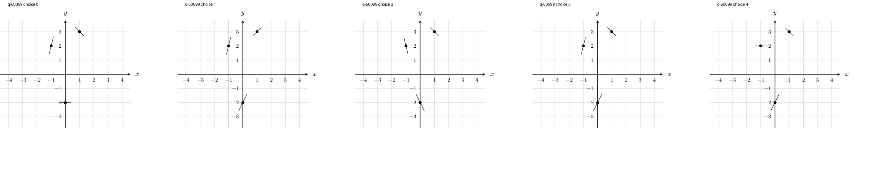

Raw source has no worked solution, difficulty or correct designation. The replay easy assignment, three-row solution and independently derived correct designation are authored repairs.

Parameterized source-profile replay (regenerated plots, normalized equation rows):

Which of the following diagrams gives the slope field at the points indicated for the differential equation $\frac{dy}{dx} = 2 - xy$?

1. 

2. 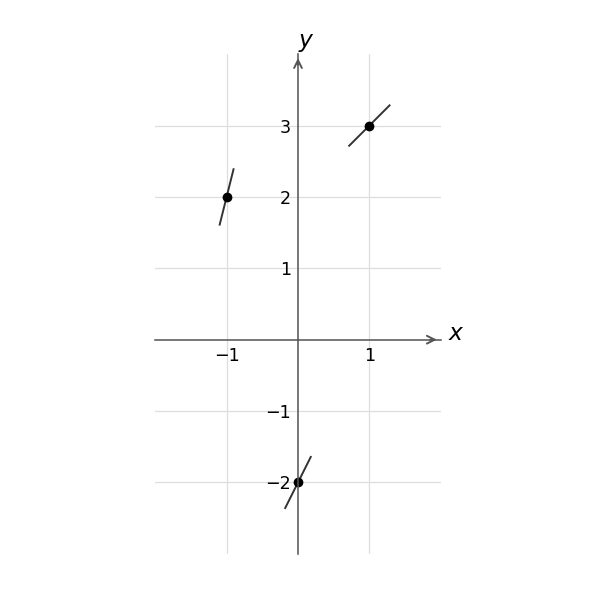

3. 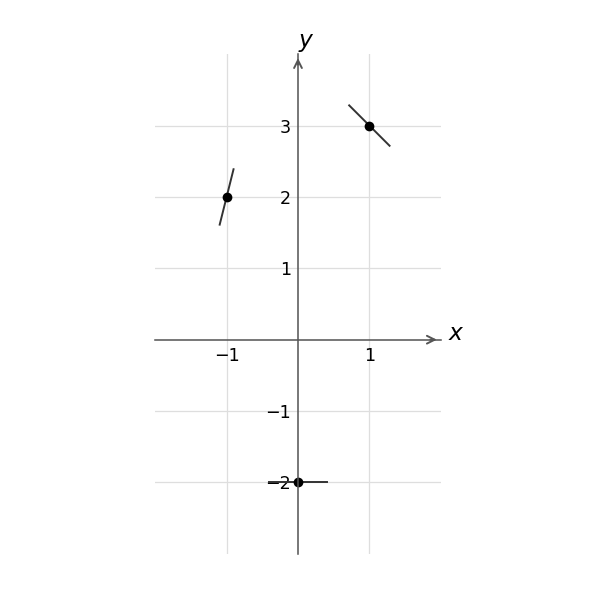

4. 

5. 

We have to sketch the slope field at the points $(-1,2)$,$(1,3)$,$(0,-2)$.

To sketch the slope field at the given points, we substitute their coordinates into the right-hand side of the differential equation.

$$
\begin{aligned} & {\frac{\text{d}y}{\text{d}x}|}_{(-1,2)}=2-1(-1)(2)=4, \\  & {\frac{\text{d}y}{\text{d}x}|}_{(1,3)}=2-1(1)(3)=-1, \\  & {\frac{\text{d}y}{\text{d}x}|}_{(0,-2)}=2-1(0)(-2)=2.\end{aligned}
$$

Setting up our points and drawing our line segments, we get the following diagram.

### Original q-80494

Which of the following diagrams gives the slope field at the points indicated for the differential equation $\frac{dy}{dx} = x^{2} - 2y$?

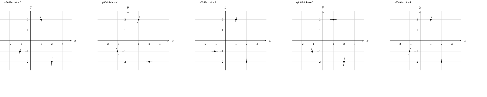

Raw source has no worked solution, difficulty or correct designation. The replay easy assignment, three-row solution and independently derived correct designation are authored repairs.

Parameterized source-profile replay (regenerated plots, normalized equation rows):

Which of the following diagrams gives the slope field at the points indicated for the differential equation $\frac{dy}{dx} = x^{2} - 2y$?

1. 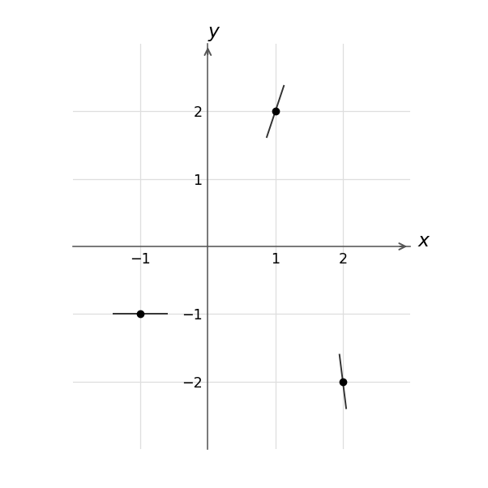

2. 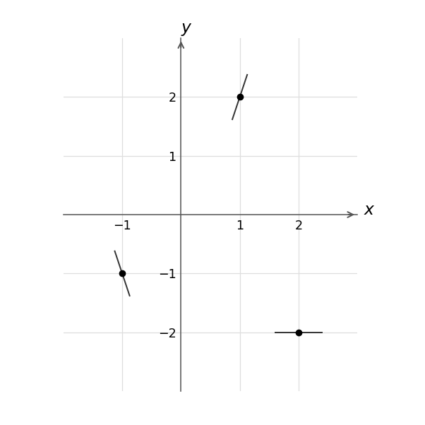

3. 

4. 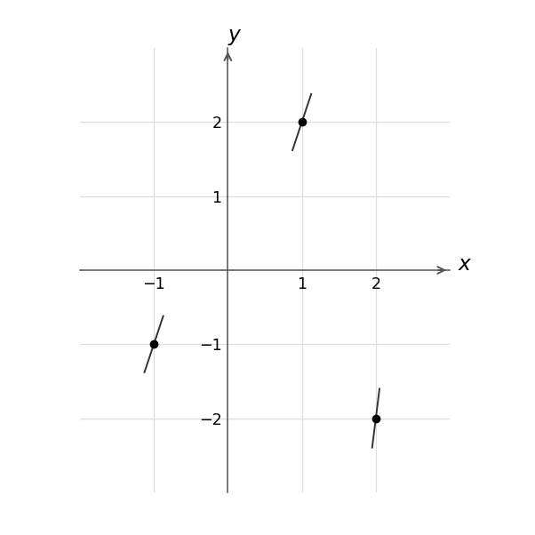

5. 

We have to sketch the slope field at the points $(1,2)$,$(-1,-1)$,$(2,-2)$.

To sketch the slope field at the given points, we substitute their coordinates into the right-hand side of the differential equation.

$$
\begin{aligned} & {\frac{\text{d}y}{\text{d}x}|}_{(1,2)}=1(1)^{2}-2(2)=-3, \\  & {\frac{\text{d}y}{\text{d}x}|}_{(-1,-1)}=1(-1)^{2}-2(-1)=3, \\  & {\frac{\text{d}y}{\text{d}x}|}_{(2,-2)}=1(2)^{2}-2(-2)=8.\end{aligned}
$$

Setting up our points and drawing our line segments, we get the following diagram.

### Original q-119674

Which of the following diagrams gives the slope field at the points indicated for the differential equation $\frac{\text{d}y}{\text{d}x}=-\frac{{y}^{2}}{x}?$

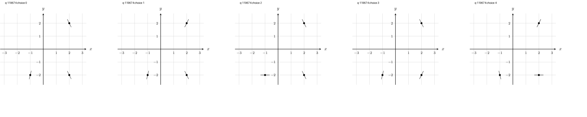

Original worked solution:

We have to sketch the slope field at the points $(-1,-2),(2,-2)$ and $(2,2).$

To sketch the slope field at the given points, we substitute their coordinates into the right-hand side of the differential equation.

$$
\begin{aligned} & {\frac{\text{d}y}{\text{d}x}|}_{(-1,-2)}=-\frac{(-2)^{2}}{(-1)}=4, \\  & {\frac{\text{d}y}{\text{d}x}|}_{(2,-2)}=-\frac{(-2)^{2}}{2}=-2, \\  & {\frac{\text{d}y}{\text{d}x}|}_{(2,2)}=-\frac{{2}^{2}}{2}=-2.\end{aligned}
$$

Setting up our points and drawing our line segments, we get the following diagram.

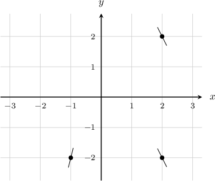

Parameterized source-profile replay (regenerated plots, normalized equation rows):

Which of the following diagrams gives the slope field at the points indicated for the differential equation $\frac{\text{d}y}{\text{d}x}=-\frac{{y}^{2}}{x}?$

1. 

2. 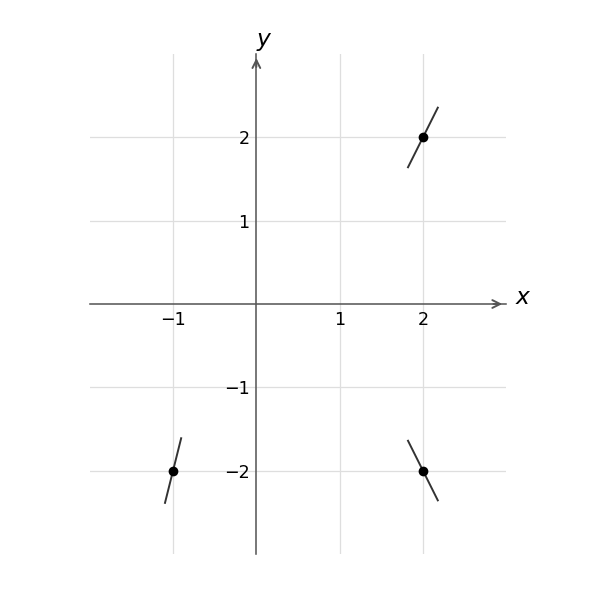

3. 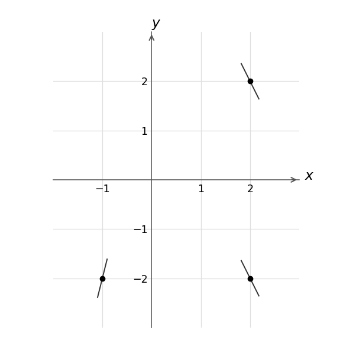

4. 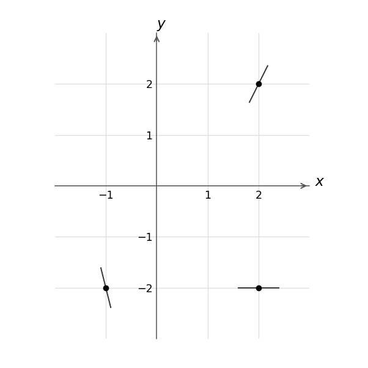

5. 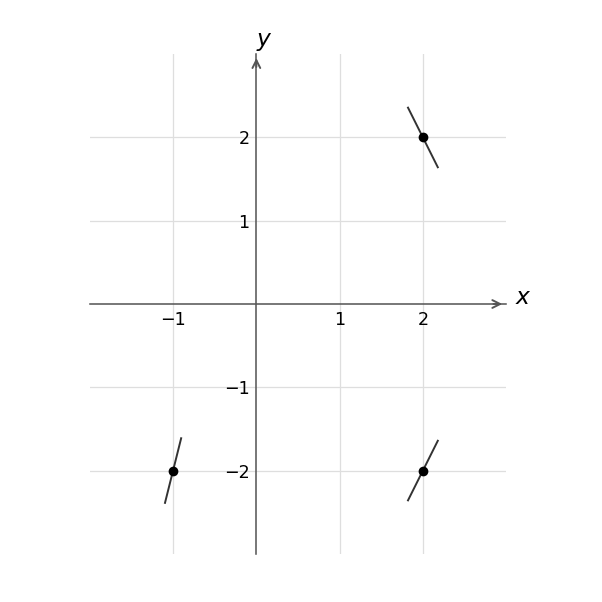

We have to sketch the slope field at the points $(-1,-2),(2,-2)$ and $(2,2).$

To sketch the slope field at the given points, we substitute their coordinates into the right-hand side of the differential equation.

$$
\begin{aligned} & {\frac{\text{d}y}{\text{d}x}|}_{(-1,-2)}=(-1)\frac{(-2)^{2}}{(-1)}=4, \\  & {\frac{\text{d}y}{\text{d}x}|}_{(2,-2)}=(-1)\frac{(-2)^{2}}{(2)}=-2, \\  & {\frac{\text{d}y}{\text{d}x}|}_{(2,2)}=(-1)\frac{(2)^{2}}{(2)}=-2.\end{aligned}
$$

Setting up our points and drawing our line segments, we get the following diagram.

### Original q-49811

Which of the following diagrams gives the slope field at the points indicated for the differential equation $\frac{\text{d}y}{\text{d}x}=2{x}^{2}-\frac{1}{2}{y}^{2}?$

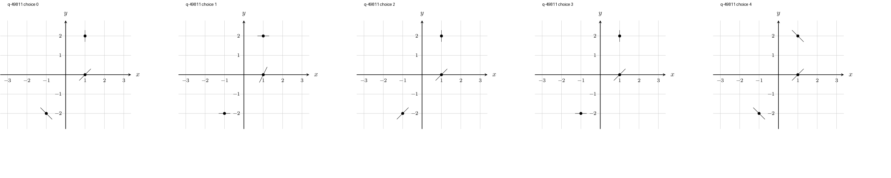

Original worked solution:

We have to sketch the slope field at the points $(1,2),(1,0),$ and $(-1,-2).$

To sketch the slope field at the given points, we substitute their coordinates into the right-hand side of the differential equation.

$$
\begin{aligned} & {\frac{\text{d}y}{\text{d}x}|}_{(1,2)}=2(1)^{2}-\frac{1}{2}(2)^{2}=0, \\  & {\frac{\text{d}y}{\text{d}x}|}_{(1,0)}=2(1)^{2}-\frac{1}{2}(0)^{2}=2, \\  & {\frac{\text{d}y}{\text{d}x}|}_{(-1,-2)}=2(-1)^{2}-\frac{1}{2}(-2)^{2}=0.\end{aligned}
$$

Setting up our points and drawing our line segments, we get the following diagram.

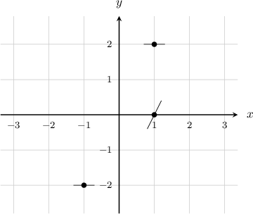

Parameterized source-profile replay (regenerated plots, normalized equation rows):

Which of the following diagrams gives the slope field at the points indicated for the differential equation $\frac{\text{d}y}{\text{d}x}=2{x}^{2}-\frac{1}{2}{y}^{2}?$

1. 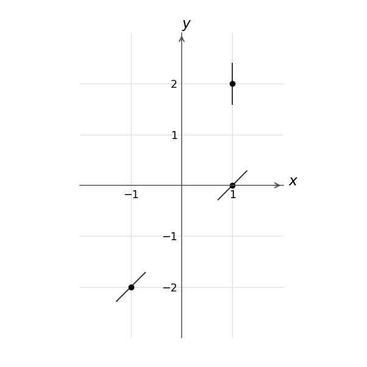

2. 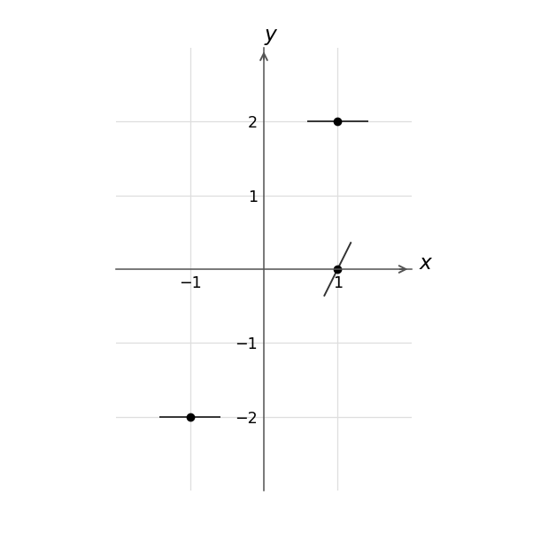

3. 

4. 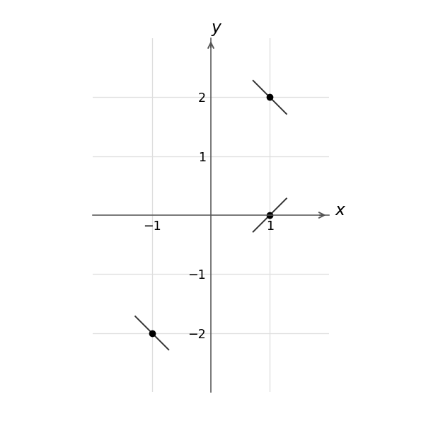

5. 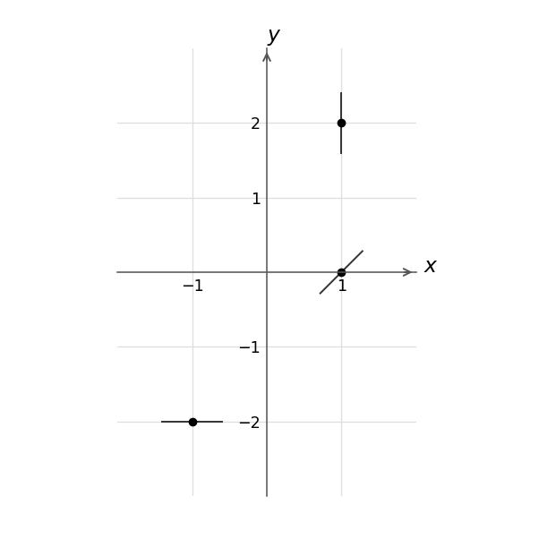

We have to sketch the slope field at the points $(1,2),(1,0),$ and $(-1,-2).$

To sketch the slope field at the given points, we substitute their coordinates into the right-hand side of the differential equation.

$$
\begin{aligned} & {\frac{\text{d}y}{\text{d}x}|}_{(1,2)}=2(1)^{2}-\frac{1}{2}(2)^{2}=0, \\  & {\frac{\text{d}y}{\text{d}x}|}_{(1,0)}=2(1)^{2}-\frac{1}{2}(0)^{2}=2, \\  & {\frac{\text{d}y}{\text{d}x}|}_{(-1,-2)}=2(-1)^{2}-\frac{1}{2}(-2)^{2}=0.\end{aligned}
$$

Setting up our points and drawing our line segments, we get the following diagram.

### Original q-80499

Which of the following diagrams gives the slope field at the points indicated for the differential equation $\frac{\text{d}y}{\text{d}x}=\frac{x+2y}{4}?$

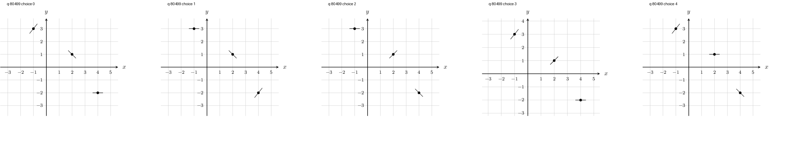

Original worked solution:

We have to sketch the slope field at the points $(4,-2),(2,1),$ and $(-1,3).$

To sketch the slope field at the given points, we substitute their coordinates into the right-hand side of the differential equation.

$$
\begin{aligned} & {\frac{\text{d}y}{\text{d}x}|}_{(4,-2)}=\frac{4+2(-2)}{4}=0, \\  & {\frac{\text{d}y}{\text{d}x}|}_{(2,1)}=\frac{2+2(1)}{4}=1, \\  & {\frac{\text{d}y}{\text{d}x}|}_{(-1,3)}=\frac{-1+2(3)}{4}=\frac{5}{4}.\end{aligned}
$$

Setting up our points and drawing our line segments, we get the following diagram.

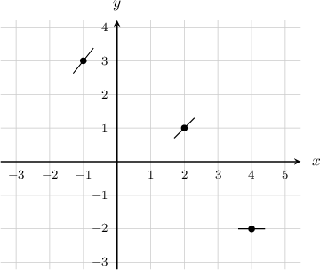

Parameterized source-profile replay (regenerated plots, normalized equation rows):

Which of the following diagrams gives the slope field at the points indicated for the differential equation $\frac{\text{d}y}{\text{d}x}=\frac{x+2y}{4}?$

1. 

2. 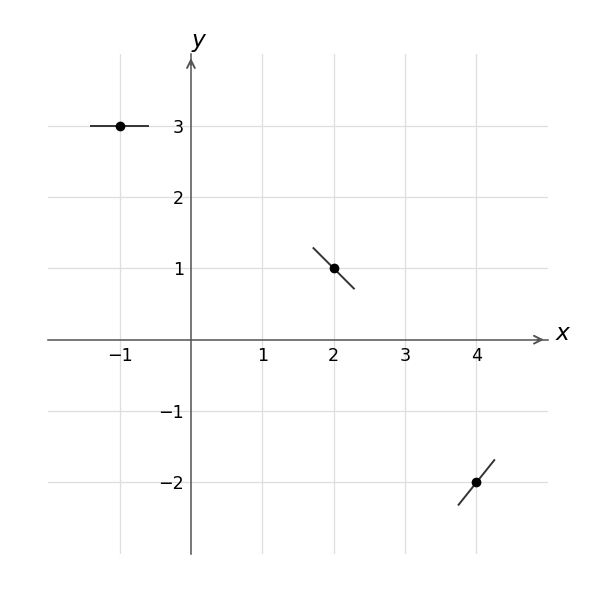

3. 

4. 

5. 

We have to sketch the slope field at the points $(4,-2),(2,1),$ and $(-1,3).$

To sketch the slope field at the given points, we substitute their coordinates into the right-hand side of the differential equation.

$$
\begin{aligned} & {\frac{\text{d}y}{\text{d}x}|}_{(4,-2)}=\frac{1(4)+(2)(-2)}{4}=0, \\  & {\frac{\text{d}y}{\text{d}x}|}_{(2,1)}=\frac{1(2)+(2)(1)}{4}=1, \\  & {\frac{\text{d}y}{\text{d}x}|}_{(-1,3)}=\frac{1(-1)+(2)(3)}{4}=\frac{5}{4}.\end{aligned}
$$

Setting up our points and drawing our line segments, we get the following diagram.

### Original q-80497

Which of the following diagrams gives the slope field at the points indicated for the differential equation $\frac{\text{d}y}{\text{d}x}=x-2y?$

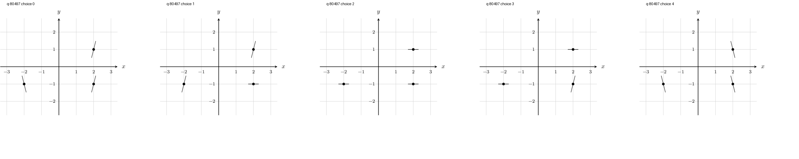

Original worked solution:

We have to sketch the slope field at the points $(-2,-1),(2,-1),$ and $(2,1).$

To sketch the slope field at the given points, we substitute their coordinates into the right-hand side of the differential equation. 

$$
\begin{aligned} & {\frac{\text{d}y}{\text{d}x}|}_{(-2,-1)}=(-2)-2(-1)=0, \\  & {\frac{\text{d}y}{\text{d}x}|}_{(2,-1)}=(2)-2(-1)=4, \\  & {\frac{\text{d}y}{\text{d}x}|}_{(2,1)}=(2)-2(1)=0.\end{aligned}
$$

Setting up our points and drawing our line segments, we get the following diagram.

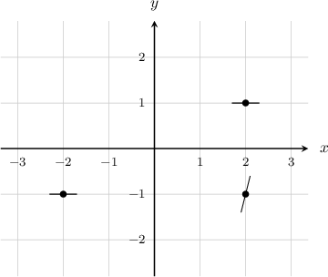

Parameterized source-profile replay (regenerated plots, normalized equation rows):

Which of the following diagrams gives the slope field at the points indicated for the differential equation $\frac{\text{d}y}{\text{d}x}=x-2y?$

1. 

2. 

3. 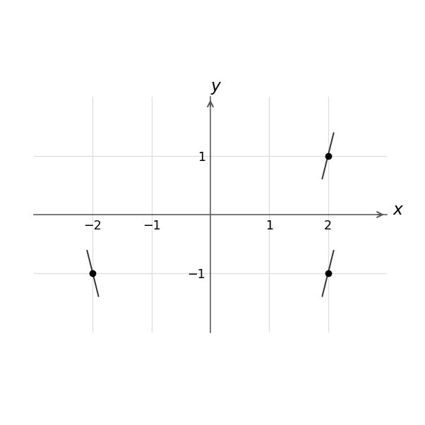

4. 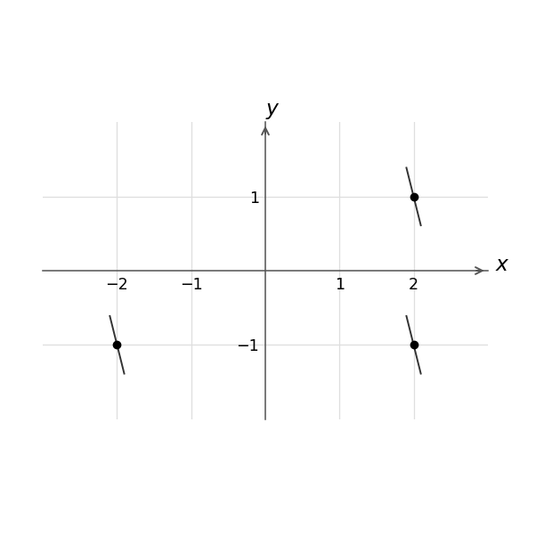

5. 

We have to sketch the slope field at the points $(-2,-1),(2,-1),$ and $(2,1).$

To sketch the slope field at the given points, we substitute their coordinates into the right-hand side of the differential equation. 

$$
\begin{aligned} & {\frac{\text{d}y}{\text{d}x}|}_{(-2,-1)}=1(-2)+(-2)(-1)=0, \\  & {\frac{\text{d}y}{\text{d}x}|}_{(2,-1)}=1(2)+(-2)(-1)=4, \\  & {\frac{\text{d}y}{\text{d}x}|}_{(2,1)}=1(2)+(-2)(1)=0.\end{aligned}
$$

Setting up our points and drawing our line segments, we get the following diagram.

### Original q-96089

Which of the following diagrams gives the slope field at the points indicated for the differential equation $\frac{\text{d}y}{\text{d}x}=x+2y?$

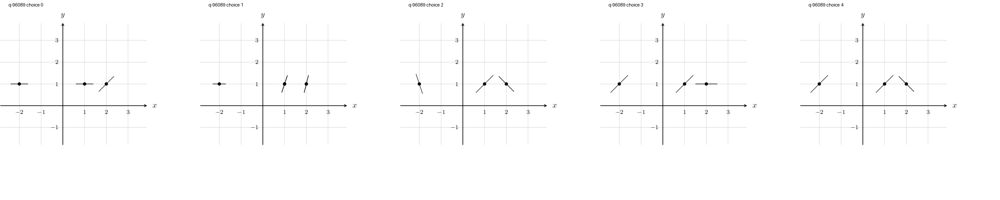

Original worked solution:

We have to sketch the slope field at the points $(-2,1),(1,1),$ and $(2,1).$

To sketch the slope field at the given points, we substitute their coordinates into the right-hand side of the differential equation.

$$
\begin{aligned} & {\frac{\text{d}y}{\text{d}x}|}_{(-2,1)}=-2+2(1)=0, \\  & {\frac{\text{d}y}{\text{d}x}|}_{(1,1)}=1+2(1)=3, \\  & {\frac{\text{d}y}{\text{d}x}|}_{(2,1)}=2+2(1)=4.\end{aligned}
$$

Setting up our points and drawing our line segments, we get the following diagram.

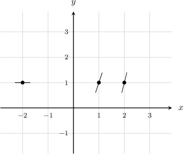

Parameterized source-profile replay (regenerated plots, normalized equation rows):

Which of the following diagrams gives the slope field at the points indicated for the differential equation $\frac{\text{d}y}{\text{d}x}=x+2y?$

1. 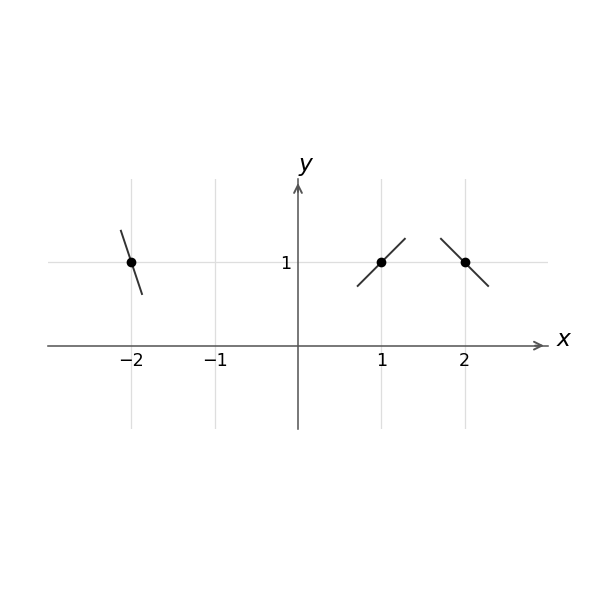

2. 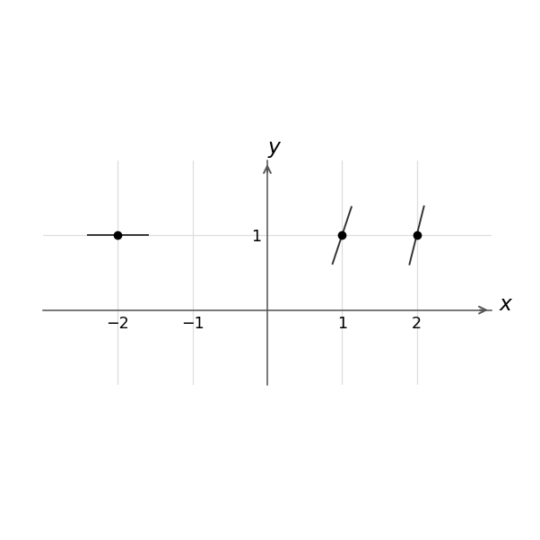

3. 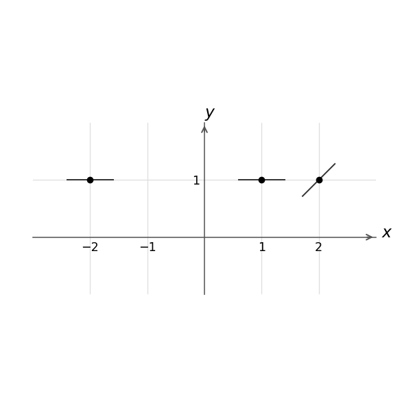

4. 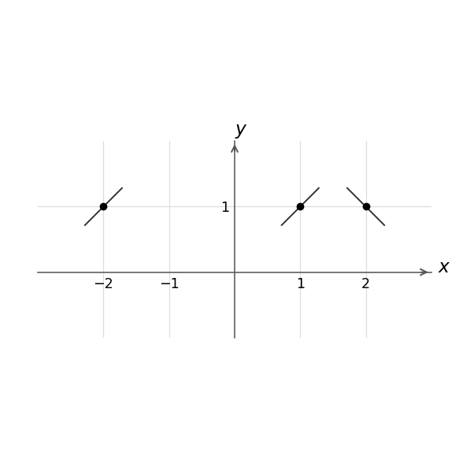

5. 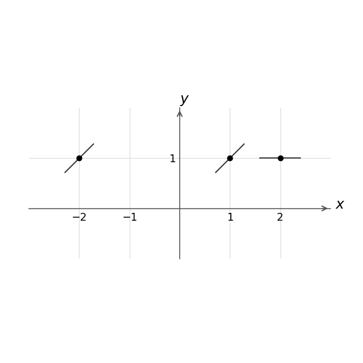

We have to sketch the slope field at the points $(-2,1),(1,1),$ and $(2,1).$

To sketch the slope field at the given points, we substitute their coordinates into the right-hand side of the differential equation.

$$
\begin{aligned} & {\frac{\text{d}y}{\text{d}x}|}_{(-2,1)}=1(-2)+(2)(1)=0, \\  & {\frac{\text{d}y}{\text{d}x}|}_{(1,1)}=1(1)+(2)(1)=3, \\  & {\frac{\text{d}y}{\text{d}x}|}_{(2,1)}=1(2)+(2)(1)=4.\end{aligned}
$$

Setting up our points and drawing our line segments, we get the following diagram.

## Generated variants

The first seven variations preserve complete observed profiles at changed parameters; later variations use the separate authored operation bank. Each eligible mathematical form has two normal examples at each level, including both missing levels.

### Generated 1: easy, constant_product, q-50099

Parameters: `{"a": "1", "b": "-1", "points": [[-2, -3], [3, 3], [0, 1]]}`. Observed complete orientation-profile extension; error intent is underdetermined.

Which of the following diagrams gives the slope field at the points indicated for the differential equation $\frac{dy}{dx} =1-(-1)xy$?

1. 

2. 

3. 

4. 

5. 

We have to sketch the slope field at the points $(-2,-3)$,$(3,3)$,$(0,1)$.

To sketch the slope field at the given points, we substitute their coordinates into the right-hand side of the differential equation.

$$
\begin{aligned} & {\frac{\text{d}y}{\text{d}x}|}_{(-2,-3)}=1-(-1)(-2)(-3)=7, \\  & {\frac{\text{d}y}{\text{d}x}|}_{(3,3)}=1-(-1)(3)(3)=10, \\  & {\frac{\text{d}y}{\text{d}x}|}_{(0,1)}=1-(-1)(0)(1)=1.\end{aligned}
$$

Setting up our points and drawing our line segments, we get the following diagram.

### Generated 2: easy, quadratic_linear, q-80494

Parameters: `{"a": "1", "b": "-1", "points": [[-2, -3], [3, 3], [0, 1]]}`. Observed complete orientation-profile extension; error intent is underdetermined.

Which of the following diagrams gives the slope field at the points indicated for the differential equation $\frac{dy}{dx} =1x^{2}-(-1)y$?

1. 

2. 

3. 

4. 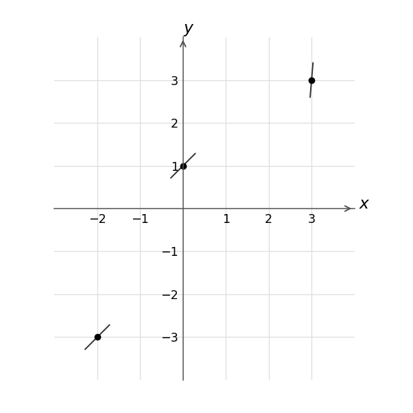

5. 

We have to sketch the slope field at the points $(-2,-3)$,$(3,3)$,$(0,1)$.

To sketch the slope field at the given points, we substitute their coordinates into the right-hand side of the differential equation.

$$
\begin{aligned} & {\frac{\text{d}y}{\text{d}x}|}_{(-2,-3)}=1(-2)^{2}-(-1)(-3)=1, \\  & {\frac{\text{d}y}{\text{d}x}|}_{(3,3)}=1(3)^{2}-(-1)(3)=12, \\  & {\frac{\text{d}y}{\text{d}x}|}_{(0,1)}=1(0)^{2}-(-1)(1)=1.\end{aligned}
$$

Setting up our points and drawing our line segments, we get the following diagram.

### Generated 3: easy, rational_square, q-119674

Parameters: `{"a": "1", "points": [[2, -1], [-2, -3], [1, 1]]}`. Observed complete orientation-profile extension; error intent is underdetermined.

Which of the following diagrams gives the slope field at the points indicated for the differential equation $\frac{\text{d}y}{\text{d}x}=1\frac{y^{2}}{x}?$

1. 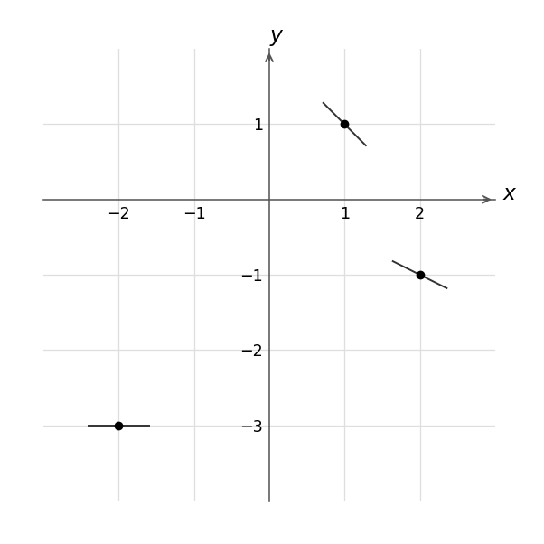

2. 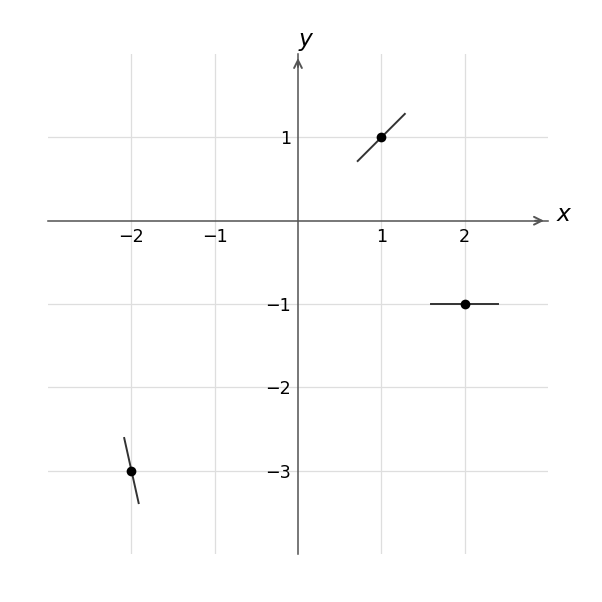

3. 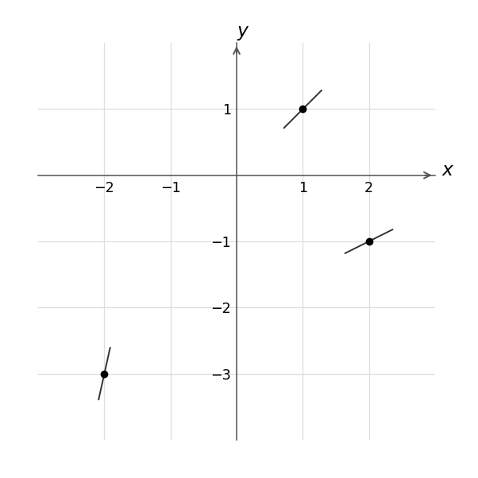

4. 

5. 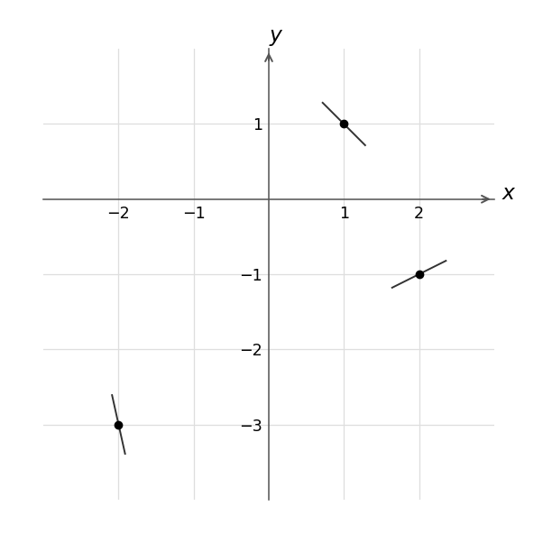

We have to sketch the slope field at the points $(2,-1),(-2,-3)$ and $(1,1).$

To sketch the slope field at the given points, we substitute their coordinates into the right-hand side of the differential equation.

$$
\begin{aligned} & {\frac{\text{d}y}{\text{d}x}|}_{(2,-1)}=1\frac{(-1)^{2}}{(2)}=\frac{1}{2}, \\  & {\frac{\text{d}y}{\text{d}x}|}_{(-2,-3)}=1\frac{(-3)^{2}}{(-2)}=- \frac{9}{2}, \\  & {\frac{\text{d}y}{\text{d}x}|}_{(1,1)}=1\frac{(1)^{2}}{(1)}=1.\end{aligned}
$$

Setting up our points and drawing our line segments, we get the following diagram.

### Generated 4: easy, two_quadratic, q-49811

Parameters: `{"a": "1", "b": "-1", "points": [[-2, -3], [3, 3], [0, 1]]}`. Observed complete orientation-profile extension; error intent is underdetermined.

Which of the following diagrams gives the slope field at the points indicated for the differential equation $\frac{\text{d}y}{\text{d}x}=1x^{2}-(-1)y^{2}?$

1. 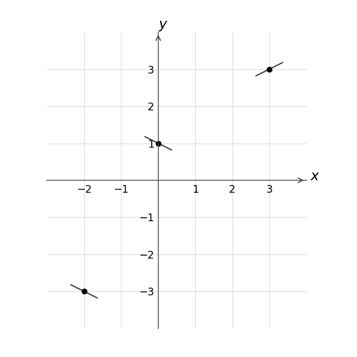

2. 

3. 

4. 

5. 

We have to sketch the slope field at the points $(-2,-3),(3,3),$ and $(0,1).$

To sketch the slope field at the given points, we substitute their coordinates into the right-hand side of the differential equation.

$$
\begin{aligned} & {\frac{\text{d}y}{\text{d}x}|}_{(-2,-3)}=1(-2)^{2}-(-1)(-3)^{2}=13, \\  & {\frac{\text{d}y}{\text{d}x}|}_{(3,3)}=1(3)^{2}-(-1)(3)^{2}=18, \\  & {\frac{\text{d}y}{\text{d}x}|}_{(0,1)}=1(0)^{2}-(-1)(1)^{2}=1.\end{aligned}
$$

Setting up our points and drawing our line segments, we get the following diagram.

### Generated 5: easy, affine_fraction, q-80499

Parameters: `{"a": "1", "b": "-1", "d": "2", "points": [[3, 3], [0, 1], [-2, -1]]}`. Observed complete orientation-profile extension; error intent is underdetermined.

Which of the following diagrams gives the slope field at the points indicated for the differential equation $\frac{\text{d}y}{\text{d}x}=\frac{1x+(-1)y}{2}?$

1. 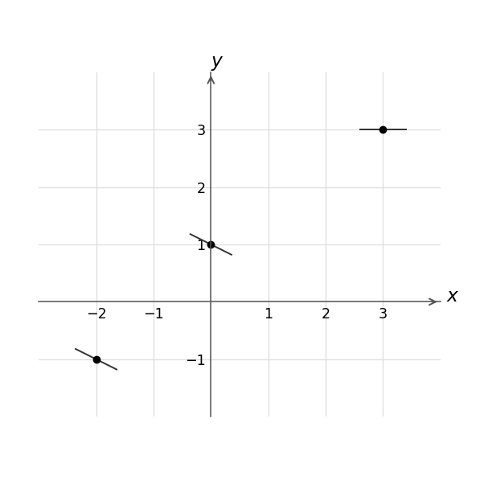

2. 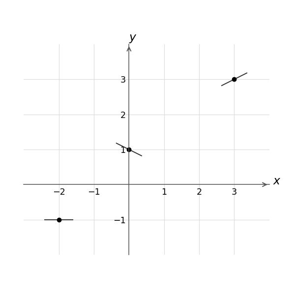

3. 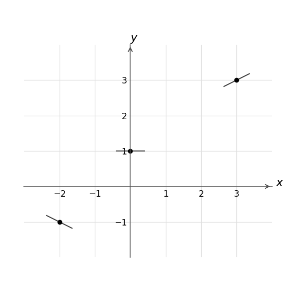

4. 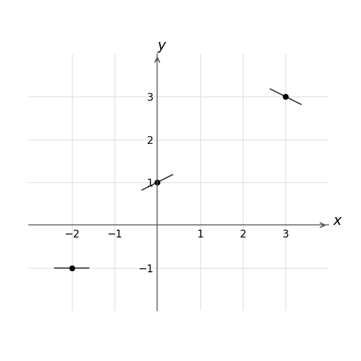

5. 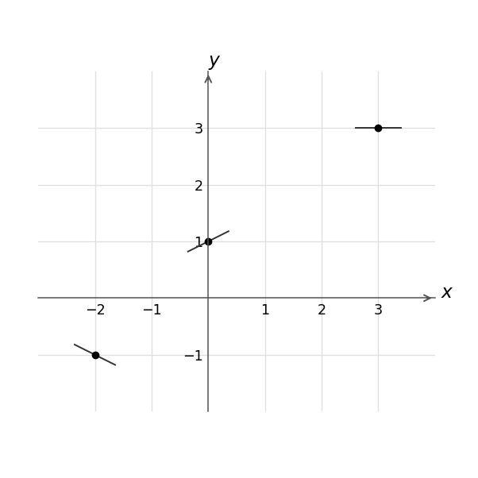

We have to sketch the slope field at the points $(3,3),(0,1),$ and $(-2,-1).$

To sketch the slope field at the given points, we substitute their coordinates into the right-hand side of the differential equation.

$$
\begin{aligned} & {\frac{\text{d}y}{\text{d}x}|}_{(3,3)}=\frac{1(3)+(-1)(3)}{2}=0, \\  & {\frac{\text{d}y}{\text{d}x}|}_{(0,1)}=\frac{1(0)+(-1)(1)}{2}=- \frac{1}{2}, \\  & {\frac{\text{d}y}{\text{d}x}|}_{(-2,-1)}=\frac{1(-2)+(-1)(-1)}{2}=- \frac{1}{2}.\end{aligned}
$$

Setting up our points and drawing our line segments, we get the following diagram.

### Generated 6: easy, affine, q-80497

Parameters: `{"a": "2", "b": "1", "points": [[-2, -2], [-2, -3], [1, 3]]}`. Observed complete orientation-profile extension; error intent is underdetermined.

Which of the following diagrams gives the slope field at the points indicated for the differential equation $\frac{\text{d}y}{\text{d}x}=2x+(1)y?$

1. 

2. 

3. 

4. 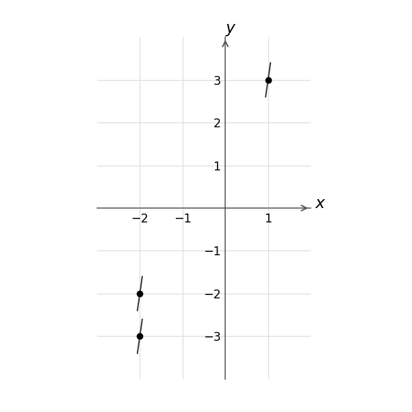

5. 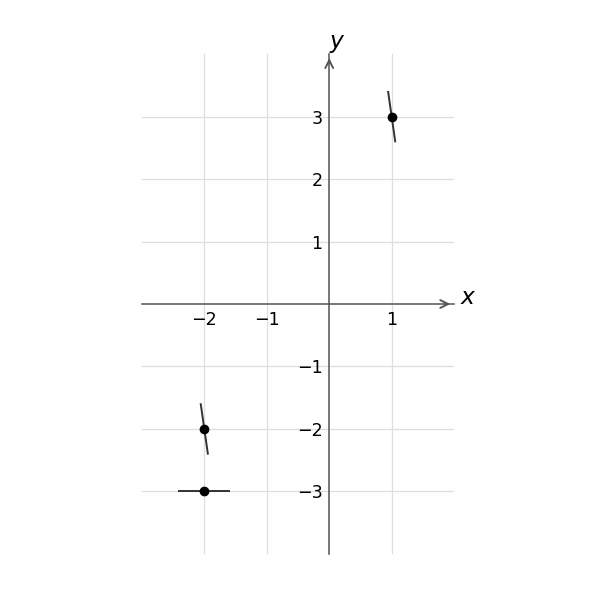

We have to sketch the slope field at the points $(-2,-2),(-2,-3),$ and $(1,3).$

To sketch the slope field at the given points, we substitute their coordinates into the right-hand side of the differential equation. 

$$
\begin{aligned} & {\frac{\text{d}y}{\text{d}x}|}_{(-2,-2)}=2(-2)+(1)(-2)=-6, \\  & {\frac{\text{d}y}{\text{d}x}|}_{(-2,-3)}=2(-2)+(1)(-3)=-7, \\  & {\frac{\text{d}y}{\text{d}x}|}_{(1,3)}=2(1)+(1)(3)=5.\end{aligned}
$$

Setting up our points and drawing our line segments, we get the following diagram.

### Generated 7: easy, affine, q-96089

Parameters: `{"a": "1", "b": "-1", "points": [[-2, -3], [3, 3], [0, 1]]}`. Observed complete orientation-profile extension; error intent is underdetermined.

Which of the following diagrams gives the slope field at the points indicated for the differential equation $\frac{\text{d}y}{\text{d}x}=1x+(-1)y?$

1. 

2. 

3. 

4. 

5. 

We have to sketch the slope field at the points $(-2,-3),(3,3),$ and $(0,1).$

To sketch the slope field at the given points, we substitute their coordinates into the right-hand side of the differential equation.

$$
\begin{aligned} & {\frac{\text{d}y}{\text{d}x}|}_{(-2,-3)}=1(-2)+(-1)(-3)=1, \\  & {\frac{\text{d}y}{\text{d}x}|}_{(3,3)}=1(3)+(-1)(3)=0, \\  & {\frac{\text{d}y}{\text{d}x}|}_{(0,1)}=1(0)+(-1)(1)=-1.\end{aligned}
$$

Setting up our points and drawing our line segments, we get the following diagram.

### Generated 8: easy, constant_product, authored

Parameters: `{"a": "2", "b": "1", "points": [[2, 3], [-2, 2], [2, 1]]}`. Authored full bank and workload.

Which of the following diagrams gives the slope field at the points indicated for the differential equation $\frac{\text{d}y}{\text{d}x}=2-(1)xy?$

1. 

2. 

3. 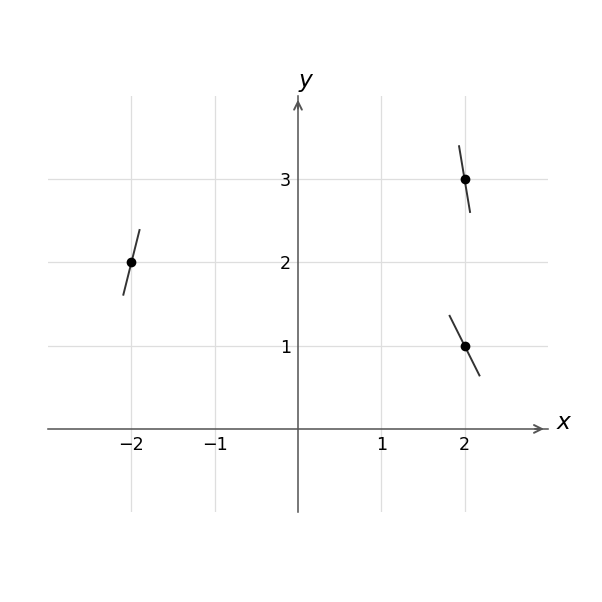

4. 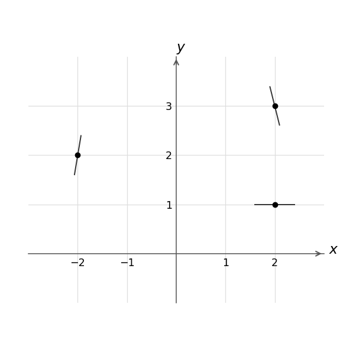

5. 

We have to sketch the slope field at the points $(2,3)$,$(-2,2)$,$(2,1)$.

To sketch the slope field at the given points, we substitute their coordinates into the right-hand side of the differential equation.

$$
\begin{aligned} & {\frac{\text{d}y}{\text{d}x}|}_{(2,3)}=2-1(2)(3)=-4, \\  & {\frac{\text{d}y}{\text{d}x}|}_{(-2,2)}=2-1(-2)(2)=6, \\  & {\frac{\text{d}y}{\text{d}x}|}_{(2,1)}=2-1(2)(1)=0.\end{aligned}
$$

Setting up our points and drawing our line segments, we get the following diagram.

### Generated 9: easy, constant_product, authored

Parameters: `{"a": "-1", "b": "3", "points": [[-1, -3], [-2, 0], [0, 0]]}`. Authored full bank and workload.

Which of the following diagrams gives the slope field at the points indicated for the differential equation $\frac{\text{d}y}{\text{d}x}=-1-(3)xy?$

1. 

2. 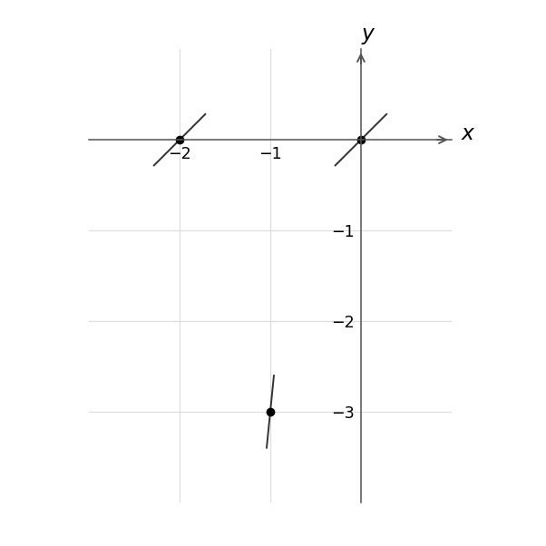

3. 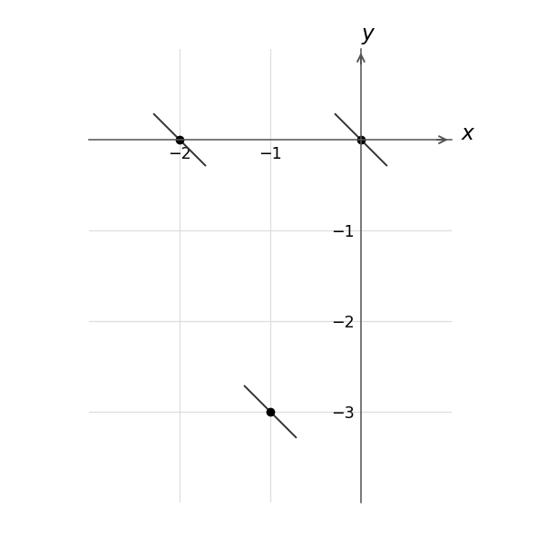

4. 

5. 

We have to sketch the slope field at the points $(-1,-3)$,$(-2,0)$,$(0,0)$.

To sketch the slope field at the given points, we substitute their coordinates into the right-hand side of the differential equation.

$$
\begin{aligned} & {\frac{\text{d}y}{\text{d}x}|}_{(-1,-3)}=-1-3(-1)(-3)=-10, \\  & {\frac{\text{d}y}{\text{d}x}|}_{(-2,0)}=-1-3(-2)(0)=-1, \\  & {\frac{\text{d}y}{\text{d}x}|}_{(0,0)}=-1-3(0)(0)=-1.\end{aligned}
$$

Setting up our points and drawing our line segments, we get the following diagram.

### Generated 10: easy, quadratic_linear, authored

Parameters: `{"a": "-1", "b": "-2", "points": [[1, 2], [-3, -1], [-1, -2]]}`. Authored full bank and workload.

Which of the following diagrams gives the slope field at the points indicated for the differential equation $\frac{\text{d}y}{\text{d}x}=(-1)x^{2}-(-2)y?$

1. 

2. 

3. 

4. 

5. 

We have to sketch the slope field at the points $(1,2)$,$(-3,-1)$,$(-1,-2)$.

To sketch the slope field at the given points, we substitute their coordinates into the right-hand side of the differential equation.

$$
\begin{aligned} & {\frac{\text{d}y}{\text{d}x}|}_{(1,2)}=(-1)(1)^{2}-(-2)(2)=3, \\  & {\frac{\text{d}y}{\text{d}x}|}_{(-3,-1)}=(-1)(-3)^{2}-(-2)(-1)=-11, \\  & {\frac{\text{d}y}{\text{d}x}|}_{(-1,-2)}=(-1)(-1)^{2}-(-2)(-2)=-5.\end{aligned}
$$

Setting up our points and drawing our line segments, we get the following diagram.

### Generated 11: easy, quadratic_linear, authored

Parameters: `{"a": "-1", "b": "3", "points": [[-1, -3], [-2, 0], [0, 0]]}`. Authored full bank and workload.

Which of the following diagrams gives the slope field at the points indicated for the differential equation $\frac{\text{d}y}{\text{d}x}=(-1)x^{2}-(3)y?$

1. 

2. 

3. 

4. 

5. 

We have to sketch the slope field at the points $(-1,-3)$,$(-2,0)$,$(0,0)$.

To sketch the slope field at the given points, we substitute their coordinates into the right-hand side of the differential equation.

$$
\begin{aligned} & {\frac{\text{d}y}{\text{d}x}|}_{(-1,-3)}=(-1)(-1)^{2}-3(-3)=8, \\  & {\frac{\text{d}y}{\text{d}x}|}_{(-2,0)}=(-1)(-2)^{2}-3(0)=-4, \\  & {\frac{\text{d}y}{\text{d}x}|}_{(0,0)}=(-1)(0)^{2}-3(0)=0.\end{aligned}
$$

Setting up our points and drawing our line segments, we get the following diagram.

### Generated 12: easy, rational_square, authored

Parameters: `{"a": "-1", "points": [[3, -1], [2, 2], [-3, -1]]}`. Authored full bank and workload.

Which of the following diagrams gives the slope field at the points indicated for the differential equation $\frac{\text{d}y}{\text{d}x}=(-1)\frac{y^{2}}{x}?$

1. 

2. 

3. 

4. 

5. 

We have to sketch the slope field at the points $(3,-1)$,$(2,2)$,$(-3,-1)$.

To sketch the slope field at the given points, we substitute their coordinates into the right-hand side of the differential equation.

$$
\begin{aligned} & {\frac{\text{d}y}{\text{d}x}|}_{(3,-1)}=(-1)\frac{(-1)^{2}}{(3)}=- \frac{1}{3}, \\  & {\frac{\text{d}y}{\text{d}x}|}_{(2,2)}=(-1)\frac{(2)^{2}}{(2)}=-2, \\  & {\frac{\text{d}y}{\text{d}x}|}_{(-3,-1)}=(-1)\frac{(-1)^{2}}{(-3)}=\frac{1}{3}.\end{aligned}
$$

Setting up our points and drawing our line segments, we get the following diagram.

### Generated 13: easy, rational_square, authored

Parameters: `{"a": "-1", "points": [[1, -3], [-1, -3], [-2, 0]]}`. Authored full bank and workload.

Which of the following diagrams gives the slope field at the points indicated for the differential equation $\frac{\text{d}y}{\text{d}x}=(-1)\frac{y^{2}}{x}?$

1. 

2. 

3. 

4. 

5. 

We have to sketch the slope field at the points $(1,-3)$,$(-1,-3)$,$(-2,0)$.

To sketch the slope field at the given points, we substitute their coordinates into the right-hand side of the differential equation.

$$
\begin{aligned} & {\frac{\text{d}y}{\text{d}x}|}_{(1,-3)}=(-1)\frac{(-3)^{2}}{(1)}=-9, \\  & {\frac{\text{d}y}{\text{d}x}|}_{(-1,-3)}=(-1)\frac{(-3)^{2}}{(-1)}=9, \\  & {\frac{\text{d}y}{\text{d}x}|}_{(-2,0)}=(-1)\frac{(0)^{2}}{(-2)}=0.\end{aligned}
$$

Setting up our points and drawing our line segments, we get the following diagram.

### Generated 14: easy, two_quadratic, authored

Parameters: `{"a": "-1", "b": "-2", "points": [[1, 2], [-3, -1], [-1, -2]]}`. Authored full bank and workload.

Which of the following diagrams gives the slope field at the points indicated for the differential equation $\frac{\text{d}y}{\text{d}x}=(-1)x^{2}-(-2)y^{2}?$

1. 

2. 

3. 

4. 

5. 

We have to sketch the slope field at the points $(1,2)$,$(-3,-1)$,$(-1,-2)$.

To sketch the slope field at the given points, we substitute their coordinates into the right-hand side of the differential equation.

$$
\begin{aligned} & {\frac{\text{d}y}{\text{d}x}|}_{(1,2)}=(-1)(1)^{2}-(-2)(2)^{2}=7, \\  & {\frac{\text{d}y}{\text{d}x}|}_{(-3,-1)}=(-1)(-3)^{2}-(-2)(-1)^{2}=-7, \\  & {\frac{\text{d}y}{\text{d}x}|}_{(-1,-2)}=(-1)(-1)^{2}-(-2)(-2)^{2}=7.\end{aligned}
$$

Setting up our points and drawing our line segments, we get the following diagram.

### Generated 15: easy, two_quadratic, authored

Parameters: `{"a": "-1", "b": "3", "points": [[-1, -3], [-2, 0], [0, 0]]}`. Authored full bank and workload.

Which of the following diagrams gives the slope field at the points indicated for the differential equation $\frac{\text{d}y}{\text{d}x}=(-1)x^{2}-(3)y^{2}?$

1. 

2. 

3. 

4. 

5. 

We have to sketch the slope field at the points $(-1,-3)$,$(-2,0)$,$(0,0)$.

To sketch the slope field at the given points, we substitute their coordinates into the right-hand side of the differential equation.

$$
\begin{aligned} & {\frac{\text{d}y}{\text{d}x}|}_{(-1,-3)}=(-1)(-1)^{2}-3(-3)^{2}=-28, \\  & {\frac{\text{d}y}{\text{d}x}|}_{(-2,0)}=(-1)(-2)^{2}-3(0)^{2}=-4, \\  & {\frac{\text{d}y}{\text{d}x}|}_{(0,0)}=(-1)(0)^{2}-3(0)^{2}=0.\end{aligned}
$$

Setting up our points and drawing our line segments, we get the following diagram.

### Generated 16: easy, affine_fraction, authored

Parameters: `{"a": "-1", "b": "-2", "d": "4", "points": [[-3, -1], [-1, -2], [-1, 1]]}`. Authored full bank and workload.

Which of the following diagrams gives the slope field at the points indicated for the differential equation $\frac{\text{d}y}{\text{d}x}=\frac{(-1)x+(-2)y}{4}?$

1. 

2. 

3. 

4. 

5. 

We have to sketch the slope field at the points $(-3,-1)$,$(-1,-2)$,$(-1,1)$.

To sketch the slope field at the given points, we substitute their coordinates into the right-hand side of the differential equation.

$$
\begin{aligned} & {\frac{\text{d}y}{\text{d}x}|}_{(-3,-1)}=\frac{(-1)(-3)+(-2)(-1)}{4}=\frac{5}{4}, \\  & {\frac{\text{d}y}{\text{d}x}|}_{(-1,-2)}=\frac{(-1)(-1)+(-2)(-2)}{4}=\frac{5}{4}, \\  & {\frac{\text{d}y}{\text{d}x}|}_{(-1,1)}=\frac{(-1)(-1)+(-2)(1)}{4}=- \frac{1}{4}.\end{aligned}
$$

Setting up our points and drawing our line segments, we get the following diagram.

### Generated 17: easy, affine_fraction, authored

Parameters: `{"a": "-1", "b": "3", "d": "2", "points": [[-2, 0], [0, 0], [2, -2]]}`. Authored full bank and workload.

Which of the following diagrams gives the slope field at the points indicated for the differential equation $\frac{\text{d}y}{\text{d}x}=\frac{(-1)x+(3)y}{2}?$

1. 

2. 

3. 

4. 

5. 

We have to sketch the slope field at the points $(-2,0)$,$(0,0)$,$(2,-2)$.

To sketch the slope field at the given points, we substitute their coordinates into the right-hand side of the differential equation.

$$
\begin{aligned} & {\frac{\text{d}y}{\text{d}x}|}_{(-2,0)}=\frac{(-1)(-2)+(3)(0)}{2}=1, \\  & {\frac{\text{d}y}{\text{d}x}|}_{(0,0)}=\frac{(-1)(0)+(3)(0)}{2}=0, \\  & {\frac{\text{d}y}{\text{d}x}|}_{(2,-2)}=\frac{(-1)(2)+(3)(-2)}{2}=-4.\end{aligned}
$$

Setting up our points and drawing our line segments, we get the following diagram.

### Generated 18: easy, affine, authored

Parameters: `{"a": "3", "b": "-1", "points": [[-3, -2], [1, 2], [3, 2]]}`. Authored full bank and workload.

Which of the following diagrams gives the slope field at the points indicated for the differential equation $\frac{\text{d}y}{\text{d}x}=3x+(-1)y?$

1. 

2. 

3. 

4. 

5. 

We have to sketch the slope field at the points $(-3,-2)$,$(1,2)$,$(3,2)$.

To sketch the slope field at the given points, we substitute their coordinates into the right-hand side of the differential equation.

$$
\begin{aligned} & {\frac{\text{d}y}{\text{d}x}|}_{(-3,-2)}=3(-3)+(-1)(-2)=-7, \\  & {\frac{\text{d}y}{\text{d}x}|}_{(1,2)}=3(1)+(-1)(2)=1, \\  & {\frac{\text{d}y}{\text{d}x}|}_{(3,2)}=3(3)+(-1)(2)=7.\end{aligned}
$$

Setting up our points and drawing our line segments, we get the following diagram.

### Generated 19: easy, affine, authored

Parameters: `{"a": "-1", "b": "3", "points": [[-1, -3], [-2, 0], [0, 0]]}`. Authored full bank and workload.

Which of the following diagrams gives the slope field at the points indicated for the differential equation $\frac{\text{d}y}{\text{d}x}=(-1)x+(3)y?$

1. 

2. 

3. 

4. 

5. 

We have to sketch the slope field at the points $(-1,-3)$,$(-2,0)$,$(0,0)$.

To sketch the slope field at the given points, we substitute their coordinates into the right-hand side of the differential equation.

$$
\begin{aligned} & {\frac{\text{d}y}{\text{d}x}|}_{(-1,-3)}=(-1)(-1)+(3)(-3)=-8, \\  & {\frac{\text{d}y}{\text{d}x}|}_{(-2,0)}=(-1)(-2)+(3)(0)=2, \\  & {\frac{\text{d}y}{\text{d}x}|}_{(0,0)}=(-1)(0)+(3)(0)=0.\end{aligned}
$$

Setting up our points and drawing our line segments, we get the following diagram.

### Generated 20: moderate, constant_product, authored

Parameters: `{"a": "5/2", "b": "2", "points": [[-1, 0], [3, 2], [1, -3]]}`. Authored full bank and workload.

Which of the following diagrams gives the slope field at the points indicated for the differential equation $\frac{\text{d}y}{\text{d}x}=\frac{5}{2}-(2)xy?$

1. 

2. 

3. 

4. 

5. 

We have to sketch the slope field at the points $(-1,0)$,$(3,2)$,$(1,-3)$.

To sketch the slope field at the given points, we substitute their coordinates into the right-hand side of the differential equation.

$$
\begin{aligned} & {\frac{\text{d}y}{\text{d}x}|}_{(-1,0)}=\frac{5}{2}-2(-1)(0)=\frac{5}{2}-(0)=\frac{5}{2}, \\  & {\frac{\text{d}y}{\text{d}x}|}_{(3,2)}=\frac{5}{2}-2(3)(2)=\frac{5}{2}-(12)=- \frac{19}{2}, \\  & {\frac{\text{d}y}{\text{d}x}|}_{(1,-3)}=\frac{5}{2}-2(1)(-3)=\frac{5}{2}-(-6)=\frac{17}{2}.\end{aligned}
$$

Setting up our points and drawing our line segments, we get the following diagram.

### Generated 21: moderate, constant_product, authored

Parameters: `{"a": "-3/2", "b": "3", "points": [[-2, 0], [0, 0], [2, -2]]}`. Authored full bank and workload.

Which of the following diagrams gives the slope field at the points indicated for the differential equation $\frac{\text{d}y}{\text{d}x}=- \frac{3}{2}-(3)xy?$

1. 

2. 

3. 

4. 

5. 

We have to sketch the slope field at the points $(-2,0)$,$(0,0)$,$(2,-2)$.

To sketch the slope field at the given points, we substitute their coordinates into the right-hand side of the differential equation.

$$
\begin{aligned} & {\frac{\text{d}y}{\text{d}x}|}_{(-2,0)}=- \frac{3}{2}-3(-2)(0)=- \frac{3}{2}-(0)=- \frac{3}{2}, \\  & {\frac{\text{d}y}{\text{d}x}|}_{(0,0)}=- \frac{3}{2}-3(0)(0)=- \frac{3}{2}-(0)=- \frac{3}{2}, \\  & {\frac{\text{d}y}{\text{d}x}|}_{(2,-2)}=- \frac{3}{2}-3(2)(-2)=- \frac{3}{2}-(-12)=\frac{21}{2}.\end{aligned}
$$

Setting up our points and drawing our line segments, we get the following diagram.

### Generated 22: moderate, quadratic_linear, authored

Parameters: `{"a": "1/2", "b": "-2", "points": [[-1, -2], [-1, 1], [3, -3]]}`. Authored full bank and workload.

Which of the following diagrams gives the slope field at the points indicated for the differential equation $\frac{\text{d}y}{\text{d}x}=\frac{1}{2}x^{2}-(-2)y?$

1. 

2. 

3. 

4. 

5. 

We have to sketch the slope field at the points $(-1,-2)$,$(-1,1)$,$(3,-3)$.

To sketch the slope field at the given points, we substitute their coordinates into the right-hand side of the differential equation.

$$
\begin{aligned} & {\frac{\text{d}y}{\text{d}x}|}_{(-1,-2)}=\frac{1}{2}(-1)^{2}-(-2)(-2)=\frac{1}{2}-(4)=- \frac{7}{2}, \\  & {\frac{\text{d}y}{\text{d}x}|}_{(-1,1)}=\frac{1}{2}(-1)^{2}-(-2)(1)=\frac{1}{2}-(-2)=\frac{5}{2}, \\  & {\frac{\text{d}y}{\text{d}x}|}_{(3,-3)}=\frac{1}{2}(3)^{2}-(-2)(-3)=\frac{9}{2}-(6)=- \frac{3}{2}.\end{aligned}
$$

Setting up our points and drawing our line segments, we get the following diagram.

### Generated 23: moderate, quadratic_linear, authored

Parameters: `{"a": "-3/2", "b": "3", "points": [[-2, 0], [0, 0], [2, -2]]}`. Authored full bank and workload.

Which of the following diagrams gives the slope field at the points indicated for the differential equation $\frac{\text{d}y}{\text{d}x}=(- \frac{3}{2})x^{2}-(3)y?$

1. 

2. 

3. 

4. 

5. 

We have to sketch the slope field at the points $(-2,0)$,$(0,0)$,$(2,-2)$.

To sketch the slope field at the given points, we substitute their coordinates into the right-hand side of the differential equation.

$$
\begin{aligned} & {\frac{\text{d}y}{\text{d}x}|}_{(-2,0)}=(- \frac{3}{2})(-2)^{2}-3(0)=-6-(0)=-6, \\  & {\frac{\text{d}y}{\text{d}x}|}_{(0,0)}=(- \frac{3}{2})(0)^{2}-3(0)=0-(0)=0, \\  & {\frac{\text{d}y}{\text{d}x}|}_{(2,-2)}=(- \frac{3}{2})(2)^{2}-3(-2)=-6-(-6)=0.\end{aligned}
$$

Setting up our points and drawing our line segments, we get the following diagram.

### Generated 24: moderate, rational_square, authored

Parameters: `{"a": "1/2", "points": [[-1, -2], [-1, 1], [3, 2]]}`. Authored full bank and workload.

Which of the following diagrams gives the slope field at the points indicated for the differential equation $\frac{\text{d}y}{\text{d}x}=\frac{1}{2}\frac{y^{2}}{x}?$

1. 

2. 

3. 

4. 

5. 

We have to sketch the slope field at the points $(-1,-2)$,$(-1,1)$,$(3,2)$.

To sketch the slope field at the given points, we substitute their coordinates into the right-hand side of the differential equation.

$$
\begin{aligned} & {\frac{\text{d}y}{\text{d}x}|}_{(-1,-2)}=\frac{1}{2}\frac{(-2)^{2}}{(-1)}=\frac{1}{2}\frac{4}{-1}=-2, \\  & {\frac{\text{d}y}{\text{d}x}|}_{(-1,1)}=\frac{1}{2}\frac{(1)^{2}}{(-1)}=\frac{1}{2}\frac{1}{-1}=- \frac{1}{2}, \\  & {\frac{\text{d}y}{\text{d}x}|}_{(3,2)}=\frac{1}{2}\frac{(2)^{2}}{(3)}=\frac{1}{2}\frac{4}{3}=\frac{2}{3}.\end{aligned}
$$

Setting up our points and drawing our line segments, we get the following diagram.

### Generated 25: moderate, rational_square, authored

Parameters: `{"a": "1/2", "points": [[-1, -2], [-3, -2], [2, -3]]}`. Authored full bank and workload.

Which of the following diagrams gives the slope field at the points indicated for the differential equation $\frac{\text{d}y}{\text{d}x}=\frac{1}{2}\frac{y^{2}}{x}?$

1. 

2. 

3. 

4. 

5. 

We have to sketch the slope field at the points $(-1,-2)$,$(-3,-2)$,$(2,-3)$.

To sketch the slope field at the given points, we substitute their coordinates into the right-hand side of the differential equation.

$$
\begin{aligned} & {\frac{\text{d}y}{\text{d}x}|}_{(-1,-2)}=\frac{1}{2}\frac{(-2)^{2}}{(-1)}=\frac{1}{2}\frac{4}{-1}=-2, \\  & {\frac{\text{d}y}{\text{d}x}|}_{(-3,-2)}=\frac{1}{2}\frac{(-2)^{2}}{(-3)}=\frac{1}{2}\frac{4}{-3}=- \frac{2}{3}, \\  & {\frac{\text{d}y}{\text{d}x}|}_{(2,-3)}=\frac{1}{2}\frac{(-3)^{2}}{(2)}=\frac{1}{2}\frac{9}{2}=\frac{9}{4}.\end{aligned}
$$

Setting up our points and drawing our line segments, we get the following diagram.

### Generated 26: moderate, two_quadratic, authored

Parameters: `{"a": "5/2", "b": "2", "points": [[-1, 0], [3, 2], [1, -3]]}`. Authored full bank and workload.

Which of the following diagrams gives the slope field at the points indicated for the differential equation $\frac{\text{d}y}{\text{d}x}=\frac{5}{2}x^{2}-(2)y^{2}?$

1. 

2. 

3. 

4. 

5. 

We have to sketch the slope field at the points $(-1,0)$,$(3,2)$,$(1,-3)$.

To sketch the slope field at the given points, we substitute their coordinates into the right-hand side of the differential equation.

$$
\begin{aligned} & {\frac{\text{d}y}{\text{d}x}|}_{(-1,0)}=\frac{5}{2}(-1)^{2}-2(0)^{2}=\frac{5}{2}-(0)=\frac{5}{2}, \\  & {\frac{\text{d}y}{\text{d}x}|}_{(3,2)}=\frac{5}{2}(3)^{2}-2(2)^{2}=\frac{45}{2}-(8)=\frac{29}{2}, \\  & {\frac{\text{d}y}{\text{d}x}|}_{(1,-3)}=\frac{5}{2}(1)^{2}-2(-3)^{2}=\frac{5}{2}-(18)=- \frac{31}{2}.\end{aligned}
$$

Setting up our points and drawing our line segments, we get the following diagram.

### Generated 27: moderate, two_quadratic, authored

Parameters: `{"a": "-3/2", "b": "1", "points": [[3, -3], [-3, -2], [1, -3]]}`. Authored full bank and workload.

Which of the following diagrams gives the slope field at the points indicated for the differential equation $\frac{\text{d}y}{\text{d}x}=(- \frac{3}{2})x^{2}-(1)y^{2}?$

1. 

2. 

3. 

4. 

5. 

We have to sketch the slope field at the points $(3,-3)$,$(-3,-2)$,$(1,-3)$.

To sketch the slope field at the given points, we substitute their coordinates into the right-hand side of the differential equation.

$$
\begin{aligned} & {\frac{\text{d}y}{\text{d}x}|}_{(3,-3)}=(- \frac{3}{2})(3)^{2}-1(-3)^{2}=- \frac{27}{2}-(9)=- \frac{45}{2}, \\  & {\frac{\text{d}y}{\text{d}x}|}_{(-3,-2)}=(- \frac{3}{2})(-3)^{2}-1(-2)^{2}=- \frac{27}{2}-(4)=- \frac{35}{2}, \\  & {\frac{\text{d}y}{\text{d}x}|}_{(1,-3)}=(- \frac{3}{2})(1)^{2}-1(-3)^{2}=- \frac{3}{2}-(9)=- \frac{21}{2}.\end{aligned}
$$

Setting up our points and drawing our line segments, we get the following diagram.

### Generated 28: moderate, affine_fraction, authored

Parameters: `{"a": "5/2", "b": "2", "d": "3", "points": [[3, 2], [1, -3], [-3, -2]]}`. Authored full bank and workload.

Which of the following diagrams gives the slope field at the points indicated for the differential equation $\frac{\text{d}y}{\text{d}x}=\frac{\frac{5}{2}x+(2)y}{3}?$

1. 

2. 

3. 

4. 

5. 

We have to sketch the slope field at the points $(3,2)$,$(1,-3)$,$(-3,-2)$.

To sketch the slope field at the given points, we substitute their coordinates into the right-hand side of the differential equation.

$$
\begin{aligned} & {\frac{\text{d}y}{\text{d}x}|}_{(3,2)}=\frac{\frac{5}{2}(3)+(2)(2)}{3}=\frac{\frac{15}{2}+(4)}{3}=\frac{23}{6}, \\  & {\frac{\text{d}y}{\text{d}x}|}_{(1,-3)}=\frac{\frac{5}{2}(1)+(2)(-3)}{3}=\frac{\frac{5}{2}+(-6)}{3}=- \frac{7}{6}, \\  & {\frac{\text{d}y}{\text{d}x}|}_{(-3,-2)}=\frac{\frac{5}{2}(-3)+(2)(-2)}{3}=\frac{- \frac{15}{2}+(-4)}{3}=- \frac{23}{6}.\end{aligned}
$$

Setting up our points and drawing our line segments, we get the following diagram.

### Generated 29: moderate, affine_fraction, authored

Parameters: `{"a": "-3/2", "b": "3", "d": "2", "points": [[0, 0], [2, -2], [3, -1]]}`. Authored full bank and workload.

Which of the following diagrams gives the slope field at the points indicated for the differential equation $\frac{\text{d}y}{\text{d}x}=\frac{(- \frac{3}{2})x+(3)y}{2}?$

1. 

2. 

3. 

4. 

5. 

We have to sketch the slope field at the points $(0,0)$,$(2,-2)$,$(3,-1)$.

To sketch the slope field at the given points, we substitute their coordinates into the right-hand side of the differential equation.

$$
\begin{aligned} & {\frac{\text{d}y}{\text{d}x}|}_{(0,0)}=\frac{(- \frac{3}{2})(0)+(3)(0)}{2}=\frac{0+(0)}{2}=0, \\  & {\frac{\text{d}y}{\text{d}x}|}_{(2,-2)}=\frac{(- \frac{3}{2})(2)+(3)(-2)}{2}=\frac{-3+(-6)}{2}=- \frac{9}{2}, \\  & {\frac{\text{d}y}{\text{d}x}|}_{(3,-1)}=\frac{(- \frac{3}{2})(3)+(3)(-1)}{2}=\frac{- \frac{9}{2}+(-3)}{2}=- \frac{15}{4}.\end{aligned}
$$

Setting up our points and drawing our line segments, we get the following diagram.

### Generated 30: moderate, affine, authored

Parameters: `{"a": "5/2", "b": "2", "points": [[-1, 0], [3, 2], [1, -3]]}`. Authored full bank and workload.

Which of the following diagrams gives the slope field at the points indicated for the differential equation $\frac{\text{d}y}{\text{d}x}=\frac{5}{2}x+(2)y?$

1. 

2. 

3. 

4. 

5. 

We have to sketch the slope field at the points $(-1,0)$,$(3,2)$,$(1,-3)$.

To sketch the slope field at the given points, we substitute their coordinates into the right-hand side of the differential equation.

$$
\begin{aligned} & {\frac{\text{d}y}{\text{d}x}|}_{(-1,0)}=\frac{5}{2}(-1)+(2)(0)=- \frac{5}{2}+(0)=- \frac{5}{2}, \\  & {\frac{\text{d}y}{\text{d}x}|}_{(3,2)}=\frac{5}{2}(3)+(2)(2)=\frac{15}{2}+(4)=\frac{23}{2}, \\  & {\frac{\text{d}y}{\text{d}x}|}_{(1,-3)}=\frac{5}{2}(1)+(2)(-3)=\frac{5}{2}+(-6)=- \frac{7}{2}.\end{aligned}
$$

Setting up our points and drawing our line segments, we get the following diagram.

### Generated 31: moderate, affine, authored

Parameters: `{"a": "-3/2", "b": "3", "points": [[-2, 0], [0, 0], [2, -2]]}`. Authored full bank and workload.

Which of the following diagrams gives the slope field at the points indicated for the differential equation $\frac{\text{d}y}{\text{d}x}=(- \frac{3}{2})x+(3)y?$

1. 

2. 

3. 

4. 

5. 

We have to sketch the slope field at the points $(-2,0)$,$(0,0)$,$(2,-2)$.

To sketch the slope field at the given points, we substitute their coordinates into the right-hand side of the differential equation.

$$
\begin{aligned} & {\frac{\text{d}y}{\text{d}x}|}_{(-2,0)}=(- \frac{3}{2})(-2)+(3)(0)=3+(0)=3, \\  & {\frac{\text{d}y}{\text{d}x}|}_{(0,0)}=(- \frac{3}{2})(0)+(3)(0)=0+(0)=0, \\  & {\frac{\text{d}y}{\text{d}x}|}_{(2,-2)}=(- \frac{3}{2})(2)+(3)(-2)=-3+(-6)=-9.\end{aligned}
$$

Setting up our points and drawing our line segments, we get the following diagram.

### Generated 32: hard, two_quadratic, authored

Parameters: `{"a": "1/2", "b": "-2", "points": [["-3/2", "-7/2"], ["3/2", "1/2"], ["1/2", "-1/2"]]}`. Authored full bank and workload.

Which of the following diagrams gives the slope field at the points indicated for the differential equation $\frac{\text{d}y}{\text{d}x}=\frac{1}{2}x^{2}-(-2)y^{2}?$

1. 

2. 

3. 

4. 

5. 

We have to sketch the slope field at the points $(- \frac{3}{2},- \frac{7}{2})$,$(\frac{3}{2},\frac{1}{2})$,$(\frac{1}{2},- \frac{1}{2})$.

To sketch the slope field at the given points, we substitute their coordinates into the right-hand side of the differential equation.

$$
\begin{aligned} & {\frac{\text{d}y}{\text{d}x}|}_{(- \frac{3}{2},- \frac{7}{2})}=\frac{1}{2}(- \frac{3}{2})^{2}-(-2)(- \frac{7}{2})^{2}=\frac{9}{8}-(- \frac{49}{2})=\frac{205}{8}, \\  & {\frac{\text{d}y}{\text{d}x}|}_{(\frac{3}{2},\frac{1}{2})}=\frac{1}{2}(\frac{3}{2})^{2}-(-2)(\frac{1}{2})^{2}=\frac{9}{8}-(- \frac{1}{2})=\frac{13}{8}, \\  & {\frac{\text{d}y}{\text{d}x}|}_{(\frac{1}{2},- \frac{1}{2})}=\frac{1}{2}(\frac{1}{2})^{2}-(-2)(- \frac{1}{2})^{2}=\frac{1}{8}-(- \frac{1}{2})=\frac{5}{8}.\end{aligned}
$$

Setting up our points and drawing our line segments, we get the following diagram.

### Generated 33: hard, two_quadratic, authored

Parameters: `{"a": "3/4", "b": "1", "points": [["-7/2", "-1/2"], ["-3/2", "7/2"], ["5/2", "7/2"]]}`. Authored full bank and workload.

Which of the following diagrams gives the slope field at the points indicated for the differential equation $\frac{\text{d}y}{\text{d}x}=\frac{3}{4}x^{2}-(1)y^{2}?$

1. 

2. 

3. 

4. 

5. 

We have to sketch the slope field at the points $(- \frac{7}{2},- \frac{1}{2})$,$(- \frac{3}{2},\frac{7}{2})$,$(\frac{5}{2},\frac{7}{2})$.

To sketch the slope field at the given points, we substitute their coordinates into the right-hand side of the differential equation.

$$
\begin{aligned} & {\frac{\text{d}y}{\text{d}x}|}_{(- \frac{7}{2},- \frac{1}{2})}=\frac{3}{4}(- \frac{7}{2})^{2}-1(- \frac{1}{2})^{2}=\frac{147}{16}-(\frac{1}{4})=\frac{143}{16}, \\  & {\frac{\text{d}y}{\text{d}x}|}_{(- \frac{3}{2},\frac{7}{2})}=\frac{3}{4}(- \frac{3}{2})^{2}-1(\frac{7}{2})^{2}=\frac{27}{16}-(\frac{49}{4})=- \frac{169}{16}, \\  & {\frac{\text{d}y}{\text{d}x}|}_{(\frac{5}{2},\frac{7}{2})}=\frac{3}{4}(\frac{5}{2})^{2}-1(\frac{7}{2})^{2}=\frac{75}{16}-(\frac{49}{4})=- \frac{121}{16}.\end{aligned}
$$

Setting up our points and drawing our line segments, we get the following diagram.

### Generated 34: hard, rational_square, authored

Parameters: `{"a": "1/2", "points": [["-3/2", "-7/2"], ["3/2", "1/2"], ["1/2", "-1/2"]]}`. Authored full bank and workload.

Which of the following diagrams gives the slope field at the points indicated for the differential equation $\frac{\text{d}y}{\text{d}x}=\frac{1}{2}\frac{y^{2}}{x}?$

1. 

2. 

3. 

4. 

5. 

We have to sketch the slope field at the points $(- \frac{3}{2},- \frac{7}{2})$,$(\frac{3}{2},\frac{1}{2})$,$(\frac{1}{2},- \frac{1}{2})$.

To sketch the slope field at the given points, we substitute their coordinates into the right-hand side of the differential equation.

$$
\begin{aligned} & {\frac{\text{d}y}{\text{d}x}|}_{(- \frac{3}{2},- \frac{7}{2})}=\frac{1}{2}\frac{(- \frac{7}{2})^{2}}{(- \frac{3}{2})}=\frac{1}{2}\frac{\frac{49}{4}}{- \frac{3}{2}}=- \frac{49}{12}, \\  & {\frac{\text{d}y}{\text{d}x}|}_{(\frac{3}{2},\frac{1}{2})}=\frac{1}{2}\frac{(\frac{1}{2})^{2}}{(\frac{3}{2})}=\frac{1}{2}\frac{\frac{1}{4}}{\frac{3}{2}}=\frac{1}{12}, \\  & {\frac{\text{d}y}{\text{d}x}|}_{(\frac{1}{2},- \frac{1}{2})}=\frac{1}{2}\frac{(- \frac{1}{2})^{2}}{(\frac{1}{2})}=\frac{1}{2}\frac{\frac{1}{4}}{\frac{1}{2}}=\frac{1}{4}.\end{aligned}
$$

Setting up our points and drawing our line segments, we get the following diagram.

### Generated 35: hard, rational_square, authored

Parameters: `{"a": "1/2", "points": [["-3/2", "-1/2"], ["3/2", "-7/2"], ["-3/2", "3/2"]]}`. Authored full bank and workload.

Which of the following diagrams gives the slope field at the points indicated for the differential equation $\frac{\text{d}y}{\text{d}x}=\frac{1}{2}\frac{y^{2}}{x}?$

1. 

2. 

3. 

4. 

5. 

We have to sketch the slope field at the points $(- \frac{3}{2},- \frac{1}{2})$,$(\frac{3}{2},- \frac{7}{2})$,$(- \frac{3}{2},\frac{3}{2})$.

To sketch the slope field at the given points, we substitute their coordinates into the right-hand side of the differential equation.

$$
\begin{aligned} & {\frac{\text{d}y}{\text{d}x}|}_{(- \frac{3}{2},- \frac{1}{2})}=\frac{1}{2}\frac{(- \frac{1}{2})^{2}}{(- \frac{3}{2})}=\frac{1}{2}\frac{\frac{1}{4}}{- \frac{3}{2}}=- \frac{1}{12}, \\  & {\frac{\text{d}y}{\text{d}x}|}_{(\frac{3}{2},- \frac{7}{2})}=\frac{1}{2}\frac{(- \frac{7}{2})^{2}}{(\frac{3}{2})}=\frac{1}{2}\frac{\frac{49}{4}}{\frac{3}{2}}=\frac{49}{12}, \\  & {\frac{\text{d}y}{\text{d}x}|}_{(- \frac{3}{2},\frac{3}{2})}=\frac{1}{2}\frac{(\frac{3}{2})^{2}}{(- \frac{3}{2})}=\frac{1}{2}\frac{\frac{9}{4}}{- \frac{3}{2}}=- \frac{3}{4}.\end{aligned}
$$

Setting up our points and drawing our line segments, we get the following diagram.

### Generated 36: hard, affine_fraction, authored

Parameters: `{"a": "1/2", "b": "-2", "d": "2", "points": [["3/2", "1/2"], ["1/2", "-1/2"], ["7/2", "-7/2"]]}`. Authored full bank and workload.

Which of the following diagrams gives the slope field at the points indicated for the differential equation $\frac{\text{d}y}{\text{d}x}=\frac{\frac{1}{2}x+(-2)y}{2}?$

1. 

2. 

3. 

4. 

5. 

We have to sketch the slope field at the points $(\frac{3}{2},\frac{1}{2})$,$(\frac{1}{2},- \frac{1}{2})$,$(\frac{7}{2},- \frac{7}{2})$.

To sketch the slope field at the given points, we substitute their coordinates into the right-hand side of the differential equation.

$$
\begin{aligned} & {\frac{\text{d}y}{\text{d}x}|}_{(\frac{3}{2},\frac{1}{2})}=\frac{\frac{1}{2}(\frac{3}{2})+(-2)(\frac{1}{2})}{2}=\frac{\frac{3}{4}+(-1)}{2}=- \frac{1}{8}, \\  & {\frac{\text{d}y}{\text{d}x}|}_{(\frac{1}{2},- \frac{1}{2})}=\frac{\frac{1}{2}(\frac{1}{2})+(-2)(- \frac{1}{2})}{2}=\frac{\frac{1}{4}+(1)}{2}=\frac{5}{8}, \\  & {\frac{\text{d}y}{\text{d}x}|}_{(\frac{7}{2},- \frac{7}{2})}=\frac{\frac{1}{2}(\frac{7}{2})+(-2)(- \frac{7}{2})}{2}=\frac{\frac{7}{4}+(7)}{2}=\frac{35}{8}.\end{aligned}
$$

Setting up our points and drawing our line segments, we get the following diagram.

### Generated 37: hard, affine_fraction, authored

Parameters: `{"a": "-3/2", "b": "3", "d": "2", "points": [["1/2", "-1/2"], ["5/2", "-5/2"], ["-7/2", "-5/2"]]}`. Authored full bank and workload.

Which of the following diagrams gives the slope field at the points indicated for the differential equation $\frac{\text{d}y}{\text{d}x}=\frac{(- \frac{3}{2})x+(3)y}{2}?$

1. 

2. 

3. 

4. 

5. 

We have to sketch the slope field at the points $(\frac{1}{2},- \frac{1}{2})$,$(\frac{5}{2},- \frac{5}{2})$,$(- \frac{7}{2},- \frac{5}{2})$.

To sketch the slope field at the given points, we substitute their coordinates into the right-hand side of the differential equation.

$$
\begin{aligned} & {\frac{\text{d}y}{\text{d}x}|}_{(\frac{1}{2},- \frac{1}{2})}=\frac{(- \frac{3}{2})(\frac{1}{2})+(3)(- \frac{1}{2})}{2}=\frac{- \frac{3}{4}+(- \frac{3}{2})}{2}=- \frac{9}{8}, \\  & {\frac{\text{d}y}{\text{d}x}|}_{(\frac{5}{2},- \frac{5}{2})}=\frac{(- \frac{3}{2})(\frac{5}{2})+(3)(- \frac{5}{2})}{2}=\frac{- \frac{15}{4}+(- \frac{15}{2})}{2}=- \frac{45}{8}, \\  & {\frac{\text{d}y}{\text{d}x}|}_{(- \frac{7}{2},- \frac{5}{2})}=\frac{(- \frac{3}{2})(- \frac{7}{2})+(3)(- \frac{5}{2})}{2}=\frac{\frac{21}{4}+(- \frac{15}{2})}{2}=- \frac{9}{8}.\end{aligned}
$$

Setting up our points and drawing our line segments, we get the following diagram.

