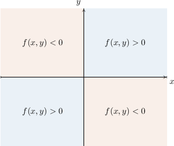
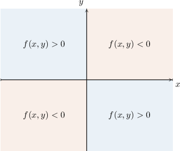
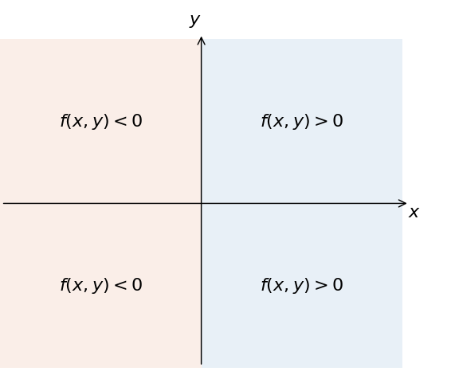
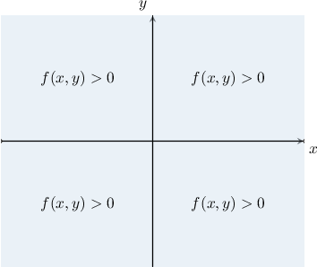
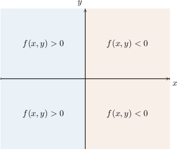
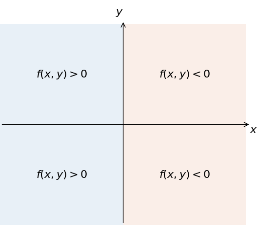
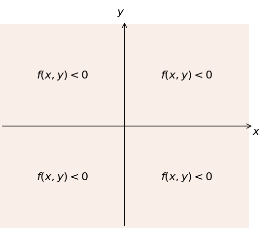

# Originals and generated variants

Every generated record has one fixed worked solution. Source q97483 has no observed worked solution or correct marker; those additions are explicitly authored. The other seven source replays match whole prompt/solution strings.

## Original q-96767

Consider the differential equation $\frac{\text{d}y}{\text{d}x}=2xy$ and its slope field. Which of the following statements are true?

- At every point in the first quadrant, the slope of the slope field is positive
- At every point in the second quadrant, the slope of the slope field is positive
- At every point in the third quadrant, the slope of the slope field is positive

Original bank: I, II, and III, I and III only, I and II only, I only, II and III only

First, we define $f(x,y)=2xy.$ Then, our differential equation is $\frac{\text{d}y}{\text{d}x}=f(x,y).$ 

Notice that $f(x,y)=0$ when $x=0$ or $y=0.$ The lines $x=0$ and $y=0$ divide the plane into the usual four quadrants.

If we compute the sign of $f(x,y)$ in each quadrant (by considering some test points, for example), we get the following:

With that in mind, let's check each statement:

- Statement I is true. If $(x,y)$ is in the first quadrant, then according to our diagram, we have

$$
{\frac{\text{d}y}{\text{d}x}|}_{(x,y)}=f(x,y)>0.\,
$$

This implies that the slope of the slope field is positive for any point $(x,y)$ in the first quadrant.

- Statement II is false. If $(x,y)$ is in the second quadrant, then according to our diagram, we have

$$
{\frac{\text{d}y}{\text{d}x}|}_{(x,y)}=f(x,y)<0.\,
$$

This implies that the slope of the slope field is negative for any point $(x,y)$ in the second quadrant.

- Statement III is true. If $(x,y)$ is in the third quadrant, then according to our diagram, we have

$$
{\frac{\text{d}y}{\text{d}x}|}_{(x,y)}=f(x,y)>0.\,
$$

This implies that the slope of the slope field is positive for any point $(x,y)$ in the third quadrant.

### Parameterized replay

Consider the differential equation $\frac{\text{d}y}{\text{d}x}=2xy$ and its slope field. Which of the following statements are true?

- At every point in the first quadrant, the slope of the slope field is positive
- At every point in the second quadrant, the slope of the slope field is positive
- At every point in the third quadrant, the slope of the slope field is positive

- I and II only
- I and III only
- I, II, and III
- II and III only
- I only

First, we define $f(x,y)=2xy.$ Then, our differential equation is $\frac{\text{d}y}{\text{d}x}=f(x,y).$ 

Notice that $f(x,y)=0$ when $x=0$ or $y=0.$ The lines $x=0$ and $y=0$ divide the plane into the usual four quadrants.

If we compute the sign of $f(x,y)$ in each quadrant (by considering some test points, for example), we get the following:

With that in mind, let's check each statement:

- Statement I is true. If $(x,y)$ is in the first quadrant, then according to our diagram, we have

$$
{\frac{\text{d}y}{\text{d}x}|}_{(x,y)}=f(x,y)>0.\,
$$

This implies that the slope of the slope field is positive for any point $(x,y)$ in the first quadrant.

- Statement II is false. If $(x,y)$ is in the second quadrant, then according to our diagram, we have

$$
{\frac{\text{d}y}{\text{d}x}|}_{(x,y)}=f(x,y)<0.\,
$$

This implies that the slope of the slope field is negative for any point $(x,y)$ in the second quadrant.

- Statement III is true. If $(x,y)$ is in the third quadrant, then according to our diagram, we have

$$
{\frac{\text{d}y}{\text{d}x}|}_{(x,y)}=f(x,y)>0.\,
$$

This implies that the slope of the slope field is positive for any point $(x,y)$ in the third quadrant.

### Generated variant: bilinear_open_thin / bank96767 / seed 17

Consider the differential equation $\frac{\text{d}y}{\text{d}x}=5xy$ and its slope field. Which of the following statements are true?

- At every point in the third quadrant, the slope of the slope field is positive
- At every point in the second quadrant, the slope of the slope field is negative
- At every point in the first quadrant, the slope of the slope field is negative

- I, II, and III
- II and III only
- I and II only
- I only
- I and III only

First, we define $f(x,y)=5xy.$ Then, our differential equation is $\frac{\text{d}y}{\text{d}x}=f(x,y).$ 

Notice that $f(x,y)=0$ when $x=0$ or $y=0.$ The lines $x=0$ and $y=0$ divide the plane into the usual four quadrants.

If we compute the sign of $f(x,y)$ in each quadrant (by considering some test points, for example), we get the following:

With that in mind, let's check each statement:

- Statement I is true. If $(x,y)$ is in the third quadrant, then according to our diagram, we have

$$
{\frac{\text{d}y}{\text{d}x}|}_{(x,y)}=f(x,y)>0.\,
$$

This implies that the slope of the slope field is positive for any point $(x,y)$ in the third quadrant.

- Statement II is true. If $(x,y)$ is in the second quadrant, then according to our diagram, we have

$$
{\frac{\text{d}y}{\text{d}x}|}_{(x,y)}=f(x,y)<0.\,
$$

This implies that the slope of the slope field is negative for any point $(x,y)$ in the second quadrant.

- Statement III is false. If $(x,y)$ is in the first quadrant, then according to our diagram, we have

$$
{\frac{\text{d}y}{\text{d}x}|}_{(x,y)}=f(x,y)>0.\,
$$

This implies that the slope of the slope field is positive for any point $(x,y)$ in the first quadrant.

### Generated variant: bilinear_open_thin / bank96767 / seed 31

Consider the differential equation $\frac{\text{d}y}{\text{d}x}=-8xy$ and its slope field. Which of the following statements are true?

- At every point in the first quadrant, the slope of the slope field is negative
- At every point in the second quadrant, the slope of the slope field is negative
- At every point in the fourth quadrant, the slope of the slope field is negative

- I only
- I, II, and III
- I and II only
- I and III only
- II and III only

First, we define $f(x,y)=-8xy.$ Then, our differential equation is $\frac{\text{d}y}{\text{d}x}=f(x,y).$ 

Notice that $f(x,y)=0$ when $x=0$ or $y=0.$ The lines $x=0$ and $y=0$ divide the plane into the usual four quadrants.

If we compute the sign of $f(x,y)$ in each quadrant (by considering some test points, for example), we get the following:

With that in mind, let's check each statement:

- Statement I is true. If $(x,y)$ is in the first quadrant, then according to our diagram, we have

$$
{\frac{\text{d}y}{\text{d}x}|}_{(x,y)}=f(x,y)<0.\,
$$

This implies that the slope of the slope field is negative for any point $(x,y)$ in the first quadrant.

- Statement II is false. If $(x,y)$ is in the second quadrant, then according to our diagram, we have

$$
{\frac{\text{d}y}{\text{d}x}|}_{(x,y)}=f(x,y)>0.\,
$$

This implies that the slope of the slope field is positive for any point $(x,y)$ in the second quadrant.

- Statement III is false. If $(x,y)$ is in the fourth quadrant, then according to our diagram, we have

$$
{\frac{\text{d}y}{\text{d}x}|}_{(x,y)}=f(x,y)>0.\,
$$

This implies that the slope of the slope field is positive for any point $(x,y)$ in the fourth quadrant.

## Original q-97483

Consider the differential equation $\frac{dy}{dx} = xy^{2}$ and its slope field. Which of the following statements are true?

1. At every point in the first quadrant, the slope of the slope field is negative
2. At every point in the second quadrant, the slope of the slope field is negative
3. At every point in the third quadrant, the slope of the slope field is negative

Original bank: III only, I only, II and III only, I and II only, I and III only

**No source solution or correct designation.**

### Parameterized replay (repaired)

Consider the differential equation $\frac{dy}{dx} = xy^{2}$ and its slope field. Which of the following statements are true?

1. At every point in the first quadrant, the slope of the slope field is negative
2. At every point in the second quadrant, the slope of the slope field is negative
3. At every point in the third quadrant, the slope of the slope field is negative

- II and III only
- I only
- III only
- I and III only
- I and II only

First, we define $f(x,y)=xy^{2}.$ Then, our differential equation is $\frac{\text{d}y}{\text{d}x}=f(x,y).$ 

Notice that $f(x,y)=0$ when $x=0$ or $y=0.$ The lines $x=0$ and $y=0$ divide the plane into the usual four quadrants.

If we compute the sign of $f(x,y)$ in each quadrant (by considering some test points, for example), we get the following:

With that in mind, let's check each statement:

- Statement I is false. If $(x,y)$ is in the first quadrant, then according to our diagram, we have

$$
{\frac{\text{d}y}{\text{d}x}|}_{(x,y)}=f(x,y)>0.
$$

This implies that the slope of the slope field is positive for any point $(x,y)$ in the first quadrant.

- Statement II is true. If $(x,y)$ is in the second quadrant, then according to our diagram, we have

$$
{\frac{\text{d}y}{\text{d}x}|}_{(x,y)}=f(x,y)<0.
$$

This implies that the slope of the slope field is negative for any point $(x,y)$ in the second quadrant.

- Statement III is true. If $(x,y)$ is in the third quadrant, then according to our diagram, we have

$$
{\frac{\text{d}y}{\text{d}x}|}_{(x,y)}=f(x,y)<0.
$$

This implies that the slope of the slope field is negative for any point $(x,y)$ in the third quadrant.

Therefore, the correct answer is "II and III only."

### Generated variant: parity_numbered / bank97483 / seed 17

Consider the differential equation $\frac{dy}{dx} = 5x^{2}y^{2}$ and its slope field. Which of the following statements are true?

1. At every point in the third quadrant, the slope of the slope field is positive
2. At every point in the second quadrant, the slope of the slope field is negative
3. At every point in the first quadrant, the slope of the slope field is negative

- III only
- I and III only
- II and III only
- I and II only
- I only

First, we define $f(x,y)=5x^{2}y^{2}.$ Then, our differential equation is $\frac{\text{d}y}{\text{d}x}=f(x,y).$ 

Notice that $f(x,y)=0$ when $x=0$ or $y=0.$ The lines $x=0$ and $y=0$ divide the plane into the usual four quadrants.

If we compute the sign of $f(x,y)$ in each quadrant (by considering some test points, for example), we get the following:

With that in mind, let's check each statement:

- Statement I is true. If $(x,y)$ is in the third quadrant, then according to our diagram, we have

$$
{\frac{\text{d}y}{\text{d}x}|}_{(x,y)}=f(x,y)>0.
$$

This implies that the slope of the slope field is positive for any point $(x,y)$ in the third quadrant.

- Statement II is false. If $(x,y)$ is in the second quadrant, then according to our diagram, we have

$$
{\frac{\text{d}y}{\text{d}x}|}_{(x,y)}=f(x,y)>0.
$$

This implies that the slope of the slope field is positive for any point $(x,y)$ in the second quadrant.

- Statement III is false. If $(x,y)$ is in the first quadrant, then according to our diagram, we have

$$
{\frac{\text{d}y}{\text{d}x}|}_{(x,y)}=f(x,y)>0.
$$

This implies that the slope of the slope field is positive for any point $(x,y)$ in the first quadrant.

Therefore, the correct answer is "I only."

### Generated variant: parity_numbered / bank97483 / seed 31

Consider the differential equation $\frac{dy}{dx} = 2xy^{2}$ and its slope field. Which of the following statements are true?

1. At every point in the fourth quadrant, the slope of the slope field is negative
2. At every point in the first quadrant, the slope of the slope field is negative
3. At every point in the third quadrant, the slope of the slope field is negative

- I and II only
- III only
- II and III only
- I and III only
- I only

First, we define $f(x,y)=2xy^{2}.$ Then, our differential equation is $\frac{\text{d}y}{\text{d}x}=f(x,y).$ 

Notice that $f(x,y)=0$ when $x=0$ or $y=0.$ The lines $x=0$ and $y=0$ divide the plane into the usual four quadrants.

If we compute the sign of $f(x,y)$ in each quadrant (by considering some test points, for example), we get the following:

With that in mind, let's check each statement:

- Statement I is false. If $(x,y)$ is in the fourth quadrant, then according to our diagram, we have

$$
{\frac{\text{d}y}{\text{d}x}|}_{(x,y)}=f(x,y)>0.
$$

This implies that the slope of the slope field is positive for any point $(x,y)$ in the fourth quadrant.

- Statement II is false. If $(x,y)$ is in the first quadrant, then according to our diagram, we have

$$
{\frac{\text{d}y}{\text{d}x}|}_{(x,y)}=f(x,y)>0.
$$

This implies that the slope of the slope field is positive for any point $(x,y)$ in the first quadrant.

- Statement III is true. If $(x,y)$ is in the third quadrant, then according to our diagram, we have

$$
{\frac{\text{d}y}{\text{d}x}|}_{(x,y)}=f(x,y)<0.
$$

This implies that the slope of the slope field is negative for any point $(x,y)$ in the third quadrant.

Therefore, the correct answer is "III only."

## Original q-119766

Consider the differential equation $\frac{\text{d}y}{\text{d}x}=6xy$ and its slope field. Which of the following statements are true?

- At every point in the second quadrant, the slope of the slope field is negative
- At every point in the third quadrant, the slope of the slope field is positive
- At every point in the fourth quadrant, the slope of the slope field is negative

Original bank: I and II only, II and III only, I only, I, II, and III, II only

First, we define $f(x,y)=6xy.$ Then, our differential equation is $\frac{\text{d}y}{\text{d}x}=f(x,y).$ 

Notice that $f(x,y)=0$ when $x=0$ or $y=0.$ The lines $x=0$ and $y=0$ divide the plane into the usual four quadrants.

If we compute the sign of $f(x,y)$ in each quadrant (by considering some test points, for example), we get the following:

With that in mind, let's check each statement:

- Statement I is true. If $(x,y)$ is in the second quadrant, then according to our diagram, we have

$$
{\frac{\text{d}y}{\text{d}x}|}_{(x,y)}=f(x,y)<0.
$$

This implies that the slope of the slope field is negative for any point $(x,y)$ in the second quadrant.

- Statement II is true. If $(x,y)$ is in the third quadrant, then according to our diagram, we have

$$
{\frac{\text{d}y}{\text{d}x}|}_{(x,y)}=f(x,y)>0.
$$

This implies that the slope of the slope field is positive for any point $(x,y)$ in the third quadrant.

- Statement III is true. If $(x,y)$ is in the fourth quadrant, then according to our diagram, we have

$$
{\frac{\text{d}y}{\text{d}x}|}_{(x,y)}=f(x,y)<0.
$$

This implies that the slope of the slope field is negative for any point $(x,y)$ in the fourth quadrant.

Therefore, the correct answer is "I, II, and III."

### Parameterized replay

Consider the differential equation $\frac{\text{d}y}{\text{d}x}=6xy$ and its slope field. Which of the following statements are true?

- At every point in the second quadrant, the slope of the slope field is negative
- At every point in the third quadrant, the slope of the slope field is positive
- At every point in the fourth quadrant, the slope of the slope field is negative

- I only
- II and III only
- I and II only
- II only
- I, II, and III

First, we define $f(x,y)=6xy.$ Then, our differential equation is $\frac{\text{d}y}{\text{d}x}=f(x,y).$ 

Notice that $f(x,y)=0$ when $x=0$ or $y=0.$ The lines $x=0$ and $y=0$ divide the plane into the usual four quadrants.

If we compute the sign of $f(x,y)$ in each quadrant (by considering some test points, for example), we get the following:

With that in mind, let's check each statement:

- Statement I is true. If $(x,y)$ is in the second quadrant, then according to our diagram, we have

$$
{\frac{\text{d}y}{\text{d}x}|}_{(x,y)}=f(x,y)<0.
$$

This implies that the slope of the slope field is negative for any point $(x,y)$ in the second quadrant.

- Statement II is true. If $(x,y)$ is in the third quadrant, then according to our diagram, we have

$$
{\frac{\text{d}y}{\text{d}x}|}_{(x,y)}=f(x,y)>0.
$$

This implies that the slope of the slope field is positive for any point $(x,y)$ in the third quadrant.

- Statement III is true. If $(x,y)$ is in the fourth quadrant, then according to our diagram, we have

$$
{\frac{\text{d}y}{\text{d}x}|}_{(x,y)}=f(x,y)<0.
$$

This implies that the slope of the slope field is negative for any point $(x,y)$ in the fourth quadrant.

Therefore, the correct answer is "I, II, and III."

### Generated variant: bilinear_closed / bank119766 / seed 17

Consider the differential equation $\frac{\text{d}y}{\text{d}x}=5xy$ and its slope field. Which of the following statements are true?

- At every point in the third quadrant, the slope of the slope field is positive
- At every point in the second quadrant, the slope of the slope field is negative
- At every point in the first quadrant, the slope of the slope field is negative

- I and II only
- II only
- I only
- I, II, and III
- II and III only

First, we define $f(x,y)=5xy.$ Then, our differential equation is $\frac{\text{d}y}{\text{d}x}=f(x,y).$ 

Notice that $f(x,y)=0$ when $x=0$ or $y=0.$ The lines $x=0$ and $y=0$ divide the plane into the usual four quadrants.

If we compute the sign of $f(x,y)$ in each quadrant (by considering some test points, for example), we get the following:

With that in mind, let's check each statement:

- Statement I is true. If $(x,y)$ is in the third quadrant, then according to our diagram, we have

$$
{\frac{\text{d}y}{\text{d}x}|}_{(x,y)}=f(x,y)>0.
$$

This implies that the slope of the slope field is positive for any point $(x,y)$ in the third quadrant.

- Statement II is true. If $(x,y)$ is in the second quadrant, then according to our diagram, we have

$$
{\frac{\text{d}y}{\text{d}x}|}_{(x,y)}=f(x,y)<0.
$$

This implies that the slope of the slope field is negative for any point $(x,y)$ in the second quadrant.

- Statement III is false. If $(x,y)$ is in the first quadrant, then according to our diagram, we have

$$
{\frac{\text{d}y}{\text{d}x}|}_{(x,y)}=f(x,y)>0.
$$

This implies that the slope of the slope field is positive for any point $(x,y)$ in the first quadrant.

Therefore, the correct answer is "I and II only."

### Generated variant: bilinear_closed / bank119766 / seed 31

Consider the differential equation $\frac{\text{d}y}{\text{d}x}=-8xy$ and its slope field. Which of the following statements are true?

- At every point in the first quadrant, the slope of the slope field is negative
- At every point in the second quadrant, the slope of the slope field is negative
- At every point in the fourth quadrant, the slope of the slope field is negative

- I, II, and III
- I and II only
- I only
- II and III only
- II only

First, we define $f(x,y)=-8xy.$ Then, our differential equation is $\frac{\text{d}y}{\text{d}x}=f(x,y).$ 

Notice that $f(x,y)=0$ when $x=0$ or $y=0.$ The lines $x=0$ and $y=0$ divide the plane into the usual four quadrants.

If we compute the sign of $f(x,y)$ in each quadrant (by considering some test points, for example), we get the following:

With that in mind, let's check each statement:

- Statement I is true. If $(x,y)$ is in the first quadrant, then according to our diagram, we have

$$
{\frac{\text{d}y}{\text{d}x}|}_{(x,y)}=f(x,y)<0.
$$

This implies that the slope of the slope field is negative for any point $(x,y)$ in the first quadrant.

- Statement II is false. If $(x,y)$ is in the second quadrant, then according to our diagram, we have

$$
{\frac{\text{d}y}{\text{d}x}|}_{(x,y)}=f(x,y)>0.
$$

This implies that the slope of the slope field is positive for any point $(x,y)$ in the second quadrant.

- Statement III is false. If $(x,y)$ is in the fourth quadrant, then according to our diagram, we have

$$
{\frac{\text{d}y}{\text{d}x}|}_{(x,y)}=f(x,y)>0.
$$

This implies that the slope of the slope field is positive for any point $(x,y)$ in the fourth quadrant.

Therefore, the correct answer is "I only."

## Original q-119769

Consider the differential equation $\frac{\text{d}y}{\text{d}x}=-5xy$ and its slope field. Which of the following statements are true?

- At every point in the first quadrant, the slope of the slope field is positive
- At every point in the second quadrant, the slope of the slope field is negative
- At every point in the fourth quadrant, the slope of the slope field is positive

Original bank: None of those listed, II only, I only, III only, I and II only

First, we define $f(x,y)=-5xy.$ Then, our differential equation is $\frac{\text{d}y}{\text{d}x}=f(x,y).$ 

Notice that $f(x,y)=0$ when $x=0$ or $y=0.$ The lines $x=0$ and $y=0$ divide the plane into the usual four quadrants.

If we compute the sign of $f(x,y)$ in each quadrant (by considering some test points, for example), we get the following:

With that in mind, let's check each statement:

- Statement I is false. If $(x,y)$ is in the first quadrant, then according to our diagram, we have

$$
{\frac{\text{d}y}{\text{d}x}|}_{(x,y)}=f(x,y)<0.
$$

This implies that the slope of the slope field is negative for any point $(x,y)$ in the first quadrant.

- Statement II is false. If $(x,y)$ is in the second quadrant, then according to our diagram, we have

$$
{\frac{\text{d}y}{\text{d}x}|}_{(x,y)}=f(x,y)>0.
$$

This implies that the slope of the slope field is positive for any point $(x,y)$ in the second quadrant.

- Statement III is true. If $(x,y)$ is in the fourth quadrant, then according to our diagram, we have

$$
{\frac{\text{d}y}{\text{d}x}|}_{(x,y)}=f(x,y)>0.
$$

This implies that the slope of the slope field is positive for any point $(x,y)$ in the fourth quadrant.

Therefore, the correct answer is "III only."

### Parameterized replay

Consider the differential equation $\frac{\text{d}y}{\text{d}x}=-5xy$ and its slope field. Which of the following statements are true?

- At every point in the first quadrant, the slope of the slope field is positive
- At every point in the second quadrant, the slope of the slope field is negative
- At every point in the fourth quadrant, the slope of the slope field is positive

- I only
- II only
- None of those listed
- I and II only
- III only

First, we define $f(x,y)=-5xy.$ Then, our differential equation is $\frac{\text{d}y}{\text{d}x}=f(x,y).$ 

Notice that $f(x,y)=0$ when $x=0$ or $y=0.$ The lines $x=0$ and $y=0$ divide the plane into the usual four quadrants.

If we compute the sign of $f(x,y)$ in each quadrant (by considering some test points, for example), we get the following:

With that in mind, let's check each statement:

- Statement I is false. If $(x,y)$ is in the first quadrant, then according to our diagram, we have

$$
{\frac{\text{d}y}{\text{d}x}|}_{(x,y)}=f(x,y)<0.
$$

This implies that the slope of the slope field is negative for any point $(x,y)$ in the first quadrant.

- Statement II is false. If $(x,y)$ is in the second quadrant, then according to our diagram, we have

$$
{\frac{\text{d}y}{\text{d}x}|}_{(x,y)}=f(x,y)>0.
$$

This implies that the slope of the slope field is positive for any point $(x,y)$ in the second quadrant.

- Statement III is true. If $(x,y)$ is in the fourth quadrant, then according to our diagram, we have

$$
{\frac{\text{d}y}{\text{d}x}|}_{(x,y)}=f(x,y)>0.
$$

This implies that the slope of the slope field is positive for any point $(x,y)$ in the fourth quadrant.

Therefore, the correct answer is "III only."

### Generated variant: bilinear_closed / bank119769 / seed 17

Consider the differential equation $\frac{\text{d}y}{\text{d}x}=5xy$ and its slope field. Which of the following statements are true?

- At every point in the third quadrant, the slope of the slope field is positive
- At every point in the second quadrant, the slope of the slope field is negative
- At every point in the first quadrant, the slope of the slope field is negative

- None of those listed
- I and II only
- I only
- III only
- II only

First, we define $f(x,y)=5xy.$ Then, our differential equation is $\frac{\text{d}y}{\text{d}x}=f(x,y).$ 

Notice that $f(x,y)=0$ when $x=0$ or $y=0.$ The lines $x=0$ and $y=0$ divide the plane into the usual four quadrants.

If we compute the sign of $f(x,y)$ in each quadrant (by considering some test points, for example), we get the following:

With that in mind, let's check each statement:

- Statement I is true. If $(x,y)$ is in the third quadrant, then according to our diagram, we have

$$
{\frac{\text{d}y}{\text{d}x}|}_{(x,y)}=f(x,y)>0.
$$

This implies that the slope of the slope field is positive for any point $(x,y)$ in the third quadrant.

- Statement II is true. If $(x,y)$ is in the second quadrant, then according to our diagram, we have

$$
{\frac{\text{d}y}{\text{d}x}|}_{(x,y)}=f(x,y)<0.
$$

This implies that the slope of the slope field is negative for any point $(x,y)$ in the second quadrant.

- Statement III is false. If $(x,y)$ is in the first quadrant, then according to our diagram, we have

$$
{\frac{\text{d}y}{\text{d}x}|}_{(x,y)}=f(x,y)>0.
$$

This implies that the slope of the slope field is positive for any point $(x,y)$ in the first quadrant.

Therefore, the correct answer is "I and II only."

### Generated variant: bilinear_closed / bank119769 / seed 31

Consider the differential equation $\frac{\text{d}y}{\text{d}x}=-8xy$ and its slope field. Which of the following statements are true?

- At every point in the first quadrant, the slope of the slope field is negative
- At every point in the second quadrant, the slope of the slope field is negative
- At every point in the fourth quadrant, the slope of the slope field is negative

- III only
- None of those listed
- I only
- II only
- I and II only

First, we define $f(x,y)=-8xy.$ Then, our differential equation is $\frac{\text{d}y}{\text{d}x}=f(x,y).$ 

Notice that $f(x,y)=0$ when $x=0$ or $y=0.$ The lines $x=0$ and $y=0$ divide the plane into the usual four quadrants.

If we compute the sign of $f(x,y)$ in each quadrant (by considering some test points, for example), we get the following:

With that in mind, let's check each statement:

- Statement I is true. If $(x,y)$ is in the first quadrant, then according to our diagram, we have

$$
{\frac{\text{d}y}{\text{d}x}|}_{(x,y)}=f(x,y)<0.
$$

This implies that the slope of the slope field is negative for any point $(x,y)$ in the first quadrant.

- Statement II is false. If $(x,y)$ is in the second quadrant, then according to our diagram, we have

$$
{\frac{\text{d}y}{\text{d}x}|}_{(x,y)}=f(x,y)>0.
$$

This implies that the slope of the slope field is positive for any point $(x,y)$ in the second quadrant.

- Statement III is false. If $(x,y)$ is in the fourth quadrant, then according to our diagram, we have

$$
{\frac{\text{d}y}{\text{d}x}|}_{(x,y)}=f(x,y)>0.
$$

This implies that the slope of the slope field is positive for any point $(x,y)$ in the fourth quadrant.

Therefore, the correct answer is "I only."

## Original q-119774

Consider the differential equation $\frac{\text{d}y}{\text{d}x}=8{x}^{2}{y}^{2}$ and its slope field. Which of the following statements are true?

- At every point in the first quadrant, the slope of the slope field is negative
- At every point in the third quadrant, the slope of the slope field is positive
- At every point in the fourth quadrant, the slope of the slope field is negative

Original bank: I only, I and III only, None of those listed, III only, II only

First, we define $f(x,y)=8{x}^{2}{y}^{2}.$ Then, our differential equation is $\frac{\text{d}y}{\text{d}x}=f(x,y).$ 

Notice that $f(x,y)=0$ when $x=0$ or $y=0.$ The lines $x=0$ and $y=0$ divide the plane into the usual four quadrants.

If we compute the sign of $f(x,y)$ in each quadrant (by considering some test points, for example), we get the following:

With that in mind, let's check each statement:

- Statement I is false. If $(x,y)$ is in the first quadrant, then according to our diagram, we have

$$
{\frac{\text{d}y}{\text{d}x}|}_{(x,y)}=f(x,y)>0.
$$

This implies that the slope of the slope field is positive for any point $(x,y)$ in the first quadrant.

- Statement II is true. If $(x,y)$ is in the third quadrant, then according to our diagram, we have

$$
{\frac{\text{d}y}{\text{d}x}|}_{(x,y)}=f(x,y)>0.
$$

This implies that the slope of the slope field is positive for any point $(x,y)$ in the third quadrant.

- Statement III is false. If $(x,y)$ is in the fourth quadrant, then according to our diagram, we have

$$
{\frac{\text{d}y}{\text{d}x}|}_{(x,y)}=f(x,y)>0.
$$

This implies that the slope of the slope field is positive for any point $(x,y)$ in the fourth quadrant.

Therefore, the correct answer is "II only."

### Parameterized replay

Consider the differential equation $\frac{\text{d}y}{\text{d}x}=8{x}^{2}{y}^{2}$ and its slope field. Which of the following statements are true?

- At every point in the first quadrant, the slope of the slope field is negative
- At every point in the third quadrant, the slope of the slope field is positive
- At every point in the fourth quadrant, the slope of the slope field is negative

- None of those listed
- I and III only
- I only
- II only
- III only

First, we define $f(x,y)=8{x}^{2}{y}^{2}.$ Then, our differential equation is $\frac{\text{d}y}{\text{d}x}=f(x,y).$ 

Notice that $f(x,y)=0$ when $x=0$ or $y=0.$ The lines $x=0$ and $y=0$ divide the plane into the usual four quadrants.

If we compute the sign of $f(x,y)$ in each quadrant (by considering some test points, for example), we get the following:

With that in mind, let's check each statement:

- Statement I is false. If $(x,y)$ is in the first quadrant, then according to our diagram, we have

$$
{\frac{\text{d}y}{\text{d}x}|}_{(x,y)}=f(x,y)>0.
$$

This implies that the slope of the slope field is positive for any point $(x,y)$ in the first quadrant.

- Statement II is true. If $(x,y)$ is in the third quadrant, then according to our diagram, we have

$$
{\frac{\text{d}y}{\text{d}x}|}_{(x,y)}=f(x,y)>0.
$$

This implies that the slope of the slope field is positive for any point $(x,y)$ in the third quadrant.

- Statement III is false. If $(x,y)$ is in the fourth quadrant, then according to our diagram, we have

$$
{\frac{\text{d}y}{\text{d}x}|}_{(x,y)}=f(x,y)>0.
$$

This implies that the slope of the slope field is positive for any point $(x,y)$ in the fourth quadrant.

Therefore, the correct answer is "II only."

### Generated variant: parity_closed / bank119774 / seed 17

Consider the differential equation $\frac{\text{d}y}{\text{d}x}=5{x}^{2}{y}^{2}$ and its slope field. Which of the following statements are true?

- At every point in the third quadrant, the slope of the slope field is positive
- At every point in the second quadrant, the slope of the slope field is negative
- At every point in the first quadrant, the slope of the slope field is negative

- I only
- II only
- None of those listed
- III only
- I and III only

First, we define $f(x,y)=5{x}^{2}{y}^{2}.$ Then, our differential equation is $\frac{\text{d}y}{\text{d}x}=f(x,y).$ 

Notice that $f(x,y)=0$ when $x=0$ or $y=0.$ The lines $x=0$ and $y=0$ divide the plane into the usual four quadrants.

If we compute the sign of $f(x,y)$ in each quadrant (by considering some test points, for example), we get the following:

With that in mind, let's check each statement:

- Statement I is true. If $(x,y)$ is in the third quadrant, then according to our diagram, we have

$$
{\frac{\text{d}y}{\text{d}x}|}_{(x,y)}=f(x,y)>0.
$$

This implies that the slope of the slope field is positive for any point $(x,y)$ in the third quadrant.

- Statement II is false. If $(x,y)$ is in the second quadrant, then according to our diagram, we have

$$
{\frac{\text{d}y}{\text{d}x}|}_{(x,y)}=f(x,y)>0.
$$

This implies that the slope of the slope field is positive for any point $(x,y)$ in the second quadrant.

- Statement III is false. If $(x,y)$ is in the first quadrant, then according to our diagram, we have

$$
{\frac{\text{d}y}{\text{d}x}|}_{(x,y)}=f(x,y)>0.
$$

This implies that the slope of the slope field is positive for any point $(x,y)$ in the first quadrant.

Therefore, the correct answer is "I only."

### Generated variant: parity_closed / bank119774 / seed 31

Consider the differential equation $\frac{\text{d}y}{\text{d}x}=2x{y}^{2}$ and its slope field. Which of the following statements are true?

- At every point in the fourth quadrant, the slope of the slope field is negative
- At every point in the first quadrant, the slope of the slope field is negative
- At every point in the third quadrant, the slope of the slope field is negative

- III only
- I only
- None of those listed
- II only
- I and III only

First, we define $f(x,y)=2x{y}^{2}.$ Then, our differential equation is $\frac{\text{d}y}{\text{d}x}=f(x,y).$ 

Notice that $f(x,y)=0$ when $x=0$ or $y=0.$ The lines $x=0$ and $y=0$ divide the plane into the usual four quadrants.

If we compute the sign of $f(x,y)$ in each quadrant (by considering some test points, for example), we get the following:

With that in mind, let's check each statement:

- Statement I is false. If $(x,y)$ is in the fourth quadrant, then according to our diagram, we have

$$
{\frac{\text{d}y}{\text{d}x}|}_{(x,y)}=f(x,y)>0.
$$

This implies that the slope of the slope field is positive for any point $(x,y)$ in the fourth quadrant.

- Statement II is false. If $(x,y)$ is in the first quadrant, then according to our diagram, we have

$$
{\frac{\text{d}y}{\text{d}x}|}_{(x,y)}=f(x,y)>0.
$$

This implies that the slope of the slope field is positive for any point $(x,y)$ in the first quadrant.

- Statement III is true. If $(x,y)$ is in the third quadrant, then according to our diagram, we have

$$
{\frac{\text{d}y}{\text{d}x}|}_{(x,y)}=f(x,y)<0.
$$

This implies that the slope of the slope field is negative for any point $(x,y)$ in the third quadrant.

Therefore, the correct answer is "III only."

## Original q-97477

Consider the differential equation $\frac{\text{d}y}{\text{d}x}=-xy$ and its slope field. Which of the following statements are true?

- At every point in the first quadrant, the slope of the slope field is positive
- At every point in the second quadrant, the slope of the slope field is positive
- At every point in the fourth quadrant, the slope of the slope field is negative

Original bank: None of those listed, III only, II only, I only, II and III only

First, we define $f(x,y)=-xy.$ Then, our differential equation is $\frac{\text{d}y}{\text{d}x}=f(x,y).$ 

Notice that $f(x,y)=0$ when $x=0$ or $y=0.$ The lines $x=0$ and $y=0$ divide the plane into the usual four quadrants.

If we compute the sign of $f(x,y)$ in each quadrant (by considering some test points, for example), we get the following:

With that in mind, let's check each statement:

- Statement I is false. If $(x,y)$ is in the first quadrant, then according to our diagram, we have

$$
{\frac{\text{d}y}{\text{d}x}|}_{(x,y)}=f(x,y)<0.
$$

This implies that the slope of the slope field is negative for any point $(x,y)$ in the first quadrant.

- Statement II is true. If $(x,y)$ is in the second quadrant, then according to our diagram, we have

$$
{\frac{\text{d}y}{\text{d}x}|}_{(x,y)}=f(x,y)>0.
$$

This implies that the slope of the slope field is positive for any point $(x,y)$ in the second quadrant.

- Statement III is false. If $(x,y)$ is in the fourth quadrant, then according to our diagram, we have

$$
{\frac{\text{d}y}{\text{d}x}|}_{(x,y)}=f(x,y)>0.
$$

This implies that the slope of the slope field is positive for any point $(x,y)$ in the fourth quadrant.

### Parameterized replay

Consider the differential equation $\frac{\text{d}y}{\text{d}x}=-xy$ and its slope field. Which of the following statements are true?

- At every point in the first quadrant, the slope of the slope field is positive
- At every point in the second quadrant, the slope of the slope field is positive
- At every point in the fourth quadrant, the slope of the slope field is negative

- II only
- III only
- None of those listed
- II and III only
- I only

First, we define $f(x,y)=-xy.$ Then, our differential equation is $\frac{\text{d}y}{\text{d}x}=f(x,y).$ 

Notice that $f(x,y)=0$ when $x=0$ or $y=0.$ The lines $x=0$ and $y=0$ divide the plane into the usual four quadrants.

If we compute the sign of $f(x,y)$ in each quadrant (by considering some test points, for example), we get the following:

With that in mind, let's check each statement:

- Statement I is false. If $(x,y)$ is in the first quadrant, then according to our diagram, we have

$$
{\frac{\text{d}y}{\text{d}x}|}_{(x,y)}=f(x,y)<0.
$$

This implies that the slope of the slope field is negative for any point $(x,y)$ in the first quadrant.

- Statement II is true. If $(x,y)$ is in the second quadrant, then according to our diagram, we have

$$
{\frac{\text{d}y}{\text{d}x}|}_{(x,y)}=f(x,y)>0.
$$

This implies that the slope of the slope field is positive for any point $(x,y)$ in the second quadrant.

- Statement III is false. If $(x,y)$ is in the fourth quadrant, then according to our diagram, we have

$$
{\frac{\text{d}y}{\text{d}x}|}_{(x,y)}=f(x,y)>0.
$$

This implies that the slope of the slope field is positive for any point $(x,y)$ in the fourth quadrant.

### Generated variant: bilinear_open / bank97477 / seed 17

Consider the differential equation $\frac{\text{d}y}{\text{d}x}=7xy$ and its slope field. Which of the following statements are true?

- At every point in the first quadrant, the slope of the slope field is negative
- At every point in the third quadrant, the slope of the slope field is positive
- At every point in the second quadrant, the slope of the slope field is positive

- II only
- II and III only
- III only
- I only
- None of those listed

First, we define $f(x,y)=7xy.$ Then, our differential equation is $\frac{\text{d}y}{\text{d}x}=f(x,y).$ 

Notice that $f(x,y)=0$ when $x=0$ or $y=0.$ The lines $x=0$ and $y=0$ divide the plane into the usual four quadrants.

If we compute the sign of $f(x,y)$ in each quadrant (by considering some test points, for example), we get the following:

With that in mind, let's check each statement:

- Statement I is false. If $(x,y)$ is in the first quadrant, then according to our diagram, we have

$$
{\frac{\text{d}y}{\text{d}x}|}_{(x,y)}=f(x,y)>0.
$$

This implies that the slope of the slope field is positive for any point $(x,y)$ in the first quadrant.

- Statement II is true. If $(x,y)$ is in the third quadrant, then according to our diagram, we have

$$
{\frac{\text{d}y}{\text{d}x}|}_{(x,y)}=f(x,y)>0.
$$

This implies that the slope of the slope field is positive for any point $(x,y)$ in the third quadrant.

- Statement III is false. If $(x,y)$ is in the second quadrant, then according to our diagram, we have

$$
{\frac{\text{d}y}{\text{d}x}|}_{(x,y)}=f(x,y)<0.
$$

This implies that the slope of the slope field is negative for any point $(x,y)$ in the second quadrant.

### Generated variant: bilinear_open / bank97477 / seed 31

Consider the differential equation $\frac{\text{d}y}{\text{d}x}=-8xy$ and its slope field. Which of the following statements are true?

- At every point in the first quadrant, the slope of the slope field is negative
- At every point in the second quadrant, the slope of the slope field is negative
- At every point in the fourth quadrant, the slope of the slope field is negative

- I only
- None of those listed
- II only
- III only
- II and III only

First, we define $f(x,y)=-8xy.$ Then, our differential equation is $\frac{\text{d}y}{\text{d}x}=f(x,y).$ 

Notice that $f(x,y)=0$ when $x=0$ or $y=0.$ The lines $x=0$ and $y=0$ divide the plane into the usual four quadrants.

If we compute the sign of $f(x,y)$ in each quadrant (by considering some test points, for example), we get the following:

With that in mind, let's check each statement:

- Statement I is true. If $(x,y)$ is in the first quadrant, then according to our diagram, we have

$$
{\frac{\text{d}y}{\text{d}x}|}_{(x,y)}=f(x,y)<0.
$$

This implies that the slope of the slope field is negative for any point $(x,y)$ in the first quadrant.

- Statement II is false. If $(x,y)$ is in the second quadrant, then according to our diagram, we have

$$
{\frac{\text{d}y}{\text{d}x}|}_{(x,y)}=f(x,y)>0.
$$

This implies that the slope of the slope field is positive for any point $(x,y)$ in the second quadrant.

- Statement III is false. If $(x,y)$ is in the fourth quadrant, then according to our diagram, we have

$$
{\frac{\text{d}y}{\text{d}x}|}_{(x,y)}=f(x,y)>0.
$$

This implies that the slope of the slope field is positive for any point $(x,y)$ in the fourth quadrant.

## Original q-97482

Consider the differential equation $\frac{\text{d}y}{\text{d}x}=9xy$ and its slope field. Which of the following statements are true?

- At every point in the first quadrant, the slope of the slope field is negative
- At every point in the second quadrant, the slope of the slope field is negative
- At every point in the fourth quadrant, the slope of the slope field is positive

Original bank: III only, I only, II only, II and III only, I and III only

First, we define $f(x,y)=9xy.$ Then, our differential equation is $\frac{\text{d}y}{\text{d}x}=f(x,y).$ 

Notice that $f(x,y)=0$ when $x=0$ or $y=0.$ The lines $x=0$ and $y=0$ divide the plane into the usual four quadrants.

If we compute the sign of $f(x,y)$ in each quadrant (by considering some test points, for example), we get the following:

With that in mind, let's check each statement:

- Statement I is false. If $(x,y)$ is in the first quadrant, then according to our diagram, we have

$$
{\frac{\text{d}y}{\text{d}x}|}_{(x,y)}=f(x,y)>0.
$$

This implies that the slope of the slope field is positive for any point $(x,y)$ in the first quadrant.

- Statement II is true. If $(x,y)$ is in the second quadrant, then according to our diagram, we have

$$
{\frac{\text{d}y}{\text{d}x}|}_{(x,y)}=f(x,y)<0.
$$

This implies that the slope of the slope field is negative for any point $(x,y)$ in the second quadrant.

- Statement III is false. If $(x,y)$ is in the fourth quadrant, then according to our diagram, we have

$$
{\frac{\text{d}y}{\text{d}x}|}_{(x,y)}=f(x,y)<0.
$$

This implies that the slope of the slope field is negative for any point $(x,y)$ in the fourth quadrant.

### Parameterized replay

Consider the differential equation $\frac{\text{d}y}{\text{d}x}=9xy$ and its slope field. Which of the following statements are true?

- At every point in the first quadrant, the slope of the slope field is negative
- At every point in the second quadrant, the slope of the slope field is negative
- At every point in the fourth quadrant, the slope of the slope field is positive

- II only
- I only
- III only
- I and III only
- II and III only

First, we define $f(x,y)=9xy.$ Then, our differential equation is $\frac{\text{d}y}{\text{d}x}=f(x,y).$ 

Notice that $f(x,y)=0$ when $x=0$ or $y=0.$ The lines $x=0$ and $y=0$ divide the plane into the usual four quadrants.

If we compute the sign of $f(x,y)$ in each quadrant (by considering some test points, for example), we get the following:

With that in mind, let's check each statement:

- Statement I is false. If $(x,y)$ is in the first quadrant, then according to our diagram, we have

$$
{\frac{\text{d}y}{\text{d}x}|}_{(x,y)}=f(x,y)>0.
$$

This implies that the slope of the slope field is positive for any point $(x,y)$ in the first quadrant.

- Statement II is true. If $(x,y)$ is in the second quadrant, then according to our diagram, we have

$$
{\frac{\text{d}y}{\text{d}x}|}_{(x,y)}=f(x,y)<0.
$$

This implies that the slope of the slope field is negative for any point $(x,y)$ in the second quadrant.

- Statement III is false. If $(x,y)$ is in the fourth quadrant, then according to our diagram, we have

$$
{\frac{\text{d}y}{\text{d}x}|}_{(x,y)}=f(x,y)<0.
$$

This implies that the slope of the slope field is negative for any point $(x,y)$ in the fourth quadrant.

### Generated variant: bilinear_open / bank97482 / seed 17

Consider the differential equation $\frac{\text{d}y}{\text{d}x}=-7xy$ and its slope field. Which of the following statements are true?

- At every point in the fourth quadrant, the slope of the slope field is positive
- At every point in the second quadrant, the slope of the slope field is negative
- At every point in the third quadrant, the slope of the slope field is negative

- II and III only
- II only
- III only
- I and III only
- I only

First, we define $f(x,y)=-7xy.$ Then, our differential equation is $\frac{\text{d}y}{\text{d}x}=f(x,y).$ 

Notice that $f(x,y)=0$ when $x=0$ or $y=0.$ The lines $x=0$ and $y=0$ divide the plane into the usual four quadrants.

If we compute the sign of $f(x,y)$ in each quadrant (by considering some test points, for example), we get the following:

With that in mind, let's check each statement:

- Statement I is true. If $(x,y)$ is in the fourth quadrant, then according to our diagram, we have

$$
{\frac{\text{d}y}{\text{d}x}|}_{(x,y)}=f(x,y)>0.
$$

This implies that the slope of the slope field is positive for any point $(x,y)$ in the fourth quadrant.

- Statement II is false. If $(x,y)$ is in the second quadrant, then according to our diagram, we have

$$
{\frac{\text{d}y}{\text{d}x}|}_{(x,y)}=f(x,y)>0.
$$

This implies that the slope of the slope field is positive for any point $(x,y)$ in the second quadrant.

- Statement III is true. If $(x,y)$ is in the third quadrant, then according to our diagram, we have

$$
{\frac{\text{d}y}{\text{d}x}|}_{(x,y)}=f(x,y)<0.
$$

This implies that the slope of the slope field is negative for any point $(x,y)$ in the third quadrant.

### Generated variant: bilinear_open / bank97482 / seed 31

Consider the differential equation $\frac{\text{d}y}{\text{d}x}=-8xy$ and its slope field. Which of the following statements are true?

- At every point in the first quadrant, the slope of the slope field is negative
- At every point in the second quadrant, the slope of the slope field is negative
- At every point in the fourth quadrant, the slope of the slope field is negative

- II and III only
- III only
- II only
- I only
- I and III only

First, we define $f(x,y)=-8xy.$ Then, our differential equation is $\frac{\text{d}y}{\text{d}x}=f(x,y).$ 

Notice that $f(x,y)=0$ when $x=0$ or $y=0.$ The lines $x=0$ and $y=0$ divide the plane into the usual four quadrants.

If we compute the sign of $f(x,y)$ in each quadrant (by considering some test points, for example), we get the following:

With that in mind, let's check each statement:

- Statement I is true. If $(x,y)$ is in the first quadrant, then according to our diagram, we have

$$
{\frac{\text{d}y}{\text{d}x}|}_{(x,y)}=f(x,y)<0.
$$

This implies that the slope of the slope field is negative for any point $(x,y)$ in the first quadrant.

- Statement II is false. If $(x,y)$ is in the second quadrant, then according to our diagram, we have

$$
{\frac{\text{d}y}{\text{d}x}|}_{(x,y)}=f(x,y)>0.
$$

This implies that the slope of the slope field is positive for any point $(x,y)$ in the second quadrant.

- Statement III is false. If $(x,y)$ is in the fourth quadrant, then according to our diagram, we have

$$
{\frac{\text{d}y}{\text{d}x}|}_{(x,y)}=f(x,y)>0.
$$

This implies that the slope of the slope field is positive for any point $(x,y)$ in the fourth quadrant.

## Original q-97487

Consider the differential equation $\frac{\text{d}y}{\text{d}x}=-4x{y}^{2}$ and its slope field. Which of the following statements are true?

- At every point in the first quadrant, the slope of the slope field is negative
- At every point in the second quadrant, the slope of the slope field is positive
- At every point in the fourth quadrant, the slope of the slope field is negative

Original bank: III only, II and III only, I, II, and III, I only, I and II only

First, we define $f(x,y)=-4x{y}^{2}.$ Then, our differential equation is $\frac{\text{d}y}{\text{d}x}=f(x,y).$ 

Notice that $f(x,y)=0$ when $x=0$ or $y=0.$ The lines $x=0$ and $y=0$ divide the plane into the usual four quadrants.

If we compute the sign of $f(x,y)$ in each quadrant (by considering some test points, for example), we get the following:

With that in mind, let's check each statement:

- Statement I is true. If $(x,y)$ is in the first quadrant, then according to our diagram, we have

$$
{\frac{\text{d}y}{\text{d}x}|}_{(x,y)}=f(x,y)<0.
$$

This implies that the slope of the slope field is negative for any point $(x,y)$ in the first quadrant.

- Statement II is true. If $(x,y)$ is in the second quadrant, then according to our diagram, we have

$$
{\frac{\text{d}y}{\text{d}x}|}_{(x,y)}=f(x,y)>0.
$$

This implies that the slope of the slope field is positive for any point $(x,y)$ in the second quadrant.

- Statement III is true. If $(x,y)$ is in the fourth quadrant, then according to our diagram, we have

$$
{\frac{\text{d}y}{\text{d}x}|}_{(x,y)}=f(x,y)<0.
$$

This implies that the slope of the slope field is negative for any point $(x,y)$ in the fourth quadrant.

### Parameterized replay

Consider the differential equation $\frac{\text{d}y}{\text{d}x}=-4x{y}^{2}$ and its slope field. Which of the following statements are true?

- At every point in the first quadrant, the slope of the slope field is negative
- At every point in the second quadrant, the slope of the slope field is positive
- At every point in the fourth quadrant, the slope of the slope field is negative

- I, II, and III
- II and III only
- III only
- I and II only
- I only

First, we define $f(x,y)=-4x{y}^{2}.$ Then, our differential equation is $\frac{\text{d}y}{\text{d}x}=f(x,y).$ 

Notice that $f(x,y)=0$ when $x=0$ or $y=0.$ The lines $x=0$ and $y=0$ divide the plane into the usual four quadrants.

If we compute the sign of $f(x,y)$ in each quadrant (by considering some test points, for example), we get the following:

With that in mind, let's check each statement:

- Statement I is true. If $(x,y)$ is in the first quadrant, then according to our diagram, we have

$$
{\frac{\text{d}y}{\text{d}x}|}_{(x,y)}=f(x,y)<0.
$$

This implies that the slope of the slope field is negative for any point $(x,y)$ in the first quadrant.

- Statement II is true. If $(x,y)$ is in the second quadrant, then according to our diagram, we have

$$
{\frac{\text{d}y}{\text{d}x}|}_{(x,y)}=f(x,y)>0.
$$

This implies that the slope of the slope field is positive for any point $(x,y)$ in the second quadrant.

- Statement III is true. If $(x,y)$ is in the fourth quadrant, then according to our diagram, we have

$$
{\frac{\text{d}y}{\text{d}x}|}_{(x,y)}=f(x,y)<0.
$$

This implies that the slope of the slope field is negative for any point $(x,y)$ in the fourth quadrant.

### Generated variant: parity_open / bank97487 / seed 17

Consider the differential equation $\frac{\text{d}y}{\text{d}x}=5{x}^{2}{y}^{2}$ and its slope field. Which of the following statements are true?

- At every point in the third quadrant, the slope of the slope field is positive
- At every point in the second quadrant, the slope of the slope field is negative
- At every point in the first quadrant, the slope of the slope field is negative

- III only
- I and II only
- I, II, and III
- I only
- II and III only

First, we define $f(x,y)=5{x}^{2}{y}^{2}.$ Then, our differential equation is $\frac{\text{d}y}{\text{d}x}=f(x,y).$ 

Notice that $f(x,y)=0$ when $x=0$ or $y=0.$ The lines $x=0$ and $y=0$ divide the plane into the usual four quadrants.

If we compute the sign of $f(x,y)$ in each quadrant (by considering some test points, for example), we get the following:

With that in mind, let's check each statement:

- Statement I is true. If $(x,y)$ is in the third quadrant, then according to our diagram, we have

$$
{\frac{\text{d}y}{\text{d}x}|}_{(x,y)}=f(x,y)>0.
$$

This implies that the slope of the slope field is positive for any point $(x,y)$ in the third quadrant.

- Statement II is false. If $(x,y)$ is in the second quadrant, then according to our diagram, we have

$$
{\frac{\text{d}y}{\text{d}x}|}_{(x,y)}=f(x,y)>0.
$$

This implies that the slope of the slope field is positive for any point $(x,y)$ in the second quadrant.

- Statement III is false. If $(x,y)$ is in the first quadrant, then according to our diagram, we have

$$
{\frac{\text{d}y}{\text{d}x}|}_{(x,y)}=f(x,y)>0.
$$

This implies that the slope of the slope field is positive for any point $(x,y)$ in the first quadrant.

### Generated variant: parity_open / bank97487 / seed 31

Consider the differential equation $\frac{\text{d}y}{\text{d}x}=2x{y}^{2}$ and its slope field. Which of the following statements are true?

- At every point in the fourth quadrant, the slope of the slope field is negative
- At every point in the first quadrant, the slope of the slope field is negative
- At every point in the third quadrant, the slope of the slope field is negative

- I only
- III only
- I, II, and III
- I and II only
- II and III only

First, we define $f(x,y)=2x{y}^{2}.$ Then, our differential equation is $\frac{\text{d}y}{\text{d}x}=f(x,y).$ 

Notice that $f(x,y)=0$ when $x=0$ or $y=0.$ The lines $x=0$ and $y=0$ divide the plane into the usual four quadrants.

If we compute the sign of $f(x,y)$ in each quadrant (by considering some test points, for example), we get the following:

With that in mind, let's check each statement:

- Statement I is false. If $(x,y)$ is in the fourth quadrant, then according to our diagram, we have

$$
{\frac{\text{d}y}{\text{d}x}|}_{(x,y)}=f(x,y)>0.
$$

This implies that the slope of the slope field is positive for any point $(x,y)$ in the fourth quadrant.

- Statement II is false. If $(x,y)$ is in the first quadrant, then according to our diagram, we have

$$
{\frac{\text{d}y}{\text{d}x}|}_{(x,y)}=f(x,y)>0.
$$

This implies that the slope of the slope field is positive for any point $(x,y)$ in the first quadrant.

- Statement III is true. If $(x,y)$ is in the third quadrant, then according to our diagram, we have

$$
{\frac{\text{d}y}{\text{d}x}|}_{(x,y)}=f(x,y)<0.
$$

This implies that the slope of the slope field is negative for any point $(x,y)$ in the third quadrant.

## Authored default easy / seed 43

Consider the differential equation $\frac{\text{d}y}{\text{d}x}=-5x$ and its slope field. Which of the following statements are true?

- At every point in the second quadrant, the slope of the slope field is negative
- At every point in the fourth quadrant, the slope of the slope field is positive
- At every point in the third quadrant, the slope of the slope field is positive

- II and III only
- I and II only
- I and III only
- III only
- None of those listed

First, we define $f(x,y)=-5x.$ Then, our differential equation is $\frac{\text{d}y}{\text{d}x}=f(x,y).$ 

Notice that $f(x,y)=0$ when $x=0.$ In each open quadrant, $x$ has a fixed nonzero sign. The lines $x=0$ and $y=0$ divide the plane into the usual four quadrants.

If we compute the sign of $f(x,y)$ in each quadrant (by considering some test points, for example), we get the following:

With that in mind, let's check each statement:

- Statement I is false. If $(x,y)$ is in the second quadrant, then according to our diagram, we have

$$
{\frac{\text{d}y}{\text{d}x}|}_{(x,y)}=f(x,y)>0.
$$

This implies that the slope of the slope field is positive for any point $(x,y)$ in the second quadrant.

- Statement II is false. If $(x,y)$ is in the fourth quadrant, then according to our diagram, we have

$$
{\frac{\text{d}y}{\text{d}x}|}_{(x,y)}=f(x,y)<0.
$$

This implies that the slope of the slope field is negative for any point $(x,y)$ in the fourth quadrant.

- Statement III is true. If $(x,y)$ is in the third quadrant, then according to our diagram, we have

$$
{\frac{\text{d}y}{\text{d}x}|}_{(x,y)}=f(x,y)>0.
$$

This implies that the slope of the slope field is positive for any point $(x,y)$ in the third quadrant.

## Authored default easy / seed 58

Consider the differential equation $\frac{\text{d}y}{\text{d}x}=-4x$ and its slope field. Which of the following statements are true?

- At every point in the second quadrant, the slope of the slope field is positive
- At every point in the first quadrant, the slope of the slope field is positive
- At every point in the third quadrant, the slope of the slope field is positive

- I and III only
- I, II, and III
- II only
- I only
- III only

First, we define $f(x,y)=-4x.$ Then, our differential equation is $\frac{\text{d}y}{\text{d}x}=f(x,y).$ 

Notice that $f(x,y)=0$ when $x=0.$ In each open quadrant, $x$ has a fixed nonzero sign. The lines $x=0$ and $y=0$ divide the plane into the usual four quadrants.

If we compute the sign of $f(x,y)$ in each quadrant (by considering some test points, for example), we get the following:

With that in mind, let's check each statement:

- Statement I is true. If $(x,y)$ is in the second quadrant, then according to our diagram, we have

$$
{\frac{\text{d}y}{\text{d}x}|}_{(x,y)}=f(x,y)>0.
$$

This implies that the slope of the slope field is positive for any point $(x,y)$ in the second quadrant.

- Statement II is false. If $(x,y)$ is in the first quadrant, then according to our diagram, we have

$$
{\frac{\text{d}y}{\text{d}x}|}_{(x,y)}=f(x,y)<0.
$$

This implies that the slope of the slope field is negative for any point $(x,y)$ in the first quadrant.

- Statement III is true. If $(x,y)$ is in the third quadrant, then according to our diagram, we have

$$
{\frac{\text{d}y}{\text{d}x}|}_{(x,y)}=f(x,y)>0.
$$

This implies that the slope of the slope field is positive for any point $(x,y)$ in the third quadrant.

## Authored default moderate / seed 43

Consider the differential equation $\frac{\text{d}y}{\text{d}x}=-5xy$ and its slope field. Which of the following statements are true?

- At every point in the second quadrant, the slope of the slope field is negative
- At every point in the fourth quadrant, the slope of the slope field is positive
- At every point in the third quadrant, the slope of the slope field is positive

- None of those listed
- I and III only
- I and II only
- II only
- II and III only

First, we define $f(x,y)=-5xy.$ Then, our differential equation is $\frac{\text{d}y}{\text{d}x}=f(x,y).$ 

Notice that $f(x,y)=0$ when $x=0$ or $y=0.$ The lines $x=0$ and $y=0$ divide the plane into the usual four quadrants.

If we compute the sign of $f(x,y)$ in each quadrant (by considering some test points, for example), we get the following:

With that in mind, let's check each statement:

- Statement I is false. If $(x,y)$ is in the second quadrant, then according to our diagram, we have

$$
{\frac{\text{d}y}{\text{d}x}|}_{(x,y)}=f(x,y)>0.
$$

This implies that the slope of the slope field is positive for any point $(x,y)$ in the second quadrant.

- Statement II is true. If $(x,y)$ is in the fourth quadrant, then according to our diagram, we have

$$
{\frac{\text{d}y}{\text{d}x}|}_{(x,y)}=f(x,y)>0.
$$

This implies that the slope of the slope field is positive for any point $(x,y)$ in the fourth quadrant.

- Statement III is false. If $(x,y)$ is in the third quadrant, then according to our diagram, we have

$$
{\frac{\text{d}y}{\text{d}x}|}_{(x,y)}=f(x,y)<0.
$$

This implies that the slope of the slope field is negative for any point $(x,y)$ in the third quadrant.

Therefore, the correct answer is "II only."

## Authored default moderate / seed 58

Consider the differential equation $\frac{\text{d}y}{\text{d}x}=-4xy$ and its slope field. Which of the following statements are true?

- At every point in the second quadrant, the slope of the slope field is positive
- At every point in the first quadrant, the slope of the slope field is positive
- At every point in the third quadrant, the slope of the slope field is positive

- I only
- I and II only
- II and III only
- I and III only
- None of those listed

First, we define $f(x,y)=-4xy.$ Then, our differential equation is $\frac{\text{d}y}{\text{d}x}=f(x,y).$ 

Notice that $f(x,y)=0$ when $x=0$ or $y=0.$ The lines $x=0$ and $y=0$ divide the plane into the usual four quadrants.

If we compute the sign of $f(x,y)$ in each quadrant (by considering some test points, for example), we get the following:

With that in mind, let's check each statement:

- Statement I is true. If $(x,y)$ is in the second quadrant, then according to our diagram, we have

$$
{\frac{\text{d}y}{\text{d}x}|}_{(x,y)}=f(x,y)>0.
$$

This implies that the slope of the slope field is positive for any point $(x,y)$ in the second quadrant.

- Statement II is false. If $(x,y)$ is in the first quadrant, then according to our diagram, we have

$$
{\frac{\text{d}y}{\text{d}x}|}_{(x,y)}=f(x,y)<0.
$$

This implies that the slope of the slope field is negative for any point $(x,y)$ in the first quadrant.

- Statement III is false. If $(x,y)$ is in the third quadrant, then according to our diagram, we have

$$
{\frac{\text{d}y}{\text{d}x}|}_{(x,y)}=f(x,y)<0.
$$

This implies that the slope of the slope field is negative for any point $(x,y)$ in the third quadrant.

Therefore, the correct answer is "I only."

## Authored default hard / seed 43

Consider the differential equation $\frac{\text{d}y}{\text{d}x}=3x{y}^{2}$ and its slope field. Which of the following statements are true?

- At every point in the fourth quadrant, the slope of the slope field is positive
- At every point in the second quadrant, the slope of the slope field is positive
- At every point in the first quadrant, the slope of the slope field is negative

- I only
- II and III only
- None of those listed
- I and II only
- I and III only

First, we define $f(x,y)=3x{y}^{2}.$ Then, our differential equation is $\frac{\text{d}y}{\text{d}x}=f(x,y).$ 

Notice that $f(x,y)=0$ when $x=0$ or $y=0.$ The lines $x=0$ and $y=0$ divide the plane into the usual four quadrants.

In an open quadrant, each squared coordinate is positive, so the remaining coordinate factors and coefficient determine the sign.

If we compute the sign of $f(x,y)$ in each quadrant (by considering some test points, for example), we get the following:

With that in mind, let's check each statement:

- Statement I is true. If $(x,y)$ is in the fourth quadrant, then according to our diagram, we have

$$
{\frac{\text{d}y}{\text{d}x}|}_{(x,y)}=f(x,y)>0.
$$

This implies that the slope of the slope field is positive for any point $(x,y)$ in the fourth quadrant.

- Statement II is false. If $(x,y)$ is in the second quadrant, then according to our diagram, we have

$$
{\frac{\text{d}y}{\text{d}x}|}_{(x,y)}=f(x,y)<0.
$$

This implies that the slope of the slope field is negative for any point $(x,y)$ in the second quadrant.

- Statement III is false. If $(x,y)$ is in the first quadrant, then according to our diagram, we have

$$
{\frac{\text{d}y}{\text{d}x}|}_{(x,y)}=f(x,y)>0.
$$

This implies that the slope of the slope field is positive for any point $(x,y)$ in the first quadrant.

Therefore, the correct answer is "I only."

## Authored default hard / seed 58

Consider the differential equation $\frac{\text{d}y}{\text{d}x}=-4{x}^{2}{y}^{2}$ and its slope field. Which of the following statements are true?

- At every point in the second quadrant, the slope of the slope field is positive
- At every point in the first quadrant, the slope of the slope field is positive
- At every point in the third quadrant, the slope of the slope field is positive

- None of those listed
- II only
- I, II, and III
- III only
- I only

First, we define $f(x,y)=-4{x}^{2}{y}^{2}.$ Then, our differential equation is $\frac{\text{d}y}{\text{d}x}=f(x,y).$ 

Notice that $f(x,y)=0$ when $x=0$ or $y=0.$ The lines $x=0$ and $y=0$ divide the plane into the usual four quadrants.

In an open quadrant, each squared coordinate is positive, so the remaining coordinate factors and coefficient determine the sign.

If we compute the sign of $f(x,y)$ in each quadrant (by considering some test points, for example), we get the following:

With that in mind, let's check each statement:

- Statement I is false. If $(x,y)$ is in the second quadrant, then according to our diagram, we have

$$
{\frac{\text{d}y}{\text{d}x}|}_{(x,y)}=f(x,y)<0.
$$

This implies that the slope of the slope field is negative for any point $(x,y)$ in the second quadrant.

- Statement II is false. If $(x,y)$ is in the first quadrant, then according to our diagram, we have

$$
{\frac{\text{d}y}{\text{d}x}|}_{(x,y)}=f(x,y)<0.
$$

This implies that the slope of the slope field is negative for any point $(x,y)$ in the first quadrant.

- Statement III is false. If $(x,y)$ is in the third quadrant, then according to our diagram, we have

$$
{\frac{\text{d}y}{\text{d}x}|}_{(x,y)}=f(x,y)<0.
$$

This implies that the slope of the slope field is negative for any point $(x,y)$ in the third quadrant.

Therefore, the correct answer is "None of those listed."
