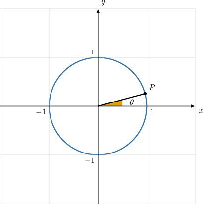
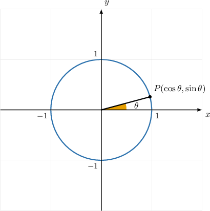
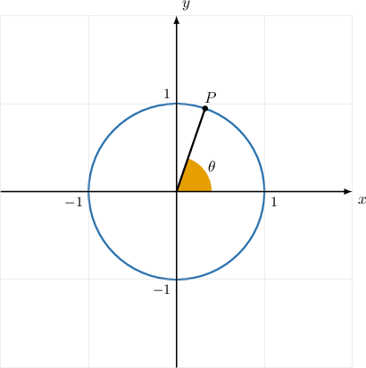
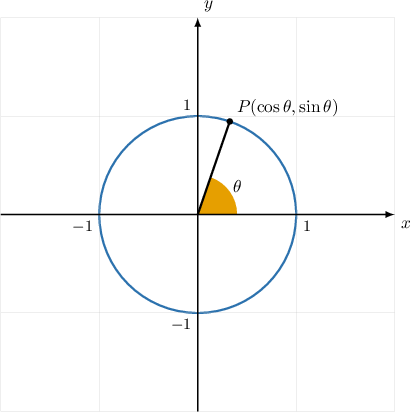
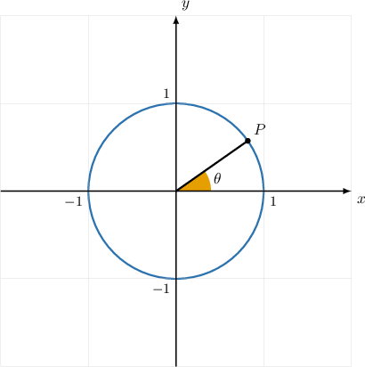
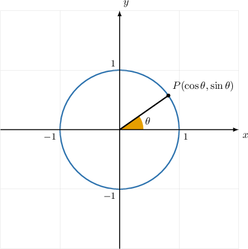
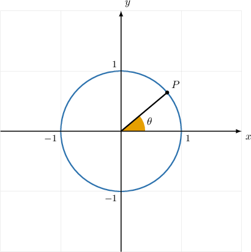
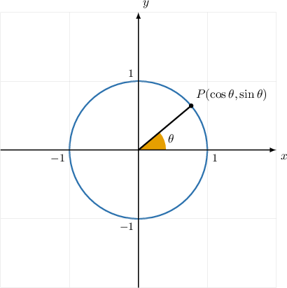
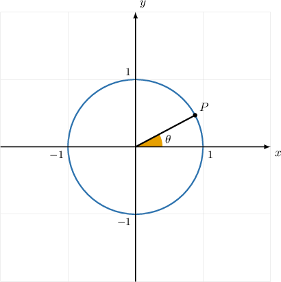
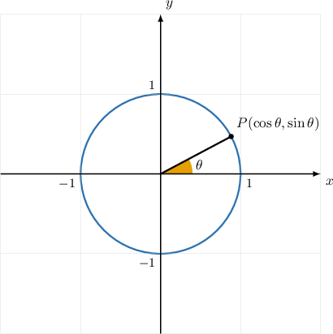

# Complete source practice questions

EDB math basis 1522; KP 17592186110756. Original prompts, every choice, and one original worked solution are retained. Missing source attributes remain explicitly missing.

## q-124750 — moderate

**Specific components:** {"given_axis": "y", "given_numerator": "1", "given_denominator": "5", "given_coordinate": "\\frac{1}{5}", "missing_coordinate": "\\frac{2 \\sqrt{6}}{5}", "reciprocal": "sec", "radicand": "24", "perfect_square_complement": false, "domains": "0 < coordinate < 1, first quadrant, positive root, reciprocal denominator nonzero.", "expected_answer": "\\frac{5 \\sqrt{6}}{12}"}

**Template:** `M1-rational-y-sec-radio`

The diagram above shows the unit circle. Given that the $y$-coordinate of the point $P$ is $\frac{1}{5},$ use the Pythagorean identity to find $sec⁡\theta .$

| Field | Type | Bank profile | Source answer entity | Original value | Source correct | Value recipe |
|---|---|---|---:|---|---|---|
| selection | radio | bank-q-124750 | 17592186257060 | $\frac{9\sqrt{6}}{2}$ | False | `p * sqrt(d) / q`; {"p": "9", "d": "6", "q": "2"} |
| selection | radio | bank-q-124750 | 17592186257837 | $\frac{5\sqrt{6}}{9}$ | False | `p * sqrt(d) / q`; {"p": "5", "d": "6", "q": "9"} |
| selection | radio | bank-q-124750 | 17592186257942 | $\frac{\sqrt{6}}{2}$ | False | `p * sqrt(d) / q`; {"p": "1", "d": "6", "q": "2"} |
| selection | radio | bank-q-124750 | 17592186258268 | $\frac{5\sqrt{6}}{12}$ | True | `b / sqrt(b**2 - n**2)`; {"n": "1", "b": "5", "K": "2*sqrt(6)"} |
| selection | radio | bank-q-124750 | 17592186258335 | $\frac{7\sqrt{6}}{12}$ | False | `p * sqrt(d) / q`; {"p": "7", "d": "6", "q": "12"} |

**Original worked solution:**

Any point $(x,y)$ on the unit circle is related to the central angle $\theta $ as follows:

$$
x=cos⁡\theta ,\,y=sin⁡\theta 
$$

We're given that $y=\frac{1}{5}$ at the point $P.$ Therefore, we have

$$
sin⁡\theta =\frac{1}{5}.
$$

We can use the Pythagorean identity to find $cos⁡\theta :$

$$
\begin{aligned}{sin}^{2}⁡\theta +{cos}^{2}⁡\theta  & =1 \\ {cos}^{2}⁡\theta  & =1-{sin}^{2}⁡\theta  \\ cos⁡\theta  & =\pm \sqrt{1-{sin}^{2}⁡\theta }\end{aligned}
$$

Substituting $sin⁡\theta =\frac{1}{5}$ gives

$$
\begin{aligned}cos⁡\theta  & =\pm \sqrt{1-{(\frac{1}{5})}^{2}} \\  & =\pm \sqrt{1-\frac{1}{25}} \\  & =\pm \sqrt{\frac{24}{25}} \\  & =\pm \frac{2\sqrt{6}}{5}.\end{aligned}
$$

We select the positive answer since $cos⁡\theta $ is positive in the first quadrant. So, $cos⁡\theta =\frac{2\sqrt{6}}{5}.$

Knowing that $sec⁡\theta =\frac{1}{cos⁡\theta },$ we have

$$
sec⁡\theta =\frac{1}{(\frac{2\sqrt{6}}{5})}=\frac{5}{2\sqrt{6}}.
$$

Finally, we rationalize the denominator.

$$
\begin{aligned}sec⁡\theta  & =\frac{5}{2\sqrt{6}} \\  & =\frac{5}{2\sqrt{6}}\cdot \frac{\sqrt{6}}{\sqrt{6}} \\  & =\frac{5\sqrt{6}}{2\cdot 6} \\  & =\frac{5\sqrt{6}}{12}\end{aligned}
$$

## q-65066 — unrated

**Specific components:** {"given_axis": "y", "given_numerator": "3", "given_denominator": "5", "given_coordinate": "\\frac{3}{5}", "missing_coordinate": "\\frac{4}{5}", "reciprocal": "sec", "radicand": "16", "perfect_square_complement": true, "domains": "0 < coordinate < 1, first quadrant, positive root, reciprocal denominator nonzero.", "expected_answer": "\\frac{5}{4}"}

**Template:** `unrated-rational-y-perfect-square`

The diagram above shows the unit circle. Given that the $y$-coordinate of the point $P$ is $\frac{3}{5}$, use the Pythagorean identity to find $\sec θ$.

| Field | Type | Bank profile | Source answer entity | Original value | Source correct | Value recipe |
|---|---|---|---:|---|---|---|
| selection | radio | bank-q-65066 | 17592186109772 | $\frac{16}{5}$ | unrecorded | `p / q`; {"p": "16", "q": "5"} |
| selection | radio | bank-q-65066 | 17592186109773 | $\frac{5}{16}$ | unrecorded | `p / q`; {"p": "5", "q": "16"} |
| selection | radio | bank-q-65066 | 17592186109774 | $\frac{16}{25}$ | unrecorded | `p / q`; {"p": "16", "q": "25"} |
| selection | radio | bank-q-65066 | 17592186109775 | $\frac{4}{5}$ | unrecorded | `p / q`; {"p": "4", "q": "5"} |
| selection | radio | bank-q-65066 | 17592186109776 | $\frac{5}{4}$ | unrecorded | `p / q`; {"p": "5", "q": "4"} |

**Original worked solution:**

**Missing in database. No source solution was invented.**

## q-124743 — moderate

**Specific components:** {"given_axis": "x", "given_numerator": "1", "given_denominator": "3", "given_coordinate": "\\frac{1}{3}", "missing_coordinate": "\\frac{2 \\sqrt{2}}{3}", "reciprocal": "csc", "radicand": "8", "perfect_square_complement": false, "domains": "0 < coordinate < 1, first quadrant, positive root, reciprocal denominator nonzero.", "expected_answer": "\\frac{3 \\sqrt{2}}{4}"}

**Template:** `M2-rational-x-csc-radio`

The diagram above shows the unit circle. Given that the $x$-coordinate of the point $P$ is $\frac{1}{3},$ use the Pythagorean identity to find $csc⁡\theta .$

| Field | Type | Bank profile | Source answer entity | Original value | Source correct | Value recipe |
|---|---|---|---:|---|---|---|
| selection | radio | bank-q-124743 | 17592186258142 | $\frac{3\sqrt{2}}{4}$ | True | `b / sqrt(b**2 - n**2)`; {"n": "1", "b": "3", "K": "2*sqrt(2)"} |
| selection | radio | bank-q-124743 | 17592186258226 | $\frac{2\sqrt{6}}{3}$ | False | `p * sqrt(d) / q`; {"p": "2", "d": "6", "q": "3"} |
| selection | radio | bank-q-124743 | 17592186258329 | $\frac{5\sqrt{2}}{2}$ | False | `p * sqrt(d) / q`; {"p": "5", "d": "2", "q": "2"} |
| selection | radio | bank-q-124743 | 17592186258921 | $\frac{3\sqrt{3}}{2}$ | False | `p * sqrt(d) / q`; {"p": "3", "d": "3", "q": "2"} |
| selection | radio | bank-q-124743 | 17592186258925 | $\frac{3}{2}$ | False | `p / q`; {"p": "3", "q": "2"} |

**Original worked solution:**

Any point $(x,y)$ on the unit circle is related to the central angle $\theta $ as follows:

$$
x=cos⁡\theta ,\,y=sin⁡\theta 
$$

We're given that $x=\frac{1}{3}$ at the point $P.$ Therefore, we have

$$
cos⁡\theta =\frac{1}{3}.
$$

We can use the Pythagorean identity to find $sin⁡\theta :$

$$
\begin{aligned}{sin}^{2}⁡\theta +{cos}^{2}⁡\theta  & =1 \\ {sin}^{2}⁡\theta  & =1-{cos}^{2}⁡\theta  \\ sin⁡\theta  & =\pm \sqrt{1-{cos}^{2}⁡\theta }\end{aligned}
$$

Substituting $cos⁡\theta =\frac{1}{3}$ gives

$$
\begin{aligned}sin⁡\theta  & =\pm \sqrt{1-{(\frac{1}{3})}^{2}} \\  & =\pm \sqrt{1-\frac{1}{9}} \\  & =\pm \sqrt{\frac{8}{9}} \\  & =\pm \frac{2\sqrt{2}}{3}.\end{aligned}
$$

We select the positive answer since $sin⁡\theta $ is positive in the first quadrant. So, $sin⁡\theta =\frac{2\sqrt{2}}{3}.$

Knowing that $csc⁡\theta =\frac{1}{sin⁡\theta },$ we have

$$
csc⁡\theta =\frac{1}{(\frac{2\sqrt{2}}{3})}=\frac{3}{2\sqrt{2}}.
$$

Finally, we rationalize the denominator.

$$
\begin{aligned}csc⁡\theta  & =\frac{3}{2\sqrt{2}} \\  & =\frac{3}{2\sqrt{2}}\cdot \frac{\sqrt{2}}{\sqrt{2}} \\  & =\frac{3\sqrt{2}}{2\cdot 2} \\  & =\frac{3\sqrt{2}}{4}\end{aligned}
$$

## q-65062 — moderate

**Specific components:** {"given_axis": "y", "given_numerator": "sqrt(3)", "given_denominator": "3", "given_coordinate": "\\frac{\\sqrt{3}}{3}", "missing_coordinate": "\\frac{\\sqrt{6}}{3}", "reciprocal": "sec", "radicand": "6", "perfect_square_complement": false, "domains": "0 < coordinate < 1, first quadrant, positive root, reciprocal denominator nonzero.", "expected_answer": "\\frac{\\sqrt{6}}{2}"}

**Template:** `M3-radical-y-sec-radio`

The diagram above shows the unit circle. Given that the $y$-coordinate of the point $P$ is $\frac{\sqrt{3}}{3},$ use the Pythagorean identity to find $sec⁡\theta .$

| Field | Type | Bank profile | Source answer entity | Original value | Source correct | Value recipe |
|---|---|---|---:|---|---|---|
| selection | radio | bank-q-65062 | 17592186333808 | $-\frac{\sqrt{3}}{\sqrt{6}}$ | False | `p * sqrt(d) / q`; {"p": "-1", "d": "2", "q": "2"} |
| selection | radio | bank-q-65062 | 17592186334517 | $-\frac{\sqrt{6}}{2}$ | False | `p * sqrt(d) / q`; {"p": "-1", "d": "6", "q": "2"} |
| selection | radio | bank-q-65062 | 17592186334679 | $\frac{\sqrt{6}}{6}$ | False | `p * sqrt(d) / q`; {"p": "1", "d": "6", "q": "6"} |
| selection | radio | bank-q-65062 | 17592186334771 | $\frac{\sqrt{3}}{\sqrt{6}}$ | False | `p * sqrt(d) / q`; {"p": "1", "d": "2", "q": "2"} |
| selection | radio | bank-q-65062 | 17592186334822 | $\frac{\sqrt{6}}{2}$ | True | `b / sqrt(b**2 - n**2)`; {"n": "sqrt(3)", "b": "3", "K": "sqrt(6)"} |

**Original worked solution:**

Any point $(x,y)$ on the unit circle is related to the central angle $\theta $ as follows:

$$
x=cos⁡\theta ,\,y=sin⁡\theta 
$$

We're given that $y=\frac{\sqrt{3}}{3}$ at the point $P.$ Therefore, we have

$$
sin⁡\theta =\frac{\sqrt{3}}{3}.
$$

We can use the Pythagorean identity to find $cos⁡\theta :$

$$
\begin{aligned}{sin}^{2}⁡\theta +{cos}^{2}⁡\theta  & =1 \\ {cos}^{2}⁡\theta  & =1-{sin}^{2}⁡\theta  \\ cos⁡\theta  & =\pm \sqrt{1-{sin}^{2}⁡\theta }\end{aligned}
$$

Substituting $sin⁡\theta =\frac{\sqrt{3}}{3}$ gives

$$
\begin{aligned}cos⁡\theta  & =\pm \sqrt{1-{(\frac{\sqrt{3}}{3})}^{2}} \\  & =\pm \sqrt{1-\frac{3}{9}} \\  & =\pm \sqrt{\frac{6}{9}} \\  & =\pm \frac{\sqrt{6}}{3}.\end{aligned}
$$

We select the positive answer since $cos⁡\theta $ is positive in the first quadrant. So, $cos⁡\theta =\frac{\sqrt{6}}{3}.$

Knowing that $sec⁡\theta =\frac{1}{cos⁡\theta },$ we have

$$
sec⁡\theta =\frac{1}{(\frac{\sqrt{6}}{3})}=\frac{3}{\sqrt{6}}.
$$

Finally, we rationalize the denominator.

$$
\begin{aligned}sec⁡\theta  & =\frac{3}{\sqrt{6}} \\  & =\frac{3}{\sqrt{6}}\cdot \frac{\sqrt{6}}{\sqrt{6}} \\  & =\frac{3\sqrt{6}}{6} \\  & =\frac{\sqrt{6}}{2}\end{aligned}
$$

## q-65064 — moderate

**Specific components:** {"given_axis": "x", "given_numerator": "sqrt(15)", "given_denominator": "5", "given_coordinate": "\\frac{\\sqrt{15}}{5}", "missing_coordinate": "\\frac{\\sqrt{10}}{5}", "reciprocal": "csc", "radicand": "10", "perfect_square_complement": false, "domains": "0 < coordinate < 1, first quadrant, positive root, reciprocal denominator nonzero.", "expected_answer": "\\frac{\\sqrt{10}}{2}"}

**Template:** `M4-radical-x-csc-radio`

The diagram above shows the unit circle. Given that the $x$-coordinate of the point $P$ is $\frac{\sqrt{15}}{5},$ use the Pythagorean identity to find $csc⁡\theta .$

| Field | Type | Bank profile | Source answer entity | Original value | Source correct | Value recipe |
|---|---|---|---:|---|---|---|
| selection | radio | bank-q-65064 | 17592186333595 | $\frac{\sqrt{10}}{2}$ | True | `b / sqrt(b**2 - n**2)`; {"n": "sqrt(15)", "b": "5", "K": "sqrt(10)"} |
| selection | radio | bank-q-65064 | 17592186333711 | $\frac{\sqrt{5}}{2}$ | False | `p * sqrt(d) / q`; {"p": "1", "d": "5", "q": "2"} |
| selection | radio | bank-q-65064 | 17592186334021 | $\sqrt{5}$ | False | `p * sqrt(d) / q`; {"p": "1", "d": "5", "q": "1"} |
| selection | radio | bank-q-65064 | 17592186334379 | $\frac{\sqrt{10}}{5}$ | False | `p * sqrt(d) / q`; {"p": "1", "d": "10", "q": "5"} |
| selection | radio | bank-q-65064 | 17592186335220 | $5$ | False | `p / q`; {"p": "5", "q": "1"} |

**Original worked solution:**

Any point $(x,y)$ on the unit circle is related to the central angle $\theta $ as follows:

$$
x=cos⁡\theta ,\,y=sin⁡\theta 
$$

We're given that $x=\frac{\sqrt{15}}{5}$ at the point $P.$ Therefore, we have

$$
cos⁡\theta =\frac{\sqrt{15}}{5}.
$$

We can use the Pythagorean identity to find $sin⁡\theta :$

$$
\begin{aligned}{sin}^{2}⁡\theta +{cos}^{2}⁡\theta  & =1 \\ {sin}^{2}⁡\theta  & =1-{cos}^{2}⁡\theta  \\ sin⁡\theta  & =\pm \sqrt{1-{cos}^{2}⁡\theta }\end{aligned}
$$

Substituting $cos⁡\theta =\frac{\sqrt{15}}{5}$ gives

$$
\begin{aligned}sin⁡\theta  & =\pm \sqrt{1-{(\frac{\sqrt{15}}{5})}^{2}} \\  & =\pm \sqrt{1-\frac{15}{25}} \\  & =\pm \sqrt{\frac{10}{25}} \\  & =\pm \frac{\sqrt{10}}{5}.\end{aligned}
$$

We select the positive answer since $sin⁡\theta $ is positive in the first quadrant. So, $sin⁡\theta =\frac{\sqrt{10}}{5}.$

Knowing that $csc⁡\theta =\frac{1}{sin⁡\theta },$ we have

$$
\begin{aligned}csc⁡\theta =\frac{1}{(\frac{\sqrt{10}}{5})}=\frac{5}{\sqrt{10}}.\end{aligned}
$$

Finally, we rationalize the denominator.

$$
\begin{aligned}csc⁡\theta  & =\frac{5}{\sqrt{10}} \\  & =\frac{5}{\sqrt{10}}\cdot \frac{\sqrt{10}}{\sqrt{10}} \\  & =\frac{5\sqrt{10}}{10} \\  & =\frac{\sqrt{10}}{2}\end{aligned}
$$

## q-85234 — moderate

**Specific components:** {"given_axis": "y", "given_numerator": "sqrt(2)", "given_denominator": "3", "given_coordinate": "\\frac{\\sqrt{2}}{3}", "missing_coordinate": "\\frac{\\sqrt{7}}{3}", "reciprocal": "sec", "radicand": "7", "perfect_square_complement": false, "domains": "0 < coordinate < 1, first quadrant, positive root, reciprocal denominator nonzero.", "expected_answer": "\\frac{3 \\sqrt{7}}{7}"}

**Template:** `M3-radical-y-sec-radio`

The diagram above shows the unit circle. Given that the $y$-coordinate of the point $P$ is $\frac{\sqrt{2}}{3},$ use the Pythagorean identity to find $sec⁡\theta .$

| Field | Type | Bank profile | Source answer entity | Original value | Source correct | Value recipe |
|---|---|---|---:|---|---|---|
| selection | radio | bank-q-85234 | 17592186352305 | $\frac{7}{2}$ | False | `p / q`; {"p": "7", "q": "2"} |
| selection | radio | bank-q-85234 | 17592186352722 | $\frac{\sqrt{7}}{2}$ | False | `p * sqrt(d) / q`; {"p": "1", "d": "7", "q": "2"} |
| selection | radio | bank-q-85234 | 17592186352896 | $\frac{5\sqrt{7}}{7}$ | False | `p * sqrt(d) / q`; {"p": "5", "d": "7", "q": "7"} |
| selection | radio | bank-q-85234 | 17592186353437 | $\frac{3\sqrt{7}}{7}$ | True | `b / sqrt(b**2 - n**2)`; {"n": "sqrt(2)", "b": "3", "K": "sqrt(7)"} |
| selection | radio | bank-q-85234 | 17592186353599 | $\frac{7}{3}$ | False | `p / q`; {"p": "7", "q": "3"} |

**Original worked solution:**

Any point $(x,y)$ on the unit circle is related to the central angle $\theta $ as follows:

$$
x=cos⁡\theta ,\,y=sin⁡\theta 
$$

We're given that $y=\frac{\sqrt{2}}{3}$ at the point $P.$ Therefore, we have

$$
sin⁡\theta =\frac{\sqrt{2}}{3}.
$$

We can use the Pythagorean identity to find $cos⁡\theta :$

$$
\begin{aligned}{sin}^{2}⁡\theta +{cos}^{2}⁡\theta  & =1 \\ {cos}^{2}⁡\theta  & =1-{sin}^{2}⁡\theta  \\ cos⁡\theta  & =\pm \sqrt{1-{sin}^{2}⁡\theta }\end{aligned}
$$

Substituting $sin⁡\theta =\frac{\sqrt{2}}{3}$ gives

$$
\begin{aligned}cos⁡\theta  & =\pm \sqrt{1-{(\frac{\sqrt{2}}{3})}^{2}} \\  & =\pm \sqrt{1-\frac{2}{9}} \\  & =\pm \sqrt{\frac{7}{9}} \\  & =\pm \frac{\sqrt{7}}{3}.\end{aligned}
$$

We select the positive answer since $cos⁡\theta $ is positive in the first quadrant. So, $cos⁡\theta =\frac{\sqrt{7}}{3}.$

Knowing that $sec⁡\theta =\frac{1}{cos⁡\theta },$ we have

$$
sec⁡\theta =\frac{1}{(\frac{\sqrt{7}}{3})}=\frac{3}{\sqrt{7}}.
$$

Finally, we rationalize the denominator.

$$
\begin{aligned}sec⁡\theta  & =\frac{3}{\sqrt{7}} \\  & =\frac{3}{\sqrt{7}}\cdot \frac{\sqrt{7}}{\sqrt{7}} \\  & =\frac{3\sqrt{7}}{7}\end{aligned}
$$
