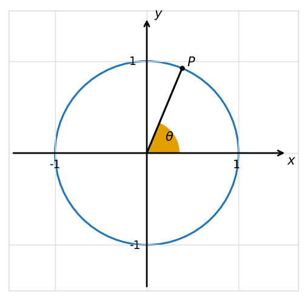
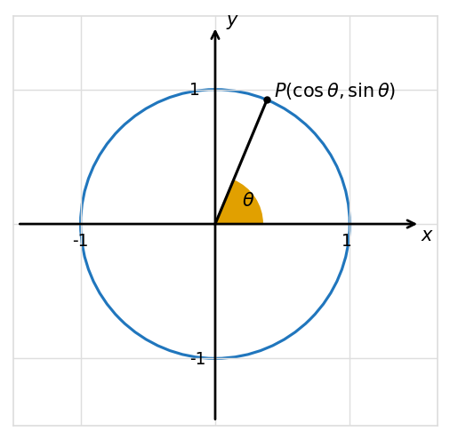

# Missing-level probes

These are local design experiments, not source-observed difficulty labels or database questions. Source field contracts are preserved. Their correctness is checked in [probe verification](probe-verification.json); operational grading has not been tested.

## Matrix-entry lookup

**Requested missing level: moderate. Best judgment for this probe: still easy.**

Find the entry $e_{53}$ of the matrix $E$, where

$$
E=\begin{bmatrix}
-5&-2&0&9\\
3&-8&-2&5\\
-2&2&5&-8\\
6&6&-6&0\\
-6&4&-\frac73&5
\end{bmatrix}.
$$

$e_{53}=$ `{{field-1}}`

Expected blank value: `-\frac{7}{3}`.

Worked solution: the entry $e_{53}$ lies at the intersection of the fifth row and third column. Therefore, $e_{53}=-\frac73$. The learner-facing solution would repeat the same matrix, as the source does.

This is a direct variant of easy `q-279539`, changing its target entry from 2 to −7/3. No arithmetic on that fraction is needed. The number looks more complicated, but the learner still makes one positional lookup. Thus it does not establish a useful moderate template. Increasing dimensions further adds search burden; asking for a transposed entry or calculating a matrix expression introduces another procedure. Reversing the task to identify indices is already a sibling KP.

**Decision:** reject the moderate label. This KP has a narrow difficulty range within its literal-matrix lookup contract.

## Reciprocal ratio

**Requested missing level: easy. Best judgment: a natural easy family.**

The diagram above shows the unit circle. Point $P$ lies in the first quadrant. Given that its $x$-coordinate is $\frac5{13}$, use the Pythagorean identity to find $\csc\theta$.

One five-choice math-radio field, key `selection`:

| Choice | Exact value | Complete bank recipe |
|---|---|---|
| A | $\frac{144}{13}$ | c²/b |
| B | $\frac{13}{144}$ | b/c² |
| C | $\frac{144}{169}$ | c²/b² |
| D | $\frac{12}{13}$ | c/b |
| E | $\frac{13}{12}$ | b/c, correct |

Here b=13 and c=12. This is a declared extrapolation of the **complete unrated q-65066 bank**, whose five values are 16/5, 5/16, 16/25, 4/5, and 5/4 at b=5,c=4. All five source values replay exactly under those recipes. The numerical transformations are observed; their original intended error explanations are not claimed. The original has no correct reference; independent mathematics identifies 5/4.

Worked solution:

Any point $(x,y)$ on the unit circle is related to the central angle $\theta$ as follows:

$$x=\cos\theta,\qquad y=\sin\theta.$$

We are given $x=\frac5{13}$, so $\cos\theta=\frac5{13}$. Using the Pythagorean identity,

$$
\begin{aligned}
\sin^2\theta+\cos^2\theta&=1,\\
\sin^2\theta&=1-\cos^2\theta,\\
\sin\theta&=\pm\sqrt{1-\cos^2\theta}.
\end{aligned}
$$

Substituting the given value gives

$$
\begin{aligned}
\sin\theta&=\pm\sqrt{1-\left(\frac5{13}\right)^2}\\
&=\pm\sqrt{1-\frac{25}{169}}\\
&=\pm\sqrt{\frac{144}{169}}\\
&=\pm\frac{12}{13}.
\end{aligned}
$$

We select the positive answer because sine is positive in the first quadrant. Finally,

$$\csc\theta=\frac1{\sin\theta}=\frac1{12/13}=\frac{13}{12}.$$

Unlike all five moderate sources, this needs no irrational-denominator rationalization. It retains the identity, branch choice, and reciprocal operation, so it does not collapse into the neighboring ordinary-ratio KP. The unrated 3–4–5 original and complete canonical example already establish that clean complementary roots fit this KP.

**Decision:** adopt as an authored easy-family proposal. New parameters need matching plots, but the difficulty design itself is straightforward.

## Non-integer determinant

**Requested missing level: hard. Best judgment: a feasible hard family driven by algebra.**

Calculate $\det(H)$ given that

$$
H=\begin{bmatrix}
\dfrac{1+\sqrt2}{2}&\dfrac{2-\sqrt3}{5}\\[6pt]
\dfrac{2+\sqrt3}{7}&\dfrac{1-\sqrt2}{3}
\end{bmatrix}.
$$

$\det(H)=$ `{{field-1}}`

Expected blank value: `-\frac{41}{210}`. No distractors are introduced, matching the observed determinant blank contract.

Worked solution: for a $2\times2$ matrix, the determinant is given by

$$\begin{vmatrix}a&b\\c&d\end{vmatrix}=ad-bc.$$

Using that formula,

$$
\begin{aligned}
\det(H)
&=\frac{1+\sqrt2}{2}\frac{1-\sqrt2}{3}
-\frac{2-\sqrt3}{5}\frac{2+\sqrt3}{7}\\
&=\frac{(1+\sqrt2)(1-\sqrt2)}6
-\frac{(2-\sqrt3)(2+\sqrt3)}{35}\\
&=\frac{1-(\sqrt2)^2}{6}-\frac{4-(\sqrt3)^2}{35}\\
&=\frac{1-2}{6}-\frac{4-3}{35}\\
&=-\frac16-\frac1{35}\\
&=-\frac{35}{210}-\frac6{210}\\
&=-\frac{41}{210}.
\end{aligned}
$$

All entries are real, all numerical denominators are nonzero, and the question still asks for ad−bc on a 2×2 matrix. Compared with moderate `q-317367`, it adds two compound products, conjugate simplification, and a less immediate common denominator. The source has radicals and signed fractions, but no observed entries of this compound conjugate-fraction form.

An authored family can use a=(u+√v)/p, d=(u−√v)/q, b=(w−√z)/r, c=(w+√z)/s, giving

$$\det(H)=\frac{u^2-v}{pq}-\frac{w^2-z}{rs}.$$

For proposed sampling, choose small positive integer denominators, positive nonsquare radicands, and nonzero diagonal products. Keep all four entries genuinely non-integer. These are new constraints for the authored family, not recovered source limits.

**Decision:** adopt as an authored hard-family proposal. Its additional challenge is prerequisite algebra; it introduces no new determinant technique and needs no plots. Solving for an unknown or moving to 3×3 would change the assessed skill and is rejected.
