ORIGINAL MA EVIDENCE — coordinate_ab

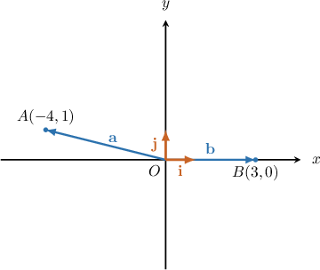

Let $A(-4, 1)$ and $B(3, 0)$. Find $\mid AB^(→) \mid$.

Worked solution absent in original.

Choices: $5\sqrt{3}$, $6$, $5\sqrt{2}$, $5$, $3\sqrt{2}$

---

ORIGINAL MA EVIDENCE — coordinate_pq

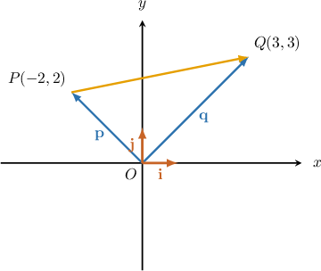

Let $P(-2, 2)$ and $Q(3, 3)$. Find $\mid PQ^(→) \mid$.

Worked solution absent in original.

Choices: $8$, $\sqrt{23}$, $\sqrt{27}$, $\sqrt{26}$, $5$

---

ORIGINAL MA EVIDENCE — coordinate_pq_signed

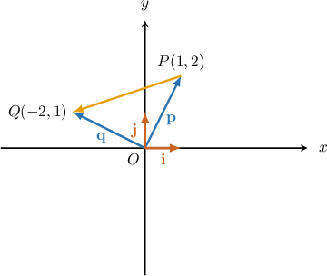

Let $P(1,2)$ and $Q(-2,1).$ Find $|\overset{\to }{PQ}|.$

We have 

$$
\begin{aligned} & \overset{\to }{OP}=p=i+2j, \\  & \overset{\to }{OQ}=q=-2i+j.\end{aligned}
$$

Expressing $\overset{\to }{PQ}$ as the difference of position vectors, we obtain:

$$
\begin{aligned}\overset{\to }{PQ} & =\overset{\to }{OQ}-\overset{\to }{OP} \\  & =q-p \\  & =(-2i+j)-(i+2j) \\  & =-3i-j\end{aligned}
$$

Now, using the formula for the magnitude of a vector, we get

$$
\begin{aligned}|\overset{\to }{PQ}| & =\sqrt{(-3)^{2}+(-1)^{2}} \\  & =\sqrt{9+1} \\  & =\sqrt{10}.\end{aligned}
$$

Choices: 

---

ORIGINAL MA EVIDENCE — coordinate_cd

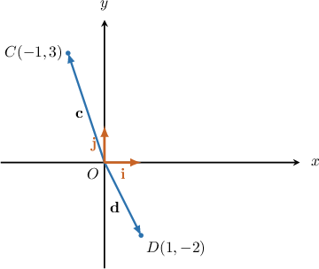

Let $C(-1,3)$ and $D(1,-2).$ Find $|\overset{\to }{CD}|.$

We have 

$$
\begin{aligned} & \overset{\to }{OC}=c=-i+3j, \\  & \overset{\to }{OD}=d=i-2j.\end{aligned}
$$

Expressing $\overset{\to }{CD}$ as the difference of position vectors, we obtain:

$$
\begin{aligned}\overset{\to }{CD} & =\overset{\to }{OD}-\overset{\to }{OC} \\  & =d-c \\  & =(i-2j)-(-i+3j) \\  & =2i-5j\end{aligned}
$$

Now, using the formula for the magnitude of a vector, we get

$$
\begin{aligned}|\overset{\to }{CD}| & =\sqrt{{2}^{2}+(-5)^{2}} \\  & =\sqrt{4+25} \\  & =\sqrt{29}.\end{aligned}
$$

Choices: 

---

ORIGINAL MA EVIDENCE — graph_read

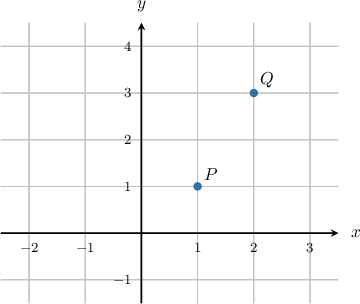

Points $P$ and $Q$ are shown in the picture above. Find $|\overset{\to }{PQ}|.$

From the picture, we obtain $P(1,1)$ and $Q(2,3).$ So, we have

$$
\begin{aligned} & \overset{\to }{OP}=p=i+j, \\  & \overset{\to }{OQ}=q=2i+3j.\end{aligned}
$$

Expressing $\overset{\to }{PQ}$ as the difference of position vectors, we obtain:

$$
\begin{aligned}\overset{\to }{PQ} & =\overset{\to }{OQ}-\overset{\to }{OP} \\  & =q-p \\  & =(2i+3j)-(i+j) \\  & =i+2j\end{aligned}
$$

Now, using the formula for the magnitude of a vector, we get

$$
\begin{aligned}|\overset{\to }{PQ}| & =\sqrt{{1}^{2}+(2)^{2}} \\  & =\sqrt{1+4} \\  & =\sqrt{5}.\end{aligned}
$$

Choices: 

---

AUTHORED NORMAL :question.difficulty/easy — coordinate_cd

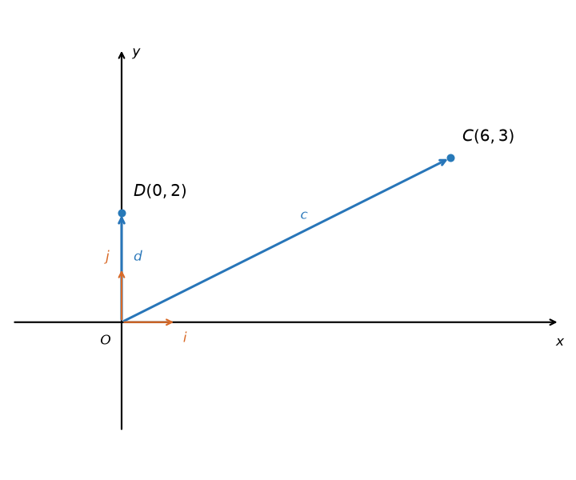

Let $C(6,3)$ and $D(0,2).$ Find $|\overset{\to }{CD}|.$

We have 

$$
\begin{aligned} & \overset{\to }{OC}=c=6i+3j, \\  & \overset{\to }{OD}=d=2j.\end{aligned}
$$

Expressing $\overset{\to }{CD}$ as the difference of position vectors, we obtain:

$$
\begin{aligned}\overset{\to }{CD} & =\overset{\to }{OD}-\overset{\to }{OC} \\  & =d-c \\  & =(2j)-(6i+3j) \\  & =-6i-j\end{aligned}
$$

The displacement components are $(0)-(6)=-6$ and $(2)-(3)=-1$.

Now, using the formula for the magnitude of a vector, we get

$$
\begin{aligned}|\overset{\to }{CD}| & =\sqrt{(-6)^{2}+(-1)^{2}} \\  & =\sqrt{36+1} \\  & =\sqrt{37}.\end{aligned}
$$

Choices: $7$, $\sqrt{61}$, $\sqrt{37}$, $\sqrt{7}$, $37$

---

AUTHORED NORMAL :question.difficulty/easy — coordinate_pq

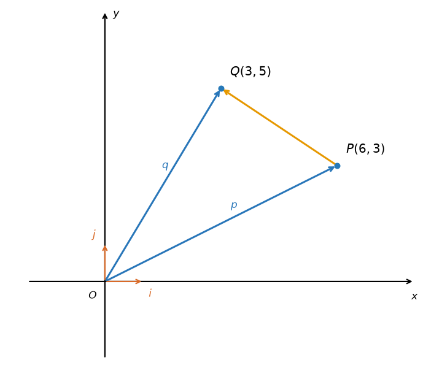

Let $P(6, 3)$ and $Q(3, 5)$. Find $|\overset{\to }{PQ}|$.

We have

$$
\begin{aligned} & \overset{\to }{OP}=p=6i+3j, \\ & \overset{\to }{OQ}=q=3i+5j.\end{aligned}
$$

Expressing $\overset{\to }{PQ}$ as the difference of position vectors, we obtain:

$$
\begin{aligned}\overset{\to }{PQ} &= \overset{\to }{OQ}-\overset{\to }{OP} \\ &= q-p \\ &= (3i+5j)-(6i+3j) \\ &= -3i+2j\end{aligned}
$$

The displacement components are $(3)-(6)=-3$ and $(5)-(3)=2$.

Now, using the formula for the magnitude of a vector, we get

$$
\begin{aligned}|\overset{\to }{PQ}| &= \sqrt{(-3)^{2}+(2)^{2}} \\ &= \sqrt{9+4} \\ &= \sqrt{13}.\end{aligned}
$$

Choices: $5$, $13$, $\sqrt{5}$, $\sqrt{13}$, $\sqrt{145}$

---

AUTHORED NORMAL :question.difficulty/easy — coordinate_ab

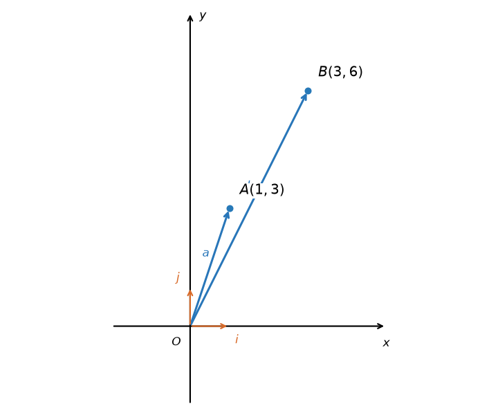

Let $A(1, 3)$ and $B(3, 6)$. Find $|\overset{\to }{AB}|$.

We have

$$
\begin{aligned} & \overset{\to }{OA}=a=i+3j, \\ & \overset{\to }{OB}=b=3i+6j.\end{aligned}
$$

Expressing $\overset{\to }{AB}$ as the difference of position vectors, we obtain:

$$
\begin{aligned}\overset{\to }{AB} &= \overset{\to }{OB}-\overset{\to }{OA} \\ &= b-a \\ &= (3i+6j)-(i+3j) \\ &= 2i+3j\end{aligned}
$$

The displacement components are $(3)-(1)=2$ and $(6)-(3)=3$.

Now, using the formula for the magnitude of a vector, we get

$$
\begin{aligned}|\overset{\to }{AB}| &= \sqrt{(2)^{2}+(3)^{2}} \\ &= \sqrt{4+9} \\ &= \sqrt{13}.\end{aligned}
$$

Choices: $5$, $\sqrt{13}$, $\sqrt{5}$, $13$, $\sqrt{97}$

---

AUTHORED NORMAL :question.difficulty/easy — coordinate_pq_signed

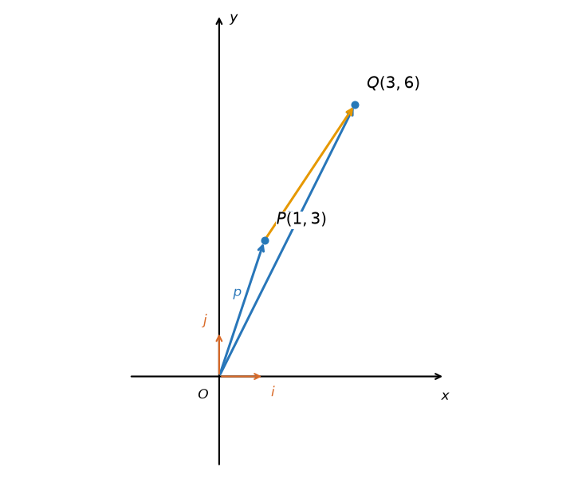

Let $P(1,3)$ and $Q(3,6).$ Find $|\overset{\to }{PQ}|.$

We have 

$$
\begin{aligned} & \overset{\to }{OP}=p=i+3j, \\  & \overset{\to }{OQ}=q=3i+6j.\end{aligned}
$$

Expressing $\overset{\to }{PQ}$ as the difference of position vectors, we obtain:

$$
\begin{aligned}\overset{\to }{PQ} & =\overset{\to }{OQ}-\overset{\to }{OP} \\  & =q-p \\  & =(3i+6j)-(i+3j) \\  & =2i+3j\end{aligned}
$$

The displacement components are $(3)-(1)=2$ and $(6)-(3)=3$.

Now, using the formula for the magnitude of a vector, we get

$$
\begin{aligned}|\overset{\to }{PQ}| & =\sqrt{(2)^{2}+(3)^{2}} \\  & =\sqrt{4+9} \\  & =\sqrt{13}.\end{aligned}
$$

Choices: $5$, $\sqrt{13}$, $\sqrt{5}$, $13$, $\sqrt{97}$

---

AUTHORED NORMAL :question.difficulty/moderate — coordinate_cd

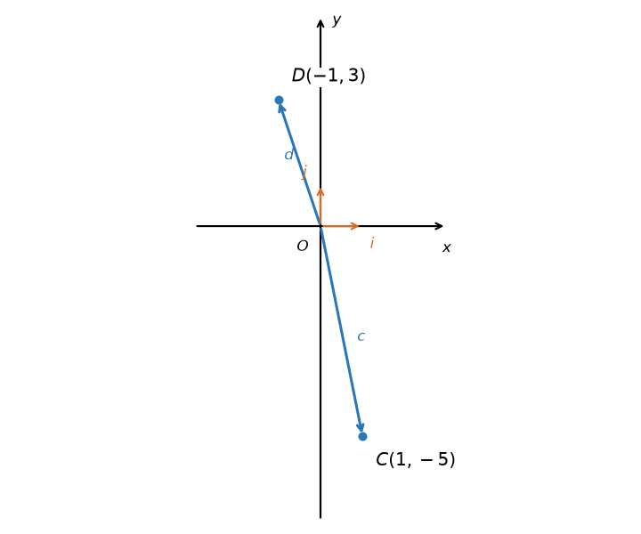

Let $C(1,-5)$ and $D(-1,3).$ Find $|\overset{\to }{CD}|.$

We have 

$$
\begin{aligned} & \overset{\to }{OC}=c=i-5j, \\  & \overset{\to }{OD}=d=-i+3j.\end{aligned}
$$

Expressing $\overset{\to }{CD}$ as the difference of position vectors, we obtain:

$$
\begin{aligned}\overset{\to }{CD} & =\overset{\to }{OD}-\overset{\to }{OC} \\  & =d-c \\  & =(-i+3j)-(i-5j) \\  & =-2i+8j\end{aligned}
$$

The displacement components are $(-1)-(1)=-2$ and $(3)-(-5)=8$.

Now, using the formula for the magnitude of a vector, we get

$$
\begin{aligned}|\overset{\to }{CD}| & =\sqrt{(-2)^{2}+(8)^{2}} \\  & =\sqrt{4+64} \\  & =\sqrt{68} \\  & =2 \sqrt{17}.\end{aligned}
$$

Choices: $10$, $2$, $2 \sqrt{17}$, $\sqrt{10}$, $68$

---

AUTHORED NORMAL :question.difficulty/moderate — coordinate_pq

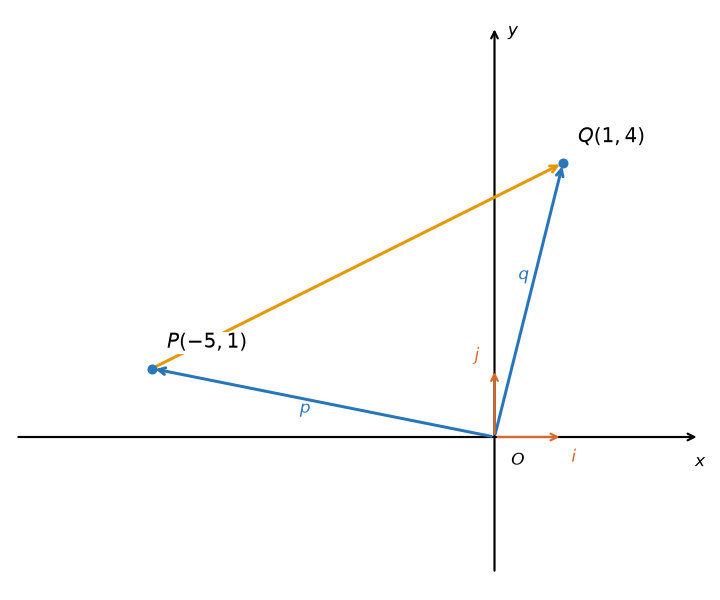

Let $P(-5, 1)$ and $Q(1, 4)$. Find $|\overset{\to }{PQ}|$.

We have

$$
\begin{aligned} & \overset{\to }{OP}=p=-5i+j, \\ & \overset{\to }{OQ}=q=i+4j.\end{aligned}
$$

Expressing $\overset{\to }{PQ}$ as the difference of position vectors, we obtain:

$$
\begin{aligned}\overset{\to }{PQ} &= \overset{\to }{OQ}-\overset{\to }{OP} \\ &= q-p \\ &= (i+4j)-(-5i+j) \\ &= 6i+3j\end{aligned}
$$

The displacement components are $(1)-(-5)=6$ and $(4)-(1)=3$.

Now, using the formula for the magnitude of a vector, we get

$$
\begin{aligned}|\overset{\to }{PQ}| &= \sqrt{(6)^{2}+(3)^{2}} \\ &= \sqrt{36+9} \\ &= \sqrt{45} \\ &= 3 \sqrt{5}.\end{aligned}
$$

Choices: $9$, $45$, $3$, $3 \sqrt{5}$, $\sqrt{41}$

---

AUTHORED NORMAL :question.difficulty/moderate — coordinate_ab

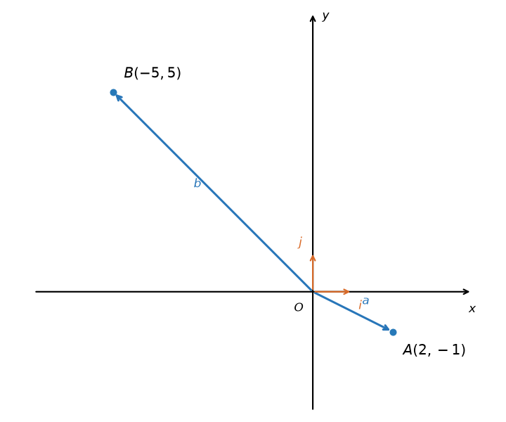

Let $A(2, -1)$ and $B(-5, 5)$. Find $|\overset{\to }{AB}|$.

We have

$$
\begin{aligned} & \overset{\to }{OA}=a=2i-j, \\ & \overset{\to }{OB}=b=-5i+5j.\end{aligned}
$$

Expressing $\overset{\to }{AB}$ as the difference of position vectors, we obtain:

$$
\begin{aligned}\overset{\to }{AB} &= \overset{\to }{OB}-\overset{\to }{OA} \\ &= b-a \\ &= (-5i+5j)-(2i-j) \\ &= -7i+6j\end{aligned}
$$

The displacement components are $(-5)-(2)=-7$ and $(5)-(-1)=6$.

Now, using the formula for the magnitude of a vector, we get

$$
\begin{aligned}|\overset{\to }{AB}| &= \sqrt{(-7)^{2}+(6)^{2}} \\ &= \sqrt{49+36} \\ &= \sqrt{85}.\end{aligned}
$$

Choices: $13$, $\sqrt{85}$, $\sqrt{13}$, $85$, $5$

---

AUTHORED NORMAL :question.difficulty/moderate — coordinate_pq_signed

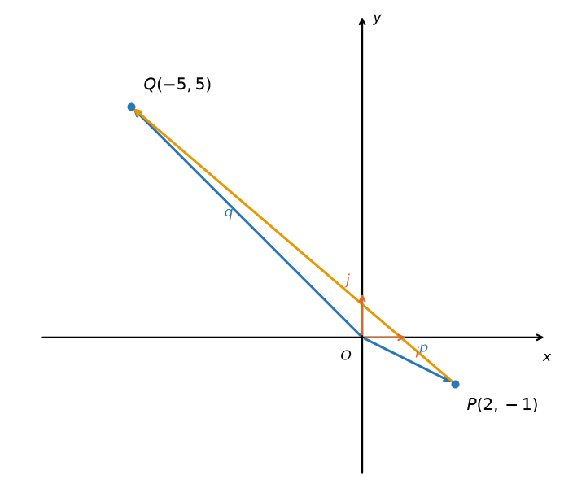

Let $P(2,-1)$ and $Q(-5,5).$ Find $|\overset{\to }{PQ}|.$

We have 

$$
\begin{aligned} & \overset{\to }{OP}=p=2i-j, \\  & \overset{\to }{OQ}=q=-5i+5j.\end{aligned}
$$

Expressing $\overset{\to }{PQ}$ as the difference of position vectors, we obtain:

$$
\begin{aligned}\overset{\to }{PQ} & =\overset{\to }{OQ}-\overset{\to }{OP} \\  & =q-p \\  & =(-5i+5j)-(2i-j) \\  & =-7i+6j\end{aligned}
$$

The displacement components are $(-5)-(2)=-7$ and $(5)-(-1)=6$.

Now, using the formula for the magnitude of a vector, we get

$$
\begin{aligned}|\overset{\to }{PQ}| & =\sqrt{(-7)^{2}+(6)^{2}} \\  & =\sqrt{49+36} \\  & =\sqrt{85}.\end{aligned}
$$

Choices: $13$, $\sqrt{85}$, $\sqrt{13}$, $85$, $5$

---

AUTHORED NORMAL :question.difficulty/moderate — graph_read

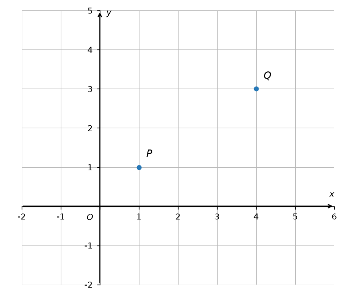

Points $P$ and $Q$ are shown in the picture above. Find $|\overset{\to }{PQ}|$.

From the picture, we obtain $P(1,1)$ and $Q(4,3).$ So, we have

$$
\begin{aligned} & \overset{\to }{OP}=p=i+j, \\  & \overset{\to }{OQ}=q=4i+3j.\end{aligned}
$$

Expressing $\overset{\to }{PQ}$ as the difference of position vectors, we obtain:

$$
\begin{aligned}\overset{\to }{PQ} & =\overset{\to }{OQ}-\overset{\to }{OP} \\  & =q-p \\  & =(4i+3j)-(i+j) \\  & =3i+2j\end{aligned}
$$

The displacement components are $(4)-(1)=3$ and $(3)-(1)=2$.

Now, using the formula for the magnitude of a vector, we get

$$
\begin{aligned}|\overset{\to }{PQ}| & =\sqrt{{3}^{2}+(2)^{2}} \\  & =\sqrt{9+4} \\  & =\sqrt{13}.\end{aligned}
$$

Choices: $5$, $\sqrt{13}$, $\sqrt{5}$, $13$, $\sqrt{41}$

---

AUTHORED NORMAL :question.difficulty/hard — graph_read

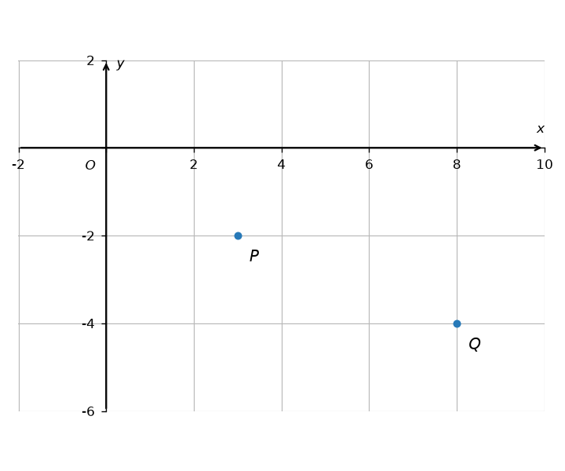

Points $P$ and $Q$ are shown in the picture above. Find $|\overset{\to }{PQ}|$.

From the picture, we obtain $P(3,-2)$ and $Q(8,-4).$ So, we have

$$
\begin{aligned} & \overset{\to }{OP}=p=3i-2j, \\  & \overset{\to }{OQ}=q=8i-4j.\end{aligned}
$$

Expressing $\overset{\to }{PQ}$ as the difference of position vectors, we obtain:

$$
\begin{aligned}\overset{\to }{PQ} & =\overset{\to }{OQ}-\overset{\to }{OP} \\  & =q-p \\  & =(8i-4j)-(3i-2j) \\  & =5i-2j\end{aligned}
$$

The displacement components are $(8)-(3)=5$ and $(-4)-(-2)=-2$.

Now, using the formula for the magnitude of a vector, we get

$$
\begin{aligned}|\overset{\to }{PQ}| & =\sqrt{{5}^{2}+(-2)^{2}} \\  & =\sqrt{25+4} \\  & =\sqrt{29}.\end{aligned}
$$

Choices: $7$, $\sqrt{157}$, $\sqrt{29}$, $\sqrt{7}$, $29$

---

AUTHORED NORMAL :question.difficulty/hard — graph_read

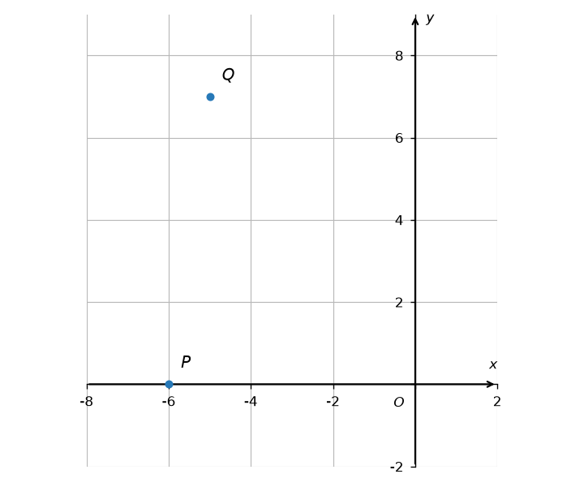

Points $P$ and $Q$ are shown in the picture above. Find $|\overset{\to }{PQ}|$.

From the picture, we obtain $P(-6,0)$ and $Q(-5,7).$ So, we have

$$
\begin{aligned} & \overset{\to }{OP}=p=-6i, \\  & \overset{\to }{OQ}=q=-5i+7j.\end{aligned}
$$

Expressing $\overset{\to }{PQ}$ as the difference of position vectors, we obtain:

$$
\begin{aligned}\overset{\to }{PQ} & =\overset{\to }{OQ}-\overset{\to }{OP} \\  & =q-p \\  & =(-5i+7j)-(-6i) \\  & =i+7j\end{aligned}
$$

The displacement components are $(-5)-(-6)=1$ and $(7)-(0)=7$.

Now, using the formula for the magnitude of a vector, we get

$$
\begin{aligned}|\overset{\to }{PQ}| & =\sqrt{{1}^{2}+(7)^{2}} \\  & =\sqrt{1+49} \\  & =\sqrt{50} \\  & =5 \sqrt{2}.\end{aligned}
$$

Choices: $8$, $50$, $2 \sqrt{2}$, $5 \sqrt{2}$, $\sqrt{170}$

---

ORIGINAL MA EVIDENCE — coordinate_ab

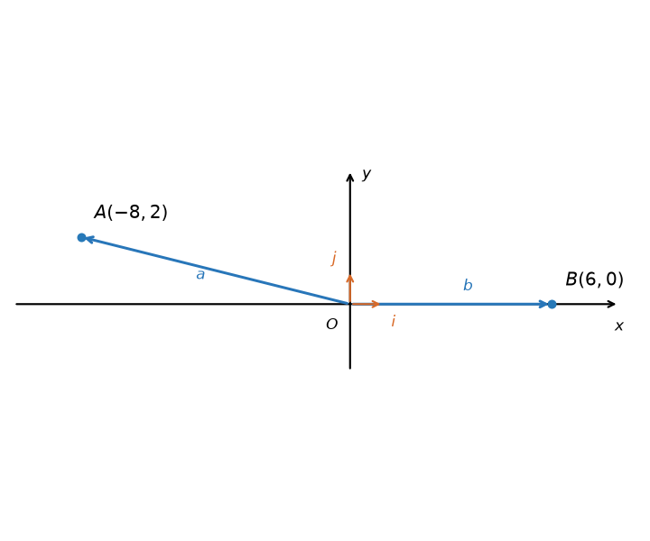

Let $A(-8, 2)$ and $B(6, 0)$. Find $\mid AB^(→) \mid$.

Worked solution absent in original.

Choices: $10 \sqrt{3}$, $12$, $10 \sqrt{2}$, $10$, $6 \sqrt{2}$

---

ORIGINAL MA EVIDENCE — coordinate_ab

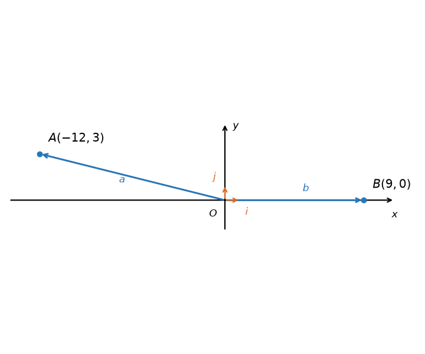

Let $A(-12, 3)$ and $B(9, 0)$. Find $\mid AB^(→) \mid$.

Worked solution absent in original.

Choices: $15 \sqrt{3}$, $18$, $15 \sqrt{2}$, $15$, $9 \sqrt{2}$

---

ORIGINAL MA EVIDENCE — coordinate_ab

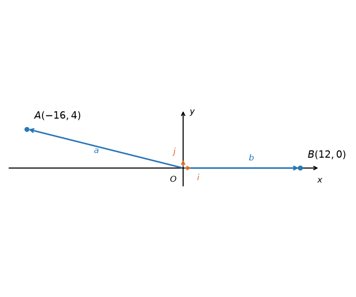

Let $A(-16, 4)$ and $B(12, 0)$. Find $\mid AB^(→) \mid$.

Worked solution absent in original.

Choices: $20 \sqrt{3}$, $24$, $20 \sqrt{2}$, $20$, $12 \sqrt{2}$

---

ORIGINAL MA EVIDENCE — coordinate_pq

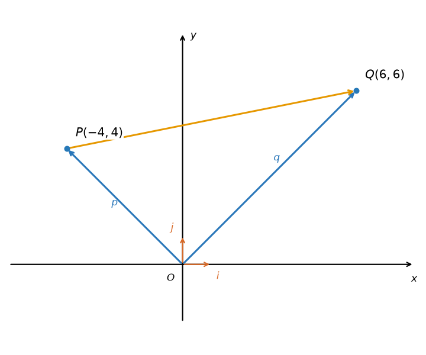

Let $P(-4, 4)$ and $Q(6, 6)$. Find $\mid PQ^(→) \mid$.

Worked solution absent in original.

Choices: $16$, $2 \sqrt{23}$, $6 \sqrt{3}$, $2 \sqrt{26}$, $10$

---

ORIGINAL MA EVIDENCE — coordinate_pq

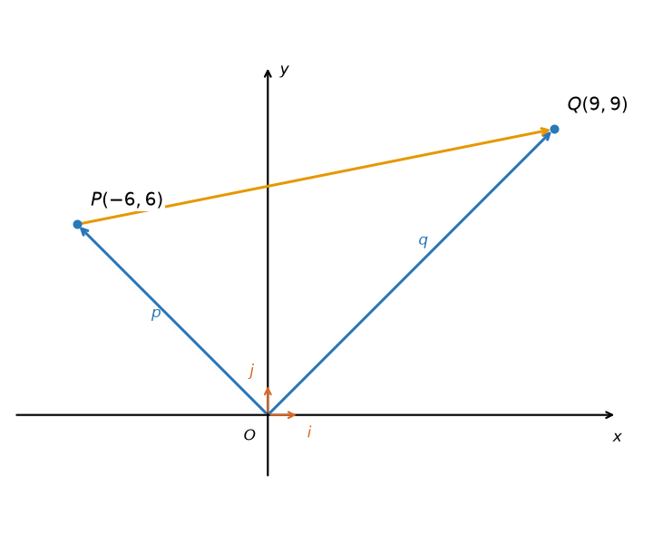

Let $P(-6, 6)$ and $Q(9, 9)$. Find $\mid PQ^(→) \mid$.

Worked solution absent in original.

Choices: $24$, $3 \sqrt{23}$, $9 \sqrt{3}$, $3 \sqrt{26}$, $15$

---

ORIGINAL MA EVIDENCE — coordinate_pq

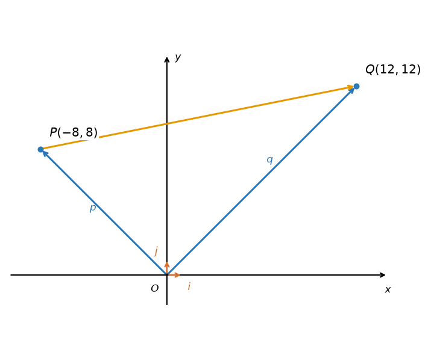

Let $P(-8, 8)$ and $Q(12, 12)$. Find $\mid PQ^(→) \mid$.

Worked solution absent in original.

Choices: $32$, $4 \sqrt{23}$, $12 \sqrt{3}$, $4 \sqrt{26}$, $20$

---

ORIGINAL MA EVIDENCE — coordinate_pq_signed

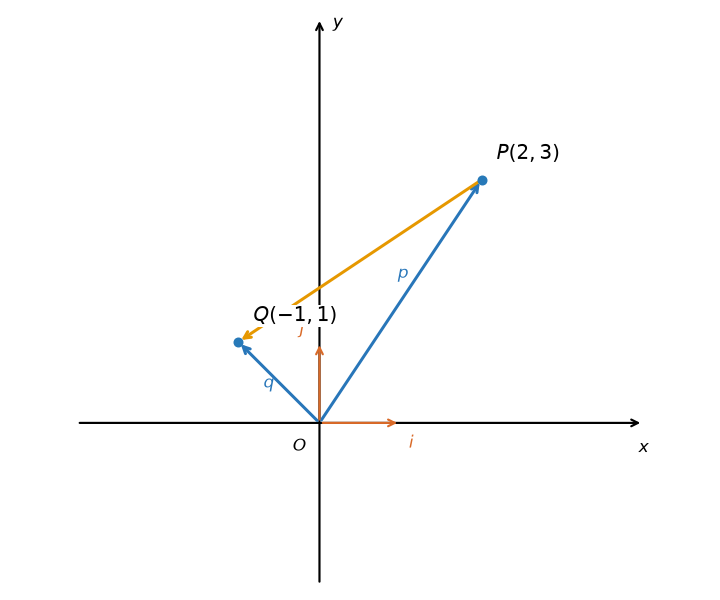

Let $P(2,3)$ and $Q(-1,1).$ Find $|\overset{\to }{PQ}|.$

We have 

$$
\begin{aligned} & \overset{\to }{OP}=p=2i+3j, \\  & \overset{\to }{OQ}=q=-i+j.\end{aligned}
$$

Expressing $\overset{\to }{PQ}$ as the difference of position vectors, we obtain:

$$
\begin{aligned}\overset{\to }{PQ} & =\overset{\to }{OQ}-\overset{\to }{OP} \\  & =q-p \\  & =(-i+j)-(2i+3j) \\  & =-3i-2j\end{aligned}
$$

Now, using the formula for the magnitude of a vector, we get

$$
\begin{aligned}|\overset{\to }{PQ}| & =\sqrt{(-3)^{2}+(-2)^{2}} \\  & =\sqrt{9+4} \\  & =\sqrt{13}.\end{aligned}
$$

Choices: 

---

ORIGINAL MA EVIDENCE — coordinate_cd

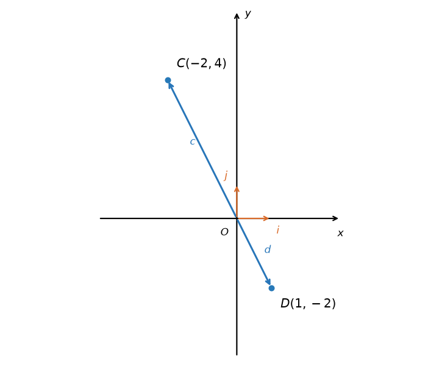

Let $C(-2,4)$ and $D(1,-2).$ Find $|\overset{\to }{CD}|.$

We have 

$$
\begin{aligned} & \overset{\to }{OC}=c=-2i+4j, \\  & \overset{\to }{OD}=d=i-2j.\end{aligned}
$$

Expressing $\overset{\to }{CD}$ as the difference of position vectors, we obtain:

$$
\begin{aligned}\overset{\to }{CD} & =\overset{\to }{OD}-\overset{\to }{OC} \\  & =d-c \\  & =(i-2j)-(-2i+4j) \\  & =3i-6j\end{aligned}
$$

Now, using the formula for the magnitude of a vector, we get

$$
\begin{aligned}|\overset{\to }{CD}| & =\sqrt{{3}^{2}+(-6)^{2}} \\  & =\sqrt{9+36} \\  & =\sqrt{45} \\  & =3 \sqrt{5}.\end{aligned}
$$

Choices: 

---

ORIGINAL MA EVIDENCE — graph_read

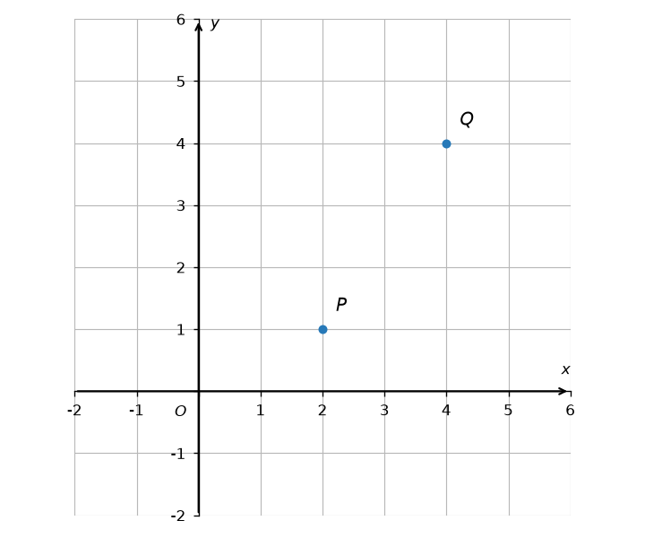

Points $P$ and $Q$ are shown in the picture above. Find $|\overset{\to }{PQ}|.$

From the picture, we obtain $P(2,1)$ and $Q(4,4).$ So, we have

$$
\begin{aligned} & \overset{\to }{OP}=p=2i+j, \\  & \overset{\to }{OQ}=q=4i+4j.\end{aligned}
$$

Expressing $\overset{\to }{PQ}$ as the difference of position vectors, we obtain:

$$
\begin{aligned}\overset{\to }{PQ} & =\overset{\to }{OQ}-\overset{\to }{OP} \\  & =q-p \\  & =(4i+4j)-(2i+j) \\  & =2i+3j\end{aligned}
$$

Now, using the formula for the magnitude of a vector, we get

$$
\begin{aligned}|\overset{\to }{PQ}| & =\sqrt{{2}^{2}+(3)^{2}} \\  & =\sqrt{4+9} \\  & =\sqrt{13}.\end{aligned}
$$

Choices: 
