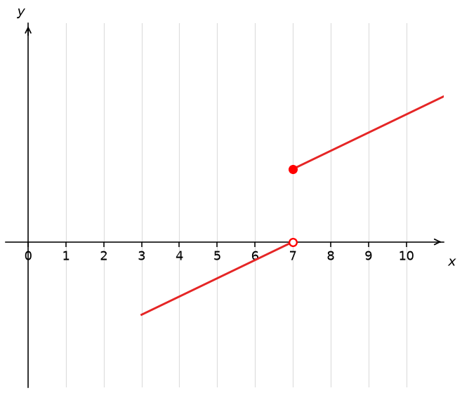

# Source originals and generated variants

Source evidence is frozen at math basis 1356. All observed source banks and omissions are available through public observed profiles. Generated variants below are clearly authored normal presentation.

## q-48080 original

What are the points of discontinuity of the function plotted above?

The graph breaks at $x=-2$ and $x=0$ meaning that we can't draw the plot without taking our pencil off of the paper when passing through these points.

Therefore, the correct answer is $x=-2$ and $x=0.$

Field selection (:answer-field.type/radio)

- $x = 2$ and $x = 0$

- $x = 0$ only

- $x = 2$ only

- $x =-2$ and $x = 0$

- x = ± 2

Field selection (:answer-field.type/radio)

- x=\pm 2

- $x=2$ only

- $x=0$ only

- $x=2$ and $x=0$

- $x=-2$ and $x=0$

### Generated variant; list_breaks

What are the points of discontinuity of the function plotted above?

Field selection

- $x=-6$ only
- $x=-2$ and $x=-1$
- $x=-6$ and $x=-1$
- $x=-2$ only
- $x=-6$ and $x=-2$

Worked solution:

The graph breaks at $x=-6$ and $x=-2$ meaning that we can't draw the plot without taking our pencil off of the paper when passing through these points.

Therefore, the correct answer is $x=-6$ and $x=-2.$

### Parameterized observed-bank variant; evidence only, preserved omissions

What are the points of discontinuity of the function plotted above?

Field selection

- $x = 3$ and $x = 1$
- x=-1,3
- $x = 3$ only
- $x = 1$ only
- $x =-1$ and $x = 1$
Field selection

- $x=3$ only
- $x=-1$ and $x=1$
- x=-1,3
- $x=1$ only
- $x=3$ and $x=1$

Worked solution:

The graph breaks at $x=-1$ and $x=1$ meaning that we can't draw the plot without taking our pencil off of the paper when passing through these points.

Therefore, the correct answer is $x=-1$ and $x=1.$

## q-48090 original

What are the points of discontinuity of the function plotted above?

The graph breaks at $x=1,2$ and $4$, meaning that we can't draw the plot without taking our pencil off of the paper when passing through these points.

Therefore, the correct answer is $x=1,2,4.$

Field selection (:answer-field.type/radio)

- x=1,2,4

- $x=4$ only

- $x=1$ and $x=2$

- $x=1$ and $x=4$

- $x=2$ only

### Generated variant; list_breaks

What are the points of discontinuity of the function plotted above?

Field selection

- $x=0$ and $x=3$
- $x=0$ and $x=1$
- $x=1$ only
- $x=1$ and $x=3$
- $x=0$ and $x=1$ and $x=3$

Worked solution:

The graph breaks at $x=0,1$ and $3$, meaning that we can't draw the plot without taking our pencil off of the paper when passing through these points.

Therefore, the correct answer is $x=0,1,3.$

### Parameterized observed-bank variant; evidence only, preserved omissions

What are the points of discontinuity of the function plotted above?

Field selection

- $x=3$ only
- $x=2$ and $x=5$
- x=2,3,5
- $x=5$ only
- $x=2$ and $x=3$

Worked solution:

The graph breaks at $x=2,3$ and $5$, meaning that we can't draw the plot without taking our pencil off of the paper when passing through these points.

Therefore, the correct answer is $x=2,3,5.$

## q-104021 original

What are the points of discontinuity of the function plotted above?

The graph breaks at $x=-2,1$ and $3,$ meaning that we can't draw the plot without taking our pencil off of the paper when passing through these points.

Therefore, the correct answer is $x=-2,1,3.$

### Generated variant; list_breaks

What are the points of discontinuity of the function plotted above?

Field selection

- $x=2$ and $x=6$
- $x=2$ only
- $x=-4$ and $x=2$
- $x=-4$ and $x=2$ and $x=6$
- $x=-4$ and $x=6$

Worked solution:

The graph breaks at $x=-4,2$ and $6,$ meaning that we can't draw the plot without taking our pencil off of the paper when passing through these points.

Therefore, the correct answer is $x=-4,2,6.$

### Parameterized observed-bank variant; evidence only, preserved omissions

What are the points of discontinuity of the function plotted above?

Worked solution:

The graph breaks at $x=-1,2$ and $4,$ meaning that we can't draw the plot without taking our pencil off of the paper when passing through these points.

Therefore, the correct answer is $x=-1,2,4.$

## q-131299 original

What are the points of discontinuity of $f(x)?$

The function $f(x)$ is discontinuous at $x=$
{{field-1}}.

The point of discontinuity of $f(x)$ is $x=2.$ It is impossible to draw the function in the neighborhood of this point without taking our pencil off of the page.

Field field-1 (:answer-field.type/blank)

- 2

### Generated variant; blank_1

What are the points of discontinuity of $f(x)?$

The function $f(x)$ is discontinuous at $x=$
{{field-1}}.

Field field-1

- 3

Worked solution:

The point of discontinuity of $f(x)$ is $x=3.$ It is impossible to draw the function in the neighborhood of this point without taking our pencil off of the page.

### Parameterized observed-bank variant; evidence only, preserved omissions

What are the points of discontinuity of $f(x)?$

The function $f(x)$ is discontinuous at $x=$
{{field-1}}.

Field field-1

- 3

Worked solution:

The point of discontinuity of $f(x)$ is $x=3.$ It is impossible to draw the function in the neighborhood of this point without taking our pencil off of the page.

## q-131334 original

**In ascending order**, what are the points of discontinuity of $g(x)?$

$g(x)$ is discontinuous at $x=$
{{field-1}}
$\,$and $x=$
{{field-2}}.

The points of discontinuity of $g(x)$ are $x=-1$ and $x=2.$ It is impossible to draw the function in the neighborhood of these points without taking our pencil off of the page.

Field field-1 (:answer-field.type/blank)

- -1

Field field-2 (:answer-field.type/blank)

- 2

### Generated variant; blank_2

**In ascending order**, what are the points of discontinuity of $g(x)?$

$g(x)$ is discontinuous at $x=$
{{field-1}}
$\,$and $x=$
{{field-2}}.

Field field-1

- 0
Field field-2

- 6

Worked solution:

The points of discontinuity of $g(x)$ are $x=0$ and $x=6.$ It is impossible to draw the function in the neighborhood of these points without taking our pencil off of the page.

### Parameterized observed-bank variant; evidence only, preserved omissions

**In ascending order**, what are the points of discontinuity of $g(x)?$

$g(x)$ is discontinuous at $x=$
{{field-1}}
$\,$and $x=$
{{field-2}}.

Field field-1

- 0
Field field-2

- 3

Worked solution:

The points of discontinuity of $g(x)$ are $x=0$ and $x=3.$ It is impossible to draw the function in the neighborhood of these points without taking our pencil off of the page.

## q-131482 original

What are the points of discontinuity of $f(x)?$

                            
                                    
                                        
                                            

                                                

                                        
                                        
                                        

                                    
                                
                                    
                                        
                                        The function $f(x)$ is discontinuous at $x=$

                                    
                                
                                    
                            
                                        {{field-1}}                
                                    
                                
                                    
                                        
                                        .

The point of discontinuity of $f(x)$ is $x=2.$ It is impossible to draw the function in a neighborhood of this point without taking our pencil off of the page.

Field field-1 (:answer-field.type/blank)

- 2

### Generated variant; blank_1

What are the points of discontinuity of $f(x)?$

The function $f(x)$ is discontinuous at $x=$

{{field-1}}                

.

Field field-1

- 0

Worked solution:

The point of discontinuity of $f(x)$ is $x=0.$ It is impossible to draw the function in a neighborhood of this point without taking our pencil off of the page.

### Parameterized observed-bank variant; evidence only, preserved omissions

What are the points of discontinuity of $f(x)?$

                            
                                    
                                        
                                            

                                                

                                        
                                        
                                        

                                    
                                
                                    
                                        
                                        The function $f(x)$ is discontinuous at $x=$

                                    
                                
                                    
                            
                                        {{field-1}}                
                                    
                                
                                    
                                        
                                        .

Field field-1

- 3

Worked solution:

The point of discontinuity of $f(x)$ is $x=3.$ It is impossible to draw the function in a neighborhood of this point without taking our pencil off of the page.

## q-131483 original

**In ascending order**, what are the points of discontinuity of $g(x)?$

                            
                                    
                                        
                                            

                                                

                                        
                                        
                                        

                                    
                                
                                    
                                        
                                        $g(x)$ is discontinuous at $x=$

                                    
                                
                                    
                            
                                        {{field-1}}                
                                    
                                
                                    
                                        
                                        
$\,$and $x=$

                                    
                                
                                    
                            
                                        {{field-2}}                
                                    
                                
                                    
                                        
                                        .

The points of discontinuity of $g(x)$ are $x=-1$ and $x=2.$ It is impossible to draw the function in the neighborhood of these points without taking our pencil off of the page.

Field field-1 (:answer-field.type/blank)

- -1

Field field-2 (:answer-field.type/blank)

- 2

### Generated variant; blank_2

**In ascending order**, what are the points of discontinuity of $g(x)?$

$g(x)$ is discontinuous at $x=$

{{field-1}}                

$\,$and $x=$

{{field-2}}                

.

Field field-1

- -3
Field field-2

- 3

Worked solution:

The points of discontinuity of $g(x)$ are $x=-3$ and $x=3.$ It is impossible to draw the function in the neighborhood of these points without taking our pencil off of the page.

### Parameterized observed-bank variant; evidence only, preserved omissions

**In ascending order**, what are the points of discontinuity of $g(x)?$

                            
                                    
                                        
                                            

                                                

                                        
                                        
                                        

                                    
                                
                                    
                                        
                                        $g(x)$ is discontinuous at $x=$

                                    
                                
                                    
                            
                                        {{field-1}}                
                                    
                                
                                    
                                        
                                        
$\,$and $x=$

                                    
                                
                                    
                            
                                        {{field-2}}                
                                    
                                
                                    
                                        
                                        .

Field field-1

- 0
Field field-2

- 3

Worked solution:

The points of discontinuity of $g(x)$ are $x=0$ and $x=3.$ It is impossible to draw the function in the neighborhood of these points without taking our pencil off of the page.

## q-104020 original

What are the points of discontinuity of the function plotted above?

The graph breaks at $x=0$ and $x=2,$ meaning that we can't draw the plot without taking our pencil off of the paper when passing through these points.

Therefore, the correct answer is $x=0$ and $x=2.$

Field selection (:answer-field.type/radio)

- $x=0$ only

- $x=2$ only

- $x=-2$ and $x=0$

- $x=0$ and $x=2$

- x=\pm 2

### Generated variant; list_breaks

What are the points of discontinuity of the function plotted above?

Field selection

- $x=0$ and $x=2$
- $x=0$ only
- $x=2$ and $x=3$
- $x=0$ and $x=3$
- $x=2$ only

Worked solution:

The graph breaks at $x=0$ and $x=2,$ meaning that we can't draw the plot without taking our pencil off of the paper when passing through these points.

Therefore, the correct answer is $x=0$ and $x=2.$

### Parameterized observed-bank variant; evidence only, preserved omissions

What are the points of discontinuity of the function plotted above?

Field selection

- $x=1$ only
- x=-1,3
- $x=3$ only
- $x=-1$ and $x=1$
- $x=1$ and $x=3$

Worked solution:

The graph breaks at $x=1$ and $x=3,$ meaning that we can't draw the plot without taking our pencil off of the paper when passing through these points.

Therefore, the correct answer is $x=1$ and $x=3.$

## q-104023 original

What are the points of discontinuity of the function plotted above?

The graph breaks at $x=-2$ and $x=0,$ meaning that we can't draw the plot without taking our pencil off of the paper when passing through these points.

Therefore, the correct answer is $x=-2$ and $x=0.$

Field selection (:answer-field.type/radio)

- $x=0$ only

- $x=-2$ only

- $x=0$ and $x=2$

- $x=-2$ and $x=0$

- x=\pm 2

### Generated variant; list_breaks

What are the points of discontinuity of the function plotted above?

Field selection

- $x=1$ only
- $x=-3$ and $x=1$
- $x=-3$ only
- $x=1$ and $x=2$
- $x=-3$ and $x=2$

Worked solution:

The graph breaks at $x=-3$ and $x=1,$ meaning that we can't draw the plot without taking our pencil off of the paper when passing through these points.

Therefore, the correct answer is $x=-3$ and $x=1.$

### Parameterized observed-bank variant; evidence only, preserved omissions

What are the points of discontinuity of the function plotted above?

Field selection

- $x=1$ and $x=3$
- $x=-1$ only
- $x=-1$ and $x=1$
- $x=1$ only
- x=-1,3

Worked solution:

The graph breaks at $x=-1$ and $x=1,$ meaning that we can't draw the plot without taking our pencil off of the paper when passing through these points.

Therefore, the correct answer is $x=-1$ and $x=1.$

## q-104040 original

Select the function that has a discontinuity at $x=-3.$

The correct answer is shown below. Notice that the function contains a break exactly at $x=-3$ and it's impossible to draw its graph without taking our pencil off of the paper.

All the other given graphs can be plotted without taking the pencil off of the paper.

Field selection (:answer-field.type/radio)

- 

- 

- 

- 

- 

### Generated variant; select_graph

Select the function that has a discontinuity at $x=-1.$

Field selection

- 
- 
- 
- 
- 

Worked solution:

The correct answer is shown below. Notice that the function contains a break exactly at $x=-1$ and it's impossible to draw its graph without taking our pencil off of the paper.

All the other given graphs can be plotted without taking the pencil off of the paper.

### Parameterized observed-bank variant; evidence only, preserved omissions

Select the function that has a discontinuity at $x=-2.$

Field selection

- 
- 
- 
- 
- 

Worked solution:

The correct answer is shown below. Notice that the function contains a break exactly at $x=-2$ and it's impossible to draw its graph without taking our pencil off of the paper.

All the other given graphs can be plotted without taking the pencil off of the paper.

## q-48074 original

Select the function that has a discontinuity at $x=1.$

The correct answer is shown below. Notice that the function contains a vertical asymptote exactly at $x=1$ and it's impossible to draw its graph without taking our pencil off of the paper.

All the other given graphs can be plotted without taking the pencil off of the paper.

Field selection (:answer-field.type/radio)

- 

- 

- 

- 

- 

### Generated variant; select_graph

Select the function that has a discontinuity at $x=0.$

Field selection

- 
- 
- 
- 
- 

Worked solution:

The correct answer is shown below. Notice that the function contains a vertical asymptote exactly at $x=0$ and it's impossible to draw its graph without taking our pencil off of the paper.

All the other given graphs can be plotted without taking the pencil off of the paper.

### Parameterized observed-bank variant; evidence only, preserved omissions

Select the function that has a discontinuity at $x=2.$

Field selection

- 
- 
- 
- 
- 

Worked solution:

The correct answer is shown below. Notice that the function contains a vertical asymptote exactly at $x=2$ and it's impossible to draw its graph without taking our pencil off of the paper.

All the other given graphs can be plotted without taking the pencil off of the paper.

## q-48076 original

Select the function that has a discontinuity at $x=-1.$

The correct answer is shown below. Notice that the function contains a vertical asymptote exactly at $x=-1$ and it's impossible to draw its graph without taking our pencil off of the paper.

All the other given graphs can be plotted without taking the pencil off of the paper.

Field selection (:answer-field.type/radio)

- 

- 

- 

- 

- 

### Generated variant; select_graph

Select the function that has a discontinuity at $x=-2.$

Field selection

- 
- 
- 
- 
- 

Worked solution:

The correct answer is shown below. Notice that the function contains a vertical asymptote exactly at $x=-2$ and it's impossible to draw its graph without taking our pencil off of the paper.

All the other given graphs can be plotted without taking the pencil off of the paper.

### Parameterized observed-bank variant; evidence only, preserved omissions

Select the function that has a discontinuity at $x=0.$

Field selection

- 
- 
- 
- 
- 

Worked solution:

The correct answer is shown below. Notice that the function contains a vertical asymptote exactly at $x=0$ and it's impossible to draw its graph without taking our pencil off of the paper.

All the other given graphs can be plotted without taking the pencil off of the paper.

## q-48087 original

What are the points of discontinuity of the function plotted above?

The graph breaks at $x=-2$ and $x=2$ meaning that we can't draw the plot without taking our pencil off of the paper when passing through these points.

Therefore, the correct answer is $x=-2$ and $x=2.$

Field selection (:answer-field.type/radio)

- x=\pm 2

- x=\pm 3

- $x=2$ only

- $x=2$ and $x=0$

- $x=0$ only

### Generated variant; list_breaks

What are the points of discontinuity of the function plotted above?

Field selection

- $x=-4$ and $x=5$
- $x=-4$ only
- $x=4$ and $x=5$
- $x=4$ only
- $x=-4$ and $x=4$

Worked solution:

The graph breaks at $x=-4$ and $x=4$ meaning that we can't draw the plot without taking our pencil off of the paper when passing through these points.

Therefore, the correct answer is $x=-4$ and $x=4.$

### Parameterized observed-bank variant; evidence only, preserved omissions

What are the points of discontinuity of the function plotted above?

Field selection

- $x=3$ only
- $x=3$ and $x=1$
- x=-2,4
- x=-1,3
- $x=1$ only

Worked solution:

The graph breaks at $x=-1$ and $x=3$ meaning that we can't draw the plot without taking our pencil off of the paper when passing through these points.

Therefore, the correct answer is $x=-1$ and $x=3.$

## q-104036 original

Select the function that has a discontinuity at $x=-2.$

The correct answer is shown below. Notice that the function contains a jump exactly at $x=-2$ and it's impossible to draw its graph without taking our pencil off of the paper.

All the other given graphs can be plotted without taking the pencil off of the paper.

Field selection (:answer-field.type/radio)

- 

- 

- 

- 

- 

### Generated variant; select_graph

Select the function that has a discontinuity at $x=-1.$

Field selection

- 
- 
- 
- 
- 

Worked solution:

The correct answer is shown below. Notice that the function contains a jump exactly at $x=-1$ and it's impossible to draw its graph without taking our pencil off of the paper.

All the other given graphs can be plotted without taking the pencil off of the paper.

### Parameterized observed-bank variant; evidence only, preserved omissions

Select the function that has a discontinuity at $x=-1.$

Field selection

- 
- 
- 
- 
- 

Worked solution:

The correct answer is shown below. Notice that the function contains a jump exactly at $x=-1$ and it's impossible to draw its graph without taking our pencil off of the paper.

All the other given graphs can be plotted without taking the pencil off of the paper.

## q-48038 original

Select the function that has a discontinuity at $x=1.$

The correct answer is shown below. Notice that the function contains a break exactly at $x=1$ and it's impossible to draw its graph without taking our pencil off of the paper.

All the other given graphs can be plotted without taking the pencil off of the paper.

Field selection (:answer-field.type/radio)

- 

- 

- 

- 

- 

### Generated variant; select_graph

Select the function that has a discontinuity at $x=4.$

Field selection

- 
- 
- 
- 
- 

Worked solution:

The correct answer is shown below. Notice that the function contains a break exactly at $x=4$ and it's impossible to draw its graph without taking our pencil off of the paper.

All the other given graphs can be plotted without taking the pencil off of the paper.

### Parameterized observed-bank variant; evidence only, preserved omissions

Select the function that has a discontinuity at $x=2.$

Field selection

- 
- 
- 
- 
- 

Worked solution:

The correct answer is shown below. Notice that the function contains a break exactly at $x=2$ and it's impossible to draw its graph without taking our pencil off of the paper.

All the other given graphs can be plotted without taking the pencil off of the paper.

## q-104025 original

What are the points of discontinuity of the function plotted above?

The graph breaks at $x=-1$ and $x=2,$ meaning that we can't draw the plot without taking our pencil off of the paper when passing through these points.

Therefore, the correct answer is $x=-1$ and $x=2.$

Field selection (:answer-field.type/radio)

- $x=2$ only

- $x=-1$ and $x=2$

- $x=1$ and $x=2$

- $x=-2$ and $x=1$

- $x=-1$ only

### Generated variant; list_breaks

What are the points of discontinuity of the function plotted above?

Field selection

- $x=0$ and $x=1$
- $x=0$ only
- $x=-3$ only
- $x=-3$ and $x=1$
- $x=-3$ and $x=0$

Worked solution:

The graph breaks at $x=-3$ and $x=0,$ meaning that we can't draw the plot without taking our pencil off of the paper when passing through these points.

Therefore, the correct answer is $x=-3$ and $x=0.$

### Parameterized observed-bank variant; evidence only, preserved omissions

What are the points of discontinuity of the function plotted above?

Field selection

- $x=2$ and $x=3$
- $x=3$ only
- $x=0$ and $x=3$
- $x=-1$ and $x=2$
- $x=0$ only

Worked solution:

The graph breaks at $x=0$ and $x=3,$ meaning that we can't draw the plot without taking our pencil off of the paper when passing through these points.

Therefore, the correct answer is $x=0$ and $x=3.$

## q-48088 original

What are the points of discontinuity of the function plotted above?

The graph breaks at $x=-3$ and $x=0$ meaning that we can't draw the plot without taking our pencil off of the paper when passing through these points.

Therefore, the correct answer is $x=-3$ and $x=0.$

Field selection (:answer-field.type/radio)

- $x=-3$ and $x=0$

- $x=0$ and $x=2$

- x=\pm 2

- $x=-3$ only

- $x=1$ only

### Generated variant; list_breaks

What are the points of discontinuity of the function plotted above?

Field selection

- $x=-7$ only
- $x=-7$ and $x=-1$
- $x=-1$ only
- $x=-1$ and $x=0$
- $x=-7$ and $x=0$

Worked solution:

The graph breaks at $x=-7$ and $x=-1$ meaning that we can't draw the plot without taking our pencil off of the paper when passing through these points.

Therefore, the correct answer is $x=-7$ and $x=-1.$

### Parameterized observed-bank variant; evidence only, preserved omissions

What are the points of discontinuity of the function plotted above?

Field selection

- x=-1,3
- $x=-2$ only
- $x=-2$ and $x=1$
- $x=2$ only
- $x=1$ and $x=3$

Worked solution:

The graph breaks at $x=-2$ and $x=1$ meaning that we can't draw the plot without taking our pencil off of the paper when passing through these points.

Therefore, the correct answer is $x=-2$ and $x=1.$

## Authored moderate extension

What are the points of discontinuity of the function plotted above?

Field selection

- $x=-4$ and $x=2$ and $x=3.5$
- $x=2$ only
- $x=2$ and $x=3.5$
- $x=-4$ and $x=3.5$
- $x=-4$ and $x=2$

Worked solution:

The graph breaks at $x=-4$ and $x=2$ and $x=3.5$, meaning that we can't draw the plot without taking our pencil off of the paper when passing through these points.

Therefore, the correct answer is $x=-4$ and $x=2$ and $x=3.5$.

## Authored moderate extension

What are the points of discontinuity of the function plotted above?

Field selection

- $x=-3$ and $x=-1.5$
- $x=-1.5$ only
- $x=-3$ and $x=-1.5$ and $x=1$
- $x=-3$ and $x=1$
- $x=-1.5$ and $x=1$

Worked solution:

The graph breaks at $x=-3$ and $x=-1.5$ and $x=1$, meaning that we can't draw the plot without taking our pencil off of the paper when passing through these points.

Therefore, the correct answer is $x=-3$ and $x=-1.5$ and $x=1$.

## Authored hard extension

What are the points of discontinuity of the function plotted above?

Field selection

- $x=-3.5$ and $x=0$ and $x=1.5$
- $x=-3.5$ and $x=0$
- $x=0$ and $x=1.5$
- $x=0$ only
- $x=-3.5$ and $x=1.5$

Worked solution:

The graph breaks at $x=-3.5$ and $x=0$ and $x=1.5$, meaning that we can't draw the plot without taking our pencil off of the paper when passing through these points.

Therefore, the correct answer is $x=-3.5$ and $x=0$ and $x=1.5$.

## Authored hard extension

What are the points of discontinuity of the function plotted above?

Field selection

- $x=-0.5$ only
- $x=-3$ and $x=-0.5$ and $x=1.5$
- $x=-0.5$ and $x=1.5$
- $x=-3$ and $x=1.5$
- $x=-3$ and $x=-0.5$

Worked solution:

The graph breaks at $x=-3$ and $x=-0.5$ and $x=1.5$, meaning that we can't draw the plot without taking our pencil off of the paper when passing through these points.

Therefore, the correct answer is $x=-3$ and $x=-0.5$ and $x=1.5$.

## Parent QA true-origin correction

Version `graph-discontinuity-2-zero-axes` extends the viewport to include actual x=0 and y=0; curve coordinates and correct answers retain their affine transformation. The original failing single blank at scale2/shift+3 now shows the true origin and the break at x=7. Its axis begins before 0, while the curve begins at x=3. Axis labels are attached to the true positive axes.

`zero-axes-review.json` contains all 34 source-family boundary records (scale2, shifts -3/+3), totalling 74 prompt/choice plots. Both shifts of every complete five-image selection bank were inspected at native resolution in the `zero-axes-q-*-plus3/minus3.png` sheets. Single/two-blank reconstructions, a translated three-break source curve, and authored moderate/hard screenshots were also inspected. Sidecar and actual raster checks verify true-zero spine intersections and ticks for all generated records; an old [3,11] viewport mutation is rejected. Native grading after refresh: 107 accepted, 260 rejected, zero unresolved. Earlier assets remain preserved.
