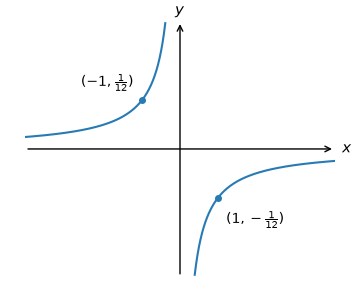
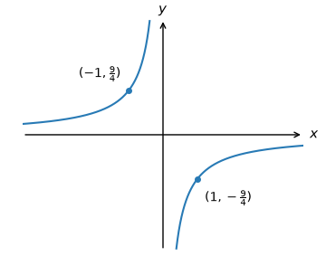
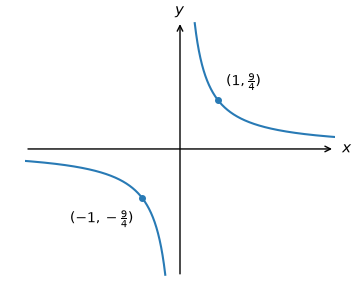
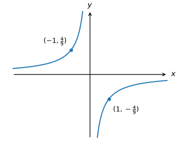
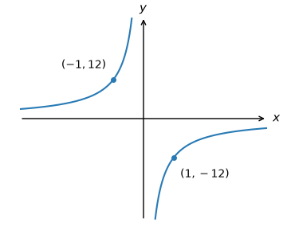
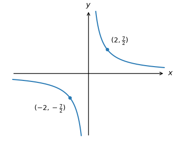
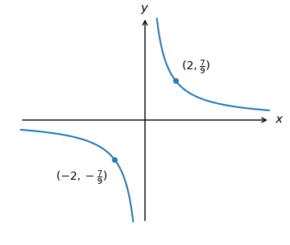
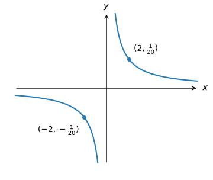
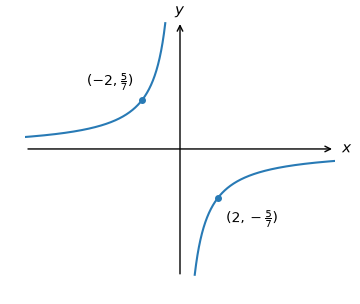
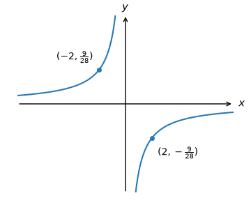

# Positive reciprocal stretch review

All five original banks precede their generated parameter variants. Hard is an authored extension at the same two-stage method. Raw q-99064 preserves both captured widgets, including one absent and one present correct ref.

## Original replay — raw_q-16506

{"n": 1, "d": 2}

Which of the following is the graph of $y=\frac{1}{2x}?$

**A** (correct)

**B**

**C**

**D**

**E**

To plot $y=\frac{1}{2x},$ we apply the following steps:

- Take the curve $y=\frac{1}{x}.$

- Stretch the result by a scale factor of $\frac{1}{2}$ parallel to the $y$-axis to get the graph of $y=\frac{1}{2x}.$

## Generated variant — raw_q-16506

{"n": 1, "d": 12}

Which of the following is the graph of $y=\frac{1}{12x}?$

**A**

**B**

**C** (correct)

**D**

**E**

To plot $y=\frac{1}{12x},$ we apply the following steps:

- Take the curve $y=\frac{1}{x}.$

- Stretch the result by a scale factor of $\frac{1}{12}$ parallel to the $y$-axis to get the graph of $y=\frac{1}{12x}.$

## Generated variant — raw_q-16506

{"n": 1, "d": 7}

Which of the following is the graph of $y=\frac{1}{7x}?$

**A**

**B**

**C**

**D** (correct)

**E**

To plot $y=\frac{1}{7x},$ we apply the following steps:

- Take the curve $y=\frac{1}{x}.$

- Stretch the result by a scale factor of $\frac{1}{7}$ parallel to the $y$-axis to get the graph of $y=\frac{1}{7x}.$

## Original replay — raw_q-99064

{"n": 3, "d": 2}

Which of the following is the graph of $y=\frac{3}{2x}?$

**Captured widget 1 (raw evidence)**

**A**

**B**

**C**

**D**

**E**

Raw evidence: source correct designation absent.

**Captured widget 2 (raw evidence)**

**A**

**B**

**C**

**D**

**E** (correct)

To plot $y=\frac{3}{2x},$ we apply the following steps:

- Take the curve $y=\frac{1}{x}.$

- Stretch the result by a scale factor of $\frac{3}{2}$ parallel to the $y$-axis to get the graph of $y=\frac{3}{2x}.$

## Generated variant — raw_q-99064

{"n": 9, "d": 4}

Which of the following is the graph of $y=\frac{9}{4x}?$

**Captured widget 1 (raw evidence)**

**A**

**B**

**C**

**D**

**E**

Raw evidence: source correct designation absent.

**Captured widget 2 (raw evidence)**

**A**

**B**

**C** (correct)

**D**

**E**

To plot $y=\frac{9}{4x},$ we apply the following steps:

- Take the curve $y=\frac{1}{x}.$

- Stretch the result by a scale factor of $\frac{9}{4}$ parallel to the $y$-axis to get the graph of $y=\frac{9}{4x}.$

## Generated variant — raw_q-99064

{"n": 8, "d": 5}

Which of the following is the graph of $y=\frac{8}{5x}?$

**Captured widget 1 (raw evidence)**

**A**

**B**

**C**

**D**

**E**

Raw evidence: source correct designation absent.

**Captured widget 2 (raw evidence)**

**A**

**B**

**C**

**D**

**E** (correct)

To plot $y=\frac{8}{5x},$ we apply the following steps:

- Take the curve $y=\frac{1}{x}.$

- Stretch the result by a scale factor of $\frac{8}{5}$ parallel to the $y$-axis to get the graph of $y=\frac{8}{5x}.$

## Original replay — raw_q-113328

{"n": 5, "d": 3}

Which of the following is the graph of $y=\frac{5}{3x}?$

**A** (correct)

**B**

**C**

**D**

**E**

To plot $y=\frac{5}{3x},$ we apply the following steps:

- Take the curve $y=\frac{1}{x}.$

- Stretch the result by a scale factor of $\frac{5}{3}$ parallel to the $y$-axis to get the graph of $y=\frac{5}{3x}.$

## Generated variant — raw_q-113328

{"n": 9, "d": 4}

Which of the following is the graph of $y=\frac{9}{4x}?$

**A** (correct)

**B**

**C**

**D**

**E**

To plot $y=\frac{9}{4x},$ we apply the following steps:

- Take the curve $y=\frac{1}{x}.$

- Stretch the result by a scale factor of $\frac{9}{4}$ parallel to the $y$-axis to get the graph of $y=\frac{9}{4x}.$

## Generated variant — raw_q-113328

{"n": 8, "d": 5}

Which of the following is the graph of $y=\frac{8}{5x}?$

**A**

**B**

**C**

**D**

**E** (correct)

To plot $y=\frac{8}{5x},$ we apply the following steps:

- Take the curve $y=\frac{1}{x}.$

- Stretch the result by a scale factor of $\frac{8}{5}$ parallel to the $y$-axis to get the graph of $y=\frac{8}{5x}.$

## Original replay — raw_q-97952

{"n": 2, "d": 1}

Which of the following is the graph of $y=\frac{2}{x}?$

**A** (correct)

**B**

**C**

**D**

**E**

To plot $y=\frac{2}{x},$ we apply the following steps:

- Take the curve $y=\frac{1}{x}.$

- Stretch the result by a scale factor of $2$ parallel to the $y$-axis to get the graph of $y=\frac{2}{x}.$

## Generated variant — raw_q-97952

{"n": 12, "d": 1}

Which of the following is the graph of $y=\frac{12}{x}?$

**A**

**B**

**C** (correct)

**D**

**E**

To plot $y=\frac{12}{x},$ we apply the following steps:

- Take the curve $y=\frac{1}{x}.$

- Stretch the result by a scale factor of $12$ parallel to the $y$-axis to get the graph of $y=\frac{12}{x}.$

## Generated variant — raw_q-97952

{"n": 7, "d": 1}

Which of the following is the graph of $y=\frac{7}{x}?$

**A**

**B**

**C**

**D** (correct)

**E**

To plot $y=\frac{7}{x},$ we apply the following steps:

- Take the curve $y=\frac{1}{x}.$

- Stretch the result by a scale factor of $7$ parallel to the $y$-axis to get the graph of $y=\frac{7}{x}.$

## Original replay — raw_q-113324

{"n": 5, "d": 1}

Which of the following is the graph of $y=\frac{5}{x}?$

**A**

**B**

**C**

**D** (correct)

**E**

To plot $y=\frac{5}{x},$ we apply the following steps:

- Take the curve $y=\frac{1}{x}.$

- Stretch the result by a scale factor of $5$ parallel to the $y$-axis to get the graph of $y=\frac{5}{x}.$

## Generated variant — raw_q-113324

{"n": 12, "d": 1}

Which of the following is the graph of $y=\frac{12}{x}?$

**A**

**B**

**C**

**D** (correct)

**E**

To plot $y=\frac{12}{x},$ we apply the following steps:

- Take the curve $y=\frac{1}{x}.$

- Stretch the result by a scale factor of $12$ parallel to the $y$-axis to get the graph of $y=\frac{12}{x}.$

## Generated variant — raw_q-113324

{"n": 7, "d": 1}

Which of the following is the graph of $y=\frac{7}{x}?$

**A**

**B** (correct)

**C**

**D**

**E**

To plot $y=\frac{7}{x},$ we apply the following steps:

- Take the curve $y=\frac{1}{x}.$

- Stretch the result by a scale factor of $7$ parallel to the $y$-axis to get the graph of $y=\frac{7}{x}.$

## Generated variant — integer_reversal

{"n": 12, "d": 1}

Which of the following is the graph of $y=\frac{12}{x}?$

**A**

**B**

**C** (correct)

**D**

**E**

To plot $y=\frac{12}{x},$ we apply the following steps:

- Take the curve $y=\frac{1}{x}.$

- Stretch the result by a scale factor of $12$ parallel to the $y$-axis to get the graph of $y=\frac{12}{x}.$

## Generated variant — integer_reversal

{"n": 7, "d": 1}

Which of the following is the graph of $y=\frac{7}{x}?$

**A**

**B**

**C**

**D** (correct)

**E**

To plot $y=\frac{7}{x},$ we apply the following steps:

- Take the curve $y=\frac{1}{x}.$

- Stretch the result by a scale factor of $7$ parallel to the $y$-axis to get the graph of $y=\frac{7}{x}.$

## Generated variant — unit_numerator_reversal

{"n": 1, "d": 12}

Which of the following is the graph of $y=\frac{1}{12x}?$

**A**

**B**

**C** (correct)

**D**

**E**

To plot $y=\frac{1}{12x},$ we apply the following steps:

- Take the curve $y=\frac{1}{x}.$

- Stretch the result by a scale factor of $\frac{1}{12}$ parallel to the $y$-axis to get the graph of $y=\frac{1}{12x}.$

## Generated variant — unit_numerator_reversal

{"n": 1, "d": 7}

Which of the following is the graph of $y=\frac{1}{7x}?$

**A**

**B**

**C**

**D** (correct)

**E**

To plot $y=\frac{1}{7x},$ we apply the following steps:

- Take the curve $y=\frac{1}{x}.$

- Stretch the result by a scale factor of $\frac{1}{7}$ parallel to the $y$-axis to get the graph of $y=\frac{1}{7x}.$

## Generated variant — rational_denominator

{"n": 9, "d": 4}

Which of the following is the graph of $y=\frac{9}{4x}?$

**A**

**B**

**C** (correct)

**D**

**E**

To plot $y=\frac{9}{4x},$ we apply the following steps:

- Take the curve $y=\frac{1}{x}.$

- Stretch the result by a scale factor of $\frac{9}{4}$ parallel to the $y$-axis to get the graph of $y=\frac{9}{4x}.$

## Generated variant — rational_denominator

{"n": 8, "d": 5}

Which of the following is the graph of $y=\frac{8}{5x}?$

**A** (correct)

**B**

**C**

**D**

**E**

To plot $y=\frac{8}{5x},$ we apply the following steps:

- Take the curve $y=\frac{1}{x}.$

- Stretch the result by a scale factor of $\frac{8}{5}$ parallel to the $y$-axis to get the graph of $y=\frac{8}{5x}.$

## Generated variant — rational_reversal

{"n": 9, "d": 4}

Which of the following is the graph of $y=\frac{9}{4x}?$

**A** (correct)

**B**

**C**

**D**

**E**

To plot $y=\frac{9}{4x},$ we apply the following steps:

- Take the curve $y=\frac{1}{x}.$

- Stretch the result by a scale factor of $\frac{9}{4}$ parallel to the $y$-axis to get the graph of $y=\frac{9}{4x}.$

## Generated variant — rational_reversal

{"n": 8, "d": 5}

Which of the following is the graph of $y=\frac{8}{5x}?$

**A**

**B**

**C**

**D**

**E** (correct)

To plot $y=\frac{8}{5x},$ we apply the following steps:

- Take the curve $y=\frac{1}{x}.$

- Stretch the result by a scale factor of $\frac{8}{5}$ parallel to the $y$-axis to get the graph of $y=\frac{8}{5x}.$

## Generated variant — nonunit_point_reversal

{"n": 7, "d": 10}

Which of the following is the graph of $y=\frac{7}{10x}?$

**A**

**B**

**C**

**D**

**E** (correct)

To plot $y=\frac{7}{10x},$ we apply the following steps:

- Take the curve $y=\frac{1}{x}.$

- Stretch the result by a scale factor of $\frac{7}{10}$ parallel to the $y$-axis to get the graph of $y=\frac{7}{10x}.$

## Generated variant — nonunit_point_reversal

{"n": 14, "d": 9}

Which of the following is the graph of $y=\frac{14}{9x}?$

**A**

**B**

**C**

**D** (correct)

**E**

To plot $y=\frac{14}{9x},$ we apply the following steps:

- Take the curve $y=\frac{1}{x}.$

- Stretch the result by a scale factor of $\frac{14}{9}$ parallel to the $y$-axis to get the graph of $y=\frac{14}{9x}.$

## Generated variant — nonunit_point_denominator

{"n": 7, "d": 10}

Which of the following is the graph of $y=\frac{7}{10x}?$

**A**

**B**

**C**

**D**

**E** (correct)

To plot $y=\frac{7}{10x},$ we apply the following steps:

- Take the curve $y=\frac{1}{x}.$

- Stretch the result by a scale factor of $\frac{7}{10}$ parallel to the $y$-axis to get the graph of $y=\frac{7}{10x}.$

## Generated variant — nonunit_point_denominator

{"n": 14, "d": 9}

Which of the following is the graph of $y=\frac{14}{9x}?$

**A**

**B**

**C**

**D** (correct)

**E**

To plot $y=\frac{14}{9x},$ we apply the following steps:

- Take the curve $y=\frac{1}{x}.$

- Stretch the result by a scale factor of $\frac{14}{9}$ parallel to the $y$-axis to get the graph of $y=\frac{14}{9x}.$

