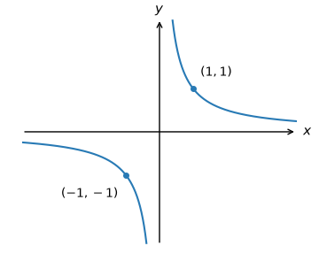
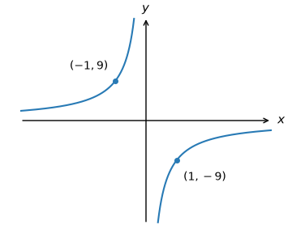
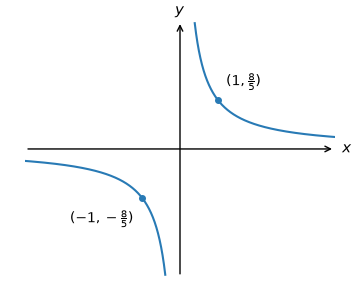
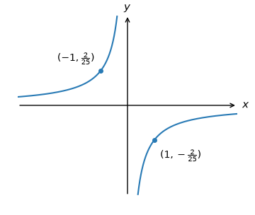
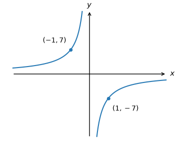
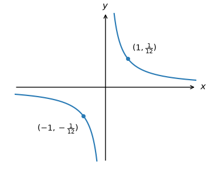
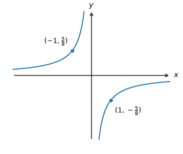
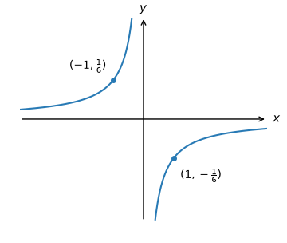
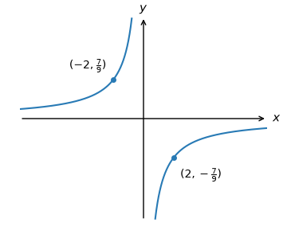
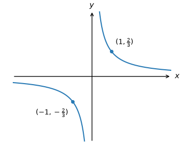

# Negative reciprocal stretch review

All nine original banks precede their generated parameter variants. Hard is an authored extension at the same two-stage method. Raw q-97958/q-97963 preserve absent difficulty, worked solution and correct ref. Raw q-99068 retains the opaque doubled coefficient and is evidence-only.

## Original replay — raw_q-97958

{"n": 3, "d": 2}

Which of the following is the graph of $y =-\frac{3}{2x}$?

**A**

**B**

**C**

**D**

**E**

Raw evidence: source correct designation absent.

## Generated variant — raw_q-97958

{"n": 9, "d": 4}

Which of the following is the graph of $y =-\frac{9}{4x}$?

**A**

**B**

**C**

**D**

**E**

Raw evidence: source correct designation absent.

## Generated variant — raw_q-97958

{"n": 8, "d": 5}

Which of the following is the graph of $y =-\frac{8}{5x}$?

**A**

**B**

**C**

**D**

**E**

Raw evidence: source correct designation absent.

## Original replay — raw_q-97963

{"n": 3, "d": 1}

Which of the following is the graph of $y =-\frac{3}{x}$?

**A**

**B**

**C**

**D**

**E**

Raw evidence: source correct designation absent.

## Generated variant — raw_q-97963

{"n": 12, "d": 1}

Which of the following is the graph of $y =-\frac{12}{x}$?

**A**

**B**

**C**

**D**

**E**

Raw evidence: source correct designation absent.

## Generated variant — raw_q-97963

{"n": 7, "d": 1}

Which of the following is the graph of $y =-\frac{7}{x}$?

**A**

**B**

**C**

**D**

**E**

Raw evidence: source correct designation absent.

## Original replay — raw_q-113335

{"n": 1, "d": 6}

Which of the following is the graph of $y=-\frac{1}{6x}?$

**A**

**B**

**C**

**D** (correct)

**E**

To plot $y=-\frac{1}{6x},$ we apply the following steps:

- Take the curve $y=-\frac{1}{x}.$

- Stretch the result by a scale factor of $\frac{1}{6}$ parallel to the $y$-axis to get the graph of $y=-\frac{1}{6x}.$

## Generated variant — raw_q-113335

{"n": 1, "d": 12}

Which of the following is the graph of $y=-\frac{1}{12x}?$

**A**

**B**

**C**

**D** (correct)

**E**

To plot $y=-\frac{1}{12x},$ we apply the following steps:

- Take the curve $y=-\frac{1}{x}.$

- Stretch the result by a scale factor of $\frac{1}{12}$ parallel to the $y$-axis to get the graph of $y=-\frac{1}{12x}.$

## Generated variant — raw_q-113335

{"n": 1, "d": 7}

Which of the following is the graph of $y=-\frac{1}{7x}?$

**A**

**B** (correct)

**C**

**D**

**E**

To plot $y=-\frac{1}{7x},$ we apply the following steps:

- Take the curve $y=-\frac{1}{x}.$

- Stretch the result by a scale factor of $\frac{1}{7}$ parallel to the $y$-axis to get the graph of $y=-\frac{1}{7x}.$

## Original replay — raw_q-113337

{"n": 5, "d": 2}

Which of the following is the graph of $y=-\frac{5}{2x}?$

**A**

**B**

**C**

**D** (correct)

**E**

To plot $y=-\frac{5}{2x},$ we apply the following steps:

- Take the curve $y=-\frac{1}{x}.$

- Stretch the result by a scale factor of $\frac{5}{2}$ parallel to the $y$-axis to get the graph of $y=-\frac{5}{2x}.$

## Generated variant — raw_q-113337

{"n": 9, "d": 4}

Which of the following is the graph of $y=-\frac{9}{4x}?$

**A**

**B**

**C**

**D**

**E** (correct)

To plot $y=-\frac{9}{4x},$ we apply the following steps:

- Take the curve $y=-\frac{1}{x}.$

- Stretch the result by a scale factor of $\frac{9}{4}$ parallel to the $y$-axis to get the graph of $y=-\frac{9}{4x}.$

## Generated variant — raw_q-113337

{"n": 8, "d": 5}

Which of the following is the graph of $y=-\frac{8}{5x}?$

**A**

**B** (correct)

**C**

**D**

**E**

To plot $y=-\frac{8}{5x},$ we apply the following steps:

- Take the curve $y=-\frac{1}{x}.$

- Stretch the result by a scale factor of $\frac{8}{5}$ parallel to the $y$-axis to get the graph of $y=-\frac{8}{5x}.$

## Original replay — raw_q-113339

{"n": 7, "d": 3}

Which of the following is the graph of $y=-\frac{7}{3x}?$

**A** (correct)

**B**

**C**

**D**

**E**

To plot $y=-\frac{7}{3x},$ we apply the following steps:

- Take the curve $y=-\frac{1}{x}.$

- Stretch the result by a scale factor of $\frac{7}{3}$ parallel to the $y$-axis to get the graph of $y=-\frac{7}{3x}.$

## Generated variant — raw_q-113339

{"n": 9, "d": 4}

Which of the following is the graph of $y=-\frac{9}{4x}?$

**A** (correct)

**B**

**C**

**D**

**E**

To plot $y=-\frac{9}{4x},$ we apply the following steps:

- Take the curve $y=-\frac{1}{x}.$

- Stretch the result by a scale factor of $\frac{9}{4}$ parallel to the $y$-axis to get the graph of $y=-\frac{9}{4x}.$

## Generated variant — raw_q-113339

{"n": 8, "d": 5}

Which of the following is the graph of $y=-\frac{8}{5x}?$

**A**

**B**

**C**

**D**

**E** (correct)

To plot $y=-\frac{8}{5x},$ we apply the following steps:

- Take the curve $y=-\frac{1}{x}.$

- Stretch the result by a scale factor of $\frac{8}{5}$ parallel to the $y$-axis to get the graph of $y=-\frac{8}{5x}.$

## Original replay — raw_q-113341

{"n": 5, "d": 4}

Which of the following is the graph of $y=-\frac{5}{4x}?$

**A**

**B**

**C**

**D**

**E** (correct)

To plot $y=-\frac{5}{4x},$ we apply the following steps:

- Take the curve $y=-\frac{1}{x}.$

- Stretch the result by a scale factor of $\frac{5}{4}$ parallel to the $y$-axis to get the graph of $y=-\frac{5}{4x}.$

## Generated variant — raw_q-113341

{"n": 9, "d": 4}

Which of the following is the graph of $y=-\frac{9}{4x}?$

**A**

**B**

**C**

**D** (correct)

**E**

To plot $y=-\frac{9}{4x},$ we apply the following steps:

- Take the curve $y=-\frac{1}{x}.$

- Stretch the result by a scale factor of $\frac{9}{4}$ parallel to the $y$-axis to get the graph of $y=-\frac{9}{4x}.$

## Generated variant — raw_q-113341

{"n": 8, "d": 5}

Which of the following is the graph of $y=-\frac{8}{5x}?$

**A**

**B**

**C** (correct)

**D**

**E**

To plot $y=-\frac{8}{5x},$ we apply the following steps:

- Take the curve $y=-\frac{1}{x}.$

- Stretch the result by a scale factor of $\frac{8}{5}$ parallel to the $y$-axis to get the graph of $y=-\frac{8}{5x}.$

## Original replay — raw_q-113336

{"n": 6, "d": 1}

Which of the following is the graph of $y=-\frac{6}{x}?$

**A**

**B** (correct)

**C**

**D**

**E**

To plot $y=-\frac{6}{x},$ we apply the following steps:

- Take the curve $y=-\frac{1}{x}.$

- Stretch the result by a scale factor of $6$ parallel to the $y$-axis to get the graph of $y=-\frac{6}{x}.$

## Generated variant — raw_q-113336

{"n": 12, "d": 1}

Which of the following is the graph of $y=-\frac{12}{x}?$

**A**

**B**

**C**

**D**

**E** (correct)

To plot $y=-\frac{12}{x},$ we apply the following steps:

- Take the curve $y=-\frac{1}{x}.$

- Stretch the result by a scale factor of $12$ parallel to the $y$-axis to get the graph of $y=-\frac{12}{x}.$

## Generated variant — raw_q-113336

{"n": 7, "d": 1}

Which of the following is the graph of $y=-\frac{7}{x}?$

**A** (correct)

**B**

**C**

**D**

**E**

To plot $y=-\frac{7}{x},$ we apply the following steps:

- Take the curve $y=-\frac{1}{x}.$

- Stretch the result by a scale factor of $7$ parallel to the $y$-axis to get the graph of $y=-\frac{7}{x}.$

## Original replay — raw_q-97949

{"n": 3, "d": 4}

Which of the following is the graph of $y=-\frac{3}{4x}?$

**A**

**B**

**C**

**D** (correct)

**E**

To plot $y=-\frac{3}{4x},$ we apply the following steps:

- Take the curve $y=-\frac{1}{x}.$

- Stretch the result by a scale factor of $\frac{3}{4}$ parallel to the $y$-axis to get the graph of $y=-\frac{3}{4x}.$

## Generated variant — raw_q-97949

{"n": 9, "d": 4}

Which of the following is the graph of $y=-\frac{9}{4x}?$

**A**

**B**

**C**

**D**

**E** (correct)

To plot $y=-\frac{9}{4x},$ we apply the following steps:

- Take the curve $y=-\frac{1}{x}.$

- Stretch the result by a scale factor of $\frac{9}{4}$ parallel to the $y$-axis to get the graph of $y=-\frac{9}{4x}.$

## Generated variant — raw_q-97949

{"n": 8, "d": 5}

Which of the following is the graph of $y=-\frac{8}{5x}?$

**A**

**B** (correct)

**C**

**D**

**E**

To plot $y=-\frac{8}{5x},$ we apply the following steps:

- Take the curve $y=-\frac{1}{x}.$

- Stretch the result by a scale factor of $\frac{8}{5}$ parallel to the $y$-axis to get the graph of $y=-\frac{8}{5x}.$

## Original replay — raw_q-99068

{"n": 1, "d": 4}

Which of the following is the graph of $y=-\frac{1}{4x}?$

**A**

**B**

**C**

**D**

**E** (correct)

To plot $y=-\frac{1}{4x},$ we apply the following steps:

- Take the curve $y=-\frac{1}{x}.$

- Stretch the result by a scale factor of $\frac{1}{4}$ parallel to the $y$-axis to get the graph of $y=-\frac{1}{4x}.$

## Generated variant — raw_q-99068

{"n": 1, "d": 12}

Which of the following is the graph of $y=-\frac{1}{12x}?$

**A** (correct)

**B**

**C**

**D**

**E**

To plot $y=-\frac{1}{12x},$ we apply the following steps:

- Take the curve $y=-\frac{1}{x}.$

- Stretch the result by a scale factor of $\frac{1}{12}$ parallel to the $y$-axis to get the graph of $y=-\frac{1}{12x}.$

## Generated variant — raw_q-99068

{"n": 1, "d": 7}

Which of the following is the graph of $y=-\frac{1}{7x}?$

**A**

**B**

**C** (correct)

**D**

**E**

To plot $y=-\frac{1}{7x},$ we apply the following steps:

- Take the curve $y=-\frac{1}{x}.$

- Stretch the result by a scale factor of $\frac{1}{7}$ parallel to the $y$-axis to get the graph of $y=-\frac{1}{7x}.$

## Generated variant — integer_reversal

{"n": 12, "d": 1}

Which of the following is the graph of $y=-\frac{12}{x}?$

**A**

**B**

**C**

**D**

**E** (correct)

To plot $y=-\frac{12}{x},$ we apply the following steps:

- Take the curve $y=-\frac{1}{x}.$

- Stretch the result by a scale factor of $12$ parallel to the $y$-axis to get the graph of $y=-\frac{12}{x}.$

## Generated variant — integer_reversal

{"n": 7, "d": 1}

Which of the following is the graph of $y=-\frac{7}{x}?$

**A** (correct)

**B**

**C**

**D**

**E**

To plot $y=-\frac{7}{x},$ we apply the following steps:

- Take the curve $y=-\frac{1}{x}.$

- Stretch the result by a scale factor of $7$ parallel to the $y$-axis to get the graph of $y=-\frac{7}{x}.$

## Generated variant — unit_numerator_reversal

{"n": 1, "d": 12}

Which of the following is the graph of $y=-\frac{1}{12x}?$

**A**

**B**

**C**

**D** (correct)

**E**

To plot $y=-\frac{1}{12x},$ we apply the following steps:

- Take the curve $y=-\frac{1}{x}.$

- Stretch the result by a scale factor of $\frac{1}{12}$ parallel to the $y$-axis to get the graph of $y=-\frac{1}{12x}.$

## Generated variant — unit_numerator_reversal

{"n": 1, "d": 7}

Which of the following is the graph of $y=-\frac{1}{7x}?$

**A**

**B** (correct)

**C**

**D**

**E**

To plot $y=-\frac{1}{7x},$ we apply the following steps:

- Take the curve $y=-\frac{1}{x}.$

- Stretch the result by a scale factor of $\frac{1}{7}$ parallel to the $y$-axis to get the graph of $y=-\frac{1}{7x}.$

## Generated variant — rational_reversal

{"n": 9, "d": 4}

Which of the following is the graph of $y=-\frac{9}{4x}?$

**A**

**B**

**C**

**D**

**E** (correct)

To plot $y=-\frac{9}{4x},$ we apply the following steps:

- Take the curve $y=-\frac{1}{x}.$

- Stretch the result by a scale factor of $\frac{9}{4}$ parallel to the $y$-axis to get the graph of $y=-\frac{9}{4x}.$

## Generated variant — rational_reversal

{"n": 8, "d": 5}

Which of the following is the graph of $y=-\frac{8}{5x}?$

**A**

**B** (correct)

**C**

**D**

**E**

To plot $y=-\frac{8}{5x},$ we apply the following steps:

- Take the curve $y=-\frac{1}{x}.$

- Stretch the result by a scale factor of $\frac{8}{5}$ parallel to the $y$-axis to get the graph of $y=-\frac{8}{5x}.$

## Generated variant — rational_numerator

{"n": 9, "d": 4}

Which of the following is the graph of $y=-\frac{9}{4x}?$

**A**

**B**

**C**

**D**

**E** (correct)

To plot $y=-\frac{9}{4x},$ we apply the following steps:

- Take the curve $y=-\frac{1}{x}.$

- Stretch the result by a scale factor of $\frac{9}{4}$ parallel to the $y$-axis to get the graph of $y=-\frac{9}{4x}.$

## Generated variant — rational_numerator

{"n": 8, "d": 5}

Which of the following is the graph of $y=-\frac{8}{5x}?$

**A**

**B** (correct)

**C**

**D**

**E**

To plot $y=-\frac{8}{5x},$ we apply the following steps:

- Take the curve $y=-\frac{1}{x}.$

- Stretch the result by a scale factor of $\frac{8}{5}$ parallel to the $y$-axis to get the graph of $y=-\frac{8}{5x}.$

## Generated variant — rational_denominator

{"n": 9, "d": 4}

Which of the following is the graph of $y=-\frac{9}{4x}?$

**A** (correct)

**B**

**C**

**D**

**E**

To plot $y=-\frac{9}{4x},$ we apply the following steps:

- Take the curve $y=-\frac{1}{x}.$

- Stretch the result by a scale factor of $\frac{9}{4}$ parallel to the $y$-axis to get the graph of $y=-\frac{9}{4x}.$

## Generated variant — rational_denominator

{"n": 8, "d": 5}

Which of the following is the graph of $y=-\frac{8}{5x}?$

**A**

**B**

**C**

**D**

**E** (correct)

To plot $y=-\frac{8}{5x},$ we apply the following steps:

- Take the curve $y=-\frac{1}{x}.$

- Stretch the result by a scale factor of $\frac{8}{5}$ parallel to the $y$-axis to get the graph of $y=-\frac{8}{5x}.$

## Generated variant — rational_unit_denominator

{"n": 9, "d": 4}

Which of the following is the graph of $y=-\frac{9}{4x}?$

**A**

**B**

**C** (correct)

**D**

**E**

To plot $y=-\frac{9}{4x},$ we apply the following steps:

- Take the curve $y=-\frac{1}{x}.$

- Stretch the result by a scale factor of $\frac{9}{4}$ parallel to the $y$-axis to get the graph of $y=-\frac{9}{4x}.$

## Generated variant — rational_unit_denominator

{"n": 8, "d": 5}

Which of the following is the graph of $y=-\frac{8}{5x}?$

**A** (correct)

**B**

**C**

**D**

**E**

To plot $y=-\frac{8}{5x},$ we apply the following steps:

- Take the curve $y=-\frac{1}{x}.$

- Stretch the result by a scale factor of $\frac{8}{5}$ parallel to the $y$-axis to get the graph of $y=-\frac{8}{5x}.$

## Generated variant — nonunit_point_reversal

{"n": 7, "d": 10}

Which of the following is the graph of $y=-\frac{7}{10x}?$

**A**

**B**

**C**

**D**

**E** (correct)

To plot $y=-\frac{7}{10x},$ we apply the following steps:

- Take the curve $y=-\frac{1}{x}.$

- Stretch the result by a scale factor of $\frac{7}{10}$ parallel to the $y$-axis to get the graph of $y=-\frac{7}{10x}.$

## Generated variant — nonunit_point_reversal

{"n": 14, "d": 9}

Which of the following is the graph of $y=-\frac{14}{9x}?$

**A**

**B**

**C**

**D** (correct)

**E**

To plot $y=-\frac{14}{9x},$ we apply the following steps:

- Take the curve $y=-\frac{1}{x}.$

- Stretch the result by a scale factor of $\frac{14}{9}$ parallel to the $y$-axis to get the graph of $y=-\frac{14}{9x}.$

## Generated variant — nonunit_point_numerator

{"n": 7, "d": 10}

Which of the following is the graph of $y=-\frac{7}{10x}?$

**A**

**B**

**C**

**D**

**E** (correct)

To plot $y=-\frac{7}{10x},$ we apply the following steps:

- Take the curve $y=-\frac{1}{x}.$

- Stretch the result by a scale factor of $\frac{7}{10}$ parallel to the $y$-axis to get the graph of $y=-\frac{7}{10x}.$

## Generated variant — nonunit_point_numerator

{"n": 14, "d": 9}

Which of the following is the graph of $y=-\frac{14}{9x}?$

**A**

**B**

**C**

**D** (correct)

**E**

To plot $y=-\frac{14}{9x},$ we apply the following steps:

- Take the curve $y=-\frac{1}{x}.$

- Stretch the result by a scale factor of $\frac{14}{9}$ parallel to the $y$-axis to get the graph of $y=-\frac{14}{9x}.$

## Generated variant — rational_reversal

{"n": 3, "d": 2}

Which of the following is the graph of $y=-\frac{3}{2x}?$

**A**

**B**

**C** (correct)

**D**

**E**

To plot $y=-\frac{3}{2x},$ we apply the following steps:

- Take the curve $y=-\frac{1}{x}.$

- Stretch the result by a scale factor of $\frac{3}{2}$ parallel to the $y$-axis to get the graph of $y=-\frac{3}{2x}.$

## Generated variant — integer_reversal

{"n": 3, "d": 1}

Which of the following is the graph of $y=-\frac{3}{x}?$

**A**

**B** (correct)

**C**

**D**

**E**

To plot $y=-\frac{3}{x},$ we apply the following steps:

- Take the curve $y=-\frac{1}{x}.$

- Stretch the result by a scale factor of $3$ parallel to the $y$-axis to get the graph of $y=-\frac{3}{x}.$

