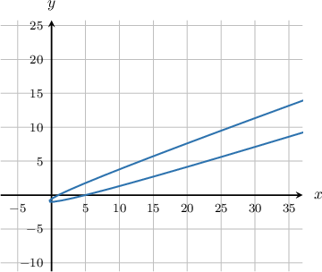
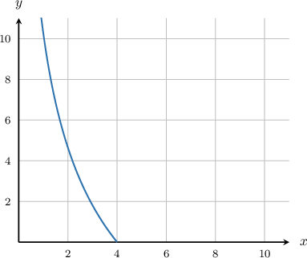
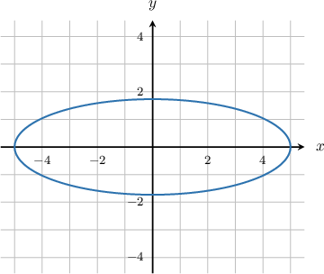
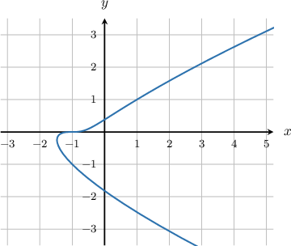
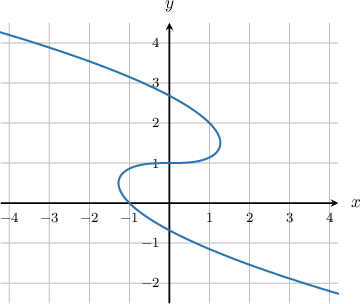
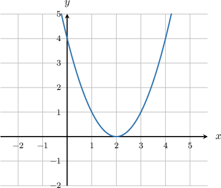
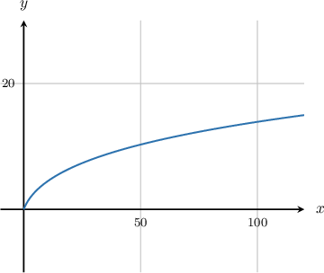

# Parametric derivative review

Originals are evidence-only complete banks; generated records use method-derived banks.

## Original faithful evidence 17592186083909

For the parametric curve 

$$
x=3\operatorname{sin}⁡\theta ,\,y=5\operatorname{cos}⁡\theta ,\,0\le \theta <2\pi ,
$$

 calculate $\frac{dy}{dx}.$

- $\frac{dy}{dx}=\frac{5}{3}\operatorname{tan}⁡\theta $
- $\frac{dy}{dx}=-\frac{5}{3}\operatorname{cot}⁡\theta $
- $\frac{dy}{dx}=-\frac{5}{3}\operatorname{tan}⁡\theta $
- $\frac{dy}{dx}=-\frac{3}{5}\operatorname{tan}⁡\theta $
- $\frac{dy}{dx}=-\frac{3}{5}\operatorname{cot}⁡\theta $

We will use the formula

$$
\frac{dy}{dx}=\frac{{y}^{′}(\theta )}{{x}^{′}(\theta )}.
$$

Differentiating $x$ and $y,$ we get

$$
{x}^{′}(\theta )=3\operatorname{cos}⁡\theta ,\,{y}^{′}(\theta )=-5\operatorname{sin}⁡\theta .
$$

 

Therefore,

$$
\frac{dy}{dx}=\frac{-5\operatorname{sin}⁡\theta }{3\operatorname{cos}⁡\theta }=-\frac{5}{3}\operatorname{tan}⁡\theta .
$$

## Original faithful evidence 17592186083911

For the parametric curve 

$$
x={e}^{t},\,y=2{t}^{2},\,-\infty <t<\infty ,
$$

 find the derivative $\frac{dy}{dx}$ at the point $P$ on the curve where $t=5.$

- $\frac{20}{e^{5}}$
- $4 \cdot e^{5}$
- $5 \cdot e^{2}$
- $20 \cdot e^{5}$
- $\frac{5}{e^{2}}$

- $4\cdot {e}^{5}$
- $20\cdot {e}^{5}$
- $5\cdot {e}^{2}$
- $\frac{20}{{e}^{5}}$
- $\frac{5}{{e}^{2}}$

We will use the formula

$$
\frac{dy}{dx}=\frac{{y}^{′}(t)}{{x}^{′}(t)}.
$$

Differentiating $x$ and $y,$ we get

$$
{x}^{′}(t)={e}^{t},\,{y}^{′}(t)=4t.
$$

 

Therefore,

$$
\frac{dy}{dx}=\frac{4t}{{e}^{t}}.
$$

At the point where $t=5$ we have

$$
\begin{aligned}\frac{dy}{dx} & =\frac{4\cdot 5}{{e}^{5}} \\  & =\frac{20}{{e}^{5}}\,.\end{aligned}
$$

## Original faithful evidence 17592186290260

For the parametric curve (shown above)

$$
x=3{t}^{2}-2t,\,y={t}^{2}-1,\,-\infty <t<\infty ,
$$

 find the derivative $\frac{dy}{dx}$ at the point $P$ on the curve where $t=2.$

- $\frac{3}{4}$
- $\frac{2}{5}$
- $\frac{2}{7}$
- $\frac{4}{5}$
- $\frac{3}{7}$

We will use the formula

$$
\frac{dy}{dx}=\frac{{y}^{′}(t)}{{x}^{′}(t)}.
$$

Differentiating $x$ and $y,$ we get

$$
{x}^{′}(t)=6t-2,\,{y}^{′}(t)=2t.
$$

 

Therefore,

$$
\frac{dy}{dx}=\frac{2t}{6t-2}=\frac{t}{3t-1}.
$$

At the point where $t=2$ we have

$$
\begin{aligned}\frac{dy}{dx} & =\frac{2}{3(2)-1} \\  & =\frac{2}{6-1} \\  & =\frac{2}{5}.\end{aligned}
$$

## Original faithful evidence 17592186321110

For the parametric curve (shown above)

$$
x=4{e}^{-t},\,y={t}^{2}+6t,\,0\le t<\infty ,
$$

find the derivative $\frac{dy}{dx}$ at the point $P$ on the curve where $t=1.$ Do not round the answer.

$\frac{dy}{dx}{|}_{t\,=\,1}=$  
{{field-1}}

- $-2e$

We will use the formula

$$
\frac{dy}{dx}=\frac{{y}^{′}(t)}{{x}^{′}(t)}.
$$

Differentiating $x$ and $y,$ we get

$$
{x}^{′}(t)=-4{e}^{-t},\,{y}^{′}(t)=2t+6.
$$

 

Therefore,

$$
\frac{dy}{dx}=\frac{2t+6}{(-4{e}^{-t})}.
$$

At the point where $t=1$ we have

$$
\begin{aligned}\frac{dy}{dx}{|}_{t\,=\,1} & =\frac{2(1)+6}{(-4{e}^{-1})} \\  & =\frac{8e}{(-4)} \\  & =-2e.\end{aligned}
$$

## Original faithful evidence 17592186321111

For the parametric curve (shown above)

$$
x=5\operatorname{sin}⁡2t,\,y=\sqrt{3}\operatorname{cos}⁡2t,\,0\le t<2\pi ,
$$

find the derivative $\frac{dy}{dx}$ at the point $P$ on the curve where $t=\frac{\pi }{6}.$ Do not round the answer.

$\frac{dy}{dx}{|}_{t\,=\,\pi /6}=$ 
{{field-1}}

- $-\frac{3}{5}$

We will use the formula

$$
\frac{dy}{dx}=\frac{{y}^{′}(t)}{{x}^{′}(t)}.
$$

Differentiating $x$ and $y,$ we get

$$
{x}^{′}(t)=10\operatorname{cos}⁡2t,\,{y}^{′}(t)=-2\sqrt{3}\operatorname{sin}⁡2t.
$$

 

Therefore,

$$
\frac{dy}{dx}=\frac{(-2\sqrt{3}\operatorname{sin}⁡2t)}{10\operatorname{cos}⁡2t}=-\frac{\sqrt{3}}{5}\operatorname{tan}⁡2t.
$$

At the point where $t=\frac{\pi }{6}$ we have

$$
\begin{aligned}\frac{dy}{dx} & =-\frac{\sqrt{3}}{5}\cdot \operatorname{tan}⁡(2\cdot \frac{\pi }{6}) \\  & =-\frac{\sqrt{3}}{5}\cdot \operatorname{tan}⁡(\frac{\pi }{3}) \\  & =-\frac{\sqrt{3}}{5}\cdot \sqrt{3} \\  & =-\frac{3}{5}\,.\end{aligned}
$$

## Original faithful evidence 17592186321112

For the parametric curve 

$$
x={e}^{2t},\,y=3{t}^{2},\,-\infty <t<\infty ,
$$

find the derivative $\frac{dy}{dx}$ at the point $P$ on the curve where $t=2.$

$\frac{dy}{dx}{|}_{t\,=\,2}=$ 
{{field-1}}

- $\frac{6}{{e}^{4}}$

We will use the formula

$$
\frac{dy}{dx}=\frac{{y}^{′}(t)}{{x}^{′}(t)}.
$$

Differentiating $x$ and $y,$ we get

$$
{x}^{′}(t)=2{e}^{2t},\,{y}^{′}(t)=6t.
$$

 

Therefore,

$$
\frac{dy}{dx}=\frac{6t}{2{e}^{2t}}=\frac{3t}{{e}^{2t}}.
$$

At the point where $t=2$ we have

$$
\begin{aligned}\frac{dy}{dx}{|}_{t\,=\,2} & =\frac{3\cdot 2}{{e}^{4}} \\  & =\frac{6}{{e}^{4}}.\end{aligned}
$$

## Original faithful evidence 17592186321113

For the parametric curve 

$$
x=5t-3,\,y={t}^{4}+2t,\,-\infty <t<\infty ,
$$

find the derivative $\frac{dy}{dx}$ at the point $P$ on the curve where $t=1.$

$\frac{dy}{dx}{|}_{t\,=\,1}=$ 
{{field-1}}

- $\frac{6}{5}$

We will use the formula

$$
\frac{dy}{dx}=\frac{{y}^{′}(t)}{{x}^{′}(t)}.
$$

Differentiating $x$ and $y,$ we get

$$
{x}^{′}(t)=5,\,{y}^{′}(t)=4{t}^{3}+2.
$$

 

Therefore,

$$
\frac{dy}{dx}=\frac{4{t}^{3}+2}{5}.
$$

At the point where $t=1$ we have

$$
\begin{aligned}\frac{dy}{dx}{|}_{t\,=\,1} & =\frac{4(1)^{3}+2}{5} \\  & =\frac{6}{5}.\end{aligned}
$$

## Original faithful evidence 17592186321114

For the parametric curve 

$$
x=\sqrt{t},\,y=8t-3,\,0\le t<\infty ,
$$

find the derivative $\frac{dy}{dx}$ at the point $P$ on the curve where $t=4.$

$\frac{dy}{dx}{|}_{t\,=\,4}=$ 
{{field-1}}

- $32$

We will use the formula

$$
\frac{dy}{dx}=\frac{{y}^{′}(t)}{{x}^{′}(t)}.
$$

Differentiating $x$ and $y,$ we get

$$
{x}^{′}(t)=\frac{1}{2\sqrt{t}},\,{y}^{′}(t)=8.
$$

 

Therefore,

$$
\frac{dy}{dx}=\frac{8}{(\frac{1}{2\sqrt{t}})}=16\sqrt{t}.
$$

At the point where $t=4$ we have

$$
\begin{aligned}\frac{dy}{dx}{|}_{t\,=\,4} & =16\sqrt{4} \\  & =16(2) \\  & =32.\end{aligned}
$$

## Original faithful evidence 17592186321115

For the parametric curve 

$$
x={e}^{3t},\,y=2{e}^{t},\,-\infty <t<\infty ,
$$

calculate $\frac{dy}{dx}$ as a function of $t.$

$\frac{dy}{dx}=$  
{{field-1}}

- $\frac{2}{3}{e}^{-2t}$

We will use the formula

$$
\frac{dy}{dx}=\frac{{y}^{′}(t)}{{x}^{′}(t)}.
$$

Differentiating $x$ and $y,$ we get

$$
{x}^{′}(t)=3{e}^{3t},\,{y}^{′}(t)=2{e}^{t}.
$$

 

Therefore,

$$
\frac{dy}{dx}=\frac{2{e}^{t}}{3{e}^{3t}}=\frac{2}{3}{e}^{-2t}.
$$

## Original faithful evidence 17592186335950

For the parametric curve (shown above)

$$
x={t}^{4}+t-1,\,y={t}^{3},\,-\infty <t<\infty ,
$$

 find the derivative $\frac{dy}{dx}$ at the point $P$ on the curve where $t=-1.$

- $-1$
- $-\,\frac{1}{4}$
- $-2$
- $-\,\frac{1}{2}$
- $-\,\frac{2}{3}$

We will use the formula

$$
\frac{dy}{dx}=\frac{{y}^{′}(t)}{{x}^{′}(t)}.
$$

Differentiating $x$ and $y,$ we get

$$
{x}^{′}(t)=4{t}^{3}+1,\,{y}^{′}(t)=3{t}^{2}.
$$

 

Therefore,

$$
\frac{dy}{dx}=\frac{3{t}^{2}}{4{t}^{3}+1}.
$$

At the point where $t=-1$ we have

$$
\begin{aligned}\frac{dy}{dx} & =\frac{3(-1)^{2}}{4(-1)^{3}+1} \\  & =\frac{3}{(-4)+1} \\  & =-1\,.\end{aligned}
$$

## Original faithful evidence 17592186335953

For the parametric curve 

$$
x={e}^{2t},\,y=({t}^{2}-1){e}^{-t},\,-\infty <t<\infty ,
$$

 find the derivative $\frac{dy}{dx}$ at the point $P$ on the curve where $t=1.$

- $2{e}^{-2}$
- ${e}^{-2}$
- $\frac{{e}^{2}}{3}$
- $\frac{{e}^{-3}}{4}$
- ${e}^{-3}$

We will use the formula

$$
\frac{dy}{dx}=\frac{{y}^{′}(t)}{{x}^{′}(t)}.
$$

Differentiating $x$ and $y,$ we get

$$
{x}^{′}(t)=2{e}^{2t},\,{y}^{′}(t)=(1+2t-{t}^{2}){e}^{-t}.
$$

 

Therefore,

$$
\frac{dy}{dx}=\frac{(1+2t-{t}^{2}){e}^{-t}}{2{e}^{2t}}=\frac{1}{2}(1+2t-{t}^{2}){e}^{-3t}.
$$

At the point where $t=1$ we have

$$
\begin{aligned}\frac{dy}{dx} & =\frac{1}{2}(1+2(1)-(1)^{2}){e}^{-3(1)} \\  & =\frac{1}{2}(1+2-1){e}^{-3} \\  & ={e}^{-3}\,.\end{aligned}
$$

## Original faithful evidence 17592186335963

For the parametric curve 

$$
x={t}^{5}-2t,\,y=1-{t}^{3},\,-\infty <t<\infty ,
$$

 find the derivative $\frac{dy}{dx}$ at the point $P$ on the curve where $t=-1.$

- $-\,\frac{1}{2}$
- $-\,\frac{3}{2}$
- $-\,\frac{1}{3}$
- $-1$
- $-3$

We will use the formula

$$
\frac{dy}{dx}=\frac{{y}^{′}(t)}{{x}^{′}(t)}.
$$

Differentiating $x$ and $y,$ we get

$$
{x}^{′}(t)=5{t}^{4}-2,\,{y}^{′}(t)=-3{t}^{2}.
$$

 

Therefore,

$$
\frac{dy}{dx}=\frac{-3{t}^{2}}{5{t}^{4}-2}.
$$

At the point where $t=-1$ we have

$$
\begin{aligned}\frac{dy}{dx} & =\frac{-3(-1)^{2}}{5(-1)^{4}-2} \\  & =\frac{-3}{5-2} \\  & =-1\,.\end{aligned}
$$

## Original faithful evidence 17592186368467

For the parametric curve 

$$
x=\sqrt{t},\,y=3{t}^{3/2},\,0<t<\infty ,
$$

calculate $\frac{dy}{dx}$ as a function of $t.$

$\frac{dy}{dx}=$  
{{field-1}}

- $9t$

We will use the formula

$$
\frac{dy}{dx}=\frac{{y}^{′}(t)}{{x}^{′}(t)}.
$$

Differentiating $x$ and $y,$ we get

$$
{x}^{′}(t)=\frac{1}{2\sqrt{t}},\,{y}^{′}(t)=\frac{9}{2}\sqrt{t}.
$$

 

Therefore,

$$
\frac{dy}{dx}=\frac{(\frac{9}{2}\sqrt{t})}{(\frac{1}{2\sqrt{t}})}=9t.
$$

## Original faithful evidence 17592186395776

For the parametric curve (shown above)

$$
x=2(t+1),\,y=4{t}^{2},\,-1\le t<1,
$$

 find the derivative $\frac{dy}{dx}$ at the point $P$ on the curve where $t=0.$

- $1$
- $2$
- $3$
- $-1$
- $0$

We will use the formula

$$
\frac{dy}{dx}=\frac{{y}^{′}(t)}{{x}^{′}(t)}.
$$

Differentiating $x$ and $y,$ we get

$$
{x}^{′}(t)=2,\,{y}^{′}(t)=8t.
$$

 

Therefore,

$$
\frac{dy}{dx}=\frac{8t}{2}=4t.
$$

At the point where $t=0$ we have

$$
\begin{aligned}\frac{dy}{dx} & =4(0) \\  & =0\,.\end{aligned}
$$

## Original faithful evidence 17592186401840

For the parametric curve 

$$
x=2\sqrt{t},\,y=12t+1,\,0\le t<\infty ,
$$

 find the derivative $\frac{dy}{dx}$ at the point $P$ on the curve where $t=1.$

- $3$
- $10$
- $12$
- $7$
- $15$

We will use the formula

$$
\frac{dy}{dx}=\frac{{y}^{′}(t)}{{x}^{′}(t)}.
$$

Differentiating $x$ and $y,$ we get

$$
{x}^{′}(t)=\frac{1}{\sqrt{t}},\,{y}^{′}(t)=12.
$$

 

Therefore,

$$
\frac{dy}{dx}=\frac{12}{\frac{1}{\sqrt{t}}}=12\sqrt{t}.
$$

At the point where $t=1$ we have

$$
\begin{aligned}\frac{dy}{dx} & =12\sqrt{1} \\  & =12\,.\end{aligned}
$$

## Original faithful evidence 17592186401853

For the parametric curve (shown above)

$$
x=2t{e}^{t},\,y={t}^{2}+2t,\,0\le t<\infty ,
$$

 find the derivative $\frac{dy}{dx}$ at the point $P$ on the curve where $t=1.$

- $\frac{1}{3e}$
- $\frac{1}{{e}^{2}}$
- $\frac{1}{2e}$
- $\frac{1}{e}$
- $\frac{1}{{e}^{3}}$

We will use the formula

$$
\frac{dy}{dx}=\frac{{y}^{′}(t)}{{x}^{′}(t)}.
$$

Differentiating $x$ and $y,$ we get

$$
{x}^{′}(t)=2{e}^{t}(t+1),\,{y}^{′}(t)=2t+2.
$$

 

Therefore,

$$
\frac{dy}{dx}=\frac{2t+2}{2{e}^{t}(t+1)}=\frac{1}{{e}^{t}}.
$$

At the point where $t=1$ we have

$$
\begin{aligned}\frac{dy}{dx} & =\frac{1}{{e}^{1}} \\  & =\frac{1}{e}\,.\end{aligned}
$$

## Original faithful evidence 17592186403272

For the parametric curve 

$$
x=({t}^{3}-1){e}^{t},\,y=2\operatorname{sin}⁡t,\,-\infty <t<\infty ,
$$

 find the derivative $\frac{dy}{dx}$ at the point $P$ on the curve where $t=0.$

- $-\,\frac{e}{2}$
- $-\,\frac{1}{2e}$
- $-\,\frac{1}{2}$
- $-\,\frac{1}{3e}$
- $-2$

We will use the formula

$$
\frac{dy}{dx}=\frac{{y}^{′}(t)}{{x}^{′}(t)}.
$$

Differentiating $x$ and $y,$ we get

$$
{x}^{′}(t)=({t}^{3}+3{t}^{2}-1){e}^{t},\,{y}^{′}(t)=2\operatorname{cos}⁡t.
$$

 

Therefore,

$$
\frac{dy}{dx}=\frac{2\operatorname{cos}⁡t}{({t}^{3}+3{t}^{2}-1){e}^{t}}.
$$

At the point where $t=0$ we have

$$
\begin{aligned}\frac{dy}{dx} & =\frac{2\operatorname{cos}⁡0}{({0}^{3}+3\cdot {0}^{2}-1){e}^{0}} \\  & =\frac{2(1)}{(-1)\cdot 1} \\  & =-2\,.\end{aligned}
$$

## Original faithful evidence 17592186403279

For the parametric curve 

$$
x=12\operatorname{sin}⁡\theta ,\,y=15\operatorname{cos}⁡\theta ,\,0\le \theta <2\pi ,
$$

 calculate $\frac{dy}{dx}.$

- $\frac{dy}{dx}=-\frac{5}{4}\operatorname{cot}⁡\theta $
- $\frac{dy}{dx}=-\frac{4}{5}\operatorname{cot}⁡\theta $
- $\frac{dy}{dx}=-\frac{4}{5}\operatorname{tan}⁡\theta $
- $\frac{dy}{dx}=\frac{5}{4}\operatorname{tan}⁡\theta $
- $\frac{dy}{dx}=-\frac{5}{4}\operatorname{tan}⁡\theta $

We will use the formula

$$
\frac{dy}{dx}=\frac{{y}^{′}(\theta )}{{x}^{′}(\theta )}.
$$

Differentiating $x$ and $y,$ we get

$$
{x}^{′}(\theta )=12\operatorname{cos}⁡\theta ,\,{y}^{′}(\theta )=-15\operatorname{sin}⁡\theta .
$$

 

Therefore,

$$
\frac{dy}{dx}=\frac{-15\operatorname{sin}⁡\theta }{12\operatorname{cos}⁡\theta }=-\frac{5}{4}\operatorname{tan}⁡\theta .
$$

## Generated trig seed 5

For the parametric curve 

$$
x=5\left(3\operatorname{sin}⁡\theta \right),\,y=\frac{5}{2}\left(5\operatorname{cos}⁡\theta \right),\,0\le \theta <2\pi ,
$$

 calculate $\frac{dy}{dx}.$

- $\frac{dy}{dx}=- \frac{5}{6}$
- $\frac{dy}{dx}=- \frac{375 \sin{\left(2 \theta \right)}}{4}$
- $\frac{dy}{dx}=- \frac{6}{5 \tan{\left(\theta \right)}}$
- $\frac{dy}{dx}=- \frac{5 \tan{\left(\theta \right)}}{6}$
- $\frac{dy}{dx}=\frac{5}{6 \tan{\left(\theta \right)}}$

We will use the formula

$$
\frac{dy}{dx}=\frac{{y}^{′}(\theta )}{{x}^{′}(\theta )}.
$$

Differentiating $x$ and $y,$ we get

$$
{x}^{′}(\theta )=5\left(3\operatorname{cos}⁡\theta \right),\,{y}^{′}(\theta )=\frac{5}{2}\left(-5\operatorname{sin}⁡\theta \right).
$$

 

Therefore,

$$
\frac{dy}{dx}=\frac{\frac{5}{2}\left(-5\operatorname{sin}⁡\theta \right)}{5\left(3\operatorname{cos}⁡\theta \right)}=\frac{1}{2}\left(-\frac{5}{3}\operatorname{tan}⁡\theta \right).
$$

## Generated trig seed 31

For the parametric curve 

$$
x=\frac{1}{2}\left(3\operatorname{sin}⁡\theta \right),\,y=4\left(5\operatorname{cos}⁡\theta \right),\,0\le \theta <2\pi ,
$$

 calculate $\frac{dy}{dx}.$

- $\frac{dy}{dx}=- \frac{3}{40 \tan{\left(\theta \right)}}$
- $\frac{dy}{dx}=\frac{40}{3 \tan{\left(\theta \right)}}$
- $\frac{dy}{dx}=- \frac{40}{3}$
- $\frac{dy}{dx}=- 15 \sin{\left(2 \theta \right)}$
- $\frac{dy}{dx}=- \frac{40 \tan{\left(\theta \right)}}{3}$

We will use the formula

$$
\frac{dy}{dx}=\frac{{y}^{′}(\theta )}{{x}^{′}(\theta )}.
$$

Differentiating $x$ and $y,$ we get

$$
{x}^{′}(\theta )=\frac{1}{2}\left(3\operatorname{cos}⁡\theta \right),\,{y}^{′}(\theta )=4\left(-5\operatorname{sin}⁡\theta \right).
$$

 

Therefore,

$$
\frac{dy}{dx}=\frac{4\left(-5\operatorname{sin}⁡\theta \right)}{\frac{1}{2}\left(3\operatorname{cos}⁡\theta \right)}=8\left(-\frac{5}{3}\operatorname{tan}⁡\theta \right).
$$

## Generated exp_poly seed 5

For the parametric curve 

$$
x=5\left({e}^{t}\right),\,y=\frac{5}{2}\left(2{t}^{2}\right),\,-\infty <t<\infty ,
$$

 find the derivative $\frac{dy}{dx}$ at the point $P$ on the curve where $t=5.$

- $\frac{2}{e^{5}}$
- $250 e^{5}$
- $\frac{e^{5}}{10}$
- $\frac{10}{e^{5}}$
- $\frac{25}{e^{5}}$

We will use the formula

$$
\frac{dy}{dx}=\frac{{y}^{′}(t)}{{x}^{′}(t)}.
$$

Differentiating $x$ and $y,$ we get

$$
{x}^{′}(t)=5\left({e}^{t}\right),\,{y}^{′}(t)=\frac{5}{2}\left(4t\right).
$$

 

Therefore,

$$
\frac{dy}{dx}=\frac{\frac{5}{2}\left(4t\right)}{5\left({e}^{t}\right)}.
$$

At the point where $t=5$ we have

$$
\begin{aligned}\frac{dy}{dx} & =\frac{\frac{5}{2}\left(4\cdot 5\right)}{5\left({e}^{5}\right)} \\  & =\frac{\frac{5}{2}\left(20\right)}{5\left({e}^{5}\right)}\,.\end{aligned}
$$

## Generated exp_poly seed 31

For the parametric curve 

$$
x=\frac{1}{2}\left({e}^{t}\right),\,y=4\left(2{t}^{2}\right),\,-\infty <t<\infty ,
$$

 find the derivative $\frac{dy}{dx}$ at the point $P$ on the curve where $t=5.$

- $\frac{e^{5}}{160}$
- $\frac{400}{e^{5}}$
- $\frac{32}{e^{5}}$
- $40 e^{5}$
- $\frac{160}{e^{5}}$

We will use the formula

$$
\frac{dy}{dx}=\frac{{y}^{′}(t)}{{x}^{′}(t)}.
$$

Differentiating $x$ and $y,$ we get

$$
{x}^{′}(t)=\frac{1}{2}\left({e}^{t}\right),\,{y}^{′}(t)=4\left(4t\right).
$$

 

Therefore,

$$
\frac{dy}{dx}=\frac{4\left(4t\right)}{\frac{1}{2}\left({e}^{t}\right)}.
$$

At the point where $t=5$ we have

$$
\begin{aligned}\frac{dy}{dx} & =\frac{4\left(4\cdot 5\right)}{\frac{1}{2}\left({e}^{5}\right)} \\  & =\frac{4\left(20\right)}{\frac{1}{2}\left({e}^{5}\right)}\,.\end{aligned}
$$

## Generated quadratic seed 5

For the parametric curve (shown above)

$$
x=5\left(3{t}^{2}-2t\right),\,y=\frac{5}{2}\left({t}^{2}-1\right),\,-\infty <t<\infty ,
$$

 find the derivative $\frac{dy}{dx}$ at the point $P$ on the curve where $t=2.$

- $\frac{1}{4}$
- $500$
- $5$
- $\frac{1}{5}$
- $\frac{3}{16}$

We will use the formula

$$
\frac{dy}{dx}=\frac{{y}^{′}(t)}{{x}^{′}(t)}.
$$

Differentiating $x$ and $y,$ we get

$$
{x}^{′}(t)=5\left(6t-2\right),\,{y}^{′}(t)=\frac{5}{2}\left(2t\right).
$$

 

Therefore,

$$
\frac{dy}{dx}=\frac{\frac{5}{2}\left(2t\right)}{5\left(6t-2\right)}=\frac{\frac{5}{2}\left(t\right)}{5\left(3t-1\right)}.
$$

At the point where $t=2$ we have

$$
\begin{aligned}\frac{dy}{dx} & =\frac{\frac{5}{2}\left(2\right)}{5\left(3(2)-1\right)} \\  & =\frac{\frac{5}{2}\left(2\right)}{5\left(6-1\right)} \\  & =\frac{\frac{5}{2}\left(2\right)}{5\left(5\right)}.\end{aligned}
$$

## Generated quadratic seed 31

For the parametric curve (shown above)

$$
x=\frac{1}{2}\left(3{t}^{2}-2t\right),\,y=4\left({t}^{2}-1\right),\,-\infty <t<\infty ,
$$

 find the derivative $\frac{dy}{dx}$ at the point $P$ on the curve where $t=2.$

- $\frac{5}{16}$
- $3$
- $4$
- $80$
- $\frac{16}{5}$

We will use the formula

$$
\frac{dy}{dx}=\frac{{y}^{′}(t)}{{x}^{′}(t)}.
$$

Differentiating $x$ and $y,$ we get

$$
{x}^{′}(t)=\frac{1}{2}\left(6t-2\right),\,{y}^{′}(t)=4\left(2t\right).
$$

 

Therefore,

$$
\frac{dy}{dx}=\frac{4\left(2t\right)}{\frac{1}{2}\left(6t-2\right)}=\frac{4\left(t\right)}{\frac{1}{2}\left(3t-1\right)}.
$$

At the point where $t=2$ we have

$$
\begin{aligned}\frac{dy}{dx} & =\frac{4\left(2\right)}{\frac{1}{2}\left(3(2)-1\right)} \\  & =\frac{4\left(2\right)}{\frac{1}{2}\left(6-1\right)} \\  & =\frac{4\left(2\right)}{\frac{1}{2}\left(5\right)}.\end{aligned}
$$

## Generated expneg_poly seed 5

For the parametric curve (shown above)

$$
x=5\left(4{e}^{-t}\right),\,y=\frac{5}{2}\left({t}^{2}+6t\right),\,0\le t<\infty ,
$$

find the derivative $\frac{dy}{dx}$ at the point $P$ on the curve where $t=1.$ Give an exact answer.

$\frac{dy}{dx}{|}_{t\,=\,1}=$  
{{field-1}}

- $\frac{1}{2}\left(-2e\right)$

We will use the formula

$$
\frac{dy}{dx}=\frac{{y}^{′}(t)}{{x}^{′}(t)}.
$$

Differentiating $x$ and $y,$ we get

$$
{x}^{′}(t)=5\left(-4{e}^{-t}\right),\,{y}^{′}(t)=\frac{5}{2}\left(2t+6\right).
$$

 

Therefore,

$$
\frac{dy}{dx}=\frac{\frac{5}{2}\left(2t+6\right)}{5\left((-4{e}^{-t})\right)}.
$$

At the point where $t=1$ we have

$$
\begin{aligned}\frac{dy}{dx}{|}_{t\,=\,1} & =\frac{\frac{5}{2}\left(2(1)+6\right)}{5\left((-4{e}^{-1})\right)} \\  & =\frac{\frac{5}{2}\left(8e\right)}{5\left((-4)\right)} \\  & =\frac{1}{2}\left(-2e\right).\end{aligned}
$$

## Generated expneg_poly seed 31

For the parametric curve (shown above)

$$
x=\frac{1}{2}\left(4{e}^{-t}\right),\,y=4\left({t}^{2}+6t\right),\,0\le t<\infty ,
$$

find the derivative $\frac{dy}{dx}$ at the point $P$ on the curve where $t=1.$ Give an exact answer.

$\frac{dy}{dx}{|}_{t\,=\,1}=$  
{{field-1}}

- $8\left(-2e\right)$

We will use the formula

$$
\frac{dy}{dx}=\frac{{y}^{′}(t)}{{x}^{′}(t)}.
$$

Differentiating $x$ and $y,$ we get

$$
{x}^{′}(t)=\frac{1}{2}\left(-4{e}^{-t}\right),\,{y}^{′}(t)=4\left(2t+6\right).
$$

 

Therefore,

$$
\frac{dy}{dx}=\frac{4\left(2t+6\right)}{\frac{1}{2}\left((-4{e}^{-t})\right)}.
$$

At the point where $t=1$ we have

$$
\begin{aligned}\frac{dy}{dx}{|}_{t\,=\,1} & =\frac{4\left(2(1)+6\right)}{\frac{1}{2}\left((-4{e}^{-1})\right)} \\  & =\frac{4\left(8e\right)}{\frac{1}{2}\left((-4)\right)} \\  & =8\left(-2e\right).\end{aligned}
$$

## Generated trig_double seed 5

For the parametric curve (shown above)

$$
x=5\left(5\operatorname{sin}⁡2t\right),\,y=\frac{5}{2}\left(\sqrt{3}\operatorname{cos}⁡2t\right),\,0\le t<2\pi ,
$$

find the derivative $\frac{dy}{dx}$ at the point $P$ on the curve where $t=\frac{\pi }{6}.$ Give an exact answer.

$\frac{dy}{dx}{|}_{t\,=\,\pi /6}=$ 
{{field-1}}

- $\frac{1}{2}\left(-\frac{3}{5}\right)$

We will use the formula

$$
\frac{dy}{dx}=\frac{{y}^{′}(t)}{{x}^{′}(t)}.
$$

Differentiating $x$ and $y,$ we get

$$
{x}^{′}(t)=5\left(10\operatorname{cos}⁡2t\right),\,{y}^{′}(t)=\frac{5}{2}\left(-2\sqrt{3}\operatorname{sin}⁡2t\right).
$$

 

Therefore,

$$
\frac{dy}{dx}=\frac{\frac{5}{2}\left((-2\sqrt{3}\operatorname{sin}⁡2t)\right)}{5\left(10\operatorname{cos}⁡2t\right)}=\frac{1}{2}\left(-\frac{\sqrt{3}}{5}\operatorname{tan}⁡2t\right).
$$

At the point where $t=\frac{\pi }{6}$ we have

$$
\begin{aligned}\frac{dy}{dx} & =\frac{1}{2}\left(-\frac{\sqrt{3}}{5}\cdot \operatorname{tan}⁡(2\cdot \frac{\pi }{6})\right) \\  & =\frac{1}{2}\left(-\frac{\sqrt{3}}{5}\cdot \operatorname{tan}⁡(\frac{\pi }{3})\right) \\  & =\frac{1}{2}\left(-\frac{\sqrt{3}}{5}\cdot \sqrt{3}\right) \\  & =\frac{1}{2}\left(-\frac{3}{5}\right)\,.\end{aligned}
$$

## Generated trig_double seed 31

For the parametric curve (shown above)

$$
x=\frac{1}{2}\left(5\operatorname{sin}⁡2t\right),\,y=4\left(\sqrt{3}\operatorname{cos}⁡2t\right),\,0\le t<2\pi ,
$$

find the derivative $\frac{dy}{dx}$ at the point $P$ on the curve where $t=\frac{\pi }{6}.$ Give an exact answer.

$\frac{dy}{dx}{|}_{t\,=\,\pi /6}=$ 
{{field-1}}

- $8\left(-\frac{3}{5}\right)$

We will use the formula

$$
\frac{dy}{dx}=\frac{{y}^{′}(t)}{{x}^{′}(t)}.
$$

Differentiating $x$ and $y,$ we get

$$
{x}^{′}(t)=\frac{1}{2}\left(10\operatorname{cos}⁡2t\right),\,{y}^{′}(t)=4\left(-2\sqrt{3}\operatorname{sin}⁡2t\right).
$$

 

Therefore,

$$
\frac{dy}{dx}=\frac{4\left((-2\sqrt{3}\operatorname{sin}⁡2t)\right)}{\frac{1}{2}\left(10\operatorname{cos}⁡2t\right)}=8\left(-\frac{\sqrt{3}}{5}\operatorname{tan}⁡2t\right).
$$

At the point where $t=\frac{\pi }{6}$ we have

$$
\begin{aligned}\frac{dy}{dx} & =8\left(-\frac{\sqrt{3}}{5}\cdot \operatorname{tan}⁡(2\cdot \frac{\pi }{6})\right) \\  & =8\left(-\frac{\sqrt{3}}{5}\cdot \operatorname{tan}⁡(\frac{\pi }{3})\right) \\  & =8\left(-\frac{\sqrt{3}}{5}\cdot \sqrt{3}\right) \\  & =8\left(-\frac{3}{5}\right)\,.\end{aligned}
$$

## Generated exp_poly_chain seed 5

For the parametric curve 

$$
x=5\left({e}^{2t}\right),\,y=\frac{5}{2}\left(3{t}^{2}\right),\,-\infty <t<\infty ,
$$

find the derivative $\frac{dy}{dx}$ at the point $P$ on the curve where $t=2.$

$\frac{dy}{dx}{|}_{t\,=\,2}=$ 
{{field-1}}

- $\frac{1}{2}\left(\frac{6}{{e}^{4}}\right)$

We will use the formula

$$
\frac{dy}{dx}=\frac{{y}^{′}(t)}{{x}^{′}(t)}.
$$

Differentiating $x$ and $y,$ we get

$$
{x}^{′}(t)=5\left(2{e}^{2t}\right),\,{y}^{′}(t)=\frac{5}{2}\left(6t\right).
$$

 

Therefore,

$$
\frac{dy}{dx}=\frac{\frac{5}{2}\left(6t\right)}{5\left(2{e}^{2t}\right)}=\frac{\frac{5}{2}\left(3t\right)}{5\left({e}^{2t}\right)}.
$$

At the point where $t=2$ we have

$$
\begin{aligned}\frac{dy}{dx}{|}_{t\,=\,2} & =\frac{\frac{5}{2}\left(3\cdot 2\right)}{5\left({e}^{4}\right)} \\  & =\frac{\frac{5}{2}\left(6\right)}{5\left({e}^{4}\right)}.\end{aligned}
$$

## Generated exp_poly_chain seed 31

For the parametric curve 

$$
x=\frac{1}{2}\left({e}^{2t}\right),\,y=4\left(3{t}^{2}\right),\,-\infty <t<\infty ,
$$

find the derivative $\frac{dy}{dx}$ at the point $P$ on the curve where $t=2.$

$\frac{dy}{dx}{|}_{t\,=\,2}=$ 
{{field-1}}

- $8\left(\frac{6}{{e}^{4}}\right)$

We will use the formula

$$
\frac{dy}{dx}=\frac{{y}^{′}(t)}{{x}^{′}(t)}.
$$

Differentiating $x$ and $y,$ we get

$$
{x}^{′}(t)=\frac{1}{2}\left(2{e}^{2t}\right),\,{y}^{′}(t)=4\left(6t\right).
$$

 

Therefore,

$$
\frac{dy}{dx}=\frac{4\left(6t\right)}{\frac{1}{2}\left(2{e}^{2t}\right)}=\frac{4\left(3t\right)}{\frac{1}{2}\left({e}^{2t}\right)}.
$$

At the point where $t=2$ we have

$$
\begin{aligned}\frac{dy}{dx}{|}_{t\,=\,2} & =\frac{4\left(3\cdot 2\right)}{\frac{1}{2}\left({e}^{4}\right)} \\  & =\frac{4\left(6\right)}{\frac{1}{2}\left({e}^{4}\right)}.\end{aligned}
$$

## Generated line_poly seed 5

For the parametric curve 

$$
x=5\left(5t-3\right),\,y=\frac{5}{2}\left({t}^{4}+2t\right),\,-\infty <t<\infty ,
$$

find the derivative $\frac{dy}{dx}$ at the point $P$ on the curve where $t=1.$

$\frac{dy}{dx}{|}_{t\,=\,1}=$ 
{{field-1}}

- $\frac{1}{2}\left(\frac{6}{5}\right)$

We will use the formula

$$
\frac{dy}{dx}=\frac{{y}^{′}(t)}{{x}^{′}(t)}.
$$

Differentiating $x$ and $y,$ we get

$$
{x}^{′}(t)=5\left(5\right),\,{y}^{′}(t)=\frac{5}{2}\left(4{t}^{3}+2\right).
$$

 

Therefore,

$$
\frac{dy}{dx}=\frac{\frac{5}{2}\left(4{t}^{3}+2\right)}{5\left(5\right)}.
$$

At the point where $t=1$ we have

$$
\begin{aligned}\frac{dy}{dx}{|}_{t\,=\,1} & =\frac{\frac{5}{2}\left(4(1)^{3}+2\right)}{5\left(5\right)} \\  & =\frac{\frac{5}{2}\left(6\right)}{5\left(5\right)}.\end{aligned}
$$

## Generated line_poly seed 31

For the parametric curve 

$$
x=\frac{1}{2}\left(5t-3\right),\,y=4\left({t}^{4}+2t\right),\,-\infty <t<\infty ,
$$

find the derivative $\frac{dy}{dx}$ at the point $P$ on the curve where $t=1.$

$\frac{dy}{dx}{|}_{t\,=\,1}=$ 
{{field-1}}

- $8\left(\frac{6}{5}\right)$

We will use the formula

$$
\frac{dy}{dx}=\frac{{y}^{′}(t)}{{x}^{′}(t)}.
$$

Differentiating $x$ and $y,$ we get

$$
{x}^{′}(t)=\frac{1}{2}\left(5\right),\,{y}^{′}(t)=4\left(4{t}^{3}+2\right).
$$

 

Therefore,

$$
\frac{dy}{dx}=\frac{4\left(4{t}^{3}+2\right)}{\frac{1}{2}\left(5\right)}.
$$

At the point where $t=1$ we have

$$
\begin{aligned}\frac{dy}{dx}{|}_{t\,=\,1} & =\frac{4\left(4(1)^{3}+2\right)}{\frac{1}{2}\left(5\right)} \\  & =\frac{4\left(6\right)}{\frac{1}{2}\left(5\right)}.\end{aligned}
$$

## Generated sqrt_linear seed 5

For the parametric curve 

$$
x=5\left(\sqrt{t}\right),\,y=\frac{5}{2}\left(8t-3\right),\,0\le t<\infty ,
$$

find the derivative $\frac{dy}{dx}$ at the point $P$ on the curve where $t=4.$

$\frac{dy}{dx}{|}_{t\,=\,4}=$ 
{{field-1}}

- $\frac{1}{2}\left(32\right)$

We will use the formula

$$
\frac{dy}{dx}=\frac{{y}^{′}(t)}{{x}^{′}(t)}.
$$

Differentiating $x$ and $y,$ we get

$$
{x}^{′}(t)=5\left(\frac{1}{2\sqrt{t}}\right),\,{y}^{′}(t)=\frac{5}{2}\left(8\right).
$$

 

Therefore,

$$
\frac{dy}{dx}=\frac{\frac{5}{2}\left(8\right)}{5\left((\frac{1}{2\sqrt{t}})\right)}=\frac{1}{2}\left(16\sqrt{t}\right).
$$

At the point where $t=4$ we have

$$
\begin{aligned}\frac{dy}{dx}{|}_{t\,=\,4} & =\frac{1}{2}\left(16\sqrt{4}\right) \\  & =\frac{1}{2}\left(16(2)\right) \\  & =\frac{1}{2}\left(32\right).\end{aligned}
$$

## Generated sqrt_linear seed 31

For the parametric curve 

$$
x=\frac{1}{2}\left(\sqrt{t}\right),\,y=4\left(8t-3\right),\,0\le t<\infty ,
$$

find the derivative $\frac{dy}{dx}$ at the point $P$ on the curve where $t=4.$

$\frac{dy}{dx}{|}_{t\,=\,4}=$ 
{{field-1}}

- $8\left(32\right)$

We will use the formula

$$
\frac{dy}{dx}=\frac{{y}^{′}(t)}{{x}^{′}(t)}.
$$

Differentiating $x$ and $y,$ we get

$$
{x}^{′}(t)=\frac{1}{2}\left(\frac{1}{2\sqrt{t}}\right),\,{y}^{′}(t)=4\left(8\right).
$$

 

Therefore,

$$
\frac{dy}{dx}=\frac{4\left(8\right)}{\frac{1}{2}\left((\frac{1}{2\sqrt{t}})\right)}=8\left(16\sqrt{t}\right).
$$

At the point where $t=4$ we have

$$
\begin{aligned}\frac{dy}{dx}{|}_{t\,=\,4} & =8\left(16\sqrt{4}\right) \\  & =8\left(16(2)\right) \\  & =8\left(32\right).\end{aligned}
$$

## Generated exp_pair seed 5

For the parametric curve 

$$
x=5\left({e}^{3t}\right),\,y=\frac{5}{2}\left(2{e}^{t}\right),\,-\infty <t<\infty ,
$$

calculate $\frac{dy}{dx}$ as a function of $t.$

$\frac{dy}{dx}=$  
{{field-1}}

- $\frac{1}{2}\left(\frac{2}{3}{e}^{-2t}\right)$

We will use the formula

$$
\frac{dy}{dx}=\frac{{y}^{′}(t)}{{x}^{′}(t)}.
$$

Differentiating $x$ and $y,$ we get

$$
{x}^{′}(t)=5\left(3{e}^{3t}\right),\,{y}^{′}(t)=\frac{5}{2}\left(2{e}^{t}\right).
$$

 

Therefore,

$$
\frac{dy}{dx}=\frac{\frac{5}{2}\left(2{e}^{t}\right)}{5\left(3{e}^{3t}\right)}=\frac{\frac{5}{2}\left(2\right)}{5\left(3\right)}{e}^{-2t}.
$$

## Generated exp_pair seed 31

For the parametric curve 

$$
x=\frac{1}{2}\left({e}^{3t}\right),\,y=4\left(2{e}^{t}\right),\,-\infty <t<\infty ,
$$

calculate $\frac{dy}{dx}$ as a function of $t.$

$\frac{dy}{dx}=$  
{{field-1}}

- $8\left(\frac{2}{3}{e}^{-2t}\right)$

We will use the formula

$$
\frac{dy}{dx}=\frac{{y}^{′}(t)}{{x}^{′}(t)}.
$$

Differentiating $x$ and $y,$ we get

$$
{x}^{′}(t)=\frac{1}{2}\left(3{e}^{3t}\right),\,{y}^{′}(t)=4\left(2{e}^{t}\right).
$$

 

Therefore,

$$
\frac{dy}{dx}=\frac{4\left(2{e}^{t}\right)}{\frac{1}{2}\left(3{e}^{3t}\right)}=\frac{4\left(2\right)}{\frac{1}{2}\left(3\right)}{e}^{-2t}.
$$

## Generated quartic seed 5

For the parametric curve (shown above)

$$
x=5\left({t}^{4}+t-1\right),\,y=\frac{5}{2}\left({t}^{3}\right),\,-\infty <t<\infty ,
$$

 find the derivative $\frac{dy}{dx}$ at the point $P$ on the curve where $t=-1.$

- $- \frac{3}{2}$
- $- \frac{225}{2}$
- $-2$
- $- \frac{1}{2}$
- $\frac{1}{2}$

We will use the formula

$$
\frac{dy}{dx}=\frac{{y}^{′}(t)}{{x}^{′}(t)}.
$$

Differentiating $x$ and $y,$ we get

$$
{x}^{′}(t)=5\left(4{t}^{3}+1\right),\,{y}^{′}(t)=\frac{5}{2}\left(3{t}^{2}\right).
$$

 

Therefore,

$$
\frac{dy}{dx}=\frac{\frac{5}{2}\left(3{t}^{2}\right)}{5\left(4{t}^{3}+1\right)}.
$$

At the point where $t=-1$ we have

$$
\begin{aligned}\frac{dy}{dx} & =\frac{\frac{5}{2}\left(3(-1)^{2}\right)}{5\left(4(-1)^{3}+1\right)} \\  & =\frac{\frac{5}{2}\left(3\right)}{5\left((-4)+1\right)} \\  & =\frac{1}{2}\left(-1\right)\,.\end{aligned}
$$

## Generated quartic seed 31

For the parametric curve (shown above)

$$
x=\frac{1}{2}\left({t}^{4}+t-1\right),\,y=4\left({t}^{3}\right),\,-\infty <t<\infty ,
$$

 find the derivative $\frac{dy}{dx}$ at the point $P$ on the curve where $t=-1.$

- $- \frac{1}{8}$
- $8$
- $-24$
- $-18$
- $-8$

We will use the formula

$$
\frac{dy}{dx}=\frac{{y}^{′}(t)}{{x}^{′}(t)}.
$$

Differentiating $x$ and $y,$ we get

$$
{x}^{′}(t)=\frac{1}{2}\left(4{t}^{3}+1\right),\,{y}^{′}(t)=4\left(3{t}^{2}\right).
$$

 

Therefore,

$$
\frac{dy}{dx}=\frac{4\left(3{t}^{2}\right)}{\frac{1}{2}\left(4{t}^{3}+1\right)}.
$$

At the point where $t=-1$ we have

$$
\begin{aligned}\frac{dy}{dx} & =\frac{4\left(3(-1)^{2}\right)}{\frac{1}{2}\left(4(-1)^{3}+1\right)} \\  & =\frac{4\left(3\right)}{\frac{1}{2}\left((-4)+1\right)} \\  & =8\left(-1\right)\,.\end{aligned}
$$

## Generated exp_product seed 5

For the parametric curve 

$$
x=5\left({e}^{2t}\right),\,y=\frac{5}{2}\left(({t}^{2}-1){e}^{-t}\right),\,-\infty <t<\infty ,
$$

 find the derivative $\frac{dy}{dx}$ at the point $P$ on the curve where $t=1.$

- $e^{-3}$
- $50 e$
- $2 e^{3}$
- $\frac{1}{2 e^{3}}$
- $0$

We will use the formula

$$
\frac{dy}{dx}=\frac{{y}^{′}(t)}{{x}^{′}(t)}.
$$

Differentiating $x$ and $y,$ we get

$$
{x}^{′}(t)=5\left(2{e}^{2t}\right),\,{y}^{′}(t)=\frac{5}{2}\left((1+2t-{t}^{2}){e}^{-t}\right).
$$

 

Therefore,

$$
\frac{dy}{dx}=\frac{\frac{5}{2}\left((1+2t-{t}^{2}){e}^{-t}\right)}{5\left(2{e}^{2t}\right)}=\frac{\frac{5}{2}\left(1\right)}{5\left(2\right)}(1+2t-{t}^{2}){e}^{-3t}.
$$

At the point where $t=1$ we have

$$
\begin{aligned}\frac{dy}{dx} & =\frac{\frac{5}{2}\left(1\right)}{5\left(2\right)}(1+2(1)-(1)^{2}){e}^{-3(1)} \\  & =\frac{\frac{5}{2}\left(1\right)}{5\left(2\right)}(1+2-1){e}^{-3} \\  & =\frac{1}{2}\left({e}^{-3}\right)\,.\end{aligned}
$$

## Generated exp_product seed 31

For the parametric curve 

$$
x=\frac{1}{2}\left({e}^{2t}\right),\,y=4\left(({t}^{2}-1){e}^{-t}\right),\,-\infty <t<\infty ,
$$

 find the derivative $\frac{dy}{dx}$ at the point $P$ on the curve where $t=1.$

- $\frac{e^{3}}{8}$
- $0$
- $\frac{16}{e^{3}}$
- $8 e$
- $\frac{8}{e^{3}}$

We will use the formula

$$
\frac{dy}{dx}=\frac{{y}^{′}(t)}{{x}^{′}(t)}.
$$

Differentiating $x$ and $y,$ we get

$$
{x}^{′}(t)=\frac{1}{2}\left(2{e}^{2t}\right),\,{y}^{′}(t)=4\left((1+2t-{t}^{2}){e}^{-t}\right).
$$

 

Therefore,

$$
\frac{dy}{dx}=\frac{4\left((1+2t-{t}^{2}){e}^{-t}\right)}{\frac{1}{2}\left(2{e}^{2t}\right)}=\frac{4\left(1\right)}{\frac{1}{2}\left(2\right)}(1+2t-{t}^{2}){e}^{-3t}.
$$

At the point where $t=1$ we have

$$
\begin{aligned}\frac{dy}{dx} & =\frac{4\left(1\right)}{\frac{1}{2}\left(2\right)}(1+2(1)-(1)^{2}){e}^{-3(1)} \\  & =\frac{4\left(1\right)}{\frac{1}{2}\left(2\right)}(1+2-1){e}^{-3} \\  & =8\left({e}^{-3}\right)\,.\end{aligned}
$$

## Generated quintic seed 5

For the parametric curve 

$$
x=5\left({t}^{5}-2t\right),\,y=\frac{5}{2}\left(1-{t}^{3}\right),\,-\infty <t<\infty ,
$$

 find the derivative $\frac{dy}{dx}$ at the point $P$ on the curve where $t=-1.$

- $- \frac{3}{2}$
- $- \frac{225}{2}$
- $-2$
- $- \frac{1}{2}$
- $1$

We will use the formula

$$
\frac{dy}{dx}=\frac{{y}^{′}(t)}{{x}^{′}(t)}.
$$

Differentiating $x$ and $y,$ we get

$$
{x}^{′}(t)=5\left(5{t}^{4}-2\right),\,{y}^{′}(t)=\frac{5}{2}\left(-3{t}^{2}\right).
$$

 

Therefore,

$$
\frac{dy}{dx}=\frac{\frac{5}{2}\left(-3{t}^{2}\right)}{5\left(5{t}^{4}-2\right)}.
$$

At the point where $t=-1$ we have

$$
\begin{aligned}\frac{dy}{dx} & =\frac{\frac{5}{2}\left(-3(-1)^{2}\right)}{5\left(5(-1)^{4}-2\right)} \\  & =\frac{\frac{5}{2}\left(-3\right)}{5\left(5-2\right)} \\  & =\frac{1}{2}\left(-1\right)\,.\end{aligned}
$$

## Generated quintic seed 31

For the parametric curve 

$$
x=\frac{1}{2}\left({t}^{5}-2t\right),\,y=4\left(1-{t}^{3}\right),\,-\infty <t<\infty ,
$$

 find the derivative $\frac{dy}{dx}$ at the point $P$ on the curve where $t=-1.$

- $- \frac{1}{8}$
- $16$
- $-24$
- $-18$
- $-8$

We will use the formula

$$
\frac{dy}{dx}=\frac{{y}^{′}(t)}{{x}^{′}(t)}.
$$

Differentiating $x$ and $y,$ we get

$$
{x}^{′}(t)=\frac{1}{2}\left(5{t}^{4}-2\right),\,{y}^{′}(t)=4\left(-3{t}^{2}\right).
$$

 

Therefore,

$$
\frac{dy}{dx}=\frac{4\left(-3{t}^{2}\right)}{\frac{1}{2}\left(5{t}^{4}-2\right)}.
$$

At the point where $t=-1$ we have

$$
\begin{aligned}\frac{dy}{dx} & =\frac{4\left(-3(-1)^{2}\right)}{\frac{1}{2}\left(5(-1)^{4}-2\right)} \\  & =\frac{4\left(-3\right)}{\frac{1}{2}\left(5-2\right)} \\  & =8\left(-1\right)\,.\end{aligned}
$$

## Generated root_power seed 5

For the parametric curve 

$$
x=5\left(\sqrt{t}\right),\,y=\frac{5}{2}\left(3{t}^{3/2}\right),\,0<t<\infty ,
$$

calculate $\frac{dy}{dx}$ as a function of $t.$

$\frac{dy}{dx}=$  
{{field-1}}

- $\frac{1}{2}\left(9t\right)$

We will use the formula

$$
\frac{dy}{dx}=\frac{{y}^{′}(t)}{{x}^{′}(t)}.
$$

Differentiating $x$ and $y,$ we get

$$
{x}^{′}(t)=5\left(\frac{1}{2\sqrt{t}}\right),\,{y}^{′}(t)=\frac{5}{2}\left(\frac{9}{2}\sqrt{t}\right).
$$

 

Therefore,

$$
\frac{dy}{dx}=\frac{\frac{5}{2}\left((\frac{9}{2}\sqrt{t})\right)}{5\left((\frac{1}{2\sqrt{t}})\right)}=\frac{1}{2}\left(9t\right).
$$

## Generated root_power seed 31

For the parametric curve 

$$
x=\frac{1}{2}\left(\sqrt{t}\right),\,y=4\left(3{t}^{3/2}\right),\,0<t<\infty ,
$$

calculate $\frac{dy}{dx}$ as a function of $t.$

$\frac{dy}{dx}=$  
{{field-1}}

- $8\left(9t\right)$

We will use the formula

$$
\frac{dy}{dx}=\frac{{y}^{′}(t)}{{x}^{′}(t)}.
$$

Differentiating $x$ and $y,$ we get

$$
{x}^{′}(t)=\frac{1}{2}\left(\frac{1}{2\sqrt{t}}\right),\,{y}^{′}(t)=4\left(\frac{9}{2}\sqrt{t}\right).
$$

 

Therefore,

$$
\frac{dy}{dx}=\frac{4\left((\frac{9}{2}\sqrt{t})\right)}{\frac{1}{2}\left((\frac{1}{2\sqrt{t}})\right)}=8\left(9t\right).
$$

## Generated line_quad seed 5

For the parametric curve (shown above)

$$
x=5\left(2(t+1)\right),\,y=\frac{5}{2}\left(4{t}^{2}\right),\,-1\le t<1,
$$

 find the derivative $\frac{dy}{dx}$ at the point $P$ on the curve where $t=0.$

- $20$
- $1$
- $2$
- $0$
- $\frac{1}{2}$

We will use the formula

$$
\frac{dy}{dx}=\frac{{y}^{′}(t)}{{x}^{′}(t)}.
$$

Differentiating $x$ and $y,$ we get

$$
{x}^{′}(t)=5\left(2\right),\,{y}^{′}(t)=\frac{5}{2}\left(8t\right).
$$

 

Therefore,

$$
\frac{dy}{dx}=\frac{\frac{5}{2}\left(8t\right)}{5\left(2\right)}=\frac{1}{2}\left(4t\right).
$$

At the point where $t=0$ we have

$$
\begin{aligned}\frac{dy}{dx} & =\frac{1}{2}\left(4(0)\right) \\  & =\frac{1}{2}\left(0\right)\,.\end{aligned}
$$

## Generated line_quad seed 31

For the parametric curve (shown above)

$$
x=2(t+1),\,y=\frac{7}{2}\left(4{t}^{2}\right),\,-1\le t<1,
$$

 find the derivative $\frac{dy}{dx}$ at the point $P$ on the curve where $t=0.$

- $28$
- $\frac{1}{14}$
- $1$
- $0$
- $14$

We will use the formula

$$
\frac{dy}{dx}=\frac{{y}^{′}(t)}{{x}^{′}(t)}.
$$

Differentiating $x$ and $y,$ we get

$$
{x}^{′}(t)=2,\,{y}^{′}(t)=\frac{7}{2}\left(8t\right).
$$

 

Therefore,

$$
\frac{dy}{dx}=\frac{\frac{7}{2}\left(8t\right)}{2}=\frac{7}{2}\left(4t\right).
$$

At the point where $t=0$ we have

$$
\begin{aligned}\frac{dy}{dx} & =\frac{7}{2}\left(4(0)\right) \\  & =\frac{7}{2}\left(0\right)\,.\end{aligned}
$$

## Generated sqrt_scaled seed 5

For the parametric curve 

$$
x=5\left(2\sqrt{t}\right),\,y=\frac{5}{2}\left(12t+1\right),\,0\le t<\infty ,
$$

 find the derivative $\frac{dy}{dx}$ at the point $P$ on the curve where $t=1.$

- $3$
- $150$
- $\frac{1}{6}$
- $6$
- $\frac{13}{4}$

We will use the formula

$$
\frac{dy}{dx}=\frac{{y}^{′}(t)}{{x}^{′}(t)}.
$$

Differentiating $x$ and $y,$ we get

$$
{x}^{′}(t)=5\left(\frac{1}{\sqrt{t}}\right),\,{y}^{′}(t)=\frac{5}{2}\left(12\right).
$$

 

Therefore,

$$
\frac{dy}{dx}=\frac{\frac{5}{2}\left(12\right)}{5\left(\frac{1}{\sqrt{t}}\right)}=\frac{1}{2}\left(12\sqrt{t}\right).
$$

At the point where $t=1$ we have

$$
\begin{aligned}\frac{dy}{dx} & =\frac{1}{2}\left(12\sqrt{1}\right) \\  & =\frac{1}{2}\left(12\right)\,.\end{aligned}
$$

## Generated sqrt_scaled seed 31

For the parametric curve 

$$
x=\frac{1}{2}\left(2\sqrt{t}\right),\,y=4\left(12t+1\right),\,0\le t<\infty ,
$$

 find the derivative $\frac{dy}{dx}$ at the point $P$ on the curve where $t=1.$

- $\frac{1}{96}$
- $52$
- $48$
- $24$
- $96$

We will use the formula

$$
\frac{dy}{dx}=\frac{{y}^{′}(t)}{{x}^{′}(t)}.
$$

Differentiating $x$ and $y,$ we get

$$
{x}^{′}(t)=\frac{1}{2}\left(\frac{1}{\sqrt{t}}\right),\,{y}^{′}(t)=4\left(12\right).
$$

 

Therefore,

$$
\frac{dy}{dx}=\frac{4\left(12\right)}{\frac{1}{2}\left(\frac{1}{\sqrt{t}}\right)}=8\left(12\sqrt{t}\right).
$$

At the point where $t=1$ we have

$$
\begin{aligned}\frac{dy}{dx} & =8\left(12\sqrt{1}\right) \\  & =8\left(12\right)\,.\end{aligned}
$$

## Generated texp_poly seed 5

For the parametric curve (shown above)

$$
x=5\left(2t{e}^{t}\right),\,y=\frac{5}{2}\left({t}^{2}+2t\right),\,0\le t<\infty ,
$$

 find the derivative $\frac{dy}{dx}$ at the point $P$ on the curve where $t=1.$

- $e^{-1}$
- $200 e$
- $2 e$
- $\frac{1}{2 e}$
- $\frac{3}{4 e}$

We will use the formula

$$
\frac{dy}{dx}=\frac{{y}^{′}(t)}{{x}^{′}(t)}.
$$

Differentiating $x$ and $y,$ we get

$$
{x}^{′}(t)=5\left(2{e}^{t}(t+1)\right),\,{y}^{′}(t)=\frac{5}{2}\left(2t+2\right).
$$

 

Therefore,

$$
\frac{dy}{dx}=\frac{\frac{5}{2}\left(2t+2\right)}{5\left(2{e}^{t}(t+1)\right)}=\frac{\frac{5}{2}\left(1\right)}{5\left({e}^{t}\right)}.
$$

At the point where $t=1$ we have

$$
\begin{aligned}\frac{dy}{dx} & =\frac{\frac{5}{2}\left(1\right)}{5\left({e}^{1}\right)} \\  & =\frac{\frac{5}{2}\left(1\right)}{5\left(e\right)}\,.\end{aligned}
$$

## Generated texp_poly seed 31

For the parametric curve (shown above)

$$
x=\frac{1}{2}\left(2t{e}^{t}\right),\,y=4\left({t}^{2}+2t\right),\,0\le t<\infty ,
$$

 find the derivative $\frac{dy}{dx}$ at the point $P$ on the curve where $t=1.$

- $\frac{e}{8}$
- $\frac{12}{e}$
- $\frac{16}{e}$
- $32 e$
- $\frac{8}{e}$

We will use the formula

$$
\frac{dy}{dx}=\frac{{y}^{′}(t)}{{x}^{′}(t)}.
$$

Differentiating $x$ and $y,$ we get

$$
{x}^{′}(t)=\frac{1}{2}\left(2{e}^{t}(t+1)\right),\,{y}^{′}(t)=4\left(2t+2\right).
$$

 

Therefore,

$$
\frac{dy}{dx}=\frac{4\left(2t+2\right)}{\frac{1}{2}\left(2{e}^{t}(t+1)\right)}=\frac{4\left(1\right)}{\frac{1}{2}\left({e}^{t}\right)}.
$$

At the point where $t=1$ we have

$$
\begin{aligned}\frac{dy}{dx} & =\frac{4\left(1\right)}{\frac{1}{2}\left({e}^{1}\right)} \\  & =\frac{4\left(1\right)}{\frac{1}{2}\left(e\right)}\,.\end{aligned}
$$

## Generated product_sin seed 5

For the parametric curve 

$$
x=6\left(({t}^{3}-1){e}^{t}\right),\,y=6\left(2\operatorname{sin}⁡t\right),\,-\infty <t<\infty ,
$$

 find the derivative $\frac{dy}{dx}$ at the point $P$ on the curve where $t=0.$

- $- \frac{1}{2}$
- $\frac{1}{2}$
- $2$
- $-2$
- $0$

We will use the formula

$$
\frac{dy}{dx}=\frac{{y}^{′}(t)}{{x}^{′}(t)}.
$$

Differentiating $x$ and $y,$ we get

$$
{x}^{′}(t)=6\left(({t}^{3}+3{t}^{2}-1){e}^{t}\right),\,{y}^{′}(t)=6\left(2\operatorname{cos}⁡t\right).
$$

 

Therefore,

$$
\frac{dy}{dx}=\frac{6\left(2\operatorname{cos}⁡t\right)}{6\left(({t}^{3}+3{t}^{2}-1){e}^{t}\right)}.
$$

At the point where $t=0$ we have

$$
\begin{aligned}\frac{dy}{dx} & =\frac{6\left(2\operatorname{cos}⁡0\right)}{6\left(({0}^{3}+3\cdot {0}^{2}-1){e}^{0}\right)} \\  & =\frac{6\left(2(1)\right)}{6\left((-1)\cdot 1\right)} \\  & =-2\,.\end{aligned}
$$

## Generated product_sin seed 31

For the parametric curve 

$$
x=\frac{1}{2}\left(({t}^{3}-1){e}^{t}\right),\,y=4\left(2\operatorname{sin}⁡t\right),\,-\infty <t<\infty ,
$$

 find the derivative $\frac{dy}{dx}$ at the point $P$ on the curve where $t=0.$

- $16$
- $- \frac{1}{16}$
- $0$
- $\frac{1}{16}$
- $-16$

We will use the formula

$$
\frac{dy}{dx}=\frac{{y}^{′}(t)}{{x}^{′}(t)}.
$$

Differentiating $x$ and $y,$ we get

$$
{x}^{′}(t)=\frac{1}{2}\left(({t}^{3}+3{t}^{2}-1){e}^{t}\right),\,{y}^{′}(t)=4\left(2\operatorname{cos}⁡t\right).
$$

 

Therefore,

$$
\frac{dy}{dx}=\frac{4\left(2\operatorname{cos}⁡t\right)}{\frac{1}{2}\left(({t}^{3}+3{t}^{2}-1){e}^{t}\right)}.
$$

At the point where $t=0$ we have

$$
\begin{aligned}\frac{dy}{dx} & =\frac{4\left(2\operatorname{cos}⁡0\right)}{\frac{1}{2}\left(({0}^{3}+3\cdot {0}^{2}-1){e}^{0}\right)} \\  & =\frac{4\left(2(1)\right)}{\frac{1}{2}\left((-1)\cdot 1\right)} \\  & =8\left(-2\right)\,.\end{aligned}
$$

## Generated trig_scaled seed 5

For the parametric curve 

$$
x=5\left(12\operatorname{sin}⁡\theta \right),\,y=\frac{5}{2}\left(15\operatorname{cos}⁡\theta \right),\,0\le \theta <2\pi ,
$$

 calculate $\frac{dy}{dx}.$

- $\frac{dy}{dx}=- \frac{5}{8}$
- $\frac{dy}{dx}=- 1125 \sin{\left(2 \theta \right)}$
- $\frac{dy}{dx}=- \frac{8}{5 \tan{\left(\theta \right)}}$
- $\frac{dy}{dx}=- \frac{5 \tan{\left(\theta \right)}}{8}$
- $\frac{dy}{dx}=\frac{5}{8 \tan{\left(\theta \right)}}$

We will use the formula

$$
\frac{dy}{dx}=\frac{{y}^{′}(\theta )}{{x}^{′}(\theta )}.
$$

Differentiating $x$ and $y,$ we get

$$
{x}^{′}(\theta )=5\left(12\operatorname{cos}⁡\theta \right),\,{y}^{′}(\theta )=\frac{5}{2}\left(-15\operatorname{sin}⁡\theta \right).
$$

 

Therefore,

$$
\frac{dy}{dx}=\frac{\frac{5}{2}\left(-15\operatorname{sin}⁡\theta \right)}{5\left(12\operatorname{cos}⁡\theta \right)}=\frac{1}{2}\left(-\frac{5}{4}\operatorname{tan}⁡\theta \right).
$$

## Generated trig_scaled seed 31

For the parametric curve 

$$
x=\frac{1}{2}\left(12\operatorname{sin}⁡\theta \right),\,y=4\left(15\operatorname{cos}⁡\theta \right),\,0\le \theta <2\pi ,
$$

 calculate $\frac{dy}{dx}.$

- $\frac{dy}{dx}=- \frac{1}{10 \tan{\left(\theta \right)}}$
- $\frac{dy}{dx}=\frac{10}{\tan{\left(\theta \right)}}$
- $\frac{dy}{dx}=-10$
- $\frac{dy}{dx}=- 180 \sin{\left(2 \theta \right)}$
- $\frac{dy}{dx}=- 10 \tan{\left(\theta \right)}$

We will use the formula

$$
\frac{dy}{dx}=\frac{{y}^{′}(\theta )}{{x}^{′}(\theta )}.
$$

Differentiating $x$ and $y,$ we get

$$
{x}^{′}(\theta )=\frac{1}{2}\left(12\operatorname{cos}⁡\theta \right),\,{y}^{′}(\theta )=4\left(-15\operatorname{sin}⁡\theta \right).
$$

 

Therefore,

$$
\frac{dy}{dx}=\frac{4\left(-15\operatorname{sin}⁡\theta \right)}{\frac{1}{2}\left(12\operatorname{cos}⁡\theta \right)}=8\left(-\frac{5}{4}\operatorname{tan}⁡\theta \right).
$$

## Generated product_pair seed 5

For the parametric curve

$$
x=5t e^{2t},\quad y=3(t^2+1)e^{-2t},\quad -\infty<t<\infty,
$$

calculate $\frac{dy}{dx}$ as a function of $t.$

$\frac{dy}{dx}=$
{{field-1}}

- $\frac{3(2t-2(t^2+1))}{5(1+2t)}e^{-4t}$

We will use the formula

$$
\frac{dy}{dx}=\frac{y'(t)}{x'(t)}.
$$

Differentiating $x$ and $y,$ we get

$$
x'(t)=5\left(\frac{d}{dt}\left(t\right)\right)e^{2t}+5t\left(\frac{d}{dt}\left(e^{2t}\right)\right),\quad y'(t)=3\left(\frac{d}{dt}\left(t^2+1\right)\right)e^{-2t}+3(t^2+1)\left(\frac{d}{dt}\left(e^{-2t}\right)\right)
$$

$$
x'(t)=5e^{2t}+ 5t(2e^{2t}),\quad y'(t)=3(2t)e^{-2t}+3(t^2+1)(-2e^{-2t})
$$

$$
x'(t)=5(1+2t)e^{2t},\quad y'(t)=3(2t-2(t^2+1))e^{-2t}
$$

Therefore,

$$
\frac{dy}{dx}=\frac{3(2t-2(t^2+1))e^{-2t}}{5(1+2t)e^{2t}}=\frac{3(2t-2(t^2+1))}{5(1+2t)}e^{-4t}.
$$

## Generated product_pair seed 31

For the parametric curve

$$
x=1t e^{2t},\quad y=1(t^2+4)e^{-2t},\quad -\infty<t<\infty,
$$

calculate $\frac{dy}{dx}$ as a function of $t.$

$\frac{dy}{dx}=$
{{field-1}}

- $\frac{1(2t-2(t^2+4))}{1(1+2t)}e^{-4t}$

We will use the formula

$$
\frac{dy}{dx}=\frac{y'(t)}{x'(t)}.
$$

Differentiating $x$ and $y,$ we get

$$
x'(t)=1\left(\frac{d}{dt}\left(t\right)\right)e^{2t}+1t\left(\frac{d}{dt}\left(e^{2t}\right)\right),\quad y'(t)=1\left(\frac{d}{dt}\left(t^2+4\right)\right)e^{-2t}+1(t^2+4)\left(\frac{d}{dt}\left(e^{-2t}\right)\right)
$$

$$
x'(t)=1e^{2t}+ 1t(2e^{2t}),\quad y'(t)=1(2t)e^{-2t}+1(t^2+4)(-2e^{-2t})
$$

$$
x'(t)=1(1+2t)e^{2t},\quad y'(t)=1(2t-2(t^2+4))e^{-2t}
$$

Therefore,

$$
\frac{dy}{dx}=\frac{1(2t-2(t^2+4))e^{-2t}}{1(1+2t)e^{2t}}=\frac{1(2t-2(t^2+4))}{1(1+2t)}e^{-4t}.
$$

## Generated quotient_pair seed 5

For the parametric curve

$$
x=\frac{5t}{t+2},\quad y=\frac{3t^2}{t+1},\quad t>0,
$$

calculate $\frac{dy}{dx}$ as a function of $t.$

$\frac{dy}{dx}=$
{{field-1}}

- $\frac{(3t^2+6t)(t+2)^2}{10(t+1)^2}$

We will use the formula

$$
\frac{dy}{dx}=\frac{y'(t)}{x'(t)}.
$$

Differentiating $x$ and $y,$ we get

$$
x'(t)=\frac{5\left(\frac{d}{dt}\left(t\right)\right)(t+2)-5t\left(\frac{d}{dt}\left(t+2\right)\right)}{(t+2)^2},\quad y'(t)=\frac{3\left(\frac{d}{dt}\left(t^2\right)\right)(t+1)-3t^2\left(\frac{d}{dt}\left(t+1\right)\right)}{(t+1)^2}
$$

$$
x'(t)=\frac{5(t+2)-5t(1)}{(t+2)^2},\quad y'(t)=\frac{6t(t+1)-3t^2(1)}{(t+1)^2}
$$

$$
x'(t)=\frac{5t+10-5t}{(t+2)^2},\quad y'(t)=\frac{6t^2+6t-3t^2}{(t+1)^2}
$$

$$
x'(t)=\frac{10}{(t+2)^2},\quad y'(t)=\frac{3t^2+6t}{(t+1)^2}
$$

Therefore,

$$
\frac{dy}{dx}=\frac{\frac{3t^2+6t}{(t+1)^2}}{\frac{10}{(t+2)^2}}=\frac{(3t^2+6t)(t+2)^2}{10(t+1)^2}.
$$

## Generated quotient_pair seed 31

For the parametric curve

$$
x=\frac{1t}{t+2},\quad y=\frac{1t^2}{t+4},\quad t>0,
$$

calculate $\frac{dy}{dx}$ as a function of $t.$

$\frac{dy}{dx}=$
{{field-1}}

- $\frac{(1t^2+8t)(t+2)^2}{2(t+4)^2}$

We will use the formula

$$
\frac{dy}{dx}=\frac{y'(t)}{x'(t)}.
$$

Differentiating $x$ and $y,$ we get

$$
x'(t)=\frac{1\left(\frac{d}{dt}\left(t\right)\right)(t+2)-1t\left(\frac{d}{dt}\left(t+2\right)\right)}{(t+2)^2},\quad y'(t)=\frac{1\left(\frac{d}{dt}\left(t^2\right)\right)(t+4)-1t^2\left(\frac{d}{dt}\left(t+4\right)\right)}{(t+4)^2}
$$

$$
x'(t)=\frac{1(t+2)-1t(1)}{(t+2)^2},\quad y'(t)=\frac{2t(t+4)-1t^2(1)}{(t+4)^2}
$$

$$
x'(t)=\frac{1t+2-1t}{(t+2)^2},\quad y'(t)=\frac{2t^2+8t-1t^2}{(t+4)^2}
$$

$$
x'(t)=\frac{2}{(t+2)^2},\quad y'(t)=\frac{1t^2+8t}{(t+4)^2}
$$

Therefore,

$$
\frac{dy}{dx}=\frac{\frac{1t^2+8t}{(t+4)^2}}{\frac{2}{(t+2)^2}}=\frac{(1t^2+8t)(t+2)^2}{2(t+4)^2}.
$$
