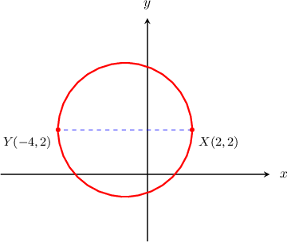
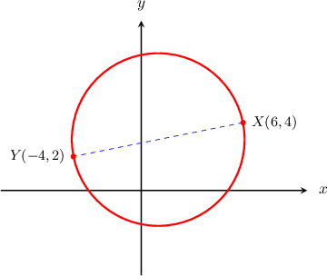
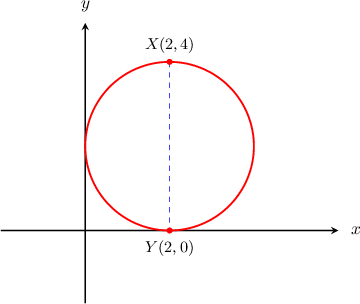
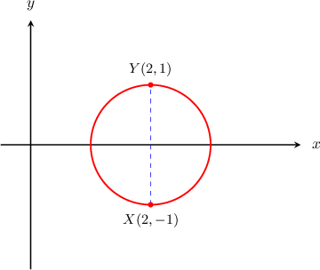
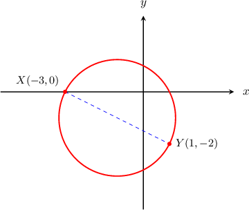
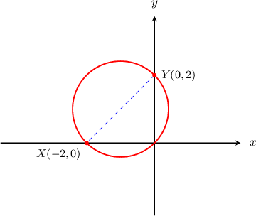
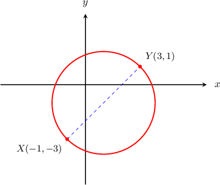
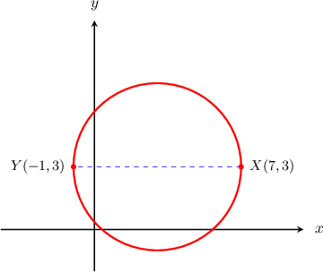
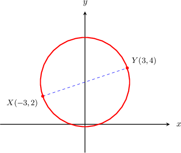

# Diameter endpoints circle review

All entries are author previews. Original and generated labels, actual difficulty or authored workload, and source-present versus inferred correct designations are explicit.

## Original raw replay q-15292

Original source replay / authored workload moderate / q-15292 / q-15292

The line segment $XY^(―)$ is a diameter of a circle. Given that $X$ and $Y$ have coordinates $(2, 2)$ and $(-4, 2)$, respectively, what is the equation of the circle?

Choices (author review; correct labeled):

* CORRECT (inferred; source designation absent) (x + 1)^{2} + (y - 2)^{2} = 9

* (x - 1)^{2} + (y - 2)^{2} = 9

* x^{2} + y^{2} = 9

* (x - 1)^{2} + (y - 2)^{2} = 36

* (x + 1)^{2} + (y - 2)^{2} = 36

Worked solution:

[Absent from original]

## Generated observed-template variant q-15292 1

Generated variant / authored workload moderate / q-15292 / q-15292

The line segment $XY^(―)$ is a diameter of a circle. Given that $X$ and $Y$ have coordinates $(2, 3)$ and $(-4, 3)$, respectively, what is the equation of the circle?

Choices (author review; correct labeled):

* CORRECT (inferred; source designation absent) (x + 1)^{2} + (y - 3)^{2} = 9

* (x + 1)^{2} + (y - 3)^{2} = 36

* (x - 1)^{2} + (y - 3)^{2} = 36

* x^{2} + y^{2} = 9

* (x - 1)^{2} + (y - 3)^{2} = 9

Worked solution:

[Absent from original]

## Generated observed-template variant q-15292 2

Generated variant / authored workload moderate / q-15292 / q-15292

The line segment $XY^(―)$ is a diameter of a circle. Given that $X$ and $Y$ have coordinates $(4, 2)$ and $(-2, 2)$, respectively, what is the equation of the circle?

Choices (author review; correct labeled):

* CORRECT (inferred; source designation absent) (x - 1)^{2} + (y - 2)^{2} = 9

* (x + 1)^{2} + (y - 2)^{2} = 9

* (x - 1)^{2} + (y - 2)^{2} = 36

* (x + 1)^{2} + (y - 2)^{2} = 36

* x^{2} + y^{2} = 9

Worked solution:

[Absent from original]

## Original raw replay q-15297

Original source replay / authored workload hard / q-15297 / q-15297

The line segment $XY^(―)$ is a diameter of a circle. Given that $X$ and $Y$ have coordinates $(6, 4)$ and $(-4, 2)$, respectively, what is the equation of the circle?

Choices (author review; correct labeled):

* x^{2} + (y - 3)^{2} = 26

* (x - 3)^{2} + (y - 1)^{2} = \sqrt{26}

* x^{2} + (y - 3)^{2} = \sqrt{26}

* CORRECT (inferred; source designation absent) (x - 1)^{2} + (y - 3)^{2} = 26

* (x - 1)^{2} + (y - 3)^{2} = \sqrt{26}

Worked solution:

[Absent from original]

## Generated observed-template variant q-15297 1

Generated variant / authored workload hard / q-15297 / q-15297

The line segment $XY^(―)$ is a diameter of a circle. Given that $X$ and $Y$ have coordinates $(7, 4)$ and $(-3, 2)$, respectively, what is the equation of the circle?

Choices (author review; correct labeled):

* x^{2} + (y - 3)^{2} = 26

* (x - 2)^{2} + (y - 3)^{2} = \sqrt{26}

* CORRECT (inferred; source designation absent) (x - 2)^{2} + (y - 3)^{2} = 26

* x^{2} + (y - 3)^{2} = \sqrt{26}

* (x - 3)^{2} + (y - 2)^{2} = \sqrt{26}

Worked solution:

[Absent from original]

## Generated observed-template variant q-15297 2

Generated variant / authored workload hard / q-15297 / q-15297

The line segment $XY^(―)$ is a diameter of a circle. Given that $X$ and $Y$ have coordinates $(6, 6)$ and $(-4, 4)$, respectively, what is the equation of the circle?

Choices (author review; correct labeled):

* x^{2} + (y - 5)^{2} = 26

* (x - 5)^{2} + (y - 1)^{2} = \sqrt{26}

* (x - 1)^{2} + (y - 5)^{2} = \sqrt{26}

* CORRECT (inferred; source designation absent) (x - 1)^{2} + (y - 5)^{2} = 26

* x^{2} + (y - 5)^{2} = \sqrt{26}

Worked solution:

[Absent from original]

## Original raw replay q-117102

Original source replay / difficulty moderate / q-117102 / q-117102

The line segment $\overset{―}{XY}$ is a diameter of a circle. Given that $X$ and $Y$ have coordinates $(2,4)$ and $(2,0)$, respectively, what is the equation of the circle?

Choices (author review; correct labeled):

* (x+2)^{2}+(y+2)^{2}=16

* (x-2)^{2}+(y-2)^{2}=16

* (x+2)^{2}+(y+2)^{2}=4

* CORRECT (x-2)^{2}+(y-2)^{2}=4

* (x-2)^{2}+(y+2)^{2}=4

Worked solution:

The general equation of a circle with radius $r$ centered at the point $(a,b)$ is

$$
(x-a)^{2}+(y-b)^{2}={r}^{2}.
$$

Using the distance formula to compute the distance between the points $X(2,4)$ and $Y(2,0),$ we find that the length of the diameter is 

$$
\begin{aligned}XY & =\sqrt{(2-2)^{2}+(4-0)^{2}} \\  & =\sqrt{{0}^{2}+{4}^{2}} \\  & =\sqrt{16} \\  & =4.\end{aligned}
$$

So the radius of the circle is 

$$
r=\frac{XY}{2}=\frac{4}{2}=2.
$$

Since the center of a circle is the midpoint of the diameter, we can find the center using the midpoint formula as follows:

$$
(\frac{{x}_{1}+{x}_{2}}{2},\frac{{y}_{1}+{y}_{2}}{2})=(\frac{2+2}{2},\frac{4+0}{2})=(2,2)
$$

So our circle has radius $r=2$ and center $(a,b)=(2,2),$ and therefore it is represented by the following equation:

$$
\begin{aligned}(x-a)^{2}+(y-b)^{2} & ={r}^{2} \\ (x-2)^{2}+(y-2)^{2} & ={2}^{2} \\ (x-2)^{2}+(y-2)^{2} & =4\end{aligned}
$$

## Generated observed-template variant q-117102 1

Generated variant / difficulty moderate / q-117102 / q-117102

The line segment $\overset{―}{XY}$ is a diameter of a circle. Given that $X$ and $Y$ have coordinates $(3,4)$ and $(3,0)$, respectively, what is the equation of the circle?

Choices (author review; correct labeled):

* (x+3)^{2}+(y+2)^{2}=16

* (x-3)^{2}+(y+2)^{2}=4

* CORRECT (x-3)^{2}+(y-2)^{2}=4

* (x+3)^{2}+(y+2)^{2}=4

* (x-3)^{2}+(y-2)^{2}=16

Worked solution:

The general equation of a circle with radius $r$ centered at the point $(a,b)$ is

$$
(x-a)^{2}+(y-b)^{2}={r}^{2}.
$$

Using the distance formula to compute the distance between the points $X(3,4)$ and $Y(3,0),$ we find that the length of the diameter is 

$$
\begin{aligned}XY & =\sqrt{(3-3)^{2}+(4-0)^{2}} \\  & =\sqrt{{0}^{2}+{4}^{2}} \\  & =\sqrt{16} \\  & =4.\end{aligned}
$$

So the radius of the circle is 

$$
r=\frac{XY}{2}=\frac{4}{2}=2.
$$

Since the center of a circle is the midpoint of the diameter, we can find the center using the midpoint formula as follows:

$$
(\frac{{x}_{1}+{x}_{2}}{2},\frac{{y}_{1}+{y}_{2}}{2})=(\frac{3+3}{2},\frac{4+0}{2})=(3,2)
$$

So our circle has radius $r=2$ and center $(a,b)=(3,2),$ and therefore it is represented by the following equation:

$$
\begin{aligned}(x-a)^{2}+(y-b)^{2} & ={r}^{2} \\ (x-3)^{2}+(y-2)^{2} & ={2}^{2} \\ (x-3)^{2}+(y-2)^{2} & =4\end{aligned}
$$

## Generated observed-template variant q-117102 2

Generated variant / difficulty moderate / q-117102 / q-117102

The line segment $\overset{―}{XY}$ is a diameter of a circle. Given that $X$ and $Y$ have coordinates $(4,4)$ and $(4,0)$, respectively, what is the equation of the circle?

Choices (author review; correct labeled):

* (x+4)^{2}+(y+2)^{2}=16

* (x-4)^{2}+(y-2)^{2}=16

* (x-4)^{2}+(y+2)^{2}=4

* CORRECT (x-4)^{2}+(y-2)^{2}=4

* (x+4)^{2}+(y+2)^{2}=4

Worked solution:

The general equation of a circle with radius $r$ centered at the point $(a,b)$ is

$$
(x-a)^{2}+(y-b)^{2}={r}^{2}.
$$

Using the distance formula to compute the distance between the points $X(4,4)$ and $Y(4,0),$ we find that the length of the diameter is 

$$
\begin{aligned}XY & =\sqrt{(4-4)^{2}+(4-0)^{2}} \\  & =\sqrt{{0}^{2}+{4}^{2}} \\  & =\sqrt{16} \\  & =4.\end{aligned}
$$

So the radius of the circle is 

$$
r=\frac{XY}{2}=\frac{4}{2}=2.
$$

Since the center of a circle is the midpoint of the diameter, we can find the center using the midpoint formula as follows:

$$
(\frac{{x}_{1}+{x}_{2}}{2},\frac{{y}_{1}+{y}_{2}}{2})=(\frac{4+4}{2},\frac{4+0}{2})=(4,2)
$$

So our circle has radius $r=2$ and center $(a,b)=(4,2),$ and therefore it is represented by the following equation:

$$
\begin{aligned}(x-a)^{2}+(y-b)^{2} & ={r}^{2} \\ (x-4)^{2}+(y-2)^{2} & ={2}^{2} \\ (x-4)^{2}+(y-2)^{2} & =4\end{aligned}
$$

## Original raw replay q-117103

Original source replay / difficulty moderate / q-117103 / q-117103

The line segment $\overset{―}{XY}$ is a diameter of a circle. Given that $X$ and $Y$ have coordinates $(2,-1)$ and $(2,1)$, respectively, what is the equation of the circle?

Choices (author review; correct labeled):

* (x-2)^{2}+{y}^{2}=4

* (x+2)^{2}+{y}^{2}=4

* CORRECT (x-2)^{2}+{y}^{2}=1

* (x+2)^{2}+{y}^{2}=1

* {x}^{2}+(y-2)^{2}=4

Worked solution:

The general equation of a circle with radius $r$ centered at the point $(a,b)$ is

$$
(x-a)^{2}+(y-b)^{2}={r}^{2}.
$$

Using the distance formula to compute the distance between the points $X(2,-1)$ and $Y(2,1),$ we find that the length of the diameter is 

$$
\begin{aligned}XY & =\sqrt{(2-2)^{2}+(-1-1)^{2}} \\  & =\sqrt{{0}^{2}+(-2)^{2}} \\  & =\sqrt{4} \\  & =2.\end{aligned}
$$

So the radius of the circle is 

$$
r=\frac{XY}{2}=\frac{2}{2}=1.
$$

Since the center of a circle is the midpoint of the diameter, we can find the center using the midpoint formula as follows:

$$
(\frac{{x}_{1}+{x}_{2}}{2},\frac{{y}_{1}+{y}_{2}}{2})=(\frac{2+2}{2},\frac{-1+1}{2})=(2,0)
$$

So our circle has radius $r=1$ and center $(a,b)=(2,0),$ and therefore it is represented by the following equation:

$$
\begin{aligned}(x-a)^{2}+(y-b)^{2} & ={r}^{2} \\ (x-2)^{2}+(y-0)^{2} & ={1}^{2} \\ (x-2)^{2}+{y}^{2} & =1\end{aligned}
$$

## Generated observed-template variant q-117103 1

Generated variant / difficulty moderate / q-117103 / q-117103

The line segment $\overset{―}{XY}$ is a diameter of a circle. Given that $X$ and $Y$ have coordinates $(3,-1)$ and $(3,1)$, respectively, what is the equation of the circle?

Choices (author review; correct labeled):

* (x-3)^{2}+{y}^{2}=4

* {x}^{2}+(y-3)^{2}=4

* (x+3)^{2}+{y}^{2}=1

* CORRECT (x-3)^{2}+{y}^{2}=1

* (x+3)^{2}+{y}^{2}=4

Worked solution:

The general equation of a circle with radius $r$ centered at the point $(a,b)$ is

$$
(x-a)^{2}+(y-b)^{2}={r}^{2}.
$$

Using the distance formula to compute the distance between the points $X(3,-1)$ and $Y(3,1),$ we find that the length of the diameter is 

$$
\begin{aligned}XY & =\sqrt{(3-3)^{2}+(-1-1)^{2}} \\  & =\sqrt{{0}^{2}+(-2)^{2}} \\  & =\sqrt{4} \\  & =2.\end{aligned}
$$

So the radius of the circle is 

$$
r=\frac{XY}{2}=\frac{2}{2}=1.
$$

Since the center of a circle is the midpoint of the diameter, we can find the center using the midpoint formula as follows:

$$
(\frac{{x}_{1}+{x}_{2}}{2},\frac{{y}_{1}+{y}_{2}}{2})=(\frac{3+3}{2},\frac{-1+1}{2})=(3,0)
$$

So our circle has radius $r=1$ and center $(a,b)=(3,0),$ and therefore it is represented by the following equation:

$$
\begin{aligned}(x-a)^{2}+(y-b)^{2} & ={r}^{2} \\ (x-3)^{2}+(y-0)^{2} & ={1}^{2} \\ (x-3)^{2}+{y}^{2} & =1\end{aligned}
$$

## Generated observed-template variant q-117103 2

Generated variant / difficulty moderate / q-117103 / q-117103

The line segment $\overset{―}{XY}$ is a diameter of a circle. Given that $X$ and $Y$ have coordinates $(4,-1)$ and $(4,1)$, respectively, what is the equation of the circle?

Choices (author review; correct labeled):

* (x-4)^{2}+{y}^{2}=4

* (x+4)^{2}+{y}^{2}=4

* {x}^{2}+(y-4)^{2}=4

* (x+4)^{2}+{y}^{2}=1

* CORRECT (x-4)^{2}+{y}^{2}=1

Worked solution:

The general equation of a circle with radius $r$ centered at the point $(a,b)$ is

$$
(x-a)^{2}+(y-b)^{2}={r}^{2}.
$$

Using the distance formula to compute the distance between the points $X(4,-1)$ and $Y(4,1),$ we find that the length of the diameter is 

$$
\begin{aligned}XY & =\sqrt{(4-4)^{2}+(-1-1)^{2}} \\  & =\sqrt{{0}^{2}+(-2)^{2}} \\  & =\sqrt{4} \\  & =2.\end{aligned}
$$

So the radius of the circle is 

$$
r=\frac{XY}{2}=\frac{2}{2}=1.
$$

Since the center of a circle is the midpoint of the diameter, we can find the center using the midpoint formula as follows:

$$
(\frac{{x}_{1}+{x}_{2}}{2},\frac{{y}_{1}+{y}_{2}}{2})=(\frac{4+4}{2},\frac{-1+1}{2})=(4,0)
$$

So our circle has radius $r=1$ and center $(a,b)=(4,0),$ and therefore it is represented by the following equation:

$$
\begin{aligned}(x-a)^{2}+(y-b)^{2} & ={r}^{2} \\ (x-4)^{2}+(y-0)^{2} & ={1}^{2} \\ (x-4)^{2}+{y}^{2} & =1\end{aligned}
$$

## Original raw replay q-117105

Original source replay / difficulty hard / q-117105 / q-117105

The line segment $\overset{―}{XY}$ is a diameter of a circle. Given that $X$ and $Y$ have coordinates $(-3,0)$ and $(1,-2)$, respectively, what is the equation of the circle?

Choices (author review; correct labeled):

* (x+1)^{2}+(y+1)^{2}=20

* (x-1)^{2}+(y-1)^{2}=20

* (x+1)^{2}+(y-1)^{2}=5

* CORRECT (x+1)^{2}+(y+1)^{2}=5

* (x-1)^{2}+(y-1)^{2}=5

Worked solution:

The general equation of a circle with radius $r$ centered at the point $(a,b)$ is

$$
(x-a)^{2}+(y-b)^{2}={r}^{2}.
$$

Using the distance formula to compute the distance between the points $X(-3,0)$ and $Y(1,-2),$ we find that the length of the diameter is 

$$
\begin{aligned}XY & =\sqrt{(-3-1)^{2}+(0-(-2))^{2}} \\  & =\sqrt{{4}^{2}+{2}^{2}} \\  & =\sqrt{16+4} \\  & =\sqrt{4\cdot 4+4} \\  & =\sqrt{4\cdot 5} \\  & =2\sqrt{5}.\end{aligned}
$$

So the radius of the circle is 

$$
r=\frac{2\sqrt{5}}{2}=\sqrt{5}.
$$

Since the center of a circle is the midpoint of the diameter, to find the center we use the midpoint formula as follows:

$$
(\frac{{x}_{1}+{x}_{2}}{2},\frac{{y}_{1}+{y}_{2}}{2})=(\frac{-3+1}{2},\frac{0-2}{2})=(-1,-1)
$$

So our circle has radius $r=\sqrt{5}$ and center $(a,b)=(-1,-1),$ and therefore it is represented by the following equation:

$$
\begin{aligned}(x-a)^{2}+(y-b)^{2} & ={r}^{2} \\ (x-(-1))^{2}+(y-(-1))^{2} & ={(\sqrt{5})}^{2} \\ (x+1)^{2}+(y+1)^{2} & =5\end{aligned}
$$

## Generated observed-template variant q-117105 1

Generated variant / difficulty hard / q-117105 / q-117105

The line segment $\overset{―}{XY}$ is a diameter of a circle. Given that $X$ and $Y$ have coordinates $(-4,0)$ and $(0,-2)$, respectively, what is the equation of the circle?

Choices (author review; correct labeled):

* (x+2)^{2}+(y+1)^{2}=20

* (x-2)^{2}+(y-1)^{2}=5

* CORRECT (x+2)^{2}+(y+1)^{2}=5

* (x+2)^{2}+(y-1)^{2}=5

* (x-2)^{2}+(y-1)^{2}=20

Worked solution:

The general equation of a circle with radius $r$ centered at the point $(a,b)$ is

$$
(x-a)^{2}+(y-b)^{2}={r}^{2}.
$$

Using the distance formula to compute the distance between the points $X(-4,0)$ and $Y(0,-2),$ we find that the length of the diameter is 

$$
\begin{aligned}XY & =\sqrt{(-4-0)^{2}+(0-(-2))^{2}} \\  & =\sqrt{{4}^{2}+{2}^{2}} \\  & =\sqrt{16+4} \\  & =\sqrt{4\cdot 4+4} \\  & =\sqrt{4\cdot 5} \\  & =2\sqrt{5}.\end{aligned}
$$

So the radius of the circle is 

$$
r=\frac{2\sqrt{5}}{2}=\sqrt{5}.
$$

Since the center of a circle is the midpoint of the diameter, to find the center we use the midpoint formula as follows:

$$
(\frac{{x}_{1}+{x}_{2}}{2},\frac{{y}_{1}+{y}_{2}}{2})=(\frac{-4+0}{2},\frac{0-2}{2})=(-2,-1)
$$

So our circle has radius $r=\sqrt{5}$ and center $(a,b)=(-2,-1),$ and therefore it is represented by the following equation:

$$
\begin{aligned}(x-a)^{2}+(y-b)^{2} & ={r}^{2} \\ (x-(-2))^{2}+(y-(-1))^{2} & ={(\sqrt{5})}^{2} \\ (x+2)^{2}+(y+1)^{2} & =5\end{aligned}
$$

## Generated observed-template variant q-117105 2

Generated variant / difficulty hard / q-117105 / q-117105

The line segment $\overset{―}{XY}$ is a diameter of a circle. Given that $X$ and $Y$ have coordinates $(-1,0)$ and $(3,-2)$, respectively, what is the equation of the circle?

Choices (author review; correct labeled):

* (x-1)^{2}+(y+1)^{2}=20

* (x+1)^{2}+(y-1)^{2}=20

* (x+1)^{2}+(y-1)^{2}=5

* CORRECT (x-1)^{2}+(y+1)^{2}=5

* (x-1)^{2}+(y-1)^{2}=5

Worked solution:

The general equation of a circle with radius $r$ centered at the point $(a,b)$ is

$$
(x-a)^{2}+(y-b)^{2}={r}^{2}.
$$

Using the distance formula to compute the distance between the points $X(-1,0)$ and $Y(3,-2),$ we find that the length of the diameter is 

$$
\begin{aligned}XY & =\sqrt{(-1-3)^{2}+(0-(-2))^{2}} \\  & =\sqrt{{4}^{2}+{2}^{2}} \\  & =\sqrt{16+4} \\  & =\sqrt{4\cdot 4+4} \\  & =\sqrt{4\cdot 5} \\  & =2\sqrt{5}.\end{aligned}
$$

So the radius of the circle is 

$$
r=\frac{2\sqrt{5}}{2}=\sqrt{5}.
$$

Since the center of a circle is the midpoint of the diameter, to find the center we use the midpoint formula as follows:

$$
(\frac{{x}_{1}+{x}_{2}}{2},\frac{{y}_{1}+{y}_{2}}{2})=(\frac{-1+3}{2},\frac{0-2}{2})=(1,-1)
$$

So our circle has radius $r=\sqrt{5}$ and center $(a,b)=(1,-1),$ and therefore it is represented by the following equation:

$$
\begin{aligned}(x-a)^{2}+(y-b)^{2} & ={r}^{2} \\ (x-1)^{2}+(y-(-1))^{2} & ={(\sqrt{5})}^{2} \\ (x-1)^{2}+(y+1)^{2} & =5\end{aligned}
$$

## Original raw replay q-117106

Original source replay / difficulty hard / q-117106 / q-117106

The line segment $\overset{―}{XY}$ is a diameter of a circle. Given that $X$ and $Y$ have coordinates $(-2,0)$ and $(0,2)$, respectively, what is the equation of the circle?

Choices (author review; correct labeled):

* (x+1)^{2}+(y+1)^{2}=2

* (x-1)^{2}+(y+1)^{2}=8

* (x+1)^{2}+(y-1)^{2}=8

* CORRECT (x+1)^{2}+(y-1)^{2}=2

* (x-1)^{2}+(y+1)^{2}=2

Worked solution:

The general equation of a circle with radius $r$ centered at the point $(a,b)$ is

$$
(x-a)^{2}+(y-b)^{2}={r}^{2}.
$$

Using the distance formula to compute the distance between the points $X(-2,0)$ and $Y(0,2),$ we find that the length of the diameter is 

$$
\begin{aligned}XY & =\sqrt{(-2-0)^{2}+(0-2)^{2}} \\  & =\sqrt{(-2)^{2}+(-2)^{2}} \\  & =\sqrt{4+4} \\  & =\sqrt{4\cdot 2} \\  & =2\sqrt{2}.\end{aligned}
$$

So the radius of the circle is 

$$
r=\frac{2\sqrt{2}}{2}=\sqrt{2}.
$$

Since the center of a circle is the midpoint of the diameter, to find the center we use the midpoint formula as follows:

$$
(\frac{{x}_{1}+{x}_{2}}{2},\frac{{y}_{1}+{y}_{2}}{2})=(\frac{-2+0}{2},\frac{0+2}{2})=(-1,1)
$$

So our circle has radius $r=\sqrt{2}$ and center $(a,b)=(-1,1),$ and therefore it is represented by the following equation:

$$
\begin{aligned}(x-a)^{2}+(y-b)^{2} & ={r}^{2} \\ (x-(-1))^{2}+(y-1)^{2} & ={(\sqrt{2})}^{2} \\ (x+1)^{2}+(y-1)^{2} & =2\end{aligned}
$$

## Generated observed-template variant q-117106 1

Generated variant / difficulty hard / q-117106 / q-117106

The line segment $\overset{―}{XY}$ is a diameter of a circle. Given that $X$ and $Y$ have coordinates $(-2,1)$ and $(0,3)$, respectively, what is the equation of the circle?

Choices (author review; correct labeled):

* (x+1)^{2}+(y+2)^{2}=2

* (x-1)^{2}+(y+2)^{2}=2

* CORRECT (x+1)^{2}+(y-2)^{2}=2

* (x+1)^{2}+(y-2)^{2}=8

* (x-1)^{2}+(y+2)^{2}=8

Worked solution:

The general equation of a circle with radius $r$ centered at the point $(a,b)$ is

$$
(x-a)^{2}+(y-b)^{2}={r}^{2}.
$$

Using the distance formula to compute the distance between the points $X(-2,1)$ and $Y(0,3),$ we find that the length of the diameter is 

$$
\begin{aligned}XY & =\sqrt{(-2-0)^{2}+(1-3)^{2}} \\  & =\sqrt{(-2)^{2}+(-2)^{2}} \\  & =\sqrt{4+4} \\  & =\sqrt{4\cdot 2} \\  & =2\sqrt{2}.\end{aligned}
$$

So the radius of the circle is 

$$
r=\frac{2\sqrt{2}}{2}=\sqrt{2}.
$$

Since the center of a circle is the midpoint of the diameter, to find the center we use the midpoint formula as follows:

$$
(\frac{{x}_{1}+{x}_{2}}{2},\frac{{y}_{1}+{y}_{2}}{2})=(\frac{-2+0}{2},\frac{1+3}{2})=(-1,2)
$$

So our circle has radius $r=\sqrt{2}$ and center $(a,b)=(-1,2),$ and therefore it is represented by the following equation:

$$
\begin{aligned}(x-a)^{2}+(y-b)^{2} & ={r}^{2} \\ (x-(-1))^{2}+(y-2)^{2} & ={(\sqrt{2})}^{2} \\ (x+1)^{2}+(y-2)^{2} & =2\end{aligned}
$$

## Generated observed-template variant q-117106 2

Generated variant / difficulty hard / q-117106 / q-117106

The line segment $\overset{―}{XY}$ is a diameter of a circle. Given that $X$ and $Y$ have coordinates $(0,0)$ and $(2,2)$, respectively, what is the equation of the circle?

Choices (author review; correct labeled):

* (x-1)^{2}+(y+1)^{2}=2

* (x+1)^{2}+(y+1)^{2}=8

* (x+1)^{2}+(y+1)^{2}=2

* CORRECT (x-1)^{2}+(y-1)^{2}=2

* (x-1)^{2}+(y-1)^{2}=8

Worked solution:

The general equation of a circle with radius $r$ centered at the point $(a,b)$ is

$$
(x-a)^{2}+(y-b)^{2}={r}^{2}.
$$

Using the distance formula to compute the distance between the points $X(0,0)$ and $Y(2,2),$ we find that the length of the diameter is 

$$
\begin{aligned}XY & =\sqrt{(0-2)^{2}+(0-2)^{2}} \\  & =\sqrt{(-2)^{2}+(-2)^{2}} \\  & =\sqrt{4+4} \\  & =\sqrt{4\cdot 2} \\  & =2\sqrt{2}.\end{aligned}
$$

So the radius of the circle is 

$$
r=\frac{2\sqrt{2}}{2}=\sqrt{2}.
$$

Since the center of a circle is the midpoint of the diameter, to find the center we use the midpoint formula as follows:

$$
(\frac{{x}_{1}+{x}_{2}}{2},\frac{{y}_{1}+{y}_{2}}{2})=(\frac{0+2}{2},\frac{0+2}{2})=(1,1)
$$

So our circle has radius $r=\sqrt{2}$ and center $(a,b)=(1,1),$ and therefore it is represented by the following equation:

$$
\begin{aligned}(x-a)^{2}+(y-b)^{2} & ={r}^{2} \\ (x-1)^{2}+(y-1)^{2} & ={(\sqrt{2})}^{2} \\ (x-1)^{2}+(y-1)^{2} & =2\end{aligned}
$$

## Original raw replay q-117107

Original source replay / difficulty hard / q-117107 / q-117107

The line segment $\overset{―}{XY}$ is a diameter of a circle. Given that $X$ and $Y$ have coordinates $(-1,-3)$ and $(3,1)$, respectively, what is the equation of the circle?

Choices (author review; correct labeled):

* (x+1)^{2}+(y-1)^{2}=32

* (x-1)^{2}+(y+1)^{2}=32

* CORRECT (x-1)^{2}+(y+1)^{2}=8

* (x+1)^{2}+(y-1)^{2}=8

* (x-1)^{2}+(y-1)^{2}=8

Worked solution:

The general equation of a circle with radius $r$ centered at the point $(a,b)$ is

$$
(x-a)^{2}+(y-b)^{2}={r}^{2}.
$$

Using the distance formula to compute the distance between the points $X(-1,-3)$ and $Y(3,1),$ we find that the length of the diameter is 

$$
\begin{aligned}XY & =\sqrt{(-1-3)^{2}+(-3-1)^{2}} \\  & =\sqrt{(-4)^{2}+(-4)^{2}} \\  & =\sqrt{16+16} \\  & =\sqrt{16\cdot 2} \\  & =4\sqrt{2}.\end{aligned}
$$

So the radius of the circle is 

$$
r=\frac{4\sqrt{2}}{2}=2\sqrt{2}.
$$

Since the center of a circle is the midpoint of the diameter, to find the center we use the midpoint formula as follows:

$$
(\frac{{x}_{1}+{x}_{2}}{2},\frac{{y}_{1}+{y}_{2}}{2})=(\frac{-1+3}{2},\frac{-3+1}{2})=(1,-1)
$$

So our circle has radius $r=2\sqrt{2}$ and center $(a,b)=(1,-1),$ and therefore it is represented by the following equation:

$$
\begin{aligned}(x-a)^{2}+(y-b)^{2} & ={r}^{2} \\ (x-1)^{2}+(y-(-1))^{2} & ={(2\sqrt{2})}^{2} \\ (x-1)^{2}+(y+1)^{2} & =8\end{aligned}
$$

## Generated observed-template variant q-117107 1

Generated variant / difficulty hard / q-117107 / q-117107

The line segment $\overset{―}{XY}$ is a diameter of a circle. Given that $X$ and $Y$ have coordinates $(0,-3)$ and $(4,1)$, respectively, what is the equation of the circle?

Choices (author review; correct labeled):

* (x+2)^{2}+(y-1)^{2}=32

* (x-2)^{2}+(y-1)^{2}=8

* (x+2)^{2}+(y-1)^{2}=8

* CORRECT (x-2)^{2}+(y+1)^{2}=8

* (x-2)^{2}+(y+1)^{2}=32

Worked solution:

The general equation of a circle with radius $r$ centered at the point $(a,b)$ is

$$
(x-a)^{2}+(y-b)^{2}={r}^{2}.
$$

Using the distance formula to compute the distance between the points $X(0,-3)$ and $Y(4,1),$ we find that the length of the diameter is 

$$
\begin{aligned}XY & =\sqrt{(0-4)^{2}+(-3-1)^{2}} \\  & =\sqrt{(-4)^{2}+(-4)^{2}} \\  & =\sqrt{16+16} \\  & =\sqrt{16\cdot 2} \\  & =4\sqrt{2}.\end{aligned}
$$

So the radius of the circle is 

$$
r=\frac{4\sqrt{2}}{2}=2\sqrt{2}.
$$

Since the center of a circle is the midpoint of the diameter, to find the center we use the midpoint formula as follows:

$$
(\frac{{x}_{1}+{x}_{2}}{2},\frac{{y}_{1}+{y}_{2}}{2})=(\frac{0+4}{2},\frac{-3+1}{2})=(2,-1)
$$

So our circle has radius $r=2\sqrt{2}$ and center $(a,b)=(2,-1),$ and therefore it is represented by the following equation:

$$
\begin{aligned}(x-a)^{2}+(y-b)^{2} & ={r}^{2} \\ (x-2)^{2}+(y-(-1))^{2} & ={(2\sqrt{2})}^{2} \\ (x-2)^{2}+(y+1)^{2} & =8\end{aligned}
$$

## Generated observed-template variant q-117107 2

Generated variant / difficulty hard / q-117107 / q-117107

The line segment $\overset{―}{XY}$ is a diameter of a circle. Given that $X$ and $Y$ have coordinates $(1,-3)$ and $(5,1)$, respectively, what is the equation of the circle?

Choices (author review; correct labeled):

* (x+3)^{2}+(y-1)^{2}=32

* (x-3)^{2}+(y+1)^{2}=32

* (x-3)^{2}+(y-1)^{2}=8

* (x+3)^{2}+(y-1)^{2}=8

* CORRECT (x-3)^{2}+(y+1)^{2}=8

Worked solution:

The general equation of a circle with radius $r$ centered at the point $(a,b)$ is

$$
(x-a)^{2}+(y-b)^{2}={r}^{2}.
$$

Using the distance formula to compute the distance between the points $X(1,-3)$ and $Y(5,1),$ we find that the length of the diameter is 

$$
\begin{aligned}XY & =\sqrt{(1-5)^{2}+(-3-1)^{2}} \\  & =\sqrt{(-4)^{2}+(-4)^{2}} \\  & =\sqrt{16+16} \\  & =\sqrt{16\cdot 2} \\  & =4\sqrt{2}.\end{aligned}
$$

So the radius of the circle is 

$$
r=\frac{4\sqrt{2}}{2}=2\sqrt{2}.
$$

Since the center of a circle is the midpoint of the diameter, to find the center we use the midpoint formula as follows:

$$
(\frac{{x}_{1}+{x}_{2}}{2},\frac{{y}_{1}+{y}_{2}}{2})=(\frac{1+5}{2},\frac{-3+1}{2})=(3,-1)
$$

So our circle has radius $r=2\sqrt{2}$ and center $(a,b)=(3,-1),$ and therefore it is represented by the following equation:

$$
\begin{aligned}(x-a)^{2}+(y-b)^{2} & ={r}^{2} \\ (x-3)^{2}+(y-(-1))^{2} & ={(2\sqrt{2})}^{2} \\ (x-3)^{2}+(y+1)^{2} & =8\end{aligned}
$$

## Original raw replay q-70987

Original source replay / difficulty moderate / q-70987 / q-70987

The line segment $\overset{―}{XY}$ is a diameter of a circle. Given that $X$ and $Y$ have coordinates $(7,3)$ and $(-1,3)$, respectively, what is the equation of the circle?

Choices (author review; correct labeled):

* (x+3)^{2}-(y+3)^{2}=4

* CORRECT (x-3)^{2}+(y-3)^{2}=16

* (x+3)^{2}+(y+3)^{2}=4

* (x+3)^{2}+(y+3)^{2}=16

* (x-3)^{2}+(y-3)^{2}=4

Worked solution:

The general equation of a circle with radius $r$ centered at the point $(a,b)$ is  

$$
(x-a)^{2}+(y-b)^{2}={r}^{2}.
$$

Using the distance formula to compute the distance between the points $X(7,3)$ and $Y(-1,3),$ we find that the length of the diameter is 

$$
\begin{aligned}XY & =\sqrt{{(7-(-1))}^{2}+{(3-3)}^{2}} \\  & =\sqrt{{8}^{2}+{0}^{2}} \\  & =\sqrt{64} \\  & =8.\end{aligned}
$$

So the radius of the circle is 

$$
r=\frac{8}{2}=4.
$$

Since the center of a circle is the midpoint of the diameter, to find the center we use the midpoint formula as follows:

$$
(\frac{{x}_{1}+{x}_{2}}{2},\frac{{y}_{1}+{y}_{2}}{2})=(\frac{7+(-1)}{2},\frac{3+3}{2})=(3,3)
$$

So our circle has radius $r=4$ and center $(a,b)=(3,3),$ and therefore it is represented by the following equation:

$$
\begin{aligned}(x-a)^{2}+(y-b)^{2} & ={r}^{2} \\ (x-3)^{2}+(y-3)^{2} & ={4}^{2} \\ (x-3)^{2}+(y-3)^{2} & =16\end{aligned}
$$

## Generated observed-template variant q-70987 1

Generated variant / difficulty moderate / q-70987 / q-70987

The line segment $\overset{―}{XY}$ is a diameter of a circle. Given that $X$ and $Y$ have coordinates $(8,3)$ and $(0,3)$, respectively, what is the equation of the circle?

Choices (author review; correct labeled):

* (x+4)^{2}-(y+3)^{2}=4

* (x-4)^{2}+(y-3)^{2}=4

* (x+4)^{2}+(y+3)^{2}=16

* (x+4)^{2}+(y+3)^{2}=4

* CORRECT (x-4)^{2}+(y-3)^{2}=16

Worked solution:

The general equation of a circle with radius $r$ centered at the point $(a,b)$ is  

$$
(x-a)^{2}+(y-b)^{2}={r}^{2}.
$$

Using the distance formula to compute the distance between the points $X(8,3)$ and $Y(0,3),$ we find that the length of the diameter is 

$$
\begin{aligned}XY & =\sqrt{{(8-0)}^{2}+{(3-3)}^{2}} \\  & =\sqrt{{8}^{2}+{0}^{2}} \\  & =\sqrt{64} \\  & =8.\end{aligned}
$$

So the radius of the circle is 

$$
r=\frac{8}{2}=4.
$$

Since the center of a circle is the midpoint of the diameter, to find the center we use the midpoint formula as follows:

$$
(\frac{{x}_{1}+{x}_{2}}{2},\frac{{y}_{1}+{y}_{2}}{2})=(\frac{8+0}{2},\frac{3+3}{2})=(4,3)
$$

So our circle has radius $r=4$ and center $(a,b)=(4,3),$ and therefore it is represented by the following equation:

$$
\begin{aligned}(x-a)^{2}+(y-b)^{2} & ={r}^{2} \\ (x-4)^{2}+(y-3)^{2} & ={4}^{2} \\ (x-4)^{2}+(y-3)^{2} & =16\end{aligned}
$$

## Generated observed-template variant q-70987 2

Generated variant / difficulty moderate / q-70987 / q-70987

The line segment $\overset{―}{XY}$ is a diameter of a circle. Given that $X$ and $Y$ have coordinates $(9,3)$ and $(1,3)$, respectively, what is the equation of the circle?

Choices (author review; correct labeled):

* (x+5)^{2}-(y+3)^{2}=4

* CORRECT (x-5)^{2}+(y-3)^{2}=16

* (x-5)^{2}+(y-3)^{2}=4

* (x+5)^{2}+(y+3)^{2}=16

* (x+5)^{2}+(y+3)^{2}=4

Worked solution:

The general equation of a circle with radius $r$ centered at the point $(a,b)$ is  

$$
(x-a)^{2}+(y-b)^{2}={r}^{2}.
$$

Using the distance formula to compute the distance between the points $X(9,3)$ and $Y(1,3),$ we find that the length of the diameter is 

$$
\begin{aligned}XY & =\sqrt{{(9-1)}^{2}+{(3-3)}^{2}} \\  & =\sqrt{{8}^{2}+{0}^{2}} \\  & =\sqrt{64} \\  & =8.\end{aligned}
$$

So the radius of the circle is 

$$
r=\frac{8}{2}=4.
$$

Since the center of a circle is the midpoint of the diameter, to find the center we use the midpoint formula as follows:

$$
(\frac{{x}_{1}+{x}_{2}}{2},\frac{{y}_{1}+{y}_{2}}{2})=(\frac{9+1}{2},\frac{3+3}{2})=(5,3)
$$

So our circle has radius $r=4$ and center $(a,b)=(5,3),$ and therefore it is represented by the following equation:

$$
\begin{aligned}(x-a)^{2}+(y-b)^{2} & ={r}^{2} \\ (x-5)^{2}+(y-3)^{2} & ={4}^{2} \\ (x-5)^{2}+(y-3)^{2} & =16\end{aligned}
$$

## Original raw replay q-70990

Original source replay / difficulty hard / q-70990 / q-70990

The line segment $\overset{―}{XY}$ is a diameter of a circle. Given that $X$ and $Y$ have coordinates $(-3,2)$ and $(3,4)$, respectively, what is the equation of the circle?

Choices (author review; correct labeled):

* CORRECT {x}^{2}+(y-3)^{2}=10

* (x-3)^{2}+{y}^{2}=10

* (x-3)^{2}-{y}^{2}=10

* {x}^{2}+(y+3)^{2}=10

* (x+3)^{2}+{y}^{2}=10

Worked solution:

The general equation of a circle with radius $r$ centered at the point $(a,b)$ is  

$$
(x-a)^{2}+(y-b)^{2}={r}^{2}.
$$

Using the distance formula to compute the distance between the points $X(-3,2)$ and $Y(3,4),$ we find that the length of the diameter is 

$$
\begin{aligned}XY & =\sqrt{{(-3-3)}^{2}+{(2-4)}^{2}} \\  & =\sqrt{(-6)^{2}+(-2)^{2}} \\  & =\sqrt{40} \\  & =\sqrt{4\cdot 10} \\  & =2\sqrt{10}.\end{aligned}
$$

So the radius of the circle is 

$$
r=\frac{2\sqrt{10}}{2}=\sqrt{10}.
$$

Since the center of a circle is the midpoint of the diameter, to find the center we use the midpoint formula as follows:

$$
(\frac{{x}_{1}+{x}_{2}}{2},\frac{{y}_{1}+{y}_{2}}{2})=(\frac{-3+3}{2},\frac{2+4}{2})=(0,3)
$$

So our circle has radius $r=\sqrt{10}$ and center $(a,b)=(0,3),$ and therefore it is represented by the following equation:

$$
\begin{aligned}(x-a)^{2}+(y-b)^{2} & ={r}^{2} \\ (x-0)^{2}+(y-3)^{2} & ={(\sqrt{10})}^{2} \\ {x}^{2}+(y-3)^{2} & =10\end{aligned}
$$

## Generated observed-template variant q-70990 1

Generated variant / difficulty hard / q-70990 / q-70990

The line segment $\overset{―}{XY}$ is a diameter of a circle. Given that $X$ and $Y$ have coordinates $(-3,3)$ and $(3,5)$, respectively, what is the equation of the circle?

Choices (author review; correct labeled):

* CORRECT {x}^{2}+(y-4)^{2}=10

* (x+4)^{2}+{y}^{2}=10

* {x}^{2}+(y+4)^{2}=10

* (x-4)^{2}-{y}^{2}=10

* (x-4)^{2}+{y}^{2}=10

Worked solution:

The general equation of a circle with radius $r$ centered at the point $(a,b)$ is  

$$
(x-a)^{2}+(y-b)^{2}={r}^{2}.
$$

Using the distance formula to compute the distance between the points $X(-3,3)$ and $Y(3,5),$ we find that the length of the diameter is 

$$
\begin{aligned}XY & =\sqrt{{(-3-3)}^{2}+{(3-5)}^{2}} \\  & =\sqrt{(-6)^{2}+(-2)^{2}} \\  & =\sqrt{40} \\  & =\sqrt{4\cdot 10} \\  & =2\sqrt{10}.\end{aligned}
$$

So the radius of the circle is 

$$
r=\frac{2\sqrt{10}}{2}=\sqrt{10}.
$$

Since the center of a circle is the midpoint of the diameter, to find the center we use the midpoint formula as follows:

$$
(\frac{{x}_{1}+{x}_{2}}{2},\frac{{y}_{1}+{y}_{2}}{2})=(\frac{-3+3}{2},\frac{3+5}{2})=(0,4)
$$

So our circle has radius $r=\sqrt{10}$ and center $(a,b)=(0,4),$ and therefore it is represented by the following equation:

$$
\begin{aligned}(x-a)^{2}+(y-b)^{2} & ={r}^{2} \\ (x-0)^{2}+(y-4)^{2} & ={(\sqrt{10})}^{2} \\ {x}^{2}+(y-4)^{2} & =10\end{aligned}
$$

## Generated observed-template variant q-70990 2

Generated variant / difficulty hard / q-70990 / q-70990

The line segment $\overset{―}{XY}$ is a diameter of a circle. Given that $X$ and $Y$ have coordinates $(-3,4)$ and $(3,6)$, respectively, what is the equation of the circle?

Choices (author review; correct labeled):

* CORRECT {x}^{2}+(y-5)^{2}=10

* (x-5)^{2}+{y}^{2}=10

* (x+5)^{2}+{y}^{2}=10

* {x}^{2}+(y+5)^{2}=10

* (x-5)^{2}-{y}^{2}=10

Worked solution:

The general equation of a circle with radius $r$ centered at the point $(a,b)$ is  

$$
(x-a)^{2}+(y-b)^{2}={r}^{2}.
$$

Using the distance formula to compute the distance between the points $X(-3,4)$ and $Y(3,6),$ we find that the length of the diameter is 

$$
\begin{aligned}XY & =\sqrt{{(-3-3)}^{2}+{(4-6)}^{2}} \\  & =\sqrt{(-6)^{2}+(-2)^{2}} \\  & =\sqrt{40} \\  & =\sqrt{4\cdot 10} \\  & =2\sqrt{10}.\end{aligned}
$$

So the radius of the circle is 

$$
r=\frac{2\sqrt{10}}{2}=\sqrt{10}.
$$

Since the center of a circle is the midpoint of the diameter, to find the center we use the midpoint formula as follows:

$$
(\frac{{x}_{1}+{x}_{2}}{2},\frac{{y}_{1}+{y}_{2}}{2})=(\frac{-3+3}{2},\frac{4+6}{2})=(0,5)
$$

So our circle has radius $r=\sqrt{10}$ and center $(a,b)=(0,5),$ and therefore it is represented by the following equation:

$$
\begin{aligned}(x-a)^{2}+(y-b)^{2} & ={r}^{2} \\ (x-0)^{2}+(y-5)^{2} & ={(\sqrt{10})}^{2} \\ {x}^{2}+(y-5)^{2} & =10\end{aligned}
$$

## Generated easy default 0

Generated variant / difficulty easy / easy_diameter / authored_easy

The line segment $\overline{XY}$ is a diameter of a circle. Given that $X$ and $Y$ have coordinates $(0,8)$ and $(0,-8)$, respectively, what is the equation of the circle?

Choices (author review; correct labeled):

* CORRECT {x}^{2}+{y}^{2}=64

* {x}^{2}+{y}^{2}=8

* {x}^{2}+{y}^{2}=256

* {x}^{2}+(y-8)^{2}=64

* {x}^{2}+(y+8)^{2}=64

Worked solution:

The general equation of a circle with radius $r$ centered at the point $(a,b)$ is

$$
(x-a)^2+(y-b)^2=r^2.
$$

Using the distance formula to compute the distance between the points $X(0,8)$ and $Y(0,-8),$ we find that the length of the diameter is

$$
\begin{aligned}XY & =\sqrt{(0-0)^2+(8-(-8))^2} \\  & =\sqrt{(0)^2+(16)^2} \\  & =\sqrt{0+256} \\  & =\sqrt{256} \\  & =16.\end{aligned}
$$

So the radius of the circle is

$$
r=\frac{XY}{2}=\frac{16}{2}=8.
$$

Since the center of a circle is the midpoint of the diameter, to find the center we use the midpoint formula as follows:

$$
(\frac{x_1+x_2}{2},\frac{y_1+y_2}{2})=(\frac{0+0}{2},\frac{8+(-8)}{2})=(0,0)
$$

So our circle has radius $r=8$ and center $(a,b)=(0,0),$ and therefore it is represented by the following equation:

$$
\begin{aligned}(x-a)^2+(y-b)^2 & =r^2 \\ (x-0)^{2}+(y-0)^{2} & =(8)^2 \\ {x}^{2}+{y}^{2} & =64\end{aligned}
$$

## Generated easy default 1

Generated variant / difficulty easy / easy_diameter / authored_easy

The line segment $\overline{XY}$ is a diameter of a circle. Given that $X$ and $Y$ have coordinates $(4,0)$ and $(-4,0)$, respectively, what is the equation of the circle?

Choices (author review; correct labeled):

* CORRECT {x}^{2}+{y}^{2}=16

* {x}^{2}+{y}^{2}=4

* {x}^{2}+{y}^{2}=64

* (x+4)^{2}+{y}^{2}=16

* (x-4)^{2}+{y}^{2}=16

Worked solution:

The general equation of a circle with radius $r$ centered at the point $(a,b)$ is

$$
(x-a)^2+(y-b)^2=r^2.
$$

Using the distance formula to compute the distance between the points $X(4,0)$ and $Y(-4,0),$ we find that the length of the diameter is

$$
\begin{aligned}XY & =\sqrt{(4-(-4))^2+(0-0)^2} \\  & =\sqrt{(8)^2+(0)^2} \\  & =\sqrt{64+0} \\  & =\sqrt{64} \\  & =8.\end{aligned}
$$

So the radius of the circle is

$$
r=\frac{XY}{2}=\frac{8}{2}=4.
$$

Since the center of a circle is the midpoint of the diameter, to find the center we use the midpoint formula as follows:

$$
(\frac{x_1+x_2}{2},\frac{y_1+y_2}{2})=(\frac{4+(-4)}{2},\frac{0+0}{2})=(0,0)
$$

So our circle has radius $r=4$ and center $(a,b)=(0,0),$ and therefore it is represented by the following equation:

$$
\begin{aligned}(x-a)^2+(y-b)^2 & =r^2 \\ (x-0)^{2}+(y-0)^{2} & =(4)^2 \\ {x}^{2}+{y}^{2} & =16\end{aligned}
$$

## Generated moderate default 0

Generated variant / difficulty moderate / moderate_diameter / authored_method

The line segment $\overline{XY}$ is a diameter of a circle. Given that $X$ and $Y$ have coordinates $(1,2)$ and $(1,0)$, respectively, what is the equation of the circle?

Choices (author review; correct labeled):

* (x-2)^{2}+(y-2)^{2}=1

* CORRECT (x-1)^{2}+(y-1)^{2}=1

* (x+1)^{2}+(y+1)^{2}=1

* (x-1)^{2}+(y-2)^{2}=1

* (x-1)^{2}+(y-1)^{2}=4

Worked solution:

The general equation of a circle with radius $r$ centered at the point $(a,b)$ is

$$
(x-a)^2+(y-b)^2=r^2.
$$

Using the distance formula to compute the distance between the points $X(1,2)$ and $Y(1,0),$ we find that the length of the diameter is

$$
\begin{aligned}XY & =\sqrt{(1-1)^2+(2-0)^2} \\  & =\sqrt{(0)^2+(2)^2} \\  & =\sqrt{0+4} \\  & =\sqrt{4} \\  & =2.\end{aligned}
$$

So the radius of the circle is

$$
r=\frac{XY}{2}=\frac{2}{2}=1.
$$

Since the center of a circle is the midpoint of the diameter, to find the center we use the midpoint formula as follows:

$$
(\frac{x_1+x_2}{2},\frac{y_1+y_2}{2})=(\frac{1+1}{2},\frac{2+0}{2})=(1,1)
$$

So our circle has radius $r=1$ and center $(a,b)=(1,1),$ and therefore it is represented by the following equation:

$$
\begin{aligned}(x-a)^2+(y-b)^2 & =r^2 \\ (x-1)^{2}+(y-1)^{2} & =(1)^2 \\ (x-1)^{2}+(y-1)^{2} & =1\end{aligned}
$$

## Generated moderate default 1

Generated variant / difficulty moderate / moderate_diameter / authored_method

The line segment $\overline{XY}$ is a diameter of a circle. Given that $X$ and $Y$ have coordinates $(-3,5)$ and $(-3,3)$, respectively, what is the equation of the circle?

Choices (author review; correct labeled):

* CORRECT (x+3)^{2}+(y-4)^{2}=1

* (x-3)^{2}+(y+4)^{2}=1

* (x+3)^{2}+(y-4)^{2}=4

* (x+6)^{2}+(y-8)^{2}=1

* (x+3)^{2}+(y-5)^{2}=1

Worked solution:

The general equation of a circle with radius $r$ centered at the point $(a,b)$ is

$$
(x-a)^2+(y-b)^2=r^2.
$$

Using the distance formula to compute the distance between the points $X(-3,5)$ and $Y(-3,3),$ we find that the length of the diameter is

$$
\begin{aligned}XY & =\sqrt{((-3)-(-3))^2+(5-3)^2} \\  & =\sqrt{(0)^2+(2)^2} \\  & =\sqrt{0+4} \\  & =\sqrt{4} \\  & =2.\end{aligned}
$$

So the radius of the circle is

$$
r=\frac{XY}{2}=\frac{2}{2}=1.
$$

Since the center of a circle is the midpoint of the diameter, to find the center we use the midpoint formula as follows:

$$
(\frac{x_1+x_2}{2},\frac{y_1+y_2}{2})=(\frac{-3+(-3)}{2},\frac{5+3}{2})=(-3,4)
$$

So our circle has radius $r=1$ and center $(a,b)=(-3,4),$ and therefore it is represented by the following equation:

$$
\begin{aligned}(x-a)^2+(y-b)^2 & =r^2 \\ (x-(-3))^{2}+(y-4)^{2} & =(1)^2 \\ (x+3)^{2}+(y-4)^{2} & =1\end{aligned}
$$

## Generated hard default 0

Generated variant / difficulty hard / hard_diameter / authored_method

The line segment $\overline{XY}$ is a diameter of a circle. Given that $X$ and $Y$ have coordinates $(-4,0)$ and $(6,2)$, respectively, what is the equation of the circle?

Choices (author review; correct labeled):

* CORRECT (x-1)^{2}+(y-1)^{2}=26

* (x-1)^{2}+(y-1)^{2}=104

* (x+1)^{2}+(y+1)^{2}=26

* (x+4)^{2}+{y}^{2}=26

* (x-2)^{2}+(y-2)^{2}=26

Worked solution:

The general equation of a circle with radius $r$ centered at the point $(a,b)$ is

$$
(x-a)^2+(y-b)^2=r^2.
$$

Using the distance formula to compute the distance between the points $X(-4,0)$ and $Y(6,2),$ we find that the length of the diameter is

$$
\begin{aligned}XY & =\sqrt{((-4)-6)^2+(0-2)^2} \\  & =\sqrt{(-10)^2+(-2)^2} \\  & =\sqrt{100+4} \\  & =\sqrt{104} \\  & =\sqrt{4\cdot 26} \\  & =2\sqrt{26}.\end{aligned}
$$

So the radius of the circle is

$$
r=\frac{XY}{2}=\frac{2\sqrt{26}}{2}=\sqrt{26}.
$$

Since the center of a circle is the midpoint of the diameter, to find the center we use the midpoint formula as follows:

$$
(\frac{x_1+x_2}{2},\frac{y_1+y_2}{2})=(\frac{-4+6}{2},\frac{0+2}{2})=(1,1)
$$

So our circle has radius $r=\sqrt{26}$ and center $(a,b)=(1,1),$ and therefore it is represented by the following equation:

$$
\begin{aligned}(x-a)^2+(y-b)^2 & =r^2 \\ (x-1)^{2}+(y-1)^{2} & =(\sqrt{26})^2 \\ (x-1)^{2}+(y-1)^{2} & =26\end{aligned}
$$

## Generated hard default 1

Generated variant / difficulty hard / hard_diameter / authored_method

The line segment $\overline{XY}$ is a diameter of a circle. Given that $X$ and $Y$ have coordinates $(-7,3)$ and $(1,5)$, respectively, what is the equation of the circle?

Choices (author review; correct labeled):

* (x+6)^{2}+(y-8)^{2}=17

* (x+3)^{2}+(y-4)^{2}=68

* (x-3)^{2}+(y+4)^{2}=17

* (x+7)^{2}+(y-3)^{2}=17

* CORRECT (x+3)^{2}+(y-4)^{2}=17

Worked solution:

The general equation of a circle with radius $r$ centered at the point $(a,b)$ is

$$
(x-a)^2+(y-b)^2=r^2.
$$

Using the distance formula to compute the distance between the points $X(-7,3)$ and $Y(1,5),$ we find that the length of the diameter is

$$
\begin{aligned}XY & =\sqrt{((-7)-1)^2+(3-5)^2} \\  & =\sqrt{(-8)^2+(-2)^2} \\  & =\sqrt{64+4} \\  & =\sqrt{68} \\  & =\sqrt{4\cdot 17} \\  & =2\sqrt{17}.\end{aligned}
$$

So the radius of the circle is

$$
r=\frac{XY}{2}=\frac{2\sqrt{17}}{2}=\sqrt{17}.
$$

Since the center of a circle is the midpoint of the diameter, to find the center we use the midpoint formula as follows:

$$
(\frac{x_1+x_2}{2},\frac{y_1+y_2}{2})=(\frac{-7+1}{2},\frac{3+5}{2})=(-3,4)
$$

So our circle has radius $r=\sqrt{17}$ and center $(a,b)=(-3,4),$ and therefore it is represented by the following equation:

$$
\begin{aligned}(x-a)^2+(y-b)^2 & =r^2 \\ (x-(-3))^{2}+(y-4)^{2} & =(\sqrt{17})^2 \\ (x+3)^{2}+(y-4)^{2} & =17\end{aligned}
$$

## Generated easy radius-10 boundary

Generated variant / difficulty easy / easy_diameter / authored_easy

The line segment $\overline{XY}$ is a diameter of a circle. Given that $X$ and $Y$ have coordinates $(10,0)$ and $(-10,0)$, respectively, what is the equation of the circle?

Choices (author review; correct labeled):

* {x}^{2}+{y}^{2}=10

* {x}^{2}+{y}^{2}=400

* CORRECT {x}^{2}+{y}^{2}=100

* (x+10)^{2}+{y}^{2}=100

* (x-10)^{2}+{y}^{2}=100

Worked solution:

The general equation of a circle with radius $r$ centered at the point $(a,b)$ is

$$
(x-a)^2+(y-b)^2=r^2.
$$

Using the distance formula to compute the distance between the points $X(10,0)$ and $Y(-10,0),$ we find that the length of the diameter is

$$
\begin{aligned}XY & =\sqrt{(10-(-10))^2+(0-0)^2} \\  & =\sqrt{(20)^2+(0)^2} \\  & =\sqrt{400+0} \\  & =\sqrt{400} \\  & =20.\end{aligned}
$$

So the radius of the circle is

$$
r=\frac{XY}{2}=\frac{20}{2}=10.
$$

Since the center of a circle is the midpoint of the diameter, to find the center we use the midpoint formula as follows:

$$
(\frac{x_1+x_2}{2},\frac{y_1+y_2}{2})=(\frac{10+(-10)}{2},\frac{0+0}{2})=(0,0)
$$

So our circle has radius $r=10$ and center $(a,b)=(0,0),$ and therefore it is represented by the following equation:

$$
\begin{aligned}(x-a)^2+(y-b)^2 & =r^2 \\ (x-0)^{2}+(y-0)^{2} & =(10)^2 \\ {x}^{2}+{y}^{2} & =100\end{aligned}
$$

## Generated easy radius-10 boundary

Generated variant / difficulty easy / easy_diameter / authored_easy

The line segment $\overline{XY}$ is a diameter of a circle. Given that $X$ and $Y$ have coordinates $(0,10)$ and $(0,-10)$, respectively, what is the equation of the circle?

Choices (author review; correct labeled):

* {x}^{2}+{y}^{2}=10

* {x}^{2}+{y}^{2}=400

* CORRECT {x}^{2}+{y}^{2}=100

* {x}^{2}+(y+10)^{2}=100

* {x}^{2}+(y-10)^{2}=100

Worked solution:

The general equation of a circle with radius $r$ centered at the point $(a,b)$ is

$$
(x-a)^2+(y-b)^2=r^2.
$$

Using the distance formula to compute the distance between the points $X(0,10)$ and $Y(0,-10),$ we find that the length of the diameter is

$$
\begin{aligned}XY & =\sqrt{(0-0)^2+(10-(-10))^2} \\  & =\sqrt{(0)^2+(20)^2} \\  & =\sqrt{0+400} \\  & =\sqrt{400} \\  & =20.\end{aligned}
$$

So the radius of the circle is

$$
r=\frac{XY}{2}=\frac{20}{2}=10.
$$

Since the center of a circle is the midpoint of the diameter, to find the center we use the midpoint formula as follows:

$$
(\frac{x_1+x_2}{2},\frac{y_1+y_2}{2})=(\frac{0+0}{2},\frac{10+(-10)}{2})=(0,0)
$$

So our circle has radius $r=10$ and center $(a,b)=(0,0),$ and therefore it is represented by the following equation:

$$
\begin{aligned}(x-a)^2+(y-b)^2 & =r^2 \\ (x-0)^{2}+(y-0)^{2} & =(10)^2 \\ {x}^{2}+{y}^{2} & =100\end{aligned}
$$

## Generated hard observed-profile sqrt(2) boundary

Generated variant / authored workload hard / q-15297 / q-15297

The line segment $XY^(―)$ is a diameter of a circle. Given that $X$ and $Y$ have coordinates $(2, 3)$ and $(0, 1)$, respectively, what is the equation of the circle?

Choices (author review; correct labeled):

* x^{2} + (y - 2)^{2} = 2

* (x - 2)^{2} + (y - 1)^{2} = \sqrt{2}

* x^{2} + (y - 2)^{2} = \sqrt{2}

* CORRECT (inferred; source designation absent) (x - 1)^{2} + (y - 2)^{2} = 2

* (x - 1)^{2} + (y - 2)^{2} = \sqrt{2}

Worked solution:

[Absent from original]
