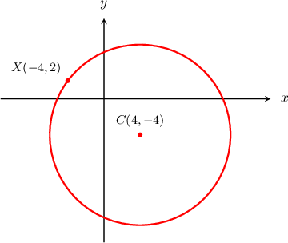
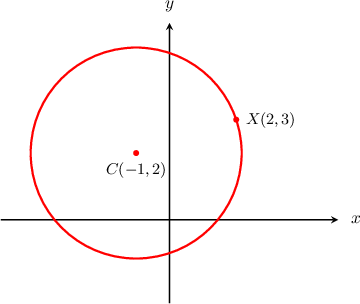
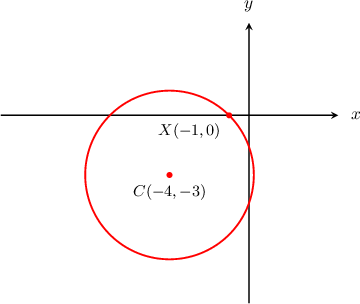
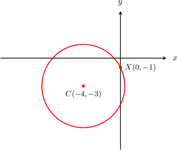
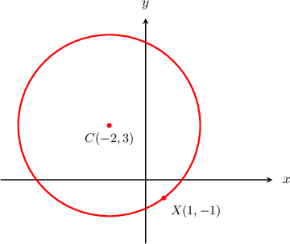
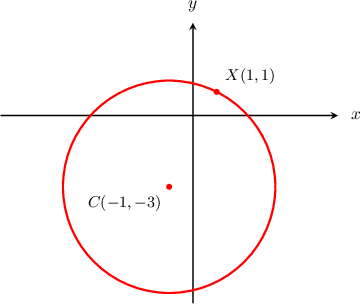
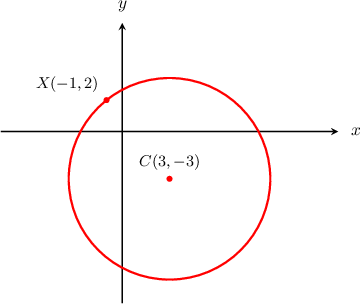

# Circle from a center and an on-circle point — review

Snapshot math basis 1356. Correct answers and metadata below are review-only.

## Original q-54215 — :question.difficulty/moderate

**Original source replay — moderate — integer_center_first — bank-q-54215**

The circle above is centered at $C(4,-4)$ and the point $X(-4,2)$ lies on the circumference. Find the equation of the circle.

- $(x-4)^{2}+(y+2)^{2}=100$
- $(x+4)^{2}+(y-2)^{2}=100$
- $(x+4)^{2}+(y-4)^{2}=10$
- *Correct:* $(x-4)^{2}+(y+4)^{2}=100$
- $(x-4)^{2}+(y+4)^{2}=10$

The general equation of a circle with radius $r$ centered at the point $(a,b)$ is

$$
(x-a)^{2}+(y-b)^{2}={r}^{2}.
$$

The length of the radius is 

$$
\begin{aligned}CX & =\sqrt{{(4-(-4))}^{2}+{(-4-2)}^{2}} \\  & =\sqrt{{8}^{2}+{6}^{2}} \\  & =\sqrt{100} \\  & =10.\end{aligned}
$$

So, our circle is generated by the following equation:

$$
\begin{aligned}(x-a)^{2}+(y-b)^{2} & ={r}^{2} \\ (x-4)^{2}+(y-(-4))^{2} & =(10)^{2} \\ (x-4)^{2}+(y+4)^{2} & =100\end{aligned}
$$

**Generated — moderate — integer_center_first — bank-q-54215**

The circle above is centered at $C(-4,-4)$ and the point $X(4,2)$ lies on the circumference. Find the equation of the circle.

- $(x+4)^{2}+(y+4)^{2}=10$
- $(x+4)^{2}+(y+2)^{2}=100$
- $(x-4)^{2}+(y-4)^{2}=10$
- $(x-4)^{2}+(y-2)^{2}=100$
- *Correct:* $(x+4)^{2}+(y+4)^{2}=100$

The general equation of a circle with radius $r$ centered at the point $(a,b)$ is

$$
(x-a)^{2}+(y-b)^{2}={r}^{2}.
$$

The length of the radius is 

$$
\begin{aligned}CX & =\sqrt{{(-4-4)}^{2}+{(-4-2)}^{2}} \\  & =\sqrt{{8}^{2}+{6}^{2}} \\  & =\sqrt{100} \\  & =10.\end{aligned}
$$

So, our circle is generated by the following equation:

$$
\begin{aligned}(x-a)^{2}+(y-b)^{2} & ={r}^{2} \\ (x-(-4))^{2}+(y-(-4))^{2} & =(10)^{2} \\ (x+4)^{2}+(y+4)^{2} & =100\end{aligned}
$$

**Generated — moderate — integer_center_first — bank-q-54215**

The circle above is centered at $C(1,3)$ and the point $X(4,7)$ lies on the circumference. Find the equation of the circle.

- *Correct:* $(x-1)^{2}+(y-3)^{2}=25$
- $(x+1)^{2}+(y-7)^{2}=25$
- $(x-1)^{2}+(y+7)^{2}=25$
- $(x-1)^{2}+(y-3)^{2}=5$
- $(x+1)^{2}+(y+3)^{2}=5$

The general equation of a circle with radius $r$ centered at the point $(a,b)$ is

$$
(x-a)^{2}+(y-b)^{2}={r}^{2}.
$$

The length of the radius is 

$$
\begin{aligned}CX & =\sqrt{{(1-4)}^{2}+{(3-7)}^{2}} \\  & =\sqrt{{3}^{2}+{4}^{2}} \\  & =\sqrt{25} \\  & =5.\end{aligned}
$$

So, our circle is generated by the following equation:

$$
\begin{aligned}(x-a)^{2}+(y-b)^{2} & ={r}^{2} \\ (x-1)^{2}+(y-3)^{2} & =(5)^{2} \\ (x-1)^{2}+(y-3)^{2} & =25\end{aligned}
$$

## Original q-72616 — ABSENT / unrated

**Original source replay — unrated source (authored moderate replay routing) — incomplete_radio — bank-q-72616**

The circle above is centered at $C(-1, 2)$ and the point $X(2, 3)$ lies on the circumference. Find the equation of the circle.

- $(x - 1)^{2} + (y + 2)^{2} = \sqrt{10}$
- $(x - 1)^{2} + (y + 2)^{2} = 10$
- $(x + 1)^{2} + (y - 2)^{2} = 10$
- $(x + 1)^{2} + (y + 2)^{2} = 10$
- $(x + 1)^{2} + (y - 2)^{2} = \sqrt{10}$

**Source solution absent; raw evidence only.**

**Original correct designation absent.** Independently inferred equation: $(x+1)^{2}+(y-2)^{2}=10$. This inference is not counted as source designation fidelity.

**Generated — unrated source (authored moderate replay routing) — incomplete_radio — bank-q-72616**

The circle above is centered at $C(-1, -4)$ and the point $X(-9, -2)$ lies on the circumference. Find the equation of the circle.

- $(x + 1)^{2} + (y - 4)^{2} = 68$
- $(x + 1)^{2} + (y + 4)^{2} = 68$
- $(x + 1)^{2} + (y + 4)^{2} = 2\sqrt{17}$
- $(x - 1)^{2} + (y - 4)^{2} = 2\sqrt{17}$
- $(x - 1)^{2} + (y - 4)^{2} = 68$

**Source solution absent; raw evidence only.**

**Generated — unrated source (authored moderate replay routing) — incomplete_radio — bank-q-72616**

The circle above is centered at $C(3, -3)$ and the point $X(1, 0)$ lies on the circumference. Find the equation of the circle.

- $(x - 3)^{2} + (y + 3)^{2} = 13$
- $(x - 3)^{2} + (y - 3)^{2} = 13$
- $(x + 3)^{2} + (y - 3)^{2} = 13$
- $(x + 3)^{2} + (y - 3)^{2} = \sqrt{13}$
- $(x - 3)^{2} + (y + 3)^{2} = \sqrt{13}$

**Source solution absent; raw evidence only.**

## Original q-117096 — :question.difficulty/moderate

**Original source replay — moderate — radical_simplified — bank-q-117096**

The circle above is centered at $C(-4,-3)$ and the point $X(-1,0)$ lies on the circumference. Find the equation of the circle.

- $(x-4)^{2}+(y-3)^{2}=18$
- $(x+4)^{2}+(y+3)^{2}=3\sqrt{2}$
- $(x+4)^{2}+(y-3)^{2}=18$
- $(x-4)^{2}+(y-3)^{2}=3\sqrt{2}$
- *Correct:* $(x+4)^{2}+(y+3)^{2}=18$

The general equation of a circle with radius $r$ centered at the point $(a,b)$ is

$$
(x-a)^{2}+(y-b)^{2}={r}^{2}.
$$

The length of the radius is 

$$
\begin{aligned}CX & =\sqrt{(-1-(-4))^{2}+(0-(-3))^{2}} \\  & =\sqrt{{3}^{2}+{3}^{2}} \\  & =3\sqrt{2}.\end{aligned}
$$

So, our circle is generated by the following equation:

$$
\begin{aligned}(x-a)^{2}+(y-b)^{2} & ={r}^{2} \\ (x-(-4))^{2}+(y-(-3))^{2} & ={(3\sqrt{2})}^{2} \\ (x+4)^{2}+(y+3)^{2} & =18\end{aligned}
$$

**Generated — moderate — radical_simplified — bank-q-117096**

The circle above is centered at $C(-1,-4)$ and the point $X(-9,-2)$ lies on the circumference. Find the equation of the circle.

- $(x-1)^{2}+(y-4)^{2}=2\sqrt{17}$
- $(x+1)^{2}+(y-4)^{2}=68$
- *Correct:* $(x+1)^{2}+(y+4)^{2}=68$
- $(x-1)^{2}+(y-4)^{2}=68$
- $(x+1)^{2}+(y+4)^{2}=2\sqrt{17}$

The general equation of a circle with radius $r$ centered at the point $(a,b)$ is

$$
(x-a)^{2}+(y-b)^{2}={r}^{2}.
$$

The length of the radius is 

$$
\begin{aligned}CX & =\sqrt{(-9-(-1))^{2}+(-2-(-4))^{2}} \\  & =\sqrt{{8}^{2}+{2}^{2}} \\  & =2\sqrt{17}.\end{aligned}
$$

So, our circle is generated by the following equation:

$$
\begin{aligned}(x-a)^{2}+(y-b)^{2} & ={r}^{2} \\ (x-(-1))^{2}+(y-(-4))^{2} & ={(2\sqrt{17})}^{2} \\ (x+1)^{2}+(y+4)^{2} & =68\end{aligned}
$$

**Generated — moderate — radical_simplified — bank-q-117096**

The circle above is centered at $C(3,1)$ and the point $X(0,4)$ lies on the circumference. Find the equation of the circle.

- $(x-3)^{2}+(y+1)^{2}=18$
- $(x-3)^{2}+(y-1)^{2}=3\sqrt{2}$
- *Correct:* $(x-3)^{2}+(y-1)^{2}=18$
- $(x+3)^{2}+(y+1)^{2}=18$
- $(x+3)^{2}+(y+1)^{2}=3\sqrt{2}$

The general equation of a circle with radius $r$ centered at the point $(a,b)$ is

$$
(x-a)^{2}+(y-b)^{2}={r}^{2}.
$$

The length of the radius is 

$$
\begin{aligned}CX & =\sqrt{(0-3)^{2}+(4-1)^{2}} \\  & =\sqrt{{3}^{2}+{3}^{2}} \\  & =3\sqrt{2}.\end{aligned}
$$

So, our circle is generated by the following equation:

$$
\begin{aligned}(x-a)^{2}+(y-b)^{2} & ={r}^{2} \\ (x-3)^{2}+(y-1)^{2} & ={(3\sqrt{2})}^{2} \\ (x-3)^{2}+(y-1)^{2} & =18\end{aligned}
$$

## Original q-117099 — :question.difficulty/moderate

**Original source replay — moderate — radical_simplified — bank-q-117099**

The circle above is centered at $C(-4,-3)$ and the point $X(0,-1)$ lies on the circumference. Find the equation of the circle.

- $(x-4)^{2}+(y-3)^{2}=20$
- $(x-4)^{2}+(y-3)^{2}=2\sqrt{5}$
- $(x+4)^{2}+(y+3)^{2}=2\sqrt{5}$
- $(x+4)^{2}+(y-3)^{2}=20$
- *Correct:* $(x+4)^{2}+(y+3)^{2}=20$

The general equation of a circle with radius $r$ centered at the point $(a,b)$ is

$$
(x-a)^{2}+(y-b)^{2}={r}^{2}.
$$

The length of the radius is 

$$
\begin{aligned}CX & =\sqrt{(0-(-4))^{2}+(-1-(-3))^{2}} \\  & =\sqrt{{4}^{2}+{2}^{2}} \\  & =2\sqrt{5}.\end{aligned}
$$

So, our circle is generated by the following equation:

$$
\begin{aligned}(x-a)^{2}+(y-b)^{2} & ={r}^{2} \\ (x-(-4))^{2}+(y-(-3))^{2} & ={(2\sqrt{5})}^{2} \\ (x+4)^{2}+(y+3)^{2} & =20\end{aligned}
$$

**Generated — moderate — radical_simplified — bank-q-117099**

The circle above is centered at $C(-1,-4)$ and the point $X(-9,-2)$ lies on the circumference. Find the equation of the circle.

- $(x+1)^{2}+(y-4)^{2}=68$
- $(x+1)^{2}+(y+4)^{2}=2\sqrt{17}$
- *Correct:* $(x+1)^{2}+(y+4)^{2}=68$
- $(x-1)^{2}+(y-4)^{2}=68$
- $(x-1)^{2}+(y-4)^{2}=2\sqrt{17}$

The general equation of a circle with radius $r$ centered at the point $(a,b)$ is

$$
(x-a)^{2}+(y-b)^{2}={r}^{2}.
$$

The length of the radius is 

$$
\begin{aligned}CX & =\sqrt{(-9-(-1))^{2}+(-2-(-4))^{2}} \\  & =\sqrt{{8}^{2}+{2}^{2}} \\  & =2\sqrt{17}.\end{aligned}
$$

So, our circle is generated by the following equation:

$$
\begin{aligned}(x-a)^{2}+(y-b)^{2} & ={r}^{2} \\ (x-(-1))^{2}+(y-(-4))^{2} & ={(2\sqrt{17})}^{2} \\ (x+1)^{2}+(y+4)^{2} & =68\end{aligned}
$$

**Generated — moderate — radical_simplified — bank-q-117099**

The circle above is centered at $C(3,1)$ and the point $X(0,4)$ lies on the circumference. Find the equation of the circle.

- $(x-3)^{2}+(y-1)^{2}=3\sqrt{2}$
- $(x+3)^{2}+(y+1)^{2}=3\sqrt{2}$
- *Correct:* $(x-3)^{2}+(y-1)^{2}=18$
- $(x+3)^{2}+(y+1)^{2}=18$
- $(x-3)^{2}+(y+1)^{2}=18$

The general equation of a circle with radius $r$ centered at the point $(a,b)$ is

$$
(x-a)^{2}+(y-b)^{2}={r}^{2}.
$$

The length of the radius is 

$$
\begin{aligned}CX & =\sqrt{(0-3)^{2}+(4-1)^{2}} \\  & =\sqrt{{3}^{2}+{3}^{2}} \\  & =3\sqrt{2}.\end{aligned}
$$

So, our circle is generated by the following equation:

$$
\begin{aligned}(x-a)^{2}+(y-b)^{2} & ={r}^{2} \\ (x-3)^{2}+(y-1)^{2} & ={(3\sqrt{2})}^{2} \\ (x-3)^{2}+(y-1)^{2} & =18\end{aligned}
$$

## Original q-72617 — :question.difficulty/moderate

**Original source replay — moderate — integer_signed — bank-q-72617**

The circle above is centered at $C(-2,3)$ and the point $X(1,-1)$ lies on the circumference. Find the equation of the circle.

- $(x-2)^{2}+(y-3)^{2}=\sqrt{5}$
- $(x+2)^{2}+(y-3)^{2}=5$
- $(x-2)^{2}+(y-3)^{2}=5$
- *Correct:* $(x+2)^{2}+(y-3)^{2}=25$
- $(x-2)^{2}+(y-3)^{2}=25$

The general equation of a circle with radius $r$ centered at the point $(a,b)$ is

$$
(x-a)^{2}+(y-b)^{2}={r}^{2}.
$$

The length of the radius is 

$$
\begin{aligned}CX & =\sqrt{{(1-(-2))}^{2}+{(-1-3)}^{2}} \\  & =\sqrt{{3}^{2}+(-4)^{2}} \\  & =\sqrt{25} \\  & =5.\end{aligned}
$$

So, our circle is generated by the following equation:

$$
\begin{aligned}(x-a)^{2}+(y-b)^{2} & ={r}^{2} \\ (x-(-2))^{2}+(y-3)^{2} & ={5}^{2} \\ (x+2)^{2}+(y-3)^{2} & =25\end{aligned}
$$

**Generated — moderate — integer_signed — bank-q-72617**

The circle above is centered at $C(-4,-4)$ and the point $X(4,2)$ lies on the circumference. Find the equation of the circle.

- $(x-4)^{2}+(y+4)^{2}=100$
- $(x-4)^{2}+(y+4)^{2}=\sqrt{10}$
- $(x-4)^{2}+(y+4)^{2}=10$
- $(x+4)^{2}+(y+4)^{2}=10$
- *Correct:* $(x+4)^{2}+(y+4)^{2}=100$

The general equation of a circle with radius $r$ centered at the point $(a,b)$ is

$$
(x-a)^{2}+(y-b)^{2}={r}^{2}.
$$

The length of the radius is 

$$
\begin{aligned}CX & =\sqrt{{(4-(-4))}^{2}+{(2-(-4))}^{2}} \\  & =\sqrt{{8}^{2}+{6}^{2}} \\  & =\sqrt{100} \\  & =10.\end{aligned}
$$

So, our circle is generated by the following equation:

$$
\begin{aligned}(x-a)^{2}+(y-b)^{2} & ={r}^{2} \\ (x-(-4))^{2}+(y-(-4))^{2} & ={10}^{2} \\ (x+4)^{2}+(y+4)^{2} & =100\end{aligned}
$$

**Generated — moderate — integer_signed — bank-q-72617**

The circle above is centered at $C(1,3)$ and the point $X(4,7)$ lies on the circumference. Find the equation of the circle.

- *Correct:* $(x-1)^{2}+(y-3)^{2}=25$
- $(x-1)^{2}+(y-3)^{2}=5$
- $(x+1)^{2}+(y-3)^{2}=\sqrt{5}$
- $(x+1)^{2}+(y-3)^{2}=25$
- $(x+1)^{2}+(y-3)^{2}=5$

The general equation of a circle with radius $r$ centered at the point $(a,b)$ is

$$
(x-a)^{2}+(y-b)^{2}={r}^{2}.
$$

The length of the radius is 

$$
\begin{aligned}CX & =\sqrt{{(4-1)}^{2}+{(7-3)}^{2}} \\  & =\sqrt{{3}^{2}+{4}^{2}} \\  & =\sqrt{25} \\  & =5.\end{aligned}
$$

So, our circle is generated by the following equation:

$$
\begin{aligned}(x-a)^{2}+(y-b)^{2} & ={r}^{2} \\ (x-1)^{2}+(y-3)^{2} & ={5}^{2} \\ (x-1)^{2}+(y-3)^{2} & =25\end{aligned}
$$

## Original q-72619 — :question.difficulty/moderate

**Original source replay — moderate — radical_unsimplified — bank-q-72619**

The circle above is centered at $C(-1,-3)$ and the point $X(1,1)$ lies on the circumference. Find the equation of the circle.

- *Correct:* $(x+1)^{2}+(y+3)^{2}=20$
- $(x+1)^{2}+(y+3)^{2}=2\sqrt{5}$
- $(x-1)^{2}+(y-3)^{2}=20$
- $(x+1)^{2}+(y-3)^{2}=20$
- $(x-1)^{2}+(y-3)^{2}=2\sqrt{5}$

The general equation of a circle with radius $r$ centered at the point $(a,b)$ is

$$
(x-a)^{2}+(y-b)^{2}={r}^{2}.
$$

The length of the radius is 

$$
\begin{aligned}CX & =\sqrt{{(1-(-1))}^{2}+{(1-(-3))}^{2}} \\  & =\sqrt{{2}^{2}+{4}^{2}} \\  & =\sqrt{20}.\end{aligned}
$$

So, our circle is generated by the following equation:

$$
\begin{aligned}(x-a)^{2}+(y-b)^{2} & ={r}^{2} \\ (x-(-1))^{2}+(y-(-3))^{2} & =(\sqrt{20})^{2} \\ (x+1)^{2}+(y+3)^{2} & =20\end{aligned}
$$

**Generated — moderate — radical_unsimplified — bank-q-72619**

The circle above is centered at $C(-1,-4)$ and the point $X(-9,-2)$ lies on the circumference. Find the equation of the circle.

- $(x+1)^{2}+(y-4)^{2}=68$
- $(x-1)^{2}+(y-4)^{2}=68$
- $(x-1)^{2}+(y-4)^{2}=2\sqrt{17}$
- *Correct:* $(x+1)^{2}+(y+4)^{2}=68$
- $(x+1)^{2}+(y+4)^{2}=2\sqrt{17}$

The general equation of a circle with radius $r$ centered at the point $(a,b)$ is

$$
(x-a)^{2}+(y-b)^{2}={r}^{2}.
$$

The length of the radius is 

$$
\begin{aligned}CX & =\sqrt{{(-9-(-1))}^{2}+{(-2-(-4))}^{2}} \\  & =\sqrt{(-8)^{2}+{2}^{2}} \\  & =\sqrt{68}.\end{aligned}
$$

So, our circle is generated by the following equation:

$$
\begin{aligned}(x-a)^{2}+(y-b)^{2} & ={r}^{2} \\ (x-(-1))^{2}+(y-(-4))^{2} & =(\sqrt{68})^{2} \\ (x+1)^{2}+(y+4)^{2} & =68\end{aligned}
$$

**Generated — moderate — radical_unsimplified — bank-q-72619**

The circle above is centered at $C(3,-3)$ and the point $X(1,0)$ lies on the circumference. Find the equation of the circle.

- $(x+3)^{2}+(y-3)^{2}=13$
- $(x-3)^{2}+(y-3)^{2}=13$
- $(x-3)^{2}+(y+3)^{2}=\sqrt{13}$
- *Correct:* $(x-3)^{2}+(y+3)^{2}=13$
- $(x+3)^{2}+(y-3)^{2}=\sqrt{13}$

The general equation of a circle with radius $r$ centered at the point $(a,b)$ is

$$
(x-a)^{2}+(y-b)^{2}={r}^{2}.
$$

The length of the radius is 

$$
\begin{aligned}CX & =\sqrt{{(1-3)}^{2}+{(0-(-3))}^{2}} \\  & =\sqrt{(-2)^{2}+{3}^{2}} \\  & =\sqrt{13}.\end{aligned}
$$

So, our circle is generated by the following equation:

$$
\begin{aligned}(x-a)^{2}+(y-b)^{2} & ={r}^{2} \\ (x-3)^{2}+(y-(-3))^{2} & =(\sqrt{13})^{2} \\ (x-3)^{2}+(y+3)^{2} & =13\end{aligned}
$$

## Original q-72621 — :question.difficulty/moderate

**Original source replay — moderate — radical_unsimplified — bank-q-72621**

The circle above is centered at $C(3,-3)$ and the point $X(-1,2)$ lies on the circumference. Find the equation of the circle.

- $(x+3)^{2}+(y+3)^{2}=\sqrt{41}$
- $(x-3)^{2}+(y+3)^{2}=\sqrt{41}$
- *Correct:* $(x-3)^{2}+(y+3)^{2}=41$
- $(x-3)^{2}+(y-3)^{2}=\sqrt{41}$
- $(x+3)^{2}+(y+3)^{2}=41$

The general equation of a circle with radius $r$ centered at the point $(a,b)$ is

$$
(x-a)^{2}+(y-b)^{2}={r}^{2}.
$$

The length of the radius is 

$$
\begin{aligned}CX & =\sqrt{{(-1-3)}^{2}+{(2-(-3))}^{2}} \\  & =\sqrt{(-4)^{2}+{5}^{2}} \\  & =\sqrt{41}.\end{aligned}
$$

So, our circle is generated by the following equation:

$$
\begin{aligned}(x-a)^{2}+(y-b)^{2} & ={r}^{2} \\ (x-3)^{2}+(y-(-3))^{2} & =(\sqrt{41})^{2} \\ (x-3)^{2}+(y+3)^{2} & =41\end{aligned}
$$

**Generated — moderate — radical_unsimplified — bank-q-72621**

The circle above is centered at $C(-1,-4)$ and the point $X(-9,-2)$ lies on the circumference. Find the equation of the circle.

- $(x+1)^{2}+(y-4)^{2}=2\sqrt{17}$
- *Correct:* $(x+1)^{2}+(y+4)^{2}=68$
- $(x-1)^{2}+(y+4)^{2}=68$
- $(x-1)^{2}+(y+4)^{2}=2\sqrt{17}$
- $(x+1)^{2}+(y+4)^{2}=2\sqrt{17}$

The general equation of a circle with radius $r$ centered at the point $(a,b)$ is

$$
(x-a)^{2}+(y-b)^{2}={r}^{2}.
$$

The length of the radius is 

$$
\begin{aligned}CX & =\sqrt{{(-9-(-1))}^{2}+{(-2-(-4))}^{2}} \\  & =\sqrt{(-8)^{2}+{2}^{2}} \\  & =\sqrt{68}.\end{aligned}
$$

So, our circle is generated by the following equation:

$$
\begin{aligned}(x-a)^{2}+(y-b)^{2} & ={r}^{2} \\ (x-(-1))^{2}+(y-(-4))^{2} & =(\sqrt{68})^{2} \\ (x+1)^{2}+(y+4)^{2} & =68\end{aligned}
$$

**Generated — moderate — radical_unsimplified — bank-q-72621**

The circle above is centered at $C(3,-3)$ and the point $X(1,0)$ lies on the circumference. Find the equation of the circle.

- *Correct:* $(x-3)^{2}+(y+3)^{2}=13$
- $(x-3)^{2}+(y-3)^{2}=\sqrt{13}$
- $(x-3)^{2}+(y+3)^{2}=\sqrt{13}$
- $(x+3)^{2}+(y+3)^{2}=\sqrt{13}$
- $(x+3)^{2}+(y+3)^{2}=13$

The general equation of a circle with radius $r$ centered at the point $(a,b)$ is

$$
(x-a)^{2}+(y-b)^{2}={r}^{2}.
$$

The length of the radius is 

$$
\begin{aligned}CX & =\sqrt{{(1-3)}^{2}+{(0-(-3))}^{2}} \\  & =\sqrt{(-2)^{2}+{3}^{2}} \\  & =\sqrt{13}.\end{aligned}
$$

So, our circle is generated by the following equation:

$$
\begin{aligned}(x-a)^{2}+(y-b)^{2} & ={r}^{2} \\ (x-3)^{2}+(y-(-3))^{2} & =(\sqrt{13})^{2} \\ (x-3)^{2}+(y+3)^{2} & =13\end{aligned}
$$

## Authored easy extension — no observed difficulty sources

**Generated — easy — authored_easy — authored-easy**

The circle above is centered at $C(-1,0)$ and the point $X(-4,4)$ lies on the circumference. Find the equation of the circle.

- *Correct:* $(x+1)^{2}+y^{2}=25$
- $(x-1)^{2}+y^{2}=25$
- $(x+4)^{2}+(y-4)^{2}=25$
- $(x+1)^{2}+y^{2}=9$
- $(x+1)^{2}+y^{2}=5$

The general equation of a circle with radius $r$ centered at the point $(a,b)$ is

$$
(x-a)^{2}+(y-b)^{2}={r}^{2}.
$$

The length of the radius is 

$$
\begin{aligned}CX & =\sqrt{{(-4-(-1))}^{2}+{(4-0)}^{2}} \\  & =\sqrt{(-3)^{2}+{4}^{2}} \\  & =\sqrt{25} \\  & =5.\end{aligned}
$$

So, our circle is generated by the following equation:

$$
\begin{aligned}(x-a)^{2}+(y-b)^{2} & ={r}^{2} \\ (x-(-1))^{2}+(y-0)^{2} & =(5)^{2} \\ (x+1)^{2}+y^{2} & =25\end{aligned}
$$

**Generated — easy — authored_easy — authored-easy**

The circle above is centered at $C(3,0)$ and the point $X(-1,3)$ lies on the circumference. Find the equation of the circle.

- $(x+3)^{2}+y^{2}=25$
- *Correct:* $(x-3)^{2}+y^{2}=25$
- $(x-3)^{2}+y^{2}=5$
- $(x-3)^{2}+y^{2}=16$
- $(x+1)^{2}+(y-3)^{2}=25$

The general equation of a circle with radius $r$ centered at the point $(a,b)$ is

$$
(x-a)^{2}+(y-b)^{2}={r}^{2}.
$$

The length of the radius is 

$$
\begin{aligned}CX & =\sqrt{{(-1-3)}^{2}+{(3-0)}^{2}} \\  & =\sqrt{(-4)^{2}+{3}^{2}} \\  & =\sqrt{25} \\  & =5.\end{aligned}
$$

So, our circle is generated by the following equation:

$$
\begin{aligned}(x-a)^{2}+(y-b)^{2} & ={r}^{2} \\ (x-3)^{2}+(y-0)^{2} & =(5)^{2} \\ (x-3)^{2}+y^{2} & =25\end{aligned}
$$

## Authored hard extension — no observed difficulty sources

**Generated — hard — authored_hard — authored-hard**

The circle above is centered at $C(- \frac{1}{2},- \frac{7}{2})$ and the point $X(-5,1)$ lies on the circumference. Find the equation of the circle.

- *Correct:* $(x+\frac{1}{2})^{2}+(y+\frac{7}{2})^{2}=\frac{81}{2}$
- $(x-\frac{1}{2})^{2}+(y-\frac{7}{2})^{2}=\frac{9\sqrt{2}}{2}$
- $(x+\frac{1}{2})^{2}+(y-\frac{7}{2})^{2}=\frac{81}{2}$
- $(x+\frac{1}{2})^{2}+(y+\frac{7}{2})^{2}=\frac{9\sqrt{2}}{2}$
- $(x-\frac{1}{2})^{2}+(y-\frac{7}{2})^{2}=\frac{81}{2}$

The general equation of a circle with radius $r$ centered at the point $(a,b)$ is

$$
(x-a)^{2}+(y-b)^{2}={r}^{2}.
$$

The length of the radius is 

$$
\begin{aligned}CX & =\sqrt{{(-5-(- \frac{1}{2}))}^{2}+{(1-(- \frac{7}{2}))}^{2}} \\  & =\sqrt{(- \frac{9}{2})^{2}+{\frac{9}{2}}^{2}} \\  & =\sqrt{\frac{81}{2}} \\  & =\frac{9\sqrt{2}}{2}.\end{aligned}
$$

So, our circle is generated by the following equation:

$$
\begin{aligned}(x-a)^{2}+(y-b)^{2} & ={r}^{2} \\ (x-(- \frac{1}{2}))^{2}+(y-(- \frac{7}{2}))^{2} & =(\frac{9\sqrt{2}}{2})^{2} \\ (x+\frac{1}{2})^{2}+(y+\frac{7}{2})^{2} & =\frac{81}{2}\end{aligned}
$$

**Generated — hard — authored_hard — authored-hard**

The circle above is centered at $C(\frac{5}{2},- \frac{5}{2})$ and the point $X(6,-4)$ lies on the circumference. Find the equation of the circle.

- $(x-\frac{5}{2})^{2}+(y+\frac{5}{2})^{2}=\frac{\sqrt{58}}{2}$
- *Correct:* $(x-\frac{5}{2})^{2}+(y+\frac{5}{2})^{2}=\frac{29}{2}$
- $(x-\frac{5}{2})^{2}+(y-\frac{5}{2})^{2}=\frac{29}{2}$
- $(x+\frac{5}{2})^{2}+(y-\frac{5}{2})^{2}=\frac{\sqrt{58}}{2}$
- $(x+\frac{5}{2})^{2}+(y-\frac{5}{2})^{2}=\frac{29}{2}$

The general equation of a circle with radius $r$ centered at the point $(a,b)$ is

$$
(x-a)^{2}+(y-b)^{2}={r}^{2}.
$$

The length of the radius is 

$$
\begin{aligned}CX & =\sqrt{{(6-\frac{5}{2})}^{2}+{(-4-(- \frac{5}{2}))}^{2}} \\  & =\sqrt{{\frac{7}{2}}^{2}+(- \frac{3}{2})^{2}} \\  & =\sqrt{\frac{29}{2}} \\  & =\frac{\sqrt{58}}{2}.\end{aligned}
$$

So, our circle is generated by the following equation:

$$
\begin{aligned}(x-a)^{2}+(y-b)^{2} & ={r}^{2} \\ (x-\frac{5}{2})^{2}+(y-(- \frac{5}{2}))^{2} & =(\frac{\sqrt{58}}{2})^{2} \\ (x-\frac{5}{2})^{2}+(y+\frac{5}{2})^{2} & =\frac{29}{2}\end{aligned}
$$

## Authored completion of incomplete source

Original absence is retained by public raw replay; the following supported radios add an independently inferred correct designation, authored moderate label and worked solution.

**Generated — moderate — incomplete_radio — bank-q-72616**

The circle above is centered at $C(-1, 2)$ and the point $X(2, 3)$ lies on the circumference. Find the equation of the circle.

- $(x - 1)^{2} + (y + 2)^{2} = \sqrt{10}$
- $(x - 1)^{2} + (y + 2)^{2} = 10$
- *Correct:* $(x + 1)^{2} + (y - 2)^{2} = 10$
- $(x + 1)^{2} + (y + 2)^{2} = 10$
- $(x + 1)^{2} + (y - 2)^{2} = \sqrt{10}$

The general equation of a circle with radius $r$ centered at the point $(a,b)$ is

$$
(x-a)^{2}+(y-b)^{2}={r}^{2}.
$$

The length of the radius is 

$$
\begin{aligned}CX & =\sqrt{{(2-(-1))}^{2}+{(3-2)}^{2}} \\  & =\sqrt{{3}^{2}+{1}^{2}} \\  & =\sqrt{10}.\end{aligned}
$$

So, our circle is generated by the following equation:

$$
\begin{aligned}(x-a)^{2}+(y-b)^{2} & ={r}^{2} \\ (x-(-1))^{2}+(y-2)^{2} & =(\sqrt{10})^{2} \\ (x+1)^{2}+(y-2)^{2} & =10\end{aligned}
$$

**Generated — moderate — incomplete_radio — bank-q-72616**

The circle above is centered at $C(-1, -4)$ and the point $X(-9, -2)$ lies on the circumference. Find the equation of the circle.

- $(x + 1)^{2} + (y - 4)^{2} = 68$
- *Correct:* $(x + 1)^{2} + (y + 4)^{2} = 68$
- $(x + 1)^{2} + (y + 4)^{2} = 2\sqrt{17}$
- $(x - 1)^{2} + (y - 4)^{2} = 2\sqrt{17}$
- $(x - 1)^{2} + (y - 4)^{2} = 68$

The general equation of a circle with radius $r$ centered at the point $(a,b)$ is

$$
(x-a)^{2}+(y-b)^{2}={r}^{2}.
$$

The length of the radius is 

$$
\begin{aligned}CX & =\sqrt{{(-9-(-1))}^{2}+{(-2-(-4))}^{2}} \\  & =\sqrt{(-8)^{2}+{2}^{2}} \\  & =\sqrt{68}.\end{aligned}
$$

So, our circle is generated by the following equation:

$$
\begin{aligned}(x-a)^{2}+(y-b)^{2} & ={r}^{2} \\ (x-(-1))^{2}+(y-(-4))^{2} & =(\sqrt{68})^{2} \\ (x+1)^{2}+(y+4)^{2} & =68\end{aligned}
$$

**Generated — moderate — incomplete_radio — bank-q-72616**

The circle above is centered at $C(3, -3)$ and the point $X(1, 0)$ lies on the circumference. Find the equation of the circle.

- *Correct:* $(x - 3)^{2} + (y + 3)^{2} = 13$
- $(x - 3)^{2} + (y - 3)^{2} = 13$
- $(x + 3)^{2} + (y - 3)^{2} = 13$
- $(x + 3)^{2} + (y - 3)^{2} = \sqrt{13}$
- $(x - 3)^{2} + (y + 3)^{2} = \sqrt{13}$

The general equation of a circle with radius $r$ centered at the point $(a,b)$ is

$$
(x-a)^{2}+(y-b)^{2}={r}^{2}.
$$

The length of the radius is 

$$
\begin{aligned}CX & =\sqrt{{(1-3)}^{2}+{(0-(-3))}^{2}} \\  & =\sqrt{(-2)^{2}+{3}^{2}} \\  & =\sqrt{13}.\end{aligned}
$$

So, our circle is generated by the following equation:

$$
\begin{aligned}(x-a)^{2}+(y-b)^{2} & ={r}^{2} \\ (x-3)^{2}+(y-(-3))^{2} & =(\sqrt{13})^{2} \\ (x-3)^{2}+(y+3)^{2} & =13\end{aligned}
$$

## Ordinary moderate defaults — all six rated source banks

Complete banks are chosen with the seeded RNG before parameters. q-72616 is excluded from ordinary defaults. Default coverage across seeds 0–35: bank-q-54215 = 5, bank-q-117096 = 8, bank-q-117099 = 4, bank-q-72617 = 5, bank-q-72619 = 9, bank-q-72621 = 5. All 36 banks and solution stages were checked, then natively graded. The following examples show one ordinary default from each selected profile.

**Generated — moderate — integer_signed — bank-q-72617**

The circle above is centered at $C(-4,-2)$ and the point $X(0,-5)$ lies on the circumference. Find the equation of the circle.

- $(x-4)^{2}+(y+2)^{2}=5$
- $(x-4)^{2}+(y+2)^{2}=\sqrt{5}$
- *Correct:* $(x+4)^{2}+(y+2)^{2}=25$
- $(x+4)^{2}+(y+2)^{2}=5$
- $(x-4)^{2}+(y+2)^{2}=25$

The general equation of a circle with radius $r$ centered at the point $(a,b)$ is

$$
(x-a)^{2}+(y-b)^{2}={r}^{2}.
$$

The length of the radius is 

$$
\begin{aligned}CX & =\sqrt{{(0-(-4))}^{2}+{(-5-(-2))}^{2}} \\  & =\sqrt{{4}^{2}+(-3)^{2}} \\  & =\sqrt{25} \\  & =5.\end{aligned}
$$

So, our circle is generated by the following equation:

$$
\begin{aligned}(x-a)^{2}+(y-b)^{2} & ={r}^{2} \\ (x-(-4))^{2}+(y-(-2))^{2} & ={5}^{2} \\ (x+4)^{2}+(y+2)^{2} & =25\end{aligned}
$$

**Generated — moderate — radical_simplified — bank-q-117096**

The circle above is centered at $C(-2,3)$ and the point $X(0,-5)$ lies on the circumference. Find the equation of the circle.

- *Correct:* $(x+2)^{2}+(y-3)^{2}=68$
- $(x+2)^{2}+(y+3)^{2}=68$
- $(x-2)^{2}+(y+3)^{2}=68$
- $(x-2)^{2}+(y+3)^{2}=2\sqrt{17}$
- $(x+2)^{2}+(y-3)^{2}=2\sqrt{17}$

The general equation of a circle with radius $r$ centered at the point $(a,b)$ is

$$
(x-a)^{2}+(y-b)^{2}={r}^{2}.
$$

The length of the radius is 

$$
\begin{aligned}CX & =\sqrt{(0-(-2))^{2}+(-5-3)^{2}} \\  & =\sqrt{{2}^{2}+{8}^{2}} \\  & =2\sqrt{17}.\end{aligned}
$$

So, our circle is generated by the following equation:

$$
\begin{aligned}(x-a)^{2}+(y-b)^{2} & ={r}^{2} \\ (x-(-2))^{2}+(y-3)^{2} & ={(2\sqrt{17})}^{2} \\ (x+2)^{2}+(y-3)^{2} & =68\end{aligned}
$$

**Generated — moderate — integer_center_first — bank-q-54215**

The circle above is centered at $C(-4,-4)$ and the point $X(0,-7)$ lies on the circumference. Find the equation of the circle.

- $(x-4)^{2}+(y-4)^{2}=5$
- *Correct:* $(x+4)^{2}+(y+4)^{2}=25$
- $(x-4)^{2}+(y+7)^{2}=25$
- $(x+4)^{2}+(y-7)^{2}=25$
- $(x+4)^{2}+(y+4)^{2}=5$

The general equation of a circle with radius $r$ centered at the point $(a,b)$ is

$$
(x-a)^{2}+(y-b)^{2}={r}^{2}.
$$

The length of the radius is 

$$
\begin{aligned}CX & =\sqrt{{(-4-0)}^{2}+{(-4-(-7))}^{2}} \\  & =\sqrt{{4}^{2}+{3}^{2}} \\  & =\sqrt{25} \\  & =5.\end{aligned}
$$

So, our circle is generated by the following equation:

$$
\begin{aligned}(x-a)^{2}+(y-b)^{2} & ={r}^{2} \\ (x-(-4))^{2}+(y-(-4))^{2} & =(5)^{2} \\ (x+4)^{2}+(y+4)^{2} & =25\end{aligned}
$$

**Generated — moderate — radical_unsimplified — bank-q-72619**

The circle above is centered at $C(-2,-5)$ and the point $X(-5,-10)$ lies on the circumference. Find the equation of the circle.

- *Correct:* $(x+2)^{2}+(y+5)^{2}=34$
- $(x-2)^{2}+(y-5)^{2}=34$
- $(x+2)^{2}+(y-5)^{2}=34$
- $(x+2)^{2}+(y+5)^{2}=\sqrt{34}$
- $(x-2)^{2}+(y-5)^{2}=\sqrt{34}$

The general equation of a circle with radius $r$ centered at the point $(a,b)$ is

$$
(x-a)^{2}+(y-b)^{2}={r}^{2}.
$$

The length of the radius is 

$$
\begin{aligned}CX & =\sqrt{{(-5-(-2))}^{2}+{(-10-(-5))}^{2}} \\  & =\sqrt{(-3)^{2}+(-5)^{2}} \\  & =\sqrt{34}.\end{aligned}
$$

So, our circle is generated by the following equation:

$$
\begin{aligned}(x-a)^{2}+(y-b)^{2} & ={r}^{2} \\ (x-(-2))^{2}+(y-(-5))^{2} & =(\sqrt{34})^{2} \\ (x+2)^{2}+(y+5)^{2} & =34\end{aligned}
$$

**Generated — moderate — radical_simplified — bank-q-117099**

The circle above is centered at $C(5,-4)$ and the point $X(4,-11)$ lies on the circumference. Find the equation of the circle.

- $(x-5)^{2}+(y+4)^{2}=5\sqrt{2}$
- *Correct:* $(x-5)^{2}+(y+4)^{2}=50$
- $(x-5)^{2}+(y-4)^{2}=50$
- $(x+5)^{2}+(y-4)^{2}=5\sqrt{2}$
- $(x+5)^{2}+(y-4)^{2}=50$

The general equation of a circle with radius $r$ centered at the point $(a,b)$ is

$$
(x-a)^{2}+(y-b)^{2}={r}^{2}.
$$

The length of the radius is 

$$
\begin{aligned}CX & =\sqrt{(4-5)^{2}+(-11-(-4))^{2}} \\  & =\sqrt{{1}^{2}+{7}^{2}} \\  & =5\sqrt{2}.\end{aligned}
$$

So, our circle is generated by the following equation:

$$
\begin{aligned}(x-a)^{2}+(y-b)^{2} & ={r}^{2} \\ (x-5)^{2}+(y-(-4))^{2} & ={(5\sqrt{2})}^{2} \\ (x-5)^{2}+(y+4)^{2} & =50\end{aligned}
$$

**Generated — moderate — radical_unsimplified — bank-q-72621**

The circle above is centered at $C(-5,4)$ and the point $X(-10,2)$ lies on the circumference. Find the equation of the circle.

- $(x+5)^{2}+(y+4)^{2}=\sqrt{29}$
- *Correct:* $(x+5)^{2}+(y-4)^{2}=29$
- $(x-5)^{2}+(y-4)^{2}=\sqrt{29}$
- $(x-5)^{2}+(y-4)^{2}=29$
- $(x+5)^{2}+(y-4)^{2}=\sqrt{29}$

The general equation of a circle with radius $r$ centered at the point $(a,b)$ is

$$
(x-a)^{2}+(y-b)^{2}={r}^{2}.
$$

The length of the radius is 

$$
\begin{aligned}CX & =\sqrt{{(-10-(-5))}^{2}+{(2-4)}^{2}} \\  & =\sqrt{(-5)^{2}+(-2)^{2}} \\  & =\sqrt{29}.\end{aligned}
$$

So, our circle is generated by the following equation:

$$
\begin{aligned}(x-a)^{2}+(y-b)^{2} & ={r}^{2} \\ (x-(-5))^{2}+(y-4)^{2} & =(\sqrt{29})^{2} \\ (x+5)^{2}+(y-4)^{2} & =29\end{aligned}
$$

