# Parametrizing Part of a Circle — author review

Original evidence and parameterized replay for every observed bank follow. q-79205 has a derived repair; its correct designation and solution are not counted as original matches.

## Original q-78681

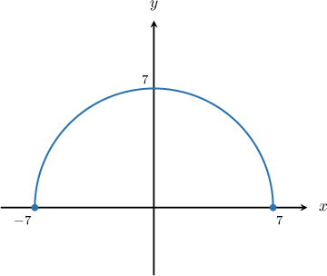

The semi-circle above is defined by the parametric equations 

$$
x=7\operatorname{cos}⁡\theta ,\,y=7\operatorname{sin}⁡\theta .
$$

What is the domain of the parameter $\theta ?$

Original field `selection`: $\theta \in [0,\frac{\pi }{2}]$, $\theta \in [0,\pi ]$, $\theta \in [0,2\pi )$, $\theta \in [-\pi ,\pi ]$, $\theta \in [-\frac{\pi }{2},\frac{\pi }{2}]$

The parametric equations of a circle  of radius $r$  centered at  the origin are

$$
x=r\operatorname{cos}⁡\theta ,\,y=r\operatorname{sin}⁡\theta ,\,\theta \in [0,2\pi ).
$$

In our case, the radius $r=7.$ So, the parametric equations of the *full* circle are 

$$
x=7\operatorname{cos}⁡\theta ,\,y=7\operatorname{sin}⁡\theta ,\,\theta \in [0,2\pi ).
$$

To restrict the parameterization to a semi-circle, we associate the parameter $\theta $ with the central angle formed by a point $(x,y)$ on the circle and the $x$-axis. 

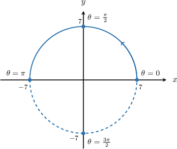

We can see that if we restrict $\theta $ to $[0,\pi ]$, we get the required semi-circle.

Therefore, the parametric equations of the semi-circle are 

$$
x=7\operatorname{cos}⁡\theta ,\,y=7\operatorname{sin}⁡\theta ,\,\theta \in [0,\pi ].
$$

### Parameterized source replay

The semi-circle above is defined by the parametric equations 

$$
x=7\operatorname{cos}⁡\theta ,\,y=7\operatorname{sin}⁡\theta .
$$

What is the domain of the parameter $\theta ?$

Field `selection`:
- $\theta \in [0,\frac{\pi }{2}]$
- $\theta \in [0,\pi ]$ **correct**
- $\theta \in [0,2\pi )$
- $\theta \in [-\pi ,\pi ]$
- $\theta \in [-\frac{\pi }{2},\frac{\pi }{2}]$

**Worked solution**

The parametric equations of a circle  of radius $r$  centered at  the origin are

$$
x=r\operatorname{cos}⁡\theta ,\,y=r\operatorname{sin}⁡\theta ,\,\theta \in [0,2\pi ).
$$

In our case, the radius $r=7.$ So, the parametric equations of the *full* circle are 

$$
x=7\operatorname{cos}⁡\theta ,\,y=7\operatorname{sin}⁡\theta ,\,\theta \in [0,2\pi ).
$$

To restrict the parameterization to a semi-circle, we associate the parameter $\theta $ with the central angle formed by a point $(x,y)$ on the circle and the $x$-axis. 

We can see that if we restrict $\theta $ to $[0,\pi ]$, we get the required semi-circle.

Therefore, the parametric equations of the semi-circle are 

$$
x=7\operatorname{cos}⁡\theta ,\,y=7\operatorname{sin}⁡\theta ,\,\theta \in [0,\pi ].
$$

### Generated variant of this complete observed bank

The semi-circle above is defined by the parametric equations 

$$
x=8\operatorname{cos}⁡\theta ,\,y=8\operatorname{sin}⁡\theta .
$$

What is the domain of the parameter $\theta ?$

Field `selection`:
- $\theta \in [0,\frac{\pi }{2}]$
- $\theta \in [0,\pi ]$ **correct**
- $\theta \in [0,2\pi )$
- $\theta \in [-\pi ,\pi ]$
- $\theta \in [-\frac{\pi }{2},\frac{\pi }{2}]$

**Worked solution**

The parametric equations of a circle  of radius $r$  centered at  the origin are

$$
x=r\operatorname{cos}⁡\theta ,\,y=r\operatorname{sin}⁡\theta ,\,\theta \in [0,2\pi ).
$$

In our case, the radius $r=8.$ So, the parametric equations of the *full* circle are 

$$
x=8\operatorname{cos}⁡\theta ,\,y=8\operatorname{sin}⁡\theta ,\,\theta \in [0,2\pi ).
$$

To restrict the parameterization to a semi-circle, we associate the parameter $\theta $ with the central angle formed by a point $(x,y)$ on the circle and the $x$-axis. 

We can see that if we restrict $\theta $ to $[0,\pi ]$, we get the required semi-circle.

Therefore, the parametric equations of the semi-circle are 

$$
x=8\operatorname{cos}⁡\theta ,\,y=8\operatorname{sin}⁡\theta ,\,\theta \in [0,\pi ].
$$

## Original q-79205

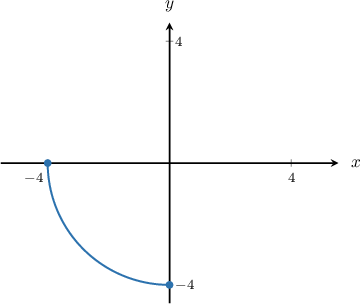

The quarter-circle above is defined by the parametric equations

$x = 4\cos θ, y = 4\sin θ$.

What is the domain of the parameter $θ$?

Original field `selection`: $θ ∈ [\frac{3π}{2}, 2π]$, $θ ∈ [0, \frac{π}{2}]$, $θ ∈ [π, \frac{3π}{2}]$, $θ ∈ [0, \frac{3π}{2}]$, $θ ∈ [\frac{π}{2}, \frac{3π}{2}]$

*No source solution/correct reference; see repair evidence.*

### Parameterized source replay

The quarter-circle above is defined by the parametric equations

$x = 4\cos θ, y = 4\sin θ$.

What is the domain of the parameter $θ$?

Field `selection`:
- $θ ∈ [\frac{3π}{2},2π]$
- $θ ∈ [0,\frac{π}{2}]$
- $θ ∈ [π,\frac{3π}{2}]$ **correct**
- $θ ∈ [0,\frac{3π}{2}]$
- $θ ∈ [\frac{π}{2},\frac{3π}{2}]$

**Worked solution**

The parametric equations of a circle  of radius $r$  centered at  the origin are

$$
x=r\operatorname{cos}⁡\theta ,\,y=r\operatorname{sin}⁡\theta ,\,\theta \in [0,2\pi ).
$$

In our case, the radius $r=4.$ So, the parametric equations of the *full* circle are 

$$
x = 4\cos θ, y = 4\sin θ,\,\theta \in [0,2\pi ).
$$

To restrict the parameterization to a quarter-circle, we associate the parameter $\theta $ with the central angle formed by a point $(x,y)$ on the circle and the $x$-axis. 

We can see that if we restrict $\theta $ to $[\pi ,\frac{3\pi }{2}]$, we get the required quarter-circle.

Therefore, the parametric equations of the quarter-circle are 

$$
x = 4\cos θ, y = 4\sin θ,\,\theta \in [\pi ,\frac{3\pi }{2}].
$$

### Generated variant of this complete observed bank

The quarter-circle above is defined by the parametric equations

$x = 8\cos θ, y = 8\sin θ$.

What is the domain of the parameter $θ$?

Field `selection`:
- $θ ∈ [\frac{3π}{2},2π]$
- $θ ∈ [0,\frac{π}{2}]$
- $θ ∈ [π,\frac{3π}{2}]$ **correct**
- $θ ∈ [0,\frac{3π}{2}]$
- $θ ∈ [\frac{π}{2},\frac{3π}{2}]$

**Worked solution**

The parametric equations of a circle  of radius $r$  centered at  the origin are

$$
x=r\operatorname{cos}⁡\theta ,\,y=r\operatorname{sin}⁡\theta ,\,\theta \in [0,2\pi ).
$$

In our case, the radius $r=8.$ So, the parametric equations of the *full* circle are 

$$
x = 8\cos θ, y = 8\sin θ,\,\theta \in [0,2\pi ).
$$

To restrict the parameterization to a quarter-circle, we associate the parameter $\theta $ with the central angle formed by a point $(x,y)$ on the circle and the $x$-axis. 

We can see that if we restrict $\theta $ to $[\pi ,\frac{3\pi }{2}]$, we get the required quarter-circle.

Therefore, the parametric equations of the quarter-circle are 

$$
x = 8\cos θ, y = 8\sin θ,\,\theta \in [\pi ,\frac{3\pi }{2}].
$$

## Original q-106294

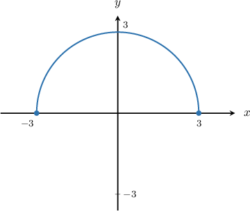

The semi-circle above is defined by the parametric equations 

$$
x=3\operatorname{cos}⁡\theta ,\,y=3\operatorname{sin}⁡\theta .
$$

What is the domain of the parameter $\theta ?$

Original field `selection`: $\theta \in [0,2\pi )$, $\theta \in [0,\frac{\pi }{2}]$, $\theta \in [0,\pi ]$, $\theta \in [\frac{\pi }{2},\frac{3\pi }{2}]$, $\theta \in [0,\frac{3\pi }{2}]$

The parametric equations of a circle  of radius $r$  centered at  the origin are

$$
x=r\operatorname{cos}⁡\theta ,\,y=r\operatorname{sin}⁡\theta ,\,\theta \in [0,2\pi ).
$$

In our case, the radius $r=3.$ So, the parametric equations of the *full* circle are 

$$
x=3\operatorname{cos}⁡\theta ,\,y=3\operatorname{sin}⁡\theta ,\,\theta \in [0,2\pi ).
$$

To restrict the parameterization to a semi-circle, we associate the parameter $\theta $ with the central angle formed by a point $(x,y)$ on the circle and the $x$-axis. 

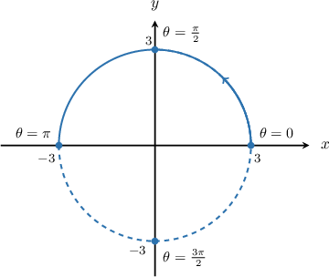

We can see that if we restrict $\theta $ to $[0,\pi ]$, we get the required semi-circle.

Therefore, the parametric equations of the semi-circle are 

$$
x=3\operatorname{cos}⁡\theta ,\,y=3\operatorname{sin}⁡\theta ,\,\theta \in [0,\pi ].
$$

### Parameterized source replay

The semi-circle above is defined by the parametric equations 

$$
x=3\operatorname{cos}⁡\theta ,\,y=3\operatorname{sin}⁡\theta .
$$

What is the domain of the parameter $\theta ?$

Field `selection`:
- $\theta \in [0,2\pi )$
- $\theta \in [0,\frac{\pi }{2}]$
- $\theta \in [0,\pi ]$ **correct**
- $\theta \in [\frac{\pi }{2},\frac{3\pi }{2}]$
- $\theta \in [0,\frac{3\pi }{2}]$

**Worked solution**

The parametric equations of a circle  of radius $r$  centered at  the origin are

$$
x=r\operatorname{cos}⁡\theta ,\,y=r\operatorname{sin}⁡\theta ,\,\theta \in [0,2\pi ).
$$

In our case, the radius $r=3.$ So, the parametric equations of the *full* circle are 

$$
x=3\operatorname{cos}⁡\theta ,\,y=3\operatorname{sin}⁡\theta ,\,\theta \in [0,2\pi ).
$$

To restrict the parameterization to a semi-circle, we associate the parameter $\theta $ with the central angle formed by a point $(x,y)$ on the circle and the $x$-axis. 

We can see that if we restrict $\theta $ to $[0,\pi ]$, we get the required semi-circle.

Therefore, the parametric equations of the semi-circle are 

$$
x=3\operatorname{cos}⁡\theta ,\,y=3\operatorname{sin}⁡\theta ,\,\theta \in [0,\pi ].
$$

### Generated variant of this complete observed bank

The semi-circle above is defined by the parametric equations 

$$
x=8\operatorname{cos}⁡\theta ,\,y=8\operatorname{sin}⁡\theta .
$$

What is the domain of the parameter $\theta ?$

Field `selection`:
- $\theta \in [0,2\pi )$
- $\theta \in [0,\frac{\pi }{2}]$
- $\theta \in [0,\pi ]$ **correct**
- $\theta \in [\frac{\pi }{2},\frac{3\pi }{2}]$
- $\theta \in [0,\frac{3\pi }{2}]$

**Worked solution**

The parametric equations of a circle  of radius $r$  centered at  the origin are

$$
x=r\operatorname{cos}⁡\theta ,\,y=r\operatorname{sin}⁡\theta ,\,\theta \in [0,2\pi ).
$$

In our case, the radius $r=8.$ So, the parametric equations of the *full* circle are 

$$
x=8\operatorname{cos}⁡\theta ,\,y=8\operatorname{sin}⁡\theta ,\,\theta \in [0,2\pi ).
$$

To restrict the parameterization to a semi-circle, we associate the parameter $\theta $ with the central angle formed by a point $(x,y)$ on the circle and the $x$-axis. 

We can see that if we restrict $\theta $ to $[0,\pi ]$, we get the required semi-circle.

Therefore, the parametric equations of the semi-circle are 

$$
x=8\operatorname{cos}⁡\theta ,\,y=8\operatorname{sin}⁡\theta ,\,\theta \in [0,\pi ].
$$

## Original q-275161

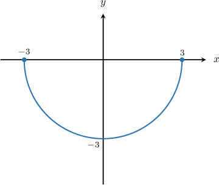

The arc of the circle above is defined by the parametric equations 

$$
x=3\operatorname{cos}⁡\theta ,\,y=3\operatorname{sin}⁡\theta .
$$

What is the domain of the parameter $\theta ?$ Assume $\theta $ is between $0$ and $2\pi .$

$\theta \in [${{field-1}}$,$
{{field-2}}$]$

Original field `field-2`: $2\pi $
Original field `field-1`: $\pi $

The parametric equations of a circle  of radius $r$  centered at  the origin are

$$
x=r\operatorname{cos}⁡\theta ,\,y=r\operatorname{sin}⁡\theta ,\,\theta \in (0,2\pi ].
$$

In our case, the radius $r=3.$ So, the parametric equations of the *full* circle are 

$$
x=3\operatorname{cos}⁡\theta ,\,y=3\operatorname{sin}⁡\theta ,\,\theta \in (0,2\pi ].
$$

To restrict the parameterization to the arc above, we associate the parameter $\theta $ with the central angle formed by a point $(x,y)$ on the circle and the $x$-axis. 

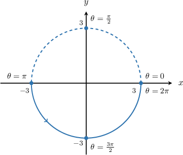

We can see that if we restrict $\theta $ to $[\pi ,2\pi ]$, we get the required arc of the circle.

Therefore, the parametric equations of the arc of the circle are 

$$
x=3\operatorname{cos}⁡\theta ,\,y=3\operatorname{sin}⁡\theta ,\,\theta \in [\pi ,2\pi ].
$$

### Parameterized source replay

The arc of the circle above is defined by the parametric equations 

$$
x=3\operatorname{cos}⁡\theta ,\,y=3\operatorname{sin}⁡\theta .
$$

What is the domain of the parameter $\theta ?$ Assume $\theta $ is between $0$ and $2\pi .$

$\theta \in [${{field-1}}$,$
{{field-2}}$]$

Field `field-2`:
- $2\pi $ **correct**
Field `field-1`:
- $\pi $ **correct**

**Worked solution**

The parametric equations of a circle  of radius $r$  centered at  the origin are

$$
x=r\operatorname{cos}⁡\theta ,\,y=r\operatorname{sin}⁡\theta ,\,\theta \in (0,2\pi ].
$$

In our case, the radius $r=3.$ So, the parametric equations of the *full* circle are 

$$
x=3\operatorname{cos}⁡\theta ,\,y=3\operatorname{sin}⁡\theta ,\,\theta \in (0,2\pi ].
$$

To restrict the parameterization to the arc above, we associate the parameter $\theta $ with the central angle formed by a point $(x,y)$ on the circle and the $x$-axis. 

We can see that if we restrict $\theta $ to $[\pi ,2\pi ]$, we get the required arc of the circle.

Therefore, the parametric equations of the arc of the circle are 

$$
x=3\operatorname{cos}⁡\theta ,\,y=3\operatorname{sin}⁡\theta ,\,\theta \in [\pi ,2\pi ].
$$

## Original q-321947

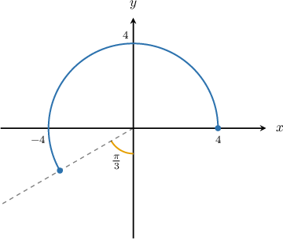

The arc of a circle above is defined by the parametric equations 

$$
x=4\operatorname{cos}⁡\theta ,\,y=4\operatorname{sin}⁡\theta .
$$

What is the domain of the parameter $\theta ?$ Assume $\theta $ is between $0$ and $2\pi .$

$\theta \in [${{field-1}}$,$
{{field-2}}$]$

Original field `field-2`: $\frac{7\pi }{6}$
Original field `field-1`: $0$

The parametric equations of a circle  of radius $r$  centered at  the origin are

$$
x=r\operatorname{cos}⁡\theta ,\,y=r\operatorname{sin}⁡\theta ,\,\theta \in [0,2\pi ).
$$

In our case, the radius $r=4.$ So, the parametric equations of the *full* circle are 

$$
x=4\operatorname{cos}⁡\theta ,\,y=4\operatorname{sin}⁡\theta ,\,\theta \in [0,2\pi ).
$$

To restrict the parameterization to the arc above, we associate the parameter $\theta $ with the central angle formed by a point $(x,y)$ on the circle and the $x$-axis.

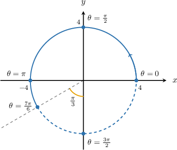

We can see that if we restrict $\theta $ to $[0,\frac{7\pi }{6}]$, we get the required arc of the circle.

Therefore, the parametric equations of the arc of the circle are 

$$
x=4\operatorname{cos}⁡\theta ,\,y=4\operatorname{sin}⁡\theta ,\,\theta \in [0,\frac{7\pi }{6}].
$$

### Parameterized source replay

The arc of a circle above is defined by the parametric equations 

$$
x=4\operatorname{cos}⁡\theta ,\,y=4\operatorname{sin}⁡\theta .
$$

What is the domain of the parameter $\theta ?$ Assume $\theta $ is between $0$ and $2\pi .$

$\theta \in [${{field-1}}$,$
{{field-2}}$]$

Field `field-2`:
- $\frac{7\pi }{6}$ **correct**
Field `field-1`:
- $0$ **correct**

**Worked solution**

The parametric equations of a circle  of radius $r$  centered at  the origin are

$$
x=r\operatorname{cos}⁡\theta ,\,y=r\operatorname{sin}⁡\theta ,\,\theta \in [0,2\pi ).
$$

In our case, the radius $r=4.$ So, the parametric equations of the *full* circle are 

$$
x=4\operatorname{cos}⁡\theta ,\,y=4\operatorname{sin}⁡\theta ,\,\theta \in [0,2\pi ).
$$

To restrict the parameterization to the arc above, we associate the parameter $\theta $ with the central angle formed by a point $(x,y)$ on the circle and the $x$-axis.

We can see that if we restrict $\theta $ to $[0,\frac{7\pi }{6}]$, we get the required arc of the circle.

Therefore, the parametric equations of the arc of the circle are 

$$
x=4\operatorname{cos}⁡\theta ,\,y=4\operatorname{sin}⁡\theta ,\,\theta \in [0,\frac{7\pi }{6}].
$$

## Original q-321948

The quarter-circle above is defined by the parametric equations 

$$
x=4\operatorname{cos}⁡\theta ,\,y=4\operatorname{sin}⁡\theta .
$$

What is the domain of the parameter $\theta ?$ Assume $\theta $ is between $0$ and $2\pi .$

$\theta \in [${{field-1}}$,$
{{field-2}}$]$

Original field `field-2`: $\frac{\pi }{2}$
Original field `field-1`: $0$

The parametric equations of a circle  of radius $r$  centered at  the origin are

$$
x=r\operatorname{cos}⁡\theta ,\,y=r\operatorname{sin}⁡\theta ,\,\theta \in [0,2\pi ).
$$

In our case, the radius $r=4.$ So, the parametric equations of the *full* circle are 

$$
x=4\operatorname{cos}⁡\theta ,\,y=4\operatorname{sin}⁡\theta ,\,\theta \in [0,2\pi ).
$$

To restrict the parameterization to the arc above, we associate the parameter $\theta $ with the central angle formed by a point $(x,y)$ on the circle and the $x$-axis.

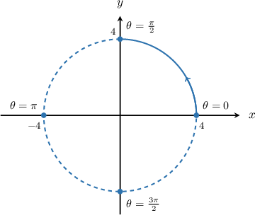

We can see that if we restrict $\theta $ to $[0,\frac{\pi }{2}]$, we get the required arc of the circle.

Therefore, the parametric equations of the arc of the circle are 

$$
x=4\operatorname{cos}⁡\theta ,\,y=4\operatorname{sin}⁡\theta ,\,\theta \in [0,\frac{\pi }{2}].
$$

### Parameterized source replay

The quarter-circle above is defined by the parametric equations 

$$
x=4\operatorname{cos}⁡\theta ,\,y=4\operatorname{sin}⁡\theta .
$$

What is the domain of the parameter $\theta ?$ Assume $\theta $ is between $0$ and $2\pi .$

$\theta \in [${{field-1}}$,$
{{field-2}}$]$

Field `field-2`:
- $\frac{\pi }{2}$ **correct**
Field `field-1`:
- $0$ **correct**

**Worked solution**

The parametric equations of a circle  of radius $r$  centered at  the origin are

$$
x=r\operatorname{cos}⁡\theta ,\,y=r\operatorname{sin}⁡\theta ,\,\theta \in [0,2\pi ).
$$

In our case, the radius $r=4.$ So, the parametric equations of the *full* circle are 

$$
x=4\operatorname{cos}⁡\theta ,\,y=4\operatorname{sin}⁡\theta ,\,\theta \in [0,2\pi ).
$$

To restrict the parameterization to the arc above, we associate the parameter $\theta $ with the central angle formed by a point $(x,y)$ on the circle and the $x$-axis.

We can see that if we restrict $\theta $ to $[0,\frac{\pi }{2}]$, we get the required arc of the circle.

Therefore, the parametric equations of the arc of the circle are 

$$
x=4\operatorname{cos}⁡\theta ,\,y=4\operatorname{sin}⁡\theta ,\,\theta \in [0,\frac{\pi }{2}].
$$

## Original q-321976

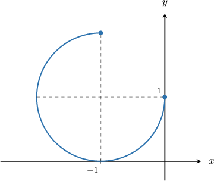

The three-quarter-circle above is defined by the parametric equations 

$$
x=\operatorname{cos}⁡\theta -1,\,y=\operatorname{sin}⁡\theta +1.
$$

What is the domain of the parameter $\theta ?$ Assume $\theta $ is between $0$ and $2\pi .$

$\theta \in [${{field-1}}$,$
{{field-2}}$]$

Original field `field-2`: $2\pi $
Original field `field-1`: $\frac{\pi }{2}$

The parametric equations of a circle of radius $r$ centered at the point $(a,b)$ are

$$
x=r\operatorname{cos}⁡\theta +a,\,y=r\operatorname{sin}⁡\theta +b,\,\theta \in (0,2\pi ].
$$

In our case, we have a circle of radius $1$ centered at the point $(-1,1).$ So, the parametric equations of the *full* circle are 

$$
x=\operatorname{cos}⁡\theta -1,\,y=\operatorname{sin}⁡\theta +1,\,\theta \in (0,2\pi ].
$$

To restrict the parameterization to a three-quarter-circle, we associate the parameter $\theta $ with the central angle formed by a point $(x,y)$ on the circle and the line parallel to the $x$-axis and crossing the center of the circle. 

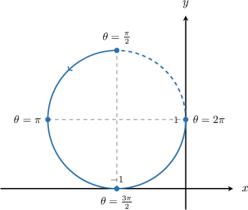

We can see that if we restrict $\theta $ to $[\frac{\pi }{2},2\pi ]$, we get the required three-quarter-circle.

Therefore, the parametric equations of the three-quarter circle are 

$$
x=\operatorname{cos}⁡\theta -1,\,y=\operatorname{sin}⁡\theta +1,\,\theta \in [\frac{\pi }{2},2\pi ].
$$

### Parameterized source replay

The three-quarter-circle above is defined by the parametric equations 

$$
x=\operatorname{cos}⁡\theta -1,\,y=\operatorname{sin}⁡\theta +1.
$$

What is the domain of the parameter $\theta ?$ Assume $\theta $ is between $0$ and $2\pi .$

$\theta \in [${{field-1}}$,$
{{field-2}}$]$

Field `field-2`:
- $2\pi $ **correct**
Field `field-1`:
- $\frac{\pi }{2}$ **correct**

**Worked solution**

The parametric equations of a circle of radius $r$ centered at the point $(a,b)$ are

$$
x=r\operatorname{cos}⁡\theta +a,\,y=r\operatorname{sin}⁡\theta +b,\,\theta \in (0,2\pi ].
$$

In our case, we have a circle of radius $1$ centered at the point $(-1,1).$ So, the parametric equations of the *full* circle are 

$$
x=\operatorname{cos}⁡\theta -1,\,y=\operatorname{sin}⁡\theta +1,\,\theta \in (0,2\pi ].
$$

To restrict the parameterization to a three-quarter-circle, we associate the parameter $\theta $ with the central angle formed by a point $(x,y)$ on the circle and the line parallel to the $x$-axis and crossing the center of the circle. 

We can see that if we restrict $\theta $ to $[\frac{\pi }{2},2\pi ]$, we get the required three-quarter-circle.

Therefore, the parametric equations of the three-quarter circle are 

$$
x=\operatorname{cos}⁡\theta -1,\,y=\operatorname{sin}⁡\theta +1,\,\theta \in [\frac{\pi }{2},2\pi ].
$$

## Original q-79165

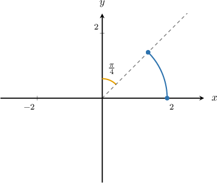

The arc of a circle above is defined by the parametric equations 

$$
x=2\operatorname{cos}⁡\theta ,\,y=2\operatorname{sin}⁡\theta .
$$

What is the domain of the parameter $\theta ?$

Original field `selection`: $\theta \in [\frac{\pi }{2},\frac{3\pi }{4}]$, $\theta \in [0,\frac{\pi }{2}]$, $\theta \in [0,\frac{5\pi }{4}]$, $\theta \in [0,\frac{\pi }{4}]$, $\theta \in [\frac{\pi }{4},\frac{\pi }{2}]$

The parametric equations of a circle  of radius $r$  centered at  the origin are

$$
x=r\operatorname{cos}⁡\theta ,\,y=r\operatorname{sin}⁡\theta ,\,\theta \in [0,2\pi ).
$$

In our case, the radius $r=2.$ So, the parametric equations of the *full* circle are 

$$
x=2\operatorname{cos}⁡\theta ,\,y=2\operatorname{sin}⁡\theta ,\,\theta \in [0,2\pi ).
$$

To restrict the parameterization to the arc above, we associate the parameter $\theta $ with the central angle formed by a point $(x,y)$ on the circle and the $x$-axis. 

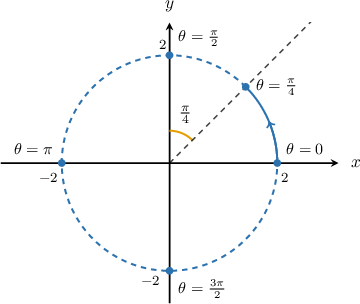

We can see that if we restrict $\theta $ to $[0,\frac{\pi }{4}]$, we get the required arc of the circle.

Therefore, the parametric equations of the arc of the circle are 

$$
x=2\operatorname{cos}⁡\theta ,\,y=2\operatorname{sin}⁡\theta ,\,\theta \in [0,\frac{\pi }{4}].
$$

### Parameterized source replay

The arc of a circle above is defined by the parametric equations 

$$
x=2\operatorname{cos}⁡\theta ,\,y=2\operatorname{sin}⁡\theta .
$$

What is the domain of the parameter $\theta ?$

Field `selection`:
- $\theta \in [\frac{\pi }{2},\frac{3\pi }{4}]$
- $\theta \in [0,\frac{\pi }{2}]$
- $\theta \in [0,\frac{5\pi }{4}]$
- $\theta \in [0,\frac{\pi }{4}]$ **correct**
- $\theta \in [\frac{\pi }{4},\frac{\pi }{2}]$

**Worked solution**

The parametric equations of a circle  of radius $r$  centered at  the origin are

$$
x=r\operatorname{cos}⁡\theta ,\,y=r\operatorname{sin}⁡\theta ,\,\theta \in [0,2\pi ).
$$

In our case, the radius $r=2.$ So, the parametric equations of the *full* circle are 

$$
x=2\operatorname{cos}⁡\theta ,\,y=2\operatorname{sin}⁡\theta ,\,\theta \in [0,2\pi ).
$$

To restrict the parameterization to the arc above, we associate the parameter $\theta $ with the central angle formed by a point $(x,y)$ on the circle and the $x$-axis. 

We can see that if we restrict $\theta $ to $[0,\frac{\pi }{4}]$, we get the required arc of the circle.

Therefore, the parametric equations of the arc of the circle are 

$$
x=2\operatorname{cos}⁡\theta ,\,y=2\operatorname{sin}⁡\theta ,\,\theta \in [0,\frac{\pi }{4}].
$$

### Generated variant of this complete observed bank

The arc of a circle above is defined by the parametric equations 

$$
x=8\operatorname{cos}⁡\theta ,\,y=8\operatorname{sin}⁡\theta .
$$

What is the domain of the parameter $\theta ?$

Field `selection`:
- $\theta \in [\frac{\pi }{2},\frac{3\pi }{4}]$
- $\theta \in [0,\frac{\pi }{2}]$
- $\theta \in [0,\frac{5\pi }{4}]$
- $\theta \in [0,\frac{\pi }{4}]$ **correct**
- $\theta \in [\frac{\pi }{4},\frac{\pi }{2}]$

**Worked solution**

The parametric equations of a circle  of radius $r$  centered at  the origin are

$$
x=r\operatorname{cos}⁡\theta ,\,y=r\operatorname{sin}⁡\theta ,\,\theta \in [0,2\pi ).
$$

In our case, the radius $r=8.$ So, the parametric equations of the *full* circle are 

$$
x=8\operatorname{cos}⁡\theta ,\,y=8\operatorname{sin}⁡\theta ,\,\theta \in [0,2\pi ).
$$

To restrict the parameterization to the arc above, we associate the parameter $\theta $ with the central angle formed by a point $(x,y)$ on the circle and the $x$-axis. 

We can see that if we restrict $\theta $ to $[0,\frac{\pi }{4}]$, we get the required arc of the circle.

Therefore, the parametric equations of the arc of the circle are 

$$
x=8\operatorname{cos}⁡\theta ,\,y=8\operatorname{sin}⁡\theta ,\,\theta \in [0,\frac{\pi }{4}].
$$

## Original q-79166

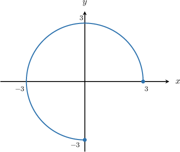

The three-quarter-circle above is defined by the parametric equations 

$$
x=3\operatorname{cos}⁡\theta ,\,y=3\operatorname{sin}⁡\theta .
$$

What is the domain of the parameter $\theta ?$

Original field `selection`: $\theta \in [0,\frac{3\pi }{2}]$, $\theta \in [0,\frac{\pi }{2}]$, $\theta \in [0,\pi ]$, $\theta \in [0,\frac{\pi }{4}]$, $\theta \in [0,\frac{3\pi }{4}]$

The parametric equations of a circle  of radius $r$  centered at  the origin are

$$
x=r\operatorname{cos}⁡\theta ,\,y=r\operatorname{sin}⁡\theta ,\,\theta \in [0,2\pi ).
$$

In our case, the radius $r=3.$ So, the parametric equations of the *full* circle are 

$$
x=3\operatorname{cos}⁡\theta ,\,y=3\operatorname{sin}⁡\theta ,\,\theta \in [0,2\pi ).
$$

To restrict the parameterization to a three-quarter-circle, we associate the parameter $\theta $ with the central angle formed by a point $(x,y)$ on the circle and the $x$-axis. 

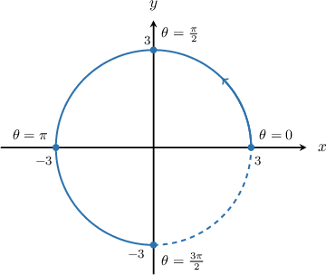

We can see that if we restrict $\theta $ to $[0,\frac{3\pi }{2}]$, we get the required three-quarter-circle.

Therefore, the parametric equations of the three-quarter-circle are 

$$
x=3\operatorname{cos}⁡\theta ,\,y=3\operatorname{sin}⁡\theta ,\,\theta \in [0,\frac{3\pi }{2}].
$$

### Parameterized source replay

The three-quarter-circle above is defined by the parametric equations 

$$
x=3\operatorname{cos}⁡\theta ,\,y=3\operatorname{sin}⁡\theta .
$$

What is the domain of the parameter $\theta ?$

Field `selection`:
- $\theta \in [0,\frac{3\pi }{2}]$ **correct**
- $\theta \in [0,\frac{\pi }{2}]$
- $\theta \in [0,\pi ]$
- $\theta \in [0,\frac{\pi }{4}]$
- $\theta \in [0,\frac{3\pi }{4}]$

**Worked solution**

The parametric equations of a circle  of radius $r$  centered at  the origin are

$$
x=r\operatorname{cos}⁡\theta ,\,y=r\operatorname{sin}⁡\theta ,\,\theta \in [0,2\pi ).
$$

In our case, the radius $r=3.$ So, the parametric equations of the *full* circle are 

$$
x=3\operatorname{cos}⁡\theta ,\,y=3\operatorname{sin}⁡\theta ,\,\theta \in [0,2\pi ).
$$

To restrict the parameterization to a three-quarter-circle, we associate the parameter $\theta $ with the central angle formed by a point $(x,y)$ on the circle and the $x$-axis. 

We can see that if we restrict $\theta $ to $[0,\frac{3\pi }{2}]$, we get the required three-quarter-circle.

Therefore, the parametric equations of the three-quarter-circle are 

$$
x=3\operatorname{cos}⁡\theta ,\,y=3\operatorname{sin}⁡\theta ,\,\theta \in [0,\frac{3\pi }{2}].
$$

### Generated variant of this complete observed bank

The three-quarter-circle above is defined by the parametric equations 

$$
x=8\operatorname{cos}⁡\theta ,\,y=8\operatorname{sin}⁡\theta .
$$

What is the domain of the parameter $\theta ?$

Field `selection`:
- $\theta \in [0,\frac{3\pi }{2}]$ **correct**
- $\theta \in [0,\frac{\pi }{2}]$
- $\theta \in [0,\pi ]$
- $\theta \in [0,\frac{\pi }{4}]$
- $\theta \in [0,\frac{3\pi }{4}]$

**Worked solution**

The parametric equations of a circle  of radius $r$  centered at  the origin are

$$
x=r\operatorname{cos}⁡\theta ,\,y=r\operatorname{sin}⁡\theta ,\,\theta \in [0,2\pi ).
$$

In our case, the radius $r=8.$ So, the parametric equations of the *full* circle are 

$$
x=8\operatorname{cos}⁡\theta ,\,y=8\operatorname{sin}⁡\theta ,\,\theta \in [0,2\pi ).
$$

To restrict the parameterization to a three-quarter-circle, we associate the parameter $\theta $ with the central angle formed by a point $(x,y)$ on the circle and the $x$-axis. 

We can see that if we restrict $\theta $ to $[0,\frac{3\pi }{2}]$, we get the required three-quarter-circle.

Therefore, the parametric equations of the three-quarter-circle are 

$$
x=8\operatorname{cos}⁡\theta ,\,y=8\operatorname{sin}⁡\theta ,\,\theta \in [0,\frac{3\pi }{2}].
$$

## Original q-79168

The arc of a circle above is defined by the parametric equations 

$$
x=2\operatorname{cos}⁡\theta ,\,y=2\operatorname{sin}⁡\theta .
$$

What is the domain of the parameter $\theta ?$

Original field `selection`: $\theta \in [0,\frac{5\pi }{4}]$, $\theta \in [0,\frac{3\pi }{4}]$, $\theta \in [0,\frac{\pi }{4}]$, $\theta \in [0,\frac{5\pi }{2}]$, $\theta \in [0,\frac{3\pi }{2}]$

The parametric equations of a circle  of radius $r$  centered at  the origin are

$$
x=r\operatorname{cos}⁡\theta ,\,y=r\operatorname{sin}⁡\theta ,\,\theta \in [0,2\pi ).
$$

In our case, the radius $r=2.$ So, the parametric equations of the *full* circle are 

$$
x=2\operatorname{cos}⁡\theta ,\,y=2\operatorname{sin}⁡\theta ,\,\theta \in [0,2\pi ).
$$

To restrict the parameterization to the arc above, we associate the parameter $\theta $ with the central angle formed by a point $(x,y)$ on the circle and the $x$-axis. 

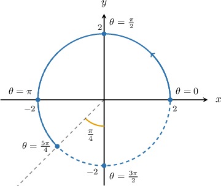

We can see that if we restrict $\theta $ to $[0,\frac{5\pi }{4}]$, we get the required arc of the circle.

Therefore, the parametric equations of the arc of the circle are 

$$
x=2\operatorname{cos}⁡\theta ,\,y=2\operatorname{sin}⁡\theta ,\,\theta \in [0,\frac{5\pi }{4}].
$$

### Parameterized source replay

The arc of a circle above is defined by the parametric equations 

$$
x=2\operatorname{cos}⁡\theta ,\,y=2\operatorname{sin}⁡\theta .
$$

What is the domain of the parameter $\theta ?$

Field `selection`:
- $\theta \in [0,\frac{5\pi }{4}]$ **correct**
- $\theta \in [0,\frac{3\pi }{4}]$
- $\theta \in [0,\frac{\pi }{4}]$
- $\theta \in [0,\frac{5\pi }{2}]$
- $\theta \in [0,\frac{3\pi }{2}]$

**Worked solution**

The parametric equations of a circle  of radius $r$  centered at  the origin are

$$
x=r\operatorname{cos}⁡\theta ,\,y=r\operatorname{sin}⁡\theta ,\,\theta \in [0,2\pi ).
$$

In our case, the radius $r=2.$ So, the parametric equations of the *full* circle are 

$$
x=2\operatorname{cos}⁡\theta ,\,y=2\operatorname{sin}⁡\theta ,\,\theta \in [0,2\pi ).
$$

To restrict the parameterization to the arc above, we associate the parameter $\theta $ with the central angle formed by a point $(x,y)$ on the circle and the $x$-axis. 

We can see that if we restrict $\theta $ to $[0,\frac{5\pi }{4}]$, we get the required arc of the circle.

Therefore, the parametric equations of the arc of the circle are 

$$
x=2\operatorname{cos}⁡\theta ,\,y=2\operatorname{sin}⁡\theta ,\,\theta \in [0,\frac{5\pi }{4}].
$$

### Generated variant of this complete observed bank

The arc of a circle above is defined by the parametric equations 

$$
x=8\operatorname{cos}⁡\theta ,\,y=8\operatorname{sin}⁡\theta .
$$

What is the domain of the parameter $\theta ?$

Field `selection`:
- $\theta \in [0,\frac{5\pi }{4}]$ **correct**
- $\theta \in [0,\frac{3\pi }{4}]$
- $\theta \in [0,\frac{\pi }{4}]$
- $\theta \in [0,\frac{5\pi }{2}]$
- $\theta \in [0,\frac{3\pi }{2}]$

**Worked solution**

The parametric equations of a circle  of radius $r$  centered at  the origin are

$$
x=r\operatorname{cos}⁡\theta ,\,y=r\operatorname{sin}⁡\theta ,\,\theta \in [0,2\pi ).
$$

In our case, the radius $r=8.$ So, the parametric equations of the *full* circle are 

$$
x=8\operatorname{cos}⁡\theta ,\,y=8\operatorname{sin}⁡\theta ,\,\theta \in [0,2\pi ).
$$

To restrict the parameterization to the arc above, we associate the parameter $\theta $ with the central angle formed by a point $(x,y)$ on the circle and the $x$-axis. 

We can see that if we restrict $\theta $ to $[0,\frac{5\pi }{4}]$, we get the required arc of the circle.

Therefore, the parametric equations of the arc of the circle are 

$$
x=8\operatorname{cos}⁡\theta ,\,y=8\operatorname{sin}⁡\theta ,\,\theta \in [0,\frac{5\pi }{4}].
$$

## Original q-79210

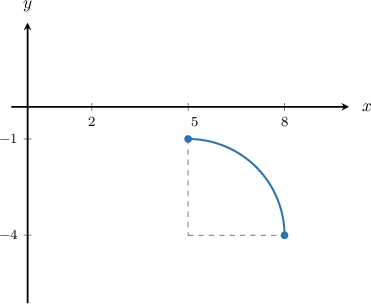

The quarter-circle above is defined by the parametric equations 

$$
x=3\operatorname{cos}⁡\theta +5,\,y=3\operatorname{sin}⁡\theta -4.
$$

What is the domain of the parameter $\theta ?$

Original field `selection`: $[\frac{\pi }{2},\frac{3\pi }{2}]$, $[0,\frac{\pi }{2}]$, $[0,\frac{3\pi }{2}]$, $[\pi ,\frac{3\pi }{2}]$, $[0,\pi ]$

The parametric equations of a circle of radius $r$ centered at the point $(a,b)$ are

$$
x=r\operatorname{cos}⁡\theta +a,\,y=r\operatorname{sin}⁡\theta +b,\,\theta \in [0,2\pi ).
$$

In our case, we have a circle of radius $3$ centered at the point $(5,-4).$ So, the parametric equations of the *full* circle are 

$$
x=3\operatorname{cos}⁡\theta +5,\,y=3\operatorname{sin}⁡\theta -4,\,\theta \in [0,2\pi ).
$$

To restrict the parameterization to a quarter-circle, we associate the parameter $\theta $ with the central angle formed by a point $(x,y)$ on the circle and the line parallel to the $x$-axis and crossing the center of the circle. 

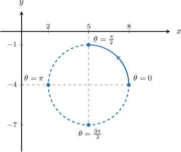

We can see that if we restrict $\theta $ to $[0,\frac{\pi }{2}]$, we get the required quarter-circle.

Therefore, the parametric equations of the quarter-circle are 

$$
x=3\operatorname{cos}⁡\theta +5,\,y=3\operatorname{sin}⁡\theta -4,\,\theta \in [0,\frac{\pi }{2}].
$$

### Parameterized source replay

The quarter-circle above is defined by the parametric equations 

$$
x=3\operatorname{cos}⁡\theta +5,\,y=3\operatorname{sin}⁡\theta -4.
$$

What is the domain of the parameter $\theta ?$

Field `selection`:
- $[\frac{\pi }{2},\frac{3\pi }{2}]$
- $[0,\frac{\pi }{2}]$ **correct**
- $[0,\frac{3\pi }{2}]$
- $[\pi ,\frac{3\pi }{2}]$
- $[0,\pi ]$

**Worked solution**

The parametric equations of a circle of radius $r$ centered at the point $(a,b)$ are

$$
x=r\operatorname{cos}⁡\theta +a,\,y=r\operatorname{sin}⁡\theta +b,\,\theta \in [0,2\pi ).
$$

In our case, we have a circle of radius $3$ centered at the point $(5,-4).$ So, the parametric equations of the *full* circle are 

$$
x=3\operatorname{cos}⁡\theta +5,\,y=3\operatorname{sin}⁡\theta -4,\,\theta \in [0,2\pi ).
$$

To restrict the parameterization to a quarter-circle, we associate the parameter $\theta $ with the central angle formed by a point $(x,y)$ on the circle and the line parallel to the $x$-axis and crossing the center of the circle. 

We can see that if we restrict $\theta $ to $[0,\frac{\pi }{2}]$, we get the required quarter-circle.

Therefore, the parametric equations of the quarter-circle are 

$$
x=3\operatorname{cos}⁡\theta +5,\,y=3\operatorname{sin}⁡\theta -4,\,\theta \in [0,\frac{\pi }{2}].
$$

### Generated variant of this complete observed bank

The quarter-circle above is defined by the parametric equations 

$$
x=8\operatorname{cos}⁡\theta +5,\,y=8\operatorname{sin}⁡\theta -4.
$$

What is the domain of the parameter $\theta ?$

Field `selection`:
- $[\frac{\pi }{2},\frac{3\pi }{2}]$
- $[0,\frac{\pi }{2}]$ **correct**
- $[0,\frac{3\pi }{2}]$
- $[\pi ,\frac{3\pi }{2}]$
- $[0,\pi ]$

**Worked solution**

The parametric equations of a circle of radius $r$ centered at the point $(a,b)$ are

$$
x=r\operatorname{cos}⁡\theta +a,\,y=r\operatorname{sin}⁡\theta +b,\,\theta \in [0,2\pi ).
$$

In our case, we have a circle of radius $8$ centered at the point $(5,-4).$ So, the parametric equations of the *full* circle are 

$$
x=8\operatorname{cos}⁡\theta +5,\,y=8\operatorname{sin}⁡\theta -4,\,\theta \in [0,2\pi ).
$$

To restrict the parameterization to a quarter-circle, we associate the parameter $\theta $ with the central angle formed by a point $(x,y)$ on the circle and the line parallel to the $x$-axis and crossing the center of the circle. 

We can see that if we restrict $\theta $ to $[0,\frac{\pi }{2}]$, we get the required quarter-circle.

Therefore, the parametric equations of the quarter-circle are 

$$
x=8\operatorname{cos}⁡\theta +5,\,y=8\operatorname{sin}⁡\theta -4,\,\theta \in [0,\frac{\pi }{2}].
$$

## Original q-79270

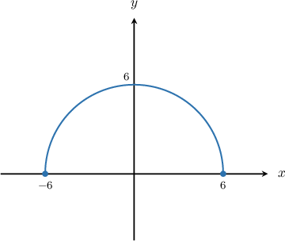

The semi-circle above is defined by the parametric equations 

$$
x=6\operatorname{cos}⁡\theta ,\,y=6\operatorname{sin}⁡\theta .
$$

What is the domain of the parameter $\theta ?$

Original field `selection`: $\theta \in [0,\frac{\pi }{2}]$, $\theta \in [\frac{\pi }{2},\frac{3\pi }{2}]$, $\theta \in [0,\frac{3\pi }{2}]$, $\theta \in [\pi ,2\pi ]$, $\theta \in [0,\pi ]$

The parametric equations of a circle  of radius $r$  centered at  the origin are

$$
x=r\operatorname{cos}⁡\theta ,\,y=r\operatorname{sin}⁡\theta ,\,\theta \in [0,2\pi ).
$$

In our case, the radius $r=6.$ So, the parametric equations of the *full* circle are 

$$
x=6\operatorname{cos}⁡\theta ,\,y=6\operatorname{sin}⁡\theta ,\,\theta \in [0,2\pi ).
$$

To restrict the parameterization to a semi-circle, we associate the parameter $\theta $ with the central angle formed by a point $(x,y)$ on the circle and the $x$-axis. 

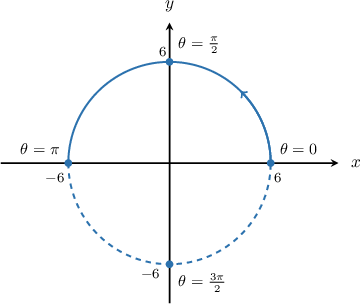

We can see that if we restrict $\theta $ to $[0,\pi ]$, we get the required semi-circle.

Therefore, the parametric equations of the semi-circle are 

$$
x=6\operatorname{cos}⁡\theta ,\,y=6\operatorname{sin}⁡\theta ,\,\theta \in [0,\pi ].
$$

### Parameterized source replay

The semi-circle above is defined by the parametric equations 

$$
x=6\operatorname{cos}⁡\theta ,\,y=6\operatorname{sin}⁡\theta .
$$

What is the domain of the parameter $\theta ?$

Field `selection`:
- $\theta \in [0,\frac{\pi }{2}]$
- $\theta \in [\frac{\pi }{2},\frac{3\pi }{2}]$
- $\theta \in [0,\frac{3\pi }{2}]$
- $\theta \in [\pi ,2\pi ]$
- $\theta \in [0,\pi ]$ **correct**

**Worked solution**

The parametric equations of a circle  of radius $r$  centered at  the origin are

$$
x=r\operatorname{cos}⁡\theta ,\,y=r\operatorname{sin}⁡\theta ,\,\theta \in [0,2\pi ).
$$

In our case, the radius $r=6.$ So, the parametric equations of the *full* circle are 

$$
x=6\operatorname{cos}⁡\theta ,\,y=6\operatorname{sin}⁡\theta ,\,\theta \in [0,2\pi ).
$$

To restrict the parameterization to a semi-circle, we associate the parameter $\theta $ with the central angle formed by a point $(x,y)$ on the circle and the $x$-axis. 

We can see that if we restrict $\theta $ to $[0,\pi ]$, we get the required semi-circle.

Therefore, the parametric equations of the semi-circle are 

$$
x=6\operatorname{cos}⁡\theta ,\,y=6\operatorname{sin}⁡\theta ,\,\theta \in [0,\pi ].
$$

### Generated variant of this complete observed bank

The semi-circle above is defined by the parametric equations 

$$
x=8\operatorname{cos}⁡\theta ,\,y=8\operatorname{sin}⁡\theta .
$$

What is the domain of the parameter $\theta ?$

Field `selection`:
- $\theta \in [0,\frac{\pi }{2}]$
- $\theta \in [\frac{\pi }{2},\frac{3\pi }{2}]$
- $\theta \in [0,\frac{3\pi }{2}]$
- $\theta \in [\pi ,2\pi ]$
- $\theta \in [0,\pi ]$ **correct**

**Worked solution**

The parametric equations of a circle  of radius $r$  centered at  the origin are

$$
x=r\operatorname{cos}⁡\theta ,\,y=r\operatorname{sin}⁡\theta ,\,\theta \in [0,2\pi ).
$$

In our case, the radius $r=8.$ So, the parametric equations of the *full* circle are 

$$
x=8\operatorname{cos}⁡\theta ,\,y=8\operatorname{sin}⁡\theta ,\,\theta \in [0,2\pi ).
$$

To restrict the parameterization to a semi-circle, we associate the parameter $\theta $ with the central angle formed by a point $(x,y)$ on the circle and the $x$-axis. 

We can see that if we restrict $\theta $ to $[0,\pi ]$, we get the required semi-circle.

Therefore, the parametric equations of the semi-circle are 

$$
x=8\operatorname{cos}⁡\theta ,\,y=8\operatorname{sin}⁡\theta ,\,\theta \in [0,\pi ].
$$

## Original q-79271

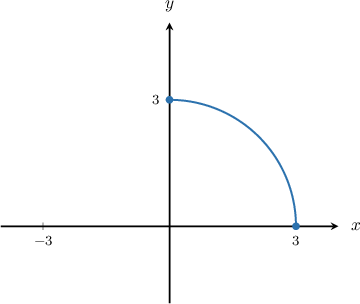

The quarter-circle above is defined by the parametric equations 

$$
x=3\operatorname{cos}⁡\theta ,\,y=3\operatorname{sin}⁡\theta .
$$

What is the domain of the parameter $\theta ?$

Original field `selection`: $\theta \in [0,\frac{3\pi }{2}]$, $\theta \in [\frac{\pi }{2},\frac{3\pi }{2}]$, $\theta \in [\frac{\pi }{2},\pi ]$, $\theta \in [0,\pi ]$, $\theta \in [0,\frac{\pi }{2}]$

The parametric equations of a circle  of radius $r$  centered at  the origin are

$$
x=r\operatorname{cos}⁡\theta ,\,y=r\operatorname{sin}⁡\theta ,\,\theta \in [0,2\pi ).
$$

In our case, the radius $r=3.$ So, the parametric equations of the *full* circle are 

$$
x=3\operatorname{cos}⁡\theta ,\,y=3\operatorname{sin}⁡\theta ,\,\theta \in [0,2\pi ).
$$

To restrict the parameterization to a quarter-circle, we associate the parameter $\theta $ with the central angle formed by a point $(x,y)$ on the circle and the $x$-axis. 

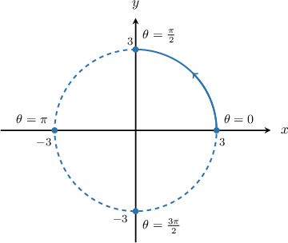

We can see that if we restrict $\theta $ to $[0,\frac{\pi }{2}]$, we get the required quarter-circle.

Therefore, the parametric equations of the quarter-circle are 

$$
x=3\operatorname{cos}⁡\theta ,\,y=3\operatorname{sin}⁡\theta ,\,\theta \in [0,\frac{\pi }{2}].
$$

### Parameterized source replay

The quarter-circle above is defined by the parametric equations 

$$
x=3\operatorname{cos}⁡\theta ,\,y=3\operatorname{sin}⁡\theta .
$$

What is the domain of the parameter $\theta ?$

Field `selection`:
- $\theta \in [0,\frac{3\pi }{2}]$
- $\theta \in [\frac{\pi }{2},\frac{3\pi }{2}]$
- $\theta \in [\frac{\pi }{2},\pi ]$
- $\theta \in [0,\pi ]$
- $\theta \in [0,\frac{\pi }{2}]$ **correct**

**Worked solution**

The parametric equations of a circle  of radius $r$  centered at  the origin are

$$
x=r\operatorname{cos}⁡\theta ,\,y=r\operatorname{sin}⁡\theta ,\,\theta \in [0,2\pi ).
$$

In our case, the radius $r=3.$ So, the parametric equations of the *full* circle are 

$$
x=3\operatorname{cos}⁡\theta ,\,y=3\operatorname{sin}⁡\theta ,\,\theta \in [0,2\pi ).
$$

To restrict the parameterization to a quarter-circle, we associate the parameter $\theta $ with the central angle formed by a point $(x,y)$ on the circle and the $x$-axis. 

We can see that if we restrict $\theta $ to $[0,\frac{\pi }{2}]$, we get the required quarter-circle.

Therefore, the parametric equations of the quarter-circle are 

$$
x=3\operatorname{cos}⁡\theta ,\,y=3\operatorname{sin}⁡\theta ,\,\theta \in [0,\frac{\pi }{2}].
$$

### Generated variant of this complete observed bank

The quarter-circle above is defined by the parametric equations 

$$
x=8\operatorname{cos}⁡\theta ,\,y=8\operatorname{sin}⁡\theta .
$$

What is the domain of the parameter $\theta ?$

Field `selection`:
- $\theta \in [0,\frac{3\pi }{2}]$
- $\theta \in [\frac{\pi }{2},\frac{3\pi }{2}]$
- $\theta \in [\frac{\pi }{2},\pi ]$
- $\theta \in [0,\pi ]$
- $\theta \in [0,\frac{\pi }{2}]$ **correct**

**Worked solution**

The parametric equations of a circle  of radius $r$  centered at  the origin are

$$
x=r\operatorname{cos}⁡\theta ,\,y=r\operatorname{sin}⁡\theta ,\,\theta \in [0,2\pi ).
$$

In our case, the radius $r=8.$ So, the parametric equations of the *full* circle are 

$$
x=8\operatorname{cos}⁡\theta ,\,y=8\operatorname{sin}⁡\theta ,\,\theta \in [0,2\pi ).
$$

To restrict the parameterization to a quarter-circle, we associate the parameter $\theta $ with the central angle formed by a point $(x,y)$ on the circle and the $x$-axis. 

We can see that if we restrict $\theta $ to $[0,\frac{\pi }{2}]$, we get the required quarter-circle.

Therefore, the parametric equations of the quarter-circle are 

$$
x=8\operatorname{cos}⁡\theta ,\,y=8\operatorname{sin}⁡\theta ,\,\theta \in [0,\frac{\pi }{2}].
$$

## Original q-79272

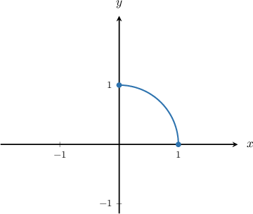

The quarter-circle above is defined by the parametric equations 

$$
x=\operatorname{cos}⁡\theta ,\,y=\operatorname{sin}⁡\theta .
$$

What is the domain of the parameter $\theta ?$

Original field `selection`: $\theta \in [\frac{\pi }{2},\pi ]$, $\theta \in [0,\frac{3\pi }{2}]$, $\theta \in [\pi ,\frac{3\pi }{2}]$, $\theta \in [0,\pi ]$, $\theta \in [0,\frac{\pi }{2}]$

The parametric equations of a circle  of radius $r$  centered at  the origin are

$$
x=r\operatorname{cos}⁡\theta ,\,y=r\operatorname{sin}⁡\theta ,\,\theta \in [0,2\pi ).
$$

In our case, the radius $r=1.$ So, the parametric equations of the *full* circle are 

$$
x=\operatorname{cos}⁡\theta ,\,y=\operatorname{sin}⁡\theta ,\,\theta \in [0,2\pi ).
$$

To restrict the parameterization to a quarter-circle, we associate the parameter $\theta $ with the central angle formed by a point $(x,y)$ on the circle and the $x$-axis. 

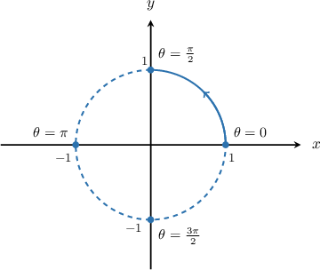

We can see that if we restrict $\theta $ to $[0,\frac{\pi }{2}]$, we get the required quarter-circle.

Therefore, the parametric equations of the quarter-circle are 

$$
x=\operatorname{cos}⁡\theta ,\,y=\operatorname{sin}⁡\theta ,\,\theta \in [0,\frac{\pi }{2}].
$$

### Parameterized source replay

The quarter-circle above is defined by the parametric equations 

$$
x=\operatorname{cos}⁡\theta ,\,y=\operatorname{sin}⁡\theta .
$$

What is the domain of the parameter $\theta ?$

Field `selection`:
- $\theta \in [\frac{\pi }{2},\pi ]$
- $\theta \in [0,\frac{3\pi }{2}]$
- $\theta \in [\pi ,\frac{3\pi }{2}]$
- $\theta \in [0,\pi ]$
- $\theta \in [0,\frac{\pi }{2}]$ **correct**

**Worked solution**

The parametric equations of a circle  of radius $r$  centered at  the origin are

$$
x=r\operatorname{cos}⁡\theta ,\,y=r\operatorname{sin}⁡\theta ,\,\theta \in [0,2\pi ).
$$

In our case, the radius $r=1.$ So, the parametric equations of the *full* circle are 

$$
x=\operatorname{cos}⁡\theta ,\,y=\operatorname{sin}⁡\theta ,\,\theta \in [0,2\pi ).
$$

To restrict the parameterization to a quarter-circle, we associate the parameter $\theta $ with the central angle formed by a point $(x,y)$ on the circle and the $x$-axis. 

We can see that if we restrict $\theta $ to $[0,\frac{\pi }{2}]$, we get the required quarter-circle.

Therefore, the parametric equations of the quarter-circle are 

$$
x=\operatorname{cos}⁡\theta ,\,y=\operatorname{sin}⁡\theta ,\,\theta \in [0,\frac{\pi }{2}].
$$

### Generated variant of this complete observed bank

The quarter-circle above is defined by the parametric equations 

$$
x=8\operatorname{cos}⁡\theta ,\,y=8\operatorname{sin}⁡\theta .
$$

What is the domain of the parameter $\theta ?$

Field `selection`:
- $\theta \in [\frac{\pi }{2},\pi ]$
- $\theta \in [0,\frac{3\pi }{2}]$
- $\theta \in [\pi ,\frac{3\pi }{2}]$
- $\theta \in [0,\pi ]$
- $\theta \in [0,\frac{\pi }{2}]$ **correct**

**Worked solution**

The parametric equations of a circle  of radius $r$  centered at  the origin are

$$
x=r\operatorname{cos}⁡\theta ,\,y=r\operatorname{sin}⁡\theta ,\,\theta \in [0,2\pi ).
$$

In our case, the radius $r=8.$ So, the parametric equations of the *full* circle are 

$$
x=8\operatorname{cos}⁡\theta ,\,y=8\operatorname{sin}⁡\theta ,\,\theta \in [0,2\pi ).
$$

To restrict the parameterization to a quarter-circle, we associate the parameter $\theta $ with the central angle formed by a point $(x,y)$ on the circle and the $x$-axis. 

We can see that if we restrict $\theta $ to $[0,\frac{\pi }{2}]$, we get the required quarter-circle.

Therefore, the parametric equations of the quarter-circle are 

$$
x=8\operatorname{cos}⁡\theta ,\,y=8\operatorname{sin}⁡\theta ,\,\theta \in [0,\frac{\pi }{2}].
$$

## Original q-106293

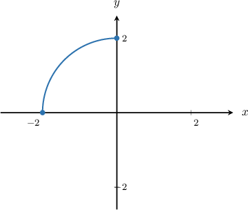

The quarter-circle above is defined by the parametric equations 

$$
x=2\operatorname{cos}⁡\theta ,\,y=2\operatorname{sin}⁡\theta .
$$

What is the domain of the parameter $\theta ?$

Original field `selection`: $[\frac{\pi }{2},\frac{3\pi }{2}]$, $[0,\frac{\pi }{2}]$, $[\frac{\pi }{2},\pi ]$, $[0,\pi ]$, $[\frac{\pi }{2},2\pi )$

The parametric equations of a circle  of radius $r$  centered at  the origin are

$$
x=r\operatorname{cos}⁡\theta ,\,y=r\operatorname{sin}⁡\theta ,\,\theta \in [0,2\pi ).
$$

In our case, the radius $r=2.$ So, the parametric equations of the *full* circle are 

$$
x=2\operatorname{cos}⁡\theta ,\,y=2\operatorname{sin}⁡\theta ,\,\theta \in [0,2\pi ).
$$

To restrict the parameterization to a quarter-circle, we associate the parameter $\theta $ with the central angle formed by a point $(x,y)$ on the circle and the $x$-axis. 

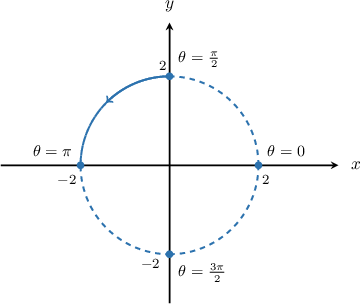

We can see that if we restrict $\theta $ to $[\frac{\pi }{2},\pi ]$, we get the required quarter-circle.

Therefore, the parametric equations of the quarter-circle are 

$$
x=2\operatorname{cos}⁡\theta ,\,y=2\operatorname{sin}⁡\theta ,\,\theta \in [\frac{\pi }{2},\pi ].
$$

### Parameterized source replay

The quarter-circle above is defined by the parametric equations 

$$
x=2\operatorname{cos}⁡\theta ,\,y=2\operatorname{sin}⁡\theta .
$$

What is the domain of the parameter $\theta ?$

Field `selection`:
- $[\frac{\pi }{2},\frac{3\pi }{2}]$
- $[0,\frac{\pi }{2}]$
- $[\frac{\pi }{2},\pi ]$ **correct**
- $[0,\pi ]$
- $[\frac{\pi }{2},2\pi )$

**Worked solution**

The parametric equations of a circle  of radius $r$  centered at  the origin are

$$
x=r\operatorname{cos}⁡\theta ,\,y=r\operatorname{sin}⁡\theta ,\,\theta \in [0,2\pi ).
$$

In our case, the radius $r=2.$ So, the parametric equations of the *full* circle are 

$$
x=2\operatorname{cos}⁡\theta ,\,y=2\operatorname{sin}⁡\theta ,\,\theta \in [0,2\pi ).
$$

To restrict the parameterization to a quarter-circle, we associate the parameter $\theta $ with the central angle formed by a point $(x,y)$ on the circle and the $x$-axis. 

We can see that if we restrict $\theta $ to $[\frac{\pi }{2},\pi ]$, we get the required quarter-circle.

Therefore, the parametric equations of the quarter-circle are 

$$
x=2\operatorname{cos}⁡\theta ,\,y=2\operatorname{sin}⁡\theta ,\,\theta \in [\frac{\pi }{2},\pi ].
$$

### Generated variant of this complete observed bank

The quarter-circle above is defined by the parametric equations 

$$
x=8\operatorname{cos}⁡\theta ,\,y=8\operatorname{sin}⁡\theta .
$$

What is the domain of the parameter $\theta ?$

Field `selection`:
- $[\frac{\pi }{2},\frac{3\pi }{2}]$
- $[0,\frac{\pi }{2}]$
- $[\frac{\pi }{2},\pi ]$ **correct**
- $[0,\pi ]$
- $[\frac{\pi }{2},2\pi )$

**Worked solution**

The parametric equations of a circle  of radius $r$  centered at  the origin are

$$
x=r\operatorname{cos}⁡\theta ,\,y=r\operatorname{sin}⁡\theta ,\,\theta \in [0,2\pi ).
$$

In our case, the radius $r=8.$ So, the parametric equations of the *full* circle are 

$$
x=8\operatorname{cos}⁡\theta ,\,y=8\operatorname{sin}⁡\theta ,\,\theta \in [0,2\pi ).
$$

To restrict the parameterization to a quarter-circle, we associate the parameter $\theta $ with the central angle formed by a point $(x,y)$ on the circle and the $x$-axis. 

We can see that if we restrict $\theta $ to $[\frac{\pi }{2},\pi ]$, we get the required quarter-circle.

Therefore, the parametric equations of the quarter-circle are 

$$
x=8\operatorname{cos}⁡\theta ,\,y=8\operatorname{sin}⁡\theta ,\,\theta \in [\frac{\pi }{2},\pi ].
$$

## Authored angular variation — easy_semi_radio

Seed 40; parameters {'r': 8, 'h': 0, 'k': 0, 'start': '0', 'end': '1'}.

The semi-circle above is defined by the parametric equations 

$$
x=8\operatorname{cos}⁡\theta ,\,y=8\operatorname{sin}⁡\theta .
$$

What is the domain of the parameter $\theta ?$

Field `selection`:
- $\theta \in [0,\pi ]$ **correct**
- $\theta \in [0,\frac{\pi }{2}]$
- $\theta \in [\frac{\pi }{2},\pi ]$
- $\theta \in [0,2\pi )$
- $\theta \in [\pi ,2\pi ]$

**Worked solution**

The parametric equations of a circle  of radius $r$  centered at  the origin are

$$
x=r\operatorname{cos}⁡\theta ,\,y=r\operatorname{sin}⁡\theta ,\,\theta \in [0,2\pi ).
$$

In our case, the radius $r=8.$ So, the parametric equations of the *full* circle are 

$$
x=8\operatorname{cos}⁡\theta ,\,y=8\operatorname{sin}⁡\theta ,\,\theta \in [0,2\pi ).
$$

To restrict the parameterization to a semi-circle, we associate the parameter $\theta $ with the central angle formed by a point $(x,y)$ on the circle and the $x$-axis. 

We can see that if we restrict $\theta $ to $[0,\pi ]$, we get the required semi-circle.

Therefore, the parametric equations of the semi-circle are 

$$
x=8\operatorname{cos}⁡\theta ,\,y=8\operatorname{sin}⁡\theta ,\,\theta \in [0,\pi ].
$$

## Authored angular variation — easy_semi_radio

Seed 73; parameters {'r': 5, 'h': 0, 'k': 0, 'start': '0', 'end': '1'}.

The semi-circle above is defined by the parametric equations 

$$
x=5\operatorname{cos}⁡\theta ,\,y=5\operatorname{sin}⁡\theta .
$$

What is the domain of the parameter $\theta ?$

Field `selection`:
- $\theta \in [0,\pi ]$ **correct**
- $\theta \in [0,\frac{\pi }{2}]$
- $\theta \in [\frac{\pi }{2},\pi ]$
- $\theta \in [0,2\pi )$
- $\theta \in [\pi ,2\pi ]$

**Worked solution**

The parametric equations of a circle  of radius $r$  centered at  the origin are

$$
x=r\operatorname{cos}⁡\theta ,\,y=r\operatorname{sin}⁡\theta ,\,\theta \in [0,2\pi ).
$$

In our case, the radius $r=5.$ So, the parametric equations of the *full* circle are 

$$
x=5\operatorname{cos}⁡\theta ,\,y=5\operatorname{sin}⁡\theta ,\,\theta \in [0,2\pi ).
$$

To restrict the parameterization to a semi-circle, we associate the parameter $\theta $ with the central angle formed by a point $(x,y)$ on the circle and the $x$-axis. 

We can see that if we restrict $\theta $ to $[0,\pi ]$, we get the required semi-circle.

Therefore, the parametric equations of the semi-circle are 

$$
x=5\operatorname{cos}⁡\theta ,\,y=5\operatorname{sin}⁡\theta ,\,\theta \in [0,\pi ].
$$

## Authored angular variation — moderate_compact_radio

Seed 40; parameters {'r': 1, 'h': 0, 'k': 0, 'start': '1', 'end': '3/2'}.

The quarter-circle above is defined by the parametric equations

$x = \cos θ, y = \sin θ$.

What is the domain of the parameter $θ$?

Field `selection`:
- $[\pi ,\frac{3\pi }{2}]$ **correct**
- $[\pi ,\frac{5\pi }{4}]$
- $[\frac{5\pi }{4},\frac{3\pi }{2}]$
- $[0,2\pi )$
- $[0,\pi ]$

**Worked solution**

The parametric equations of a circle  of radius $r$  centered at  the origin are

$$
x=r\operatorname{cos}⁡\theta ,\,y=r\operatorname{sin}⁡\theta ,\,\theta \in [0,2\pi ).
$$

In our case, the radius $r=1.$ So, the parametric equations of the *full* circle are 

$$
x = \cos θ, y = \sin θ,\,\theta \in [0,2\pi ).
$$

To restrict the parameterization to a quarter-circle, we associate the parameter $\theta $ with the central angle formed by a point $(x,y)$ on the circle and the $x$-axis. 

We can see that if we restrict $\theta $ to $[\pi ,\frac{3\pi }{2}]$, we get the required quarter-circle.

Therefore, the parametric equations of the quarter-circle are 

$$
x = \cos θ, y = \sin θ,\,\theta \in [\pi ,\frac{3\pi }{2}].
$$

## Authored angular variation — moderate_compact_radio

Seed 73; parameters {'r': 2, 'h': 0, 'k': 0, 'start': '1', 'end': '3/2'}.

The quarter-circle above is defined by the parametric equations

$x = 2\cos θ, y = 2\sin θ$.

What is the domain of the parameter $θ$?

Field `selection`:
- $[\pi ,\frac{3\pi }{2}]$ **correct**
- $[\pi ,\frac{5\pi }{4}]$
- $[\frac{5\pi }{4},\frac{3\pi }{2}]$
- $[0,2\pi )$
- $[0,\pi ]$

**Worked solution**

The parametric equations of a circle  of radius $r$  centered at  the origin are

$$
x=r\operatorname{cos}⁡\theta ,\,y=r\operatorname{sin}⁡\theta ,\,\theta \in [0,2\pi ).
$$

In our case, the radius $r=2.$ So, the parametric equations of the *full* circle are 

$$
x = 2\cos θ, y = 2\sin θ,\,\theta \in [0,2\pi ).
$$

To restrict the parameterization to a quarter-circle, we associate the parameter $\theta $ with the central angle formed by a point $(x,y)$ on the circle and the $x$-axis. 

We can see that if we restrict $\theta $ to $[\pi ,\frac{3\pi }{2}]$, we get the required quarter-circle.

Therefore, the parametric equations of the quarter-circle are 

$$
x = 2\cos θ, y = 2\sin θ,\,\theta \in [\pi ,\frac{3\pi }{2}].
$$

## Authored angular variation — moderate_arc_blank

Seed 40; parameters {'r': 1, 'h': 0, 'k': 0, 'start': '3/4', 'end': '7/4'}.

The arc of the circle above is defined by the parametric equations 

$$
x=\operatorname{cos}⁡\theta ,\,y=\operatorname{sin}⁡\theta .
$$

What is the domain of the parameter $\theta ?$ Assume $\theta $ is between $0$ and $2\pi .$

$\theta \in [${{field-1}}$,$
{{field-2}}$]$

Field `field-2`:
- $\frac{7\pi }{4}$ **correct**
Field `field-1`:
- $\frac{3\pi }{4}$ **correct**

**Worked solution**

The parametric equations of a circle  of radius $r$  centered at  the origin are

$$
x=r\operatorname{cos}⁡\theta ,\,y=r\operatorname{sin}⁡\theta ,\,\theta \in (0,2\pi ].
$$

In our case, the radius $r=1.$ So, the parametric equations of the *full* circle are 

$$
x=\operatorname{cos}⁡\theta ,\,y=\operatorname{sin}⁡\theta ,\,\theta \in (0,2\pi ].
$$

To restrict the parameterization to the arc above, we associate the parameter $\theta $ with the central angle formed by a point $(x,y)$ on the circle and the $x$-axis. 

We can see that if we restrict $\theta $ to $[\frac{3\pi }{4},\frac{7\pi }{4}]$, we get the required arc of the circle.

Therefore, the parametric equations of the arc of the circle are 

$$
x=\operatorname{cos}⁡\theta ,\,y=\operatorname{sin}⁡\theta ,\,\theta \in [\frac{3\pi }{4},\frac{7\pi }{4}].
$$

## Authored angular variation — moderate_arc_blank

Seed 73; parameters {'r': 2, 'h': 0, 'k': 0, 'start': '1/4', 'end': '5/4'}.

The arc of the circle above is defined by the parametric equations 

$$
x=2\operatorname{cos}⁡\theta ,\,y=2\operatorname{sin}⁡\theta .
$$

What is the domain of the parameter $\theta ?$ Assume $\theta $ is between $0$ and $2\pi .$

$\theta \in [${{field-1}}$,$
{{field-2}}$]$

Field `field-2`:
- $\frac{5\pi }{4}$ **correct**
Field `field-1`:
- $\frac{\pi }{4}$ **correct**

**Worked solution**

The parametric equations of a circle  of radius $r$  centered at  the origin are

$$
x=r\operatorname{cos}⁡\theta ,\,y=r\operatorname{sin}⁡\theta ,\,\theta \in (0,2\pi ].
$$

In our case, the radius $r=2.$ So, the parametric equations of the *full* circle are 

$$
x=2\operatorname{cos}⁡\theta ,\,y=2\operatorname{sin}⁡\theta ,\,\theta \in (0,2\pi ].
$$

To restrict the parameterization to the arc above, we associate the parameter $\theta $ with the central angle formed by a point $(x,y)$ on the circle and the $x$-axis. 

We can see that if we restrict $\theta $ to $[\frac{\pi }{4},\frac{5\pi }{4}]$, we get the required arc of the circle.

Therefore, the parametric equations of the arc of the circle are 

$$
x=2\operatorname{cos}⁡\theta ,\,y=2\operatorname{sin}⁡\theta ,\,\theta \in [\frac{\pi }{4},\frac{5\pi }{4}].
$$

## Authored angular variation — easy_arc_blank

Seed 40; parameters {'r': 1, 'h': 0, 'k': 0, 'start': '0', 'end': '7/6'}.

The arc of a circle above is defined by the parametric equations 

$$
x=\operatorname{cos}⁡\theta ,\,y=\operatorname{sin}⁡\theta .
$$

What is the domain of the parameter $\theta ?$ Assume $\theta $ is between $0$ and $2\pi .$

$\theta \in [${{field-1}}$,$
{{field-2}}$]$

Field `field-2`:
- $\frac{7\pi }{6}$ **correct**
Field `field-1`:
- $0$ **correct**

**Worked solution**

The parametric equations of a circle  of radius $r$  centered at  the origin are

$$
x=r\operatorname{cos}⁡\theta ,\,y=r\operatorname{sin}⁡\theta ,\,\theta \in [0,2\pi ).
$$

In our case, the radius $r=1.$ So, the parametric equations of the *full* circle are 

$$
x=\operatorname{cos}⁡\theta ,\,y=\operatorname{sin}⁡\theta ,\,\theta \in [0,2\pi ).
$$

To restrict the parameterization to the arc above, we associate the parameter $\theta $ with the central angle formed by a point $(x,y)$ on the circle and the $x$-axis.

We can see that if we restrict $\theta $ to $[0,\frac{7\pi }{6}]$, we get the required arc of the circle.

Therefore, the parametric equations of the arc of the circle are 

$$
x=\operatorname{cos}⁡\theta ,\,y=\operatorname{sin}⁡\theta ,\,\theta \in [0,\frac{7\pi }{6}].
$$

## Authored angular variation — easy_arc_blank

Seed 73; parameters {'r': 2, 'h': 0, 'k': 0, 'start': '0', 'end': '5/4'}.

The arc of a circle above is defined by the parametric equations 

$$
x=2\operatorname{cos}⁡\theta ,\,y=2\operatorname{sin}⁡\theta .
$$

What is the domain of the parameter $\theta ?$ Assume $\theta $ is between $0$ and $2\pi .$

$\theta \in [${{field-1}}$,$
{{field-2}}$]$

Field `field-2`:
- $\frac{5\pi }{4}$ **correct**
Field `field-1`:
- $0$ **correct**

**Worked solution**

The parametric equations of a circle  of radius $r$  centered at  the origin are

$$
x=r\operatorname{cos}⁡\theta ,\,y=r\operatorname{sin}⁡\theta ,\,\theta \in [0,2\pi ).
$$

In our case, the radius $r=2.$ So, the parametric equations of the *full* circle are 

$$
x=2\operatorname{cos}⁡\theta ,\,y=2\operatorname{sin}⁡\theta ,\,\theta \in [0,2\pi ).
$$

To restrict the parameterization to the arc above, we associate the parameter $\theta $ with the central angle formed by a point $(x,y)$ on the circle and the $x$-axis.

We can see that if we restrict $\theta $ to $[0,\frac{5\pi }{4}]$, we get the required arc of the circle.

Therefore, the parametric equations of the arc of the circle are 

$$
x=2\operatorname{cos}⁡\theta ,\,y=2\operatorname{sin}⁡\theta ,\,\theta \in [0,\frac{5\pi }{4}].
$$

## Authored angular variation — easy_quarter_blank

Seed 40; parameters {'r': 8, 'h': 0, 'k': 0, 'start': '0', 'end': '1/2'}.

The quarter-circle above is defined by the parametric equations 

$$
x=8\operatorname{cos}⁡\theta ,\,y=8\operatorname{sin}⁡\theta .
$$

What is the domain of the parameter $\theta ?$ Assume $\theta $ is between $0$ and $2\pi .$

$\theta \in [${{field-1}}$,$
{{field-2}}$]$

Field `field-2`:
- $\frac{\pi }{2}$ **correct**
Field `field-1`:
- $0$ **correct**

**Worked solution**

The parametric equations of a circle  of radius $r$  centered at  the origin are

$$
x=r\operatorname{cos}⁡\theta ,\,y=r\operatorname{sin}⁡\theta ,\,\theta \in [0,2\pi ).
$$

In our case, the radius $r=8.$ So, the parametric equations of the *full* circle are 

$$
x=8\operatorname{cos}⁡\theta ,\,y=8\operatorname{sin}⁡\theta ,\,\theta \in [0,2\pi ).
$$

To restrict the parameterization to the arc above, we associate the parameter $\theta $ with the central angle formed by a point $(x,y)$ on the circle and the $x$-axis.

We can see that if we restrict $\theta $ to $[0,\frac{\pi }{2}]$, we get the required arc of the circle.

Therefore, the parametric equations of the arc of the circle are 

$$
x=8\operatorname{cos}⁡\theta ,\,y=8\operatorname{sin}⁡\theta ,\,\theta \in [0,\frac{\pi }{2}].
$$

## Authored angular variation — easy_quarter_blank

Seed 73; parameters {'r': 5, 'h': 0, 'k': 0, 'start': '0', 'end': '1/2'}.

The quarter-circle above is defined by the parametric equations 

$$
x=5\operatorname{cos}⁡\theta ,\,y=5\operatorname{sin}⁡\theta .
$$

What is the domain of the parameter $\theta ?$ Assume $\theta $ is between $0$ and $2\pi .$

$\theta \in [${{field-1}}$,$
{{field-2}}$]$

Field `field-2`:
- $\frac{\pi }{2}$ **correct**
Field `field-1`:
- $0$ **correct**

**Worked solution**

The parametric equations of a circle  of radius $r$  centered at  the origin are

$$
x=r\operatorname{cos}⁡\theta ,\,y=r\operatorname{sin}⁡\theta ,\,\theta \in [0,2\pi ).
$$

In our case, the radius $r=5.$ So, the parametric equations of the *full* circle are 

$$
x=5\operatorname{cos}⁡\theta ,\,y=5\operatorname{sin}⁡\theta ,\,\theta \in [0,2\pi ).
$$

To restrict the parameterization to the arc above, we associate the parameter $\theta $ with the central angle formed by a point $(x,y)$ on the circle and the $x$-axis.

We can see that if we restrict $\theta $ to $[0,\frac{\pi }{2}]$, we get the required arc of the circle.

Therefore, the parametric equations of the arc of the circle are 

$$
x=5\operatorname{cos}⁡\theta ,\,y=5\operatorname{sin}⁡\theta ,\,\theta \in [0,\frac{\pi }{2}].
$$

## Authored angular variation — hard_threequarter_blank

Seed 40; parameters {'r': 1, 'h': -3, 'k': -2, 'start': '1/2', 'end': '2'}.

The three-quarter-circle above is defined by the parametric equations 

$$
x=\operatorname{cos}⁡\theta -3,\,y=\operatorname{sin}⁡\theta -2.
$$

What is the domain of the parameter $\theta ?$ Assume $\theta $ is between $0$ and $2\pi .$

$\theta \in [${{field-1}}$,$
{{field-2}}$]$

Field `field-2`:
- $2\pi $ **correct**
Field `field-1`:
- $\frac{\pi }{2}$ **correct**

**Worked solution**

The parametric equations of a circle of radius $r$ centered at the point $(a,b)$ are

$$
x=r\operatorname{cos}⁡\theta +a,\,y=r\operatorname{sin}⁡\theta +b,\,\theta \in (0,2\pi ].
$$

In our case, we have a circle of radius $1$ centered at the point $(-3,-2).$ So, the parametric equations of the *full* circle are 

$$
x=\operatorname{cos}⁡\theta -3,\,y=\operatorname{sin}⁡\theta -2,\,\theta \in (0,2\pi ].
$$

To restrict the parameterization to a three-quarter-circle, we associate the parameter $\theta $ with the central angle formed by a point $(x,y)$ on the circle and the line parallel to the $x$-axis and crossing the center of the circle. 

We can see that if we restrict $\theta $ to $[\frac{\pi }{2},2\pi ]$, we get the required three-quarter-circle.

Therefore, the parametric equations of the three-quarter circle are 

$$
x=\operatorname{cos}⁡\theta -3,\,y=\operatorname{sin}⁡\theta -2,\,\theta \in [\frac{\pi }{2},2\pi ].
$$

## Authored angular variation — hard_threequarter_blank

Seed 73; parameters {'r': 2, 'h': 2, 'k': 1, 'start': '1/2', 'end': '2'}.

The three-quarter-circle above is defined by the parametric equations 

$$
x=2\operatorname{cos}⁡\theta +2,\,y=2\operatorname{sin}⁡\theta +1.
$$

What is the domain of the parameter $\theta ?$ Assume $\theta $ is between $0$ and $2\pi .$

$\theta \in [${{field-1}}$,$
{{field-2}}$]$

Field `field-2`:
- $2\pi $ **correct**
Field `field-1`:
- $\frac{\pi }{2}$ **correct**

**Worked solution**

The parametric equations of a circle of radius $r$ centered at the point $(a,b)$ are

$$
x=r\operatorname{cos}⁡\theta +a,\,y=r\operatorname{sin}⁡\theta +b,\,\theta \in (0,2\pi ].
$$

In our case, we have a circle of radius $2$ centered at the point $(2,1).$ So, the parametric equations of the *full* circle are 

$$
x=2\operatorname{cos}⁡\theta +2,\,y=2\operatorname{sin}⁡\theta +1,\,\theta \in (0,2\pi ].
$$

To restrict the parameterization to a three-quarter-circle, we associate the parameter $\theta $ with the central angle formed by a point $(x,y)$ on the circle and the line parallel to the $x$-axis and crossing the center of the circle. 

We can see that if we restrict $\theta $ to $[\frac{\pi }{2},2\pi ]$, we get the required three-quarter-circle.

Therefore, the parametric equations of the three-quarter circle are 

$$
x=2\operatorname{cos}⁡\theta +2,\,y=2\operatorname{sin}⁡\theta +1,\,\theta \in [\frac{\pi }{2},2\pi ].
$$

## Authored angular variation — easy_arc_radio

Seed 40; parameters {'r': 1, 'h': 0, 'k': 0, 'start': '0', 'end': '7/6'}.

The arc of a circle above is defined by the parametric equations 

$$
x=\operatorname{cos}⁡\theta ,\,y=\operatorname{sin}⁡\theta .
$$

What is the domain of the parameter $\theta ?$

Field `selection`:
- $\theta \in [0,\frac{7\pi }{6}]$ **correct**
- $\theta \in [0,\frac{7\pi }{12}]$
- $\theta \in [\frac{7\pi }{12},\frac{7\pi }{6}]$
- $\theta \in [0,2\pi )$
- $\theta \in [\frac{7\pi }{6},2\pi ]$

**Worked solution**

The parametric equations of a circle  of radius $r$  centered at  the origin are

$$
x=r\operatorname{cos}⁡\theta ,\,y=r\operatorname{sin}⁡\theta ,\,\theta \in [0,2\pi ).
$$

In our case, the radius $r=1.$ So, the parametric equations of the *full* circle are 

$$
x=\operatorname{cos}⁡\theta ,\,y=\operatorname{sin}⁡\theta ,\,\theta \in [0,2\pi ).
$$

To restrict the parameterization to the arc above, we associate the parameter $\theta $ with the central angle formed by a point $(x,y)$ on the circle and the $x$-axis. 

We can see that if we restrict $\theta $ to $[0,\frac{7\pi }{6}]$, we get the required arc of the circle.

Therefore, the parametric equations of the arc of the circle are 

$$
x=\operatorname{cos}⁡\theta ,\,y=\operatorname{sin}⁡\theta ,\,\theta \in [0,\frac{7\pi }{6}].
$$

## Authored angular variation — easy_arc_radio

Seed 73; parameters {'r': 2, 'h': 0, 'k': 0, 'start': '0', 'end': '5/4'}.

The arc of a circle above is defined by the parametric equations 

$$
x=2\operatorname{cos}⁡\theta ,\,y=2\operatorname{sin}⁡\theta .
$$

What is the domain of the parameter $\theta ?$

Field `selection`:
- $\theta \in [0,\frac{5\pi }{4}]$ **correct**
- $\theta \in [0,\frac{5\pi }{8}]$
- $\theta \in [\frac{5\pi }{8},\frac{5\pi }{4}]$
- $\theta \in [0,2\pi )$
- $\theta \in [\frac{5\pi }{4},2\pi ]$

**Worked solution**

The parametric equations of a circle  of radius $r$  centered at  the origin are

$$
x=r\operatorname{cos}⁡\theta ,\,y=r\operatorname{sin}⁡\theta ,\,\theta \in [0,2\pi ).
$$

In our case, the radius $r=2.$ So, the parametric equations of the *full* circle are 

$$
x=2\operatorname{cos}⁡\theta ,\,y=2\operatorname{sin}⁡\theta ,\,\theta \in [0,2\pi ).
$$

To restrict the parameterization to the arc above, we associate the parameter $\theta $ with the central angle formed by a point $(x,y)$ on the circle and the $x$-axis. 

We can see that if we restrict $\theta $ to $[0,\frac{5\pi }{4}]$, we get the required arc of the circle.

Therefore, the parametric equations of the arc of the circle are 

$$
x=2\operatorname{cos}⁡\theta ,\,y=2\operatorname{sin}⁡\theta ,\,\theta \in [0,\frac{5\pi }{4}].
$$

## Authored angular variation — easy_threequarter_radio

Seed 40; parameters {'r': 8, 'h': 0, 'k': 0, 'start': '0', 'end': '3/2'}.

The three-quarter-circle above is defined by the parametric equations 

$$
x=8\operatorname{cos}⁡\theta ,\,y=8\operatorname{sin}⁡\theta .
$$

What is the domain of the parameter $\theta ?$

Field `selection`:
- $\theta \in [0,\frac{3\pi }{2}]$ **correct**
- $\theta \in [0,\frac{3\pi }{4}]$
- $\theta \in [\frac{3\pi }{4},\frac{3\pi }{2}]$
- $\theta \in [0,2\pi )$
- $\theta \in [\frac{3\pi }{2},2\pi ]$

**Worked solution**

The parametric equations of a circle  of radius $r$  centered at  the origin are

$$
x=r\operatorname{cos}⁡\theta ,\,y=r\operatorname{sin}⁡\theta ,\,\theta \in [0,2\pi ).
$$

In our case, the radius $r=8.$ So, the parametric equations of the *full* circle are 

$$
x=8\operatorname{cos}⁡\theta ,\,y=8\operatorname{sin}⁡\theta ,\,\theta \in [0,2\pi ).
$$

To restrict the parameterization to a three-quarter-circle, we associate the parameter $\theta $ with the central angle formed by a point $(x,y)$ on the circle and the $x$-axis. 

We can see that if we restrict $\theta $ to $[0,\frac{3\pi }{2}]$, we get the required three-quarter-circle.

Therefore, the parametric equations of the three-quarter-circle are 

$$
x=8\operatorname{cos}⁡\theta ,\,y=8\operatorname{sin}⁡\theta ,\,\theta \in [0,\frac{3\pi }{2}].
$$

## Authored angular variation — easy_threequarter_radio

Seed 73; parameters {'r': 5, 'h': 0, 'k': 0, 'start': '0', 'end': '3/2'}.

The three-quarter-circle above is defined by the parametric equations 

$$
x=5\operatorname{cos}⁡\theta ,\,y=5\operatorname{sin}⁡\theta .
$$

What is the domain of the parameter $\theta ?$

Field `selection`:
- $\theta \in [0,\frac{3\pi }{2}]$ **correct**
- $\theta \in [0,\frac{3\pi }{4}]$
- $\theta \in [\frac{3\pi }{4},\frac{3\pi }{2}]$
- $\theta \in [0,2\pi )$
- $\theta \in [\frac{3\pi }{2},2\pi ]$

**Worked solution**

The parametric equations of a circle  of radius $r$  centered at  the origin are

$$
x=r\operatorname{cos}⁡\theta ,\,y=r\operatorname{sin}⁡\theta ,\,\theta \in [0,2\pi ).
$$

In our case, the radius $r=5.$ So, the parametric equations of the *full* circle are 

$$
x=5\operatorname{cos}⁡\theta ,\,y=5\operatorname{sin}⁡\theta ,\,\theta \in [0,2\pi ).
$$

To restrict the parameterization to a three-quarter-circle, we associate the parameter $\theta $ with the central angle formed by a point $(x,y)$ on the circle and the $x$-axis. 

We can see that if we restrict $\theta $ to $[0,\frac{3\pi }{2}]$, we get the required three-quarter-circle.

Therefore, the parametric equations of the three-quarter-circle are 

$$
x=5\operatorname{cos}⁡\theta ,\,y=5\operatorname{sin}⁡\theta ,\,\theta \in [0,\frac{3\pi }{2}].
$$

## Authored angular variation — hard_quarter_radio

Seed 40; parameters {'r': 1, 'h': -3, 'k': -2, 'start': '3/2', 'end': '2'}.

The quarter-circle above is defined by the parametric equations 

$$
x=\operatorname{cos}⁡\theta -3,\,y=\operatorname{sin}⁡\theta -2.
$$

What is the domain of the parameter $\theta ?$

Field `selection`:
- $[\frac{3\pi }{2},2\pi ]$ **correct**
- $[\frac{3\pi }{2},\frac{7\pi }{4}]$
- $[\frac{7\pi }{4},2\pi ]$
- $[0,2\pi )$
- $[0,\frac{3\pi }{2}]$

**Worked solution**

The parametric equations of a circle of radius $r$ centered at the point $(a,b)$ are

$$
x=r\operatorname{cos}⁡\theta +a,\,y=r\operatorname{sin}⁡\theta +b,\,\theta \in [0,2\pi ).
$$

In our case, we have a circle of radius $1$ centered at the point $(-3,-2).$ So, the parametric equations of the *full* circle are 

$$
x=\operatorname{cos}⁡\theta -3,\,y=\operatorname{sin}⁡\theta -2,\,\theta \in [0,2\pi ).
$$

To restrict the parameterization to a quarter-circle, we associate the parameter $\theta $ with the central angle formed by a point $(x,y)$ on the circle and the line parallel to the $x$-axis and crossing the center of the circle. 

We can see that if we restrict $\theta $ to $[\frac{3\pi }{2},2\pi ]$, we get the required quarter-circle.

Therefore, the parametric equations of the quarter-circle are 

$$
x=\operatorname{cos}⁡\theta -3,\,y=\operatorname{sin}⁡\theta -2,\,\theta \in [\frac{3\pi }{2},2\pi ].
$$

## Authored angular variation — hard_quarter_radio

Seed 73; parameters {'r': 2, 'h': 2, 'k': 1, 'start': '1', 'end': '3/2'}.

The quarter-circle above is defined by the parametric equations 

$$
x=2\operatorname{cos}⁡\theta +2,\,y=2\operatorname{sin}⁡\theta +1.
$$

What is the domain of the parameter $\theta ?$

Field `selection`:
- $[\pi ,\frac{3\pi }{2}]$ **correct**
- $[\pi ,\frac{5\pi }{4}]$
- $[\frac{5\pi }{4},\frac{3\pi }{2}]$
- $[0,2\pi )$
- $[0,\pi ]$

**Worked solution**

The parametric equations of a circle of radius $r$ centered at the point $(a,b)$ are

$$
x=r\operatorname{cos}⁡\theta +a,\,y=r\operatorname{sin}⁡\theta +b,\,\theta \in [0,2\pi ).
$$

In our case, we have a circle of radius $2$ centered at the point $(2,1).$ So, the parametric equations of the *full* circle are 

$$
x=2\operatorname{cos}⁡\theta +2,\,y=2\operatorname{sin}⁡\theta +1,\,\theta \in [0,2\pi ).
$$

To restrict the parameterization to a quarter-circle, we associate the parameter $\theta $ with the central angle formed by a point $(x,y)$ on the circle and the line parallel to the $x$-axis and crossing the center of the circle. 

We can see that if we restrict $\theta $ to $[\pi ,\frac{3\pi }{2}]$, we get the required quarter-circle.

Therefore, the parametric equations of the quarter-circle are 

$$
x=2\operatorname{cos}⁡\theta +2,\,y=2\operatorname{sin}⁡\theta +1,\,\theta \in [\pi ,\frac{3\pi }{2}].
$$

## Authored angular variation — easy_quarter_radio

Seed 40; parameters {'r': 8, 'h': 0, 'k': 0, 'start': '0', 'end': '1/2'}.

The quarter-circle above is defined by the parametric equations 

$$
x=8\operatorname{cos}⁡\theta ,\,y=8\operatorname{sin}⁡\theta .
$$

What is the domain of the parameter $\theta ?$

Field `selection`:
- $\theta \in [0,\frac{\pi }{2}]$ **correct**
- $\theta \in [0,\frac{\pi }{4}]$
- $\theta \in [\frac{\pi }{4},\frac{\pi }{2}]$
- $\theta \in [0,2\pi )$
- $\theta \in [\frac{\pi }{2},2\pi ]$

**Worked solution**

The parametric equations of a circle  of radius $r$  centered at  the origin are

$$
x=r\operatorname{cos}⁡\theta ,\,y=r\operatorname{sin}⁡\theta ,\,\theta \in [0,2\pi ).
$$

In our case, the radius $r=8.$ So, the parametric equations of the *full* circle are 

$$
x=8\operatorname{cos}⁡\theta ,\,y=8\operatorname{sin}⁡\theta ,\,\theta \in [0,2\pi ).
$$

To restrict the parameterization to a quarter-circle, we associate the parameter $\theta $ with the central angle formed by a point $(x,y)$ on the circle and the $x$-axis. 

We can see that if we restrict $\theta $ to $[0,\frac{\pi }{2}]$, we get the required quarter-circle.

Therefore, the parametric equations of the quarter-circle are 

$$
x=8\operatorname{cos}⁡\theta ,\,y=8\operatorname{sin}⁡\theta ,\,\theta \in [0,\frac{\pi }{2}].
$$

## Authored angular variation — easy_quarter_radio

Seed 73; parameters {'r': 5, 'h': 0, 'k': 0, 'start': '0', 'end': '1/2'}.

The quarter-circle above is defined by the parametric equations 

$$
x=5\operatorname{cos}⁡\theta ,\,y=5\operatorname{sin}⁡\theta .
$$

What is the domain of the parameter $\theta ?$

Field `selection`:
- $\theta \in [0,\frac{\pi }{2}]$ **correct**
- $\theta \in [0,\frac{\pi }{4}]$
- $\theta \in [\frac{\pi }{4},\frac{\pi }{2}]$
- $\theta \in [0,2\pi )$
- $\theta \in [\frac{\pi }{2},2\pi ]$

**Worked solution**

The parametric equations of a circle  of radius $r$  centered at  the origin are

$$
x=r\operatorname{cos}⁡\theta ,\,y=r\operatorname{sin}⁡\theta ,\,\theta \in [0,2\pi ).
$$

In our case, the radius $r=5.$ So, the parametric equations of the *full* circle are 

$$
x=5\operatorname{cos}⁡\theta ,\,y=5\operatorname{sin}⁡\theta ,\,\theta \in [0,2\pi ).
$$

To restrict the parameterization to a quarter-circle, we associate the parameter $\theta $ with the central angle formed by a point $(x,y)$ on the circle and the $x$-axis. 

We can see that if we restrict $\theta $ to $[0,\frac{\pi }{2}]$, we get the required quarter-circle.

Therefore, the parametric equations of the quarter-circle are 

$$
x=5\operatorname{cos}⁡\theta ,\,y=5\operatorname{sin}⁡\theta ,\,\theta \in [0,\frac{\pi }{2}].
$$

## Authored angular variation — moderate_quarter_radio

Seed 40; parameters {'r': 1, 'h': 0, 'k': 0, 'start': '1', 'end': '3/2'}.

The quarter-circle above is defined by the parametric equations 

$$
x=\operatorname{cos}⁡\theta ,\,y=\operatorname{sin}⁡\theta .
$$

What is the domain of the parameter $\theta ?$

Field `selection`:
- $[\pi ,\frac{3\pi }{2}]$ **correct**
- $[\pi ,\frac{5\pi }{4}]$
- $[\frac{5\pi }{4},\frac{3\pi }{2}]$
- $[0,2\pi )$
- $[0,\pi ]$

**Worked solution**

The parametric equations of a circle  of radius $r$  centered at  the origin are

$$
x=r\operatorname{cos}⁡\theta ,\,y=r\operatorname{sin}⁡\theta ,\,\theta \in [0,2\pi ).
$$

In our case, the radius $r=1.$ So, the parametric equations of the *full* circle are 

$$
x=\operatorname{cos}⁡\theta ,\,y=\operatorname{sin}⁡\theta ,\,\theta \in [0,2\pi ).
$$

To restrict the parameterization to a quarter-circle, we associate the parameter $\theta $ with the central angle formed by a point $(x,y)$ on the circle and the $x$-axis. 

We can see that if we restrict $\theta $ to $[\pi ,\frac{3\pi }{2}]$, we get the required quarter-circle.

Therefore, the parametric equations of the quarter-circle are 

$$
x=\operatorname{cos}⁡\theta ,\,y=\operatorname{sin}⁡\theta ,\,\theta \in [\pi ,\frac{3\pi }{2}].
$$

## Authored angular variation — moderate_quarter_radio

Seed 73; parameters {'r': 2, 'h': 0, 'k': 0, 'start': '1', 'end': '3/2'}.

The quarter-circle above is defined by the parametric equations 

$$
x=2\operatorname{cos}⁡\theta ,\,y=2\operatorname{sin}⁡\theta .
$$

What is the domain of the parameter $\theta ?$

Field `selection`:
- $[\pi ,\frac{3\pi }{2}]$ **correct**
- $[\pi ,\frac{5\pi }{4}]$
- $[\frac{5\pi }{4},\frac{3\pi }{2}]$
- $[0,2\pi )$
- $[0,\pi ]$

**Worked solution**

The parametric equations of a circle  of radius $r$  centered at  the origin are

$$
x=r\operatorname{cos}⁡\theta ,\,y=r\operatorname{sin}⁡\theta ,\,\theta \in [0,2\pi ).
$$

In our case, the radius $r=2.$ So, the parametric equations of the *full* circle are 

$$
x=2\operatorname{cos}⁡\theta ,\,y=2\operatorname{sin}⁡\theta ,\,\theta \in [0,2\pi ).
$$

To restrict the parameterization to a quarter-circle, we associate the parameter $\theta $ with the central angle formed by a point $(x,y)$ on the circle and the $x$-axis. 

We can see that if we restrict $\theta $ to $[\pi ,\frac{3\pi }{2}]$, we get the required quarter-circle.

Therefore, the parametric equations of the quarter-circle are 

$$
x=2\operatorname{cos}⁡\theta ,\,y=2\operatorname{sin}⁡\theta ,\,\theta \in [\pi ,\frac{3\pi }{2}].
$$
