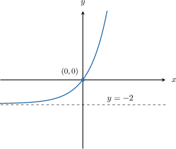
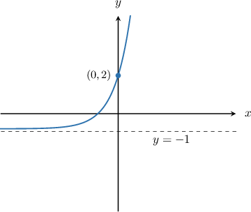
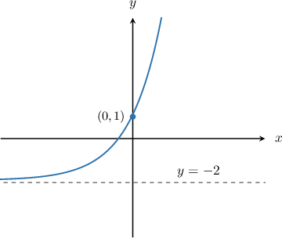
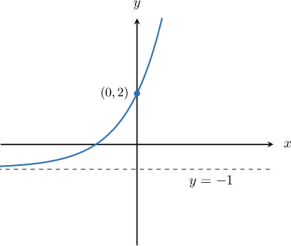
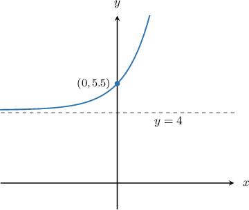
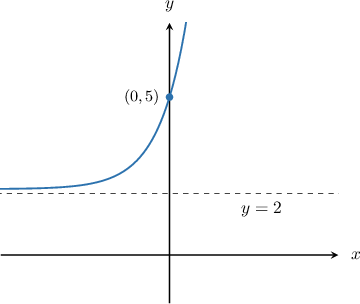
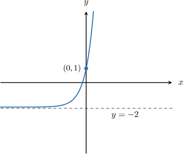

# Template extraction

Snapshot: math basis 1356, lineage 01a12a15-3e0a-75a1-9dac-f8b8c5d5c3f1. Seven practice records and one canonical example. Source JSON stays unchanged.

## Stage 1: specific records

### q-18518
DB ID 17592186088061; original difficulty absent (authored replay assignment easy). Provided base 2, shift -2, stretch 2, labeled point (0,0). One radio field selection, five text parameter pairs.
Original prompt:

The graph above shows $y = k(2^{x}) + c$. Find the value of $k$ and $c$.
Original worked solution:
ABSENT; no staged solution is fabricated in raw replay.

### q-18521
DB ID 17592186088062; original difficulty absent (authored replay assignment moderate). Provided base 3, shift -1, stretch 3, labeled point (0,2). One radio field selection, five math complete equations.
Original prompt:

The graph above shows $y = k(3^{x}) + c$. Determine the values of $k$ and $c$ and find the equation of the curve.
Original worked solution:
ABSENT; no staged solution is fabricated in raw replay.

### q-29233
DB ID 17592186297230; original difficulty easy. Provided base 2, shift -2, stretch 3, labeled point (0,1). One radio field selection, five text parameter pairs.
Original prompt:

The graph above shows $y=k({2}^{x})+c.$ Find the value of $k$ and $c.$
Original worked solution:
The horizontal asymptote of the curve $y=k({2}^{x})+c$ is $y=c.$ In the graph above, the horizontal asymptote is $y=-2,$ so $c=-2.$

Therefore, our function takes the form

$$
y=k({2}^{x})-2.
$$

We can solve for $k$ by finding a point on the graph and substituting for $x$ and $y.$ The labeled point on the graph is $(0,1),$ so we substitute $x=0$ and $y=1$ into the function and solve for $k:$

$$
\begin{aligned}y & =k({2}^{x})-2 \\ 1 & =k({2}^{0})-2 \\ 1 & =k(1)-2 \\ 1 & =k-2 \\ 3 & =k\end{aligned}
$$

Therefore, $k=3$ and $c=-2.$

### q-7239
DB ID 17592186339103; original difficulty moderate. Provided base 2, shift -1, stretch 3, labeled point (0,2). One radio field selection, five math complete equations.
Original prompt:

The graph above shows $y=k({2}^{x})+c.$  Determine the values of $k$ and $c$ and find the equation of the curve.
Original worked solution:
The horizontal asymptote of the curve $y=k({2}^{x})+c$ is $y=c.$ In the graph above, the horizontal asymptote is $y=-1,$ so $c=-1.$

Therefore, our function takes the form

$$
y=k({2}^{x})-1.
$$

We can solve for $k$ by finding a point on the graph and substituting for $x$ and $y.$ The labeled point on the graph is $(0,2),$ so we substitute $x=0$ and $y=2$ into the function and solve for $k:$

$$
\begin{aligned}y & =k({2}^{x})-1 \\ 2 & =k({2}^{0})-1 \\ 2 & =k(1)-1 \\ 2 & =k-1 \\ 3 & =k\end{aligned}
$$

Therefore, the curve is $y=3({2}^{x})-1.$

### q-7241
DB ID 17592186339109; original difficulty moderate. Provided base 2, shift 4, stretch 1.5, labeled point (0,5.5). One radio field selection, five math complete equations.
Original prompt:

The graph above shows $y=k({2}^{x})+c.$  Determine the values of $k$ and $c$ and find the equation of the curve.
Original worked solution:
The horizontal asymptote of the curve $y=k({2}^{x})+c$ is $y=c.$ In the graph above, the horizontal asymptote is $y=4,$ so $c=4.$

Therefore, our function takes the form

$$
y=k({2}^{x})+4.
$$

We can solve for $k$ by finding a point on the graph and substituting for $x$ and $y.$ The labeled point on the graph is $(0,5.5),$ so we substitute $x=0$ and $y=5.5$ into the function and solve for $k:$

$$
\begin{aligned}y & =k({2}^{x})+4 \\ 5.5 & =k({2}^{0})+4 \\ 5.5 & =k(1)+4 \\ 5.5 & =k+4 \\ 1.5 & =k\end{aligned}
$$

Therefore, the curve is $y=1.5({2}^{x})+4.$

### q-7243
DB ID 17592186339112; original difficulty moderate. Provided base 3, shift 2, stretch 3, labeled point (0,5). One radio field selection, five math complete equations.
Original prompt:

The graph above shows $y=k({3}^{x})+c.$  Determine the values of $k$ and $c$ and find the equation of the curve.
Original worked solution:
The horizontal asymptote of the curve $y=k({3}^{x})+c$ is $y=c.$ In the graph above, the horizontal asymptote is $y=2,$ so $c=2.$

Therefore, our function takes the form

$$
y=k({3}^{x})+2.
$$

We can solve for $k$ by finding a point on the graph and substituting for $x$ and $y.$ The labeled point on the graph is $(0,5),$ so we substitute $x=0$ and $y=5$ into the function and solve for $k:$

$$
\begin{aligned}y & =k({3}^{x})+2 \\ 5 & =k({3}^{0})+2 \\ 5 & =k(1)+2 \\ 5 & =k+2 \\ 3 & =k\end{aligned}
$$

Therefore, the curve is $y=3({3}^{x})+2.$

### q-99778
DB ID 17592186362387; original difficulty moderate. Provided base 5, shift -2, stretch 3, labeled point (0,1). One radio field selection, five math complete equations.
Original prompt:

The graph above shows $y=k({5}^{x})+c.$ Determine the values of $k$ and $c$ and find the equation of the curve.
Original worked solution:
The horizontal asymptote of the curve $y=k({5}^{x})+c$ is $y=c.$ In the graph above, the horizontal asymptote is $y=-2,$ so $c=-2.$

Therefore, our function takes the form

$$
y=k({5}^{x})-2.
$$

We can solve for $k$ by finding a point on the graph and substituting for $x$ and $y.$ The labeled point on the graph is $(0,1),$ so we substitute $x=0$ and $y=1$ into the function and solve for $k:$

$$
\begin{aligned}y & =k({5}^{x})-2 \\ 1 & =k({5}^{0})-2 \\ 1 & =k(1)-2 \\ 1 & =k-2 \\ 3 & =k\end{aligned}
$$

Therefore, the curve is $y=3({5}^{x})-2.$

## Stage 2: shared mathematical pattern

The supplied curve is y=k(b^x)+c with b>1 already given. Read the dashed horizontal asymptote as c, read the marked y-intercept u, substitute x=0 so b^0=1, and solve u=k+c by subtraction. Easy requests the parameter pair. Moderate additionally assembles the equation, including observed half-integer k. The canonical b=6,k=2,c=4 uses the same five-row substitution sequence. The graph is central: heavy plot rating.

## Stage 3: complete components and banks

Every option below belongs to its original single selection field. Expressions are complete ordered affine value patterns in b,k,c, not claims about error intent. All historical banks are public evidence-only profiles; normal banks are separately method-derived. A scalar source value cannot recover the original mental error. Each source choice is reproduced exactly at its parameters, preserving text/math type and choice count.

### source:q-18518
- fdb66394-4266-565e-91ae-8a8b7af9cee2 | $k = 2$ and $c = 0$ | (k,c) = (k, 0)
- 150b9369-075a-5021-bc4c-61c7a18b4f73 | $k = 2$ and $c =-2$ | (k,c) = (k, c)
- 4bbf6db9-8223-5028-ae5e-f807b2dd3498 | $k = 2$ and $c =-1$ | (k,c) = (k, c+1)
- 699bb0a1-016d-57fe-92f5-0428a434dc65 | $k = 0$ and $c =-2$ | (k,c) = (0, c)
- 6a125372-2aec-5d48-8233-b14a97167e01 | $k = 2$ and $c = 2$ | (k,c) = (k, -c)

### source:q-18521
- c922058f-6ffc-5196-8a63-c6d648cf5eb7 | y = 2(2^{x}) - 1 | (k,c,b) = (k-1, c, b-1)
- e1ee1b66-a62b-52df-92bc-6bade2c00445 | y = 3(2^{x}) - 1 | (k,c,b) = (k, c, b-1)
- e36ec578-8a82-5f24-8d5e-4cf41bf3a472 | y = 2(3^{x}) - 1 | (k,c,b) = (k-1, c, b)
- 0c025b92-f6e1-52f1-b4cc-dd437db7b61b | y = 3(3^{x}) - 1 | (k,c,b) = (k, c, b)
- 44ba58e9-8529-5e68-b6b0-7622e301e7a9 | y = 3(3^{x}) - 2 | (k,c,b) = (k, c-1, b)

### source:q-29233
- 3033adc0-2183-5e2c-b2ab-63195c598803 | $k=0$ and $c=2$ | (k,c) = (0, -c)
- 474dd8bc-1c5d-55ec-8e0e-e9ca0f43cf6b | $k=-2$ and $c=-2$ | (k,c) = (c, c)
- 9c47edb1-a830-59d9-96ec-8a3e4d43e2c6 | $k=0$ and $c=-2$ | (k,c) = (0, c)
- a8da0063-cf36-5ff9-9624-61c1f1ff3246 | $k=2$ and $c=2$ | (k,c) = (-c, -c)
- b2bae8ee-b0c7-5e6e-a0d2-0ebf31e953d8 | $k=3$ and $c=-2$ | (k,c) = (k, c) | CORRECT

### source:q-7239
- 121b16a2-0458-5600-9a6f-f4f6e552fd5d | y=3({2}^{x})-2 | (k,c) = (k, c-1)
- 4c671da3-c302-5f3c-9ea5-2dc6dac2cc6c | y=3({2}^{x})+2 | (k,c) = (k, -2*c)
- 6fed05ea-acde-5be8-b414-01135dc6f042 | y=3({2}^{x})-1 | (k,c) = (k, c) | CORRECT
- 826ab4ce-caa8-5db7-9188-f1b3cd74a9bb | y={2}^{x}-1 | (k,c) = (1, c)
- 9cf95245-48b9-524a-917b-0ba71da5cdb8 | y=2({2}^{x})-1 | (k,c) = (k-1, c)

### source:q-7241
- 49005b9e-8885-518c-a503-38932dbc77f8 | y=1.5({2}^{x})+4 | (k,c) = (k, c) | CORRECT
- a7777608-b4d4-5368-84cb-c7a407165b82 | y=1.5({2}^{x})+3 | (k,c) = (k, c-1)
- ba7873cf-81b9-5aaf-8051-9f548d554ab8 | y=0.5({2}^{x})+4 | (k,c) = (k-1, c)
- c3ad9d29-36d5-5b4e-bad4-d6181862fae0 | y=1.5({2}^{x})+5 | (k,c) = (k, c+1)
- e97102d4-c948-5475-a8f4-3282b09cc04f | y=0.5({2}^{x})+5 | (k,c) = (k-1, c+1)

### source:q-7243
- 5ce58e5a-cdfc-5db9-b925-fbed74ce33e0 | y=3({3}^{x})+3 | (k,c) = (k, c+1)
- 6965cfa3-9de6-50d2-97f1-3e9a39053046 | y=2({3}^{x})+2 | (k,c) = (k-1, c)
- 9190d101-9cc9-5b59-9ff1-c543b6d33077 | y=3({3}^{x})+2 | (k,c) = (k, c) | CORRECT
- e78f0489-7a6c-5a4a-b1ab-06362d7a58cf | y=3({3}^{x})+5 | (k,c) = (k, c+k)
- ee3098c0-1ba2-5d6f-b48b-c270f7d26cf3 | y=3({3}^{x})+4 | (k,c) = (k, 2*c)

### source:q-99778
- 1ab10718-6d3b-52c0-979d-851a802bf503 | y=2({5}^{x}) | (k,c) = (k-1, 0)
- 1de876ec-9970-58f2-9a90-c4d11e4cb17f | y=3({5}^{x})-2 | (k,c) = (k, c) | CORRECT
- 3f9bf016-9043-5261-918f-1b6e78a04dc8 | y=2({5}^{x})-1 | (k,c) = (k-1, c+1)
- b1c6d0f2-103a-5ff1-ae93-ddea26192443 | y=4({5}^{x})-3 | (k,c) = (k+1, c-1)
- dd530816-df7a-59d6-bf4f-d28add78a64b | y=3({5}^{x})+2 | (k,c) = (k, -c)

## Stage 4: reusable masks, constraints and extensions

Prompt uses the whole exponential component slot, preserving the original surrounding prose/spacing and image placement. Fixed formal statements: horizontal asymptote y=c, Therefore our function takes the form, point substitution explanation, and Therefore conclusion. Five distinct aligned rows: general function, coordinate substitution, b^0 evaluated to 1, k(1) reduced to k, subtraction yielding k. Every complete numeric component is derived, including prose coordinates/conclusion. Raw absence of difficulty, solution or correct ref remains absent. IDs become field-owned deterministic UUIDs; source provenance stays metadata.

Historical source:q-18521 includes altered bases in WRONG equations. It remains evidence-only and does not add a base-recovery branch: the prompt explicitly supplies its base. Legacy q-18518 and q-18521 lack correct refs/solutions and unrated difficulty. The raster labels independently imply respectively k=2,c=-2 and k=3,c=-1. These inferred values are recorded as metadata and separate native fixtures, never counted as matched original designations. No mathematical or presentation repair is applied to raw learner text. Actual ord values show one slash before begin/end and two only at aligned row separators, so no slash repair is warranted.

Normal complete profiles: intercept_shift = [(k,c),(k+c,c),(k,-c),(k+c,0),(c,k)] models using intercept as stretch, reversing shift, ignoring shift, swapping parameters. grid_reading = [(k,c),(k-step,c+step),(k+step,c-step),(k+step,c),(k+c,c)] models adjacent-coordinate reading and omitted subtraction. Entire eligible bank is selected before parameters; any duplicate/equivalent object rejects the entire instance. No arbitrary first-valid wrong value is selected.

Easy: integer labeled asymptote/intercept and parameter-pair response. Moderate: labeled asymptote/intercept, integer or half-integer subtraction and complete equation response. Hard is authored, not an observed label: infer asymptote and marked intercept from a calibrated half/quarter grid, with both k and c noninteger, subtract, assemble equation. This adds coordinate-scale reading and fractional one-step subtraction already supported by the observed 5.5/1.5 source and the one-step addition/subtraction prerequisite. It introduces no logarithm, nonzero-x power solving, reflection, graph selection or base identification. Every instance within each level has the same method; no progression.

Normal bounds enforced on explicit API inputs and samplers: integer b=2..6, 1<=k<=6, nonzero |c|<=6, |k+c|<=10. Easy integer k,c and unit step. Moderate k denominator 1 or 2, integer c and unit step. Hard step=1/2 or 1/4, k,c noninteger multiples of step, nonzero intercept. Raw evidence has an independently explicit integer/quarter domain for parameterized replay.

Task fingerprints omit supplied base for pair-response because b^0=1 makes its value incidental to parameter identification; equation response includes the supplied base because it is part of the required object. Content identity includes actual prompt, complete bank, fixed solution, difficulty/presence and version; order/seed/profile aliases do not change identity.

