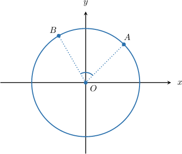
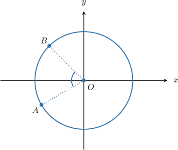
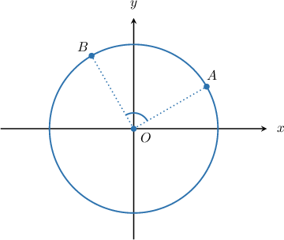
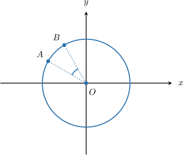
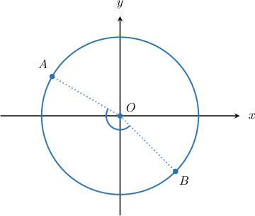
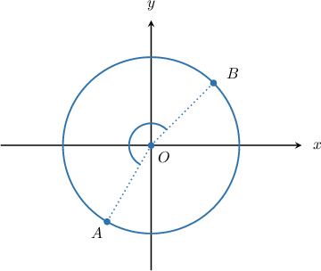
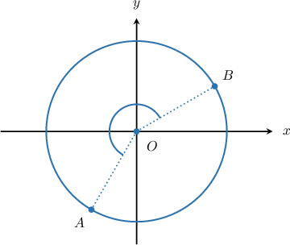
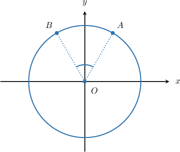
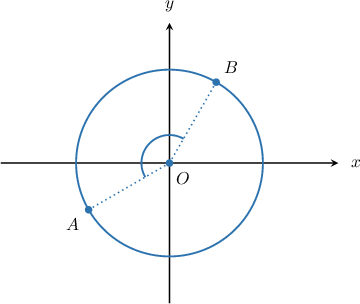
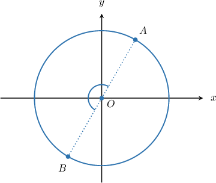

# Source originals and generated variants

Raw evidence preserves omitted fields and opaque banks; normal variants are explicitly authored method-bank questions.

## q-40920 — original

The diagram above shows a circle of radius $r$ centered at the origin. If the polar coordinates of the point $A$ are $(8, \frac{π}{4})$ and $m∠AOB = \frac{5π}{12}$, what are the Cartesian coordinates of $B$?

selection
(-4, 2\sqrt{2})
(-4, 2\sqrt{3})
(-4\sqrt{2}, 4\sqrt{3})
(-4, 4\sqrt{3})
(-4\sqrt{2}, 4\sqrt{2})

### Generated radius-scaled opaque evidence variant

The diagram above shows a circle of radius $r$ centered at the origin. If the polar coordinates of the point $A$ are $(4,\frac{\pi}{4})$ and $m∠AOB = \frac{5π}{12}$, what are the Cartesian coordinates of $B$?

selection
(-2,\sqrt{2})
(-2,\sqrt{3})
(- 2 \sqrt{2},2 \sqrt{3})
(-2,2 \sqrt{3})
(- 2 \sqrt{2},2 \sqrt{2})

### Generated normal method-bank variant

The diagram above shows a circle of radius $r$ centered at the origin. If the polar coordinates of the point $A$ are $(3,\frac{3 \pi}{4})$ and $m∠AOB=\frac{13 \pi}{12}$, what are the Cartesian coordinates of $B$?

selection
(- \frac{3 \sqrt{3}}{2},- \frac{3}{2})
(\frac{3 \sqrt{3}}{2},- \frac{3}{2})
(\frac{3}{2},- \frac{3 \sqrt{3}}{2})
(\frac{3 \sqrt{3}}{2},\frac{3}{2})
(- \frac{3 \sqrt{2}}{2},\frac{3 \sqrt{2}}{2})

Worked solution
First, since $A$ has polar coordinates $(3,\frac{3 \pi}{4}),$ we must have $r=3.$ Also, since the points $A$ and $B$ both lie on a circle of radius $3,$ the $r$-coordinate of $B$ must also be $3.$

Notice that one must traverse the circle counterclockwise to move from the point $A$ to point $B.$ Since the $\theta $-coordinate of $A$ is $\frac{3 \pi}{4},$ the $\theta $-coordinate of $B$ must be

$$
{\theta }_{B}=\frac{3 \pi}{4}+\frac{13 \pi}{12}=\frac{11 \pi}{6}.
$$

So, the polar coordinates of $B$ are $(3,\frac{11 \pi}{6})$

Now, we convert $B$ to Cartesian coordinates. To convert from polar coordinates to Cartesian coordinates, we use

$$
x=r\operatorname{cos}⁡\theta ,\,y=r\operatorname{sin}⁡\theta .
$$

First, we calculate the $x$-coordinate of $B:$

$$
\begin{aligned}x & =r\operatorname{cos}⁡\theta  \\  & =3\operatorname{cos}⁡(\frac{11 \pi}{6}) \\  & =3\cdot (\frac{\sqrt{3}}{2}) \\  & =\frac{3 \sqrt{3}}{2}\end{aligned}
$$

Then, we calculate the $y$-coordinate of $B:$

$$
\begin{aligned}y & =r\operatorname{sin}⁡\theta  \\  & =3\operatorname{sin}⁡(\frac{11 \pi}{6}) \\  & =3\cdot (- \frac{1}{2}) \\  & =- \frac{3}{2}\end{aligned}
$$

Therefore, the Cartesian coordinates of $B$ are $(\frac{3 \sqrt{3}}{2},- \frac{3}{2}).$

## q-40922 — original

The diagram above shows a circle of radius $r$ centered at the origin. If the polar coordinates of the point $A$ are $(6, 210^{∘})$ and $m∠AOB = 75^{∘}$, what are the Cartesian coordinates of $B$?

selection
(-3\sqrt{2}, 3\sqrt{2})
(-2\sqrt{3}, 2\sqrt{3})
(-3\sqrt{3}, 2)
(-3, 2\sqrt{3})
(-3\sqrt{3}, 3)

### Generated radius-scaled opaque evidence variant

The diagram above shows a circle of radius $r$ centered at the origin. If the polar coordinates of the point $A$ are $(3,{210}^{∘})$ and $m∠AOB = 75^{∘}$, what are the Cartesian coordinates of $B$?

selection
(- \frac{3 \sqrt{2}}{2},\frac{3 \sqrt{2}}{2})
(- \sqrt{3},\sqrt{3})
(- \frac{3 \sqrt{3}}{2},1)
(- \frac{3}{2},\sqrt{3})
(- \frac{3 \sqrt{3}}{2},\frac{3}{2})

### Generated normal method-bank variant

The diagram above shows a circle of radius $r$ centered at the origin. If the polar coordinates of the point $A$ are $(5,\frac{\pi}{6})$ and $m∠AOB=\frac{\pi}{2}$, what are the Cartesian coordinates of $B$?

selection
(\frac{5 \sqrt{3}}{2},\frac{5}{2})
(\frac{5}{2},- \frac{5 \sqrt{3}}{2})
(- \frac{5}{2},- \frac{5 \sqrt{3}}{2})
(\frac{5}{2},\frac{5 \sqrt{3}}{2})
(- \frac{5}{2},\frac{5 \sqrt{3}}{2})

Worked solution
First, since $A$ has polar coordinates $(5,\frac{\pi}{6}),$ we must have $r=5.$ Also, since the points $A$ and $B$ both lie on a circle of radius $5,$ the $r$-coordinate of $B$ must also be $5.$

Notice that one must traverse the circle counterclockwise to move from the point $A$ to point $B.$ Since the $\theta $-coordinate of $A$ is $\frac{\pi}{6},$ the $\theta $-coordinate of $B$ must be

$$
{\theta }_{B}=\frac{\pi}{6}+\frac{\pi}{2}=\frac{2 \pi}{3}.
$$

So, the polar coordinates of $B$ are $(5,\frac{2 \pi}{3})$

Now, we convert $B$ to Cartesian coordinates. To convert from polar coordinates to Cartesian coordinates, we use

$$
x=r\operatorname{cos}⁡\theta ,\,y=r\operatorname{sin}⁡\theta .
$$

First, we calculate the $x$-coordinate of $B:$

$$
\begin{aligned}x & =r\operatorname{cos}⁡\theta  \\  & =5\operatorname{cos}⁡(\frac{2 \pi}{3}) \\  & =5\cdot (- \frac{1}{2}) \\  & =- \frac{5}{2}\end{aligned}
$$

Then, we calculate the $y$-coordinate of $B:$

$$
\begin{aligned}y & =r\operatorname{sin}⁡\theta  \\  & =5\operatorname{sin}⁡(\frac{2 \pi}{3}) \\  & =5\cdot (\frac{\sqrt{3}}{2}) \\  & =\frac{5 \sqrt{3}}{2}\end{aligned}
$$

Therefore, the Cartesian coordinates of $B$ are $(- \frac{5}{2},\frac{5 \sqrt{3}}{2}).$

## q-120593 — original

The diagram above shows a circle of radius $r$ centered at the origin. If the polar coordinates of the point $A$ are $(6,\frac{\pi }{6})$ and $m∠AOB=\frac{\pi }{2},$ what are the Cartesian coordinates of $B?$

selection
(-3\sqrt{2},\sqrt{3})
(-3,3)
(-3,3\sqrt{3})
(\sqrt{2},3\sqrt{3})
(-3\sqrt{2},3)

Worked solution
First, since $A$ has polar coordinates $(6,\frac{\pi }{6}),$ we must have $r=6.$ Also, since the points $A$ and $B$ both lie on a circle of radius $6,$ the $r$-coordinate of $B$ must also be $6.$ 

Notice that one must traverse the circle counterclockwise to move from the point $A$ to point $B.$ Since the $\theta $-coordinate of $A$ is $\frac{\pi }{6},$ the $\theta $-coordinate of $B$ must be

$$
{\theta }_{B}=\frac{\pi }{6}+\frac{\pi }{2}=\frac{2\pi }{3}.
$$

So, the polar coordinates of $B$ are $(6,\frac{2\pi }{3})$ 

Now, we convert $B$ to Cartesian coordinates. To convert from polar coordinates to Cartesian coordinates, we use

$$
x=r\operatorname{cos}⁡\theta ,\,y=r\operatorname{sin}⁡\theta .
$$

First, we calculate the $x$-coordinate of $B:$

$$
\begin{aligned}x & =r\operatorname{cos}⁡\theta  \\  & =6\operatorname{cos}⁡(\frac{2\pi }{3}) \\  & =6(-\frac{1}{2}) \\  & =-3\end{aligned}
$$

Then, we calculate the $y$-coordinate of $B:$

$$
\begin{aligned}y & =r\operatorname{sin}⁡\theta  \\  & =6\operatorname{sin}⁡(\frac{2\pi }{3}) \\  & =6(\frac{\sqrt{3}}{2}) \\  & =3\sqrt{3}\end{aligned}
$$

Therefore, the Cartesian coordinates of $B$ are $(-3,3\sqrt{3}).$

### Generated radius-scaled opaque evidence variant

The diagram above shows a circle of radius $r$ centered at the origin. If the polar coordinates of the point $A$ are $(3,\frac{\pi}{6})$ and $m∠AOB=\frac{\pi }{2},$ what are the Cartesian coordinates of $B?$

selection
(- \frac{3 \sqrt{2}}{2},\frac{\sqrt{3}}{2})
(- \frac{3}{2},\frac{3}{2})
(- \frac{3}{2},\frac{3 \sqrt{3}}{2})
(\frac{\sqrt{2}}{2},\frac{3 \sqrt{3}}{2})
(- \frac{3 \sqrt{2}}{2},\frac{3}{2})

Worked solution
First, since $A$ has polar coordinates $(3,\frac{\pi}{6}),$ we must have $r=3.$ Also, since the points $A$ and $B$ both lie on a circle of radius $3,$ the $r$-coordinate of $B$ must also be $3.$ 

Notice that one must traverse the circle counterclockwise to move from the point $A$ to point $B.$ Since the $\theta $-coordinate of $A$ is $\frac{\pi }{6},$ the $\theta $-coordinate of $B$ must be

$$
{\theta }_{B}=\frac{\pi }{6}+\frac{\pi }{2}=\frac{2\pi }{3}.
$$

So, the polar coordinates of $B$ are $(3,\frac{2 \pi}{3})$ 

Now, we convert $B$ to Cartesian coordinates. To convert from polar coordinates to Cartesian coordinates, we use

$$
x=r\operatorname{cos}⁡\theta ,\,y=r\operatorname{sin}⁡\theta .
$$

First, we calculate the $x$-coordinate of $B:$

$$
\begin{aligned}x & =r\operatorname{cos}⁡\theta  \\  & =3\operatorname{cos}⁡(\frac{2 \pi}{3}) \\  & =3\cdot (- \frac{1}{2}) \\  & =- \frac{3}{2}\end{aligned}
$$

Then, we calculate the $y$-coordinate of $B:$

$$
\begin{aligned}y & =r\operatorname{sin}⁡\theta  \\  & =3\operatorname{sin}⁡(\frac{2 \pi}{3}) \\  & =3\cdot (\frac{\sqrt{3}}{2}) \\  & =\frac{3 \sqrt{3}}{2}\end{aligned}
$$

Therefore, the Cartesian coordinates of $B$ are $(- \frac{3}{2},\frac{3 \sqrt{3}}{2}).$

### Generated normal method-bank variant

The diagram above shows a circle of radius $r$ centered at the origin. If the polar coordinates of the point $A$ are $(3 \sqrt{2},\frac{5 \pi}{4})$ and $m∠AOB=\frac{5 \pi}{12},$ what are the Cartesian coordinates of $B?$

selection
(- \frac{3 \sqrt{6}}{2},- \frac{3 \sqrt{2}}{2})
(-3,-3)
(\frac{3 \sqrt{2}}{2},- \frac{3 \sqrt{6}}{2})
(- \frac{3 \sqrt{6}}{2},\frac{3 \sqrt{2}}{2})
(\frac{3 \sqrt{6}}{2},\frac{3 \sqrt{2}}{2})

Worked solution
First, since $A$ has polar coordinates $(3 \sqrt{2},\frac{5 \pi}{4}),$ we must have $r=3 \sqrt{2}.$ Also, since the points $A$ and $B$ both lie on a circle of radius $3 \sqrt{2},$ the $r$-coordinate of $B$ must also be $3 \sqrt{2}.$ 

Notice that one must traverse the circle clockwise to move from the point $A$ to point $B.$ Since the $\theta $-coordinate of $A$ is $\frac{5 \pi}{4},$ the $\theta $-coordinate of $B$ must be

$$
{\theta }_{B}=\frac{5 \pi}{4}-\frac{5 \pi}{12}=\frac{5 \pi}{6}.
$$

So, the polar coordinates of $B$ are $(3 \sqrt{2},\frac{5 \pi}{6})$ 

Now, we convert $B$ to Cartesian coordinates. To convert from polar coordinates to Cartesian coordinates, we use

$$
x=r\operatorname{cos}⁡\theta ,\,y=r\operatorname{sin}⁡\theta .
$$

First, we calculate the $x$-coordinate of $B:$

$$
\begin{aligned}x & =r\operatorname{cos}⁡\theta  \\  & =3 \sqrt{2}\operatorname{cos}⁡(\frac{5 \pi}{6}) \\  & =3 \sqrt{2}\cdot (- \frac{\sqrt{3}}{2}) \\  & =- \frac{3 \sqrt{6}}{2}\end{aligned}
$$

Then, we calculate the $y$-coordinate of $B:$

$$
\begin{aligned}y & =r\operatorname{sin}⁡\theta  \\  & =3 \sqrt{2}\operatorname{sin}⁡(\frac{5 \pi}{6}) \\  & =3 \sqrt{2}\cdot (\frac{1}{2}) \\  & =\frac{3 \sqrt{2}}{2}\end{aligned}
$$

Therefore, the Cartesian coordinates of $B$ are $(- \frac{3 \sqrt{6}}{2},\frac{3 \sqrt{2}}{2}).$

## q-120595 — original

The diagram above shows a circle of radius $r$ centered at the origin. If the polar coordinates of the point $A$ are $(4,\frac{5\pi }{6})$ and $m∠AOB=\frac{\pi }{6},$ what are the Cartesian coordinates of $B?$

selection
(2\sqrt{3},-2)
(2\sqrt{3},2\sqrt{3})
(-2,2)
(-2,2\sqrt{3})
(-2\sqrt{3},2)

Worked solution
First, since $A$ has polar coordinates $(4,\frac{5\pi }{6}),$ we must have $r=4.$ Also, since the points $A$ and $B$ both lie on a circle of radius $4,$ the $r$-coordinate of $B$ must also be $4.$

Notice that one must traverse the circle clockwise to move from the point $A$ to point $B.$ Since the $\theta $-coordinate of $A$ is $\frac{5\pi }{6},$ the $\theta $-coordinate of $B$ must be

$$
{\theta }_{B}=\frac{5\pi }{6}-\frac{\pi }{6}=\frac{2\pi }{3}.
$$

So, the polar coordinates of $B$ are $(4,\frac{2\pi }{3})$ 

Now, we convert $B$ to Cartesian coordinates. To convert from polar coordinates to Cartesian coordinates, we use

$$
x=r\operatorname{cos}⁡\theta ,\,y=r\operatorname{sin}⁡\theta .
$$

First, we calculate the $x$-coordinate of $B:$

$$
\begin{aligned}x & =r\operatorname{cos}⁡\theta  \\  & =4\operatorname{cos}⁡(\frac{2\pi }{3}) \\  & =4\cdot (-\frac{1}{2}) \\  & =-2\end{aligned}
$$

Then, we calculate the $y$-coordinate of $B:$

$$
\begin{aligned}y & =r\operatorname{sin}⁡\theta  \\  & =4\operatorname{sin}⁡(\frac{2\pi }{3}) \\  & =4\cdot \frac{\sqrt{3}}{2} \\  & =2\sqrt{3}\end{aligned}
$$

Therefore, the Cartesian coordinates of $B$ are $(-2,2\sqrt{3}).$

### Generated radius-scaled opaque evidence variant

The diagram above shows a circle of radius $r$ centered at the origin. If the polar coordinates of the point $A$ are $(2,\frac{5 \pi}{6})$ and $m∠AOB=\frac{\pi }{6},$ what are the Cartesian coordinates of $B?$

selection
(\sqrt{3},-1)
(\sqrt{3},\sqrt{3})
(-1,1)
(-1,\sqrt{3})
(- \sqrt{3},1)

Worked solution
First, since $A$ has polar coordinates $(2,\frac{5 \pi}{6}),$ we must have $r=2.$ Also, since the points $A$ and $B$ both lie on a circle of radius $2,$ the $r$-coordinate of $B$ must also be $2.$

Notice that one must traverse the circle clockwise to move from the point $A$ to point $B.$ Since the $\theta $-coordinate of $A$ is $\frac{5\pi }{6},$ the $\theta $-coordinate of $B$ must be

$$
{\theta }_{B}=\frac{5\pi }{6}-\frac{\pi }{6}=\frac{2\pi }{3}.
$$

So, the polar coordinates of $B$ are $(2,\frac{2 \pi}{3})$ 

Now, we convert $B$ to Cartesian coordinates. To convert from polar coordinates to Cartesian coordinates, we use

$$
x=r\operatorname{cos}⁡\theta ,\,y=r\operatorname{sin}⁡\theta .
$$

First, we calculate the $x$-coordinate of $B:$

$$
\begin{aligned}x & =r\operatorname{cos}⁡\theta  \\  & =2\operatorname{cos}⁡(\frac{2 \pi}{3}) \\  & =2\cdot (- \frac{1}{2}) \\  & =-1\end{aligned}
$$

Then, we calculate the $y$-coordinate of $B:$

$$
\begin{aligned}y & =r\operatorname{sin}⁡\theta  \\  & =2\operatorname{sin}⁡(\frac{2 \pi}{3}) \\  & =2\cdot (\frac{\sqrt{3}}{2}) \\  & =\sqrt{3}\end{aligned}
$$

Therefore, the Cartesian coordinates of $B$ are $(-1,\sqrt{3}).$

### Generated normal method-bank variant

The diagram above shows a circle of radius $r$ centered at the origin. If the polar coordinates of the point $A$ are $(3,\frac{5 \pi}{4})$ and $m∠AOB=\frac{5 \pi}{12},$ what are the Cartesian coordinates of $B?$

selection
(\frac{3}{2},- \frac{3 \sqrt{3}}{2})
(- \frac{3 \sqrt{2}}{2},- \frac{3 \sqrt{2}}{2})
(- \frac{3 \sqrt{3}}{2},\frac{3}{2})
(\frac{3}{2},\frac{3 \sqrt{3}}{2})
(- \frac{3}{2},- \frac{3 \sqrt{3}}{2})

Worked solution
First, since $A$ has polar coordinates $(3,\frac{5 \pi}{4}),$ we must have $r=3.$ Also, since the points $A$ and $B$ both lie on a circle of radius $3,$ the $r$-coordinate of $B$ must also be $3.$

Notice that one must traverse the circle counterclockwise to move from the point $A$ to point $B.$ Since the $\theta $-coordinate of $A$ is $\frac{5 \pi}{4},$ the $\theta $-coordinate of $B$ must be

$$
{\theta }_{B}=\frac{5 \pi}{4}+\frac{5 \pi}{12}=\frac{5 \pi}{3}.
$$

So, the polar coordinates of $B$ are $(3,\frac{5 \pi}{3})$ 

Now, we convert $B$ to Cartesian coordinates. To convert from polar coordinates to Cartesian coordinates, we use

$$
x=r\operatorname{cos}⁡\theta ,\,y=r\operatorname{sin}⁡\theta .
$$

First, we calculate the $x$-coordinate of $B:$

$$
\begin{aligned}x & =r\operatorname{cos}⁡\theta  \\  & =3\operatorname{cos}⁡(\frac{5 \pi}{3}) \\  & =3\cdot (\frac{1}{2}) \\  & =\frac{3}{2}\end{aligned}
$$

Then, we calculate the $y$-coordinate of $B:$

$$
\begin{aligned}y & =r\operatorname{sin}⁡\theta  \\  & =3\operatorname{sin}⁡(\frac{5 \pi}{3}) \\  & =3\cdot (- \frac{\sqrt{3}}{2}) \\  & =- \frac{3 \sqrt{3}}{2}\end{aligned}
$$

Therefore, the Cartesian coordinates of $B$ are $(\frac{3}{2},- \frac{3 \sqrt{3}}{2}).$

## q-120597 — original

The diagram above shows a circle of radius $r$ centered at the origin. If the polar coordinates of the point $A$ are $(4\sqrt{2},{150}^{∘})$ and $m∠AOB={165}^{∘},$ what are the Cartesian coordinates of $B?$

selection
(4,-4)
(-4\sqrt{2},-4)
(-2,-2)
(2,-2\sqrt{2})
(4,4\sqrt{2})

Worked solution
First, since $A$ has polar coordinates $(4\sqrt{2},{150}^{∘}),$ we must have $r=4\sqrt{2}.$ Also, since the points $A$ and $B$ both lie on a circle of radius $4\sqrt{2},$ the $r$-coordinate of $B$ must also be $4\sqrt{2}.$  

Notice that one must traverse the circle counterclockwise to move from the point $A$ to point $B.$ Since the $\theta $-coordinate of $A$ is ${150}^{∘},$ the $\theta $-coordinate of $B$ must be

$$
{\theta }_{B}={150}^{∘}+{165}^{∘}={315}^{∘}.
$$

So, the polar coordinates of $B$ are $(4\sqrt{2},{315}^{∘})$

Now, we convert $B$ to Cartesian coordinates. To convert from polar coordinates to Cartesian coordinates, we use

$$
x=r\operatorname{cos}⁡\theta ,\,y=r\operatorname{sin}⁡\theta .
$$

First, we calculate the $x$-coordinate of $B:$

$$
\begin{aligned}x & =r\operatorname{cos}⁡\theta  \\  & =4\sqrt{2}\operatorname{cos}⁡({315}^{∘}) \\  & =4\sqrt{2}\cdot \frac{\sqrt{2}}{2} \\  & =4\end{aligned}
$$

Then, we calculate the $y$-coordinate of $B:$

$$
\begin{aligned}y & =r\operatorname{sin}⁡\theta  \\  & =4\sqrt{2}\operatorname{sin}⁡({315}^{∘}) \\  & =4\sqrt{2}(-\frac{\sqrt{2}}{2}) \\  & =-4\end{aligned}
$$

Therefore, the Cartesian coordinates of $B$ are $(4,-4).$

### Generated radius-scaled opaque evidence variant

The diagram above shows a circle of radius $r$ centered at the origin. If the polar coordinates of the point $A$ are $(2 \sqrt{2},{150}^{∘})$ and $m∠AOB={165}^{∘},$ what are the Cartesian coordinates of $B?$

selection
(2,-2)
(- 2 \sqrt{2},-2)
(-1,-1)
(1,- \sqrt{2})
(2,2 \sqrt{2})

Worked solution
First, since $A$ has polar coordinates $(2 \sqrt{2},{150}^{∘}),$ we must have $r=2 \sqrt{2}.$ Also, since the points $A$ and $B$ both lie on a circle of radius $2 \sqrt{2},$ the $r$-coordinate of $B$ must also be $2 \sqrt{2}.$  

Notice that one must traverse the circle counterclockwise to move from the point $A$ to point $B.$ Since the $\theta $-coordinate of $A$ is ${150}^{∘},$ the $\theta $-coordinate of $B$ must be

$$
{\theta }_{B}={150}^{∘}+{165}^{∘}={315}^{∘}.
$$

So, the polar coordinates of $B$ are $(2 \sqrt{2},{315}^{∘})$

Now, we convert $B$ to Cartesian coordinates. To convert from polar coordinates to Cartesian coordinates, we use

$$
x=r\operatorname{cos}⁡\theta ,\,y=r\operatorname{sin}⁡\theta .
$$

First, we calculate the $x$-coordinate of $B:$

$$
\begin{aligned}x & =r\operatorname{cos}⁡\theta  \\  & =2 \sqrt{2}\operatorname{cos}⁡({315}^{∘}) \\  & =2 \sqrt{2}\cdot (\frac{\sqrt{2}}{2}) \\  & =2\end{aligned}
$$

Then, we calculate the $y$-coordinate of $B:$

$$
\begin{aligned}y & =r\operatorname{sin}⁡\theta  \\  & =2 \sqrt{2}\operatorname{sin}⁡({315}^{∘}) \\  & =2 \sqrt{2}\cdot (- \frac{\sqrt{2}}{2}) \\  & =-2\end{aligned}
$$

Therefore, the Cartesian coordinates of $B$ are $(2,-2).$

### Generated normal method-bank variant

The diagram above shows a circle of radius $r$ centered at the origin. If the polar coordinates of the point $A$ are $(5,{150}^{∘})$ and $m∠AOB={90}^{∘},$ what are the Cartesian coordinates of $B?$

selection
(\frac{5}{2},\frac{5 \sqrt{3}}{2})
(- \frac{5 \sqrt{3}}{2},\frac{5}{2})
(\frac{5}{2},- \frac{5 \sqrt{3}}{2})
(- \frac{5}{2},\frac{5 \sqrt{3}}{2})
(- \frac{5}{2},- \frac{5 \sqrt{3}}{2})

Worked solution
First, since $A$ has polar coordinates $(5,{150}^{∘}),$ we must have $r=5.$ Also, since the points $A$ and $B$ both lie on a circle of radius $5,$ the $r$-coordinate of $B$ must also be $5.$  

Notice that one must traverse the circle clockwise to move from the point $A$ to point $B.$ Since the $\theta $-coordinate of $A$ is ${150}^{∘},$ the $\theta $-coordinate of $B$ must be

$$
{\theta }_{B}={150}^{∘}-{90}^{∘}={60}^{∘}.
$$

So, the polar coordinates of $B$ are $(5,{60}^{∘})$

Now, we convert $B$ to Cartesian coordinates. To convert from polar coordinates to Cartesian coordinates, we use

$$
x=r\operatorname{cos}⁡\theta ,\,y=r\operatorname{sin}⁡\theta .
$$

First, we calculate the $x$-coordinate of $B:$

$$
\begin{aligned}x & =r\operatorname{cos}⁡\theta  \\  & =5\operatorname{cos}⁡({60}^{∘}) \\  & =5\cdot (\frac{1}{2}) \\  & =\frac{5}{2}\end{aligned}
$$

Then, we calculate the $y$-coordinate of $B:$

$$
\begin{aligned}y & =r\operatorname{sin}⁡\theta  \\  & =5\operatorname{sin}⁡({60}^{∘}) \\  & =5\cdot (\frac{\sqrt{3}}{2}) \\  & =\frac{5 \sqrt{3}}{2}\end{aligned}
$$

Therefore, the Cartesian coordinates of $B$ are $(\frac{5}{2},\frac{5 \sqrt{3}}{2}).$

## q-120598 — original

The diagram above shows a circle of radius $r$ centered at the origin. If the polar coordinates of the point $A$ are $(2,{240}^{∘})$ and $m∠AOB={195}^{∘},$ what are the Cartesian coordinates of $B?$

selection
(2,2)
(\sqrt{2},\sqrt{2})
(1,1)
(2,\sqrt{2})
(\sqrt{2},2)

Worked solution
First, since $A$ has polar coordinates $(2,{240}^{∘}),$ we must have $r=2.$ Also, since the points $A$ and $B$ both lie on a circle of radius $2,$ the $r$-coordinate of $B$ must also be $2.$

Notice that one must traverse the circle clockwise to move from the point $A$ to point $B.$ Since the $\theta $-coordinate of $A$ is ${240}^{∘},$ the $\theta $-coordinate of $B$ must be

$$
{\theta }_{B}={240}^{∘}-{195}^{∘}={45}^{∘}.
$$

So, the polar coordinates of $B$ are $(2,{45}^{∘})$

Now, we convert $B$ to Cartesian coordinates. To convert from polar coordinates to Cartesian coordinates, we use

$$
x=r\operatorname{cos}⁡\theta ,\,y=r\operatorname{sin}⁡\theta .
$$

First, we calculate the $x$-coordinate of $B:$

$$
\begin{aligned}x & =r\operatorname{cos}⁡\theta  \\  & =2\operatorname{cos}⁡({45}^{∘}) \\  & =2(\frac{\sqrt{2}}{2}) \\  & =\sqrt{2}\end{aligned}
$$

Then, we calculate the $y$-coordinate of $B:$

$$
\begin{aligned}y & =r\operatorname{sin}⁡\theta  \\  & =2\operatorname{sin}⁡({45}^{∘}) \\  & =2\cdot \frac{\sqrt{2}}{2} \\  & =\sqrt{2}\end{aligned}
$$

Therefore, the Cartesian coordinates of $B$ are $(\sqrt{2},\sqrt{2}).$

### Generated radius-scaled opaque evidence variant

The diagram above shows a circle of radius $r$ centered at the origin. If the polar coordinates of the point $A$ are $(1,{240}^{∘})$ and $m∠AOB={195}^{∘},$ what are the Cartesian coordinates of $B?$

selection
(1,1)
(\frac{\sqrt{2}}{2},\frac{\sqrt{2}}{2})
(\frac{1}{2},\frac{1}{2})
(1,\frac{\sqrt{2}}{2})
(\frac{\sqrt{2}}{2},1)

Worked solution
First, since $A$ has polar coordinates $(1,{240}^{∘}),$ we must have $r=1.$ Also, since the points $A$ and $B$ both lie on a circle of radius $1,$ the $r$-coordinate of $B$ must also be $1.$

Notice that one must traverse the circle clockwise to move from the point $A$ to point $B.$ Since the $\theta $-coordinate of $A$ is ${240}^{∘},$ the $\theta $-coordinate of $B$ must be

$$
{\theta }_{B}={240}^{∘}-{195}^{∘}={45}^{∘}.
$$

So, the polar coordinates of $B$ are $(1,{45}^{∘})$

Now, we convert $B$ to Cartesian coordinates. To convert from polar coordinates to Cartesian coordinates, we use

$$
x=r\operatorname{cos}⁡\theta ,\,y=r\operatorname{sin}⁡\theta .
$$

First, we calculate the $x$-coordinate of $B:$

$$
\begin{aligned}x & =r\operatorname{cos}⁡\theta  \\  & =1\operatorname{cos}⁡({45}^{∘}) \\  & =1\cdot (\frac{\sqrt{2}}{2}) \\  & =\frac{\sqrt{2}}{2}\end{aligned}
$$

Then, we calculate the $y$-coordinate of $B:$

$$
\begin{aligned}y & =r\operatorname{sin}⁡\theta  \\  & =1\operatorname{sin}⁡({45}^{∘}) \\  & =1\cdot (\frac{\sqrt{2}}{2}) \\  & =\frac{\sqrt{2}}{2}\end{aligned}
$$

Therefore, the Cartesian coordinates of $B$ are $(\frac{\sqrt{2}}{2},\frac{\sqrt{2}}{2}).$

### Generated normal method-bank variant

The diagram above shows a circle of radius $r$ centered at the origin. If the polar coordinates of the point $A$ are $(8,{330}^{∘})$ and $m∠AOB={210}^{∘},$ what are the Cartesian coordinates of $B?$

selection
(-4,- 4 \sqrt{3})
(4 \sqrt{3},-4)
(-8,0)
(-4,4 \sqrt{3})
(4,4 \sqrt{3})

Worked solution
First, since $A$ has polar coordinates $(8,{330}^{∘}),$ we must have $r=8.$ Also, since the points $A$ and $B$ both lie on a circle of radius $8,$ the $r$-coordinate of $B$ must also be $8.$

Notice that one must traverse the circle clockwise to move from the point $A$ to point $B.$ Since the $\theta $-coordinate of $A$ is ${330}^{∘},$ the $\theta $-coordinate of $B$ must be

$$
{\theta }_{B}={330}^{∘}-{210}^{∘}={120}^{∘}.
$$

So, the polar coordinates of $B$ are $(8,{120}^{∘})$

Now, we convert $B$ to Cartesian coordinates. To convert from polar coordinates to Cartesian coordinates, we use

$$
x=r\operatorname{cos}⁡\theta ,\,y=r\operatorname{sin}⁡\theta .
$$

First, we calculate the $x$-coordinate of $B:$

$$
\begin{aligned}x & =r\operatorname{cos}⁡\theta  \\  & =8\operatorname{cos}⁡({120}^{∘}) \\  & =8\cdot (- \frac{1}{2}) \\  & =-4\end{aligned}
$$

Then, we calculate the $y$-coordinate of $B:$

$$
\begin{aligned}y & =r\operatorname{sin}⁡\theta  \\  & =8\operatorname{sin}⁡({120}^{∘}) \\  & =8\cdot (\frac{\sqrt{3}}{2}) \\  & =4 \sqrt{3}\end{aligned}
$$

Therefore, the Cartesian coordinates of $B$ are $(-4,4 \sqrt{3}).$

## q-277012 — original

The diagram above shows a circle of radius $r$ centered at the origin. Determine the Cartesian coordinates of $B$ given that the polar coordinates of the point $A$ are $(4,{240}^{∘})$ and $m∠AOB={210}^{∘}.$

The Cartesian coordinates of $B$ are $(${{field-1}}$,$
{{field-2}}$).$

field-1
2\sqrt{3}

field-2
2

Worked solution
First, since $A$ has polar coordinates $(4,{240}^{∘}),$ we must have $r=4.$ Also, since the points $A$ and $B$ both lie on a circle of radius $4,$ the $r$-coordinate of $B$ must also be $4.$

Notice that one must traverse the circle clockwise to move from the point $A$ to point $B.$ Since the $\theta $-coordinate of $A$ is ${240}^{∘},$ the $\theta $-coordinate of $B$ must be

$$
{\theta }_{B}={240}^{∘}-{210}^{∘}={30}^{∘}.
$$

So, the polar coordinates of $B$ are $(4,{30}^{∘})$ 

Now, we convert $B$ to Cartesian coordinates. To convert from polar coordinates to Cartesian coordinates, we use

$$
x=r\operatorname{cos}⁡\theta ,\,y=r\operatorname{sin}⁡\theta .
$$

First, we calculate the $x$-coordinate of $B:$

$$
\begin{aligned}x & =r\operatorname{cos}⁡\theta  \\  & =4\operatorname{cos}⁡({30}^{∘}) \\  & =4\cdot \frac{\sqrt{3}}{2} \\  & =2\sqrt{3}\end{aligned}
$$

Then, we calculate the $y$-coordinate of $B:$

$$
\begin{aligned}y & =r\operatorname{sin}⁡\theta  \\  & =4\operatorname{sin}⁡({30}^{∘}) \\  & =4\cdot \frac{1}{2} \\  & =2\end{aligned}
$$

Therefore, the Cartesian coordinates of $B$ are $(2\sqrt{3},2).$

### Generated radius-scaled opaque evidence variant

The diagram above shows a circle of radius $r$ centered at the origin. Determine the Cartesian coordinates of $B$ given that the polar coordinates of the point $A$ are $(2,{240}^{∘})$ and $m∠AOB={210}^{∘}.$

The Cartesian coordinates of $B$ are $(${{field-1}}$,$
{{field-2}}$).$

field-1
\sqrt{3}

field-2
1

Worked solution
First, since $A$ has polar coordinates $(2,{240}^{∘}),$ we must have $r=2.$ Also, since the points $A$ and $B$ both lie on a circle of radius $2,$ the $r$-coordinate of $B$ must also be $2.$

Notice that one must traverse the circle clockwise to move from the point $A$ to point $B.$ Since the $\theta $-coordinate of $A$ is ${240}^{∘},$ the $\theta $-coordinate of $B$ must be

$$
{\theta }_{B}={240}^{∘}-{210}^{∘}={30}^{∘}.
$$

So, the polar coordinates of $B$ are $(2,{30}^{∘})$ 

Now, we convert $B$ to Cartesian coordinates. To convert from polar coordinates to Cartesian coordinates, we use

$$
x=r\operatorname{cos}⁡\theta ,\,y=r\operatorname{sin}⁡\theta .
$$

First, we calculate the $x$-coordinate of $B:$

$$
\begin{aligned}x & =r\operatorname{cos}⁡\theta  \\  & =2\operatorname{cos}⁡({30}^{∘}) \\  & =2\cdot (\frac{\sqrt{3}}{2}) \\  & =\sqrt{3}\end{aligned}
$$

Then, we calculate the $y$-coordinate of $B:$

$$
\begin{aligned}y & =r\operatorname{sin}⁡\theta  \\  & =2\operatorname{sin}⁡({30}^{∘}) \\  & =2\cdot (\frac{1}{2}) \\  & =1\end{aligned}
$$

Therefore, the Cartesian coordinates of $B$ are $(\sqrt{3},1).$

### Generated normal method-bank variant

The diagram above shows a circle of radius $r$ centered at the origin. Determine the Cartesian coordinates of $B$ given that the polar coordinates of the point $A$ are $(3,{330}^{∘})$ and $m∠AOB={105}^{∘}.$

The Cartesian coordinates of $B$ are $(${{field-1}}$,$
{{field-2}}$).$

field-1
- \frac{3 \sqrt{2}}{2}

field-2
- \frac{3 \sqrt{2}}{2}

Worked solution
First, since $A$ has polar coordinates $(3,{330}^{∘}),$ we must have $r=3.$ Also, since the points $A$ and $B$ both lie on a circle of radius $3,$ the $r$-coordinate of $B$ must also be $3.$

Notice that one must traverse the circle clockwise to move from the point $A$ to point $B.$ Since the $\theta $-coordinate of $A$ is ${330}^{∘},$ the $\theta $-coordinate of $B$ must be

$$
{\theta }_{B}={330}^{∘}-{105}^{∘}={225}^{∘}.
$$

So, the polar coordinates of $B$ are $(3,{225}^{∘})$ 

Now, we convert $B$ to Cartesian coordinates. To convert from polar coordinates to Cartesian coordinates, we use

$$
x=r\operatorname{cos}⁡\theta ,\,y=r\operatorname{sin}⁡\theta .
$$

First, we calculate the $x$-coordinate of $B:$

$$
\begin{aligned}x & =r\operatorname{cos}⁡\theta  \\  & =3\operatorname{cos}⁡({225}^{∘}) \\  & =3\cdot (- \frac{\sqrt{2}}{2}) \\  & =- \frac{3 \sqrt{2}}{2}\end{aligned}
$$

Then, we calculate the $y$-coordinate of $B:$

$$
\begin{aligned}y & =r\operatorname{sin}⁡\theta  \\  & =3\operatorname{sin}⁡({225}^{∘}) \\  & =3\cdot (- \frac{\sqrt{2}}{2}) \\  & =- \frac{3 \sqrt{2}}{2}\end{aligned}
$$

Therefore, the Cartesian coordinates of $B$ are $(- \frac{3 \sqrt{2}}{2},- \frac{3 \sqrt{2}}{2}).$

## q-277027 — original

The diagram above shows a circle of radius $r$ centered at the origin. Determine the Cartesian coordinates of $B$ given that the polar coordinates of the point $A$ are $(10,{60}^{∘})$ and $m∠AOB={60}^{∘}.$

The Cartesian coordinates of $B$ are $(${{field-1}}$,$
{{field-2}}$).$

field-1
-5

field-2
5\sqrt{3}

Worked solution
First, since $A$ has polar coordinates $(10,{60}^{∘}),$ we must have $r=10.$ Also, since the points $A$ and $B$ both lie on a circle of radius $10,$ the $r$-coordinate of $B$ must also be $10.$

Notice that one must traverse the circle counter-clockwise to move from the point $A$ to point $B.$ Since the $\theta $-coordinate of $A$ is ${60}^{∘},$ the $\theta $-coordinate of $B$ must be

$$
{\theta }_{B}={60}^{∘}+{60}^{∘}={120}^{∘}.
$$

So, the polar coordinates of $B$ are $(10,{120}^{∘})$ 

Now, we convert $B$ to Cartesian coordinates. To convert from polar coordinates to Cartesian coordinates, we use

$$
x=r\operatorname{cos}⁡\theta ,\,y=r\operatorname{sin}⁡\theta .
$$

First, we calculate the $x$-coordinate of $B:$

$$
\begin{aligned}x & =r\operatorname{cos}⁡\theta  \\  & =10\operatorname{cos}⁡({120}^{∘}) \\  & =10\cdot (-\frac{1}{2}) \\  & =-5\end{aligned}
$$

Then, we calculate the $y$-coordinate of $B:$

$$
\begin{aligned}y & =r\operatorname{sin}⁡\theta  \\  & =10\operatorname{sin}⁡({120}^{∘}) \\  & =10\cdot \frac{\sqrt{3}}{2} \\  & =5\sqrt{3}\end{aligned}
$$

Therefore, the Cartesian coordinates of $B$ are $(-5,5\sqrt{3}).$

### Generated radius-scaled opaque evidence variant

The diagram above shows a circle of radius $r$ centered at the origin. Determine the Cartesian coordinates of $B$ given that the polar coordinates of the point $A$ are $(5,{60}^{∘})$ and $m∠AOB={60}^{∘}.$

The Cartesian coordinates of $B$ are $(${{field-1}}$,$
{{field-2}}$).$

field-1
- \frac{5}{2}

field-2
\frac{5 \sqrt{3}}{2}

Worked solution
First, since $A$ has polar coordinates $(5,{60}^{∘}),$ we must have $r=5.$ Also, since the points $A$ and $B$ both lie on a circle of radius $5,$ the $r$-coordinate of $B$ must also be $5.$

Notice that one must traverse the circle counter-clockwise to move from the point $A$ to point $B.$ Since the $\theta $-coordinate of $A$ is ${60}^{∘},$ the $\theta $-coordinate of $B$ must be

$$
{\theta }_{B}={60}^{∘}+{60}^{∘}={120}^{∘}.
$$

So, the polar coordinates of $B$ are $(5,{120}^{∘})$ 

Now, we convert $B$ to Cartesian coordinates. To convert from polar coordinates to Cartesian coordinates, we use

$$
x=r\operatorname{cos}⁡\theta ,\,y=r\operatorname{sin}⁡\theta .
$$

First, we calculate the $x$-coordinate of $B:$

$$
\begin{aligned}x & =r\operatorname{cos}⁡\theta  \\  & =5\operatorname{cos}⁡({120}^{∘}) \\  & =5\cdot (- \frac{1}{2}) \\  & =- \frac{5}{2}\end{aligned}
$$

Then, we calculate the $y$-coordinate of $B:$

$$
\begin{aligned}y & =r\operatorname{sin}⁡\theta  \\  & =5\operatorname{sin}⁡({120}^{∘}) \\  & =5\cdot (\frac{\sqrt{3}}{2}) \\  & =\frac{5 \sqrt{3}}{2}\end{aligned}
$$

Therefore, the Cartesian coordinates of $B$ are $(- \frac{5}{2},\frac{5 \sqrt{3}}{2}).$

### Generated normal method-bank variant

The diagram above shows a circle of radius $r$ centered at the origin. Determine the Cartesian coordinates of $B$ given that the polar coordinates of the point $A$ are $(4,\frac{7 \pi}{6})$ and $m∠AOB=\frac{\pi}{2}.$

The Cartesian coordinates of $B$ are $(${{field-1}}$,$
{{field-2}}$).$

field-1
-2

field-2
2 \sqrt{3}

Worked solution
First, since $A$ has polar coordinates $(4,\frac{7 \pi}{6}),$ we must have $r=4.$ Also, since the points $A$ and $B$ both lie on a circle of radius $4,$ the $r$-coordinate of $B$ must also be $4.$

Notice that one must traverse the circle clockwise to move from the point $A$ to point $B.$ Since the $\theta $-coordinate of $A$ is $\frac{7 \pi}{6},$ the $\theta $-coordinate of $B$ must be

$$
{\theta }_{B}=\frac{7 \pi}{6}-\frac{\pi}{2}=\frac{2 \pi}{3}.
$$

So, the polar coordinates of $B$ are $(4,\frac{2 \pi}{3})$ 

Now, we convert $B$ to Cartesian coordinates. To convert from polar coordinates to Cartesian coordinates, we use

$$
x=r\operatorname{cos}⁡\theta ,\,y=r\operatorname{sin}⁡\theta .
$$

First, we calculate the $x$-coordinate of $B:$

$$
\begin{aligned}x & =r\operatorname{cos}⁡\theta  \\  & =4\operatorname{cos}⁡(\frac{2 \pi}{3}) \\  & =4\cdot (- \frac{1}{2}) \\  & =-2\end{aligned}
$$

Then, we calculate the $y$-coordinate of $B:$

$$
\begin{aligned}y & =r\operatorname{sin}⁡\theta  \\  & =4\operatorname{sin}⁡(\frac{2 \pi}{3}) \\  & =4\cdot (\frac{\sqrt{3}}{2}) \\  & =2 \sqrt{3}\end{aligned}
$$

Therefore, the Cartesian coordinates of $B$ are $(-2,2 \sqrt{3}).$

## q-81221 — original

The diagram above shows a circle of radius $r$ centered at the origin. If the polar coordinates of the point $A$ are $(5,\frac{7\pi }{6})$ and $m∠AOB=\frac{5\pi }{6},$ what are the Cartesian coordinates of $B?$

selection
(\frac{5\sqrt{2}}{2},\frac{9}{2})
(2\sqrt{2},4)
(\sqrt{3},4)
(2\sqrt{2},\frac{9}{2})
(\frac{5}{2},\frac{5\sqrt{3}}{2})

Worked solution
First, since $A$ has polar coordinates $(5,\frac{7\pi }{6}),$ we must have $r=5.$ Also, since the points $A$ and $B$ both lie on a circle of radius $5,$ the $r$-coordinate of $B$ must also be $5.$

Notice that one must traverse the circle clockwise to move from the point $A$ to point $B.$ Since the $\theta $-coordinate of $A$ is $\frac{7\pi }{6},$ the $\theta $-coordinate of $B$ must be

$$
{\theta }_{B}=\frac{7\pi }{6}-\frac{5\pi }{6}=\frac{\pi }{3}.
$$

So, the polar coordinates of $B$ are $(5,\frac{\pi }{3})$

Now, we convert $B$ to Cartesian coordinates. To convert from polar coordinates to Cartesian coordinates, we use

$$
x=r\operatorname{cos}⁡\theta ,\,y=r\operatorname{sin}⁡\theta .
$$

First, we calculate the $x$-coordinate of $B:$

$$
\begin{aligned}x & =r\operatorname{cos}⁡\theta  \\  & =5\operatorname{cos}⁡(\frac{\pi }{3}) \\  & =5\cdot \frac{1}{2} \\  & =\frac{5}{2}\end{aligned}
$$

Then, we calculate the $y$-coordinate of $B:$

$$
\begin{aligned}y & =r\operatorname{sin}⁡\theta  \\  & =5\operatorname{sin}⁡(\frac{\pi }{3}) \\  & =5\cdot \frac{\sqrt{3}}{2} \\  & =\frac{5\sqrt{3}}{2}\end{aligned}
$$

Therefore, the Cartesian coordinates of $B$ are $(\frac{5}{2},\frac{5\sqrt{3}}{2}).$

### Generated radius-scaled opaque evidence variant

The diagram above shows a circle of radius $r$ centered at the origin. If the polar coordinates of the point $A$ are $(\frac{5}{2},\frac{7 \pi}{6})$ and $m∠AOB=\frac{5\pi }{6},$ what are the Cartesian coordinates of $B?$

selection
(\frac{5 \sqrt{2}}{4},\frac{9}{4})
(\sqrt{2},2)
(\frac{\sqrt{3}}{2},2)
(\sqrt{2},\frac{9}{4})
(\frac{5}{4},\frac{5 \sqrt{3}}{4})

Worked solution
First, since $A$ has polar coordinates $(\frac{5}{2},\frac{7 \pi}{6}),$ we must have $r=\frac{5}{2}.$ Also, since the points $A$ and $B$ both lie on a circle of radius $\frac{5}{2},$ the $r$-coordinate of $B$ must also be $\frac{5}{2}.$

Notice that one must traverse the circle clockwise to move from the point $A$ to point $B.$ Since the $\theta $-coordinate of $A$ is $\frac{7\pi }{6},$ the $\theta $-coordinate of $B$ must be

$$
{\theta }_{B}=\frac{7\pi }{6}-\frac{5\pi }{6}=\frac{\pi }{3}.
$$

So, the polar coordinates of $B$ are $(\frac{5}{2},\frac{\pi}{3})$

Now, we convert $B$ to Cartesian coordinates. To convert from polar coordinates to Cartesian coordinates, we use

$$
x=r\operatorname{cos}⁡\theta ,\,y=r\operatorname{sin}⁡\theta .
$$

First, we calculate the $x$-coordinate of $B:$

$$
\begin{aligned}x & =r\operatorname{cos}⁡\theta  \\  & =\frac{5}{2}\operatorname{cos}⁡(\frac{\pi}{3}) \\  & =\frac{5}{2}\cdot (\frac{1}{2}) \\  & =\frac{5}{4}\end{aligned}
$$

Then, we calculate the $y$-coordinate of $B:$

$$
\begin{aligned}y & =r\operatorname{sin}⁡\theta  \\  & =\frac{5}{2}\operatorname{sin}⁡(\frac{\pi}{3}) \\  & =\frac{5}{2}\cdot (\frac{\sqrt{3}}{2}) \\  & =\frac{5 \sqrt{3}}{4}\end{aligned}
$$

Therefore, the Cartesian coordinates of $B$ are $(\frac{5}{4},\frac{5 \sqrt{3}}{4}).$

### Generated normal method-bank variant

The diagram above shows a circle of radius $r$ centered at the origin. If the polar coordinates of the point $A$ are $(10,\frac{\pi}{3})$ and $m∠AOB=\frac{\pi}{2},$ what are the Cartesian coordinates of $B?$

selection
(- 5 \sqrt{3},5)
(5 \sqrt{3},5)
(5 \sqrt{3},-5)
(5,5 \sqrt{3})
(- 5 \sqrt{3},-5)

Worked solution
First, since $A$ has polar coordinates $(10,\frac{\pi}{3}),$ we must have $r=10.$ Also, since the points $A$ and $B$ both lie on a circle of radius $10,$ the $r$-coordinate of $B$ must also be $10.$

Notice that one must traverse the circle counterclockwise to move from the point $A$ to point $B.$ Since the $\theta $-coordinate of $A$ is $\frac{\pi}{3},$ the $\theta $-coordinate of $B$ must be

$$
{\theta }_{B}=\frac{\pi}{3}+\frac{\pi}{2}=\frac{5 \pi}{6}.
$$

So, the polar coordinates of $B$ are $(10,\frac{5 \pi}{6})$

Now, we convert $B$ to Cartesian coordinates. To convert from polar coordinates to Cartesian coordinates, we use

$$
x=r\operatorname{cos}⁡\theta ,\,y=r\operatorname{sin}⁡\theta .
$$

First, we calculate the $x$-coordinate of $B:$

$$
\begin{aligned}x & =r\operatorname{cos}⁡\theta  \\  & =10\operatorname{cos}⁡(\frac{5 \pi}{6}) \\  & =10\cdot (- \frac{\sqrt{3}}{2}) \\  & =- 5 \sqrt{3}\end{aligned}
$$

Then, we calculate the $y$-coordinate of $B:$

$$
\begin{aligned}y & =r\operatorname{sin}⁡\theta  \\  & =10\operatorname{sin}⁡(\frac{5 \pi}{6}) \\  & =10\cdot (\frac{1}{2}) \\  & =5\end{aligned}
$$

Therefore, the Cartesian coordinates of $B$ are $(- 5 \sqrt{3},5).$

## q-81224 — original

The diagram above shows a circle of radius $r$ centered at the origin. If the polar coordinates of the point $A$ are $(10,\frac{\pi }{3})$ and $m∠AOB=\pi ,$ what are the Cartesian coordinates of $B?$

selection
(-4,-5\sqrt{3})
(-6,-4\sqrt{2})
(-\frac{11}{2},-4\sqrt{2})
(-5,-4\sqrt{6})
(-5,-5\sqrt{3})

Worked solution
First, since $A$ has polar coordinates $(10,\frac{\pi }{3}),$ we must have $r=10.$ Also, since the points $A$ and $B$ both lie on a circle of radius $10,$ the $r$-coordinate of $B$ must also be $10.$

Notice that one must traverse the circle counterclockwise to move from the point $A$ to point $B.$ Since the $\theta $-coordinate of $A$ is $\frac{\pi }{3},$ the $\theta $-coordinate of $B$ must be

$$
{\theta }_{B}=\frac{\pi }{3}+\pi =\frac{4\pi }{3}.
$$

So, the polar coordinates of $B$ are $(10,\frac{4\pi }{3})$

Now, we convert $B$ to Cartesian coordinates. To convert from polar coordinates to Cartesian coordinates, we use

$$
x=r\operatorname{cos}⁡\theta ,\,y=r\operatorname{sin}⁡\theta .
$$

First, we calculate the $x$-coordinate of $B:$

$$
\begin{aligned}x & =r\operatorname{cos}⁡\theta  \\  & =10\operatorname{cos}⁡(\frac{4\pi }{3}) \\  & =10(-\frac{1}{2}) \\  & =-5\end{aligned}
$$

Then, we calculate the $y$-coordinate of $B:$

$$
\begin{aligned}y & =r\operatorname{sin}⁡\theta  \\  & =10\operatorname{sin}⁡(\frac{4\pi }{3}) \\  & =10(-\frac{\sqrt{3}}{2}) \\  & =-5\sqrt{3}\end{aligned}
$$

Therefore, the Cartesian coordinates of $B$ are $(-5,-5\sqrt{3}).$

### Generated radius-scaled opaque evidence variant

The diagram above shows a circle of radius $r$ centered at the origin. If the polar coordinates of the point $A$ are $(5,\frac{\pi}{3})$ and $m∠AOB=\pi ,$ what are the Cartesian coordinates of $B?$

selection
(-2,- \frac{5 \sqrt{3}}{2})
(-3,- 2 \sqrt{2})
(- \frac{11}{4},- 2 \sqrt{2})
(- \frac{5}{2},- 2 \sqrt{6})
(- \frac{5}{2},- \frac{5 \sqrt{3}}{2})

Worked solution
First, since $A$ has polar coordinates $(5,\frac{\pi}{3}),$ we must have $r=5.$ Also, since the points $A$ and $B$ both lie on a circle of radius $5,$ the $r$-coordinate of $B$ must also be $5.$

Notice that one must traverse the circle counterclockwise to move from the point $A$ to point $B.$ Since the $\theta $-coordinate of $A$ is $\frac{\pi }{3},$ the $\theta $-coordinate of $B$ must be

$$
{\theta }_{B}=\frac{\pi }{3}+\pi =\frac{4\pi }{3}.
$$

So, the polar coordinates of $B$ are $(5,\frac{4 \pi}{3})$

Now, we convert $B$ to Cartesian coordinates. To convert from polar coordinates to Cartesian coordinates, we use

$$
x=r\operatorname{cos}⁡\theta ,\,y=r\operatorname{sin}⁡\theta .
$$

First, we calculate the $x$-coordinate of $B:$

$$
\begin{aligned}x & =r\operatorname{cos}⁡\theta  \\  & =5\operatorname{cos}⁡(\frac{4 \pi}{3}) \\  & =5\cdot (- \frac{1}{2}) \\  & =- \frac{5}{2}\end{aligned}
$$

Then, we calculate the $y$-coordinate of $B:$

$$
\begin{aligned}y & =r\operatorname{sin}⁡\theta  \\  & =5\operatorname{sin}⁡(\frac{4 \pi}{3}) \\  & =5\cdot (- \frac{\sqrt{3}}{2}) \\  & =- \frac{5 \sqrt{3}}{2}\end{aligned}
$$

Therefore, the Cartesian coordinates of $B$ are $(- \frac{5}{2},- \frac{5 \sqrt{3}}{2}).$

### Generated normal method-bank variant

The diagram above shows a circle of radius $r$ centered at the origin. If the polar coordinates of the point $A$ are $(5,{225}^{∘})$ and $m∠AOB={105}^{∘},$ what are the Cartesian coordinates of $B?$

selection
(- \frac{5 \sqrt{2}}{2},- \frac{5 \sqrt{2}}{2})
(\frac{5 \sqrt{3}}{2},- \frac{5}{2})
(- \frac{5 \sqrt{3}}{2},- \frac{5}{2})
(- \frac{5}{2},\frac{5 \sqrt{3}}{2})
(\frac{5 \sqrt{3}}{2},\frac{5}{2})

Worked solution
First, since $A$ has polar coordinates $(5,{225}^{∘}),$ we must have $r=5.$ Also, since the points $A$ and $B$ both lie on a circle of radius $5,$ the $r$-coordinate of $B$ must also be $5.$

Notice that one must traverse the circle counterclockwise to move from the point $A$ to point $B.$ Since the $\theta $-coordinate of $A$ is ${225}^{∘},$ the $\theta $-coordinate of $B$ must be

$$
{\theta }_{B}={225}^{∘}+{105}^{∘}={330}^{∘}.
$$

So, the polar coordinates of $B$ are $(5,{330}^{∘})$

Now, we convert $B$ to Cartesian coordinates. To convert from polar coordinates to Cartesian coordinates, we use

$$
x=r\operatorname{cos}⁡\theta ,\,y=r\operatorname{sin}⁡\theta .
$$

First, we calculate the $x$-coordinate of $B:$

$$
\begin{aligned}x & =r\operatorname{cos}⁡\theta  \\  & =5\operatorname{cos}⁡({330}^{∘}) \\  & =5\cdot (\frac{\sqrt{3}}{2}) \\  & =\frac{5 \sqrt{3}}{2}\end{aligned}
$$

Then, we calculate the $y$-coordinate of $B:$

$$
\begin{aligned}y & =r\operatorname{sin}⁡\theta  \\  & =5\operatorname{sin}⁡({330}^{∘}) \\  & =5\cdot (- \frac{1}{2}) \\  & =- \frac{5}{2}\end{aligned}
$$

Therefore, the Cartesian coordinates of $B$ are $(\frac{5 \sqrt{3}}{2},- \frac{5}{2}).$

## Authored easy variant 0

The diagram above shows a circle of radius $r$ centered at the origin. If the polar coordinates of the point $A$ are $(5,{0}^{∘}),$ and $m∠AOB={30}^{∘},$ what are the Cartesian coordinates of $B?$

The Cartesian coordinates of $B$ are $(${{field-1}}$,$
{{field-2}}$).$

field-1
\frac{5 \sqrt{3}}{2}

field-2
\frac{5}{2}

Worked solution
First, since $A$ has polar coordinates $(5,{0}^{∘}),$ we must have $r=5.$ Also, since the points $A$ and $B$ both lie on a circle of radius $5,$ the $r$-coordinate of $B$ must also be $5.$

Notice that one must traverse the circle counterclockwise to move from the point $A$ to point $B.$ Since the $\theta $-coordinate of $A$ is ${0}^{∘},$ the $\theta $-coordinate of $B$ must be

$$
{\theta }_{B}={0}^{∘}+{30}^{∘}={30}^{∘}.
$$

So, the polar coordinates of $B$ are $(5,{30}^{∘})$

Now, we convert $B$ to Cartesian coordinates. To convert from polar coordinates to Cartesian coordinates, we use

$$
x=r\operatorname{cos}⁡\theta ,\,y=r\operatorname{sin}⁡\theta .
$$

First, we calculate the $x$-coordinate of $B:$

$$
\begin{aligned}x & =r\operatorname{cos}⁡\theta  \\  & =5\operatorname{cos}⁡({30}^{∘}) \\  & =5\cdot (\frac{\sqrt{3}}{2}) \\  & =\frac{5 \sqrt{3}}{2}\end{aligned}
$$

Then, we calculate the $y$-coordinate of $B:$

$$
\begin{aligned}y & =r\operatorname{sin}⁡\theta  \\  & =5\operatorname{sin}⁡({30}^{∘}) \\  & =5\cdot (\frac{1}{2}) \\  & =\frac{5}{2}\end{aligned}
$$

Therefore, the Cartesian coordinates of $B$ are $(\frac{5 \sqrt{3}}{2},\frac{5}{2}).$

## Authored easy variant 1

The diagram above shows a circle of radius $r$ centered at the origin. If the polar coordinates of the point $A$ are $(7,{0}^{∘}),$ and $m∠AOB={60}^{∘},$ what are the Cartesian coordinates of $B?$

selection
(7,0)
(\frac{7}{2},- \frac{7 \sqrt{3}}{2})
(- \frac{7}{2},\frac{7 \sqrt{3}}{2})
(\frac{1}{2},\frac{\sqrt{3}}{2})
(\frac{7}{2},\frac{7 \sqrt{3}}{2})

Worked solution
First, since $A$ has polar coordinates $(7,{0}^{∘}),$ we must have $r=7.$ Also, since the points $A$ and $B$ both lie on a circle of radius $7,$ the $r$-coordinate of $B$ must also be $7.$

Notice that one must traverse the circle counterclockwise to move from the point $A$ to point $B.$ Since the $\theta $-coordinate of $A$ is ${0}^{∘},$ the $\theta $-coordinate of $B$ must be

$$
{\theta }_{B}={0}^{∘}+{60}^{∘}={60}^{∘}.
$$

So, the polar coordinates of $B$ are $(7,{60}^{∘})$

Now, we convert $B$ to Cartesian coordinates. To convert from polar coordinates to Cartesian coordinates, we use

$$
x=r\operatorname{cos}⁡\theta ,\,y=r\operatorname{sin}⁡\theta .
$$

First, we calculate the $x$-coordinate of $B:$

$$
\begin{aligned}x & =r\operatorname{cos}⁡\theta  \\  & =7\operatorname{cos}⁡({60}^{∘}) \\  & =7\cdot (\frac{1}{2}) \\  & =\frac{7}{2}\end{aligned}
$$

Then, we calculate the $y$-coordinate of $B:$

$$
\begin{aligned}y & =r\operatorname{sin}⁡\theta  \\  & =7\operatorname{sin}⁡({60}^{∘}) \\  & =7\cdot (\frac{\sqrt{3}}{2}) \\  & =\frac{7 \sqrt{3}}{2}\end{aligned}
$$

Therefore, the Cartesian coordinates of $B$ are $(\frac{7}{2},\frac{7 \sqrt{3}}{2}).$

## Authored easy variant 2

The diagram above shows a circle of radius $r$ centered at the origin. If the polar coordinates of the point $A$ are $(5,{0}^{∘}),$ and $m∠AOB={30}^{∘},$ what are the Cartesian coordinates of $B?$

selection
(\frac{\sqrt{3}}{2},\frac{1}{2})
(\frac{5 \sqrt{3}}{2},\frac{5}{2})
(5,0)
(\frac{5 \sqrt{3}}{2},- \frac{5}{2})
(- \frac{5 \sqrt{3}}{2},\frac{5}{2})

Worked solution
First, since $A$ has polar coordinates $(5,{0}^{∘}),$ we must have $r=5.$ Also, since the points $A$ and $B$ both lie on a circle of radius $5,$ the $r$-coordinate of $B$ must also be $5.$

Notice that one must traverse the circle counterclockwise to move from the point $A$ to point $B.$ Since the $\theta $-coordinate of $A$ is ${0}^{∘},$ the $\theta $-coordinate of $B$ must be

$$
{\theta }_{B}={0}^{∘}+{30}^{∘}={30}^{∘}.
$$

So, the polar coordinates of $B$ are $(5,{30}^{∘})$

Now, we convert $B$ to Cartesian coordinates. To convert from polar coordinates to Cartesian coordinates, we use

$$
x=r\operatorname{cos}⁡\theta ,\,y=r\operatorname{sin}⁡\theta .
$$

First, we calculate the $x$-coordinate of $B:$

$$
\begin{aligned}x & =r\operatorname{cos}⁡\theta  \\  & =5\operatorname{cos}⁡({30}^{∘}) \\  & =5\cdot (\frac{\sqrt{3}}{2}) \\  & =\frac{5 \sqrt{3}}{2}\end{aligned}
$$

Then, we calculate the $y$-coordinate of $B:$

$$
\begin{aligned}y & =r\operatorname{sin}⁡\theta  \\  & =5\operatorname{sin}⁡({30}^{∘}) \\  & =5\cdot (\frac{1}{2}) \\  & =\frac{5}{2}\end{aligned}
$$

Therefore, the Cartesian coordinates of $B$ are $(\frac{5 \sqrt{3}}{2},\frac{5}{2}).$

## Authored easy variant 3

The diagram above shows a circle of radius $r$ centered at the origin. If the polar coordinates of the point $A$ are $(8,{0}^{∘}),$ and $m∠AOB={30}^{∘},$ what are the Cartesian coordinates of $B?$

selection
(8,0)
(4 \sqrt{3},4)
(- 4 \sqrt{3},4)
(4 \sqrt{3},-4)
(\frac{\sqrt{3}}{2},\frac{1}{2})

Worked solution
First, since $A$ has polar coordinates $(8,{0}^{∘}),$ we must have $r=8.$ Also, since the points $A$ and $B$ both lie on a circle of radius $8,$ the $r$-coordinate of $B$ must also be $8.$

Notice that one must traverse the circle counterclockwise to move from the point $A$ to point $B.$ Since the $\theta $-coordinate of $A$ is ${0}^{∘},$ the $\theta $-coordinate of $B$ must be

$$
{\theta }_{B}={0}^{∘}+{30}^{∘}={30}^{∘}.
$$

So, the polar coordinates of $B$ are $(8,{30}^{∘})$

Now, we convert $B$ to Cartesian coordinates. To convert from polar coordinates to Cartesian coordinates, we use

$$
x=r\operatorname{cos}⁡\theta ,\,y=r\operatorname{sin}⁡\theta .
$$

First, we calculate the $x$-coordinate of $B:$

$$
\begin{aligned}x & =r\operatorname{cos}⁡\theta  \\  & =8\operatorname{cos}⁡({30}^{∘}) \\  & =8\cdot (\frac{\sqrt{3}}{2}) \\  & =4 \sqrt{3}\end{aligned}
$$

Then, we calculate the $y$-coordinate of $B:$

$$
\begin{aligned}y & =r\operatorname{sin}⁡\theta  \\  & =8\operatorname{sin}⁡({30}^{∘}) \\  & =8\cdot (\frac{1}{2}) \\  & =4\end{aligned}
$$

Therefore, the Cartesian coordinates of $B$ are $(4 \sqrt{3},4).$

## Authored easy variant 4

The diagram above shows a circle of radius $r$ centered at the origin. If the polar coordinates of the point $A$ are $(8,{0}^{∘}),$ and $m∠AOB={30}^{∘},$ what are the Cartesian coordinates of $B?$

selection
(4 \sqrt{3},4)
(8,0)
(4 \sqrt{3},-4)
(\frac{\sqrt{3}}{2},\frac{1}{2})
(- 4 \sqrt{3},4)

Worked solution
First, since $A$ has polar coordinates $(8,{0}^{∘}),$ we must have $r=8.$ Also, since the points $A$ and $B$ both lie on a circle of radius $8,$ the $r$-coordinate of $B$ must also be $8.$

Notice that one must traverse the circle counterclockwise to move from the point $A$ to point $B.$ Since the $\theta $-coordinate of $A$ is ${0}^{∘},$ the $\theta $-coordinate of $B$ must be

$$
{\theta }_{B}={0}^{∘}+{30}^{∘}={30}^{∘}.
$$

So, the polar coordinates of $B$ are $(8,{30}^{∘})$

Now, we convert $B$ to Cartesian coordinates. To convert from polar coordinates to Cartesian coordinates, we use

$$
x=r\operatorname{cos}⁡\theta ,\,y=r\operatorname{sin}⁡\theta .
$$

First, we calculate the $x$-coordinate of $B:$

$$
\begin{aligned}x & =r\operatorname{cos}⁡\theta  \\  & =8\operatorname{cos}⁡({30}^{∘}) \\  & =8\cdot (\frac{\sqrt{3}}{2}) \\  & =4 \sqrt{3}\end{aligned}
$$

Then, we calculate the $y$-coordinate of $B:$

$$
\begin{aligned}y & =r\operatorname{sin}⁡\theta  \\  & =8\operatorname{sin}⁡({30}^{∘}) \\  & =8\cdot (\frac{1}{2}) \\  & =4\end{aligned}
$$

Therefore, the Cartesian coordinates of $B$ are $(4 \sqrt{3},4).$

## Authored easy variant 5

The diagram above shows a circle of radius $r$ centered at the origin. If the polar coordinates of the point $A$ are $(6,{0}^{∘}),$ and $m∠AOB={30}^{∘},$ what are the Cartesian coordinates of $B?$

The Cartesian coordinates of $B$ are $(${{field-1}}$,$
{{field-2}}$).$

field-1
3 \sqrt{3}

field-2
3

Worked solution
First, since $A$ has polar coordinates $(6,{0}^{∘}),$ we must have $r=6.$ Also, since the points $A$ and $B$ both lie on a circle of radius $6,$ the $r$-coordinate of $B$ must also be $6.$

Notice that one must traverse the circle counterclockwise to move from the point $A$ to point $B.$ Since the $\theta $-coordinate of $A$ is ${0}^{∘},$ the $\theta $-coordinate of $B$ must be

$$
{\theta }_{B}={0}^{∘}+{30}^{∘}={30}^{∘}.
$$

So, the polar coordinates of $B$ are $(6,{30}^{∘})$

Now, we convert $B$ to Cartesian coordinates. To convert from polar coordinates to Cartesian coordinates, we use

$$
x=r\operatorname{cos}⁡\theta ,\,y=r\operatorname{sin}⁡\theta .
$$

First, we calculate the $x$-coordinate of $B:$

$$
\begin{aligned}x & =r\operatorname{cos}⁡\theta  \\  & =6\operatorname{cos}⁡({30}^{∘}) \\  & =6\cdot (\frac{\sqrt{3}}{2}) \\  & =3 \sqrt{3}\end{aligned}
$$

Then, we calculate the $y$-coordinate of $B:$

$$
\begin{aligned}y & =r\operatorname{sin}⁡\theta  \\  & =6\operatorname{sin}⁡({30}^{∘}) \\  & =6\cdot (\frac{1}{2}) \\  & =3\end{aligned}
$$

Therefore, the Cartesian coordinates of $B$ are $(3 \sqrt{3},3).$

## Authored moderate variant 6

The diagram above shows a circle of radius $r$ centered at the origin. If the polar coordinates of the point $A$ are $(4,{225}^{∘}),$ and $m∠AOB={15}^{∘},$ what are the Cartesian coordinates of $B?$

The Cartesian coordinates of $B$ are $(${{field-1}}$,$
{{field-2}}$).$

field-1
- 2 \sqrt{3}

field-2
-2

Worked solution
First, since $A$ has polar coordinates $(4,{225}^{∘}),$ we must have $r=4.$ Also, since the points $A$ and $B$ both lie on a circle of radius $4,$ the $r$-coordinate of $B$ must also be $4.$

Notice that one must traverse the circle clockwise to move from the point $A$ to point $B.$ Since the $\theta $-coordinate of $A$ is ${225}^{∘},$ the $\theta $-coordinate of $B$ must be

$$
{\theta }_{B}={225}^{∘}-{15}^{∘}={210}^{∘}.
$$

So, the polar coordinates of $B$ are $(4,{210}^{∘})$

Now, we convert $B$ to Cartesian coordinates. To convert from polar coordinates to Cartesian coordinates, we use

$$
x=r\operatorname{cos}⁡\theta ,\,y=r\operatorname{sin}⁡\theta .
$$

First, we calculate the $x$-coordinate of $B:$

$$
\begin{aligned}x & =r\operatorname{cos}⁡\theta  \\  & =4\operatorname{cos}⁡({210}^{∘}) \\  & =4\cdot (- \frac{\sqrt{3}}{2}) \\  & =- 2 \sqrt{3}\end{aligned}
$$

Then, we calculate the $y$-coordinate of $B:$

$$
\begin{aligned}y & =r\operatorname{sin}⁡\theta  \\  & =4\operatorname{sin}⁡({210}^{∘}) \\  & =4\cdot (- \frac{1}{2}) \\  & =-2\end{aligned}
$$

Therefore, the Cartesian coordinates of $B$ are $(- 2 \sqrt{3},-2).$

## Authored moderate variant 7

The diagram above shows a circle of radius $r$ centered at the origin. If the polar coordinates of the point $A$ are $(8,{225}^{∘}),$ and $m∠AOB={15}^{∘},$ what are the Cartesian coordinates of $B?$

selection
(- 4 \sqrt{3},-4)
(-4,- 4 \sqrt{3})
(- 4 \sqrt{3},4)
(- 4 \sqrt{2},- 4 \sqrt{2})
(4 \sqrt{3},-4)

Worked solution
First, since $A$ has polar coordinates $(8,{225}^{∘}),$ we must have $r=8.$ Also, since the points $A$ and $B$ both lie on a circle of radius $8,$ the $r$-coordinate of $B$ must also be $8.$

Notice that one must traverse the circle clockwise to move from the point $A$ to point $B.$ Since the $\theta $-coordinate of $A$ is ${225}^{∘},$ the $\theta $-coordinate of $B$ must be

$$
{\theta }_{B}={225}^{∘}-{15}^{∘}={210}^{∘}.
$$

So, the polar coordinates of $B$ are $(8,{210}^{∘})$

Now, we convert $B$ to Cartesian coordinates. To convert from polar coordinates to Cartesian coordinates, we use

$$
x=r\operatorname{cos}⁡\theta ,\,y=r\operatorname{sin}⁡\theta .
$$

First, we calculate the $x$-coordinate of $B:$

$$
\begin{aligned}x & =r\operatorname{cos}⁡\theta  \\  & =8\operatorname{cos}⁡({210}^{∘}) \\  & =8\cdot (- \frac{\sqrt{3}}{2}) \\  & =- 4 \sqrt{3}\end{aligned}
$$

Then, we calculate the $y$-coordinate of $B:$

$$
\begin{aligned}y & =r\operatorname{sin}⁡\theta  \\  & =8\operatorname{sin}⁡({210}^{∘}) \\  & =8\cdot (- \frac{1}{2}) \\  & =-4\end{aligned}
$$

Therefore, the Cartesian coordinates of $B$ are $(- 4 \sqrt{3},-4).$

## Authored moderate variant 8

The diagram above shows a circle of radius $r$ centered at the origin. If the polar coordinates of the point $A$ are $(4,{135}^{∘}),$ and $m∠AOB={15}^{∘},$ what are the Cartesian coordinates of $B?$

selection
(-2,2 \sqrt{3})
(2,2 \sqrt{3})
(- 2 \sqrt{3},2)
(- 2 \sqrt{2},2 \sqrt{2})
(-2,- 2 \sqrt{3})

Worked solution
First, since $A$ has polar coordinates $(4,{135}^{∘}),$ we must have $r=4.$ Also, since the points $A$ and $B$ both lie on a circle of radius $4,$ the $r$-coordinate of $B$ must also be $4.$

Notice that one must traverse the circle clockwise to move from the point $A$ to point $B.$ Since the $\theta $-coordinate of $A$ is ${135}^{∘},$ the $\theta $-coordinate of $B$ must be

$$
{\theta }_{B}={135}^{∘}-{15}^{∘}={120}^{∘}.
$$

So, the polar coordinates of $B$ are $(4,{120}^{∘})$

Now, we convert $B$ to Cartesian coordinates. To convert from polar coordinates to Cartesian coordinates, we use

$$
x=r\operatorname{cos}⁡\theta ,\,y=r\operatorname{sin}⁡\theta .
$$

First, we calculate the $x$-coordinate of $B:$

$$
\begin{aligned}x & =r\operatorname{cos}⁡\theta  \\  & =4\operatorname{cos}⁡({120}^{∘}) \\  & =4\cdot (- \frac{1}{2}) \\  & =-2\end{aligned}
$$

Then, we calculate the $y$-coordinate of $B:$

$$
\begin{aligned}y & =r\operatorname{sin}⁡\theta  \\  & =4\operatorname{sin}⁡({120}^{∘}) \\  & =4\cdot (\frac{\sqrt{3}}{2}) \\  & =2 \sqrt{3}\end{aligned}
$$

Therefore, the Cartesian coordinates of $B$ are $(-2,2 \sqrt{3}).$

## Authored moderate variant 9

The diagram above shows a circle of radius $r$ centered at the origin. If the polar coordinates of the point $A$ are $(3,{135}^{∘}),$ and $m∠AOB={15}^{∘},$ what are the Cartesian coordinates of $B?$

selection
(- \frac{3 \sqrt{2}}{2},\frac{3 \sqrt{2}}{2})
(- \frac{3}{2},\frac{3 \sqrt{3}}{2})
(- \frac{3}{2},- \frac{3 \sqrt{3}}{2})
(\frac{3}{2},\frac{3 \sqrt{3}}{2})
(- \frac{3 \sqrt{3}}{2},\frac{3}{2})

Worked solution
First, since $A$ has polar coordinates $(3,{135}^{∘}),$ we must have $r=3.$ Also, since the points $A$ and $B$ both lie on a circle of radius $3,$ the $r$-coordinate of $B$ must also be $3.$

Notice that one must traverse the circle clockwise to move from the point $A$ to point $B.$ Since the $\theta $-coordinate of $A$ is ${135}^{∘},$ the $\theta $-coordinate of $B$ must be

$$
{\theta }_{B}={135}^{∘}-{15}^{∘}={120}^{∘}.
$$

So, the polar coordinates of $B$ are $(3,{120}^{∘})$

Now, we convert $B$ to Cartesian coordinates. To convert from polar coordinates to Cartesian coordinates, we use

$$
x=r\operatorname{cos}⁡\theta ,\,y=r\operatorname{sin}⁡\theta .
$$

First, we calculate the $x$-coordinate of $B:$

$$
\begin{aligned}x & =r\operatorname{cos}⁡\theta  \\  & =3\operatorname{cos}⁡({120}^{∘}) \\  & =3\cdot (- \frac{1}{2}) \\  & =- \frac{3}{2}\end{aligned}
$$

Then, we calculate the $y$-coordinate of $B:$

$$
\begin{aligned}y & =r\operatorname{sin}⁡\theta  \\  & =3\operatorname{sin}⁡({120}^{∘}) \\  & =3\cdot (\frac{\sqrt{3}}{2}) \\  & =\frac{3 \sqrt{3}}{2}\end{aligned}
$$

Therefore, the Cartesian coordinates of $B$ are $(- \frac{3}{2},\frac{3 \sqrt{3}}{2}).$

## Authored moderate variant 10

The diagram above shows a circle of radius $r$ centered at the origin. If the polar coordinates of the point $A$ are $(7,{240}^{∘}),$ and $m∠AOB={30}^{∘},$ what are the Cartesian coordinates of $B?$

selection
(- \frac{7 \sqrt{3}}{2},- \frac{7}{2})
(\frac{7 \sqrt{3}}{2},- \frac{7}{2})
(0,-7)
(- \frac{7 \sqrt{3}}{2},\frac{7}{2})
(- \frac{7}{2},- \frac{7 \sqrt{3}}{2})

Worked solution
First, since $A$ has polar coordinates $(7,{240}^{∘}),$ we must have $r=7.$ Also, since the points $A$ and $B$ both lie on a circle of radius $7,$ the $r$-coordinate of $B$ must also be $7.$

Notice that one must traverse the circle clockwise to move from the point $A$ to point $B.$ Since the $\theta $-coordinate of $A$ is ${240}^{∘},$ the $\theta $-coordinate of $B$ must be

$$
{\theta }_{B}={240}^{∘}-{30}^{∘}={210}^{∘}.
$$

So, the polar coordinates of $B$ are $(7,{210}^{∘})$

Now, we convert $B$ to Cartesian coordinates. To convert from polar coordinates to Cartesian coordinates, we use

$$
x=r\operatorname{cos}⁡\theta ,\,y=r\operatorname{sin}⁡\theta .
$$

First, we calculate the $x$-coordinate of $B:$

$$
\begin{aligned}x & =r\operatorname{cos}⁡\theta  \\  & =7\operatorname{cos}⁡({210}^{∘}) \\  & =7\cdot (- \frac{\sqrt{3}}{2}) \\  & =- \frac{7 \sqrt{3}}{2}\end{aligned}
$$

Then, we calculate the $y$-coordinate of $B:$

$$
\begin{aligned}y & =r\operatorname{sin}⁡\theta  \\  & =7\operatorname{sin}⁡({210}^{∘}) \\  & =7\cdot (- \frac{1}{2}) \\  & =- \frac{7}{2}\end{aligned}
$$

Therefore, the Cartesian coordinates of $B$ are $(- \frac{7 \sqrt{3}}{2},- \frac{7}{2}).$

## Authored moderate variant 11

The diagram above shows a circle of radius $r$ centered at the origin. If the polar coordinates of the point $A$ are $(8,{45}^{∘}),$ and $m∠AOB={15}^{∘},$ what are the Cartesian coordinates of $B?$

The Cartesian coordinates of $B$ are $(${{field-1}}$,$
{{field-2}}$).$

field-1
4 \sqrt{3}

field-2
4

Worked solution
First, since $A$ has polar coordinates $(8,{45}^{∘}),$ we must have $r=8.$ Also, since the points $A$ and $B$ both lie on a circle of radius $8,$ the $r$-coordinate of $B$ must also be $8.$

Notice that one must traverse the circle clockwise to move from the point $A$ to point $B.$ Since the $\theta $-coordinate of $A$ is ${45}^{∘},$ the $\theta $-coordinate of $B$ must be

$$
{\theta }_{B}={45}^{∘}-{15}^{∘}={30}^{∘}.
$$

So, the polar coordinates of $B$ are $(8,{30}^{∘})$

Now, we convert $B$ to Cartesian coordinates. To convert from polar coordinates to Cartesian coordinates, we use

$$
x=r\operatorname{cos}⁡\theta ,\,y=r\operatorname{sin}⁡\theta .
$$

First, we calculate the $x$-coordinate of $B:$

$$
\begin{aligned}x & =r\operatorname{cos}⁡\theta  \\  & =8\operatorname{cos}⁡({30}^{∘}) \\  & =8\cdot (\frac{\sqrt{3}}{2}) \\  & =4 \sqrt{3}\end{aligned}
$$

Then, we calculate the $y$-coordinate of $B:$

$$
\begin{aligned}y & =r\operatorname{sin}⁡\theta  \\  & =8\operatorname{sin}⁡({30}^{∘}) \\  & =8\cdot (\frac{1}{2}) \\  & =4\end{aligned}
$$

Therefore, the Cartesian coordinates of $B$ are $(4 \sqrt{3},4).$

## Authored hard variant 12

The diagram above shows a circle of radius $r$ centered at the origin. Determine the Cartesian coordinates of $B$ given that the polar coordinates of the point $A$ are $(9,\frac{\pi}{4})$ and $m∠AOB=\frac{\pi}{2}.$

The Cartesian coordinates of $B$ are $(${{field-1}}$,$
{{field-2}}$).$

field-1
- \frac{9 \sqrt{2}}{2}

field-2
\frac{9 \sqrt{2}}{2}

Worked solution
First, since $A$ has polar coordinates $(9,\frac{\pi}{4}),$ we must have $r=9.$ Also, since the points $A$ and $B$ both lie on a circle of radius $9,$ the $r$-coordinate of $B$ must also be $9.$

Notice that one must traverse the circle counter-clockwise to move from the point $A$ to point $B.$ Since the $\theta $-coordinate of $A$ is $\frac{\pi}{4},$ the $\theta $-coordinate of $B$ must be

$$
{\theta }_{B}=\frac{\pi}{4}+\frac{\pi}{2}=\frac{3 \pi}{4}.
$$

So, the polar coordinates of $B$ are $(9,\frac{3 \pi}{4})$ 

Now, we convert $B$ to Cartesian coordinates. To convert from polar coordinates to Cartesian coordinates, we use

$$
x=r\operatorname{cos}⁡\theta ,\,y=r\operatorname{sin}⁡\theta .
$$

First, we calculate the $x$-coordinate of $B:$

$$
\begin{aligned}x & =r\operatorname{cos}⁡\theta  \\  & =9\operatorname{cos}⁡(\frac{3 \pi}{4}) \\  & =9\cdot (- \frac{\sqrt{2}}{2}) \\  & =- \frac{9 \sqrt{2}}{2}\end{aligned}
$$

Then, we calculate the $y$-coordinate of $B:$

$$
\begin{aligned}y & =r\operatorname{sin}⁡\theta  \\  & =9\operatorname{sin}⁡(\frac{3 \pi}{4}) \\  & =9\cdot (\frac{\sqrt{2}}{2}) \\  & =\frac{9 \sqrt{2}}{2}\end{aligned}
$$

Therefore, the Cartesian coordinates of $B$ are $(- \frac{9 \sqrt{2}}{2},\frac{9 \sqrt{2}}{2}).$

## Authored hard variant 13

The diagram above shows a circle of radius $r$ centered at the origin. If the polar coordinates of the point $A$ are $(8 \sqrt{2},\frac{2 \pi}{3})$ and $m∠AOB=\frac{7 \pi}{6}$, what are the Cartesian coordinates of $B$?

selection
(0,- 8 \sqrt{2})
(4 \sqrt{6},4 \sqrt{2})
(- 4 \sqrt{2},4 \sqrt{6})
(- 4 \sqrt{6},- 4 \sqrt{2})
(4 \sqrt{6},- 4 \sqrt{2})

Worked solution
First, since $A$ has polar coordinates $(8 \sqrt{2},\frac{2 \pi}{3}),$ we must have $r=8 \sqrt{2}.$ Also, since the points $A$ and $B$ both lie on a circle of radius $8 \sqrt{2},$ the $r$-coordinate of $B$ must also be $8 \sqrt{2}.$

Notice that one must traverse the circle counterclockwise to move from the point $A$ to point $B.$ Since the $\theta $-coordinate of $A$ is $\frac{2 \pi}{3},$ the $\theta $-coordinate of $B$ must be

$$
{\theta }_{B}=\frac{2 \pi}{3}+\frac{7 \pi}{6}=\frac{11 \pi}{6}.
$$

So, the polar coordinates of $B$ are $(8 \sqrt{2},\frac{11 \pi}{6})$

Now, we convert $B$ to Cartesian coordinates. To convert from polar coordinates to Cartesian coordinates, we use

$$
x=r\operatorname{cos}⁡\theta ,\,y=r\operatorname{sin}⁡\theta .
$$

First, we calculate the $x$-coordinate of $B:$

$$
\begin{aligned}x & =r\operatorname{cos}⁡\theta  \\  & =8 \sqrt{2}\operatorname{cos}⁡(\frac{11 \pi}{6}) \\  & =8 \sqrt{2}\cdot (\frac{\sqrt{3}}{2}) \\  & =4 \sqrt{6}\end{aligned}
$$

Then, we calculate the $y$-coordinate of $B:$

$$
\begin{aligned}y & =r\operatorname{sin}⁡\theta  \\  & =8 \sqrt{2}\operatorname{sin}⁡(\frac{11 \pi}{6}) \\  & =8 \sqrt{2}\cdot (- \frac{1}{2}) \\  & =- 4 \sqrt{2}\end{aligned}
$$

Therefore, the Cartesian coordinates of $B$ are $(4 \sqrt{6},- 4 \sqrt{2}).$

## Authored hard variant 14

The diagram above shows a circle of radius $r$ centered at the origin. If the polar coordinates of the point $A$ are $(3,\frac{5 \pi}{6})$ and $m∠AOB=\frac{5 \pi}{6}$, what are the Cartesian coordinates of $B$?

selection
(3,0)
(\frac{3}{2},\frac{3 \sqrt{3}}{2})
(- \frac{3 \sqrt{3}}{2},\frac{3}{2})
(- \frac{3}{2},- \frac{3 \sqrt{3}}{2})
(\frac{3}{2},- \frac{3 \sqrt{3}}{2})

Worked solution
First, since $A$ has polar coordinates $(3,\frac{5 \pi}{6}),$ we must have $r=3.$ Also, since the points $A$ and $B$ both lie on a circle of radius $3,$ the $r$-coordinate of $B$ must also be $3.$

Notice that one must traverse the circle counterclockwise to move from the point $A$ to point $B.$ Since the $\theta $-coordinate of $A$ is $\frac{5 \pi}{6},$ the $\theta $-coordinate of $B$ must be

$$
{\theta }_{B}=\frac{5 \pi}{6}+\frac{5 \pi}{6}=\frac{5 \pi}{3}.
$$

So, the polar coordinates of $B$ are $(3,\frac{5 \pi}{3})$

Now, we convert $B$ to Cartesian coordinates. To convert from polar coordinates to Cartesian coordinates, we use

$$
x=r\operatorname{cos}⁡\theta ,\,y=r\operatorname{sin}⁡\theta .
$$

First, we calculate the $x$-coordinate of $B:$

$$
\begin{aligned}x & =r\operatorname{cos}⁡\theta  \\  & =3\operatorname{cos}⁡(\frac{5 \pi}{3}) \\  & =3\cdot (\frac{1}{2}) \\  & =\frac{3}{2}\end{aligned}
$$

Then, we calculate the $y$-coordinate of $B:$

$$
\begin{aligned}y & =r\operatorname{sin}⁡\theta  \\  & =3\operatorname{sin}⁡(\frac{5 \pi}{3}) \\  & =3\cdot (- \frac{\sqrt{3}}{2}) \\  & =- \frac{3 \sqrt{3}}{2}\end{aligned}
$$

Therefore, the Cartesian coordinates of $B$ are $(\frac{3}{2},- \frac{3 \sqrt{3}}{2}).$

## Authored hard variant 15

The diagram above shows a circle of radius $r$ centered at the origin. If the polar coordinates of the point $A$ are $(3,\frac{\pi}{3})$ and $m∠AOB=\frac{\pi }{2},$ what are the Cartesian coordinates of $B?$

selection
(- \frac{3 \sqrt{3}}{2},- \frac{3}{2})
(\frac{3 \sqrt{3}}{2},\frac{3}{2})
(- \frac{3 \sqrt{3}}{2},\frac{3}{2})
(\frac{3 \sqrt{3}}{2},- \frac{3}{2})
(\frac{3}{2},\frac{3 \sqrt{3}}{2})

Worked solution
First, since $A$ has polar coordinates $(3,\frac{\pi}{3}),$ we must have $r=3.$ Also, since the points $A$ and $B$ both lie on a circle of radius $3,$ the $r$-coordinate of $B$ must also be $3.$ 

Notice that one must traverse the circle counterclockwise to move from the point $A$ to point $B.$ Since the $\theta $-coordinate of $A$ is $\frac{\pi}{3},$ the $\theta $-coordinate of $B$ must be

$$
{\theta }_{B}=\frac{\pi}{3}+\frac{\pi}{2}=\frac{5 \pi}{6}.
$$

So, the polar coordinates of $B$ are $(3,\frac{5 \pi}{6})$ 

Now, we convert $B$ to Cartesian coordinates. To convert from polar coordinates to Cartesian coordinates, we use

$$
x=r\operatorname{cos}⁡\theta ,\,y=r\operatorname{sin}⁡\theta .
$$

First, we calculate the $x$-coordinate of $B:$

$$
\begin{aligned}x & =r\operatorname{cos}⁡\theta  \\  & =3\operatorname{cos}⁡(\frac{5 \pi}{6}) \\  & =3\cdot (- \frac{\sqrt{3}}{2}) \\  & =- \frac{3 \sqrt{3}}{2}\end{aligned}
$$

Then, we calculate the $y$-coordinate of $B:$

$$
\begin{aligned}y & =r\operatorname{sin}⁡\theta  \\  & =3\operatorname{sin}⁡(\frac{5 \pi}{6}) \\  & =3\cdot (\frac{1}{2}) \\  & =\frac{3}{2}\end{aligned}
$$

Therefore, the Cartesian coordinates of $B$ are $(- \frac{3 \sqrt{3}}{2},\frac{3}{2}).$

## Authored hard variant 16

The diagram above shows a circle of radius $r$ centered at the origin. If the polar coordinates of the point $A$ are $(3 \sqrt{2},{45}^{∘})$ and $m∠AOB={195}^{∘},$ what are the Cartesian coordinates of $B?$

selection
(- \frac{3 \sqrt{2}}{2},- \frac{3 \sqrt{6}}{2})
(3,3)
(- \frac{3 \sqrt{6}}{2},- \frac{3 \sqrt{2}}{2})
(\frac{3 \sqrt{2}}{2},- \frac{3 \sqrt{6}}{2})
(- \frac{3 \sqrt{2}}{2},\frac{3 \sqrt{6}}{2})

Worked solution
First, since $A$ has polar coordinates $(3 \sqrt{2},{45}^{∘}),$ we must have $r=3 \sqrt{2}.$ Also, since the points $A$ and $B$ both lie on a circle of radius $3 \sqrt{2},$ the $r$-coordinate of $B$ must also be $3 \sqrt{2}.$  

Notice that one must traverse the circle counterclockwise to move from the point $A$ to point $B.$ Since the $\theta $-coordinate of $A$ is ${45}^{∘},$ the $\theta $-coordinate of $B$ must be

$$
{\theta }_{B}={45}^{∘}+{195}^{∘}={240}^{∘}.
$$

So, the polar coordinates of $B$ are $(3 \sqrt{2},{240}^{∘})$

Now, we convert $B$ to Cartesian coordinates. To convert from polar coordinates to Cartesian coordinates, we use

$$
x=r\operatorname{cos}⁡\theta ,\,y=r\operatorname{sin}⁡\theta .
$$

First, we calculate the $x$-coordinate of $B:$

$$
\begin{aligned}x & =r\operatorname{cos}⁡\theta  \\  & =3 \sqrt{2}\operatorname{cos}⁡({240}^{∘}) \\  & =3 \sqrt{2}\cdot (- \frac{1}{2}) \\  & =- \frac{3 \sqrt{2}}{2}\end{aligned}
$$

Then, we calculate the $y$-coordinate of $B:$

$$
\begin{aligned}y & =r\operatorname{sin}⁡\theta  \\  & =3 \sqrt{2}\operatorname{sin}⁡({240}^{∘}) \\  & =3 \sqrt{2}\cdot (- \frac{\sqrt{3}}{2}) \\  & =- \frac{3 \sqrt{6}}{2}\end{aligned}
$$

Therefore, the Cartesian coordinates of $B$ are $(- \frac{3 \sqrt{2}}{2},- \frac{3 \sqrt{6}}{2}).$

## Authored hard variant 17

The diagram above shows a circle of radius $r$ centered at the origin. Determine the Cartesian coordinates of $B$ given that the polar coordinates of the point $A$ are $(8 \sqrt{2},{240}^{∘})$ and $m∠AOB={60}^{∘}.$

The Cartesian coordinates of $B$ are $(${{field-1}}$,$
{{field-2}}$).$

field-1
4 \sqrt{2}

field-2
- 4 \sqrt{6}

Worked solution
First, since $A$ has polar coordinates $(8 \sqrt{2},{240}^{∘}),$ we must have $r=8 \sqrt{2}.$ Also, since the points $A$ and $B$ both lie on a circle of radius $8 \sqrt{2},$ the $r$-coordinate of $B$ must also be $8 \sqrt{2}.$

Notice that one must traverse the circle counter-clockwise to move from the point $A$ to point $B.$ Since the $\theta $-coordinate of $A$ is ${240}^{∘},$ the $\theta $-coordinate of $B$ must be

$$
{\theta }_{B}={240}^{∘}+{60}^{∘}={300}^{∘}.
$$

So, the polar coordinates of $B$ are $(8 \sqrt{2},{300}^{∘})$ 

Now, we convert $B$ to Cartesian coordinates. To convert from polar coordinates to Cartesian coordinates, we use

$$
x=r\operatorname{cos}⁡\theta ,\,y=r\operatorname{sin}⁡\theta .
$$

First, we calculate the $x$-coordinate of $B:$

$$
\begin{aligned}x & =r\operatorname{cos}⁡\theta  \\  & =8 \sqrt{2}\operatorname{cos}⁡({300}^{∘}) \\  & =8 \sqrt{2}\cdot (\frac{1}{2}) \\  & =4 \sqrt{2}\end{aligned}
$$

Then, we calculate the $y$-coordinate of $B:$

$$
\begin{aligned}y & =r\operatorname{sin}⁡\theta  \\  & =8 \sqrt{2}\operatorname{sin}⁡({300}^{∘}) \\  & =8 \sqrt{2}\cdot (- \frac{\sqrt{3}}{2}) \\  & =- 4 \sqrt{6}\end{aligned}
$$

Therefore, the Cartesian coordinates of $B$ are $(4 \sqrt{2},- 4 \sqrt{6}).$

## Authored hard variant 18

The diagram above shows a circle of radius $r$ centered at the origin. Determine the Cartesian coordinates of $B$ given that the polar coordinates of the point $A$ are $(9,\frac{\pi}{4})$ and $m∠AOB=\frac{\pi}{2}.$

The Cartesian coordinates of $B$ are $(${{field-1}}$,$
{{field-2}}$).$

field-1
- \frac{9 \sqrt{2}}{2}

field-2
\frac{9 \sqrt{2}}{2}

Worked solution
First, since $A$ has polar coordinates $(9,\frac{\pi}{4}),$ we must have $r=9.$ Also, since the points $A$ and $B$ both lie on a circle of radius $9,$ the $r$-coordinate of $B$ must also be $9.$

Notice that one must traverse the circle counter-clockwise to move from the point $A$ to point $B.$ Since the $\theta $-coordinate of $A$ is $\frac{\pi}{4},$ the $\theta $-coordinate of $B$ must be

$$
{\theta }_{B}=\frac{\pi}{4}+\frac{\pi}{2}=\frac{3 \pi}{4}.
$$

So, the polar coordinates of $B$ are $(9,\frac{3 \pi}{4})$ 

Now, we convert $B$ to Cartesian coordinates. To convert from polar coordinates to Cartesian coordinates, we use

$$
x=r\operatorname{cos}⁡\theta ,\,y=r\operatorname{sin}⁡\theta .
$$

First, we calculate the $x$-coordinate of $B:$

$$
\begin{aligned}x & =r\operatorname{cos}⁡\theta  \\  & =9\operatorname{cos}⁡(\frac{3 \pi}{4}) \\  & =9\cdot (- \frac{\sqrt{2}}{2}) \\  & =- \frac{9 \sqrt{2}}{2}\end{aligned}
$$

Then, we calculate the $y$-coordinate of $B:$

$$
\begin{aligned}y & =r\operatorname{sin}⁡\theta  \\  & =9\operatorname{sin}⁡(\frac{3 \pi}{4}) \\  & =9\cdot (\frac{\sqrt{2}}{2}) \\  & =\frac{9 \sqrt{2}}{2}\end{aligned}
$$

Therefore, the Cartesian coordinates of $B$ are $(- \frac{9 \sqrt{2}}{2},\frac{9 \sqrt{2}}{2}).$

## Authored hard variant 19

The diagram above shows a circle of radius $r$ centered at the origin. If the polar coordinates of the point $A$ are $(8 \sqrt{2},\frac{2 \pi}{3})$ and $m∠AOB=\frac{7 \pi}{6}$, what are the Cartesian coordinates of $B$?

selection
(0,- 8 \sqrt{2})
(4 \sqrt{6},4 \sqrt{2})
(- 4 \sqrt{2},4 \sqrt{6})
(- 4 \sqrt{6},- 4 \sqrt{2})
(4 \sqrt{6},- 4 \sqrt{2})

Worked solution
First, since $A$ has polar coordinates $(8 \sqrt{2},\frac{2 \pi}{3}),$ we must have $r=8 \sqrt{2}.$ Also, since the points $A$ and $B$ both lie on a circle of radius $8 \sqrt{2},$ the $r$-coordinate of $B$ must also be $8 \sqrt{2}.$

Notice that one must traverse the circle counterclockwise to move from the point $A$ to point $B.$ Since the $\theta $-coordinate of $A$ is $\frac{2 \pi}{3},$ the $\theta $-coordinate of $B$ must be

$$
{\theta }_{B}=\frac{2 \pi}{3}+\frac{7 \pi}{6}=\frac{11 \pi}{6}.
$$

So, the polar coordinates of $B$ are $(8 \sqrt{2},\frac{11 \pi}{6})$

Now, we convert $B$ to Cartesian coordinates. To convert from polar coordinates to Cartesian coordinates, we use

$$
x=r\operatorname{cos}⁡\theta ,\,y=r\operatorname{sin}⁡\theta .
$$

First, we calculate the $x$-coordinate of $B:$

$$
\begin{aligned}x & =r\operatorname{cos}⁡\theta  \\  & =8 \sqrt{2}\operatorname{cos}⁡(\frac{11 \pi}{6}) \\  & =8 \sqrt{2}\cdot (\frac{\sqrt{3}}{2}) \\  & =4 \sqrt{6}\end{aligned}
$$

Then, we calculate the $y$-coordinate of $B:$

$$
\begin{aligned}y & =r\operatorname{sin}⁡\theta  \\  & =8 \sqrt{2}\operatorname{sin}⁡(\frac{11 \pi}{6}) \\  & =8 \sqrt{2}\cdot (- \frac{1}{2}) \\  & =- 4 \sqrt{2}\end{aligned}
$$

Therefore, the Cartesian coordinates of $B$ are $(4 \sqrt{6},- 4 \sqrt{2}).$

## Authored hard variant 20

The diagram above shows a circle of radius $r$ centered at the origin. If the polar coordinates of the point $A$ are $(9,\frac{\pi}{6})$ and $m∠AOB=\frac{\pi}{2},$ what are the Cartesian coordinates of $B?$

selection
(- \frac{9}{2},- \frac{9 \sqrt{3}}{2})
(\frac{9}{2},- \frac{9 \sqrt{3}}{2})
(\frac{9}{2},\frac{9 \sqrt{3}}{2})
(\frac{9 \sqrt{3}}{2},\frac{9}{2})
(- \frac{9}{2},\frac{9 \sqrt{3}}{2})

Worked solution
First, since $A$ has polar coordinates $(9,\frac{\pi}{6}),$ we must have $r=9.$ Also, since the points $A$ and $B$ both lie on a circle of radius $9,$ the $r$-coordinate of $B$ must also be $9.$

Notice that one must traverse the circle counterclockwise to move from the point $A$ to point $B.$ Since the $\theta $-coordinate of $A$ is $\frac{\pi}{6},$ the $\theta $-coordinate of $B$ must be

$$
{\theta }_{B}=\frac{\pi}{6}+\frac{\pi}{2}=\frac{2 \pi}{3}.
$$

So, the polar coordinates of $B$ are $(9,\frac{2 \pi}{3})$

Now, we convert $B$ to Cartesian coordinates. To convert from polar coordinates to Cartesian coordinates, we use

$$
x=r\operatorname{cos}⁡\theta ,\,y=r\operatorname{sin}⁡\theta .
$$

First, we calculate the $x$-coordinate of $B:$

$$
\begin{aligned}x & =r\operatorname{cos}⁡\theta  \\  & =9\operatorname{cos}⁡(\frac{2 \pi}{3}) \\  & =9\cdot (- \frac{1}{2}) \\  & =- \frac{9}{2}\end{aligned}
$$

Then, we calculate the $y$-coordinate of $B:$

$$
\begin{aligned}y & =r\operatorname{sin}⁡\theta  \\  & =9\operatorname{sin}⁡(\frac{2 \pi}{3}) \\  & =9\cdot (\frac{\sqrt{3}}{2}) \\  & =\frac{9 \sqrt{3}}{2}\end{aligned}
$$

Therefore, the Cartesian coordinates of $B$ are $(- \frac{9}{2},\frac{9 \sqrt{3}}{2}).$

## Authored hard variant 21

The diagram above shows a circle of radius $r$ centered at the origin. Determine the Cartesian coordinates of $B$ given that the polar coordinates of the point $A$ are $(10,\frac{\pi}{4})$ and $m∠AOB=\frac{11 \pi}{12}.$

The Cartesian coordinates of $B$ are $(${{field-1}}$,$
{{field-2}}$).$

field-1
- 5 \sqrt{3}

field-2
-5

Worked solution
First, since $A$ has polar coordinates $(10,\frac{\pi}{4}),$ we must have $r=10.$ Also, since the points $A$ and $B$ both lie on a circle of radius $10,$ the $r$-coordinate of $B$ must also be $10.$

Notice that one must traverse the circle counterclockwise to move from the point $A$ to point $B.$ Since the $\theta $-coordinate of $A$ is $\frac{\pi}{4},$ the $\theta $-coordinate of $B$ must be

$$
{\theta }_{B}=\frac{\pi}{4}+\frac{11 \pi}{12}=\frac{7 \pi}{6}.
$$

So, the polar coordinates of $B$ are $(10,\frac{7 \pi}{6})$ 

Now, we convert $B$ to Cartesian coordinates. To convert from polar coordinates to Cartesian coordinates, we use

$$
x=r\operatorname{cos}⁡\theta ,\,y=r\operatorname{sin}⁡\theta .
$$

First, we calculate the $x$-coordinate of $B:$

$$
\begin{aligned}x & =r\operatorname{cos}⁡\theta  \\  & =10\operatorname{cos}⁡(\frac{7 \pi}{6}) \\  & =10\cdot (- \frac{\sqrt{3}}{2}) \\  & =- 5 \sqrt{3}\end{aligned}
$$

Then, we calculate the $y$-coordinate of $B:$

$$
\begin{aligned}y & =r\operatorname{sin}⁡\theta  \\  & =10\operatorname{sin}⁡(\frac{7 \pi}{6}) \\  & =10\cdot (- \frac{1}{2}) \\  & =-5\end{aligned}
$$

Therefore, the Cartesian coordinates of $B$ are $(- 5 \sqrt{3},-5).$

## Authored hard variant 22

The diagram above shows a circle of radius $r$ centered at the origin. If the polar coordinates of the point $A$ are $(2 \sqrt{2},{120}^{∘})$ and $m∠AOB={90}^{∘},$ what are the Cartesian coordinates of $B?$

selection
(- \sqrt{6},\sqrt{2})
(\sqrt{6},- \sqrt{2})
(- \sqrt{6},- \sqrt{2})
(\sqrt{6},\sqrt{2})
(- \sqrt{2},\sqrt{6})

Worked solution
First, since $A$ has polar coordinates $(2 \sqrt{2},{120}^{∘}),$ we must have $r=2 \sqrt{2}.$ Also, since the points $A$ and $B$ both lie on a circle of radius $2 \sqrt{2},$ the $r$-coordinate of $B$ must also be $2 \sqrt{2}.$

Notice that one must traverse the circle clockwise to move from the point $A$ to point $B.$ Since the $\theta $-coordinate of $A$ is ${120}^{∘},$ the $\theta $-coordinate of $B$ must be

$$
{\theta }_{B}={120}^{∘}-{90}^{∘}={30}^{∘}.
$$

So, the polar coordinates of $B$ are $(2 \sqrt{2},{30}^{∘})$

Now, we convert $B$ to Cartesian coordinates. To convert from polar coordinates to Cartesian coordinates, we use

$$
x=r\operatorname{cos}⁡\theta ,\,y=r\operatorname{sin}⁡\theta .
$$

First, we calculate the $x$-coordinate of $B:$

$$
\begin{aligned}x & =r\operatorname{cos}⁡\theta  \\  & =2 \sqrt{2}\operatorname{cos}⁡({30}^{∘}) \\  & =2 \sqrt{2}\cdot (\frac{\sqrt{3}}{2}) \\  & =\sqrt{6}\end{aligned}
$$

Then, we calculate the $y$-coordinate of $B:$

$$
\begin{aligned}y & =r\operatorname{sin}⁡\theta  \\  & =2 \sqrt{2}\operatorname{sin}⁡({30}^{∘}) \\  & =2 \sqrt{2}\cdot (\frac{1}{2}) \\  & =\sqrt{2}\end{aligned}
$$

Therefore, the Cartesian coordinates of $B$ are $(\sqrt{6},\sqrt{2}).$

## Authored hard variant 23

The diagram above shows a circle of radius $r$ centered at the origin. If the polar coordinates of the point $A$ are $(9,\frac{3 \pi}{4})$ and $m∠AOB=\frac{5 \pi}{12},$ what are the Cartesian coordinates of $B?$

selection
(- \frac{9 \sqrt{3}}{2},- \frac{9}{2})
(\frac{9}{2},- \frac{9 \sqrt{3}}{2})
(- \frac{9}{2},\frac{9 \sqrt{3}}{2})
(- \frac{9 \sqrt{2}}{2},\frac{9 \sqrt{2}}{2})
(\frac{9}{2},\frac{9 \sqrt{3}}{2})

Worked solution
First, since $A$ has polar coordinates $(9,\frac{3 \pi}{4}),$ we must have $r=9.$ Also, since the points $A$ and $B$ both lie on a circle of radius $9,$ the $r$-coordinate of $B$ must also be $9.$

Notice that one must traverse the circle clockwise to move from the point $A$ to point $B.$ Since the $\theta $-coordinate of $A$ is $\frac{3 \pi}{4},$ the $\theta $-coordinate of $B$ must be

$$
{\theta }_{B}=\frac{3 \pi}{4}-\frac{5 \pi}{12}=\frac{\pi}{3}.
$$

So, the polar coordinates of $B$ are $(9,\frac{\pi}{3})$

Now, we convert $B$ to Cartesian coordinates. To convert from polar coordinates to Cartesian coordinates, we use

$$
x=r\operatorname{cos}⁡\theta ,\,y=r\operatorname{sin}⁡\theta .
$$

First, we calculate the $x$-coordinate of $B:$

$$
\begin{aligned}x & =r\operatorname{cos}⁡\theta  \\  & =9\operatorname{cos}⁡(\frac{\pi}{3}) \\  & =9\cdot (\frac{1}{2}) \\  & =\frac{9}{2}\end{aligned}
$$

Then, we calculate the $y$-coordinate of $B:$

$$
\begin{aligned}y & =r\operatorname{sin}⁡\theta  \\  & =9\operatorname{sin}⁡(\frac{\pi}{3}) \\  & =9\cdot (\frac{\sqrt{3}}{2}) \\  & =\frac{9 \sqrt{3}}{2}\end{aligned}
$$

Therefore, the Cartesian coordinates of $B$ are $(\frac{9}{2},\frac{9 \sqrt{3}}{2}).$

## Authored hard variant 24

The diagram above shows a circle of radius $r$ centered at the origin. If the polar coordinates of the point $A$ are $(6,{300}^{∘})$ and $m∠AOB={90}^{∘},$ what are the Cartesian coordinates of $B?$

selection
(3 \sqrt{3},-3)
(- 3 \sqrt{3},-3)
(3 \sqrt{3},3)
(- 3 \sqrt{3},3)
(3,- 3 \sqrt{3})

Worked solution
First, since $A$ has polar coordinates $(6,{300}^{∘}),$ we must have $r=6.$ Also, since the points $A$ and $B$ both lie on a circle of radius $6,$ the $r$-coordinate of $B$ must also be $6.$

Notice that one must traverse the circle clockwise to move from the point $A$ to point $B.$ Since the $\theta $-coordinate of $A$ is ${300}^{∘},$ the $\theta $-coordinate of $B$ must be

$$
{\theta }_{B}={300}^{∘}-{90}^{∘}={210}^{∘}.
$$

So, the polar coordinates of $B$ are $(6,{210}^{∘})$ 

Now, we convert $B$ to Cartesian coordinates. To convert from polar coordinates to Cartesian coordinates, we use

$$
x=r\operatorname{cos}⁡\theta ,\,y=r\operatorname{sin}⁡\theta .
$$

First, we calculate the $x$-coordinate of $B:$

$$
\begin{aligned}x & =r\operatorname{cos}⁡\theta  \\  & =6\operatorname{cos}⁡({210}^{∘}) \\  & =6\cdot (- \frac{\sqrt{3}}{2}) \\  & =- 3 \sqrt{3}\end{aligned}
$$

Then, we calculate the $y$-coordinate of $B:$

$$
\begin{aligned}y & =r\operatorname{sin}⁡\theta  \\  & =6\operatorname{sin}⁡({210}^{∘}) \\  & =6\cdot (- \frac{1}{2}) \\  & =-3\end{aligned}
$$

Therefore, the Cartesian coordinates of $B$ are $(- 3 \sqrt{3},-3).$

## Authored hard variant 25

The diagram above shows a circle of radius $r$ centered at the origin. If the polar coordinates of the point $A$ are $(9 \sqrt{2},\frac{5 \pi}{4})$ and $m∠AOB = \frac{5π}{12}$, what are the Cartesian coordinates of $B$?

selection
(\frac{9 \sqrt{2}}{2},\frac{9 \sqrt{6}}{2})
(- \frac{9 \sqrt{2}}{2},- \frac{9 \sqrt{6}}{2})
(- \frac{9 \sqrt{6}}{2},\frac{9 \sqrt{2}}{2})
(\frac{9 \sqrt{2}}{2},- \frac{9 \sqrt{6}}{2})
(-9,-9)

Worked solution
First, since $A$ has polar coordinates $(9 \sqrt{2},\frac{5 \pi}{4}),$ we must have $r=9 \sqrt{2}.$ Also, since the points $A$ and $B$ both lie on a circle of radius $9 \sqrt{2},$ the $r$-coordinate of $B$ must also be $9 \sqrt{2}.$

Notice that one must traverse the circle counterclockwise to move from the point $A$ to point $B.$ Since the $\theta $-coordinate of $A$ is $\frac{5 \pi}{4},$ the $\theta $-coordinate of $B$ must be

$$
{\theta }_{B}=\frac{5 \pi}{4}+\frac{5 \pi}{12}=\frac{5 \pi}{3}.
$$

So, the polar coordinates of $B$ are $(9 \sqrt{2},\frac{5 \pi}{3})$

Now, we convert $B$ to Cartesian coordinates. To convert from polar coordinates to Cartesian coordinates, we use

$$
x=r\operatorname{cos}⁡\theta ,\,y=r\operatorname{sin}⁡\theta .
$$

First, we calculate the $x$-coordinate of $B:$

$$
\begin{aligned}x & =r\operatorname{cos}⁡\theta  \\  & =9 \sqrt{2}\operatorname{cos}⁡(\frac{5 \pi}{3}) \\  & =9 \sqrt{2}\cdot (\frac{1}{2}) \\  & =\frac{9 \sqrt{2}}{2}\end{aligned}
$$

Then, we calculate the $y$-coordinate of $B:$

$$
\begin{aligned}y & =r\operatorname{sin}⁡\theta  \\  & =9 \sqrt{2}\operatorname{sin}⁡(\frac{5 \pi}{3}) \\  & =9 \sqrt{2}\cdot (- \frac{\sqrt{3}}{2}) \\  & =- \frac{9 \sqrt{6}}{2}\end{aligned}
$$

Therefore, the Cartesian coordinates of $B$ are $(\frac{9 \sqrt{2}}{2},- \frac{9 \sqrt{6}}{2}).$