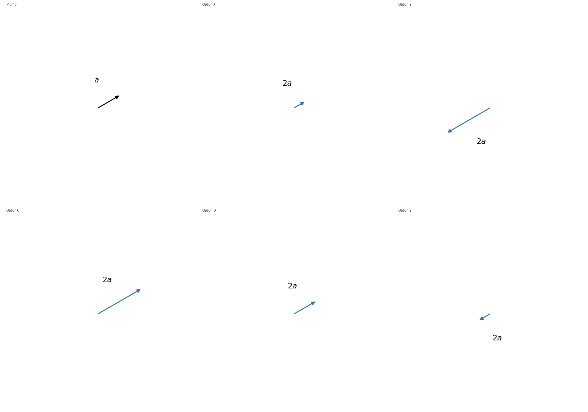
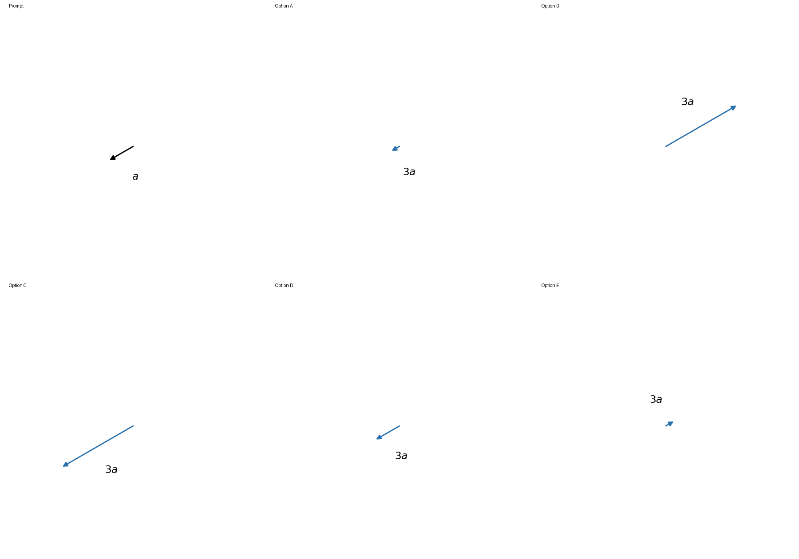
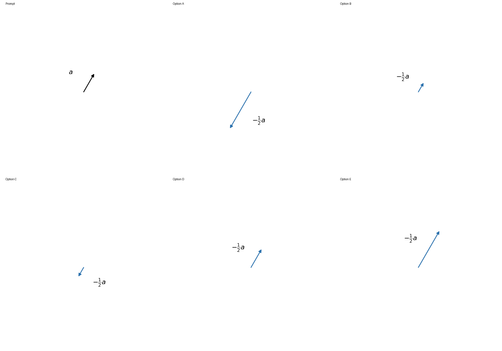
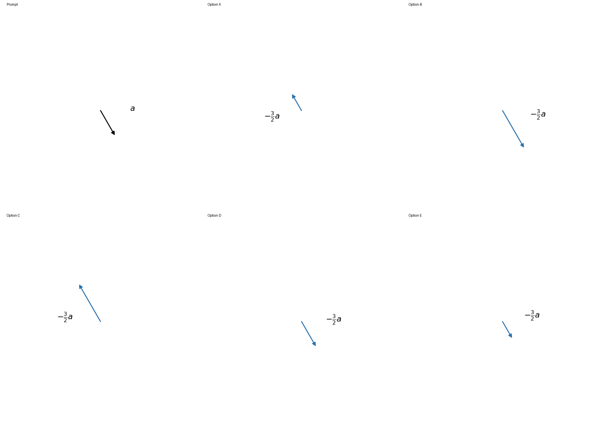
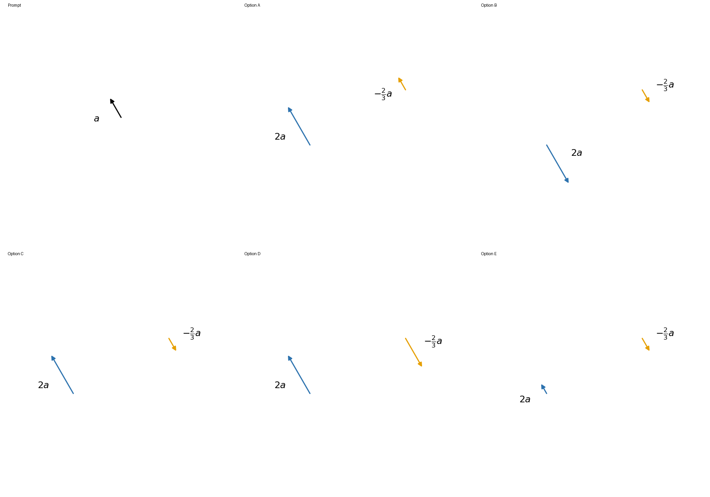
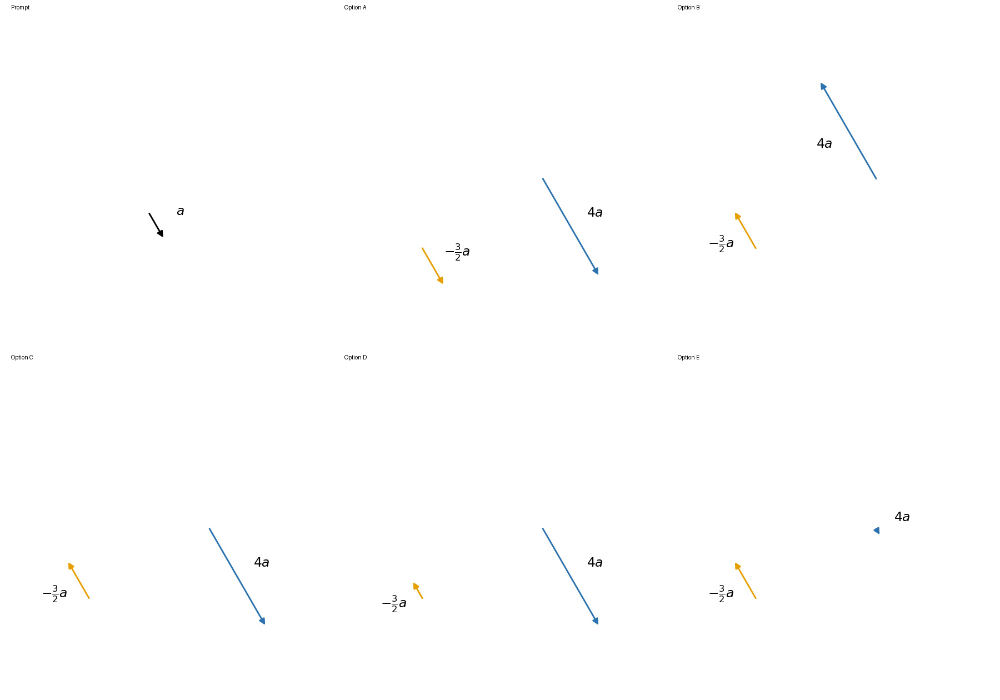

# Visual review

All 12 original practice images and all 3 canonical images were inspected at original resolution. Pixel stroke and arrowhead measurements confirm the entire original bank; source-raster-checks.json keeps exact per-image data.

Two authored complete banks at each level were inspected in the full-resolution contact sheets below. Arrow direction and relative length satisfy the actual prompt criteria. Labels are clear of every arrow; all five options share the prompt's physical scale. Short reciprocal distractors retain visible directed heads.

