# Originals and generated variants

Raw source provenance: math basis 1356. Original raw source is retained in source.json. Generated q-275128 has an explicit placeholder repair.

## Original q-19370

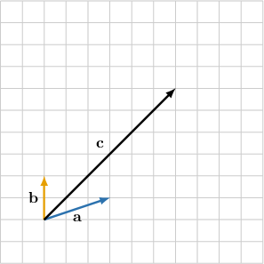

Consider the picture above. Given that $c=\lambda a+\mu b$, find $\lambda $ and $\mu .$

selection:

$\lambda =2$ and $\mu =2$

$\lambda =2.5$ and $\mu =-2$

$\lambda =-2$ and $\mu =2$

$\lambda =1.5$ and $\mu =2$

$\lambda =-2$ and $\mu =-2$

Original worked solution:

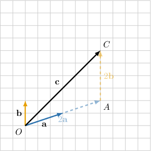

In $△OAC$ shown above, we have:

- $OA=2|a|$

- $\overset{\to }{OA}$ and $a$ have the same direction

Hence, $\overset{\to }{OA}=2a.$

Similarly:

- $AC=2|b|$

- $\overset{\to }{AC}$ and $b$ have the same direction

Hence, $\overset{\to }{AC}=2b.$

Additionally, 

$$
\begin{aligned}c & =\overset{\to }{OA}+\overset{\to }{AC} \\  & =2a+2b.\end{aligned}
$$

Consequently, $c=\lambda a+\mu b=2a+2b.$ 

Since $a∦b,$ the linear combination can only be written in one way. Equating the coefficients, we get:

- $\lambda =2$ and $\mu =2$

### Parameterized fidelity replay

Consider the picture above. Given that $c=\lambda a+\mu b$, find $\lambda $ and $\mu .$

selection:
- $\lambda =-2$ and $\mu =2$
- $\lambda =2.5$ and $\mu =-2$
- $\lambda =2$ and $\mu =2$
- $\lambda =-2$ and $\mu =-2$
- $\lambda =1.5$ and $\mu =2$

Worked solution:

In $△OAC$ shown above, we have:

- $OA=2|a|$

- $\overset{\to }{OA}$ and $a$ have the same direction

Hence, $\overset{\to }{OA}=2a.$

Similarly:

- $AC=2|b|$

- $\overset{\to }{AC}$ and $b$ have the same direction

Hence, $\overset{\to }{AC}=2b.$

Additionally, 

$$
\begin{aligned}c & =\overset{\to }{OA}+\overset{\to }{AC} \\  & =2a+2b.\end{aligned}
$$

Consequently, $c=\lambda a+\mu b=2a+2b.$ 

Since $a∦b,$ the linear combination can only be written in one way. Equating the coefficients, we get:

- $\lambda =2$ and $\mu =2$

### Generated changed-parameter variant

Consider the picture above. Given that $c=\lambda a+\mu b$, find $\lambda $ and $\mu .$

selection:
- $\lambda =\frac{9}{8}$ and $\mu =1.5$
- $\lambda =-1.5$ and $\mu =1.5$
- $\lambda =-1.5$ and $\mu =-1.5$
- $\lambda =1.5$ and $\mu =1.5$
- $\lambda =\frac{15}{8}$ and $\mu =-1.5$

Worked solution:

In $△OAC$ shown above, we have:

- $OA=\frac{3}{2}|a|$

- $\overset{\to }{OA}$ and $a$ have the same direction

Hence, $\overset{\to }{OA}=\frac{3}{2}a.$

Similarly:

- $AC=\frac{3}{2}|b|$

- $\overset{\to }{AC}$ and $b$ have the same direction

Hence, $\overset{\to }{AC}=\frac{3}{2}b.$

Additionally, 

$$
\begin{aligned}c & =\overset{\to }{OA}+\overset{\to }{AC} \\  & =\frac{3}{2}a+\frac{3}{2}b.\end{aligned}
$$

Consequently, $c=\lambda a+\mu b=\frac{3}{2}a+\frac{3}{2}b.$ 

Since $a∦b,$ the linear combination can only be written in one way. Equating the coefficients, we get:

- $\lambda =\frac{3}{2}$ and $\mu =\frac{3}{2}$

## Original q-42670

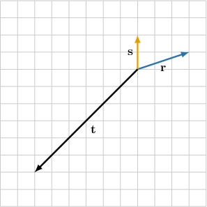

Consider the picture above. Given that $t=\lambda r+\mu s$, find $\lambda $ and $\mu .$

selection:

$\lambda =-2$ and $\mu =3$

$\lambda =-2$ and $\mu =3.5$

$\lambda =-2$ and $\mu =2$

$\lambda =-2$ and $\mu =-2$

$\lambda =2$ and $\mu =-2.5$

Original worked solution:

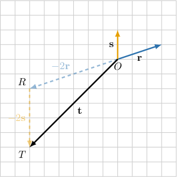

In $△ORT$ shown above, we have:

- $OR=2|r|$

- $\overset{\to }{OR}$ has the opposite direction to $r$

Hence, $\overset{\to }{OR}=-2r.$

Similarly:

- $RT=2|s|$

- $\overset{\to }{RT}$ has the opposite direction to $s$

Hence, $\overset{\to }{RT}=-2s.$

Additionally, 

$$
\begin{aligned}t & =\overset{\to }{OR}+\overset{\to }{RT} \\  & =-2r-2s.\end{aligned}
$$

Consequently, $t=\lambda r+\mu s=-2r-2s.$ 

Since $s∦r,$ the linear combination can only be written in one way. Equating the coefficients, we get:

- $\lambda =-2$ and $\mu =-2$

### Parameterized fidelity replay

Consider the picture above. Given that $t=\lambda r+\mu s$, find $\lambda $ and $\mu .$

selection:
- $\lambda =-2$ and $\mu =2$
- $\lambda =-2$ and $\mu =3.5$
- $\lambda =-2$ and $\mu =3$
- $\lambda =2$ and $\mu =-2.5$
- $\lambda =-2$ and $\mu =-2$

Worked solution:

In $△ORT$ shown above, we have:

- $OR=2|r|$

- $\overset{\to }{OR}$ has the opposite direction to $r$

Hence, $\overset{\to }{OR}=-2r.$

Similarly:

- $RT=2|s|$

- $\overset{\to }{RT}$ has the opposite direction to $s$

Hence, $\overset{\to }{RT}=-2s.$

Additionally, 

$$
\begin{aligned}t & =\overset{\to }{OR}+\overset{\to }{RT} \\  & =-2r-2s.\end{aligned}
$$

Consequently, $t=\lambda r+\mu s=-2r-2s.$ 

Since $s∦r,$ the linear combination can only be written in one way. Equating the coefficients, we get:

- $\lambda =-2$ and $\mu =-2$

### Generated changed-parameter variant

Consider the picture above. Given that $t=\lambda r+\mu s$, find $\lambda $ and $\mu .$

selection:
- $\lambda =-1.5$ and $\mu =-1.5$
- $\lambda =1.5$ and $\mu =-\frac{15}{8}$
- $\lambda =-1.5$ and $\mu =1.5$
- $\lambda =-1.5$ and $\mu =\frac{21}{8}$
- $\lambda =-1.5$ and $\mu =\frac{9}{4}$

Worked solution:

In $△ORT$ shown above, we have:

- $OR=\frac{3}{2}|r|$

- $\overset{\to }{OR}$ has the opposite direction to $r$

Hence, $\overset{\to }{OR}=-\frac{3}{2}r.$

Similarly:

- $RT=\frac{3}{2}|s|$

- $\overset{\to }{RT}$ has the opposite direction to $s$

Hence, $\overset{\to }{RT}=-\frac{3}{2}s.$

Additionally, 

$$
\begin{aligned}t & =\overset{\to }{OR}+\overset{\to }{RT} \\  & =-\frac{3}{2}r-\frac{3}{2}s.\end{aligned}
$$

Consequently, $t=\lambda r+\mu s=-\frac{3}{2}r-\frac{3}{2}s.$ 

Since $s∦r,$ the linear combination can only be written in one way. Equating the coefficients, we get:

- $\lambda =-\frac{3}{2}$ and $\mu =-\frac{3}{2}$

## Original q-120268

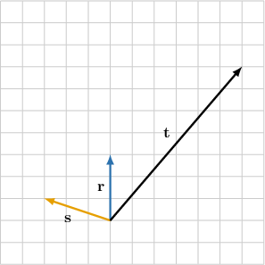

Consider the picture above. Given that $t=\lambda r+\mu s$, find $\lambda $ and $\mu .$

selection:

$\lambda =2$ and $\mu =-2$

$\lambda =3$ and $\mu =-2$

$\lambda =2$ and $\mu =-3$

$\lambda =-2$ and $\mu =3$

$\lambda =3$ and $\mu =-3$

Original worked solution:

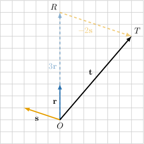

In $△ORT$ shown above, we have:

- $OR=3|r|$

- $\overset{\to }{OR}$ and $r$ have the same direction

Hence, $\overset{\to }{OR}=3r.$

Similarly:

- $RT=2|s|$

- $\overset{\to }{RT}$ has the opposite direction to $s$

Hence, $\overset{\to }{RT}=-2s.$

Additionally, 

$$
\begin{aligned}t & =\overset{\to }{OR}+\overset{\to }{RT} \\  & =3r-2s.\end{aligned}
$$

Consequently, $t=\lambda r+\mu s=3r-2s.$ 

Since $s∦r,$ the linear combination can only be written in one way. Equating the coefficients, we get:

- $\lambda =3$ and $\mu =-2$

### Parameterized fidelity replay

Consider the picture above. Given that $t=\lambda r+\mu s$, find $\lambda $ and $\mu .$

selection:
- $\lambda =2$ and $\mu =-3$
- $\lambda =3$ and $\mu =-2$
- $\lambda =2$ and $\mu =-2$
- $\lambda =3$ and $\mu =-3$
- $\lambda =-2$ and $\mu =3$

Worked solution:

In $△ORT$ shown above, we have:

- $OR=3|r|$

- $\overset{\to }{OR}$ and $r$ have the same direction

Hence, $\overset{\to }{OR}=3r.$

Similarly:

- $RT=2|s|$

- $\overset{\to }{RT}$ has the opposite direction to $s$

Hence, $\overset{\to }{RT}=-2s.$

Additionally, 

$$
\begin{aligned}t & =\overset{\to }{OR}+\overset{\to }{RT} \\  & =3r-2s.\end{aligned}
$$

Consequently, $t=\lambda r+\mu s=3r-2s.$ 

Since $s∦r,$ the linear combination can only be written in one way. Equating the coefficients, we get:

- $\lambda =3$ and $\mu =-2$

### Generated changed-parameter variant

Consider the picture above. Given that $t=\lambda r+\mu s$, find $\lambda $ and $\mu .$

selection:
- $\lambda =\frac{9}{4}$ and $\mu =-\frac{3}{2}$
- $\lambda =\frac{3}{2}$ and $\mu =-\frac{3}{2}$
- $\lambda =\frac{9}{4}$ and $\mu =-\frac{9}{4}$
- $\lambda =\frac{3}{2}$ and $\mu =-\frac{9}{4}$
- $\lambda =-\frac{3}{2}$ and $\mu =\frac{9}{4}$

Worked solution:

In $△ORT$ shown above, we have:

- $OR=\frac{9}{4}|r|$

- $\overset{\to }{OR}$ and $r$ have the same direction

Hence, $\overset{\to }{OR}=\frac{9}{4}r.$

Similarly:

- $RT=\frac{3}{2}|s|$

- $\overset{\to }{RT}$ has the opposite direction to $s$

Hence, $\overset{\to }{RT}=-\frac{3}{2}s.$

Additionally, 

$$
\begin{aligned}t & =\overset{\to }{OR}+\overset{\to }{RT} \\  & =\frac{9}{4}r-\frac{3}{2}s.\end{aligned}
$$

Consequently, $t=\lambda r+\mu s=\frac{9}{4}r-\frac{3}{2}s.$ 

Since $s∦r,$ the linear combination can only be written in one way. Equating the coefficients, we get:

- $\lambda =\frac{9}{4}$ and $\mu =-\frac{3}{2}$

## Original q-120277

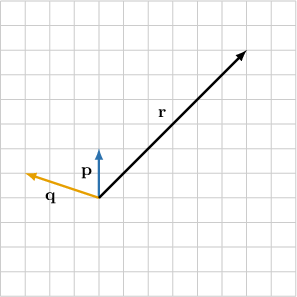

Consider the picture above. Given that $r=\lambda p+\mu q$, find $\lambda $ and $\mu .$

selection:

$\lambda =2$ and $\mu =-4$

$\lambda =-2$ and $\mu =4$

$\lambda =4$ and $\mu =-2$

$\lambda =2$ and $\mu =2$

$\lambda =4$ and $\mu =-4$

Original worked solution:

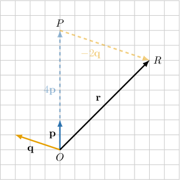

In $△OPR$ shown above, we have 

- $OP=4|p|$

- $\overset{\to }{OP}$ and $p$ have the same direction

Hence, $\overset{\to }{OP}=4p.$

Similarly:

- $PR=2|q|$

- $\overset{\to }{PR}$ has the opposite direction to $q$

Hence, $\overset{\to }{PR}=-2q.$

Additionally, 

$$
\begin{aligned}r & =\overset{\to }{OP}+\overset{\to }{PR} \\  & =4p-2q.\end{aligned}
$$

Consequently, $r=\lambda p+\mu q=4p-2q.$

Since $p∦q,$ the linear combination can only be written in one way. Equating the coefficients, we get:

- $\lambda =4$ and $\mu =-2$

### Parameterized fidelity replay

Consider the picture above. Given that $r=\lambda p+\mu q$, find $\lambda $ and $\mu .$

selection:
- $\lambda =4$ and $\mu =-2$
- $\lambda =-2$ and $\mu =4$
- $\lambda =2$ and $\mu =-4$
- $\lambda =4$ and $\mu =-4$
- $\lambda =2$ and $\mu =2$

Worked solution:

In $△OPR$ shown above, we have 

- $OP=4|p|$

- $\overset{\to }{OP}$ and $p$ have the same direction

Hence, $\overset{\to }{OP}=4p.$

Similarly:

- $PR=2|q|$

- $\overset{\to }{PR}$ has the opposite direction to $q$

Hence, $\overset{\to }{PR}=-2q.$

Additionally, 

$$
\begin{aligned}r & =\overset{\to }{OP}+\overset{\to }{PR} \\  & =4p-2q.\end{aligned}
$$

Consequently, $r=\lambda p+\mu q=4p-2q.$

Since $p∦q,$ the linear combination can only be written in one way. Equating the coefficients, we get:

- $\lambda =4$ and $\mu =-2$

### Generated changed-parameter variant

Consider the picture above. Given that $r=\lambda p+\mu q$, find $\lambda $ and $\mu .$

selection:
- $\lambda =-\frac{3}{2}$ and $\mu =3$
- $\lambda =3$ and $\mu =-3$
- $\lambda =\frac{3}{2}$ and $\mu =-3$
- $\lambda =3$ and $\mu =-\frac{3}{2}$
- $\lambda =\frac{3}{2}$ and $\mu =\frac{3}{2}$

Worked solution:

In $△OPR$ shown above, we have 

- $OP=3|p|$

- $\overset{\to }{OP}$ and $p$ have the same direction

Hence, $\overset{\to }{OP}=3p.$

Similarly:

- $PR=\frac{3}{2}|q|$

- $\overset{\to }{PR}$ has the opposite direction to $q$

Hence, $\overset{\to }{PR}=-\frac{3}{2}q.$

Additionally, 

$$
\begin{aligned}r & =\overset{\to }{OP}+\overset{\to }{PR} \\  & =3p-\frac{3}{2}q.\end{aligned}
$$

Consequently, $r=\lambda p+\mu q=3p-\frac{3}{2}q.$

Since $p∦q,$ the linear combination can only be written in one way. Equating the coefficients, we get:

- $\lambda =3$ and $\mu =-\frac{3}{2}$

## Original q-120279

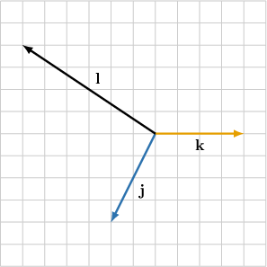

Consider the picture above. Given that $l=\lambda j+\mu k$, find $\lambda $ and $\mu .$

selection:

$\lambda =-2$ and $\mu =-1$

$\lambda =2$ and $\mu =1$

$\lambda =1$ and $\mu =-2$

$\lambda =-1$ and $\mu =-2$

$\lambda =1$ and $\mu =2$

Original worked solution:

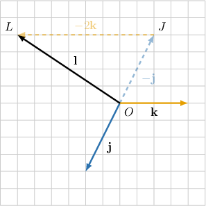

In $△OJL$ shown above, we have 

- $OJ=|j|$

- $\overset{\to }{OJ}$ has the opposite direction to $j$

Hence, $\overset{\to }{OJ}=-j.$

Similarly:

- $JL=2|k|$

- $\overset{\to }{JL}$ has the opposite direction to $k$

Hence, $\overset{\to }{JL}=-2k.$

Additionally, 

$$
\begin{aligned}l & =\overset{\to }{OJ}+\overset{\to }{JL} \\  & =-j-2k.\end{aligned}
$$

Consequently, $l=\lambda j+\mu k=-j-2k.$

Since $j∦k,$ the linear combination can only be written in one way. Equating the coefficients, we get:

- $\lambda =-1$ and $\mu =-2$

### Parameterized fidelity replay

Consider the picture above. Given that $l=\lambda j+\mu k$, find $\lambda $ and $\mu .$

selection:
- $\lambda =1$ and $\mu =-2$
- $\lambda =2$ and $\mu =1$
- $\lambda =-2$ and $\mu =-1$
- $\lambda =1$ and $\mu =2$
- $\lambda =-1$ and $\mu =-2$

Worked solution:

In $△OJL$ shown above, we have 

- $OJ=|j|$

- $\overset{\to }{OJ}$ has the opposite direction to $j$

Hence, $\overset{\to }{OJ}=-j.$

Similarly:

- $JL=2|k|$

- $\overset{\to }{JL}$ has the opposite direction to $k$

Hence, $\overset{\to }{JL}=-2k.$

Additionally, 

$$
\begin{aligned}l & =\overset{\to }{OJ}+\overset{\to }{JL} \\  & =-j-2k.\end{aligned}
$$

Consequently, $l=\lambda j+\mu k=-j-2k.$

Since $j∦k,$ the linear combination can only be written in one way. Equating the coefficients, we get:

- $\lambda =-1$ and $\mu =-2$

### Generated changed-parameter variant

Consider the picture above. Given that $l=\lambda j+\mu k$, find $\lambda $ and $\mu .$

selection:
- $\lambda =\frac{3}{4}$ and $\mu =-\frac{3}{2}$
- $\lambda =-\frac{3}{4}$ and $\mu =-\frac{3}{2}$
- $\lambda =-\frac{3}{2}$ and $\mu =-\frac{3}{4}$
- $\lambda =\frac{3}{2}$ and $\mu =\frac{3}{4}$
- $\lambda =\frac{3}{4}$ and $\mu =\frac{3}{2}$

Worked solution:

In $△OJL$ shown above, we have 

- $OJ=\frac{3}{4}|j|$

- $\overset{\to }{OJ}$ has the opposite direction to $j$

Hence, $\overset{\to }{OJ}=-\frac{3}{4}j.$

Similarly:

- $JL=\frac{3}{2}|k|$

- $\overset{\to }{JL}$ has the opposite direction to $k$

Hence, $\overset{\to }{JL}=-\frac{3}{2}k.$

Additionally, 

$$
\begin{aligned}l & =\overset{\to }{OJ}+\overset{\to }{JL} \\  & =-\frac{3}{4}j-\frac{3}{2}k.\end{aligned}
$$

Consequently, $l=\lambda j+\mu k=-\frac{3}{4}j-\frac{3}{2}k.$

Since $j∦k,$ the linear combination can only be written in one way. Equating the coefficients, we get:

- $\lambda =-\frac{3}{4}$ and $\mu =-\frac{3}{2}$

## Original q-120281

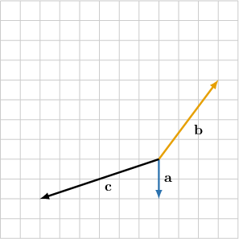

Consider the picture above. Given that $c=\lambda a+\mu b$, find $\lambda $ and $\mu .$

selection:

$\lambda =3$ and $\mu =2$

$\lambda =-3$ and $\mu =-2$

$\lambda =-3$ and $\mu =2$

$\lambda =-2$ and $\mu =-3$

$\lambda =2$ and $\mu =3$

Original worked solution:

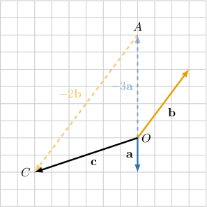

In $△OAC$ shown above, we have:

- $OA=3|a|$

- $\overset{\to }{OA}$ and $a$ have opposite directions

Hence, $\overset{\to }{OA}=-3a.$

Similarly:

- $AC=2|b|$

- $\overset{\to }{AC}$ and $b$ have opposite directions

Hence, $\overset{\to }{AC}=-2b.$

Additionally, 

$$
\begin{aligned}c & =\overset{\to }{OA}+\overset{\to }{AC} \\  & =-3a-2b.\end{aligned}
$$

Consequently, $c=\lambda a+\mu b=-3a-2b.$ 

Since $a∦b,$ the linear combination can only be written in one way. Equating the coefficients, we get:

- $\lambda =-3$ and $\mu =-2$

### Parameterized fidelity replay

Consider the picture above. Given that $c=\lambda a+\mu b$, find $\lambda $ and $\mu .$

selection:
- $\lambda =-3$ and $\mu =2$
- $\lambda =-3$ and $\mu =-2$
- $\lambda =3$ and $\mu =2$
- $\lambda =2$ and $\mu =3$
- $\lambda =-2$ and $\mu =-3$

Worked solution:

In $△OAC$ shown above, we have:

- $OA=3|a|$

- $\overset{\to }{OA}$ and $a$ have opposite directions

Hence, $\overset{\to }{OA}=-3a.$

Similarly:

- $AC=2|b|$

- $\overset{\to }{AC}$ and $b$ have opposite directions

Hence, $\overset{\to }{AC}=-2b.$

Additionally, 

$$
\begin{aligned}c & =\overset{\to }{OA}+\overset{\to }{AC} \\  & =-3a-2b.\end{aligned}
$$

Consequently, $c=\lambda a+\mu b=-3a-2b.$ 

Since $a∦b,$ the linear combination can only be written in one way. Equating the coefficients, we get:

- $\lambda =-3$ and $\mu =-2$

### Generated changed-parameter variant

Consider the picture above. Given that $c=\lambda a+\mu b$, find $\lambda $ and $\mu .$

selection:
- $\lambda =-\frac{9}{4}$ and $\mu =\frac{3}{2}$
- $\lambda =\frac{9}{4}$ and $\mu =\frac{3}{2}$
- $\lambda =-\frac{3}{2}$ and $\mu =-\frac{9}{4}$
- $\lambda =-\frac{9}{4}$ and $\mu =-\frac{3}{2}$
- $\lambda =\frac{3}{2}$ and $\mu =\frac{9}{4}$

Worked solution:

In $△OAC$ shown above, we have:

- $OA=\frac{9}{4}|a|$

- $\overset{\to }{OA}$ and $a$ have opposite directions

Hence, $\overset{\to }{OA}=-\frac{9}{4}a.$

Similarly:

- $AC=\frac{3}{2}|b|$

- $\overset{\to }{AC}$ and $b$ have opposite directions

Hence, $\overset{\to }{AC}=-\frac{3}{2}b.$

Additionally, 

$$
\begin{aligned}c & =\overset{\to }{OA}+\overset{\to }{AC} \\  & =-\frac{9}{4}a-\frac{3}{2}b.\end{aligned}
$$

Consequently, $c=\lambda a+\mu b=-\frac{9}{4}a-\frac{3}{2}b.$ 

Since $a∦b,$ the linear combination can only be written in one way. Equating the coefficients, we get:

- $\lambda =-\frac{9}{4}$ and $\mu =-\frac{3}{2}$

## Original q-275128

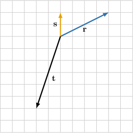

Consider the picture above. If $t=\lambda r+\mu s$, then$\,\lambda =$

$-\frac{1}{2}$

and 
$\mu =$

$-\frac{5}{2}$

.

field-2:

-\frac{5}{2}

field-1:

-\frac{1}{2}

Original worked solution:

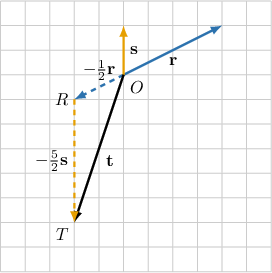

In $△ORT$ shown above, we have:

- $OR=\frac{1}{2}|r|$

- $\overset{\to }{OR}$ has the opposite direction to $r$

Hence, $\overset{\to }{OR}=-\frac{1}{2}r.$

Similarly:

- $RT=\frac{5}{2}|s|$

- $\overset{\to }{RT}$ has the opposite direction to $s$

Hence, $\overset{\to }{RT}=-\frac{5}{2}s.$

Additionally, 

$$
\begin{aligned}t & =\overset{\to }{OR}+\overset{\to }{RT} \\  & =-\frac{1}{2}r-\frac{5}{2}s.\end{aligned}
$$

Consequently, $t=\lambda r+\mu s=-\frac{1}{2}r-\frac{5}{2}s.$ 

Since $s∦r,$ the linear combination can only be written in one way. Equating the coefficients, we get:

- $\lambda =-\frac{1}{2}$ and $\mu =-\frac{5}{2}$

### Parameterized fidelity replay

Consider the picture above. If $t=\lambda r+\mu s$, then$\,\lambda =$

{{field-1}}

and 
$\mu =$

{{field-2}}

.

field-2:
- -\frac{5}{2}
field-1:
- -\frac{1}{2}

Worked solution:

In $△ORT$ shown above, we have:

- $OR=\frac{1}{2}|r|$

- $\overset{\to }{OR}$ has the opposite direction to $r$

Hence, $\overset{\to }{OR}=-\frac{1}{2}r.$

Similarly:

- $RT=\frac{5}{2}|s|$

- $\overset{\to }{RT}$ has the opposite direction to $s$

Hence, $\overset{\to }{RT}=-\frac{5}{2}s.$

Additionally, 

$$
\begin{aligned}t & =\overset{\to }{OR}+\overset{\to }{RT} \\  & =-\frac{1}{2}r-\frac{5}{2}s.\end{aligned}
$$

Consequently, $t=\lambda r+\mu s=-\frac{1}{2}r-\frac{5}{2}s.$ 

Since $s∦r,$ the linear combination can only be written in one way. Equating the coefficients, we get:

- $\lambda =-\frac{1}{2}$ and $\mu =-\frac{5}{2}$

### Generated changed-parameter variant

Consider the picture above. If $t=\lambda r+\mu s$, then$\,\lambda =$

{{field-1}}

and 
$\mu =$

{{field-2}}

.

field-2:
- -\frac{5}{4}
field-1:
- -\frac{1}{4}

Worked solution:

In $△ORT$ shown above, we have:

- $OR=\frac{1}{4}|r|$

- $\overset{\to }{OR}$ has the opposite direction to $r$

Hence, $\overset{\to }{OR}=-\frac{1}{4}r.$

Similarly:

- $RT=\frac{5}{4}|s|$

- $\overset{\to }{RT}$ has the opposite direction to $s$

Hence, $\overset{\to }{RT}=-\frac{5}{4}s.$

Additionally, 

$$
\begin{aligned}t & =\overset{\to }{OR}+\overset{\to }{RT} \\  & =-\frac{1}{4}r-\frac{5}{4}s.\end{aligned}
$$

Consequently, $t=\lambda r+\mu s=-\frac{1}{4}r-\frac{5}{4}s.$ 

Since $s∦r,$ the linear combination can only be written in one way. Equating the coefficients, we get:

- $\lambda =-\frac{1}{4}$ and $\mu =-\frac{5}{4}$

## Original q-326013

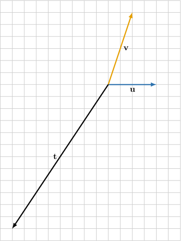

Consider the picture above. If $t=\lambda u+\mu v$, then$\,\lambda =$
{{field-1}}
and 
$\mu =$
{{field-2}}.

field-1:

-1

field-2:

-2

Original worked solution:

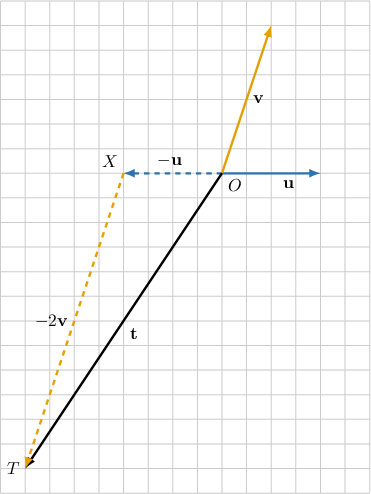

In $△OXT$ shown above, we have:

- $OX=|u|$

- $\overset{\to }{OX}$ has the opposite direction to $u$

Hence, $\overset{\to }{OX}=-u.$

Similarly:

- $XT=2|v|$

- $\overset{\to }{XT}$ has the opposite direction to $v$

Hence, $\overset{\to }{XT}=-2v.$

Additionally,

$$
t=\overset{\to }{OX}+\overset{\to }{XT}=-u-2v.
$$

Consequently, $t=\lambda u+\mu v=-1u-2v.$

Since $v∦u,$ the linear combination can only be written in one way. Equating the coefficients, we get:

- $\lambda =-1$ and $\mu =-2$

### Parameterized fidelity replay

Consider the picture above. If $t=\lambda u+\mu v$, then$\,\lambda =$
{{field-1}}
and 
$\mu =$
{{field-2}}.

field-1:
- -1
field-2:
- -2

Worked solution:

In $△OXT$ shown above, we have:

- $OX=|u|$

- $\overset{\to }{OX}$ has the opposite direction to $u$

Hence, $\overset{\to }{OX}=-u.$

Similarly:

- $XT=2|v|$

- $\overset{\to }{XT}$ has the opposite direction to $v$

Hence, $\overset{\to }{XT}=-2v.$

Additionally,

$$
t=\overset{\to }{OX}+\overset{\to }{XT}=-u-2v.
$$

Consequently, $t=\lambda u+\mu v=-1u-2v.$

Since $v∦u,$ the linear combination can only be written in one way. Equating the coefficients, we get:

- $\lambda =-1$ and $\mu =-2$

### Generated changed-parameter variant

Consider the picture above. If $t=\lambda u+\mu v$, then$\,\lambda =$
{{field-1}}
and 
$\mu =$
{{field-2}}.

field-1:
- -\frac{3}{4}
field-2:
- -\frac{3}{2}

Worked solution:

In $△OXT$ shown above, we have:

- $OX=\frac{3}{4}|u|$

- $\overset{\to }{OX}$ has the opposite direction to $u$

Hence, $\overset{\to }{OX}=-\frac{3}{4}u.$

Similarly:

- $XT=\frac{3}{2}|v|$

- $\overset{\to }{XT}$ has the opposite direction to $v$

Hence, $\overset{\to }{XT}=-\frac{3}{2}v.$

Additionally,

$$
t=\overset{\to }{OX}+\overset{\to }{XT}=-\frac{3}{4}u-\frac{3}{2}v.
$$

Consequently, $t=\lambda u+\mu v=-\frac{3}{4}u-\frac{3}{2}v.$

Since $v∦u,$ the linear combination can only be written in one way. Equating the coefficients, we get:

- $\lambda =-\frac{3}{4}$ and $\mu =-\frac{3}{2}$

## Original q-326014

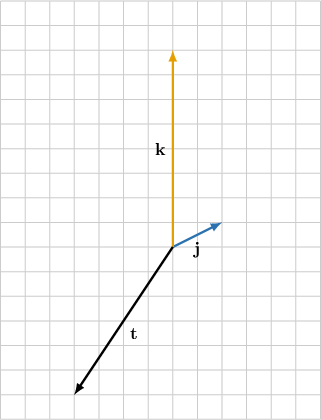

Consider the picture above. If $t=\lambda j+\mu k$, then$\,\lambda =$
{{field-1}}
and 
$\mu =$
{{field-2}}.

field-2:

-\frac{1}{2}

field-1:

-2

Original worked solution:

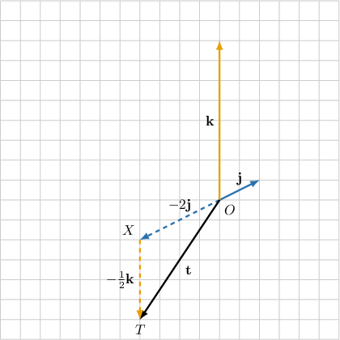

In $△OXT$ shown above, we have:

- $OX=2|j|$

- $\overset{\to }{OX}$ has the opposite direction to $j$

Hence, $\overset{\to }{OX}=-2j.$

Similarly:

- $XT=\frac{1}{2}|k|$

- $\overset{\to }{XT}$ has the opposite direction to $k$

Hence, $\overset{\to }{XT}=-\frac{1}{2}k.$

Additionally,

$$
t=\overset{\to }{OX}+\overset{\to }{XT}=-2j-\frac{1}{2}k.
$$

Consequently, $t=\lambda j+\mu k=-2j-\frac{1}{2}k.$

Since $k∦j,$ the linear combination can only be written in one way. Equating the coefficients, we get:

- $\lambda =-2$ and $\mu =-\frac{1}{2}$

### Parameterized fidelity replay

Consider the picture above. If $t=\lambda j+\mu k$, then$\,\lambda =$
{{field-1}}
and 
$\mu =$
{{field-2}}.

field-2:
- -\frac{1}{2}
field-1:
- -2

Worked solution:

In $△OXT$ shown above, we have:

- $OX=2|j|$

- $\overset{\to }{OX}$ has the opposite direction to $j$

Hence, $\overset{\to }{OX}=-2j.$

Similarly:

- $XT=\frac{1}{2}|k|$

- $\overset{\to }{XT}$ has the opposite direction to $k$

Hence, $\overset{\to }{XT}=-\frac{1}{2}k.$

Additionally,

$$
t=\overset{\to }{OX}+\overset{\to }{XT}=-2j-\frac{1}{2}k.
$$

Consequently, $t=\lambda j+\mu k=-2j-\frac{1}{2}k.$

Since $k∦j,$ the linear combination can only be written in one way. Equating the coefficients, we get:

- $\lambda =-2$ and $\mu =-\frac{1}{2}$

### Generated changed-parameter variant

Consider the picture above. If $t=\lambda j+\mu k$, then$\,\lambda =$
{{field-1}}
and 
$\mu =$
{{field-2}}.

field-2:
- -\frac{1}{4}
field-1:
- -1

Worked solution:

In $△OXT$ shown above, we have:

- $OX=|j|$

- $\overset{\to }{OX}$ has the opposite direction to $j$

Hence, $\overset{\to }{OX}=-j.$

Similarly:

- $XT=\frac{1}{4}|k|$

- $\overset{\to }{XT}$ has the opposite direction to $k$

Hence, $\overset{\to }{XT}=-\frac{1}{4}k.$

Additionally,

$$
t=\overset{\to }{OX}+\overset{\to }{XT}=-j-\frac{1}{4}k.
$$

Consequently, $t=\lambda j+\mu k=-j-\frac{1}{4}k.$

Since $k∦j,$ the linear combination can only be written in one way. Equating the coefficients, we get:

- $\lambda =-1$ and $\mu =-\frac{1}{4}$

## Original q-326018

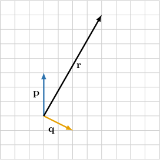

Consider the picture above. If $r=\lambda p+\mu q$, then$\,\lambda =$
{{field-1}}
and 
$\mu =$
{{field-2}}.

field-2:

2

field-1:

3

Original worked solution:

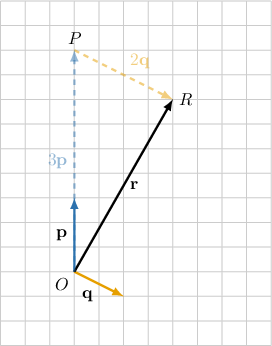

In $△OPR$ shown above, we have 

- $OP=3|p|$

- $\overset{\to }{OP}$ and $p$ have the same direction

Hence, $\overset{\to }{OP}=3p.$

Similarly:

- $PR=2|q|$

- $\overset{\to }{PR}$ and $q$ have the same direction

Hence, $\overset{\to }{PR}=2q.$

Additionally, 

$$
\begin{aligned}r & =\overset{\to }{OP}+\overset{\to }{PR} \\  & =3p+2q.\end{aligned}
$$

Consequently, $r=\lambda p+\mu q=3p+2q.$

Since $p∦q,$ the linear combination can only be written in one way. Equating the coefficients, we get:

- $\lambda =3$ and $\mu =2$

### Parameterized fidelity replay

Consider the picture above. If $r=\lambda p+\mu q$, then$\,\lambda =$
{{field-1}}
and 
$\mu =$
{{field-2}}.

field-2:
- 2
field-1:
- 3

Worked solution:

In $△OPR$ shown above, we have 

- $OP=3|p|$

- $\overset{\to }{OP}$ and $p$ have the same direction

Hence, $\overset{\to }{OP}=3p.$

Similarly:

- $PR=2|q|$

- $\overset{\to }{PR}$ and $q$ have the same direction

Hence, $\overset{\to }{PR}=2q.$

Additionally, 

$$
\begin{aligned}r & =\overset{\to }{OP}+\overset{\to }{PR} \\  & =3p+2q.\end{aligned}
$$

Consequently, $r=\lambda p+\mu q=3p+2q.$

Since $p∦q,$ the linear combination can only be written in one way. Equating the coefficients, we get:

- $\lambda =3$ and $\mu =2$

### Generated changed-parameter variant

Consider the picture above. If $r=\lambda p+\mu q$, then$\,\lambda =$
{{field-1}}
and 
$\mu =$
{{field-2}}.

field-2:
- 3
field-1:
- 2

Worked solution:

In $△OPR$ shown above, we have 

- $OP=2|p|$

- $\overset{\to }{OP}$ and $p$ have the same direction

Hence, $\overset{\to }{OP}=2p.$

Similarly:

- $PR=3|q|$

- $\overset{\to }{PR}$ and $q$ have the same direction

Hence, $\overset{\to }{PR}=3q.$

Additionally, 

$$
\begin{aligned}r & =\overset{\to }{OP}+\overset{\to }{PR} \\  & =2p+3q.\end{aligned}
$$

Consequently, $r=\lambda p+\mu q=2p+3q.$

Since $p∦q,$ the linear combination can only be written in one way. Equating the coefficients, we get:

- $\lambda =2$ and $\mu =3$

## Original q-326022

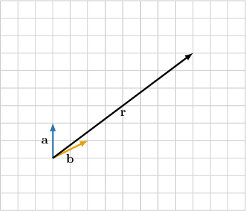

Consider the picture above. If $r=\lambda a+\mu b$, then$\,\lambda =$
{{field-1}}
and 
$\mu =$
{{field-2}}.

field-2:

4

field-1:

1

Original worked solution:

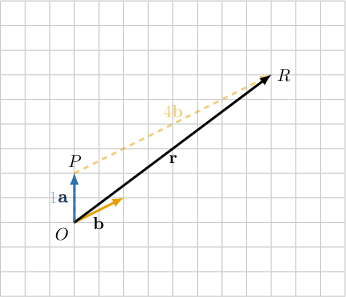

In $△OPR$ shown above, we have 

- $OP=|a|$

- $\overset{\to }{OP}$ and $a$ have the same direction

Hence, $\overset{\to }{OP}=a.$

Similarly:

- $PR=4|b|$

- $\overset{\to }{PR}$ and $b$ have the same direction

Hence, $\overset{\to }{PR}=4b.$

Additionally, 

$$
\begin{aligned}r & =\overset{\to }{OP}+\overset{\to }{PR} \\  & =a+4b.\end{aligned}
$$

Consequently, $r=\lambda a+\mu b=1a+4b.$

Since $a∦b,$ the linear combination can only be written in one way. Equating the coefficients, we get:

- $\lambda =1$ and $\mu =4$

### Parameterized fidelity replay

Consider the picture above. If $r=\lambda a+\mu b$, then$\,\lambda =$
{{field-1}}
and 
$\mu =$
{{field-2}}.

field-2:
- 4
field-1:
- 1

Worked solution:

In $△OPR$ shown above, we have 

- $OP=|a|$

- $\overset{\to }{OP}$ and $a$ have the same direction

Hence, $\overset{\to }{OP}=a.$

Similarly:

- $PR=4|b|$

- $\overset{\to }{PR}$ and $b$ have the same direction

Hence, $\overset{\to }{PR}=4b.$

Additionally, 

$$
\begin{aligned}r & =\overset{\to }{OP}+\overset{\to }{PR} \\  & =a+4b.\end{aligned}
$$

Consequently, $r=\lambda a+\mu b=1a+4b.$

Since $a∦b,$ the linear combination can only be written in one way. Equating the coefficients, we get:

- $\lambda =1$ and $\mu =4$

### Generated changed-parameter variant

Consider the picture above. If $r=\lambda a+\mu b$, then$\,\lambda =$
{{field-1}}
and 
$\mu =$
{{field-2}}.

field-2:
- 3
field-1:
- 2

Worked solution:

In $△OPR$ shown above, we have 

- $OP=2|a|$

- $\overset{\to }{OP}$ and $a$ have the same direction

Hence, $\overset{\to }{OP}=2a.$

Similarly:

- $PR=3|b|$

- $\overset{\to }{PR}$ and $b$ have the same direction

Hence, $\overset{\to }{PR}=3b.$

Additionally, 

$$
\begin{aligned}r & =\overset{\to }{OP}+\overset{\to }{PR} \\  & =2a+3b.\end{aligned}
$$

Consequently, $r=\lambda a+\mu b=2a+3b.$

Since $a∦b,$ the linear combination can only be written in one way. Equating the coefficients, we get:

- $\lambda =2$ and $\mu =3$

## Original q-327074

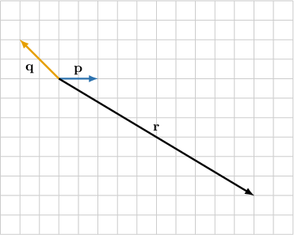

Consider the picture above. If $r=\lambda p+\mu q$, then$\,\lambda =$
{{field-1}}
and 
$\mu =$
{{field-2}}.

field-1:

2

field-2:

-3

Original worked solution:

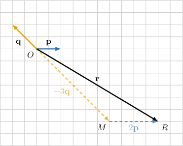

In $△OMR$ shown above, we have 

- $OM=3|q|$

- $\overset{\to }{OM}$ and $q$ have the opposite direction

Hence, $\overset{\to }{OM}=-3q.$

Similarly:

- $MR=2|p|$

- $\overset{\to }{MR}$ and $p$ have the same direction

Hence, $\overset{\to }{MR}=2p.$

Additionally,

$$
\begin{aligned}r & =\overset{\to }{OM}+\overset{\to }{MR} \\  & =-3q+2p.\end{aligned}
$$

Consequently, $r=\lambda p+\mu q=2p-3q.$

Since $p∦q,$ the linear combination can only be written in one way. Equating the coefficients, we get:

- $\lambda =2$ and $\mu =-3$

### Parameterized fidelity replay

Consider the picture above. If $r=\lambda p+\mu q$, then$\,\lambda =$
{{field-1}}
and 
$\mu =$
{{field-2}}.

field-1:
- 2
field-2:
- -3

Worked solution:

In $△OMR$ shown above, we have 

- $OM=3|q|$

- $\overset{\to }{OM}$ and $q$ have the opposite direction

Hence, $\overset{\to }{OM}=-3q.$

Similarly:

- $MR=2|p|$

- $\overset{\to }{MR}$ and $p$ have the same direction

Hence, $\overset{\to }{MR}=2p.$

Additionally,

$$
\begin{aligned}r & =\overset{\to }{OM}+\overset{\to }{MR} \\  & =-3q+2p.\end{aligned}
$$

Consequently, $r=\lambda p+\mu q=2p-3q.$

Since $p∦q,$ the linear combination can only be written in one way. Equating the coefficients, we get:

- $\lambda =2$ and $\mu =-3$

### Generated changed-parameter variant

Consider the picture above. If $r=\lambda p+\mu q$, then$\,\lambda =$
{{field-1}}
and 
$\mu =$
{{field-2}}.

field-1:
- \frac{3}{2}
field-2:
- -\frac{9}{4}

Worked solution:

In $△OMR$ shown above, we have 

- $OM=\frac{9}{4}|q|$

- $\overset{\to }{OM}$ and $q$ have the opposite direction

Hence, $\overset{\to }{OM}=-\frac{9}{4}q.$

Similarly:

- $MR=\frac{3}{2}|p|$

- $\overset{\to }{MR}$ and $p$ have the same direction

Hence, $\overset{\to }{MR}=\frac{3}{2}p.$

Additionally,

$$
\begin{aligned}r & =\overset{\to }{OM}+\overset{\to }{MR} \\  & =-\frac{9}{4}q+\frac{3}{2}p.\end{aligned}
$$

Consequently, $r=\lambda p+\mu q=\frac{3}{2}p-\frac{9}{4}q.$

Since $p∦q,$ the linear combination can only be written in one way. Equating the coefficients, we get:

- $\lambda =\frac{3}{2}$ and $\mu =-\frac{9}{4}$

## Original q-327075

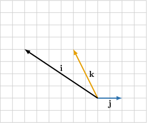

Consider the picture above. If $i=\lambda j+\mu k$, then$\,\lambda =$
{{field-1}}
and 
$\mu =$
{{field-2}}.

field-1:

-2

field-2:

1

Original worked solution:

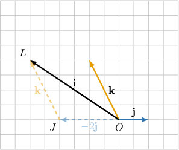

In $△OJL$ shown above, we have  

- $OJ=2|j|$

- $\overset{\to }{OJ}$ and $j$ have the opposite direction

Hence, $\overset{\to }{OJ}=-2j.$  

Similarly:  

- $JL=|k|$

- $\overset{\to }{JL}$ and $k$ have the same direction

Hence, $\overset{\to }{JL}=k.$  

Additionally, 

$$
i=\overset{\to }{OJ}+\overset{\to }{JL}=-2j+k.
$$

Consequently, $i=\lambda j+\mu k=-2j+k.$  

Since $j∦k,$ the linear combination can only be written in one way.  Equating the coefficients, we get 

$$
\lambda =-2,\,\mu =1.
$$

### Parameterized fidelity replay

Consider the picture above. If $i=\lambda j+\mu k$, then$\,\lambda =$
{{field-1}}
and 
$\mu =$
{{field-2}}.

field-1:
- -2
field-2:
- 1

Worked solution:

In $△OJL$ shown above, we have  

- $OJ=2|j|$

- $\overset{\to }{OJ}$ and $j$ have the opposite direction

Hence, $\overset{\to }{OJ}=-2j.$  

Similarly:  

- $JL=|k|$

- $\overset{\to }{JL}$ and $k$ have the same direction

Hence, $\overset{\to }{JL}=k.$  

Additionally, 

$$
i=\overset{\to }{OJ}+\overset{\to }{JL}=-2j+k.
$$

Consequently, $i=\lambda j+\mu k=-2j+k.$  

Since $j∦k,$ the linear combination can only be written in one way.  Equating the coefficients, we get 

$$
\lambda =-2,\,\mu =1.
$$

### Generated changed-parameter variant

Consider the picture above. If $i=\lambda j+\mu k$, then$\,\lambda =$
{{field-1}}
and 
$\mu =$
{{field-2}}.

field-1:
- -\frac{3}{2}
field-2:
- \frac{3}{4}

Worked solution:

In $△OJL$ shown above, we have  

- $OJ=\frac{3}{2}|j|$

- $\overset{\to }{OJ}$ and $j$ have the opposite direction

Hence, $\overset{\to }{OJ}=-\frac{3}{2}j.$  

Similarly:  

- $JL=\frac{3}{4}|k|$

- $\overset{\to }{JL}$ and $k$ have the same direction

Hence, $\overset{\to }{JL}=\frac{3}{4}k.$  

Additionally, 

$$
i=\overset{\to }{OJ}+\overset{\to }{JL}=-\frac{3}{2}j+\frac{3}{4}k.
$$

Consequently, $i=\lambda j+\mu k=-\frac{3}{2}j+\frac{3}{4}k.$  

Since $j∦k,$ the linear combination can only be written in one way.  Equating the coefficients, we get 

$$
\lambda =-\frac{3}{2},\,\mu =\frac{3}{4}.
$$

## Original q-327078

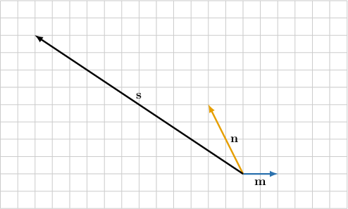

Consider the picture above. If $s=\lambda m+\mu n$, then$\,\lambda =$
{{field-1}}
and 
$\mu =$
{{field-2}}.

field-2:

2

field-1:

-4

Original worked solution:

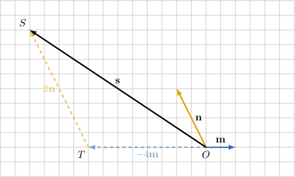

In $△OTS$ shown above, we have 

- $OT=4|m|$

- $\overset{\to }{OT}$ and $m$ have the opposite direction

Hence, $\overset{\to }{OT}=-4m.$

Similarly:

- $TS=2|n|$

- $\overset{\to }{TS}$ and $n$ have the same direction

Hence, $\overset{\to }{TS}=2n.$

Additionally, 

$$
\begin{aligned}s & =\overset{\to }{OT}+\overset{\to }{TS} \\  & =-4m+2n.\end{aligned}
$$

Consequently, $s=\lambda m+\mu n=-4m+2n.$

Since $m∦n,$ the linear combination can only be written in one way. Equating the coefficients, we get:

- $\lambda =-4$ and $\mu =2$

### Parameterized fidelity replay

Consider the picture above. If $s=\lambda m+\mu n$, then$\,\lambda =$
{{field-1}}
and 
$\mu =$
{{field-2}}.

field-2:
- 2
field-1:
- -4

Worked solution:

In $△OTS$ shown above, we have 

- $OT=4|m|$

- $\overset{\to }{OT}$ and $m$ have the opposite direction

Hence, $\overset{\to }{OT}=-4m.$

Similarly:

- $TS=2|n|$

- $\overset{\to }{TS}$ and $n$ have the same direction

Hence, $\overset{\to }{TS}=2n.$

Additionally, 

$$
\begin{aligned}s & =\overset{\to }{OT}+\overset{\to }{TS} \\  & =-4m+2n.\end{aligned}
$$

Consequently, $s=\lambda m+\mu n=-4m+2n.$

Since $m∦n,$ the linear combination can only be written in one way. Equating the coefficients, we get:

- $\lambda =-4$ and $\mu =2$

### Generated changed-parameter variant

Consider the picture above. If $s=\lambda m+\mu n$, then$\,\lambda =$
{{field-1}}
and 
$\mu =$
{{field-2}}.

field-2:
- \frac{3}{2}
field-1:
- -3

Worked solution:

In $△OTS$ shown above, we have 

- $OT=3|m|$

- $\overset{\to }{OT}$ and $m$ have the opposite direction

Hence, $\overset{\to }{OT}=-3m.$

Similarly:

- $TS=\frac{3}{2}|n|$

- $\overset{\to }{TS}$ and $n$ have the same direction

Hence, $\overset{\to }{TS}=\frac{3}{2}n.$

Additionally, 

$$
\begin{aligned}s & =\overset{\to }{OT}+\overset{\to }{TS} \\  & =-3m+\frac{3}{2}n.\end{aligned}
$$

Consequently, $s=\lambda m+\mu n=-3m+\frac{3}{2}n.$

Since $m∦n,$ the linear combination can only be written in one way. Equating the coefficients, we get:

- $\lambda =-3$ and $\mu =\frac{3}{2}$

## Original q-42657

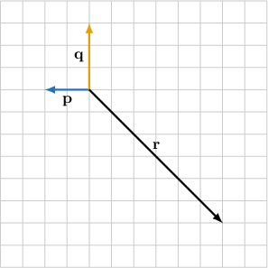

Consider the picture above. Given that $r=\lambda p+\mu q$, find $\lambda $ and $\mu .$

selection:

$\lambda =-3$ and $\mu =-2$

$\lambda =0$ and $\mu =-2$

$\lambda =-3$ and $\mu =-3$

$\lambda =3$ and $\mu =2$

$\lambda =-3$ and $\mu =0$

Original worked solution:

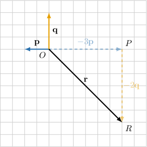

In $△OPR$ shown above, we have 

- $OP=3|p|$

- $\overset{\to }{OP}$ has the opposite direction to $p$

Hence, $\overset{\to }{OP}=-3p.$

Similarly:

- $PR=2|q|$

- $\overset{\to }{PR}$ has the opposite direction to $q$

Hence, $\overset{\to }{PR}=-2q.$

Additionally, 

$$
\begin{aligned}r & =\overset{\to }{OP}+\overset{\to }{PR} \\  & =-3p-2q.\end{aligned}
$$

Consequently, $r=\lambda p+\mu q=-3p-2q.$

Since $p∦q,$ the linear combination can only be written in one way. Equating the coefficients, we get:

- $\lambda =-3$ and $\mu =-2$

### Parameterized fidelity replay

Consider the picture above. Given that $r=\lambda p+\mu q$, find $\lambda $ and $\mu .$

selection:
- $\lambda =-3$ and $\mu =-3$
- $\lambda =0$ and $\mu =-2$
- $\lambda =-3$ and $\mu =-2$
- $\lambda =-3$ and $\mu =0$
- $\lambda =3$ and $\mu =2$

Worked solution:

In $△OPR$ shown above, we have 

- $OP=3|p|$

- $\overset{\to }{OP}$ has the opposite direction to $p$

Hence, $\overset{\to }{OP}=-3p.$

Similarly:

- $PR=2|q|$

- $\overset{\to }{PR}$ has the opposite direction to $q$

Hence, $\overset{\to }{PR}=-2q.$

Additionally, 

$$
\begin{aligned}r & =\overset{\to }{OP}+\overset{\to }{PR} \\  & =-3p-2q.\end{aligned}
$$

Consequently, $r=\lambda p+\mu q=-3p-2q.$

Since $p∦q,$ the linear combination can only be written in one way. Equating the coefficients, we get:

- $\lambda =-3$ and $\mu =-2$

### Generated changed-parameter variant

Consider the picture above. Given that $r=\lambda p+\mu q$, find $\lambda $ and $\mu .$

selection:
- $\lambda =\frac{9}{4}$ and $\mu =\frac{3}{2}$
- $\lambda =-\frac{9}{4}$ and $\mu =0$
- $\lambda =-\frac{9}{4}$ and $\mu =-\frac{9}{4}$
- $\lambda =0$ and $\mu =-\frac{3}{2}$
- $\lambda =-\frac{9}{4}$ and $\mu =-\frac{3}{2}$

Worked solution:

In $△OPR$ shown above, we have 

- $OP=\frac{9}{4}|p|$

- $\overset{\to }{OP}$ has the opposite direction to $p$

Hence, $\overset{\to }{OP}=-\frac{9}{4}p.$

Similarly:

- $PR=\frac{3}{2}|q|$

- $\overset{\to }{PR}$ has the opposite direction to $q$

Hence, $\overset{\to }{PR}=-\frac{3}{2}q.$

Additionally, 

$$
\begin{aligned}r & =\overset{\to }{OP}+\overset{\to }{PR} \\  & =-\frac{9}{4}p-\frac{3}{2}q.\end{aligned}
$$

Consequently, $r=\lambda p+\mu q=-\frac{9}{4}p-\frac{3}{2}q.$

Since $p∦q,$ the linear combination can only be written in one way. Equating the coefficients, we get:

- $\lambda =-\frac{9}{4}$ and $\mu =-\frac{3}{2}$

## Original q-42662

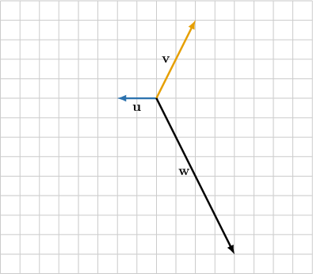

Consider the picture above. Given that $w=\lambda u+\mu v$, find $\lambda $ and $\mu .$

selection:

$\lambda =-2$ and $\mu =-3$

$\lambda =3$ and $\mu =3$

$\lambda =1$ and $\mu =2$

$\lambda =3$ and $\mu =2$

$\lambda =-4$ and $\mu =-2$

Original worked solution:

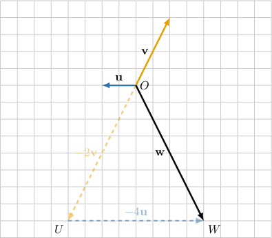

In $△OUW$ shown above, we have 

- $OU=2|v|$

- $\overset{\to }{OU}$ has the opposite direction to $v$

Hence, $\overset{\to }{OU}=-2v.$

Similarly:

- $UW=4|u|$

- $\overset{\to }{UW}$ has the opposite direction to $u$

Hence, $\overset{\to }{UW}=-4u.$

Additionally, 

$$
\begin{aligned}w & =\overset{\to }{OU}+\overset{\to }{UW} \\  & =-2v-4u \\  & =-4u-2v.\end{aligned}
$$

Consequently, $w=\lambda u+\mu v=-4u-2v.$

Since $u∦v,$ the linear combination can only be written in one way. Equating the coefficients, we get:

- $\lambda =-4$ and $\mu =-2$

### Parameterized fidelity replay

Consider the picture above. Given that $w=\lambda u+\mu v$, find $\lambda $ and $\mu .$

selection:
- $\lambda =1$ and $\mu =2$
- $\lambda =3$ and $\mu =3$
- $\lambda =-2$ and $\mu =-3$
- $\lambda =-4$ and $\mu =-2$
- $\lambda =3$ and $\mu =2$

Worked solution:

In $△OUW$ shown above, we have 

- $OU=2|v|$

- $\overset{\to }{OU}$ has the opposite direction to $v$

Hence, $\overset{\to }{OU}=-2v.$

Similarly:

- $UW=4|u|$

- $\overset{\to }{UW}$ has the opposite direction to $u$

Hence, $\overset{\to }{UW}=-4u.$

Additionally, 

$$
\begin{aligned}w & =\overset{\to }{OU}+\overset{\to }{UW} \\  & =-2v-4u \\  & =-4u-2v.\end{aligned}
$$

Consequently, $w=\lambda u+\mu v=-4u-2v.$

Since $u∦v,$ the linear combination can only be written in one way. Equating the coefficients, we get:

- $\lambda =-4$ and $\mu =-2$

### Generated changed-parameter variant

Consider the picture above. Given that $w=\lambda u+\mu v$, find $\lambda $ and $\mu .$

selection:
- $\lambda =\frac{9}{4}$ and $\mu =\frac{9}{4}$
- $\lambda =-\frac{3}{2}$ and $\mu =-\frac{9}{4}$
- $\lambda =\frac{9}{4}$ and $\mu =\frac{3}{2}$
- $\lambda =\frac{3}{4}$ and $\mu =\frac{3}{2}$
- $\lambda =-3$ and $\mu =-\frac{3}{2}$

Worked solution:

In $△OUW$ shown above, we have 

- $OU=\frac{3}{2}|v|$

- $\overset{\to }{OU}$ has the opposite direction to $v$

Hence, $\overset{\to }{OU}=-\frac{3}{2}v.$

Similarly:

- $UW=3|u|$

- $\overset{\to }{UW}$ has the opposite direction to $u$

Hence, $\overset{\to }{UW}=-3u.$

Additionally, 

$$
\begin{aligned}w & =\overset{\to }{OU}+\overset{\to }{UW} \\  & =-\frac{3}{2}v-3u \\  & =-3u-\frac{3}{2}v.\end{aligned}
$$

Consequently, $w=\lambda u+\mu v=-3u-\frac{3}{2}v.$

Since $u∦v,$ the linear combination can only be written in one way. Equating the coefficients, we get:

- $\lambda =-3$ and $\mu =-\frac{3}{2}$

## Original q-42676

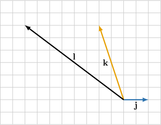

Consider the picture above. Given that $l=\lambda j+\mu k$, find $\lambda $ and $\mu .$

selection:

$\lambda =3$ and $\mu =1$

$\lambda =1$ and $\mu =-3$

$\lambda =-3$ and $\mu =1$

$\lambda =3$ and $\mu =-1$

$\lambda =-2$ and $\mu =2$

Original worked solution:

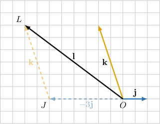

In $△OJL$ shown above, we have 

- $OJ=3|j|$

- $\overset{\to }{OJ}$ and $j$ have the opposite direction

Hence, $\overset{\to }{OJ}=-3j.$

Similarly:

- $JL=|k|$

- $\overset{\to }{JL}$ and $k$ have the same direction

Hence, $\overset{\to }{JL}=k.$

Additionally, 

$$
\begin{aligned}l & =\overset{\to }{OJ}+\overset{\to }{JL} \\  & =-3j+k.\end{aligned}
$$

Consequently, $l=\lambda j+\mu k=-3j+k.$

Since $j∦k,$ the linear combination can only be written in one way. Equating the coefficients, we get:

- $\lambda =-3$ and $\mu =1$

### Parameterized fidelity replay

Consider the picture above. Given that $l=\lambda j+\mu k$, find $\lambda $ and $\mu .$

selection:
- $\lambda =-3$ and $\mu =1$
- $\lambda =1$ and $\mu =-3$
- $\lambda =3$ and $\mu =1$
- $\lambda =-2$ and $\mu =2$
- $\lambda =3$ and $\mu =-1$

Worked solution:

In $△OJL$ shown above, we have 

- $OJ=3|j|$

- $\overset{\to }{OJ}$ and $j$ have the opposite direction

Hence, $\overset{\to }{OJ}=-3j.$

Similarly:

- $JL=|k|$

- $\overset{\to }{JL}$ and $k$ have the same direction

Hence, $\overset{\to }{JL}=k.$

Additionally, 

$$
\begin{aligned}l & =\overset{\to }{OJ}+\overset{\to }{JL} \\  & =-3j+k.\end{aligned}
$$

Consequently, $l=\lambda j+\mu k=-3j+k.$

Since $j∦k,$ the linear combination can only be written in one way. Equating the coefficients, we get:

- $\lambda =-3$ and $\mu =1$

### Generated changed-parameter variant

Consider the picture above. Given that $l=\lambda j+\mu k$, find $\lambda $ and $\mu .$

selection:
- $\lambda =-\frac{3}{2}$ and $\mu =\frac{3}{2}$
- $\lambda =\frac{3}{4}$ and $\mu =-\frac{9}{4}$
- $\lambda =-\frac{9}{4}$ and $\mu =\frac{3}{4}$
- $\lambda =\frac{9}{4}$ and $\mu =\frac{3}{4}$
- $\lambda =\frac{9}{4}$ and $\mu =-\frac{3}{4}$

Worked solution:

In $△OJL$ shown above, we have 

- $OJ=\frac{9}{4}|j|$

- $\overset{\to }{OJ}$ and $j$ have the opposite direction

Hence, $\overset{\to }{OJ}=-\frac{9}{4}j.$

Similarly:

- $JL=\frac{3}{4}|k|$

- $\overset{\to }{JL}$ and $k$ have the same direction

Hence, $\overset{\to }{JL}=\frac{3}{4}k.$

Additionally, 

$$
\begin{aligned}l & =\overset{\to }{OJ}+\overset{\to }{JL} \\  & =-\frac{9}{4}j+\frac{3}{4}k.\end{aligned}
$$

Consequently, $l=\lambda j+\mu k=-\frac{9}{4}j+\frac{3}{4}k.$

Since $j∦k,$ the linear combination can only be written in one way. Equating the coefficients, we get:

- $\lambda =-\frac{9}{4}$ and $\mu =\frac{3}{4}$

## Original q-77515

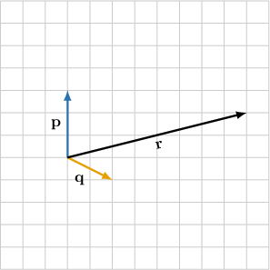

Consider the picture above. Given that $r=\lambda p+\mu q$, find $\lambda $ and $\mu .$

selection:

$\lambda =2$ and $\mu =-4$

$\lambda =-2$ and $\mu =-4$

$\lambda =-1$ and $\mu =3$

$\lambda =1$ and $\mu =3$

$\lambda =2$ and $\mu =4$

Original worked solution:

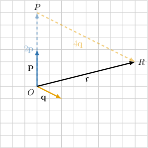

In $△OPR$ shown above, we have 

- $OP=2|p|$

- $\overset{\to }{OP}$ and $p$ have the same direction

Hence, $\overset{\to }{OP}=2p.$

Similarly:

- $PR=4|q|$

- $\overset{\to }{PR}$ and $q$ have the same direction

Hence, $\overset{\to }{PR}=4q.$

Additionally, 

$$
\begin{aligned}r & =\overset{\to }{OP}+\overset{\to }{PR} \\  & =2p+4q.\end{aligned}
$$

Consequently, $r=\lambda p+\mu q=2p+4q.$

Since $p∦q,$ the linear combination can only be written in one way. Equating the coefficients, we get:

- $\lambda =2$ and $\mu =4$

### Parameterized fidelity replay

Consider the picture above. Given that $r=\lambda p+\mu q$, find $\lambda $ and $\mu .$

selection:
- $\lambda =-1$ and $\mu =3$
- $\lambda =-2$ and $\mu =-4$
- $\lambda =2$ and $\mu =-4$
- $\lambda =2$ and $\mu =4$
- $\lambda =1$ and $\mu =3$

Worked solution:

In $△OPR$ shown above, we have 

- $OP=2|p|$

- $\overset{\to }{OP}$ and $p$ have the same direction

Hence, $\overset{\to }{OP}=2p.$

Similarly:

- $PR=4|q|$

- $\overset{\to }{PR}$ and $q$ have the same direction

Hence, $\overset{\to }{PR}=4q.$

Additionally, 

$$
\begin{aligned}r & =\overset{\to }{OP}+\overset{\to }{PR} \\  & =2p+4q.\end{aligned}
$$

Consequently, $r=\lambda p+\mu q=2p+4q.$

Since $p∦q,$ the linear combination can only be written in one way. Equating the coefficients, we get:

- $\lambda =2$ and $\mu =4$

### Generated changed-parameter variant

Consider the picture above. Given that $r=\lambda p+\mu q$, find $\lambda $ and $\mu .$

selection:
- $\lambda =\frac{3}{2}$ and $\mu =-3$
- $\lambda =-\frac{3}{4}$ and $\mu =\frac{9}{4}$
- $\lambda =\frac{3}{2}$ and $\mu =3$
- $\lambda =\frac{3}{4}$ and $\mu =\frac{9}{4}$
- $\lambda =-\frac{3}{2}$ and $\mu =-3$

Worked solution:

In $△OPR$ shown above, we have 

- $OP=\frac{3}{2}|p|$

- $\overset{\to }{OP}$ and $p$ have the same direction

Hence, $\overset{\to }{OP}=\frac{3}{2}p.$

Similarly:

- $PR=3|q|$

- $\overset{\to }{PR}$ and $q$ have the same direction

Hence, $\overset{\to }{PR}=3q.$

Additionally, 

$$
\begin{aligned}r & =\overset{\to }{OP}+\overset{\to }{PR} \\  & =\frac{3}{2}p+3q.\end{aligned}
$$

Consequently, $r=\lambda p+\mu q=\frac{3}{2}p+3q.$

Since $p∦q,$ the linear combination can only be written in one way. Equating the coefficients, we get:

- $\lambda =\frac{3}{2}$ and $\mu =3$

## Original q-326016

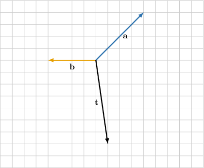

Consider the picture above. If $t=\lambda a+\mu b$, then$\,\lambda =$
{{field-1}}
and 
$\mu =$
{{field-2}}.

field-1:

-\frac{7}{4}

field-2:

-2

Original worked solution:

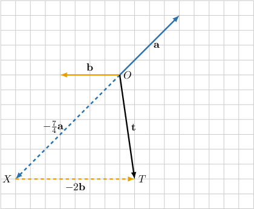

In $△OXT$ shown above, we have:

- $OX=\frac{7}{4}\cdot |a|$

- $\overset{\to }{OX}$ has the opposite direction to $a$

Hence, $\overset{\to }{OX}=-\frac{7}{4}a.$

Similarly:

- $XT=2|b|$

- $\overset{\to }{XT}$ has the opposite direction to $b$

Hence, $\overset{\to }{XT}=-2b.$

Additionally,

$$
t=\overset{\to }{OX}+\overset{\to }{XT}=-\frac{7}{4}a-2b.
$$

Consequently, $t=\lambda a+\mu b=-\frac{7}{4}a-2b.$

Since $b∦a,$ the linear combination can only be written in one way. Equating the coefficients, we get:

- $\lambda =-\frac{7}{4}$ and $\mu =-2$

### Parameterized fidelity replay

Consider the picture above. If $t=\lambda a+\mu b$, then$\,\lambda =$
{{field-1}}
and 
$\mu =$
{{field-2}}.

field-1:
- -\frac{7}{4}
field-2:
- -2

Worked solution:

In $△OXT$ shown above, we have:

- $OX=\frac{7}{4}\cdot |a|$

- $\overset{\to }{OX}$ has the opposite direction to $a$

Hence, $\overset{\to }{OX}=-\frac{7}{4}a.$

Similarly:

- $XT=2|b|$

- $\overset{\to }{XT}$ has the opposite direction to $b$

Hence, $\overset{\to }{XT}=-2b.$

Additionally,

$$
t=\overset{\to }{OX}+\overset{\to }{XT}=-\frac{7}{4}a-2b.
$$

Consequently, $t=\lambda a+\mu b=-\frac{7}{4}a-2b.$

Since $b∦a,$ the linear combination can only be written in one way. Equating the coefficients, we get:

- $\lambda =-\frac{7}{4}$ and $\mu =-2$

### Generated changed-parameter variant

Consider the picture above. If $t=\lambda a+\mu b$, then$\,\lambda =$
{{field-1}}
and 
$\mu =$
{{field-2}}.

field-1:
- -2
field-2:
- -1

Worked solution:

In $△OXT$ shown above, we have:

- $OX=2\cdot |a|$

- $\overset{\to }{OX}$ has the opposite direction to $a$

Hence, $\overset{\to }{OX}=-2a.$

Similarly:

- $XT=|b|$

- $\overset{\to }{XT}$ has the opposite direction to $b$

Hence, $\overset{\to }{XT}=-b.$

Additionally,

$$
t=\overset{\to }{OX}+\overset{\to }{XT}=-2a-b.
$$

Consequently, $t=\lambda a+\mu b=-2a-b.$

Since $b∦a,$ the linear combination can only be written in one way. Equating the coefficients, we get:

- $\lambda =-2$ and $\mu =-1$

## Original q-77452

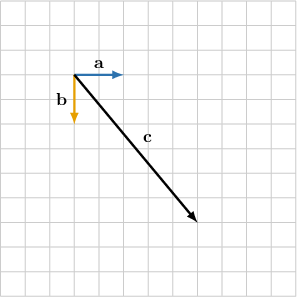

Consider the picture above. Given that $c=\lambda a+\mu b$, find $\lambda $ and $\mu .$

selection:

$\lambda =-2.5$ and $\mu =-3$

$\lambda =2.5$ and $\mu =3$

$\lambda =2.5$ and $\mu =-3$

$\lambda =-3$ and $\mu =2.5$

$\lambda =-2.5$ and $\mu =3$

Original worked solution:

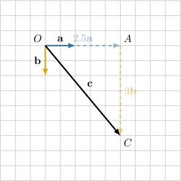

In $△OAC$ shown above, we have:

- $OA=2.5|a|$

- $\overset{\to }{OA}$ and $a$ have the same direction

Hence, $\overset{\to }{OA}=2.5a.$

Similarly:

- $AC=3|b|$

- $\overset{\to }{AC}$ and $b$ have the same direction

Hence, $\overset{\to }{AC}=3b.$

Additionally, 

$$
\begin{aligned}c & =\overset{\to }{OA}+\overset{\to }{AC} \\  & =2.5a+3b.\end{aligned}
$$

Consequently, $c=\lambda a+\mu b=2.5a+3b.$ 

Since $a∦b,$ the linear combination can only be written in one way. Equating the coefficients, we get:

$\,$ $\lambda =2.5$ and $\mu =3$

### Parameterized fidelity replay

Consider the picture above. Given that $c=\lambda a+\mu b$, find $\lambda $ and $\mu .$

selection:
- $\lambda =2.5$ and $\mu =-3$
- $\lambda =2.5$ and $\mu =3$
- $\lambda =-2.5$ and $\mu =-3$
- $\lambda =-2.5$ and $\mu =3$
- $\lambda =-3$ and $\mu =2.5$

Worked solution:

In $△OAC$ shown above, we have:

- $OA=2.5|a|$

- $\overset{\to }{OA}$ and $a$ have the same direction

Hence, $\overset{\to }{OA}=2.5a.$

Similarly:

- $AC=3|b|$

- $\overset{\to }{AC}$ and $b$ have the same direction

Hence, $\overset{\to }{AC}=3b.$

Additionally, 

$$
\begin{aligned}c & =\overset{\to }{OA}+\overset{\to }{AC} \\  & =2.5a+3b.\end{aligned}
$$

Consequently, $c=\lambda a+\mu b=2.5a+3b.$ 

Since $a∦b,$ the linear combination can only be written in one way. Equating the coefficients, we get:

$\,$ $\lambda =2.5$ and $\mu =3$

### Generated changed-parameter variant

Consider the picture above. Given that $c=\lambda a+\mu b$, find $\lambda $ and $\mu .$

selection:
- $\lambda =-\frac{5}{4}$ and $\mu =-1.5$
- $\lambda =-\frac{5}{4}$ and $\mu =1.5$
- $\lambda =-1.5$ and $\mu =\frac{5}{4}$
- $\lambda =\frac{5}{4}$ and $\mu =1.5$
- $\lambda =\frac{5}{4}$ and $\mu =-1.5$

Worked solution:

In $△OAC$ shown above, we have:

- $OA=\frac{5}{4}|a|$

- $\overset{\to }{OA}$ and $a$ have the same direction

Hence, $\overset{\to }{OA}=\frac{5}{4}a.$

Similarly:

- $AC=1.5|b|$

- $\overset{\to }{AC}$ and $b$ have the same direction

Hence, $\overset{\to }{AC}=1.5b.$

Additionally, 

$$
\begin{aligned}c & =\overset{\to }{OA}+\overset{\to }{AC} \\  & =\frac{5}{4}a+1.5b.\end{aligned}
$$

Consequently, $c=\lambda a+\mu b=\frac{5}{4}a+1.5b.$ 

Since $a∦b,$ the linear combination can only be written in one way. Equating the coefficients, we get:

$\,$ $\lambda =\frac{5}{4}$ and $\mu =1.5$

## Original q-20413

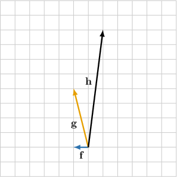

Consider the picture above. Given that $h=\lambda f+\mu g$, find $\lambda $ and $\mu .$

selection:

$\lambda =1$ and $\mu =2$

$\lambda =3$ and $\mu =2$

$\lambda =-3$ and $\mu =2$

$\lambda =-3$ and $\mu =3$

$\lambda =2$ and $\mu =-3$

Original worked solution:

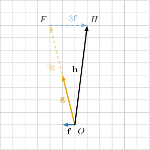

In $△OFH$ shown above, we have 

- $OF=2|g|$

- $\overset{\to }{OF}$ and $g$ have the same direction

Hence, $\overset{\to }{OF}=2g.$

Similarly:

- $FH=3|f|$

- $\overset{\to }{FH}$ has the opposite direction to $f$

Hence, $\overset{\to }{FH}=-3f.$

Additionally, 

$$
\begin{aligned}h & =\overset{\to }{OF}+\overset{\to }{FH} \\  & =2g-3f \\  & =-3f+2g.\end{aligned}
$$

Consequently, $h=\lambda f+\mu g=-3f+2g.$

Since $f∦g,$ the linear combination can only be written in one way. Equating the coefficients, we get:

- $\lambda =-3$ and $\mu =2$

### Parameterized fidelity replay

Consider the picture above. Given that $h=\lambda f+\mu g$, find $\lambda $ and $\mu .$

selection:
- $\lambda =-3$ and $\mu =2$
- $\lambda =3$ and $\mu =2$
- $\lambda =1$ and $\mu =2$
- $\lambda =2$ and $\mu =-3$
- $\lambda =-3$ and $\mu =3$

Worked solution:

In $△OFH$ shown above, we have 

- $OF=2|g|$

- $\overset{\to }{OF}$ and $g$ have the same direction

Hence, $\overset{\to }{OF}=2g.$

Similarly:

- $FH=3|f|$

- $\overset{\to }{FH}$ has the opposite direction to $f$

Hence, $\overset{\to }{FH}=-3f.$

Additionally, 

$$
\begin{aligned}h & =\overset{\to }{OF}+\overset{\to }{FH} \\  & =2g-3f \\  & =-3f+2g.\end{aligned}
$$

Consequently, $h=\lambda f+\mu g=-3f+2g.$

Since $f∦g,$ the linear combination can only be written in one way. Equating the coefficients, we get:

- $\lambda =-3$ and $\mu =2$

### Generated changed-parameter variant

Consider the picture above. Given that $h=\lambda f+\mu g$, find $\lambda $ and $\mu .$

selection:
- $\lambda =\frac{3}{4}$ and $\mu =\frac{3}{2}$
- $\lambda =-\frac{9}{4}$ and $\mu =\frac{3}{2}$
- $\lambda =\frac{3}{2}$ and $\mu =-\frac{9}{4}$
- $\lambda =\frac{9}{4}$ and $\mu =\frac{3}{2}$
- $\lambda =-\frac{9}{4}$ and $\mu =\frac{9}{4}$

Worked solution:

In $△OFH$ shown above, we have 

- $OF=\frac{3}{2}|g|$

- $\overset{\to }{OF}$ and $g$ have the same direction

Hence, $\overset{\to }{OF}=\frac{3}{2}g.$

Similarly:

- $FH=\frac{9}{4}|f|$

- $\overset{\to }{FH}$ has the opposite direction to $f$

Hence, $\overset{\to }{FH}=-\frac{9}{4}f.$

Additionally, 

$$
\begin{aligned}h & =\overset{\to }{OF}+\overset{\to }{FH} \\  & =\frac{3}{2}g-\frac{9}{4}f \\  & =-\frac{9}{4}f+\frac{3}{2}g.\end{aligned}
$$

Consequently, $h=\lambda f+\mu g=-\frac{9}{4}f+\frac{3}{2}g.$

Since $f∦g,$ the linear combination can only be written in one way. Equating the coefficients, we get:

- $\lambda =-\frac{9}{4}$ and $\mu =\frac{3}{2}$

## Authored easy blank

Consider the picture above. If $r=\lambda p+\mu q$, then$\,\lambda =$
{{field-1}}
and 
$\mu =$
{{field-2}}.

field-1:
- 3
field-2:
- 1

Worked solution:

In $△OPR$ shown above, we have:

- $OP=3|p|$

- $\overset{\to }{OP}$ and $p$ have the same direction

Hence, $\overset{\to }{OP}=3p.$

Similarly:

- $PR=|q|$

- $\overset{\to }{PR}$ and $q$ have the same direction

Hence, $\overset{\to }{PR}=q.$

Additionally, 

$$
\begin{aligned}r & =\overset{\to }{OP}+\overset{\to }{PR} \\  & =3p+q.\end{aligned}
$$

Consequently, $r=\lambda p+\mu q=3p+q.$

Since $p∦q,$ the linear combination can only be written in one way. Equating the coefficients, we get:

- $\lambda =3$ and $\mu =1$

## Authored easy blank

Consider the picture above. If $r=\lambda p+\mu q$, then$\,\lambda =$
{{field-1}}
and 
$\mu =$
{{field-2}}.

field-1:
- 1
field-2:
- 4

Worked solution:

In $△OPR$ shown above, we have:

- $OP=|p|$

- $\overset{\to }{OP}$ and $p$ have the same direction

Hence, $\overset{\to }{OP}=p.$

Similarly:

- $PR=4|q|$

- $\overset{\to }{PR}$ and $q$ have the same direction

Hence, $\overset{\to }{PR}=4q.$

Additionally, 

$$
\begin{aligned}r & =\overset{\to }{OP}+\overset{\to }{PR} \\  & =p+4q.\end{aligned}
$$

Consequently, $r=\lambda p+\mu q=p+4q.$

Since $p∦q,$ the linear combination can only be written in one way. Equating the coefficients, we get:

- $\lambda =1$ and $\mu =4$

## Authored easy radio

Consider the picture above. Given that $r=\lambda p+\mu q$, find $\lambda $ and $\mu .$

selection:
- $\lambda =3$ and $\mu =-1$
- $\lambda =3$ and $\mu =1$
- $\lambda =-3$ and $\mu =-1$
- $\lambda =-3$ and $\mu =1$
- $\lambda =1$ and $\mu =3$

Worked solution:

In $△OPR$ shown above, we have:

- $OP=3|p|$

- $\overset{\to }{OP}$ and $p$ have the same direction

Hence, $\overset{\to }{OP}=3p.$

Similarly:

- $PR=|q|$

- $\overset{\to }{PR}$ and $q$ have the same direction

Hence, $\overset{\to }{PR}=q.$

Additionally, 

$$
\begin{aligned}r & =\overset{\to }{OP}+\overset{\to }{PR} \\  & =3p+q.\end{aligned}
$$

Consequently, $r=\lambda p+\mu q=3p+q.$

Since $p∦q,$ the linear combination can only be written in one way. Equating the coefficients, we get:

- $\lambda =3$ and $\mu =1$

## Authored easy radio

Consider the picture above. Given that $r=\lambda p+\mu q$, find $\lambda $ and $\mu .$

selection:
- $\lambda =-1$ and $\mu =4$
- $\lambda =1$ and $\mu =-4$
- $\lambda =4$ and $\mu =1$
- $\lambda =-1$ and $\mu =-4$
- $\lambda =1$ and $\mu =4$

Worked solution:

In $△OPR$ shown above, we have:

- $OP=|p|$

- $\overset{\to }{OP}$ and $p$ have the same direction

Hence, $\overset{\to }{OP}=p.$

Similarly:

- $PR=4|q|$

- $\overset{\to }{PR}$ and $q$ have the same direction

Hence, $\overset{\to }{PR}=4q.$

Additionally, 

$$
\begin{aligned}r & =\overset{\to }{OP}+\overset{\to }{PR} \\  & =p+4q.\end{aligned}
$$

Consequently, $r=\lambda p+\mu q=p+4q.$

Since $p∦q,$ the linear combination can only be written in one way. Equating the coefficients, we get:

- $\lambda =1$ and $\mu =4$

## Authored moderate blank

Consider the picture above. If $r=\lambda p+\mu q$, then$\,\lambda =$
{{field-1}}
and 
$\mu =$
{{field-2}}.

field-1:
- -\frac{5}{2}
field-2:
- -\frac{1}{2}

Worked solution:

In $△OPR$ shown above, we have:

- $OP=\frac{5}{2}|p|$

- $\overset{\to }{OP}$ has the opposite direction to $p$

Hence, $\overset{\to }{OP}=-\frac{5}{2}p.$

Similarly:

- $PR=\frac{1}{2}|q|$

- $\overset{\to }{PR}$ has the opposite direction to $q$

Hence, $\overset{\to }{PR}=-\frac{1}{2}q.$

Additionally, 

$$
\begin{aligned}r & =\overset{\to }{OP}+\overset{\to }{PR} \\  & =-\frac{5}{2}p-\frac{1}{2}q.\end{aligned}
$$

Consequently, $r=\lambda p+\mu q=-\frac{5}{2}p-\frac{1}{2}q.$

Since $p∦q,$ the linear combination can only be written in one way. Equating the coefficients, we get:

- $\lambda =-\frac{5}{2}$ and $\mu =-\frac{1}{2}$

## Authored moderate blank

Consider the picture above. If $r=\lambda p+\mu q$, then$\,\lambda =$
{{field-1}}
and 
$\mu =$
{{field-2}}.

field-1:
- -\frac{1}{2}
field-2:
- -4

Worked solution:

In $△OPR$ shown above, we have:

- $OP=\frac{1}{2}|p|$

- $\overset{\to }{OP}$ has the opposite direction to $p$

Hence, $\overset{\to }{OP}=-\frac{1}{2}p.$

Similarly:

- $PR=4|q|$

- $\overset{\to }{PR}$ has the opposite direction to $q$

Hence, $\overset{\to }{PR}=-4q.$

Additionally, 

$$
\begin{aligned}r & =\overset{\to }{OP}+\overset{\to }{PR} \\  & =-\frac{1}{2}p-4q.\end{aligned}
$$

Consequently, $r=\lambda p+\mu q=-\frac{1}{2}p-4q.$

Since $p∦q,$ the linear combination can only be written in one way. Equating the coefficients, we get:

- $\lambda =-\frac{1}{2}$ and $\mu =-4$

## Authored moderate radio

Consider the picture above. Given that $r=\lambda p+\mu q$, find $\lambda $ and $\mu .$

selection:
- $\lambda =\frac{5}{2}$ and $\mu =\frac{1}{2}$
- $\lambda =-\frac{1}{2}$ and $\mu =-\frac{5}{2}$
- $\lambda =\frac{5}{2}$ and $\mu =-\frac{1}{2}$
- $\lambda =-\frac{5}{2}$ and $\mu =-\frac{1}{2}$
- $\lambda =-\frac{5}{2}$ and $\mu =\frac{1}{2}$

Worked solution:

In $△OPR$ shown above, we have:

- $OP=\frac{5}{2}|p|$

- $\overset{\to }{OP}$ has the opposite direction to $p$

Hence, $\overset{\to }{OP}=-\frac{5}{2}p.$

Similarly:

- $PR=\frac{1}{2}|q|$

- $\overset{\to }{PR}$ has the opposite direction to $q$

Hence, $\overset{\to }{PR}=-\frac{1}{2}q.$

Additionally, 

$$
\begin{aligned}r & =\overset{\to }{OP}+\overset{\to }{PR} \\  & =-\frac{5}{2}p-\frac{1}{2}q.\end{aligned}
$$

Consequently, $r=\lambda p+\mu q=-\frac{5}{2}p-\frac{1}{2}q.$

Since $p∦q,$ the linear combination can only be written in one way. Equating the coefficients, we get:

- $\lambda =-\frac{5}{2}$ and $\mu =-\frac{1}{2}$

## Authored moderate radio

Consider the picture above. Given that $r=\lambda p+\mu q$, find $\lambda $ and $\mu .$

selection:
- $\lambda =-4$ and $\mu =-\frac{1}{2}$
- $\lambda =-\frac{1}{2}$ and $\mu =-4$
- $\lambda =-\frac{1}{2}$ and $\mu =4$
- $\lambda =\frac{1}{2}$ and $\mu =-4$
- $\lambda =\frac{1}{2}$ and $\mu =4$

Worked solution:

In $△OPR$ shown above, we have:

- $OP=\frac{1}{2}|p|$

- $\overset{\to }{OP}$ has the opposite direction to $p$

Hence, $\overset{\to }{OP}=-\frac{1}{2}p.$

Similarly:

- $PR=4|q|$

- $\overset{\to }{PR}$ has the opposite direction to $q$

Hence, $\overset{\to }{PR}=-4q.$

Additionally, 

$$
\begin{aligned}r & =\overset{\to }{OP}+\overset{\to }{PR} \\  & =-\frac{1}{2}p-4q.\end{aligned}
$$

Consequently, $r=\lambda p+\mu q=-\frac{1}{2}p-4q.$

Since $p∦q,$ the linear combination can only be written in one way. Equating the coefficients, we get:

- $\lambda =-\frac{1}{2}$ and $\mu =-4$

## Authored hard blank

Consider the picture above. If $r=\lambda p+\mu q$, then$\,\lambda =$
{{field-1}}
and 
$\mu =$
{{field-2}}.

field-1:
- \frac{7}{2}
field-2:
- -\frac{15}{4}

Worked solution:

In $△OMR$ shown above, we have:

- $OM=\frac{15}{4}|q|$

- $\overset{\to }{OM}$ has the opposite direction to $q$

Hence, $\overset{\to }{OM}=-\frac{15}{4}q.$

Similarly:

- $MR=\frac{7}{2}|p|$

- $\overset{\to }{MR}$ and $p$ have the same direction

Hence, $\overset{\to }{MR}=\frac{7}{2}p.$

Additionally, 

$$
\begin{aligned}r & =\overset{\to }{OM}+\overset{\to }{MR} \\  & =-\frac{15}{4}q+\frac{7}{2}p \\  & =\frac{7}{2}p-\frac{15}{4}q.\end{aligned}
$$

Consequently, $r=\lambda p+\mu q=\frac{7}{2}p-\frac{15}{4}q.$

Since $p∦q,$ the linear combination can only be written in one way. Equating the coefficients, we get:

- $\lambda =\frac{7}{2}$ and $\mu =-\frac{15}{4}$

## Authored hard blank

Consider the picture above. If $r=\lambda p+\mu q$, then$\,\lambda =$
{{field-1}}
and 
$\mu =$
{{field-2}}.

field-1:
- \frac{1}{4}
field-2:
- \frac{2}{3}

Worked solution:

In $△OMR$ shown above, we have:

- $OM=\frac{2}{3}|q|$

- $\overset{\to }{OM}$ and $q$ have the same direction

Hence, $\overset{\to }{OM}=\frac{2}{3}q.$

Similarly:

- $MR=\frac{1}{4}|p|$

- $\overset{\to }{MR}$ and $p$ have the same direction

Hence, $\overset{\to }{MR}=\frac{1}{4}p.$

Additionally, 

$$
\begin{aligned}r & =\overset{\to }{OM}+\overset{\to }{MR} \\  & =\frac{2}{3}q+\frac{1}{4}p \\  & =\frac{1}{4}p+\frac{2}{3}q.\end{aligned}
$$

Consequently, $r=\lambda p+\mu q=\frac{1}{4}p+\frac{2}{3}q.$

Since $p∦q,$ the linear combination can only be written in one way. Equating the coefficients, we get:

- $\lambda =\frac{1}{4}$ and $\mu =\frac{2}{3}$

## Authored hard radio

Consider the picture above. Given that $r=\lambda p+\mu q$, find $\lambda $ and $\mu .$

selection:
- $\lambda =\frac{7}{2}$ and $\mu =\frac{15}{4}$
- $\lambda =\frac{7}{2}$ and $\mu =-\frac{15}{4}$
- $\lambda =-\frac{7}{2}$ and $\mu =\frac{15}{4}$
- $\lambda =-\frac{7}{2}$ and $\mu =-\frac{15}{4}$
- $\lambda =-\frac{15}{4}$ and $\mu =\frac{7}{2}$

Worked solution:

In $△OMR$ shown above, we have:

- $OM=\frac{15}{4}|q|$

- $\overset{\to }{OM}$ has the opposite direction to $q$

Hence, $\overset{\to }{OM}=-\frac{15}{4}q.$

Similarly:

- $MR=\frac{7}{2}|p|$

- $\overset{\to }{MR}$ and $p$ have the same direction

Hence, $\overset{\to }{MR}=\frac{7}{2}p.$

Additionally, 

$$
\begin{aligned}r & =\overset{\to }{OM}+\overset{\to }{MR} \\  & =-\frac{15}{4}q+\frac{7}{2}p \\  & =\frac{7}{2}p-\frac{15}{4}q.\end{aligned}
$$

Consequently, $r=\lambda p+\mu q=\frac{7}{2}p-\frac{15}{4}q.$

Since $p∦q,$ the linear combination can only be written in one way. Equating the coefficients, we get:

- $\lambda =\frac{7}{2}$ and $\mu =-\frac{15}{4}$

## Authored hard radio

Consider the picture above. Given that $r=\lambda p+\mu q$, find $\lambda $ and $\mu .$

selection:
- $\lambda =\frac{2}{3}$ and $\mu =\frac{1}{4}$
- $\lambda =\frac{1}{4}$ and $\mu =-\frac{2}{3}$
- $\lambda =-\frac{1}{4}$ and $\mu =-\frac{2}{3}$
- $\lambda =\frac{1}{4}$ and $\mu =\frac{2}{3}$
- $\lambda =-\frac{1}{4}$ and $\mu =\frac{2}{3}$

Worked solution:

In $△OMR$ shown above, we have:

- $OM=\frac{2}{3}|q|$

- $\overset{\to }{OM}$ and $q$ have the same direction

Hence, $\overset{\to }{OM}=\frac{2}{3}q.$

Similarly:

- $MR=\frac{1}{4}|p|$

- $\overset{\to }{MR}$ and $p$ have the same direction

Hence, $\overset{\to }{MR}=\frac{1}{4}p.$

Additionally, 

$$
\begin{aligned}r & =\overset{\to }{OM}+\overset{\to }{MR} \\  & =\frac{2}{3}q+\frac{1}{4}p \\  & =\frac{1}{4}p+\frac{2}{3}q.\end{aligned}
$$

Consequently, $r=\lambda p+\mu q=\frac{1}{4}p+\frac{2}{3}q.$

Since $p∦q,$ the linear combination can only be written in one way. Equating the coefficients, we get:

- $\lambda =\frac{1}{4}$ and $\mu =\frac{2}{3}$
