# Source originals and clearly labeled generated variants

Raw originals preserve legacy field attrs and every original image bank. Four distractor magnitudes are uncertain; these are evidence-only profiles. Normal variants use authored banks.

## ORIGINAL RAW REPLAY · easy · q-50195

Which of the following shows some of the solution curves of the differential equation $\frac{\text{d}y}{\text{d}x}=2(x-1)?$

Field selection

**Choice 1**

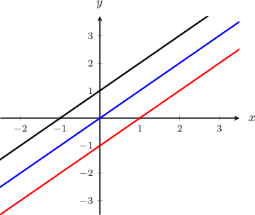

**Choice 2**

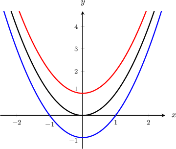

**Choice 3**

**Choice 4**

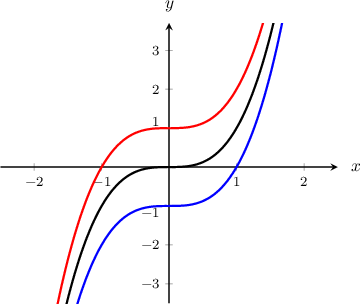

**Choice 5**

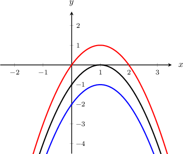

Field selection

**Choice 1**

**Choice 2**

**Choice 3**

**Choice 4**

**Choice 5 — correct**

Integrating the equation, we get

$$
\begin{aligned}\int \frac{\text{d}y}{\text{d}x}\,\text{d}x & =2\int (x-1)\,\text{d}x \\ y & =2\int (x-1)\,\text{d}x \\  & =(x-1)^{2}+C.\end{aligned}
$$

We can now plot the solution curves by selecting different values for $C.$ The sketch below shows the solution curves for $C=-1,0,1.$

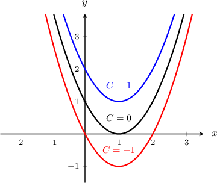

## ORIGINAL RAW REPLAY · moderate · q-50196

Which of the following shows some of the solution curves of the differential equation $\frac{\text{d}y}{\text{d}x}=-3(x+1)^{2}.$

Field selection

**Choice 1 — correct**

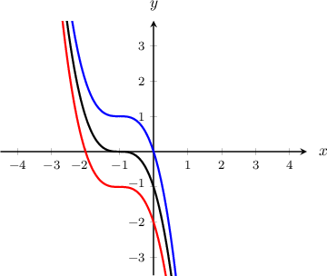

**Choice 2**

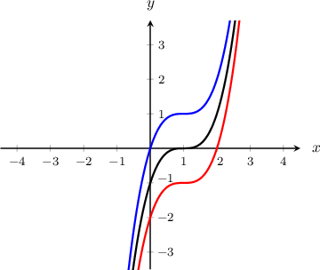

**Choice 3**

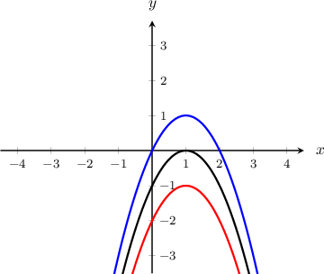

**Choice 4**

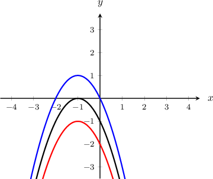

**Choice 5**

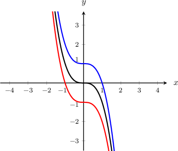

Integrating the equation, we get

$$
\begin{aligned}\int \frac{\text{d}y}{\text{d}x}\,\text{d}x & =-3\int (x+1)^{2}\,\text{d}x \\ y & =-3\int (x+1)^{2}\,\text{d}x \\  & =-(x+1)^{3}+C.\end{aligned}
$$

We can now plot the solution curves by selecting different values for $C.$ The sketch below shows the solution curves for $C=-1,0,1.$

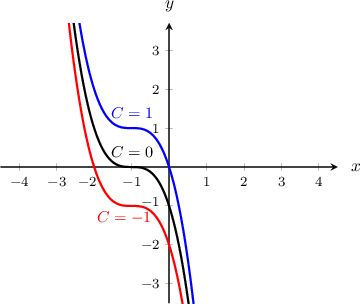

## ORIGINAL RAW REPLAY · moderate · q-119132

Which of the following shows some of the solution curves of the differential equation $\frac{\text{d}y}{\text{d}x}=\frac{{e}^{-x/4}}{2}?$

Field selection

**Choice 1**

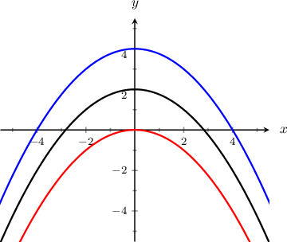

**Choice 2**

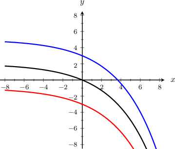

**Choice 3**

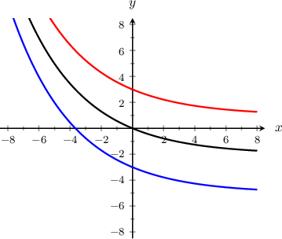

**Choice 4 — correct**

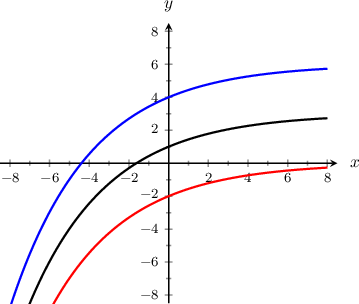

**Choice 5**

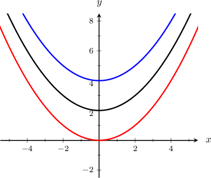

Integrating the equation, we get

$$
\begin{aligned}\int \frac{\text{d}y}{\text{d}x}\,\text{d}x & =\int \frac{{e}^{-x/4}}{2}\,\text{d}x \\ y & =\frac{1}{2}\int {e}^{-x/4}\,\text{d}x \\  & =\frac{1}{2}(-4{e}^{-x/4}) \\  & =-2{e}^{-x/4}+C.\end{aligned}
$$

We can now plot the solution curves by selecting different values for $C.$ The sketch below shows the solution curves for $C=0,3,6.$

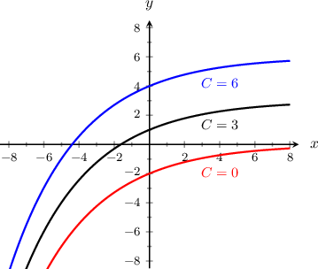

## ORIGINAL RAW REPLAY · easy · q-49947

Which of the following shows some of the solution curves of the differential equation $x\cdot \frac{\text{d}y}{\text{d}x}=1$ for $x>0?$

Field selection

**Choice 1 — correct**

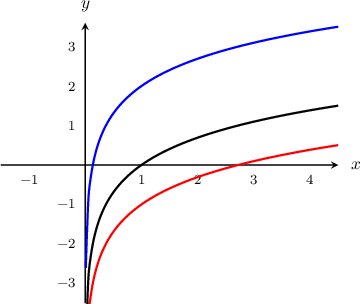

**Choice 2**

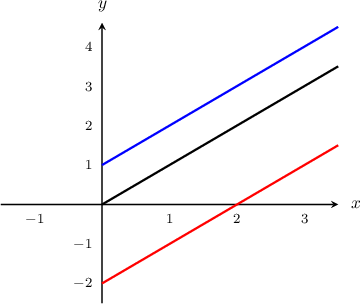

**Choice 3**

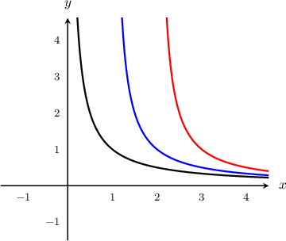

**Choice 4**

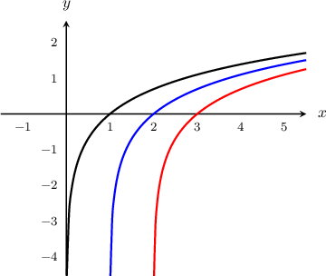

**Choice 5**

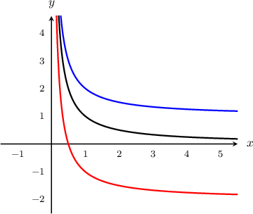

Rearranging and Integrating the equation, we get

$$
\begin{aligned}\frac{\text{d}y}{\text{d}x} & =\frac{1}{x} \\ \int \frac{\text{d}y}{\text{d}x}\,\text{d}x & =\int \frac{1}{x}\,\text{d}x \\ y & =\int \frac{1}{x}\,\text{d}x \\  & =\operatorname{ln}⁡|x|+C \\  & =\operatorname{ln}⁡x+C,\,x>0.\end{aligned}
$$

We can now plot the solution curves by selecting different values for $C.$ The sketch below shows the solution curves for $C=-1,0,2.$

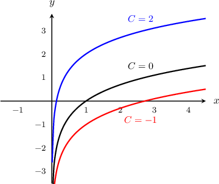

## ORIGINAL RAW REPLAY · easy · q-50197

Which of the following shows some of the solution curves of the differential equation ${x}^{2}\cdot \frac{\text{d}y}{\text{d}x}+1=0$ for $x>0?$

Field selection

**Choice 1**

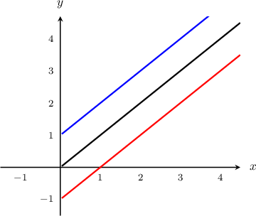

**Choice 2**

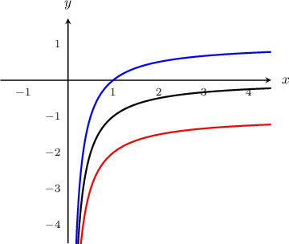

**Choice 3**

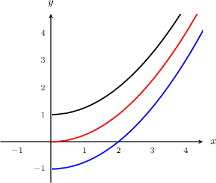

**Choice 4 — correct**

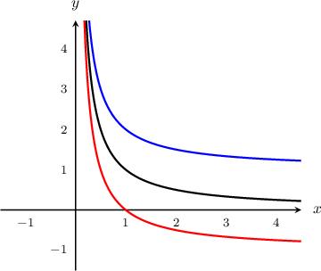

**Choice 5**

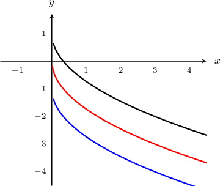

Rearranging and Integrating the equation, we get

$$
\begin{aligned}\frac{\text{d}y}{\text{d}x} & =-\frac{1}{{x}^{2}} \\ \int \frac{\text{d}y}{\text{d}x}\,\text{d}x & =-\int \frac{1}{{x}^{2}}\,\text{d}x \\ y & =-\int \frac{1}{{x}^{2}}\,\text{d}x \\  & =\frac{1}{x}+C.\end{aligned}
$$

We can now plot the solution curves by selecting different values for $C.$ The sketch below shows the solution curves for $C=-1,0,1$ for $x>0.$

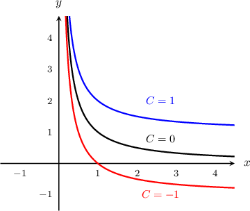

## ORIGINAL RAW REPLAY · easy · q-50198

Which of the following shows some of the solution curves of the differential equation $\frac{\text{d}y}{\text{d}x}=-2.$

Field selection

**Choice 1 — correct**

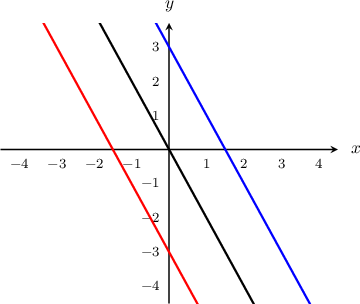

**Choice 2**

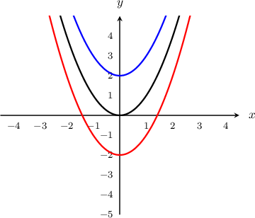

**Choice 3**

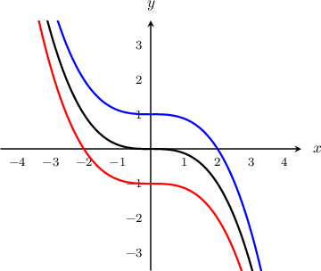

**Choice 4**

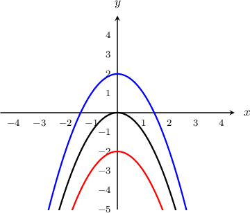

**Choice 5**

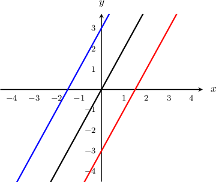

Integrating the equation, we get

$$
\begin{aligned}\int \frac{\text{d}y}{\text{d}x}\,\text{d}x & =-2\int \,\text{d}x \\ y & =-2x+C.\end{aligned}
$$

We can now plot the solution curves by selecting different values for $C.$ The sketch below shows the solution curves for $C=-3,0,3.$

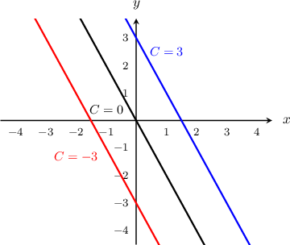

## ORIGINAL RAW REPLAY · easy · q-79565

Which of the following shows some of the solution curves of the differential equation $\frac{\text{d}y}{\text{d}x}=2x?$

Field selection

**Choice 1 — correct**

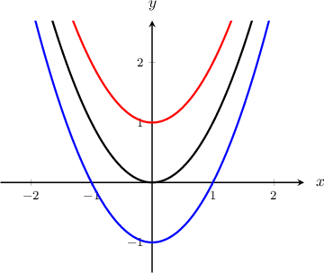

**Choice 2**

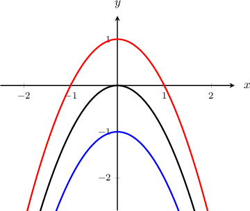

**Choice 3**

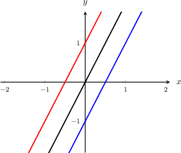

**Choice 4**

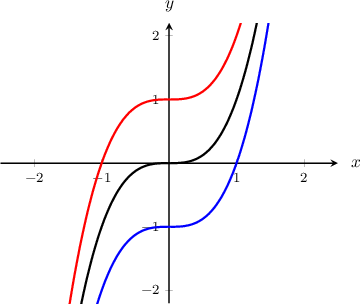

**Choice 5**

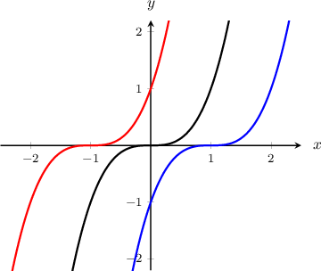

Integrating the equation, we get

$$
\begin{aligned}\int \frac{\text{d}y}{\text{d}x}\,\text{d}x & =2\int x\,\text{d}x \\  & ={x}^{2}+C.\end{aligned}
$$

We can now plot the solution curves by selecting different values for $C.$ The sketch below shows the solution curves for $C=-1,0,1.$

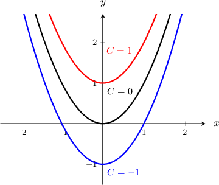

## ORIGINAL RAW REPLAY · easy · q-79566

Which of the following shows some of the solution curves of the differential equation $\frac{\text{d}y}{\text{d}x}=\frac{3}{2}(x+2)^{2}.$

Field selection

**Choice 1 — correct**

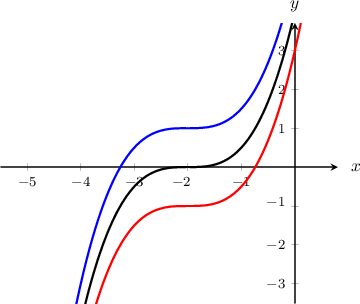

**Choice 2**

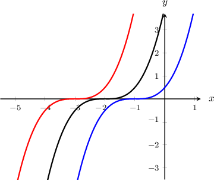

**Choice 3**

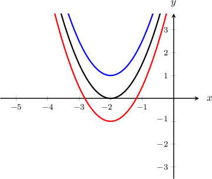

**Choice 4**

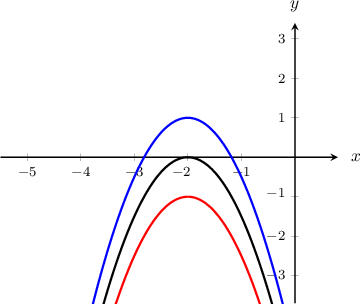

**Choice 5**

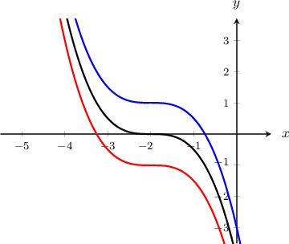

Integrating the equation, we get

$$
\begin{aligned}\int \frac{\text{d}y}{\text{d}x}\,\text{d}x & =\int \frac{3}{2}(x+2)^{2}\,\text{d}x \\ y & =\frac{3}{2}\int (x+2)^{2}\,\text{d}x \\  & =\frac{1}{2}(x+2)^{3}+C.\end{aligned}
$$

We can now plot the solution curves by selecting different values for $C.$ The sketch below shows the solution curves for $C=-1,0,1.$

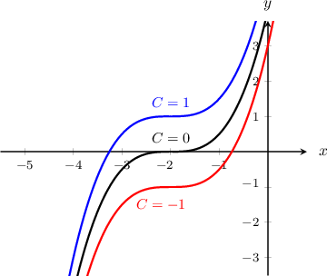

## ORIGINAL RAW REPLAY · moderate · q-119139

Which of the following shows some of the solution curves of the differential equation $\frac{\text{d}y}{\text{d}x}=-4{e}^{2x}?$

Field selection

**Choice 1**

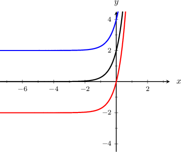

**Choice 2 — correct**

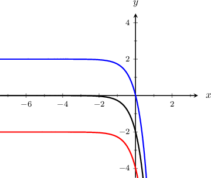

**Choice 3**

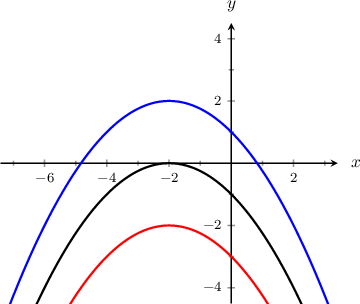

**Choice 4**

**Choice 5**

Integrating the equation, we get

$$
\begin{aligned}\int \frac{\text{d}y}{\text{d}x}\,\text{d}x & =\int (-4{e}^{2x})\,\text{d}x \\ y & =-4\int {e}^{2x}\,\text{d}x \\  & =-4(\frac{{e}^{2x}}{2}) \\  & =-2{e}^{2x}+C.\end{aligned}
$$

We can now plot the solution curves by selecting different values for $C.$ The sketch below shows the solution curves for $C=-2,0,2.$

## ORIGINAL RAW REPLAY · moderate · q-119142

Which of the following shows some of the solution curves of the differential equation $\frac{\text{d}y}{\text{d}x}=-\frac{3(x-1)^{2}}{4}?$

Field selection

**Choice 1**

**Choice 2**

**Choice 3 — correct**

**Choice 4**

**Choice 5**

Integrating the equation, we get

$$
\begin{aligned}\int \frac{\text{d}y}{\text{d}x}\,\text{d}x & =\int (-\frac{3(x-1)^{2}}{4})\,\text{d}x \\ y & =-\frac{3}{4}\int (x-1)^{2}\,\text{d}x \\  & =-\frac{3}{4}(\frac{(x-1)^{3}}{3}) \\  & =-\frac{(x-1)^{3}}{4}+C.\end{aligned}
$$

We can now plot the solution curves by selecting different values for $C.$ The sketch below shows the solution curves for $C=-2,0,2.$

## ORIGINAL RAW REPLAY · easy · q-79563

Which of the following shows some of the solution curves of the differential equation $\frac{\text{d}y}{\text{d}x}=3.$

Field selection

**Choice 1**

**Choice 2**

**Choice 3**

**Choice 4**

**Choice 5 — correct**

Integrating the equation, we get

$$
\begin{aligned}\int \frac{\text{d}y}{\text{d}x}\,\text{d}x & =3\int \,\text{d}x \\ y & =3x+C.\end{aligned}
$$

We can now plot the solution curves by selecting different values for $C.$ The sketch below shows the solution curves for $C=-2,0,2.$

## GENERATED VARIANT · easy · q-50195

Which of the following shows some of the solution curves of the differential equation $\frac{\text{d}y}{\text{d}x}=3 x - 3?$

Field selection

**Choice 1**

**Choice 2**

**Choice 3**

**Choice 4**

**Choice 5**

Field selection

**Choice 1**

**Choice 2**

**Choice 3**

**Choice 4 — correct**

**Choice 5**

Integrating the equation, we get

$$
\begin{aligned}\int \frac{\text{d}y}{\text{d}x}\,\text{d}x & =3\int x - 1\,\text{d}x \\ y & =3\int x - 1\,\text{d}x \\  & =\frac{3 \left(x - 1\right)^{2}}{2}+C.\end{aligned}
$$

We can now plot the solution curves by selecting different values for $C.$ The sketch below shows the solution curves for $C=-1,0,1.$

## GENERATED VARIANT · moderate · q-50196

Which of the following shows some of the solution curves of the differential equation $\frac{\text{d}y}{\text{d}x}=- \frac{9 \left(x + 1\right)^{2}}{2}.$

Field selection

**Choice 1**

**Choice 2**

**Choice 3**

**Choice 4 — correct**

**Choice 5**

Integrating the equation, we get

$$
\begin{aligned}\int \frac{\text{d}y}{\text{d}x}\,\text{d}x & =- \frac{9}{2}\int \left(x + 1\right)^{2}\,\text{d}x \\ y & =- \frac{9}{2}\int \left(x + 1\right)^{2}\,\text{d}x \\  & =- \frac{3 \left(x + 1\right)^{3}}{2}+C.\end{aligned}
$$

We can now plot the solution curves by selecting different values for $C.$ The sketch below shows the solution curves for $C=-1,0,1.$

## GENERATED VARIANT · moderate · q-119132

Which of the following shows some of the solution curves of the differential equation $\frac{\text{d}y}{\text{d}x}=\frac{3 e^{- \frac{x}{4}}}{4}?$

Field selection

**Choice 1 — correct**

**Choice 2**

**Choice 3**

**Choice 4**

**Choice 5**

Integrating the equation, we get

$$
\begin{aligned}\int \frac{\text{d}y}{\text{d}x}\,\text{d}x & =\int \frac{3 e^{- \frac{x}{4}}}{4}\,\text{d}x \\ y & =\frac{3}{4}\int e^{- \frac{x}{4}}\,\text{d}x \\  & =\frac{3}{4}(- 4 e^{- \frac{x}{4}}) \\  & =- 3 e^{- \frac{x}{4}}+C.\end{aligned}
$$

We can now plot the solution curves by selecting different values for $C.$ The sketch below shows the solution curves for $C=0,3,6.$

## GENERATED VARIANT · easy · q-49947

Which of the following shows some of the solution curves of the differential equation $x\cdot \frac{\text{d}y}{\text{d}x}=\frac{3}{2}$ for $x>0?$

Field selection

**Choice 1**

**Choice 2**

**Choice 3**

**Choice 4 — correct**

**Choice 5**

Rearranging and Integrating the equation, we get

$$
\begin{aligned}\frac{\text{d}y}{\text{d}x} & =\frac{3}{2 x} \\ \int \frac{\text{d}y}{\text{d}x}\,\text{d}x & =\int \frac{3}{2 x}\,\text{d}x \\ y & =\int \frac{3}{2 x}\,\text{d}x \\  & =\frac{3}{2}\ln|x|+C \\  & =\frac{3 \ln{\left(x \right)}}{2}+C,\,x>0.\end{aligned}
$$

We can now plot the solution curves by selecting different values for $C.$ The sketch below shows the solution curves for $C=-1,0,2.$

## GENERATED VARIANT · easy · q-50197

Which of the following shows some of the solution curves of the differential equation ${x}^{2}\cdot \frac{\text{d}y}{\text{d}x}+\frac{3}{2}=0$ for $x>0?$

Field selection

**Choice 1 — correct**

**Choice 2**

**Choice 3**

**Choice 4**

**Choice 5**

Rearranging and Integrating the equation, we get

$$
\begin{aligned}\frac{\text{d}y}{\text{d}x} & =- \frac{3}{2 x^{2}} \\ \int \frac{\text{d}y}{\text{d}x}\,\text{d}x & =- \frac{3}{2}\int \frac{1}{{x}^{2}}\,\text{d}x \\ y & =- \frac{3}{2}\int \frac{1}{{x}^{2}}\,\text{d}x \\  & =\frac{3}{2 x}+C.\end{aligned}
$$

We can now plot the solution curves by selecting different values for $C.$ The sketch below shows the solution curves for $C=-1,0,1$ for $x>0.$

## GENERATED VARIANT · easy · q-50198

Which of the following shows some of the solution curves of the differential equation $\frac{\text{d}y}{\text{d}x}=-3.$

Field selection

**Choice 1**

**Choice 2**

**Choice 3**

**Choice 4 — correct**

**Choice 5**

Integrating the equation, we get

$$
\begin{aligned}\int \frac{\text{d}y}{\text{d}x}\,\text{d}x & =-3\int \,\text{d}x \\ y & =- 3 x+C.\end{aligned}
$$

We can now plot the solution curves by selecting different values for $C.$ The sketch below shows the solution curves for $C=-3,0,3.$

## GENERATED VARIANT · easy · q-79565

Which of the following shows some of the solution curves of the differential equation $\frac{\text{d}y}{\text{d}x}=3 x?$

Field selection

**Choice 1**

**Choice 2**

**Choice 3**

**Choice 4 — correct**

**Choice 5**

Integrating the equation, we get

$$
\begin{aligned}\int \frac{\text{d}y}{\text{d}x}\,\text{d}x & =3\int x\,\text{d}x \\  & =\frac{3 x^{2}}{2}+C.\end{aligned}
$$

We can now plot the solution curves by selecting different values for $C.$ The sketch below shows the solution curves for $C=-1,0,1.$

## GENERATED VARIANT · easy · q-79566

Which of the following shows some of the solution curves of the differential equation $\frac{\text{d}y}{\text{d}x}=\frac{9 \left(x + 2\right)^{2}}{4}.$

Field selection

**Choice 1**

**Choice 2**

**Choice 3**

**Choice 4 — correct**

**Choice 5**

Integrating the equation, we get

$$
\begin{aligned}\int \frac{\text{d}y}{\text{d}x}\,\text{d}x & =\int \frac{9 \left(x + 2\right)^{2}}{4}\,\text{d}x \\ y & =\frac{9}{4}\int \left(x + 2\right)^{2}\,\text{d}x \\  & =\frac{3 \left(x + 2\right)^{3}}{4}+C.\end{aligned}
$$

We can now plot the solution curves by selecting different values for $C.$ The sketch below shows the solution curves for $C=-1,0,1.$

## GENERATED VARIANT · moderate · q-119139

Which of the following shows some of the solution curves of the differential equation $\frac{\text{d}y}{\text{d}x}=- 6 e^{2 x}?$

Field selection

**Choice 1**

**Choice 2 — correct**

**Choice 3**

**Choice 4**

**Choice 5**

Integrating the equation, we get

$$
\begin{aligned}\int \frac{\text{d}y}{\text{d}x}\,\text{d}x & =\int (- 6 e^{2 x})\,\text{d}x \\ y & =-6\int e^{2 x}\,\text{d}x \\  & =-6(\frac{e^{2 x}}{2}) \\  & =- 3 e^{2 x}+C.\end{aligned}
$$

We can now plot the solution curves by selecting different values for $C.$ The sketch below shows the solution curves for $C=-2,0,2.$

## GENERATED VARIANT · moderate · q-119142

Which of the following shows some of the solution curves of the differential equation $\frac{\text{d}y}{\text{d}x}=- \frac{9 \left(x - 1\right)^{2}}{8}?$

Field selection

**Choice 1**

**Choice 2**

**Choice 3 — correct**

**Choice 4**

**Choice 5**

Integrating the equation, we get

$$
\begin{aligned}\int \frac{\text{d}y}{\text{d}x}\,\text{d}x & =\int (- \frac{9 \left(x - 1\right)^{2}}{8})\,\text{d}x \\ y & =- \frac{9}{8}\int \left(x - 1\right)^{2}\,\text{d}x \\  & =- \frac{9}{8}(\frac{\left(x - 1\right)^{3}}{3}) \\  & =- \frac{3 \left(x - 1\right)^{3}}{8}+C.\end{aligned}
$$

We can now plot the solution curves by selecting different values for $C.$ The sketch below shows the solution curves for $C=-2,0,2.$

## GENERATED VARIANT · easy · q-79563

Which of the following shows some of the solution curves of the differential equation $\frac{\text{d}y}{\text{d}x}=\frac{9}{2}.$

Field selection

**Choice 1**

**Choice 2**

**Choice 3**

**Choice 4**

**Choice 5 — correct**

Integrating the equation, we get

$$
\begin{aligned}\int \frac{\text{d}y}{\text{d}x}\,\text{d}x & =\frac{9}{2}\int \,\text{d}x \\ y & =\frac{9 x}{2}+C.\end{aligned}
$$

We can now plot the solution curves by selecting different values for $C.$ The sketch below shows the solution curves for $C=-2,0,2.$

## GENERATED VARIANT · easy · logarithmic

Which of the following shows some of the solution curves of the differential equation $\frac{\text{d}y}{\text{d}x}=\frac{3}{x}?$ for $x>0$

Field selection

**Choice 1**

**Choice 2**

**Choice 3**

**Choice 4 — correct**

**Choice 5**

Integrating the equation, we get

$$
\begin{aligned}\int \frac{\text{d}y}{\text{d}x}\,\text{d}x & =\int (\frac{3}{x})\,\text{d}x \\ y & =3\int \frac{1}{x}\,\text{d}x \\  & =3\ln|x|+C \\ y & =3 \ln{\left(x \right)}+C.\end{aligned}
$$

We can now plot the solution curves by selecting different values for $C.$ The sketch below shows the solution curves for $C=-2,0,2.$ for $x>0$

## GENERATED VARIANT · easy · quadratic

Which of the following shows some of the solution curves of the differential equation $\frac{\text{d}y}{\text{d}x}=2 x + 4?$

Field selection

**Choice 1**

**Choice 2**

**Choice 3**

**Choice 4 — correct**

**Choice 5**

Integrating the equation, we get

$$
\begin{aligned}\int \frac{\text{d}y}{\text{d}x}\,\text{d}x & =\int (2 x + 4)\,\text{d}x \\ y & =2\int x + 2\,\text{d}x \\  & =2\left(\frac{\left(x + 2\right)^{2}}{2}\right)+C \\ y & =\left(x + 2\right)^{2}+C.\end{aligned}
$$

We can now plot the solution curves by selecting different values for $C.$ The sketch below shows the solution curves for $C=-2,0,2.$

## GENERATED VARIANT · easy · linear

Which of the following shows some of the solution curves of the differential equation $\frac{\text{d}y}{\text{d}x}=-3?$

Field selection

**Choice 1**

**Choice 2**

**Choice 3**

**Choice 4**

**Choice 5 — correct**

Integrating the equation, we get

$$
\begin{aligned}\int \frac{\text{d}y}{\text{d}x}\,\text{d}x & =\int (-3)\,\text{d}x \\ y & =- 3 x+C.\end{aligned}
$$

We can now plot the solution curves by selecting different values for $C.$ The sketch below shows the solution curves for $C=-2,0,2.$

## GENERATED VARIANT · easy · quadratic

Which of the following shows some of the solution curves of the differential equation $\frac{\text{d}y}{\text{d}x}=2 x - 4?$

Field selection

**Choice 1 — correct**

**Choice 2**

**Choice 3**

**Choice 4**

**Choice 5**

Integrating the equation, we get

$$
\begin{aligned}\int \frac{\text{d}y}{\text{d}x}\,\text{d}x & =\int (2 x - 4)\,\text{d}x \\ y & =2\int x - 2\,\text{d}x \\  & =2\left(\frac{\left(x - 2\right)^{2}}{2}\right)+C \\ y & =\left(x - 2\right)^{2}+C.\end{aligned}
$$

We can now plot the solution curves by selecting different values for $C.$ The sketch below shows the solution curves for $C=-2,0,2.$

## GENERATED VARIANT · easy · quadratic

Which of the following shows some of the solution curves of the differential equation $\frac{\text{d}y}{\text{d}x}=- 2 x - 4?$

Field selection

**Choice 1**

**Choice 2**

**Choice 3 — correct**

**Choice 4**

**Choice 5**

Integrating the equation, we get

$$
\begin{aligned}\int \frac{\text{d}y}{\text{d}x}\,\text{d}x & =\int (- 2 x - 4)\,\text{d}x \\ y & =-2\int x + 2\,\text{d}x \\  & =-2\left(\frac{\left(x + 2\right)^{2}}{2}\right)+C \\ y & =- \left(x + 2\right)^{2}+C.\end{aligned}
$$

We can now plot the solution curves by selecting different values for $C.$ The sketch below shows the solution curves for $C=-2,0,2.$

## GENERATED VARIANT · easy · reciprocal

Which of the following shows some of the solution curves of the differential equation $\frac{\text{d}y}{\text{d}x}=\frac{1}{x^{2}}?$ for $x>0$

Field selection

**Choice 1**

**Choice 2**

**Choice 3**

**Choice 4 — correct**

**Choice 5**

Integrating the equation, we get

$$
\begin{aligned}\int \frac{\text{d}y}{\text{d}x}\,\text{d}x & =\int (\frac{1}{x^{2}})\,\text{d}x \\ y & =1\int x^{-2}\,\text{d}x \\  & =1\left(-x^{-1}\right)+C \\ y & =- \frac{1}{x}+C.\end{aligned}
$$

We can now plot the solution curves by selecting different values for $C.$ The sketch below shows the solution curves for $C=-2,0,2.$ for $x>0$

## GENERATED VARIANT · easy · reciprocal

Which of the following shows some of the solution curves of the differential equation $\frac{\text{d}y}{\text{d}x}=- \frac{3}{x^{2}}?$ for $x>0$

Field selection

**Choice 1**

**Choice 2**

**Choice 3**

**Choice 4**

**Choice 5 — correct**

Integrating the equation, we get

$$
\begin{aligned}\int \frac{\text{d}y}{\text{d}x}\,\text{d}x & =\int (- \frac{3}{x^{2}})\,\text{d}x \\ y & =-3\int x^{-2}\,\text{d}x \\  & =-3\left(-x^{-1}\right)+C \\ y & =\frac{3}{x}+C.\end{aligned}
$$

We can now plot the solution curves by selecting different values for $C.$ The sketch below shows the solution curves for $C=-2,0,2.$ for $x>0$

## GENERATED VARIANT · easy · cubic

Which of the following shows some of the solution curves of the differential equation $\frac{\text{d}y}{\text{d}x}=- 6 \left(x - 1\right)^{2}?$

Field selection

**Choice 1**

**Choice 2**

**Choice 3**

**Choice 4**

**Choice 5 — correct**

Integrating the equation, we get

$$
\begin{aligned}\int \frac{\text{d}y}{\text{d}x}\,\text{d}x & =\int (- 6 \left(x - 1\right)^{2})\,\text{d}x \\ y & =-6\int \left(x - 1\right)^{2}\,\text{d}x \\  & =-6\left(\frac{\left(x - 1\right)^{3}}{3}\right)+C \\ y & =- 2 \left(x - 1\right)^{3}+C.\end{aligned}
$$

We can now plot the solution curves by selecting different values for $C.$ The sketch below shows the solution curves for $C=-2,0,2.$

## GENERATED VARIANT · moderate · exponential

Which of the following shows some of the solution curves of the differential equation $\frac{\text{d}y}{\text{d}x}=2 e^{2 x}?$

Field selection

**Choice 1 — correct**

**Choice 2**

**Choice 3**

**Choice 4**

**Choice 5**

Integrating the equation, we get

$$
\begin{aligned}\int \frac{\text{d}y}{\text{d}x}\,\text{d}x & =\int (2 e^{2 x})\,\text{d}x \\ y & =2\int e^{2 x}\,\text{d}x \\  & =2\left(\frac{e^{2 x}}{2}\right)+C \\ y & =e^{2 x}+C.\end{aligned}
$$

We can now plot the solution curves by selecting different values for $C.$ The sketch below shows the solution curves for $C=-2,0,2.$

## GENERATED VARIANT · moderate · cubic

Which of the following shows some of the solution curves of the differential equation $\frac{\text{d}y}{\text{d}x}=- 3 \left(x - 1\right)^{2}?$

Field selection

**Choice 1**

**Choice 2**

**Choice 3**

**Choice 4**

**Choice 5 — correct**

Integrating the equation, we get

$$
\begin{aligned}\int \frac{\text{d}y}{\text{d}x}\,\text{d}x & =\int (- 3 \left(x - 1\right)^{2})\,\text{d}x \\ y & =-3\int \left(x - 1\right)^{2}\,\text{d}x \\  & =-3\left(\frac{\left(x - 1\right)^{3}}{3}\right)+C \\ y & =- \left(x - 1\right)^{3}+C.\end{aligned}
$$

We can now plot the solution curves by selecting different values for $C.$ The sketch below shows the solution curves for $C=-2,0,2.$

## GENERATED VARIANT · moderate · cubic

Which of the following shows some of the solution curves of the differential equation $\frac{\text{d}y}{\text{d}x}=- 3 \left(x + 2\right)^{2}?$

Field selection

**Choice 1 — correct**

**Choice 2**

**Choice 3**

**Choice 4**

**Choice 5**

Integrating the equation, we get

$$
\begin{aligned}\int \frac{\text{d}y}{\text{d}x}\,\text{d}x & =\int (- 3 \left(x + 2\right)^{2})\,\text{d}x \\ y & =-3\int \left(x + 2\right)^{2}\,\text{d}x \\  & =-3\left(\frac{\left(x + 2\right)^{3}}{3}\right)+C \\ y & =- \left(x + 2\right)^{3}+C.\end{aligned}
$$

We can now plot the solution curves by selecting different values for $C.$ The sketch below shows the solution curves for $C=-2,0,2.$

## GENERATED VARIANT · moderate · cubic

Which of the following shows some of the solution curves of the differential equation $\frac{\text{d}y}{\text{d}x}=- \frac{3 \left(x - 1\right)^{2}}{2}?$

Field selection

**Choice 1**

**Choice 2 — correct**

**Choice 3**

**Choice 4**

**Choice 5**

Integrating the equation, we get

$$
\begin{aligned}\int \frac{\text{d}y}{\text{d}x}\,\text{d}x & =\int (- \frac{3 \left(x - 1\right)^{2}}{2})\,\text{d}x \\ y & =- \frac{3}{2}\int \left(x - 1\right)^{2}\,\text{d}x \\  & =- \frac{3}{2}\left(\frac{\left(x - 1\right)^{3}}{3}\right)+C \\ y & =- \frac{\left(x - 1\right)^{3}}{2}+C.\end{aligned}
$$

We can now plot the solution curves by selecting different values for $C.$ The sketch below shows the solution curves for $C=-2,0,2.$

## GENERATED VARIANT · moderate · cubic

Which of the following shows some of the solution curves of the differential equation $\frac{\text{d}y}{\text{d}x}=\frac{3 \left(x + 2\right)^{2}}{4}?$

Field selection

**Choice 1**

**Choice 2**

**Choice 3 — correct**

**Choice 4**

**Choice 5**

Integrating the equation, we get

$$
\begin{aligned}\int \frac{\text{d}y}{\text{d}x}\,\text{d}x & =\int (\frac{3 \left(x + 2\right)^{2}}{4})\,\text{d}x \\ y & =\frac{3}{4}\int \left(x + 2\right)^{2}\,\text{d}x \\  & =\frac{3}{4}\left(\frac{\left(x + 2\right)^{3}}{3}\right)+C \\ y & =\frac{\left(x + 2\right)^{3}}{4}+C.\end{aligned}
$$

We can now plot the solution curves by selecting different values for $C.$ The sketch below shows the solution curves for $C=-2,0,2.$

## GENERATED VARIANT · moderate · exponential

Which of the following shows some of the solution curves of the differential equation $\frac{\text{d}y}{\text{d}x}=- \frac{e^{- \frac{x}{4}}}{8}?$

Field selection

**Choice 1**

**Choice 2**

**Choice 3**

**Choice 4**

**Choice 5 — correct**

Integrating the equation, we get

$$
\begin{aligned}\int \frac{\text{d}y}{\text{d}x}\,\text{d}x & =\int (- \frac{e^{- \frac{x}{4}}}{8})\,\text{d}x \\ y & =- \frac{1}{8}\int e^{- \frac{x}{4}}\,\text{d}x \\  & =- \frac{1}{8}\left(- 4 e^{- \frac{x}{4}}\right)+C \\ y & =\frac{e^{- \frac{x}{4}}}{2}+C.\end{aligned}
$$

We can now plot the solution curves by selecting different values for $C.$ The sketch below shows the solution curves for $C=-2,0,2.$

## GENERATED VARIANT · moderate · cubic

Which of the following shows some of the solution curves of the differential equation $\frac{\text{d}y}{\text{d}x}=6 \left(x - 1\right)^{2}?$

Field selection

**Choice 1**

**Choice 2**

**Choice 3**

**Choice 4**

**Choice 5 — correct**

Integrating the equation, we get

$$
\begin{aligned}\int \frac{\text{d}y}{\text{d}x}\,\text{d}x & =\int (6 \left(x - 1\right)^{2})\,\text{d}x \\ y & =6\int \left(x - 1\right)^{2}\,\text{d}x \\  & =6\left(\frac{\left(x - 1\right)^{3}}{3}\right)+C \\ y & =2 \left(x - 1\right)^{3}+C.\end{aligned}
$$

We can now plot the solution curves by selecting different values for $C.$ The sketch below shows the solution curves for $C=-2,0,2.$

## GENERATED VARIANT · moderate · exponential

Which of the following shows some of the solution curves of the differential equation $\frac{\text{d}y}{\text{d}x}=\frac{e^{- \frac{x}{2}}}{4}?$

Field selection

**Choice 1**

**Choice 2**

**Choice 3**

**Choice 4**

**Choice 5 — correct**

Integrating the equation, we get

$$
\begin{aligned}\int \frac{\text{d}y}{\text{d}x}\,\text{d}x & =\int (\frac{e^{- \frac{x}{2}}}{4})\,\text{d}x \\ y & =\frac{1}{4}\int e^{- \frac{x}{2}}\,\text{d}x \\  & =\frac{1}{4}\left(- 2 e^{- \frac{x}{2}}\right)+C \\ y & =- \frac{e^{- \frac{x}{2}}}{2}+C.\end{aligned}
$$

We can now plot the solution curves by selecting different values for $C.$ The sketch below shows the solution curves for $C=-2,0,2.$

## GENERATED VARIANT · hard · exponential

Which of the following shows some of the solution curves of the differential equation $\frac{\text{d}y}{\text{d}x}=- \frac{9 e^{- \frac{3 x}{2}}}{4}?$

Field selection

**Choice 1 — correct**

**Choice 2**

**Choice 3**

**Choice 4**

**Choice 5**

Integrating the equation, we get

$$
\begin{aligned}\int \frac{\text{d}y}{\text{d}x}\,\text{d}x & =\int (- \frac{9 e^{- \frac{3 x}{2}}}{4})\,\text{d}x \\ y & =- \frac{9}{4}\int e^{- \frac{3 x}{2}}\,\text{d}x \\  & =- \frac{9}{4}\left(- \frac{2 e^{- \frac{3 x}{2}}}{3}\right)+C \\ y & =\frac{3 e^{- \frac{3 x}{2}}}{2}+C.\end{aligned}
$$

We can now plot the solution curves by selecting different values for $C.$ The sketch below shows the solution curves for $C=-2,0,2.$

## GENERATED VARIANT · hard · cubic

Which of the following shows some of the solution curves of the differential equation $\frac{\text{d}y}{\text{d}x}=- \frac{9 \left(x - 1\right)^{2}}{2}?$

Field selection

**Choice 1**

**Choice 2**

**Choice 3**

**Choice 4**

**Choice 5 — correct**

Integrating the equation, we get

$$
\begin{aligned}\int \frac{\text{d}y}{\text{d}x}\,\text{d}x & =\int (- \frac{9 \left(x - 1\right)^{2}}{2})\,\text{d}x \\ y & =- \frac{9}{2}\int \left(x - 1\right)^{2}\,\text{d}x \\  & =- \frac{9}{2}\left(\frac{\left(x - 1\right)^{3}}{3}\right)+C \\ y & =- \frac{3 \left(x - 1\right)^{3}}{2}+C.\end{aligned}
$$

We can now plot the solution curves by selecting different values for $C.$ The sketch below shows the solution curves for $C=-2,0,2.$

## GENERATED VARIANT · hard · cubic

Which of the following shows some of the solution curves of the differential equation $\frac{\text{d}y}{\text{d}x}=- \frac{9 \left(x + 2\right)^{2}}{2}?$

Field selection

**Choice 1 — correct**

**Choice 2**

**Choice 3**

**Choice 4**

**Choice 5**

Integrating the equation, we get

$$
\begin{aligned}\int \frac{\text{d}y}{\text{d}x}\,\text{d}x & =\int (- \frac{9 \left(x + 2\right)^{2}}{2})\,\text{d}x \\ y & =- \frac{9}{2}\int \left(x + 2\right)^{2}\,\text{d}x \\  & =- \frac{9}{2}\left(\frac{\left(x + 2\right)^{3}}{3}\right)+C \\ y & =- \frac{3 \left(x + 2\right)^{3}}{2}+C.\end{aligned}
$$

We can now plot the solution curves by selecting different values for $C.$ The sketch below shows the solution curves for $C=-2,0,2.$

## GENERATED VARIANT · hard · cubic

Which of the following shows some of the solution curves of the differential equation $\frac{\text{d}y}{\text{d}x}=- 2 \left(x - 1\right)^{2}?$

Field selection

**Choice 1**

**Choice 2 — correct**

**Choice 3**

**Choice 4**

**Choice 5**

Integrating the equation, we get

$$
\begin{aligned}\int \frac{\text{d}y}{\text{d}x}\,\text{d}x & =\int (- 2 \left(x - 1\right)^{2})\,\text{d}x \\ y & =-2\int \left(x - 1\right)^{2}\,\text{d}x \\  & =-2\left(\frac{\left(x - 1\right)^{3}}{3}\right)+C \\ y & =- \frac{2 \left(x - 1\right)^{3}}{3}+C.\end{aligned}
$$

We can now plot the solution curves by selecting different values for $C.$ The sketch below shows the solution curves for $C=-2,0,2.$

## GENERATED VARIANT · hard · cubic

Which of the following shows some of the solution curves of the differential equation $\frac{\text{d}y}{\text{d}x}=2 \left(x + 2\right)^{2}?$

Field selection

**Choice 1**

**Choice 2**

**Choice 3 — correct**

**Choice 4**

**Choice 5**

Integrating the equation, we get

$$
\begin{aligned}\int \frac{\text{d}y}{\text{d}x}\,\text{d}x & =\int (2 \left(x + 2\right)^{2})\,\text{d}x \\ y & =2\int \left(x + 2\right)^{2}\,\text{d}x \\  & =2\left(\frac{\left(x + 2\right)^{3}}{3}\right)+C \\ y & =\frac{2 \left(x + 2\right)^{3}}{3}+C.\end{aligned}
$$

We can now plot the solution curves by selecting different values for $C.$ The sketch below shows the solution curves for $C=-2,0,2.$

## GENERATED VARIANT · hard · exponential

Which of the following shows some of the solution curves of the differential equation $\frac{\text{d}y}{\text{d}x}=- e^{- \frac{3 x}{2}}?$

Field selection

**Choice 1**

**Choice 2 — correct**

**Choice 3**

**Choice 4**

**Choice 5**

Integrating the equation, we get

$$
\begin{aligned}\int \frac{\text{d}y}{\text{d}x}\,\text{d}x & =\int (- e^{- \frac{3 x}{2}})\,\text{d}x \\ y & =-1\int e^{- \frac{3 x}{2}}\,\text{d}x \\  & =-1\left(- \frac{2 e^{- \frac{3 x}{2}}}{3}\right)+C \\ y & =\frac{2 e^{- \frac{3 x}{2}}}{3}+C.\end{aligned}
$$

We can now plot the solution curves by selecting different values for $C.$ The sketch below shows the solution curves for $C=-2,0,2.$

## GENERATED VARIANT · hard · cubic

Which of the following shows some of the solution curves of the differential equation $\frac{\text{d}y}{\text{d}x}=\frac{9 \left(x - 1\right)^{2}}{2}?$

Field selection

**Choice 1**

**Choice 2**

**Choice 3**

**Choice 4**

**Choice 5 — correct**

Integrating the equation, we get

$$
\begin{aligned}\int \frac{\text{d}y}{\text{d}x}\,\text{d}x & =\int (\frac{9 \left(x - 1\right)^{2}}{2})\,\text{d}x \\ y & =\frac{9}{2}\int \left(x - 1\right)^{2}\,\text{d}x \\  & =\frac{9}{2}\left(\frac{\left(x - 1\right)^{3}}{3}\right)+C \\ y & =\frac{3 \left(x - 1\right)^{3}}{2}+C.\end{aligned}
$$

We can now plot the solution curves by selecting different values for $C.$ The sketch below shows the solution curves for $C=-2,0,2.$

## GENERATED VARIANT · hard · exponential

Which of the following shows some of the solution curves of the differential equation $\frac{\text{d}y}{\text{d}x}=- e^{\frac{3 x}{2}}?$

Field selection

**Choice 1**

**Choice 2**

**Choice 3**

**Choice 4**

**Choice 5 — correct**

Integrating the equation, we get

$$
\begin{aligned}\int \frac{\text{d}y}{\text{d}x}\,\text{d}x & =\int (- e^{\frac{3 x}{2}})\,\text{d}x \\ y & =-1\int e^{\frac{3 x}{2}}\,\text{d}x \\  & =-1\left(\frac{2 e^{\frac{3 x}{2}}}{3}\right)+C \\ y & =- \frac{2 e^{\frac{3 x}{2}}}{3}+C.\end{aligned}
$$

We can now plot the solution curves by selecting different values for $C.$ The sketch below shows the solution curves for $C=-2,0,2.$

## GENERATED VARIANT · easy · linear

Which of the following shows some of the solution curves of the differential equation $\frac{\text{d}y}{\text{d}x}=2?$

Field selection

**Choice 1**

**Choice 2**

**Choice 3**

**Choice 4 — correct**

**Choice 5**

Integrating the equation, we get

$$
\begin{aligned}\int \frac{\text{d}y}{\text{d}x}\,\text{d}x & =\int (2)\,\text{d}x \\ y & =2 x+C.\end{aligned}
$$

We can now plot the solution curves by selecting different values for $C.$ The sketch below shows the solution curves for $C=-2,0,2.$

## GENERATED VARIANT · easy · quadratic

Which of the following shows some of the solution curves of the differential equation $\frac{\text{d}y}{\text{d}x}=4 x - 8?$

Field selection

**Choice 1**

**Choice 2**

**Choice 3**

**Choice 4**

**Choice 5 — correct**

Integrating the equation, we get

$$
\begin{aligned}\int \frac{\text{d}y}{\text{d}x}\,\text{d}x & =\int (4 x - 8)\,\text{d}x \\ y & =4\int x - 2\,\text{d}x \\  & =4\left(\frac{\left(x - 2\right)^{2}}{2}\right)+C \\ y & =2 \left(x - 2\right)^{2}+C.\end{aligned}
$$

We can now plot the solution curves by selecting different values for $C.$ The sketch below shows the solution curves for $C=-2,0,2.$

## GENERATED VARIANT · easy · cubic

Which of the following shows some of the solution curves of the differential equation $\frac{\text{d}y}{\text{d}x}=6 \left(x - 2\right)^{2}?$

Field selection

**Choice 1**

**Choice 2**

**Choice 3**

**Choice 4**

**Choice 5 — correct**

Integrating the equation, we get

$$
\begin{aligned}\int \frac{\text{d}y}{\text{d}x}\,\text{d}x & =\int (6 \left(x - 2\right)^{2})\,\text{d}x \\ y & =6\int \left(x - 2\right)^{2}\,\text{d}x \\  & =6\left(\frac{\left(x - 2\right)^{3}}{3}\right)+C \\ y & =2 \left(x - 2\right)^{3}+C.\end{aligned}
$$

We can now plot the solution curves by selecting different values for $C.$ The sketch below shows the solution curves for $C=-2,0,2.$

## GENERATED VARIANT · easy · logarithmic

Which of the following shows some of the solution curves of the differential equation $\frac{\text{d}y}{\text{d}x}=\frac{2}{x}?$ for $x>0$

Field selection

**Choice 1**

**Choice 2**

**Choice 3**

**Choice 4 — correct**

**Choice 5**

Integrating the equation, we get

$$
\begin{aligned}\int \frac{\text{d}y}{\text{d}x}\,\text{d}x & =\int (\frac{2}{x})\,\text{d}x \\ y & =2\int \frac{1}{x}\,\text{d}x \\  & =2\ln|x|+C \\ y & =2 \ln{\left(x \right)}+C.\end{aligned}
$$

We can now plot the solution curves by selecting different values for $C.$ The sketch below shows the solution curves for $C=-2,0,2.$ for $x>0$

## GENERATED VARIANT · easy · reciprocal

Which of the following shows some of the solution curves of the differential equation $\frac{\text{d}y}{\text{d}x}=- \frac{2}{x^{2}}?$ for $x>0$

Field selection

**Choice 1**

**Choice 2**

**Choice 3**

**Choice 4 — correct**

**Choice 5**

Integrating the equation, we get

$$
\begin{aligned}\int \frac{\text{d}y}{\text{d}x}\,\text{d}x & =\int (- \frac{2}{x^{2}})\,\text{d}x \\ y & =-2\int x^{-2}\,\text{d}x \\  & =-2\left(-x^{-1}\right)+C \\ y & =\frac{2}{x}+C.\end{aligned}
$$

We can now plot the solution curves by selecting different values for $C.$ The sketch below shows the solution curves for $C=-2,0,2.$ for $x>0$

