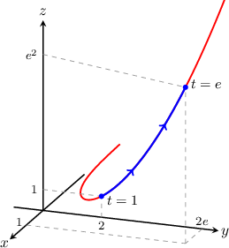

# Spatial arc length source replay and generated review

All values are exact. Original records remain verbatim in source.json. Generated records use presentation repairs documented in extraction.

## Source replay q-33759

Parameters: {"a": "1", "b": "E"}

Find the arc length of the curve $r(t) = ⟨\ln t, 2t, t^{2}⟩$
from $t = 1$ to $t = e$.

Choices: $1 + e^{2}$, $-1 + e^{2}$, $-2 + e^{-1} + e^{2}$, $e^{2}$, $-2 + e^{-2} + e^{2}$

First, we find ${r}^{′}(t)$ and $‖{r}^{′}(t)‖:$

$$
\begin{aligned}r^{\prime}(t)&=\langle 1/t,2,2t\rangle \\ \|r^{\prime}(t)\|&=\sqrt{1/t^2+4+4t^2} \\ &=\sqrt{(1/t+2t)^2} \\ &=1/t+2t\end{aligned}
$$

Notice that $t>0$ for $t\in [1,e].$

Therefore, the arc length of the curve is

$$
\begin{aligned}L&=\int_{1}^{e}\|r^{\prime}(t)\|\,\mathrm dt \\ &=\int_{1}^{e}(1/t+2t)\,\mathrm dt \\ &=(\ln t+t^2)\big|_{1}^{e} \\ &=\ln(e/1)+e^{2}-1 \\ &=e^{2}.\end{aligned}
$$

Original prompt:

Find the arc length of the curve $r(t) = ⟨\ln t, 2t, t^{2}⟩$
from $t = 1$ to $t = e$.

Original choices: $\frac{1}{e} + e^{2} - 2$, $e^{2} - 1$, $e^{2} + 1$, $\frac{1}{e^{2}} + e^{2} - 2$, $e^{2}$

Original solution:

Unavailable; the generated worked solution is authored.

## Generated log_square observed_q-33759

Parameters: {"a": "1", "b": "2"}

Find the arc length of the curve $r(t) = ⟨\ln t, 2t, t^{2}⟩$
from $t = 1$ to $t = 2$.

Choices: $\frac{9}{4}$, $5$, $\frac{5}{2}$, $3$, $\ln{\left(2 \right)} + 3$

First, we find ${r}^{′}(t)$ and $‖{r}^{′}(t)‖:$

$$
\begin{aligned}r^{\prime}(t)&=\langle 1/t,2,2t\rangle \\ \|r^{\prime}(t)\|&=\sqrt{1/t^2+4+4t^2} \\ &=\sqrt{(1/t+2t)^2} \\ &=1/t+2t\end{aligned}
$$

Notice that $t>0$ for $t\in [1,2].$

Therefore, the arc length of the curve is

$$
\begin{aligned}L&=\int_{1}^{2}\|r^{\prime}(t)\|\,\mathrm dt \\ &=\int_{1}^{2}(1/t+2t)\,\mathrm dt \\ &=(\ln t+t^2)\big|_{1}^{2} \\ &=\ln(2/1)+4-1 \\ &=\ln{\left(2 \right)} + 3.\end{aligned}
$$

## Generated log_square authored_operations

Parameters: {"a": "1", "b": "2"}

Find the arc length of the curve $r(t) = ⟨\ln t, 2t, t^{2}⟩$
from $t = 1$ to $t = 2$.

Choices: $\frac{83}{6}$, $2 \ln{\left(2 \right)} + 6$, $\ln{\left(2 \right)} + 3$, $\frac{\ln{\left(2 \right)}}{2} + \frac{3}{2}$, $\frac{9}{2}$

First, we find ${r}^{′}(t)$ and $‖{r}^{′}(t)‖:$

$$
\begin{aligned}r^{\prime}(t)&=\langle 1/t,2,2t\rangle \\ \|r^{\prime}(t)\|&=\sqrt{1/t^2+4+4t^2} \\ &=\sqrt{(1/t+2t)^2} \\ &=1/t+2t\end{aligned}
$$

Notice that $t>0$ for $t\in [1,2].$

Therefore, the arc length of the curve is

$$
\begin{aligned}L&=\int_{1}^{2}\|r^{\prime}(t)\|\,\mathrm dt \\ &=\int_{1}^{2}(1/t+2t)\,\mathrm dt \\ &=(\ln t+t^2)\big|_{1}^{2} \\ &=\ln(2/1)+4-1 \\ &=\ln{\left(2 \right)} + 3.\end{aligned}
$$

## Source replay q-33779

Parameters: {"a": "1", "b": "3"}

Find the arc length of the curve $f(t)=⟨\operatorname{cos}⁡t+t\operatorname{sin}⁡t,\,\operatorname{sin}⁡t-t\operatorname{cos}⁡t,\,\frac{\sqrt{3}}{2}{t}^{2}⟩$
from $t=1$ to $t=3.$

Choices: $8\sqrt{3}$, $8\sqrt{2}$, $4$, $4\sqrt{3}$, $8$

First, we find ${f}^{′}(t)$ and $‖{f}^{′}(t)‖:$

$$
\begin{aligned}{f}^{′}(t) & =⟨\frac{\text{d}}{\text{d}t}(\operatorname{cos}⁡t+t\operatorname{sin}⁡t),\,\frac{\text{d}}{\text{d}t}(\operatorname{sin}⁡t-t\operatorname{cos}⁡t),\,\frac{\text{d}}{\text{d}t}(\frac{\sqrt{3}}{2}{t}^{2})⟩ \\  & =⟨-\operatorname{sin}⁡t+(\operatorname{sin}⁡t+t\operatorname{cos}⁡t),\,\operatorname{cos}⁡t-(\operatorname{cos}⁡t-t\operatorname{sin}⁡t),\,\sqrt{3}t⟩ \\  & =⟨t\operatorname{cos}⁡t,\,t\operatorname{sin}⁡t,\,\sqrt{3}t⟩ \\ ‖{f}^{′}(t)‖ & =\sqrt{(t\operatorname{cos}⁡t)^{2}+(t\operatorname{sin}⁡t)^{2}+(\sqrt{3}t)^{2}} \\  & =\sqrt{{t}^{2}({cos}^{2}⁡t+{sin}^{2}⁡t)+3{t}^{2}} \\  & =\sqrt{4{t}^{2}} \\  & =2t\end{aligned}
$$

Notice that $t>0$ for $t\in [1,3].$

Therefore, the arc length of the curve is

$$
\begin{aligned}L & ={\int }_{1}^{3}‖{f}^{′}(t)‖\,\text{d}t \\  & ={\int }_{1}^{3}2t\,\text{d}t \\  & ={t}^{2}{|}_{1}^{3} \\  & =9-1 \\  & =8.\end{aligned}
$$

Original prompt:

Find the arc length of the curve $f(t)=⟨\operatorname{cos}⁡t+t\operatorname{sin}⁡t,\,\operatorname{sin}⁡t-t\operatorname{cos}⁡t,\,\frac{\sqrt{3}}{2}{t}^{2}⟩$
from $t=1$ to $t=3.$

Original choices: $4$, $8\sqrt{2}$, $8\sqrt{3}$, $8$, $4\sqrt{3}$

Original solution:

First, we find ${f}^{′}(t)$ and $‖{f}^{′}(t)‖:$

$$
\begin{aligned}{f}^{′}(t) & =⟨\frac{\text{d}}{\text{d}t}(\operatorname{cos}⁡t+t\operatorname{sin}⁡t),\,\frac{\text{d}}{\text{d}t}(\operatorname{sin}⁡t-t\operatorname{cos}⁡t),\,\frac{\text{d}}{\text{d}t}(\frac{\sqrt{3}}{2}{t}^{2})⟩ \\  & =⟨-\operatorname{sin}⁡t+(\operatorname{sin}⁡t+t\operatorname{cos}⁡t),\,\operatorname{cos}⁡t-(\operatorname{cos}⁡t-t\operatorname{sin}⁡t),\,\sqrt{3}t⟩ \\  & =⟨t\operatorname{cos}⁡t,\,t\operatorname{sin}⁡t,\,\sqrt{3}t⟩ \\ ‖{f}^{′}(t)‖ & =\sqrt{(t\operatorname{cos}⁡t)^{2}+(t\operatorname{sin}⁡t)^{2}+(\sqrt{3}t)^{2}} \\  & =\sqrt{{t}^{2}({cos}^{2}⁡t+{sin}^{2}⁡t)+3{t}^{2}} \\  & =\sqrt{4{t}^{2}} \\  & =2t\end{aligned}
$$

Notice that $t>0$ for $t\in [1,3].$

Therefore, the arc length of the curve is

$$
\begin{aligned}L & ={\int }_{1}^{3}‖{f}^{′}(t)‖\,\text{d}t \\  & ={\int }_{1}^{3}2t\,\text{d}t \\  & ={t}^{2}{|}_{1}^{3} \\  & =9-1 \\  & =8.\end{aligned}
$$

## Generated product_trig observed_q-33779

Parameters: {"a": "2", "b": "7/2"}

Find the arc length of the curve $f(t)=⟨\operatorname{cos}⁡t+t\operatorname{sin}⁡t,\,\operatorname{sin}⁡t-t\operatorname{cos}⁡t,\,\frac{\sqrt{3}}{2}{t}^{2}⟩$
from $t=2$ to $t=\frac{7}{2}.$

Choices: $\frac{33}{8}$, $\frac{33}{4}$, $\frac{33\sqrt{3}}{8}$, $\frac{33\sqrt{2}}{4}$, $\frac{33\sqrt{3}}{4}$

First, we find ${f}^{′}(t)$ and $‖{f}^{′}(t)‖:$

$$
\begin{aligned}{f}^{′}(t) & =⟨\frac{\text{d}}{\text{d}t}(\operatorname{cos}⁡t+t\operatorname{sin}⁡t),\,\frac{\text{d}}{\text{d}t}(\operatorname{sin}⁡t-t\operatorname{cos}⁡t),\,\frac{\text{d}}{\text{d}t}(\frac{\sqrt{3}}{2}{t}^{2})⟩ \\  & =⟨-\operatorname{sin}⁡t+(\operatorname{sin}⁡t+t\operatorname{cos}⁡t),\,\operatorname{cos}⁡t-(\operatorname{cos}⁡t-t\operatorname{sin}⁡t),\,\sqrt{3}t⟩ \\  & =⟨t\operatorname{cos}⁡t,\,t\operatorname{sin}⁡t,\,\sqrt{3}t⟩ \\ ‖{f}^{′}(t)‖ & =\sqrt{(t\operatorname{cos}⁡t)^{2}+(t\operatorname{sin}⁡t)^{2}+(\sqrt{3}t)^{2}} \\  & =\sqrt{{t}^{2}({cos}^{2}⁡t+{sin}^{2}⁡t)+3{t}^{2}} \\  & =\sqrt{4{t}^{2}} \\  & =2t\end{aligned}
$$

Notice that $t>0$ for $t\in [2,\frac{7}{2}].$

Therefore, the arc length of the curve is

$$
\begin{aligned}L & ={\int }_{2}^{\frac{7}{2}}‖{f}^{′}(t)‖\,\text{d}t \\  & ={\int }_{2}^{\frac{7}{2}}2t\,\text{d}t \\  & ={t}^{2}{|}_{2}^{\frac{7}{2}} \\  & =\frac{49}{4}-4 \\  & =\frac{33}{4}.\end{aligned}
$$

## Generated product_trig authored_operations

Parameters: {"a": "3/2", "b": "4"}

Find the arc length of the curve $f(t)=⟨\operatorname{cos}⁡t+t\operatorname{sin}⁡t,\,\operatorname{sin}⁡t-t\operatorname{cos}⁡t,\,\frac{\sqrt{3}}{2}{t}^{2}⟩$
from $t=\frac{3}{2}$ to $t=4.$

Choices: $\frac{485}{6}$, $\frac{55}{2}$, $\frac{55}{4}$, $\frac{55}{8}$, $8$

First, we find ${f}^{′}(t)$ and $‖{f}^{′}(t)‖:$

$$
\begin{aligned}{f}^{′}(t) & =⟨\frac{\text{d}}{\text{d}t}(\operatorname{cos}⁡t+t\operatorname{sin}⁡t),\,\frac{\text{d}}{\text{d}t}(\operatorname{sin}⁡t-t\operatorname{cos}⁡t),\,\frac{\text{d}}{\text{d}t}(\frac{\sqrt{3}}{2}{t}^{2})⟩ \\  & =⟨-\operatorname{sin}⁡t+(\operatorname{sin}⁡t+t\operatorname{cos}⁡t),\,\operatorname{cos}⁡t-(\operatorname{cos}⁡t-t\operatorname{sin}⁡t),\,\sqrt{3}t⟩ \\  & =⟨t\operatorname{cos}⁡t,\,t\operatorname{sin}⁡t,\,\sqrt{3}t⟩ \\ ‖{f}^{′}(t)‖ & =\sqrt{(t\operatorname{cos}⁡t)^{2}+(t\operatorname{sin}⁡t)^{2}+(\sqrt{3}t)^{2}} \\  & =\sqrt{{t}^{2}({cos}^{2}⁡t+{sin}^{2}⁡t)+3{t}^{2}} \\  & =\sqrt{4{t}^{2}} \\  & =2t\end{aligned}
$$

Notice that $t>0$ for $t\in [\frac{3}{2},4].$

Therefore, the arc length of the curve is

$$
\begin{aligned}L & ={\int }_{\frac{3}{2}}^{4}‖{f}^{′}(t)‖\,\text{d}t \\  & ={\int }_{\frac{3}{2}}^{4}2t\,\text{d}t \\  & ={t}^{2}{|}_{\frac{3}{2}}^{4} \\  & =16-\frac{9}{4} \\  & =\frac{55}{4}.\end{aligned}
$$

## Source replay q-127635

Parameters: {"a": "-1", "b": "0"}

Find the arc length of the curve $r(t)=⟨2t,\,\frac{1}{3}{t}^{3},\,{t}^{2}⟩$ from $t=-1$ to $t=0.$

Choices: $3$, $4$, $\frac{11}{6}$, $\frac{7}{3}$, $\frac{9}{2}$

First, we find ${r}^{′}(t)$ and $‖{r}^{′}(t)‖:$

$$
\begin{aligned}{r}^{′}(t) & =⟨\frac{\text{d}}{\text{d}t}(2t),\,\frac{\text{d}}{\text{d}t}(\frac{1}{3}{t}^{3}),\,\frac{\text{d}}{\text{d}t}({t}^{2})⟩ \\  & =⟨2,\,{t}^{2},\,2t⟩ \\ ‖{r}^{′}(t)‖ & =\sqrt{{(2)}^{2}+{({t}^{2})}^{2}+{(2t)}^{2}} \\  & =\sqrt{{t}^{4}+4{t}^{2}+4} \\  & =\sqrt{({t}^{2}+2)^{2}} \\  & ={t}^{2}+2\end{aligned}
$$

Therefore, the arc length of the curve is

$$
\begin{aligned}L & ={\int }_{-1}^{0}‖{r}^{′}(t)‖\,\text{d}t \\  & ={\int }_{-1}^{0}({t}^{2}+2)\,\text{d}t \\  & =(\frac{1}{3}{t}^{3}+2t){|}_{-1}^{0} \\  & =(\frac{0^{3}}{3}+2(0))-(\frac{(-1)^{3}}{3}+2(-1)) \\  & =\frac{1}{3}+2 \\  & =\frac{7}{3}\end{aligned}
$$

Original prompt:

Find the arc length of the curve $r(t)=⟨2t,\,\frac{1}{3}{t}^{3},\,{t}^{2}⟩$ from $t=-1$ to $t=0.$

Original choices: $\frac{11}{6}$, $4$, $3$, $\frac{9}{2}$, $\frac{7}{3}$

Original solution:

First, we find ${r}^{′}(t)$ and $‖{r}^{′}(t)‖:$

$$
\begin{aligned}{r}^{′}(t) & =⟨\frac{\text{d}}{\text{d}t}(2t),\,\frac{\text{d}}{\text{d}t}(\frac{1}{3}{t}^{3}),\,\frac{\text{d}}{\text{d}t}({t}^{2}))⟩ \\  & =⟨2,\,{t}^{2},\,2t⟩ \\ ‖{r}^{′}(t)‖ & =\sqrt{{(2)}^{2}+{({t}^{2})}^{2}+{(2t)}^{2}} \\  & =\sqrt{{t}^{4}+4{t}^{2}+4} \\  & =\sqrt{({t}^{2}+2)^{2}} \\  & ={t}^{2}+2\end{aligned}
$$

Therefore, the arc length of the curve is

$$
\begin{aligned}L & ={\int }_{-1}^{0}‖{r}^{′}(t)‖\,\text{d}t \\  & ={\int }_{-1}^{0}({t}^{2}+2)\,\text{d}t \\  & =(\frac{1}{3}{t}^{3}+2t){|}_{-1}^{0} \\  & =(\frac{{0}^{3}}{3}+2(0))-(\frac{(-1)^{3}}{3}+2(-1)) \\  & =\frac{1}{3}+2 \\  & =\frac{7}{3}\end{aligned}
$$

## Generated poly_negative observed_q-127635

Parameters: {"a": "1", "b": "9/2"}

Find the arc length of the curve $r(t)=⟨2t,\,\frac{1}{3}{t}^{3},\,{t}^{2}⟩$ from $t=1$ to $t=\frac{9}{2}.$

Choices: $\frac{1397}{48}$, $\frac{1143}{16}$, $\frac{889}{24}$, $\frac{127}{2}$, $\frac{381}{8}$

First, we find ${r}^{′}(t)$ and $‖{r}^{′}(t)‖:$

$$
\begin{aligned}{r}^{′}(t) & =⟨\frac{\text{d}}{\text{d}t}(2t),\,\frac{\text{d}}{\text{d}t}(\frac{1}{3}{t}^{3}),\,\frac{\text{d}}{\text{d}t}({t}^{2})⟩ \\  & =⟨2,\,{t}^{2},\,2t⟩ \\ ‖{r}^{′}(t)‖ & =\sqrt{{(2)}^{2}+{({t}^{2})}^{2}+{(2t)}^{2}} \\  & =\sqrt{{t}^{4}+4{t}^{2}+4} \\  & =\sqrt{({t}^{2}+2)^{2}} \\  & ={t}^{2}+2\end{aligned}
$$

Therefore, the arc length of the curve is

$$
\begin{aligned}L & ={\int }_{1}^{\frac{9}{2}}‖{r}^{′}(t)‖\,\text{d}t \\  & ={\int }_{1}^{\frac{9}{2}}({t}^{2}+2)\,\text{d}t \\  & =(\frac{1}{3}{t}^{3}+2t){|}_{1}^{\frac{9}{2}} \\  & =(\frac{\frac{9}{2}^{3}}{3}+2(\frac{9}{2}))-(\frac{1^{3}}{3}+2(1)) \\  & =\frac{315}{8}-(\frac{7}{3}) \\  & =\frac{889}{24}\end{aligned}
$$

## Generated poly_negative authored_operations

Parameters: {"a": "-1/2", "b": "1/2"}

Find the arc length of the curve $r(t)=⟨2t,\,\frac{1}{3}{t}^{3},\,{t}^{2}⟩$ from $t=- \frac{1}{2}$ to $t=\frac{1}{2}.$

Choices: $\frac{25}{12}$, $\frac{1043}{240}$, $\frac{25}{6}$, $\frac{9}{4}$, $\frac{25}{24}$

First, we find ${r}^{′}(t)$ and $‖{r}^{′}(t)‖:$

$$
\begin{aligned}{r}^{′}(t) & =⟨\frac{\text{d}}{\text{d}t}(2t),\,\frac{\text{d}}{\text{d}t}(\frac{1}{3}{t}^{3}),\,\frac{\text{d}}{\text{d}t}({t}^{2})⟩ \\  & =⟨2,\,{t}^{2},\,2t⟩ \\ ‖{r}^{′}(t)‖ & =\sqrt{{(2)}^{2}+{({t}^{2})}^{2}+{(2t)}^{2}} \\  & =\sqrt{{t}^{4}+4{t}^{2}+4} \\  & =\sqrt{({t}^{2}+2)^{2}} \\  & ={t}^{2}+2\end{aligned}
$$

Therefore, the arc length of the curve is

$$
\begin{aligned}L & ={\int }_{- \frac{1}{2}}^{\frac{1}{2}}‖{r}^{′}(t)‖\,\text{d}t \\  & ={\int }_{- \frac{1}{2}}^{\frac{1}{2}}({t}^{2}+2)\,\text{d}t \\  & =(\frac{1}{3}{t}^{3}+2t){|}_{- \frac{1}{2}}^{\frac{1}{2}} \\  & =(\frac{\frac{1}{2}^{3}}{3}+2(\frac{1}{2}))-(\frac{(- \frac{1}{2})^{3}}{3}+2(- \frac{1}{2})) \\  & =\frac{25}{24}-(- \frac{25}{24}) \\  & =\frac{25}{12}\end{aligned}
$$

## Source replay q-76906

Parameters: {"a": "0", "b": "2"}

Find the arc length of the curve $r(t)=⟨{t}^{2},\,4,\,{t}^{2}⟩$
from  $t=0$ to $t=2.$

Choices: $2\sqrt{2}$, $8$, $4\sqrt{2}$, $16$, $4$

First, we find ${r}^{′}(t)$ and $‖{r}^{′}(t)‖:$

$$
\begin{aligned}{r}^{′}(t) & =⟨\frac{\text{d}}{\text{d}t}({t}^{2}),\,\frac{\text{d}}{\text{d}t}(4),\,\frac{\text{d}}{\text{d}t}({t}^{2})⟩ \\  & =⟨2t,\,0,\,2t⟩ \\ ‖{r}^{′}(t)‖ & =\sqrt{{(2t)}^{2}+0+{(2t)}^{2}} \\  & =\sqrt{8{t}^{2}} \\  & =2\sqrt{2}\,t\end{aligned}
$$

Notice that $t\ge 0$ for $t\in [0,2].$

Therefore, the arc length of the curve is

$$
\begin{aligned}L & ={\int }_{0}^{2}‖{r}^{′}(t)‖\,\text{d}t \\  & ={\int }_{0}^{2}2\sqrt{2}t\,\text{d}t \\  & =\sqrt{2}({t}^{2}){|}_{0}^{2} \\  & =4\sqrt{2}.\end{aligned}
$$

Original prompt:

Find the arc length of the curve $r(t)=⟨{t}^{2},\,4,\,{t}^{2}⟩$
from  $t=0$ to $t=2.$

Original choices: $4\sqrt{2}$, $8$, $2\sqrt{2}$, $4$, $16$

Original solution:

First, we find ${r}^{′}(t)$ and $‖{r}^{′}(t)‖:$

$$
\begin{aligned}{r}^{′}(t) & =⟨\frac{\text{d}}{\text{d}t}({t}^{2}),\,\frac{\text{d}}{\text{d}t}(4),\,\frac{\text{d}}{\text{d}t}({t}^{2})⟩ \\  & =⟨2t,\,0,\,2t⟩ \\ ‖{r}^{′}(t)‖ & =\sqrt{{(2t)}^{2}+0+{(2t)}^{2}} \\  & =\sqrt{8{t}^{2}} \\  & =2\sqrt{2}\,t\end{aligned}
$$

Notice that $t\ge 0$ for $t\in [0,2].$

Therefore, the arc length of the curve is

$$
\begin{aligned}L & ={\int }_{0}^{2}‖{r}^{′}(t)‖\,\text{d}t \\  & ={\int }_{0}^{2}2\sqrt{2}t\,\text{d}t \\  & =\sqrt{2}({t}^{2}){|}_{0}^{2} \\  & =4\sqrt{2}.\end{aligned}
$$

## Generated quadratic_two observed_q-76906

Parameters: {"a": "2", "b": "7/2"}

Find the arc length of the curve $r(t)=⟨{t}^{2},\,4,\,{t}^{2}⟩$
from  $t=2$ to $t=\frac{7}{2}.$

Choices: $\frac{33\sqrt{2}}{4}$, $\frac{33}{4}$, $33$, $\frac{33}{2}$, $\frac{33\sqrt{2}}{8}$

First, we find ${r}^{′}(t)$ and $‖{r}^{′}(t)‖:$

$$
\begin{aligned}{r}^{′}(t) & =⟨\frac{\text{d}}{\text{d}t}({t}^{2}),\,\frac{\text{d}}{\text{d}t}(4),\,\frac{\text{d}}{\text{d}t}({t}^{2})⟩ \\  & =⟨2t,\,0,\,2t⟩ \\ ‖{r}^{′}(t)‖ & =\sqrt{{(2t)}^{2}+0+{(2t)}^{2}} \\  & =\sqrt{8{t}^{2}} \\  & =2\sqrt{2}\,t\end{aligned}
$$

Notice that $t\ge 0$ for $t\in [2,\frac{7}{2}].$

Therefore, the arc length of the curve is

$$
\begin{aligned}L & ={\int }_{2}^{\frac{7}{2}}‖{r}^{′}(t)‖\,\text{d}t \\  & ={\int }_{2}^{\frac{7}{2}}2\sqrt{2}t\,\text{d}t \\  & =\sqrt{2}({t}^{2}){|}_{2}^{\frac{7}{2}} \\  & =\frac{33\sqrt{2}}{4}.\end{aligned}
$$

## Generated quadratic_two authored_operations

Parameters: {"a": "3/2", "b": "4"}

Find the arc length of the curve $r(t)=⟨{t}^{2},\,4,\,{t}^{2}⟩$
from  $t=\frac{3}{2}$ to $t=4.$

Choices: $\frac{485}{3}$, $\frac{55\sqrt{2}}{2}$, $\frac{55\sqrt{2}}{4}$, $\frac{55\sqrt{2}}{8}$, $8\sqrt{2}$

First, we find ${r}^{′}(t)$ and $‖{r}^{′}(t)‖:$

$$
\begin{aligned}{r}^{′}(t) & =⟨\frac{\text{d}}{\text{d}t}({t}^{2}),\,\frac{\text{d}}{\text{d}t}(4),\,\frac{\text{d}}{\text{d}t}({t}^{2})⟩ \\  & =⟨2t,\,0,\,2t⟩ \\ ‖{r}^{′}(t)‖ & =\sqrt{{(2t)}^{2}+0+{(2t)}^{2}} \\  & =\sqrt{8{t}^{2}} \\  & =2\sqrt{2}\,t\end{aligned}
$$

Notice that $t\ge 0$ for $t\in [\frac{3}{2},4].$

Therefore, the arc length of the curve is

$$
\begin{aligned}L & ={\int }_{\frac{3}{2}}^{4}‖{r}^{′}(t)‖\,\text{d}t \\  & ={\int }_{\frac{3}{2}}^{4}2\sqrt{2}t\,\text{d}t \\  & =\sqrt{2}({t}^{2}){|}_{\frac{3}{2}}^{4} \\  & =\frac{55\sqrt{2}}{4}.\end{aligned}
$$

## Source replay q-76908

Parameters: {"a": "0", "b": "3"}

Find the arc length of the curve $r(t)=⟨t,\,{t}^{2},\,\frac{2{t}^{3}}{3}⟩$
from  $t=0$ to $t=3.$

Choices: $24$, $19$, $15$, $21$, $10$

First, we find ${r}^{′}(t)$ and $‖{r}^{′}(t)‖:$

$$
\begin{aligned}{r}^{′}(t) & =⟨\frac{\text{d}}{\text{d}t}(t),\,\frac{\text{d}}{\text{d}t}({t}^{2}),\,\frac{\text{d}}{\text{d}t}(\frac{2{t}^{3}}{3})⟩ \\  & =⟨1,\,2t,\,2{t}^{2}⟩ \\ ‖{r}^{′}(t)‖ & =\sqrt{{1}^{2}+{(2t)}^{2}+{(2{t}^{2})}^{2}} \\  & =\sqrt{1+4{t}^{2}+4{t}^{4}} \\  & =\sqrt{{(1+2{t}^{2})}^{2}} \\  & =1+2{t}^{2}\end{aligned}
$$

Therefore, the arc length of the curve is

$$
\begin{aligned}L & ={\int }_{0}^{3}‖{r}^{′}(t)‖\,\text{d}t \\  & ={\int }_{0}^{3}(1+2{t}^{2})\,\text{d}t \\  & ={(t+\frac{2{t}^{3}}{3})|}_{0}^{3} \\  & =3+18-0 \\  & =21.\end{aligned}
$$

Original prompt:

Find the arc length of the curve $r(t)=⟨t,\,{t}^{2},\,\frac{2{t}^{3}}{3}⟩$
from  $t=0$ to $t=3.$

Original choices: $15$, $19$, $24$, $10$, $21$

Original solution:

First, we find ${r}^{′}(t)$ and $‖{r}^{′}(t)‖:$

$$
\begin{aligned}{r}^{′}(t) & =⟨\frac{\text{d}}{\text{d}t}(t),\,\frac{\text{d}}{\text{d}t}({t}^{2})\,\frac{\text{d}}{\text{d}t}(\frac{2{t}^{3}}{3})⟩ \\  & =⟨1,\,2t,\,2{t}^{2}⟩ \\ ‖{r}^{′}(t)‖ & =\sqrt{{1}^{2}+{(2t)}^{2}+{(2{t}^{2})}^{2}} \\  & =\sqrt{1+4{t}^{2}+4{t}^{4}} \\  & =\sqrt{{(1+2{t}^{2})}^{2}} \\  & =1+2{t}^{2}\end{aligned}
$$

Therefore, the arc length of the curve is

$$
\begin{aligned}L & ={\int }_{0}^{3}‖{r}^{′}(t)‖\,\text{d}t \\  & ={\int }_{0}^{3}(1+2{t}^{2})\,\text{d}t \\  & ={(t+\frac{2{t}^{3}}{3})|}_{0}^{3} \\  & =3+18-0 \\  & =21.\end{aligned}
$$

## Generated poly_ordered observed_q-76908

Parameters: {"a": "1", "b": "9/2"}

Find the arc length of the curve $r(t)=⟨t,\,{t}^{2},\,\frac{2{t}^{3}}{3}⟩$
from  $t=1$ to $t=\frac{9}{2}.$

Choices: $\frac{545}{12}$, $\frac{545}{18}$, $\frac{763}{12}$, $\frac{2071}{36}$, $\frac{218}{3}$

First, we find ${r}^{′}(t)$ and $‖{r}^{′}(t)‖:$

$$
\begin{aligned}{r}^{′}(t) & =⟨\frac{\text{d}}{\text{d}t}(t),\,\frac{\text{d}}{\text{d}t}({t}^{2}),\,\frac{\text{d}}{\text{d}t}(\frac{2{t}^{3}}{3})⟩ \\  & =⟨1,\,2t,\,2{t}^{2}⟩ \\ ‖{r}^{′}(t)‖ & =\sqrt{{1}^{2}+{(2t)}^{2}+{(2{t}^{2})}^{2}} \\  & =\sqrt{1+4{t}^{2}+4{t}^{4}} \\  & =\sqrt{{(1+2{t}^{2})}^{2}} \\  & =1+2{t}^{2}\end{aligned}
$$

Therefore, the arc length of the curve is

$$
\begin{aligned}L & ={\int }_{1}^{\frac{9}{2}}‖{r}^{′}(t)‖\,\text{d}t \\  & ={\int }_{1}^{\frac{9}{2}}(1+2{t}^{2})\,\text{d}t \\  & ={(t+\frac{2{t}^{3}}{3})|}_{1}^{\frac{9}{2}} \\  & =\frac{9}{2}+\frac{243}{4}-(\frac{5}{3}) \\  & =\frac{763}{12}.\end{aligned}
$$

## Generated poly_ordered authored_operations

Parameters: {"a": "-1/2", "b": "1/2"}

Find the arc length of the curve $r(t)=⟨t,\,{t}^{2},\,\frac{2{t}^{3}}{3}⟩$
from  $t=- \frac{1}{2}$ to $t=\frac{1}{2}.$

Choices: $\frac{7}{6}$, $\frac{83}{60}$, $\frac{7}{3}$, $\frac{3}{2}$, $\frac{7}{12}$

First, we find ${r}^{′}(t)$ and $‖{r}^{′}(t)‖:$

$$
\begin{aligned}{r}^{′}(t) & =⟨\frac{\text{d}}{\text{d}t}(t),\,\frac{\text{d}}{\text{d}t}({t}^{2}),\,\frac{\text{d}}{\text{d}t}(\frac{2{t}^{3}}{3})⟩ \\  & =⟨1,\,2t,\,2{t}^{2}⟩ \\ ‖{r}^{′}(t)‖ & =\sqrt{{1}^{2}+{(2t)}^{2}+{(2{t}^{2})}^{2}} \\  & =\sqrt{1+4{t}^{2}+4{t}^{4}} \\  & =\sqrt{{(1+2{t}^{2})}^{2}} \\  & =1+2{t}^{2}\end{aligned}
$$

Therefore, the arc length of the curve is

$$
\begin{aligned}L & ={\int }_{- \frac{1}{2}}^{\frac{1}{2}}‖{r}^{′}(t)‖\,\text{d}t \\  & ={\int }_{- \frac{1}{2}}^{\frac{1}{2}}(1+2{t}^{2})\,\text{d}t \\  & ={(t+\frac{2{t}^{3}}{3})|}_{- \frac{1}{2}}^{\frac{1}{2}} \\  & =\frac{1}{2}+\frac{1}{12}-(- \frac{7}{12}) \\  & =\frac{7}{6}.\end{aligned}
$$

## Source replay q-76914

Parameters: {"a": "0", "b": "2"}

Find the arc length of the curve $r(t)=⟨2t\operatorname{cos}⁡2t-\operatorname{sin}⁡2t,\,\frac{3{t}^{2}}{2},\,2t\operatorname{sin}⁡2t+\operatorname{cos}⁡2t⟩$
from  $t=0$ to $t=2.$

Choices: $10$, $20$, $24$, $18$, $6$

First, we find ${r}^{′}(t)$ and $‖{r}^{′}(t)‖:$

$$
\begin{aligned}{r}^{′}(t) & =⟨\frac{\text{d}}{\text{d}t}(2t\operatorname{cos}⁡2t-\operatorname{sin}⁡2t),\,\frac{\text{d}}{\text{d}t}(\frac{3{t}^{2}}{2}),\,\frac{\text{d}}{\text{d}t}(2t\operatorname{sin}⁡2t+\operatorname{cos}⁡2t)⟩ \\  & =⟨-4t\operatorname{sin}⁡2t,\,3t,\,4t\operatorname{cos}⁡2t⟩ \\ ‖{r}^{′}(t)‖ & =\sqrt{{(-4t\operatorname{sin}⁡2t)}^{2}+(3t)^{2}+{(4t\operatorname{cos}⁡2t)}^{2}} \\  & =\sqrt{16{t}^{2}{sin}^{2}⁡2t+9{t}^{2}+16{t}^{2}{cos}^{2}⁡2t} \\  & =\sqrt{16{t}^{2}+9{t}^{2}} \\  & =\sqrt{25{t}^{2}} \\  & =5t\end{aligned}
$$

Notice that $t\ge 0$ for $t\in [0,2].$

Therefore, the arc length of the curve is

$$
\begin{aligned}L & ={\int }_{0}^{2}‖{r}^{′}(t)‖\,\text{d}t \\  & ={\int }_{0}^{2}5t\,\text{d}t \\  & ={(\frac{5{t}^{2}}{2})|}_{0}^{2} \\  & =10.\end{aligned}
$$

Original prompt:

Find the arc length of the curve $r(t)=⟨2t\operatorname{cos}⁡2t-\operatorname{sin}⁡2t,\,\frac{3{t}^{2}}{2},\,2t\operatorname{sin}⁡2t+\operatorname{cos}⁡2t⟩$
from  $t=0$ to $t=2.$

Original choices: $24$, $20$, $10$, $6$, $18$

Original solution:

First, we find ${r}^{′}(t)$ and $‖{r}^{′}(t)‖:$

$$
\begin{aligned}{r}^{′}(t) & =⟨\frac{\text{d}}{\text{d}t}(2t\operatorname{cos}⁡2t-\operatorname{sin}⁡2t),\,\frac{\text{d}}{\text{d}t}(\frac{3{t}^{2}}{2}),\,\frac{\text{d}}{\text{d}t}(2t\operatorname{sin}⁡2t+\operatorname{cos}⁡2t)⟩ \\  & =⟨-4t\operatorname{sin}⁡2t,\,3t,\,4t\operatorname{cos}⁡2t⟩ \\ ‖{r}^{′}(t)‖ & =\sqrt{{(-4t\operatorname{sin}⁡2t)}^{2}+(3t)^{2}+{(4t\operatorname{cos}⁡2t)}^{2}} \\  & =\sqrt{16{t}^{2}{sin}^{2}⁡2t+9{t}^{2}+16{t}^{2}{cos}^{2}⁡2t} \\  & =\sqrt{16{t}^{2}+9{t}^{2}} \\  & =\sqrt{25{t}^{2}} \\  & =5t\end{aligned}
$$

Notice that $t\ge 0$ for $t\in [0,2].$

Therefore, the arc length of the curve is

$$
\begin{aligned}L & ={\int }_{0}^{2}‖{r}^{′}(t)‖\,\text{d}t \\  & ={\int }_{0}^{2}5t\,\text{d}t \\  & ={(\frac{5{t}^{2}}{2})|}_{0}^{2} \\  & =10.\end{aligned}
$$

## Generated chain_product observed_q-76914

Parameters: {"a": "2", "b": "7/2"}

Find the arc length of the curve $r(t)=⟨2t\operatorname{cos}⁡2t-\operatorname{sin}⁡2t,\,\frac{3{t}^{2}}{2},\,2t\operatorname{sin}⁡2t+\operatorname{cos}⁡2t⟩$
from  $t=2$ to $t=\frac{7}{2}.$

Choices: $\frac{99}{2}$, $\frac{99}{8}$, $\frac{297}{8}$, $\frac{165}{4}$, $\frac{165}{8}$

First, we find ${r}^{′}(t)$ and $‖{r}^{′}(t)‖:$

$$
\begin{aligned}{r}^{′}(t) & =⟨\frac{\text{d}}{\text{d}t}(2t\operatorname{cos}⁡2t-\operatorname{sin}⁡2t),\,\frac{\text{d}}{\text{d}t}(\frac{3{t}^{2}}{2}),\,\frac{\text{d}}{\text{d}t}(2t\operatorname{sin}⁡2t+\operatorname{cos}⁡2t)⟩ \\  & =⟨-4t\operatorname{sin}⁡2t,\,3t,\,4t\operatorname{cos}⁡2t⟩ \\ ‖{r}^{′}(t)‖ & =\sqrt{{(-4t\operatorname{sin}⁡2t)}^{2}+(3t)^{2}+{(4t\operatorname{cos}⁡2t)}^{2}} \\  & =\sqrt{16{t}^{2}{sin}^{2}⁡2t+9{t}^{2}+16{t}^{2}{cos}^{2}⁡2t} \\  & =\sqrt{16{t}^{2}+9{t}^{2}} \\  & =\sqrt{25{t}^{2}} \\  & =5t\end{aligned}
$$

Notice that $t\ge 0$ for $t\in [2,\frac{7}{2}].$

Therefore, the arc length of the curve is

$$
\begin{aligned}L & ={\int }_{2}^{\frac{7}{2}}‖{r}^{′}(t)‖\,\text{d}t \\  & ={\int }_{2}^{\frac{7}{2}}5t\,\text{d}t \\  & ={(\frac{5{t}^{2}}{2})|}_{2}^{\frac{7}{2}} \\  & =\frac{165}{8}.\end{aligned}
$$

## Generated chain_product authored_operations

Parameters: {"a": "3/2", "b": "4"}

Find the arc length of the curve $r(t)=⟨2t\operatorname{cos}⁡2t-\operatorname{sin}⁡2t,\,\frac{3{t}^{2}}{2},\,2t\operatorname{sin}⁡2t+\operatorname{cos}⁡2t⟩$
from  $t=\frac{3}{2}$ to $t=4.$

Choices: $\frac{12125}{24}$, $\frac{275}{4}$, $\frac{275}{8}$, $\frac{275}{16}$, $20$

First, we find ${r}^{′}(t)$ and $‖{r}^{′}(t)‖:$

$$
\begin{aligned}{r}^{′}(t) & =⟨\frac{\text{d}}{\text{d}t}(2t\operatorname{cos}⁡2t-\operatorname{sin}⁡2t),\,\frac{\text{d}}{\text{d}t}(\frac{3{t}^{2}}{2}),\,\frac{\text{d}}{\text{d}t}(2t\operatorname{sin}⁡2t+\operatorname{cos}⁡2t)⟩ \\  & =⟨-4t\operatorname{sin}⁡2t,\,3t,\,4t\operatorname{cos}⁡2t⟩ \\ ‖{r}^{′}(t)‖ & =\sqrt{{(-4t\operatorname{sin}⁡2t)}^{2}+(3t)^{2}+{(4t\operatorname{cos}⁡2t)}^{2}} \\  & =\sqrt{16{t}^{2}{sin}^{2}⁡2t+9{t}^{2}+16{t}^{2}{cos}^{2}⁡2t} \\  & =\sqrt{16{t}^{2}+9{t}^{2}} \\  & =\sqrt{25{t}^{2}} \\  & =5t\end{aligned}
$$

Notice that $t\ge 0$ for $t\in [\frac{3}{2},4].$

Therefore, the arc length of the curve is

$$
\begin{aligned}L & ={\int }_{\frac{3}{2}}^{4}‖{r}^{′}(t)‖\,\text{d}t \\  & ={\int }_{\frac{3}{2}}^{4}5t\,\text{d}t \\  & ={(\frac{5{t}^{2}}{2})|}_{\frac{3}{2}}^{4} \\  & =\frac{275}{8}.\end{aligned}
$$

## Source replay q-77064

Parameters: {"a": "0", "b": "3"}

Find the arc length of the curve $r(t)=⟨10,\,\frac{{t}^{3}}{3}-t,\,{t}^{2}⟩$
from  $t=0$ to $t=3.$

Choices: $9$, $12$, $15$, $6$, $3$

First, we find ${r}^{′}(t)$ and $‖{r}^{′}(t)‖:$

$$
\begin{aligned}{r}^{′}(t) & =⟨\frac{\text{d}}{\text{d}t}(10),\,\frac{\text{d}}{\text{d}t}(\frac{{t}^{3}}{3}-t),\,\frac{\text{d}}{\text{d}t}({t}^{2})⟩ \\  & =⟨0,\,{t}^{2}-1,\,2t⟩ \\ ‖{r}^{′}(t)‖ & =\sqrt{{0}^{2}+{({t}^{2}-1)}^{2}+{(2t)}^{2}} \\  & =\sqrt{{t}^{4}-2{t}^{2}+1+4{t}^{2}} \\  & =\sqrt{{t}^{4}+2{t}^{2}+1} \\  & =\sqrt{{({t}^{2}+1)}^{2}} \\  & ={t}^{2}+1\end{aligned}
$$

Therefore, the arc length of the curve is

$$
\begin{aligned}L & ={\int }_{0}^{3}‖{r}^{′}(t)‖\,\text{d}t \\  & ={\int }_{0}^{3}({t}^{2}+1)\,\text{d}t \\  & ={(\frac{{t}^{3}}{3}+t)|}_{0}^{3} \\  & =9+3-0 \\  & =12.\end{aligned}
$$

Original prompt:

Find the arc length of the curve $r(t)=⟨10,\,\frac{{t}^{3}}{3}-t,\,{t}^{2}⟩$
from  $t=0$ to $t=3.$

Original choices: $15$, $12$, $9$, $3$, $6$

Original solution:

First, we find ${r}^{′}(t)$ and $‖{r}^{′}(t)‖:$

$$
\begin{aligned}{r}^{′}(t) & =⟨\frac{\text{d}}{\text{d}t}(10),\,\frac{\text{d}}{\text{d}t}(\frac{{t}^{3}}{3}-t),\,\frac{\text{d}}{\text{d}t}({t}^{2})⟩ \\  & =⟨0,\,{t}^{2}-1,\,2t⟩ \\ ‖{r}^{′}(t)‖ & =\sqrt{{0}^{2}+{({t}^{2}-1)}^{2}+{(2t)}^{2}} \\  & =\sqrt{{t}^{4}-2{t}^{2}+1+4{t}^{2}} \\  & =\sqrt{{t}^{4}+2{t}^{2}+1} \\  & =\sqrt{{({t}^{2}+1)}^{2}} \\  & ={t}^{2}+1\end{aligned}
$$

Therefore, the arc length of the curve is

$$
\begin{aligned}L & ={\int }_{0}^{3}‖{r}^{′}(t)‖\,\text{d}t \\  & ={\int }_{0}^{3}({t}^{2}+1)\,\text{d}t \\  & ={(\frac{{t}^{3}}{3}+t)|}_{0}^{3} \\  & =9+3-0 \\  & =12.\end{aligned}
$$

## Generated poly_constant observed_q-77064

Parameters: {"a": "1", "b": "9/2"}

Find the arc length of the curve $r(t)=⟨10,\,\frac{{t}^{3}}{3}-t,\,{t}^{2}⟩$
from  $t=1$ to $t=\frac{9}{2}.$

Choices: $\frac{4025}{96}$, $\frac{805}{96}$, $\frac{805}{48}$, $\frac{805}{24}$, $\frac{805}{32}$

First, we find ${r}^{′}(t)$ and $‖{r}^{′}(t)‖:$

$$
\begin{aligned}{r}^{′}(t) & =⟨\frac{\text{d}}{\text{d}t}(10),\,\frac{\text{d}}{\text{d}t}(\frac{{t}^{3}}{3}-t),\,\frac{\text{d}}{\text{d}t}({t}^{2})⟩ \\  & =⟨0,\,{t}^{2}-1,\,2t⟩ \\ ‖{r}^{′}(t)‖ & =\sqrt{{0}^{2}+{({t}^{2}-1)}^{2}+{(2t)}^{2}} \\  & =\sqrt{{t}^{4}-2{t}^{2}+1+4{t}^{2}} \\  & =\sqrt{{t}^{4}+2{t}^{2}+1} \\  & =\sqrt{{({t}^{2}+1)}^{2}} \\  & ={t}^{2}+1\end{aligned}
$$

Therefore, the arc length of the curve is

$$
\begin{aligned}L & ={\int }_{1}^{\frac{9}{2}}‖{r}^{′}(t)‖\,\text{d}t \\  & ={\int }_{1}^{\frac{9}{2}}({t}^{2}+1)\,\text{d}t \\  & ={(\frac{{t}^{3}}{3}+t)|}_{1}^{\frac{9}{2}} \\  & =\frac{243}{8}+\frac{9}{2}-(\frac{4}{3}) \\  & =\frac{805}{24}.\end{aligned}
$$

## Generated poly_constant authored_operations

Parameters: {"a": "-1/2", "b": "1/2"}

Find the arc length of the curve $r(t)=⟨10,\,\frac{{t}^{3}}{3}-t,\,{t}^{2}⟩$
from  $t=- \frac{1}{2}$ to $t=\frac{1}{2}.$

Choices: $\frac{13}{12}$, $\frac{283}{240}$, $\frac{13}{6}$, $\frac{5}{4}$, $\frac{13}{24}$

First, we find ${r}^{′}(t)$ and $‖{r}^{′}(t)‖:$

$$
\begin{aligned}{r}^{′}(t) & =⟨\frac{\text{d}}{\text{d}t}(10),\,\frac{\text{d}}{\text{d}t}(\frac{{t}^{3}}{3}-t),\,\frac{\text{d}}{\text{d}t}({t}^{2})⟩ \\  & =⟨0,\,{t}^{2}-1,\,2t⟩ \\ ‖{r}^{′}(t)‖ & =\sqrt{{0}^{2}+{({t}^{2}-1)}^{2}+{(2t)}^{2}} \\  & =\sqrt{{t}^{4}-2{t}^{2}+1+4{t}^{2}} \\  & =\sqrt{{t}^{4}+2{t}^{2}+1} \\  & =\sqrt{{({t}^{2}+1)}^{2}} \\  & ={t}^{2}+1\end{aligned}
$$

Therefore, the arc length of the curve is

$$
\begin{aligned}L & ={\int }_{- \frac{1}{2}}^{\frac{1}{2}}‖{r}^{′}(t)‖\,\text{d}t \\  & ={\int }_{- \frac{1}{2}}^{\frac{1}{2}}({t}^{2}+1)\,\text{d}t \\  & ={(\frac{{t}^{3}}{3}+t)|}_{- \frac{1}{2}}^{\frac{1}{2}} \\  & =\frac{1}{24}+\frac{1}{2}-(- \frac{13}{24}) \\  & =\frac{13}{12}.\end{aligned}
$$

## Source replay q-127633

Parameters: {"a": "0", "b": "1"}

Find the arc length of the curve $r(t)=⟨t,\,\operatorname{sin}⁡t,\,\operatorname{cos}⁡t⟩$
from $t=0$ to $t=1.$

Choices: $-1 + 2\sqrt{2}$, $-1 + \pi$, $\sqrt{2}$, $\frac{\sqrt{2}}{2}$, $2 \pi$

First, we find ${r}^{′}(t)$ and $‖{r}^{′}(t)‖:$

$$
\begin{aligned}{r}^{′}(t) & =⟨\frac{\text{d}}{\text{d}t}(t),\,\frac{\text{d}}{\text{d}t}(\operatorname{sin}⁡t),\,\frac{\text{d}}{\text{d}t}(\operatorname{cos}⁡t)⟩ \\  & =⟨1,\,\operatorname{cos}⁡t,\,-\operatorname{sin}⁡t⟩ \\ ‖{r}^{′}(t)‖ & =\sqrt{{(1)}^{2}+{(\operatorname{cos}⁡t)}^{2}+{(-\operatorname{sin}⁡t)}^{2}} \\  & =\sqrt{1+{cos}^{2}⁡t+{sin}^{2}⁡t} \\  & =\sqrt{1+1} \\  & =\sqrt{2}\end{aligned}
$$

Therefore, the arc length of the curve is

$$
\begin{aligned}L & ={\int }_{0}^{1}‖{r}^{′}(t)‖\,\text{d}t \\  & ={\int }_{0}^{1}\sqrt{2}\,\text{d}t \\  & =\sqrt{2}{\int }_{0}^{1}\text{d}t \\  & =\sqrt{2}t\,{|}_{0}^{1} \\  & =\sqrt{2}(1-0) \\  & =\sqrt{2}.\end{aligned}
$$

Original prompt:

Find the arc length of the curve $r(t)=⟨t,\,\operatorname{sin}⁡t,\,\operatorname{cos}⁡t⟩$
from $t=0$ to $t=1.$

Original choices: $\sqrt{2}$, $\pi -1$, $2\sqrt{2}-1$, $2\pi $, $\frac{\sqrt{2}}{2}$

Original solution:

First, we find ${r}^{′}(t)$ and $‖{r}^{′}(t)‖:$

$$
\begin{aligned}{r}^{′}(t) & =⟨\frac{\text{d}}{\text{d}t}(t),\,\frac{\text{d}}{\text{d}t}(\operatorname{sin}⁡t),\,\frac{\text{d}}{\text{d}t}(\operatorname{cos}⁡t))⟩ \\  & =⟨1,\,\operatorname{cos}⁡t,\,-\operatorname{sin}⁡t⟩ \\ ‖{r}^{′}(t)‖ & =\sqrt{{(1)}^{2}+{(\operatorname{cos}⁡t)}^{2}+{(-\operatorname{sin}⁡t)}^{2}} \\  & =\sqrt{1+{cos}^{2}⁡t+{sin}^{2}⁡t} \\  & =\sqrt{1+1} \\  & =\sqrt{2}\end{aligned}
$$

Therefore, the arc length of the curve is

$$
\begin{aligned}L & ={\int }_{0}^{1}‖{r}^{′}(t)‖\,\text{d}t \\  & ={\int }_{0}^{1}\sqrt{2}\,\text{d}t \\  & =\sqrt{2}{\int }_{0}^{1}\text{d}t \\  & =\sqrt{2}t\,{|}_{0}^{1} \\  & =\sqrt{2}(1-0) \\  & =\sqrt{2}.\end{aligned}
$$

## Generated helix observed_q-127633

Parameters: {"a": "1", "b": "9/2"}

Find the arc length of the curve $r(t)=⟨t,\,\operatorname{sin}⁡t,\,\operatorname{cos}⁡t⟩$
from $t=1$ to $t=\frac{9}{2}.$

Choices: $\frac{7\sqrt{2}}{2}$, $7 \pi$, $\frac{7\sqrt{2}}{4}$, $- \frac{7}{2} + \frac{7 \pi}{2}$, $- \frac{7}{2} + 7\sqrt{2}$

First, we find ${r}^{′}(t)$ and $‖{r}^{′}(t)‖:$

$$
\begin{aligned}{r}^{′}(t) & =⟨\frac{\text{d}}{\text{d}t}(t),\,\frac{\text{d}}{\text{d}t}(\operatorname{sin}⁡t),\,\frac{\text{d}}{\text{d}t}(\operatorname{cos}⁡t)⟩ \\  & =⟨1,\,\operatorname{cos}⁡t,\,-\operatorname{sin}⁡t⟩ \\ ‖{r}^{′}(t)‖ & =\sqrt{{(1)}^{2}+{(\operatorname{cos}⁡t)}^{2}+{(-\operatorname{sin}⁡t)}^{2}} \\  & =\sqrt{1+{cos}^{2}⁡t+{sin}^{2}⁡t} \\  & =\sqrt{1+1} \\  & =\sqrt{2}\end{aligned}
$$

Therefore, the arc length of the curve is

$$
\begin{aligned}L & ={\int }_{1}^{\frac{9}{2}}‖{r}^{′}(t)‖\,\text{d}t \\  & ={\int }_{1}^{\frac{9}{2}}\sqrt{2}\,\text{d}t \\  & =\sqrt{2}{\int }_{1}^{\frac{9}{2}}\text{d}t \\  & =\sqrt{2}t\,{|}_{1}^{\frac{9}{2}} \\  & =\sqrt{2}(\frac{9}{2}-1) \\  & =\frac{7\sqrt{2}}{2}.\end{aligned}
$$

## Generated helix authored_operations

Parameters: {"a": "1/2", "b": "5"}

Find the arc length of the curve $r(t)=⟨t,\,\operatorname{sin}⁡t,\,\operatorname{cos}⁡t⟩$
from $t=\frac{1}{2}$ to $t=5.$

Choices: $\frac{9\sqrt{2}}{2}$, $9$, $\frac{9\sqrt{2}}{4}$, $9\sqrt{2}$, $\sqrt{2}$

First, we find ${r}^{′}(t)$ and $‖{r}^{′}(t)‖:$

$$
\begin{aligned}{r}^{′}(t) & =⟨\frac{\text{d}}{\text{d}t}(t),\,\frac{\text{d}}{\text{d}t}(\operatorname{sin}⁡t),\,\frac{\text{d}}{\text{d}t}(\operatorname{cos}⁡t)⟩ \\  & =⟨1,\,\operatorname{cos}⁡t,\,-\operatorname{sin}⁡t⟩ \\ ‖{r}^{′}(t)‖ & =\sqrt{{(1)}^{2}+{(\operatorname{cos}⁡t)}^{2}+{(-\operatorname{sin}⁡t)}^{2}} \\  & =\sqrt{1+{cos}^{2}⁡t+{sin}^{2}⁡t} \\  & =\sqrt{1+1} \\  & =\sqrt{2}\end{aligned}
$$

Therefore, the arc length of the curve is

$$
\begin{aligned}L & ={\int }_{\frac{1}{2}}^{5}‖{r}^{′}(t)‖\,\text{d}t \\  & ={\int }_{\frac{1}{2}}^{5}\sqrt{2}\,\text{d}t \\  & =\sqrt{2}{\int }_{\frac{1}{2}}^{5}\text{d}t \\  & =\sqrt{2}t\,{|}_{\frac{1}{2}}^{5} \\  & =\sqrt{2}(5-\frac{1}{2}) \\  & =\frac{9\sqrt{2}}{2}.\end{aligned}
$$

## Source replay q-76909

Parameters: {"a": "0", "b": "4"}

Find the arc length of the curve $r(t)=⟨2-{t}^{2},\,{t}^{2}+4,\,\frac{{t}^{2}}{2}⟩$
from  $t=0$ to $t=4.$

Choices: $36$, $60$, $12$, $24$, $48$

First, we find ${r}^{′}(t)$ and $‖{r}^{′}(t)‖:$

$$
\begin{aligned}{r}^{′}(t) & =⟨\frac{\text{d}}{\text{d}t}(2-{t}^{2}),\,\frac{\text{d}}{\text{d}t}({t}^{2}+4),\,\frac{\text{d}}{\text{d}t}(\frac{{t}^{2}}{2})⟩ \\  & =⟨-2t,\,2t,\,t⟩ \\ ‖{r}^{′}(t)‖ & =\sqrt{{(-2t)}^{2}+{(2t)}^{2}+{(t)}^{2}} \\  & =\sqrt{9{t}^{2}} \\  & =3t\end{aligned}
$$

Notice that $t\ge 0$ for $t\in [0,4].$

Therefore, the arc length of the curve is

$$
\begin{aligned}L & ={\int }_{0}^{4}‖{r}^{′}(t)‖\,\text{d}t \\  & ={\int }_{0}^{4}3t\,\text{d}t \\  & =\frac{3}{2}({t}^{2}){|}_{0}^{4} \\  & =24.\end{aligned}
$$

Original prompt:

Find the arc length of the curve $r(t)=⟨2-{t}^{2},\,{t}^{2}+4,\,\frac{{t}^{2}}{2}⟩$
from  $t=0$ to $t=4.$

Original choices: $12$, $60$, $36$, $48$, $24$

Original solution:

First, we find ${r}^{′}(t)$ and $‖{r}^{′}(t)‖:$

$$
\begin{aligned}{r}^{′}(t) & =⟨\frac{\text{d}}{\text{d}t}(2-{t}^{2}),\,\frac{\text{d}}{\text{d}t}({t}^{2}+4),\,\frac{\text{d}}{\text{d}t}(\frac{{t}^{2}}{2})⟩ \\  & =⟨-2t,\,2t,\,t⟩ \\ ‖{r}^{′}(t)‖ & =\sqrt{{(-2t)}^{2}+{(2t)}^{2}+{(t)}^{2}} \\  & =\sqrt{9{t}^{2}} \\  & =3t\end{aligned}
$$

Notice that $t\ge 0$ for $t\in [0,4].$

Therefore, the arc length of the curve is

$$
\begin{aligned}L & ={\int }_{0}^{4}‖{r}^{′}(t)‖\,\text{d}t \\  & ={\int }_{0}^{4}3t\,\text{d}t \\  & =\frac{3}{2}({t}^{2}){|}_{0}^{4} \\  & =24.\end{aligned}
$$

## Generated quadratic_three observed_q-76909

Parameters: {"a": "2", "b": "7/2"}

Find the arc length of the curve $r(t)=⟨2-{t}^{2},\,{t}^{2}+4,\,\frac{{t}^{2}}{2}⟩$
from  $t=2$ to $t=\frac{7}{2}.$

Choices: $\frac{99}{16}$, $\frac{99}{4}$, $\frac{99}{8}$, $\frac{495}{16}$, $\frac{297}{16}$

First, we find ${r}^{′}(t)$ and $‖{r}^{′}(t)‖:$

$$
\begin{aligned}{r}^{′}(t) & =⟨\frac{\text{d}}{\text{d}t}(2-{t}^{2}),\,\frac{\text{d}}{\text{d}t}({t}^{2}+4),\,\frac{\text{d}}{\text{d}t}(\frac{{t}^{2}}{2})⟩ \\  & =⟨-2t,\,2t,\,t⟩ \\ ‖{r}^{′}(t)‖ & =\sqrt{{(-2t)}^{2}+{(2t)}^{2}+{(t)}^{2}} \\  & =\sqrt{9{t}^{2}} \\  & =3t\end{aligned}
$$

Notice that $t\ge 0$ for $t\in [2,\frac{7}{2}].$

Therefore, the arc length of the curve is

$$
\begin{aligned}L & ={\int }_{2}^{\frac{7}{2}}‖{r}^{′}(t)‖\,\text{d}t \\  & ={\int }_{2}^{\frac{7}{2}}3t\,\text{d}t \\  & =\frac{3}{2}({t}^{2}){|}_{2}^{\frac{7}{2}} \\  & =\frac{99}{8}.\end{aligned}
$$

## Generated quadratic_three authored_operations

Parameters: {"a": "3/2", "b": "4"}

Find the arc length of the curve $r(t)=⟨2-{t}^{2},\,{t}^{2}+4,\,\frac{{t}^{2}}{2}⟩$
from  $t=\frac{3}{2}$ to $t=4.$

Choices: $\frac{1455}{8}$, $\frac{165}{4}$, $\frac{165}{8}$, $\frac{165}{16}$, $12$

First, we find ${r}^{′}(t)$ and $‖{r}^{′}(t)‖:$

$$
\begin{aligned}{r}^{′}(t) & =⟨\frac{\text{d}}{\text{d}t}(2-{t}^{2}),\,\frac{\text{d}}{\text{d}t}({t}^{2}+4),\,\frac{\text{d}}{\text{d}t}(\frac{{t}^{2}}{2})⟩ \\  & =⟨-2t,\,2t,\,t⟩ \\ ‖{r}^{′}(t)‖ & =\sqrt{{(-2t)}^{2}+{(2t)}^{2}+{(t)}^{2}} \\  & =\sqrt{9{t}^{2}} \\  & =3t\end{aligned}
$$

Notice that $t\ge 0$ for $t\in [\frac{3}{2},4].$

Therefore, the arc length of the curve is

$$
\begin{aligned}L & ={\int }_{\frac{3}{2}}^{4}‖{r}^{′}(t)‖\,\text{d}t \\  & ={\int }_{\frac{3}{2}}^{4}3t\,\text{d}t \\  & =\frac{3}{2}({t}^{2}){|}_{\frac{3}{2}}^{4} \\  & =\frac{165}{8}.\end{aligned}
$$

## Source replay q-76910

Parameters: {"a": "0", "b": "5"}

Find the arc length of the curve $r(t)=⟨\frac{4-\sqrt{3}{t}^{2}}{\sqrt{2}},\,{t}^{3},\,t+5⟩$
from  $t=0$ to $t=5.$

Choices: $125$, $150$, $130$, $90$, $75$

First, we find ${r}^{′}(t)$ and $‖{r}^{′}(t)‖:$

$$
\begin{aligned}{r}^{′}(t) & =⟨\frac{\text{d}}{\text{d}t}(\frac{4-\sqrt{3}{t}^{2}}{\sqrt{2}}),\,\frac{\text{d}}{\text{d}t}({t}^{3}),\,\frac{\text{d}}{\text{d}t}(t+5)⟩ \\  & =⟨-\sqrt{6}t,\,3{t}^{2},\,1⟩ \\ ‖{r}^{′}(t)‖ & =\sqrt{{(-\sqrt{6}t)}^{2}+{(3{t}^{2})}^{2}+{1}^{2}} \\  & =\sqrt{6{t}^{2}+9{t}^{4}+1} \\  & =\sqrt{(1+3{t}^{2})^{2}} \\  & =1+3{t}^{2}\end{aligned}
$$

Therefore, the arc length of the curve is

$$
\begin{aligned}L & ={\int }_{0}^{5}‖{r}^{′}(t)‖\,\text{d}t \\  & ={\int }_{0}^{5}(1+3{t}^{2})\,\text{d}t \\  & =(t+{t}^{3}){|}_{0}^{5} \\  & =5+125-0 \\  & =130.\end{aligned}
$$

Original prompt:

Find the arc length of the curve $r(t)=⟨\frac{4-\sqrt{3}{t}^{2}}{\sqrt{2}},\,{t}^{3},\,t+5⟩$
from  $t=0$ to $t=5.$

Original choices: $130$, $150$, $125$, $75$, $90$

Original solution:

First, we find ${r}^{′}(t)$ and $‖{r}^{′}(t)‖:$

$$
\begin{aligned}{r}^{′}(t) & =⟨\frac{\text{d}}{\text{d}t}(\frac{4-\sqrt{3}{t}^{2}}{\sqrt{2}}),\,\frac{\text{d}}{\text{d}t}({t}^{3}),\,\frac{\text{d}}{\text{d}t}(t+5)⟩ \\  & =⟨-\sqrt{6}t,\,3{t}^{2},\,1⟩ \\ ‖{r}^{′}(t)‖ & =\sqrt{{(-\sqrt{6}t)}^{2}+{(3{t}^{2})}^{2}+{1}^{2}} \\  & =\sqrt{6{t}^{2}+9{t}^{4}+1} \\  & =\sqrt{(1+3{t}^{2})^{2}} \\  & =1+3{t}^{2}\end{aligned}
$$

Therefore, the arc length of the curve is

$$
\begin{aligned}L & ={\int }_{0}^{5}‖{r}^{′}(t)‖\,\text{d}t \\  & ={\int }_{0}^{5}(1+3{t}^{2})\,\text{d}t \\  & =(t+{t}^{3}){|}_{0}^{5} \\  & =5+125-0 \\  & =130.\end{aligned}
$$

## Generated poly_radical observed_q-76910

Parameters: {"a": "1", "b": "9/2"}

Find the arc length of the curve $r(t)=⟨\frac{4-\sqrt{3}{t}^{2}}{\sqrt{2}},\,{t}^{3},\,t+5⟩$
from  $t=1$ to $t=\frac{9}{2}.$

Choices: $\frac{749}{8}$, $\frac{11235}{208}$, $\frac{6741}{104}$, $\frac{11235}{104}$, $\frac{18725}{208}$

First, we find ${r}^{′}(t)$ and $‖{r}^{′}(t)‖:$

$$
\begin{aligned}{r}^{′}(t) & =⟨\frac{\text{d}}{\text{d}t}(\frac{4-\sqrt{3}{t}^{2}}{\sqrt{2}}),\,\frac{\text{d}}{\text{d}t}({t}^{3}),\,\frac{\text{d}}{\text{d}t}(t+5)⟩ \\  & =⟨-\sqrt{6}t,\,3{t}^{2},\,1⟩ \\ ‖{r}^{′}(t)‖ & =\sqrt{{(-\sqrt{6}t)}^{2}+{(3{t}^{2})}^{2}+{1}^{2}} \\  & =\sqrt{6{t}^{2}+9{t}^{4}+1} \\  & =\sqrt{(1+3{t}^{2})^{2}} \\  & =1+3{t}^{2}\end{aligned}
$$

Therefore, the arc length of the curve is

$$
\begin{aligned}L & ={\int }_{1}^{\frac{9}{2}}‖{r}^{′}(t)‖\,\text{d}t \\  & ={\int }_{1}^{\frac{9}{2}}(1+3{t}^{2})\,\text{d}t \\  & =(t+{t}^{3}){|}_{1}^{\frac{9}{2}} \\  & =\frac{9}{2}+\frac{729}{8}-(2) \\  & =\frac{749}{8}.\end{aligned}
$$

## Generated poly_radical authored_operations

Parameters: {"a": "-1/2", "b": "1/2"}

Find the arc length of the curve $r(t)=⟨\frac{4-\sqrt{3}{t}^{2}}{\sqrt{2}},\,{t}^{3},\,t+5⟩$
from  $t=- \frac{1}{2}$ to $t=\frac{1}{2}.$

Choices: $\frac{5}{4}$, $\frac{129}{80}$, $\frac{5}{2}$, $\frac{7}{4}$, $\frac{5}{8}$

First, we find ${r}^{′}(t)$ and $‖{r}^{′}(t)‖:$

$$
\begin{aligned}{r}^{′}(t) & =⟨\frac{\text{d}}{\text{d}t}(\frac{4-\sqrt{3}{t}^{2}}{\sqrt{2}}),\,\frac{\text{d}}{\text{d}t}({t}^{3}),\,\frac{\text{d}}{\text{d}t}(t+5)⟩ \\  & =⟨-\sqrt{6}t,\,3{t}^{2},\,1⟩ \\ ‖{r}^{′}(t)‖ & =\sqrt{{(-\sqrt{6}t)}^{2}+{(3{t}^{2})}^{2}+{1}^{2}} \\  & =\sqrt{6{t}^{2}+9{t}^{4}+1} \\  & =\sqrt{(1+3{t}^{2})^{2}} \\  & =1+3{t}^{2}\end{aligned}
$$

Therefore, the arc length of the curve is

$$
\begin{aligned}L & ={\int }_{- \frac{1}{2}}^{\frac{1}{2}}‖{r}^{′}(t)‖\,\text{d}t \\  & ={\int }_{- \frac{1}{2}}^{\frac{1}{2}}(1+3{t}^{2})\,\text{d}t \\  & =(t+{t}^{3}){|}_{- \frac{1}{2}}^{\frac{1}{2}} \\  & =\frac{1}{2}+\frac{1}{8}-(- \frac{5}{8}) \\  & =\frac{5}{4}.\end{aligned}
$$
