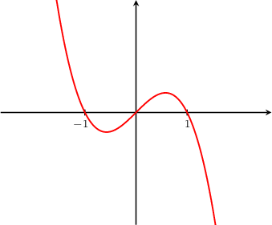
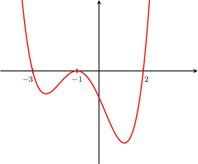
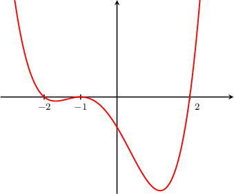
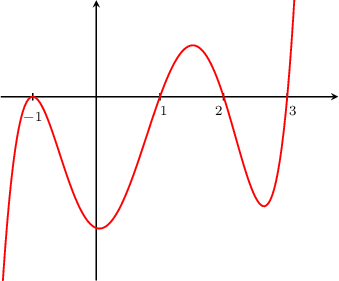
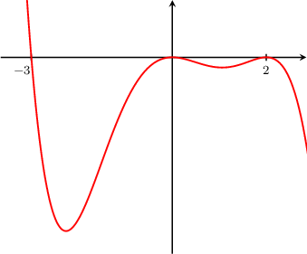
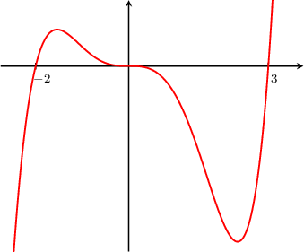
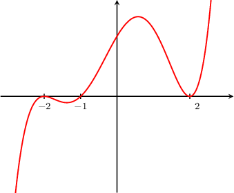
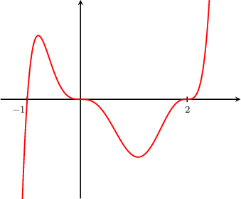
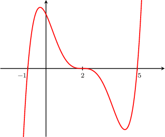
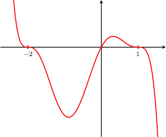

# Review — Identifying the Factored Polynomial Shown in a Graph

Source math basis 1356. Original omission/normalization and bank ineligibility are recorded in template-extraction.md.

## Original q-38668

Which of the following could be the equation of the polynomial curve shown above?

- $y =-x(x + 1)(x - 1)(x + 2)$
- $y =-x(x + 1)^{2}(x - 1)(x + 2)$
- $y =-x^{2}(x + 1)(x - 1)^{2}$
- $y =-x(x + 1)(x - 1)$
- $y =-x(x + 1)^{2}(x - 1)$

No captured solution or correct designation.

## Original q-38671

Which of the following could be the equation of the polynomial curve shown above?

- $y=2(x+3)(x+1)(x-2)$
- $y=3(x+2)(x+1)(x-2)$
- $y=3(x+3)(x+1)(x-2)$
- $y=5{x}^{2}(x+1)(x-2)$
- $y=(x+3)(x+1{)}^{2}(x-2)$

First, we notice that the function has precisely three distinct roots, $x=-3,$ $x=-1,$ and $x=2.$

Based on the graph, we can make the following conclusions about the multiplicities of the roots:

- Since the graph is *not* tangent to the $x$-axis at $x=-3,$ this root is a simple root (the multiplicity equals $1$).

- Since the graph just touches the $x$-axis and reverses direction at $x=-1,$ this root has even multiplicity.

- Since the graph is *not* tangent to the $x$-axis at $x=2,$ this root is a simple root (the multiplicity equals $1$).

From the given options, the only possible equation is $y=(x+3)(x+1{)}^{2}(x-2).$

## Original q-38763

Which of the following could be the equation of the polynomial curve shown above?

First, we notice that the function has precisely three distinct roots, $x=-2,$ $x=-1,$ and $x=2.$

Based on the graph, we can make the following conclusions about the multiplicities of the roots:

- Since the graph is *not* tangent to the $x$-axis at $x=-2,$ this root is a simple root (the multiplicity equals $1$).

- Since the graph just touches the $x$-axis and reverses direction at $x=-1,$ this root has even multiplicity.

- Since the graph is *not* tangent to the $x$-axis at $x=2,$ this root is a simple root (the multiplicity equals $1$).

From the given options, the only possible equation is $y=\frac{1}{4}(x+2)(x+1)^{2}(x-2).$

## Original q-38765

Which of the following could be the equation of the polynomial curve shown above?

First, we notice that the function has precisely four distinct roots, $x=-1,$ $x=1,$ $x=2,$ and $x=3.$

Based on the graph, we can make the following conclusions about the multiplicities of the roots:

- Since the graph just touches the $x$-axis and reverses direction at $x=-1,$ this root has even multiplicity.

- Since the graph is *not* tangent to the $x$-axis at $x=1,$ this root is a simple root (the multiplicity equals $1$).

- Since the graph is *not* tangent to the $x$-axis at $x=2,$ this root is a simple root (the multiplicity equals $1$).

- Since the graph is *not* tangent to the $x$-axis at $x=3,$ this root is a simple root (the multiplicity equals $1$).

From the given options, the only possible equation is $y=(x+1)^{2}(x-1)(x-2)(x-3).$

## Original q-112595

Which of the following could be the equation of the polynomial curve shown above?

- $y=-3x(x+3)(x-2{)}^{2}$
- $y=-8{x}^{4}(x+3)(x-2{)}^{3}$
- $y=-\frac{1}{10}{x}^{2}(x+3)(x-2{)}^{4}$
- $y=-\frac{1}{5}x(x-3)(x-2)$
- $y=-{x}^{4}(x-3{)}^{3}(x-2{)}^{2}$

First, we notice that the function has precisely three distinct roots, $x=-3,$ $x=0$ and $x=2.$

Based on the graph, we can make the following conclusions about the multiplicities of the roots:

- Since the graph is *not* tangent to the $x$-axis at $x=-3,$ this root is a simple root (the multiplicity equals $1$).

- Since the graph just touches the $x$-axis and reverses direction at $x=0,$ this root has even multiplicity.

- Since the graph just touches the $x$-axis and reverses direction at $x=2,$ this root has even multiplicity.

Therefore, the only possible equation is $y=-\frac{1}{10}{x}^{2}(x+3)(x-2{)}^{4}.$

## Original q-112596

Which of the following could be the equation of the polynomial curve shown above?

- $y=2x(x+2)(x+3{)}^{3}$
- $y={x}^{3}(x+2{)}^{3}(x+3{)}^{2}$
- $y=\frac{1}{4}x(x+2)(x-3)$
- $y=5{x}^{3}(x+2{)}^{2}(x-3{)}^{3}$
- $y=\frac{1}{5}{x}^{3}(x+2)(x-3)$

First, we notice that the function has precisely three distinct roots, $x=-2,$ $x=0$ and $x=3.$

Based on the graph, we can make the following conclusions about the multiplicities of the roots:

- Since the graph is *not* tangent to the $x$-axis at $x=-2,$ this root is a simple root (the multiplicity equals $1$).

- Since the graph passes through $x=0,$ this root has odd multiplicity, and since the graph is tangent to the $x$-axis at $x=0,$ the multiplicity must be greater than one.

- Since the graph is *not* tangent to the $x$-axis at $x=3,$ this root is a simple root (the multiplicity equals $1$).

Therefore, the only possible equation is $y=\frac{1}{5}{x}^{3}(x+2)(x-3).$

## Original q-38774

Which of the following could be the equation of the polynomial curve shown above?

- $y=\frac{1}{10}(x+2{)}^{2}(x+1)(x-2{)}^{2}$
- $y=\frac{1}{5}(x+2{)}^{2}(x+1{)}^{2}(x-2{)}^{2}$
- $y=10(x+2{)}^{6}(x+1{)}^{4}(x-2{)}^{2}$
- $y=\frac{1}{2}(x+4{)}^{5}(x+2{)}^{2}(x+1)$
- $y=\frac{1}{3}(x+2{)}^{4}(x+1)(x-2)$

First, we notice that the function has precisely three distinct roots, $x=-2,$ $x=-1,$ and $x=2.$

Based on the graph, we can make the following conclusions about the multiplicities of the roots:

- Since the graph just touches the $x$-axis and reverses direction at $x=-2,$ this root has even multiplicity.

- Since the graph is *not* tangent to the $x$-axis at $x=-1,$ this root is a simple root (the multiplicity equals $1$).

- Since the graph just touches the $x$-axis and reverses direction at $x=2,$ this root has even multiplicity.

From the given options, the only possible equation is $y=\frac{1}{10}(x+2{)}^{2}(x+1)(x-2{)}^{2}.$

## Original q-80348

Which of the following could be the equation of the polynomial curve shown above?

- $y={x}^{3}(x+1)(x-2)$
- $y={x}^{2}(x+1){(x-2)}^{2}$
- $y={x}^{3}(x+1){(x-2)}^{3}$
- $y={x}^{5}{(x+1)}^{2}(x-2)$
- $y=x{(x+1)}^{2}(x-2)$

First, we notice that the function has precisely three distinct roots, $x=-1$, $x=0$ and $x=2.$

Based on the graph, we can make the following conclusions about the multiplicities of the roots:

- Since the graph is *not* tangent to the $x$-axis at $x=-1,$ this root is a simple root (the multiplicity equals $1$).

- Since the graph passes through $x=0,$ this root has odd multiplicity, and since the graph is tangent to the $x$-axis at $x=0,$ the multiplicity must be greater than one.

- Since the graph passes through $x=2,$ this root has odd multiplicity, and since the graph is tangent to the $x$-axis at $x=2,$ the multiplicity must be greater than one.

From the given options, the only possible equation is $y={x}^{3}(x+1){(x-2)}^{3}.$

## Original q-80350

Which of the following could be the equation of the polynomial curve shown above?

- $y=(x+1)(x-2)^{5}(x-5)$
- $y=(x+1)(x-2)^{3}(x-5)^{2}$
- $y=(x+1)(x-2)^{2}(x-5)$
- $y=(x+1)^{2}(x-2)(x-5)^{2}$
- $y=(x+1)^{3}(x-2)(x-5)$

First, we notice that the function has precisely three distinct roots, $x=-1$, $x=2$ and $x=5.$

Based on the graph, we can make the following conclusions about the multiplicities of the roots:

- Since the graph is *not* tangent to the $x$-axis at $x=-1,$ this root is also a simple root (the multiplicity equals $1$).

- Since the graph passes through $x=2,$ this root has odd multiplicity, and since the graph is tangent to the $x$-axis at $x=2,$ the multiplicity must be greater than one.

- Since the graph is *not* tangent to the $x$-axis at $x=5,$ this root is also a simple root (the multiplicity equals $1$).

From the given options, the only possible equation is $y=(x+1)(x-2)^{5}(x-5).$

## Original q-80352

Which of the following could be the equation of the polynomial curve shown above?

- $y=-x(x+2)^{7}(x-1)$
- $y=-x(x+2)^{5}(x-1)^{2}$
- $y=-x(x+2)^{3}(x-1)^{3}$
- $y=-{x}^{3}(x+2)^{5}(x-1)$
- $y=-{x}^{2}(x+2)(x-1)^{7}$

First, we notice that the function has precisely three distinct roots, $x=-2,x=0$ and $x=1.$

Based on the graph, we can make the following conclusions about the multiplicities of the roots:

- Since the graph passes through $x=-2,$ this root has odd multiplicity, and since the graph is tangent to the $x$-axis at $x=-2,$ the multiplicity must be greater than one.

- Since the graph is *not* tangent to the $x$-axis at $x=0,$ this root is a simple root (the multiplicity equals $1$).

- Since the graph passes through $x=1,$ this root has odd multiplicity, and since the graph is tangent to the $x$-axis at $x=1,$ the multiplicity must be greater than one.

From the given options, the only possible equation is $y=-x(x+2)^{3}(x-1)^{3}.$

## raw source evidence (omissions preserved; ineligible) q-38668-raw

Which of the following could be the equation of the polynomial curve shown above?

- $y =-x^{2}(x + 1)(x - 1)^{2}$

- $y =-x(x + 1)^{2}(x - 1)(x + 2)$

- $y =-x(x + 1)(x - 1)(x + 2)$

- $y =-x(x + 1)^{2}(x - 1)$

- $y =-x(x + 1)(x - 1)$

## source replay q-38668

Which of the following could be the equation of the polynomial curve shown above?

- $y =-x^{2}(x + 1)(x - 1)^{2}$

- $y =-x(x + 1)^{2}(x - 1)(x + 2)$

- $y =-x(x + 1)(x - 1)(x + 2)$

- $y =-x(x + 1)^{2}(x - 1)$

- $y =-x(x + 1)(x - 1)$

First, we notice that the function has precisely three distinct roots, $x=-1$, $x=0$, and $x=1.$

Based on the graph, we can make the following conclusions about the multiplicities of the roots:

- Since the graph is *not* tangent to the $x$-axis at $x=-1,$ this root is a simple root (the multiplicity equals $1$).

- Since the graph is *not* tangent to the $x$-axis at $x=0,$ this root is a simple root (the multiplicity equals $1$).

- Since the graph is *not* tangent to the $x$-axis at $x=1,$ this root is a simple root (the multiplicity equals $1$).

From the given options, the only possible equation is $y =-x(x + 1)(x - 1).$

## raw source evidence (omissions preserved; ineligible) q-38671-raw

Which of the following could be the equation of the polynomial curve shown above?

- $y=3(x+3)(x+1)(x-2)$

- $y=3(x+2)(x+1)(x-2)$

- $y=2(x+3)(x+1)(x-2)$

- $y=(x+3)(x+1{)}^{2}(x-2)$

- $y=5{x}^{2}(x+1)(x-2)$

First, we notice that the function has precisely three distinct roots, $x=-3,$ $x=-1,$ and $x=2.$

Based on the graph, we can make the following conclusions about the multiplicities of the roots:

- Since the graph is *not* tangent to the $x$-axis at $x=-3,$ this root is a simple root (the multiplicity equals $1$).

- Since the graph just touches the $x$-axis and reverses direction at $x=-1,$ this root has even multiplicity.

- Since the graph is *not* tangent to the $x$-axis at $x=2,$ this root is a simple root (the multiplicity equals $1$).

From the given options, the only possible equation is $y=(x+3)(x+1{)}^{2}(x-2).$

## source replay q-38671

Which of the following could be the equation of the polynomial curve shown above?

- $y=3(x+3)(x+1)(x-2)$

- $y=3(x+2)(x+1)(x-2)$

- $y=2(x+3)(x+1)(x-2)$

- $y=(x+3)(x+1{)}^{2}(x-2)$

- $y=5{x}^{2}(x+1)(x-2)$

First, we notice that the function has precisely three distinct roots, $x=-3,$ $x=-1,$ and $x=2.$

Based on the graph, we can make the following conclusions about the multiplicities of the roots:

- Since the graph is *not* tangent to the $x$-axis at $x=-3,$ this root is a simple root (the multiplicity equals $1$).

- Since the graph just touches the $x$-axis and reverses direction at $x=-1,$ this root has even multiplicity.

- Since the graph is *not* tangent to the $x$-axis at $x=2,$ this root is a simple root (the multiplicity equals $1$).

From the given options, the only possible equation is $y=(x+3)(x+1{)}^{2}(x-2).$

## raw source evidence (omissions preserved; ineligible) q-38763-raw

Which of the following could be the equation of the polynomial curve shown above?

First, we notice that the function has precisely three distinct roots, $x=-2,$ $x=-1,$ and $x=2.$

Based on the graph, we can make the following conclusions about the multiplicities of the roots:

- Since the graph is *not* tangent to the $x$-axis at $x=-2,$ this root is a simple root (the multiplicity equals $1$).

- Since the graph just touches the $x$-axis and reverses direction at $x=-1,$ this root has even multiplicity.

- Since the graph is *not* tangent to the $x$-axis at $x=2,$ this root is a simple root (the multiplicity equals $1$).

From the given options, the only possible equation is $y=\frac{1}{4}(x+2)(x+1)^{2}(x-2).$

## source replay q-38763

Which of the following could be the equation of the polynomial curve shown above?

- $y=\frac{1}{4}(x+2)(x+1)(x-2)$

- $y=- \frac{1}{4}(x+2)(x+1)^{2}(x-2)$

- $y=\frac{1}{4}(x+2)(x+1)^{2}(x-2)$

- $y=\frac{1}{4}(x+2)(x+1)^{3}(x-2)$

- $y=\frac{1}{4}(x+3)(x+1)^{2}(x-2)$

First, we notice that the function has precisely three distinct roots, $x=-2,$ $x=-1,$ and $x=2.$

Based on the graph, we can make the following conclusions about the multiplicities of the roots:

- Since the graph is *not* tangent to the $x$-axis at $x=-2,$ this root is a simple root (the multiplicity equals $1$).

- Since the graph just touches the $x$-axis and reverses direction at $x=-1,$ this root has even multiplicity.

- Since the graph is *not* tangent to the $x$-axis at $x=2,$ this root is a simple root (the multiplicity equals $1$).

From the given options, the only possible equation is $y=\frac{1}{4}(x+2)(x+1)^{2}(x-2).$

## raw source evidence (omissions preserved; ineligible) q-38765-raw

Which of the following could be the equation of the polynomial curve shown above?

First, we notice that the function has precisely four distinct roots, $x=-1,$ $x=1,$ $x=2,$ and $x=3.$

Based on the graph, we can make the following conclusions about the multiplicities of the roots:

- Since the graph just touches the $x$-axis and reverses direction at $x=-1,$ this root has even multiplicity.

- Since the graph is *not* tangent to the $x$-axis at $x=1,$ this root is a simple root (the multiplicity equals $1$).

- Since the graph is *not* tangent to the $x$-axis at $x=2,$ this root is a simple root (the multiplicity equals $1$).

- Since the graph is *not* tangent to the $x$-axis at $x=3,$ this root is a simple root (the multiplicity equals $1$).

From the given options, the only possible equation is $y=(x+1)^{2}(x-1)(x-2)(x-3).$

## source replay q-38765

Which of the following could be the equation of the polynomial curve shown above?

- $y=(x+1)(x-1)(x-2)(x-3)$

- $y=-(x+1)^{2}(x-1)(x-2)(x-3)$

- $y=(x+1)^{2}(x-1)(x-2)(x-3)$

- $y=(x+1)^{3}(x-1)(x-2)(x-3)$

- $y=(x+2)^{2}(x-1)(x-2)(x-3)$

First, we notice that the function has precisely four distinct roots, $x=-1,$ $x=1,$ $x=2,$ and $x=3.$

Based on the graph, we can make the following conclusions about the multiplicities of the roots:

- Since the graph just touches the $x$-axis and reverses direction at $x=-1,$ this root has even multiplicity.

- Since the graph is *not* tangent to the $x$-axis at $x=1,$ this root is a simple root (the multiplicity equals $1$).

- Since the graph is *not* tangent to the $x$-axis at $x=2,$ this root is a simple root (the multiplicity equals $1$).

- Since the graph is *not* tangent to the $x$-axis at $x=3,$ this root is a simple root (the multiplicity equals $1$).

From the given options, the only possible equation is $y=(x+1)^{2}(x-1)(x-2)(x-3).$

## raw source evidence (omissions preserved; ineligible) q-112595-raw

Which of the following could be the equation of the polynomial curve shown above?

- $y=-\frac{1}{10}{x}^{2}(x+3)(x-2{)}^{4}$

- $y=-8{x}^{4}(x+3)(x-2{)}^{3}$

- $y=-3x(x+3)(x-2{)}^{2}$

- $y=-{x}^{4}(x-3{)}^{3}(x-2{)}^{2}$

- $y=-\frac{1}{5}x(x-3)(x-2)$

First, we notice that the function has precisely three distinct roots, $x=-3,$ $x=0$ and $x=2.$

Based on the graph, we can make the following conclusions about the multiplicities of the roots:

- Since the graph is *not* tangent to the $x$-axis at $x=-3,$ this root is a simple root (the multiplicity equals $1$).

- Since the graph just touches the $x$-axis and reverses direction at $x=0,$ this root has even multiplicity.

- Since the graph just touches the $x$-axis and reverses direction at $x=2,$ this root has even multiplicity.

Therefore, the only possible equation is $y=-\frac{1}{10}{x}^{2}(x+3)(x-2{)}^{4}.$

## source replay q-112595

Which of the following could be the equation of the polynomial curve shown above?

- $y=-\frac{1}{10}{x}^{2}(x+3)(x-2{)}^{4}$

- $y=-8{x}^{4}(x+3)(x-2{)}^{3}$

- $y=-3x(x+3)(x-2{)}^{2}$

- $y=-{x}^{4}(x-3{)}^{3}(x-2{)}^{2}$

- $y=-\frac{1}{5}x(x-3)(x-2)$

First, we notice that the function has precisely three distinct roots, $x=-3,$ $x=0$ and $x=2.$

Based on the graph, we can make the following conclusions about the multiplicities of the roots:

- Since the graph is *not* tangent to the $x$-axis at $x=-3,$ this root is a simple root (the multiplicity equals $1$).

- Since the graph just touches the $x$-axis and reverses direction at $x=0,$ this root has even multiplicity.

- Since the graph just touches the $x$-axis and reverses direction at $x=2,$ this root has even multiplicity.

Therefore, the only possible equation is $y=-\frac{1}{10}{x}^{2}(x+3)(x-2{)}^{4}.$

## raw source evidence (omissions preserved; ineligible) q-112596-raw

Which of the following could be the equation of the polynomial curve shown above?

- $y=\frac{1}{4}x(x+2)(x-3)$

- $y={x}^{3}(x+2{)}^{3}(x+3{)}^{2}$

- $y=2x(x+2)(x+3{)}^{3}$

- $y=\frac{1}{5}{x}^{3}(x+2)(x-3)$

- $y=5{x}^{3}(x+2{)}^{2}(x-3{)}^{3}$

First, we notice that the function has precisely three distinct roots, $x=-2,$ $x=0$ and $x=3.$

Based on the graph, we can make the following conclusions about the multiplicities of the roots:

- Since the graph is *not* tangent to the $x$-axis at $x=-2,$ this root is a simple root (the multiplicity equals $1$).

- Since the graph passes through $x=0,$ this root has odd multiplicity, and since the graph is tangent to the $x$-axis at $x=0,$ the multiplicity must be greater than one.

- Since the graph is *not* tangent to the $x$-axis at $x=3,$ this root is a simple root (the multiplicity equals $1$).

Therefore, the only possible equation is $y=\frac{1}{5}{x}^{3}(x+2)(x-3).$

## source replay q-112596

Which of the following could be the equation of the polynomial curve shown above?

- $y=\frac{1}{4}x(x+2)(x-3)$

- $y={x}^{3}(x+2{)}^{3}(x+3{)}^{2}$

- $y=2x(x+2)(x+3{)}^{3}$

- $y=\frac{1}{5}{x}^{3}(x+2)(x-3)$

- $y=5{x}^{3}(x+2{)}^{2}(x-3{)}^{3}$

First, we notice that the function has precisely three distinct roots, $x=-2,$ $x=0$ and $x=3.$

Based on the graph, we can make the following conclusions about the multiplicities of the roots:

- Since the graph is *not* tangent to the $x$-axis at $x=-2,$ this root is a simple root (the multiplicity equals $1$).

- Since the graph passes through $x=0,$ this root has odd multiplicity, and since the graph is tangent to the $x$-axis at $x=0,$ the multiplicity must be greater than one.

- Since the graph is *not* tangent to the $x$-axis at $x=3,$ this root is a simple root (the multiplicity equals $1$).

Therefore, the only possible equation is $y=\frac{1}{5}{x}^{3}(x+2)(x-3).$

## raw source evidence (omissions preserved; ineligible) q-38774-raw

Which of the following could be the equation of the polynomial curve shown above?

- $y=10(x+2{)}^{6}(x+1{)}^{4}(x-2{)}^{2}$

- $y=\frac{1}{5}(x+2{)}^{2}(x+1{)}^{2}(x-2{)}^{2}$

- $y=\frac{1}{10}(x+2{)}^{2}(x+1)(x-2{)}^{2}$

- $y=\frac{1}{3}(x+2{)}^{4}(x+1)(x-2)$

- $y=\frac{1}{2}(x+4{)}^{5}(x+2{)}^{2}(x+1)$

First, we notice that the function has precisely three distinct roots, $x=-2,$ $x=-1,$ and $x=2.$

Based on the graph, we can make the following conclusions about the multiplicities of the roots:

- Since the graph just touches the $x$-axis and reverses direction at $x=-2,$ this root has even multiplicity.

- Since the graph is *not* tangent to the $x$-axis at $x=-1,$ this root is a simple root (the multiplicity equals $1$).

- Since the graph just touches the $x$-axis and reverses direction at $x=2,$ this root has even multiplicity.

From the given options, the only possible equation is $y=\frac{1}{10}(x+2{)}^{2}(x+1)(x-2{)}^{2}.$

## source replay q-38774

Which of the following could be the equation of the polynomial curve shown above?

- $y=10(x+2{)}^{6}(x+1{)}^{4}(x-2{)}^{2}$

- $y=\frac{1}{5}(x+2{)}^{2}(x+1{)}^{2}(x-2{)}^{2}$

- $y=\frac{1}{10}(x+2{)}^{2}(x+1)(x-2{)}^{2}$

- $y=\frac{1}{3}(x+2{)}^{4}(x+1)(x-2)$

- $y=\frac{1}{2}(x+4{)}^{5}(x+2{)}^{2}(x+1)$

First, we notice that the function has precisely three distinct roots, $x=-2,$ $x=-1,$ and $x=2.$

Based on the graph, we can make the following conclusions about the multiplicities of the roots:

- Since the graph just touches the $x$-axis and reverses direction at $x=-2,$ this root has even multiplicity.

- Since the graph is *not* tangent to the $x$-axis at $x=-1,$ this root is a simple root (the multiplicity equals $1$).

- Since the graph just touches the $x$-axis and reverses direction at $x=2,$ this root has even multiplicity.

From the given options, the only possible equation is $y=\frac{1}{10}(x+2{)}^{2}(x+1)(x-2{)}^{2}.$

## raw source evidence (omissions preserved; ineligible) q-80348-raw

Which of the following could be the equation of the polynomial curve shown above?

- $y={x}^{3}(x+1){(x-2)}^{3}$

- $y={x}^{2}(x+1){(x-2)}^{2}$

- $y={x}^{3}(x+1)(x-2)$

- $y=x{(x+1)}^{2}(x-2)$

- $y={x}^{5}{(x+1)}^{2}(x-2)$

First, we notice that the function has precisely three distinct roots, $x=-1$, $x=0$ and $x=2.$

Based on the graph, we can make the following conclusions about the multiplicities of the roots:

- Since the graph is *not* tangent to the $x$-axis at $x=-1,$ this root is a simple root (the multiplicity equals $1$).

- Since the graph passes through $x=0,$ this root has odd multiplicity, and since the graph is tangent to the $x$-axis at $x=0,$ the multiplicity must be greater than one.

- Since the graph passes through $x=2,$ this root has odd multiplicity, and since the graph is tangent to the $x$-axis at $x=2,$ the multiplicity must be greater than one.

From the given options, the only possible equation is $y={x}^{3}(x+1){(x-2)}^{3}.$

## source replay q-80348

Which of the following could be the equation of the polynomial curve shown above?

- $y={x}^{3}(x+1){(x-2)}^{3}$

- $y={x}^{2}(x+1){(x-2)}^{2}$

- $y={x}^{3}(x+1)(x-2)$

- $y=x{(x+1)}^{2}(x-2)$

- $y={x}^{5}{(x+1)}^{2}(x-2)$

First, we notice that the function has precisely three distinct roots, $x=-1$, $x=0$ and $x=2.$

Based on the graph, we can make the following conclusions about the multiplicities of the roots:

- Since the graph is *not* tangent to the $x$-axis at $x=-1,$ this root is a simple root (the multiplicity equals $1$).

- Since the graph passes through $x=0,$ this root has odd multiplicity, and since the graph is tangent to the $x$-axis at $x=0,$ the multiplicity must be greater than one.

- Since the graph passes through $x=2,$ this root has odd multiplicity, and since the graph is tangent to the $x$-axis at $x=2,$ the multiplicity must be greater than one.

From the given options, the only possible equation is $y={x}^{3}(x+1){(x-2)}^{3}.$

## raw source evidence (omissions preserved; ineligible) q-80350-raw

Which of the following could be the equation of the polynomial curve shown above?

- $y=(x+1)(x-2)^{2}(x-5)$

- $y=(x+1)(x-2)^{3}(x-5)^{2}$

- $y=(x+1)(x-2)^{5}(x-5)$

- $y=(x+1)^{3}(x-2)(x-5)$

- $y=(x+1)^{2}(x-2)(x-5)^{2}$

First, we notice that the function has precisely three distinct roots, $x=-1$, $x=2$ and $x=5.$

Based on the graph, we can make the following conclusions about the multiplicities of the roots:

- Since the graph is *not* tangent to the $x$-axis at $x=-1,$ this root is also a simple root (the multiplicity equals $1$).

- Since the graph passes through $x=2,$ this root has odd multiplicity, and since the graph is tangent to the $x$-axis at $x=2,$ the multiplicity must be greater than one.

- Since the graph is *not* tangent to the $x$-axis at $x=5,$ this root is also a simple root (the multiplicity equals $1$).

From the given options, the only possible equation is $y=(x+1)(x-2)^{5}(x-5).$

## source replay q-80350

Which of the following could be the equation of the polynomial curve shown above?

- $y=(x+1)(x-2)^{2}(x-5)$

- $y=(x+1)(x-2)^{3}(x-5)^{2}$

- $y=(x+1)(x-2)^{5}(x-5)$

- $y=(x+1)^{3}(x-2)(x-5)$

- $y=(x+1)^{2}(x-2)(x-5)^{2}$

First, we notice that the function has precisely three distinct roots, $x=-1$, $x=2$ and $x=5.$

Based on the graph, we can make the following conclusions about the multiplicities of the roots:

- Since the graph is *not* tangent to the $x$-axis at $x=-1,$ this root is also a simple root (the multiplicity equals $1$).

- Since the graph passes through $x=2,$ this root has odd multiplicity, and since the graph is tangent to the $x$-axis at $x=2,$ the multiplicity must be greater than one.

- Since the graph is *not* tangent to the $x$-axis at $x=5,$ this root is also a simple root (the multiplicity equals $1$).

From the given options, the only possible equation is $y=(x+1)(x-2)^{5}(x-5).$

## raw source evidence (omissions preserved; ineligible) q-80352-raw

Which of the following could be the equation of the polynomial curve shown above?

- $y=-x(x+2)^{3}(x-1)^{3}$

- $y=-x(x+2)^{5}(x-1)^{2}$

- $y=-x(x+2)^{7}(x-1)$

- $y=-{x}^{2}(x+2)(x-1)^{7}$

- $y=-{x}^{3}(x+2)^{5}(x-1)$

First, we notice that the function has precisely three distinct roots, $x=-2,x=0$ and $x=1.$

Based on the graph, we can make the following conclusions about the multiplicities of the roots:

- Since the graph passes through $x=-2,$ this root has odd multiplicity, and since the graph is tangent to the $x$-axis at $x=-2,$ the multiplicity must be greater than one.

- Since the graph is *not* tangent to the $x$-axis at $x=0,$ this root is a simple root (the multiplicity equals $1$).

- Since the graph passes through $x=1,$ this root has odd multiplicity, and since the graph is tangent to the $x$-axis at $x=1,$ the multiplicity must be greater than one.

From the given options, the only possible equation is $y=-x(x+2)^{3}(x-1)^{3}.$

## source replay q-80352

Which of the following could be the equation of the polynomial curve shown above?

- $y=-x(x+2)^{3}(x-1)^{3}$

- $y=-x(x+2)^{5}(x-1)^{2}$

- $y=-x(x+2)^{7}(x-1)$

- $y=-{x}^{2}(x+2)(x-1)^{7}$

- $y=-{x}^{3}(x+2)^{5}(x-1)$

First, we notice that the function has precisely three distinct roots, $x=-2,x=0$ and $x=1.$

Based on the graph, we can make the following conclusions about the multiplicities of the roots:

- Since the graph passes through $x=-2,$ this root has odd multiplicity, and since the graph is tangent to the $x$-axis at $x=-2,$ the multiplicity must be greater than one.

- Since the graph is *not* tangent to the $x$-axis at $x=0,$ this root is a simple root (the multiplicity equals $1$).

- Since the graph passes through $x=1,$ this root has odd multiplicity, and since the graph is tangent to the $x$-axis at $x=1,$ the multiplicity must be greater than one.

From the given options, the only possible equation is $y=-x(x+2)^{3}(x-1)^{3}.$

## generated variant q-38668

Which of the following could be the equation of the polynomial curve shown above?

- $y =- \frac{1}{2}(x+2)(x+3)(x+1)(x+4)$

- $y =- \frac{1}{2}(x+2)(x+3)^{2}(x+1)(x+4)$

- $y =- \frac{1}{2}(x+2)(x+3)^{2}(x+1)$

- $y =- \frac{1}{2}(x+2)^{2}(x+3)(x+1)^{2}$

- $y =- \frac{1}{2}(x+2)(x+3)(x+1)$

First, we notice that the function has precisely three distinct roots, $x=-3$, $x=-2$, and $x=-1.$

Based on the graph, we can make the following conclusions about the multiplicities of the roots:

- Since the graph is *not* tangent to the $x$-axis at $x=-3,$ this root is a simple root (the multiplicity equals $1$).

- Since the graph is *not* tangent to the $x$-axis at $x=-2,$ this root is a simple root (the multiplicity equals $1$).

- Since the graph is *not* tangent to the $x$-axis at $x=-1,$ this root is a simple root (the multiplicity equals $1$).

From the given options, the only possible equation is $y =- \frac{1}{2}(x+2)(x+3)(x+1).$

## generated variant q-38668

Which of the following could be the equation of the polynomial curve shown above?

- $y =-2(x-2)x^{2}(x-4)(x + 2)$

- $y =-2(x-2)x(x-4)(x + 2)$

- $y =-2(x-2)x(x-4)$

- $y =-2(x-2)x^{2}(x-4)$

- $y =-2(x-2)^{2}x(x-4)^{2}$

First, we notice that the function has precisely three distinct roots, $x=0$, $x=2$, and $x=4.$

Based on the graph, we can make the following conclusions about the multiplicities of the roots:

- Since the graph is *not* tangent to the $x$-axis at $x=0,$ this root is a simple root (the multiplicity equals $1$).

- Since the graph is *not* tangent to the $x$-axis at $x=2,$ this root is a simple root (the multiplicity equals $1$).

- Since the graph is *not* tangent to the $x$-axis at $x=4,$ this root is a simple root (the multiplicity equals $1$).

From the given options, the only possible equation is $y =-2(x-2)x(x-4).$

## generated variant q-38763

Which of the following could be the equation of the polynomial curve shown above?

- $y=\frac{1}{8}x(x+4)(x+3)^{2}$

- $y=- \frac{1}{8}x(x+4)(x+3)^{2}$

- $y=\frac{1}{8}x(x+4)(x+3)^{3}$

- $y=\frac{1}{8}x(x+4)(x+3)$

- $y=\frac{1}{8}x(x+5)(x+3)^{2}$

First, we notice that the function has precisely three distinct roots, $x=-4,$ $x=-3,$ and $x=0.$

Based on the graph, we can make the following conclusions about the multiplicities of the roots:

- Since the graph is *not* tangent to the $x$-axis at $x=-4,$ this root is a simple root (the multiplicity equals $1$).

- Since the graph just touches the $x$-axis and reverses direction at $x=-3,$ this root has even multiplicity.

- Since the graph is *not* tangent to the $x$-axis at $x=0,$ this root is a simple root (the multiplicity equals $1$).

From the given options, the only possible equation is $y=\frac{1}{8}x(x+4)(x+3)^{2}.$

## generated variant q-38763

Which of the following could be the equation of the polynomial curve shown above?

- $y=- \frac{1}{2}x^{2}(x+2)(x-6)$

- $y=\frac{1}{2}x^{2}(x+2)(x-6)$

- $y=\frac{1}{2}x^{2}(x+4)(x-6)$

- $y=\frac{1}{2}x^{3}(x+2)(x-6)$

- $y=\frac{1}{2}x(x+2)(x-6)$

First, we notice that the function has precisely three distinct roots, $x=-2,$ $x=0,$ and $x=6.$

Based on the graph, we can make the following conclusions about the multiplicities of the roots:

- Since the graph is *not* tangent to the $x$-axis at $x=-2,$ this root is a simple root (the multiplicity equals $1$).

- Since the graph just touches the $x$-axis and reverses direction at $x=0,$ this root has even multiplicity.

- Since the graph is *not* tangent to the $x$-axis at $x=6,$ this root is a simple root (the multiplicity equals $1$).

From the given options, the only possible equation is $y=\frac{1}{2}x^{2}(x+2)(x-6).$

## generated variant q-38765

Which of the following could be the equation of the polynomial curve shown above?

- $y=\frac{1}{2}x(x+3)^{2}(x+1)(x-1)$

- $y=- \frac{1}{2}x(x+3)^{2}(x+1)(x-1)$

- $y=\frac{1}{2}x(x+3)^{3}(x+1)(x-1)$

- $y=\frac{1}{2}x(x+3)(x+1)(x-1)$

- $y=\frac{1}{2}x(x+4)^{2}(x+1)(x-1)$

First, we notice that the function has precisely four distinct roots, $x=-3,$ $x=-1,$ $x=0,$ and $x=1.$

Based on the graph, we can make the following conclusions about the multiplicities of the roots:

- Since the graph just touches the $x$-axis and reverses direction at $x=-3,$ this root has even multiplicity.

- Since the graph is *not* tangent to the $x$-axis at $x=-1,$ this root is a simple root (the multiplicity equals $1$).

- Since the graph is *not* tangent to the $x$-axis at $x=0,$ this root is a simple root (the multiplicity equals $1$).

- Since the graph is *not* tangent to the $x$-axis at $x=1,$ this root is a simple root (the multiplicity equals $1$).

From the given options, the only possible equation is $y=\frac{1}{2}x(x+3)^{2}(x+1)(x-1).$

## generated variant q-38765

Which of the following could be the equation of the polynomial curve shown above?

- $y=-2x^{2}(x-4)(x-6)(x-8)$

- $y=2x^{2}(x-4)(x-6)(x-8)$

- $y=2(x+2)^{2}(x-4)(x-6)(x-8)$

- $y=2x^{3}(x-4)(x-6)(x-8)$

- $y=2x(x-4)(x-6)(x-8)$

First, we notice that the function has precisely four distinct roots, $x=0,$ $x=4,$ $x=6,$ and $x=8.$

Based on the graph, we can make the following conclusions about the multiplicities of the roots:

- Since the graph just touches the $x$-axis and reverses direction at $x=0,$ this root has even multiplicity.

- Since the graph is *not* tangent to the $x$-axis at $x=4,$ this root is a simple root (the multiplicity equals $1$).

- Since the graph is *not* tangent to the $x$-axis at $x=6,$ this root is a simple root (the multiplicity equals $1$).

- Since the graph is *not* tangent to the $x$-axis at $x=8,$ this root is a simple root (the multiplicity equals $1$).

From the given options, the only possible equation is $y=2x^{2}(x-4)(x-6)(x-8).$

## generated variant q-112595

Which of the following could be the equation of the polynomial curve shown above?

- $y=- \frac{3}{2}(x+2)(x+5)x^{2}$

- $y=-4(x+2)^{4}(x+5)x^{3}$

- $y=- \frac{1}{2}(x+2)^{4}(x-1)^{3}x^{2}$

- $y=- \frac{1}{20}(x+2)^{2}(x+5)x^{4}$

- $y=- \frac{1}{10}(x+2)(x-1)x$

First, we notice that the function has precisely three distinct roots, $x=-5,$ $x=-2$ and $x=0.$

Based on the graph, we can make the following conclusions about the multiplicities of the roots:

- Since the graph is *not* tangent to the $x$-axis at $x=-5,$ this root is a simple root (the multiplicity equals $1$).

- Since the graph just touches the $x$-axis and reverses direction at $x=-2,$ this root has even multiplicity.

- Since the graph just touches the $x$-axis and reverses direction at $x=0,$ this root has even multiplicity.

Therefore, the only possible equation is $y=- \frac{1}{20}(x+2)^{2}(x+5)x^{4}.$

## generated variant q-112595

Which of the following could be the equation of the polynomial curve shown above?

- $y=-16(x-2)^{4}(x+4)(x-6)^{3}$

- $y=-6(x-2)(x+4)(x-6)^{2}$

- $y=- \frac{2}{5}(x-2)(x-8)(x-6)$

- $y=-2(x-2)^{4}(x-8)^{3}(x-6)^{2}$

- $y=- \frac{1}{5}(x-2)^{2}(x+4)(x-6)^{4}$

First, we notice that the function has precisely three distinct roots, $x=-4,$ $x=2$ and $x=6.$

Based on the graph, we can make the following conclusions about the multiplicities of the roots:

- Since the graph is *not* tangent to the $x$-axis at $x=-4,$ this root is a simple root (the multiplicity equals $1$).

- Since the graph just touches the $x$-axis and reverses direction at $x=2,$ this root has even multiplicity.

- Since the graph just touches the $x$-axis and reverses direction at $x=6,$ this root has even multiplicity.

Therefore, the only possible equation is $y=- \frac{1}{5}(x-2)^{2}(x+4)(x-6)^{4}.$

## generated variant q-112596

Which of the following could be the equation of the polynomial curve shown above?

- $y=(x+2)(x+4)(x+5)^{3}$

- $y=\frac{1}{2}(x+2)^{3}(x+4)^{3}(x+5)^{2}$

- $y=\frac{1}{10}(x+2)^{3}(x+4)(x-1)$

- $y=\frac{1}{8}(x+2)(x+4)(x-1)$

- $y=\frac{5}{2}(x+2)^{3}(x+4)^{2}(x-1)^{3}$

First, we notice that the function has precisely three distinct roots, $x=-4,$ $x=-2$ and $x=1.$

Based on the graph, we can make the following conclusions about the multiplicities of the roots:

- Since the graph is *not* tangent to the $x$-axis at $x=-4,$ this root is a simple root (the multiplicity equals $1$).

- Since the graph passes through $x=-2,$ this root has odd multiplicity, and since the graph is tangent to the $x$-axis at $x=-2,$ the multiplicity must be greater than one.

- Since the graph is *not* tangent to the $x$-axis at $x=1,$ this root is a simple root (the multiplicity equals $1$).

Therefore, the only possible equation is $y=\frac{1}{10}(x+2)^{3}(x+4)(x-1).$

## generated variant q-112596

Which of the following could be the equation of the polynomial curve shown above?

- $y=2(x-2)^{3}(x+2{)}^{3}(x+4)^{2}$

- $y=4(x-2)(x+2)(x+4)^{3}$

- $y=10(x-2)^{3}(x+2{)}^{2}(x-8)^{3}$

- $y=\frac{2}{5}(x-2)^{3}(x+2)(x-8)$

- $y=\frac{1}{2}(x-2)(x+2)(x-8)$

First, we notice that the function has precisely three distinct roots, $x=-2,$ $x=2$ and $x=8.$

Based on the graph, we can make the following conclusions about the multiplicities of the roots:

- Since the graph is *not* tangent to the $x$-axis at $x=-2,$ this root is a simple root (the multiplicity equals $1$).

- Since the graph passes through $x=2,$ this root has odd multiplicity, and since the graph is tangent to the $x$-axis at $x=2,$ the multiplicity must be greater than one.

- Since the graph is *not* tangent to the $x$-axis at $x=8,$ this root is a simple root (the multiplicity equals $1$).

Therefore, the only possible equation is $y=\frac{2}{5}(x-2)^{3}(x+2)(x-8).$

## generated variant q-80348

Which of the following could be the equation of the polynomial curve shown above?

- $y=\frac{1}{2}(x+2)^{3}(x+3)x$

- $y=\frac{1}{2}(x+2)^{2}(x+3)x^{2}$

- $y=\frac{1}{2}(x+2)(x+3)^{2}x$

- $y=\frac{1}{2}(x+2)^{3}(x+3)x^{3}$

- $y=\frac{1}{2}(x+2)^{5}(x+3)^{2}x$

First, we notice that the function has precisely three distinct roots, $x=-3$, $x=-2$ and $x=0.$

Based on the graph, we can make the following conclusions about the multiplicities of the roots:

- Since the graph is *not* tangent to the $x$-axis at $x=-3,$ this root is a simple root (the multiplicity equals $1$).

- Since the graph passes through $x=-2,$ this root has odd multiplicity, and since the graph is tangent to the $x$-axis at $x=-2,$ the multiplicity must be greater than one.

- Since the graph passes through $x=0,$ this root has odd multiplicity, and since the graph is tangent to the $x$-axis at $x=0,$ the multiplicity must be greater than one.

From the given options, the only possible equation is $y=\frac{1}{2}(x+2)^{3}(x+3)x^{3}.$

## generated variant q-80348

Which of the following could be the equation of the polynomial curve shown above?

- $y=2(x-2)^{2}x(x-6)^{2}$

- $y=2(x-2)^{3}x(x-6)$

- $y=2(x-2)^{5}x^{2}(x-6)$

- $y=2(x-2)x^{2}(x-6)$

- $y=2(x-2)^{3}x(x-6)^{3}$

First, we notice that the function has precisely three distinct roots, $x=0$, $x=2$ and $x=6.$

Based on the graph, we can make the following conclusions about the multiplicities of the roots:

- Since the graph is *not* tangent to the $x$-axis at $x=0,$ this root is a simple root (the multiplicity equals $1$).

- Since the graph passes through $x=2,$ this root has odd multiplicity, and since the graph is tangent to the $x$-axis at $x=2,$ the multiplicity must be greater than one.

- Since the graph passes through $x=6,$ this root has odd multiplicity, and since the graph is tangent to the $x$-axis at $x=6,$ the multiplicity must be greater than one.

From the given options, the only possible equation is $y=2(x-2)^{3}x(x-6)^{3}.$

## generated variant q-80350

Which of the following could be the equation of the polynomial curve shown above?

- $y=\frac{1}{2}(x+3)x^{5}(x-3)$

- $y=\frac{1}{2}(x+3)x^{3}(x-3)^{2}$

- $y=\frac{1}{2}(x+3)^{3}x(x-3)$

- $y=\frac{1}{2}(x+3)x^{2}(x-3)$

- $y=\frac{1}{2}(x+3)^{2}x(x-3)^{2}$

First, we notice that the function has precisely three distinct roots, $x=-3$, $x=0$ and $x=3.$

Based on the graph, we can make the following conclusions about the multiplicities of the roots:

- Since the graph is *not* tangent to the $x$-axis at $x=-3,$ this root is also a simple root (the multiplicity equals $1$).

- Since the graph passes through $x=0,$ this root has odd multiplicity, and since the graph is tangent to the $x$-axis at $x=0,$ the multiplicity must be greater than one.

- Since the graph is *not* tangent to the $x$-axis at $x=3,$ this root is also a simple root (the multiplicity equals $1$).

From the given options, the only possible equation is $y=\frac{1}{2}(x+3)x^{5}(x-3).$

## generated variant q-80350

Which of the following could be the equation of the polynomial curve shown above?

- $y=2x(x-6)^{3}(x-12)^{2}$

- $y=2x(x-6)^{5}(x-12)$

- $y=2x^{2}(x-6)(x-12)^{2}$

- $y=2x^{3}(x-6)(x-12)$

- $y=2x(x-6)^{2}(x-12)$

First, we notice that the function has precisely three distinct roots, $x=0$, $x=6$ and $x=12.$

Based on the graph, we can make the following conclusions about the multiplicities of the roots:

- Since the graph is *not* tangent to the $x$-axis at $x=0,$ this root is also a simple root (the multiplicity equals $1$).

- Since the graph passes through $x=6,$ this root has odd multiplicity, and since the graph is tangent to the $x$-axis at $x=6,$ the multiplicity must be greater than one.

- Since the graph is *not* tangent to the $x$-axis at $x=12,$ this root is also a simple root (the multiplicity equals $1$).

From the given options, the only possible equation is $y=2x(x-6)^{5}(x-12).$

## generated variant q-80352

Which of the following could be the equation of the polynomial curve shown above?

- $y=- \frac{1}{2}(x+2)(x+4)^{7}(x+1)$

- $y=- \frac{1}{2}(x+2)(x+4)^{5}(x+1)^{2}$

- $y=- \frac{1}{2}(x+2)^{2}(x+4)(x+1)^{7}$

- $y=- \frac{1}{2}(x+2)(x+4)^{3}(x+1)^{3}$

- $y=- \frac{1}{2}(x+2)^{3}(x+4)^{5}(x+1)$

First, we notice that the function has precisely three distinct roots, $x=-4,x=-2$ and $x=-1.$

Based on the graph, we can make the following conclusions about the multiplicities of the roots:

- Since the graph passes through $x=-4,$ this root has odd multiplicity, and since the graph is tangent to the $x$-axis at $x=-4,$ the multiplicity must be greater than one.

- Since the graph is *not* tangent to the $x$-axis at $x=-2,$ this root is a simple root (the multiplicity equals $1$).

- Since the graph passes through $x=-1,$ this root has odd multiplicity, and since the graph is tangent to the $x$-axis at $x=-1,$ the multiplicity must be greater than one.

From the given options, the only possible equation is $y=- \frac{1}{2}(x+2)(x+4)^{3}(x+1)^{3}.$

## generated variant q-80352

Which of the following could be the equation of the polynomial curve shown above?

- $y=-2(x-2)(x+2)^{5}(x-4)^{2}$

- $y=-2(x-2)(x+2)^{7}(x-4)$

- $y=-2(x-2)^{3}(x+2)^{5}(x-4)$

- $y=-2(x-2)^{2}(x+2)(x-4)^{7}$

- $y=-2(x-2)(x+2)^{3}(x-4)^{3}$

First, we notice that the function has precisely three distinct roots, $x=-2,x=2$ and $x=4.$

Based on the graph, we can make the following conclusions about the multiplicities of the roots:

- Since the graph passes through $x=-2,$ this root has odd multiplicity, and since the graph is tangent to the $x$-axis at $x=-2,$ the multiplicity must be greater than one.

- Since the graph is *not* tangent to the $x$-axis at $x=2,$ this root is a simple root (the multiplicity equals $1$).

- Since the graph passes through $x=4,$ this root has odd multiplicity, and since the graph is tangent to the $x$-axis at $x=4,$ the multiplicity must be greater than one.

From the given options, the only possible equation is $y=-2(x-2)(x+2)^{3}(x-4)^{3}.$

## generated variant hard-mixed

Which of the following could be the equation of the polynomial curve shown above?

- $y=\frac{1}{40}(x+6)(x+3)^{2}(x+1)^{3}(x-2)$

- $y=- \frac{1}{40}(x+6)(x+3)^{2}(x+1)^{3}(x-2)$

- $y=\frac{1}{40}(x+6)(x+3)^{3}(x+1)^{3}(x-2)$

- $y=\frac{1}{40}(x+6)(x+3)(x+1)^{3}(x-2)$

- $y=\frac{1}{40}(x+7)(x+3)^{2}(x+1)^{3}(x-2)$

First, we notice that the function has precisely four distinct roots, $x=-6$, $x=-3$, $x=-1$, and $x=2.$

Based on the graph, we can make the following conclusions about the multiplicities of the roots:

- Since the graph is *not* tangent to the $x$-axis at $x=-6,$ this root is a simple root (the multiplicity equals $1$).

- Since the graph just touches the $x$-axis and reverses direction at $x=-3,$ this root has even multiplicity.

- Since the graph passes through $x=-1,$ this root has odd multiplicity, and since the graph is tangent to the $x$-axis at $x=-1,$ the multiplicity must be greater than one.

- Since the graph is *not* tangent to the $x$-axis at $x=2,$ this root is a simple root (the multiplicity equals $1$).

From the given options, the only possible equation is $y=\frac{1}{40}(x+6)(x+3)^{2}(x+1)^{3}(x-2).$

## generated variant hard-mixed

Which of the following could be the equation of the polynomial curve shown above?

- $y=- \frac{1}{10}(x+2)(x-1)^{2}(x-3)^{3}(x-6)$

- $y=\frac{1}{10}(x+2)(x-1)^{2}(x-3)^{3}(x-6)$

- $y=\frac{1}{10}(x+3)(x-1)^{2}(x-3)^{3}(x-6)$

- $y=\frac{1}{10}(x+2)(x-1)^{3}(x-3)^{3}(x-6)$

- $y=\frac{1}{10}(x+2)(x-1)(x-3)^{3}(x-6)$

First, we notice that the function has precisely four distinct roots, $x=-2$, $x=1$, $x=3$, and $x=6.$

Based on the graph, we can make the following conclusions about the multiplicities of the roots:

- Since the graph is *not* tangent to the $x$-axis at $x=-2,$ this root is a simple root (the multiplicity equals $1$).

- Since the graph just touches the $x$-axis and reverses direction at $x=1,$ this root has even multiplicity.

- Since the graph passes through $x=3,$ this root has odd multiplicity, and since the graph is tangent to the $x$-axis at $x=3,$ the multiplicity must be greater than one.

- Since the graph is *not* tangent to the $x$-axis at $x=6,$ this root is a simple root (the multiplicity equals $1$).

From the given options, the only possible equation is $y=\frac{1}{10}(x+2)(x-1)^{2}(x-3)^{3}(x-6).$

## generated variant hard-even-right

Which of the following could be the equation of the polynomial curve shown above?

- $y=\frac{1}{40}(x+6)^{3}(x+4)(x+1)(x-1)^{2}$

- $y=- \frac{1}{40}(x+6)^{3}(x+4)(x+1)(x-1)^{2}$

- $y=\frac{1}{40}(x+6)^{4}(x+4)(x+1)(x-1)^{2}$

- $y=\frac{1}{40}(x+6)(x+4)(x+1)(x-1)^{2}$

- $y=\frac{1}{40}(x+7)^{3}(x+4)(x+1)(x-1)^{2}$

First, we notice that the function has precisely four distinct roots, $x=-6$, $x=-4$, $x=-1$, and $x=1.$

Based on the graph, we can make the following conclusions about the multiplicities of the roots:

- Since the graph passes through $x=-6,$ this root has odd multiplicity, and since the graph is tangent to the $x$-axis at $x=-6,$ the multiplicity must be greater than one.

- Since the graph is *not* tangent to the $x$-axis at $x=-4,$ this root is a simple root (the multiplicity equals $1$).

- Since the graph is *not* tangent to the $x$-axis at $x=-1,$ this root is a simple root (the multiplicity equals $1$).

- Since the graph just touches the $x$-axis and reverses direction at $x=1,$ this root has even multiplicity.

From the given options, the only possible equation is $y=\frac{1}{40}(x+6)^{3}(x+4)(x+1)(x-1)^{2}.$

## generated variant hard-even-right

Which of the following could be the equation of the polynomial curve shown above?

- $y=- \frac{1}{10}x(x+2)^{3}(x-3)(x-5)^{2}$

- $y=\frac{1}{10}x(x+2)^{3}(x-3)(x-5)^{2}$

- $y=\frac{1}{10}x(x+3)^{3}(x-3)(x-5)^{2}$

- $y=\frac{1}{10}x(x+2)^{4}(x-3)(x-5)^{2}$

- $y=\frac{1}{10}x(x+2)(x-3)(x-5)^{2}$

First, we notice that the function has precisely four distinct roots, $x=-2$, $x=0$, $x=3$, and $x=5.$

Based on the graph, we can make the following conclusions about the multiplicities of the roots:

- Since the graph passes through $x=-2,$ this root has odd multiplicity, and since the graph is tangent to the $x$-axis at $x=-2,$ the multiplicity must be greater than one.

- Since the graph is *not* tangent to the $x$-axis at $x=0,$ this root is a simple root (the multiplicity equals $1$).

- Since the graph is *not* tangent to the $x$-axis at $x=3,$ this root is a simple root (the multiplicity equals $1$).

- Since the graph just touches the $x$-axis and reverses direction at $x=5,$ this root has even multiplicity.

From the given options, the only possible equation is $y=\frac{1}{10}x(x+2)^{3}(x-3)(x-5)^{2}.$

## generated variant hard-odd-right

Which of the following could be the equation of the polynomial curve shown above?

- $y=- \frac{1}{40}x(x+5)^{2}(x+3)(x-2)^{3}$

- $y=\frac{1}{40}x(x+5)^{2}(x+3)(x-2)^{3}$

- $y=- \frac{1}{40}x(x+5)^{3}(x+3)(x-2)^{3}$

- $y=- \frac{1}{40}x(x+5)(x+3)(x-2)^{3}$

- $y=- \frac{1}{40}x(x+6)^{2}(x+3)(x-2)^{3}$

First, we notice that the function has precisely four distinct roots, $x=-5$, $x=-3$, $x=0$, and $x=2.$

Based on the graph, we can make the following conclusions about the multiplicities of the roots:

- Since the graph just touches the $x$-axis and reverses direction at $x=-5,$ this root has even multiplicity.

- Since the graph is *not* tangent to the $x$-axis at $x=-3,$ this root is a simple root (the multiplicity equals $1$).

- Since the graph is *not* tangent to the $x$-axis at $x=0,$ this root is a simple root (the multiplicity equals $1$).

- Since the graph passes through $x=2,$ this root has odd multiplicity, and since the graph is tangent to the $x$-axis at $x=2,$ the multiplicity must be greater than one.

From the given options, the only possible equation is $y=- \frac{1}{40}x(x+5)^{2}(x+3)(x-2)^{3}.$

## generated variant hard-odd-right

Which of the following could be the equation of the polynomial curve shown above?

- $y=\frac{1}{10}(x+1)^{2}(x-1)(x-4)(x-6)^{3}$

- $y=- \frac{1}{10}(x+1)^{2}(x-1)(x-4)(x-6)^{3}$

- $y=- \frac{1}{10}(x+2)^{2}(x-1)(x-4)(x-6)^{3}$

- $y=- \frac{1}{10}(x+1)^{3}(x-1)(x-4)(x-6)^{3}$

- $y=- \frac{1}{10}(x+1)(x-1)(x-4)(x-6)^{3}$

First, we notice that the function has precisely four distinct roots, $x=-1$, $x=1$, $x=4$, and $x=6.$

Based on the graph, we can make the following conclusions about the multiplicities of the roots:

- Since the graph just touches the $x$-axis and reverses direction at $x=-1,$ this root has even multiplicity.

- Since the graph is *not* tangent to the $x$-axis at $x=1,$ this root is a simple root (the multiplicity equals $1$).

- Since the graph is *not* tangent to the $x$-axis at $x=4,$ this root is a simple root (the multiplicity equals $1$).

- Since the graph passes through $x=6,$ this root has odd multiplicity, and since the graph is tangent to the $x$-axis at $x=6,$ the multiplicity must be greater than one.

From the given options, the only possible equation is $y=- \frac{1}{10}(x+1)^{2}(x-1)(x-4)(x-6)^{3}.$

## generated variant hard-even-left

Which of the following could be the equation of the polynomial curve shown above?

- $y=- \frac{1}{40}(x+5)^{2}(x+4)^{3}(x+1)(x-2)$

- $y=\frac{1}{40}(x+5)^{2}(x+4)^{3}(x+1)(x-2)$

- $y=- \frac{1}{40}(x+5)^{3}(x+4)^{3}(x+1)(x-2)$

- $y=- \frac{1}{40}(x+5)(x+4)^{3}(x+1)(x-2)$

- $y=- \frac{1}{40}(x+6)^{2}(x+4)^{3}(x+1)(x-2)$

First, we notice that the function has precisely four distinct roots, $x=-5$, $x=-4$, $x=-1$, and $x=2.$

Based on the graph, we can make the following conclusions about the multiplicities of the roots:

- Since the graph just touches the $x$-axis and reverses direction at $x=-5,$ this root has even multiplicity.

- Since the graph passes through $x=-4,$ this root has odd multiplicity, and since the graph is tangent to the $x$-axis at $x=-4,$ the multiplicity must be greater than one.

- Since the graph is *not* tangent to the $x$-axis at $x=-1,$ this root is a simple root (the multiplicity equals $1$).

- Since the graph is *not* tangent to the $x$-axis at $x=2,$ this root is a simple root (the multiplicity equals $1$).

From the given options, the only possible equation is $y=- \frac{1}{40}(x+5)^{2}(x+4)^{3}(x+1)(x-2).$

## generated variant hard-even-left

Which of the following could be the equation of the polynomial curve shown above?

- $y=\frac{1}{10}x^{3}(x+1)^{2}(x-3)(x-6)$

- $y=- \frac{1}{10}x^{3}(x+1)^{2}(x-3)(x-6)$

- $y=- \frac{1}{10}x^{3}(x+2)^{2}(x-3)(x-6)$

- $y=- \frac{1}{10}x^{3}(x+1)^{3}(x-3)(x-6)$

- $y=- \frac{1}{10}x^{3}(x+1)(x-3)(x-6)$

First, we notice that the function has precisely four distinct roots, $x=-1$, $x=0$, $x=3$, and $x=6.$

Based on the graph, we can make the following conclusions about the multiplicities of the roots:

- Since the graph just touches the $x$-axis and reverses direction at $x=-1,$ this root has even multiplicity.

- Since the graph passes through $x=0,$ this root has odd multiplicity, and since the graph is tangent to the $x$-axis at $x=0,$ the multiplicity must be greater than one.

- Since the graph is *not* tangent to the $x$-axis at $x=3,$ this root is a simple root (the multiplicity equals $1$).

- Since the graph is *not* tangent to the $x$-axis at $x=6,$ this root is a simple root (the multiplicity equals $1$).

From the given options, the only possible equation is $y=- \frac{1}{10}x^{3}(x+1)^{2}(x-3)(x-6).$

## generated variant q-38671-authored

Which of the following could be the equation of the polynomial curve shown above?

- $y=\frac{1}{2}x(x+5)(x+3)^{2}$

- $y=- \frac{1}{2}x(x+5)(x+3)^{2}$

- $y=\frac{1}{2}x(x+5)(x+3)^{3}$

- $y=\frac{1}{2}x(x+5)(x+3)$

- $y=\frac{1}{2}x(x+6)(x+3)^{2}$

First, we notice that the function has precisely three distinct roots, $x=-5,$ $x=-3,$ and $x=0.$

Based on the graph, we can make the following conclusions about the multiplicities of the roots:

- Since the graph is *not* tangent to the $x$-axis at $x=-5,$ this root is a simple root (the multiplicity equals $1$).

- Since the graph just touches the $x$-axis and reverses direction at $x=-3,$ this root has even multiplicity.

- Since the graph is *not* tangent to the $x$-axis at $x=0,$ this root is a simple root (the multiplicity equals $1$).

From the given options, the only possible equation is $y=\frac{1}{2}x(x+5)(x+3)^{2}.$

## generated variant q-38671-authored

Which of the following could be the equation of the polynomial curve shown above?

- $y=-2x^{2}(x+4)(x-6)$

- $y=2x^{2}(x+4)(x-6)$

- $y=2x^{2}(x+6)(x-6)$

- $y=2x^{3}(x+4)(x-6)$

- $y=2x(x+4)(x-6)$

First, we notice that the function has precisely three distinct roots, $x=-4,$ $x=0,$ and $x=6.$

Based on the graph, we can make the following conclusions about the multiplicities of the roots:

- Since the graph is *not* tangent to the $x$-axis at $x=-4,$ this root is a simple root (the multiplicity equals $1$).

- Since the graph just touches the $x$-axis and reverses direction at $x=0,$ this root has even multiplicity.

- Since the graph is *not* tangent to the $x$-axis at $x=6,$ this root is a simple root (the multiplicity equals $1$).

From the given options, the only possible equation is $y=2x^{2}(x+4)(x-6).$

## generated variant q-38774-authored

Which of the following could be the equation of the polynomial curve shown above?

- $y=\frac{1}{20}x^{2}(x+4)^{2}(x+3)$

- $y=- \frac{1}{20}x^{2}(x+4)^{2}(x+3)$

- $y=\frac{1}{20}x^{2}(x+4)^{3}(x+3)$

- $y=\frac{1}{20}x^{2}(x+4)(x+3)$

- $y=\frac{1}{20}x^{2}(x+5)^{2}(x+3)$

First, we notice that the function has precisely three distinct roots, $x=-4,$ $x=-3,$ and $x=0.$

Based on the graph, we can make the following conclusions about the multiplicities of the roots:

- Since the graph just touches the $x$-axis and reverses direction at $x=-4,$ this root has even multiplicity.

- Since the graph is *not* tangent to the $x$-axis at $x=-3,$ this root is a simple root (the multiplicity equals $1$).

- Since the graph just touches the $x$-axis and reverses direction at $x=0,$ this root has even multiplicity.

From the given options, the only possible equation is $y=\frac{1}{20}x^{2}(x+4)^{2}(x+3).$

## generated variant q-38774-authored

Which of the following could be the equation of the polynomial curve shown above?

- $y=- \frac{1}{5}x(x+2)^{2}(x-6)^{2}$

- $y=\frac{1}{5}x(x+2)^{2}(x-6)^{2}$

- $y=\frac{1}{5}x(x+4)^{2}(x-6)^{2}$

- $y=\frac{1}{5}x(x+2)^{3}(x-6)^{2}$

- $y=\frac{1}{5}x(x+2)(x-6)^{2}$

First, we notice that the function has precisely three distinct roots, $x=-2,$ $x=0,$ and $x=6.$

Based on the graph, we can make the following conclusions about the multiplicities of the roots:

- Since the graph just touches the $x$-axis and reverses direction at $x=-2,$ this root has even multiplicity.

- Since the graph is *not* tangent to the $x$-axis at $x=0,$ this root is a simple root (the multiplicity equals $1$).

- Since the graph just touches the $x$-axis and reverses direction at $x=6,$ this root has even multiplicity.

From the given options, the only possible equation is $y=\frac{1}{5}x(x+2)^{2}(x-6)^{2}.$