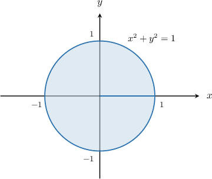
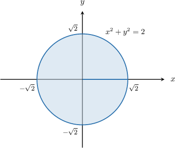
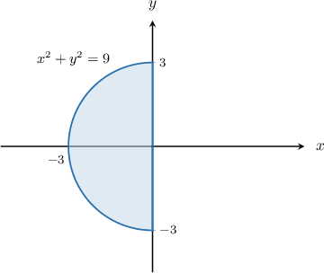
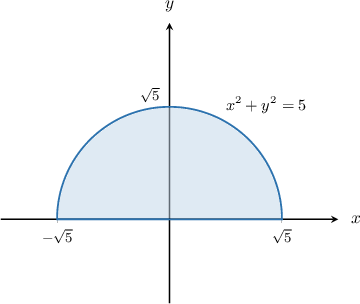
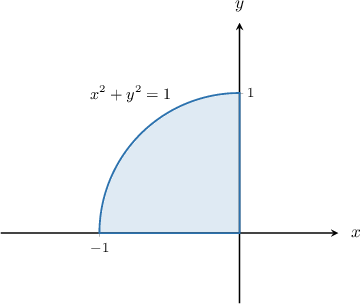

## original raw q-161520

The region $R$ is enclosed inside the cylinder $x^{2} + y^{2} = 25$ for $x \ge 0$ between the surfaces $z = 0$ and $z = 6 + y$.
Express the following triple integral in cylindrical polar coordinates.
$∭_(R)xzdV$

1. $\displaystyle \int_{- π / 2}^{π/2}\displaystyle \int_{0}^{5}\displaystyle \int_{0}^{6 + r cos ⁡ θ}r 2 z cos ⁡ θdzdrdθ$
2. $\displaystyle \int_{- π / 2}^{π/2}\displaystyle \int_{0}^{5}\displaystyle \int_{0}^{6 + r sin ⁡ θ}r 2 z cos ⁡ θdzdrdθ$
3. $\displaystyle \int_{0}^{π/2}\displaystyle \int_{0}^{5}\displaystyle \int_{0}^{6 + r sin ⁡ θ}r 2 z sin ⁡ θdzdrdθ$
4. $\displaystyle \int_{0}^{π/2}\displaystyle \int_{0}^{5}\displaystyle \int_{0}^{6 + r cos ⁡ θ}r z sin ⁡ θdzdrdθ$
5. $\displaystyle \int_{- π / 2}^{π/2}\displaystyle \int_{0}^{5}\displaystyle \int_{0}^{6 + r sin ⁡ θ}r z cos ⁡ θdzdrdθ$

[Original solution absent.]

---

## generated half_xz

The region $R$ is enclosed inside the cylinder $x^2+y^2=10$ for $x\ge 0$, between the surfaces $z=0$ and $z=y + 8$. Express the following triple integral in cylindrical polar coordinates.

$$
\iiint_R x z\,\mathrm{d}V
$$

1. ${\int }_{0}^{\frac{\pi}{2}}{\int }_{0}^{\sqrt{10}}{\int }_{0}^{r \sin{\left(\theta \right)} + 8}r^{2} z \sin{\left(\theta \right)}\,dz\,\text{d}r\,\text{d}\theta $
2. ${\int }_{0}^{\frac{\pi}{2}}{\int }_{0}^{\sqrt{10}}{\int }_{0}^{r \cos{\left(\theta \right)} + 8}r z \sin{\left(\theta \right)}\,dz\,\text{d}r\,\text{d}\theta $
3. ${\int }_{- \frac{\pi}{2}}^{\frac{\pi}{2}}{\int }_{0}^{\sqrt{10}}{\int }_{0}^{r \cos{\left(\theta \right)} + 8}r^{2} z \cos{\left(\theta \right)}\,dz\,\text{d}r\,\text{d}\theta $
4. ${\int }_{- \frac{\pi}{2}}^{\frac{\pi}{2}}{\int }_{0}^{\sqrt{10}}{\int }_{0}^{r \sin{\left(\theta \right)} + 8}r^{2} z \cos{\left(\theta \right)}\,dz\,\text{d}r\,\text{d}\theta $
5. ${\int }_{- \frac{\pi}{2}}^{\frac{\pi}{2}}{\int }_{0}^{\sqrt{10}}{\int }_{0}^{r \sin{\left(\theta \right)} + 8}r z \cos{\left(\theta \right)}\,dz\,\text{d}r\,\text{d}\theta $

We will use the change of variables formula in the form

$$
{∭}_{R}f(x,y,z)\,dV={∭}_{Δ}\,f(r\operatorname{cos}⁡\theta ,r\operatorname{sin}⁡\theta ,z)\,r\,dz\,dr\,d\theta .
$$

If $(r,\theta ,z)$ are the cylindrical polar coordinates of a point, then its Cartesian coordinates $(x,y,z)$ can be found by using the formulas

$$
x=r\operatorname{cos}⁡\theta ,\,y=r\operatorname{sin}⁡\theta ,\,z=z.
$$

First, let's sketch the projection of $R$ onto the $xy$-plane:

The region $R$ is one-half of a right vertical cylinder of radius $\sqrt{10}$ whose axis passes through the point $(0,0)$ in the $xy$-plane, and is

- bounded below by $z=0=0,$ and

- bounded above by $z=y + 8=r \sin{\left(\theta \right)} + 8.$

As a result, in cylindrical polar coordinates, our region can be expressed as

$$
\Delta=\{(r,\theta,z):0\le r\le \sqrt{10},- \frac{\pi}{2}\le\theta\le \frac{\pi}{2},0\le z\le r \sin{\left(\theta \right)} + 8\}.
$$

Therefore, using the change of variables formula, we obtain

$$
\begin{aligned}\iiint_R x z\,\mathrm{d}V&=\iiint_\Delta (r\cos\theta)z\cdot r\,dz\,dr\,d\theta \\ &=\iiint_\Delta r^2z\cos\theta\,dz\,dr\,d\theta \\ &={\int }_{- \frac{\pi}{2}}^{\frac{\pi}{2}}{\int }_{0}^{\sqrt{10}}{\int }_{0}^{r \sin{\left(\theta \right)} + 8}r^{2} z \cos{\left(\theta \right)}\,dz\,\text{d}r\,\text{d}\theta \end{aligned}
$$

---

## generated half_xz

The region $R$ is enclosed inside the cylinder $x^2+y^2=11$ for $x\ge 0$, between the surfaces $z=0$ and $z=y + 4$. Express the following triple integral in cylindrical polar coordinates.

$$
\iiint_R x z\,\mathrm{d}V
$$

1. ${\int }_{0}^{\frac{\pi}{2}}{\int }_{0}^{\sqrt{11}}{\int }_{0}^{r \sin{\left(\theta \right)} + 4}r^{2} z \sin{\left(\theta \right)}\,dz\,\text{d}r\,\text{d}\theta $
2. ${\int }_{0}^{\frac{\pi}{2}}{\int }_{0}^{\sqrt{11}}{\int }_{0}^{r \cos{\left(\theta \right)} + 4}r z \sin{\left(\theta \right)}\,dz\,\text{d}r\,\text{d}\theta $
3. ${\int }_{- \frac{\pi}{2}}^{\frac{\pi}{2}}{\int }_{0}^{\sqrt{11}}{\int }_{0}^{r \cos{\left(\theta \right)} + 4}r^{2} z \cos{\left(\theta \right)}\,dz\,\text{d}r\,\text{d}\theta $
4. ${\int }_{- \frac{\pi}{2}}^{\frac{\pi}{2}}{\int }_{0}^{\sqrt{11}}{\int }_{0}^{r \sin{\left(\theta \right)} + 4}r^{2} z \cos{\left(\theta \right)}\,dz\,\text{d}r\,\text{d}\theta $
5. ${\int }_{- \frac{\pi}{2}}^{\frac{\pi}{2}}{\int }_{0}^{\sqrt{11}}{\int }_{0}^{r \sin{\left(\theta \right)} + 4}r z \cos{\left(\theta \right)}\,dz\,\text{d}r\,\text{d}\theta $

We will use the change of variables formula in the form

$$
{∭}_{R}f(x,y,z)\,dV={∭}_{Δ}\,f(r\operatorname{cos}⁡\theta ,r\operatorname{sin}⁡\theta ,z)\,r\,dz\,dr\,d\theta .
$$

If $(r,\theta ,z)$ are the cylindrical polar coordinates of a point, then its Cartesian coordinates $(x,y,z)$ can be found by using the formulas

$$
x=r\operatorname{cos}⁡\theta ,\,y=r\operatorname{sin}⁡\theta ,\,z=z.
$$

First, let's sketch the projection of $R$ onto the $xy$-plane:

The region $R$ is one-half of a right vertical cylinder of radius $\sqrt{11}$ whose axis passes through the point $(0,0)$ in the $xy$-plane, and is

- bounded below by $z=0=0,$ and

- bounded above by $z=y + 4=r \sin{\left(\theta \right)} + 4.$

As a result, in cylindrical polar coordinates, our region can be expressed as

$$
\Delta=\{(r,\theta,z):0\le r\le \sqrt{11},- \frac{\pi}{2}\le\theta\le \frac{\pi}{2},0\le z\le r \sin{\left(\theta \right)} + 4\}.
$$

Therefore, using the change of variables formula, we obtain

$$
\begin{aligned}\iiint_R x z\,\mathrm{d}V&=\iiint_\Delta (r\cos\theta)z\cdot r\,dz\,dr\,d\theta \\ &=\iiint_\Delta r^2z\cos\theta\,dz\,dr\,d\theta \\ &={\int }_{- \frac{\pi}{2}}^{\frac{\pi}{2}}{\int }_{0}^{\sqrt{11}}{\int }_{0}^{r \sin{\left(\theta \right)} + 4}r^{2} z \cos{\left(\theta \right)}\,dz\,\text{d}r\,\text{d}\theta \end{aligned}
$$

---

## original raw q-39481

The region $R$ is enclosed inside the cylinder ${x}^{2}+{y}^{2}=9$ between the surfaces $z=1$ and $z=10-x.$
Express the following triple integral in cylindrical polar coordinates. 

$$
{∭}_{R}z\sqrt{{x}^{2}+{y}^{2}}\,\text{d}V
$$

1. $\displaystyle \int_{0}^{2π}\displaystyle \int_{0}^{3}\displaystyle \int_{1}^{10 - r cos ⁡ θ}r 2 zdzdrdθ$
2. $\displaystyle \int_{0}^{2π}\displaystyle \int_{0}^{3}\displaystyle \int_{1}^{10}r 2 zdzdrdθ$
3. $\displaystyle \int_{0}^{2π}\displaystyle \int_{0}^{3}\displaystyle \int_{1}^{10 - r cos ⁡ θ}r zdzdrdθ$
4. $\displaystyle \int_{0}^{2π}\displaystyle \int_{0}^{9}\displaystyle \int_{1}^{10}r 2 zdzdrdθ$
5. $\displaystyle \int_{0}^{2π}\displaystyle \int_{0}^{9}\displaystyle \int_{1}^{10 - r sin ⁡ θ}r 2 zdzdrdθ$
1. ${\int }_{0}^{2\pi }{\int }_{0}^{3}{\int }_{1}^{10}{r}^{2}z\,dz\,\text{d}r\,\text{d}\theta $
2. ${\int }_{0}^{2\pi }{\int }_{0}^{3}{\int }_{1}^{10-r\operatorname{cos}⁡\theta }{r}^{2}z\,dz\,\text{d}r\,\text{d}\theta $
3. ${\int }_{0}^{2\pi }{\int }_{0}^{3}{\int }_{1}^{10-r\operatorname{cos}⁡\theta }rz\,dz\,\text{d}r\,\text{d}\theta $
4. ${\int }_{0}^{2\pi }{\int }_{0}^{9}{\int }_{1}^{10-r\operatorname{sin}⁡\theta }{r}^{2}z\,dz\,\text{d}r\,\text{d}\theta $
5. ${\int }_{0}^{2\pi }{\int }_{0}^{9}{\int }_{1}^{10}{r}^{2}z\,dz\,\text{d}r\,\text{d}\theta $

We will use the change of variables formula in the form

$$
{∭}_{R}f(x,y,z)\,dV={∭}_{Δ}\,f(r\operatorname{cos}⁡\theta ,r\operatorname{sin}⁡\theta ,z)\,r\,dz\,dr\,d\theta .
$$

If $(r,\theta ,z)$ are the cylindrical polar coordinates of a point, then its Cartesian coordinates $(x,y,z)$ can be found by using the formulas

$$
x=r\operatorname{cos}⁡\theta ,\,y=r\operatorname{sin}⁡\theta ,\,z=z.
$$

First, let's sketch the projection of $R$ onto the $xy$-plane:

The region $R$ is a right vertical cylinder of radius $3$ whose axis passes through the point $(0,0)$ in the $xy$-plane, and is

- bounded below by $z=1,$ and

- bounded above by $z=10-x=10-r\operatorname{cos}⁡\theta .$

As a result, in cylindrical polar coordinates, our region can be expressed as 

$$
Δ={(r,\theta ,z)\,:\,0\le r\le 3,\,0\le \theta <2\pi ,\,1\le z\le 10-r\operatorname{cos}⁡\theta }.
$$

Therefore, using the change of variables formula, we obtain  

$$
\begin{aligned}{∭}_{R}z\sqrt{{x}^{2}+{y}^{2}}\,\text{d}V & ={∭}_{Δ}z\sqrt{(r\operatorname{cos}⁡\theta )^{2}+(r\operatorname{sin}⁡\theta )^{2}}\,r\,dz\,dr\,d\theta  \\  & ={∭}_{Δ}z\sqrt{{r}^{2}({cos}^{2}⁡\theta +{sin}^{2}⁡\theta )}\,r\,dz\,dr\,d\theta  \\  & ={\int }_{0}^{2\pi }{\int }_{0}^{3}{\int }_{1}^{10-r\operatorname{cos}⁡\theta }{r}^{2}z\,dz\,\text{d}r\,\text{d}\theta .\end{aligned}
$$

---

## generated full_zradial

The region $R$ is enclosed inside the cylinder ${x}^{2}+{y}^{2}=10$ between the surfaces $z=0$ and $z=8-x.$
Express the following triple integral in cylindrical polar coordinates. 

$$
{∭}_{R}z\sqrt{{x}^{2}+{y}^{2}}\,\text{d}V
$$

1. ${\int }_{0}^{2 \pi}{\int }_{0}^{\sqrt{10}}{\int }_{0}^{8}r^{2} z\,dz\,\text{d}r\,\text{d}\theta $
2. ${\int }_{0}^{2 \pi}{\int }_{0}^{10}{\int }_{0}^{8}r^{2} z\,dz\,\text{d}r\,\text{d}\theta $
3. ${\int }_{0}^{2 \pi}{\int }_{0}^{\sqrt{10}}{\int }_{0}^{- r \cos{\left(\theta \right)} + 8}r^{2} z\,dz\,\text{d}r\,\text{d}\theta $
4. ${\int }_{0}^{2 \pi}{\int }_{0}^{10}{\int }_{0}^{- r \sin{\left(\theta \right)} + 8}r^{2} z\,dz\,\text{d}r\,\text{d}\theta $
5. ${\int }_{0}^{2 \pi}{\int }_{0}^{\sqrt{10}}{\int }_{0}^{- r \cos{\left(\theta \right)} + 8}r z\,dz\,\text{d}r\,\text{d}\theta $

We will use the change of variables formula in the form

$$
{∭}_{R}f(x,y,z)\,dV={∭}_{Δ}\,f(r\operatorname{cos}⁡\theta ,r\operatorname{sin}⁡\theta ,z)\,r\,dz\,dr\,d\theta .
$$

If $(r,\theta ,z)$ are the cylindrical polar coordinates of a point, then its Cartesian coordinates $(x,y,z)$ can be found by using the formulas

$$
x=r\operatorname{cos}⁡\theta ,\,y=r\operatorname{sin}⁡\theta ,\,z=z.
$$

First, let's sketch the projection of $R$ onto the $xy$-plane:

The region $R$ is a right vertical cylinder of radius $\sqrt{10}$ whose axis passes through the point $(0,0)$ in the $xy$-plane, and is

- bounded below by $z=0,$ and

- bounded above by $z=8-x=8-r\operatorname{cos}⁡\theta .$

As a result, in cylindrical polar coordinates, our region can be expressed as 

$$
Δ=\{(r,\theta ,z)\,:\,0\le r\le \sqrt{10},\,0\le \theta <2\pi ,\,0\le z\le 8-r\operatorname{cos}⁡\theta \}.
$$

Therefore, using the change of variables formula, we obtain  

$$
\begin{aligned}{∭}_{R}z\sqrt{{x}^{2}+{y}^{2}}\,\text{d}V & ={∭}_{Δ}z\sqrt{(r\operatorname{cos}⁡\theta )^{2}+(r\operatorname{sin}⁡\theta )^{2}}\,r\,dz\,dr\,d\theta  \\  & ={∭}_{Δ}z\sqrt{{r}^{2}({cos}^{2}⁡\theta +{sin}^{2}⁡\theta )}\,r\,dz\,dr\,d\theta  \\  & ={\int }_{0}^{2\pi }{\int }_{0}^{\sqrt{10}}{\int }_{0}^{8-r\operatorname{cos}⁡\theta }{r}^{2}z\,dz\,\text{d}r\,\text{d}\theta .\end{aligned}
$$

---

## generated full_zradial

The region $R$ is enclosed inside the cylinder ${x}^{2}+{y}^{2}=16$ between the surfaces $z=-2$ and $z=3-x.$
Express the following triple integral in cylindrical polar coordinates. 

$$
{∭}_{R}z\sqrt{{x}^{2}+{y}^{2}}\,\text{d}V
$$

1. ${\int }_{0}^{2 \pi}{\int }_{0}^{4}{\int }_{-2}^{- r \cos{\left(\theta \right)} + 3}r^{2} z\,dz\,\text{d}r\,\text{d}\theta $
2. ${\int }_{0}^{2 \pi}{\int }_{0}^{16}{\int }_{-2}^{3}r^{2} z\,dz\,\text{d}r\,\text{d}\theta $
3. ${\int }_{0}^{2 \pi}{\int }_{0}^{4}{\int }_{-2}^{3}r^{2} z\,dz\,\text{d}r\,\text{d}\theta $
4. ${\int }_{0}^{2 \pi}{\int }_{0}^{16}{\int }_{-2}^{- r \sin{\left(\theta \right)} + 3}r^{2} z\,dz\,\text{d}r\,\text{d}\theta $
5. ${\int }_{0}^{2 \pi}{\int }_{0}^{4}{\int }_{-2}^{- r \cos{\left(\theta \right)} + 3}r z\,dz\,\text{d}r\,\text{d}\theta $

We will use the change of variables formula in the form

$$
{∭}_{R}f(x,y,z)\,dV={∭}_{Δ}\,f(r\operatorname{cos}⁡\theta ,r\operatorname{sin}⁡\theta ,z)\,r\,dz\,dr\,d\theta .
$$

If $(r,\theta ,z)$ are the cylindrical polar coordinates of a point, then its Cartesian coordinates $(x,y,z)$ can be found by using the formulas

$$
x=r\operatorname{cos}⁡\theta ,\,y=r\operatorname{sin}⁡\theta ,\,z=z.
$$

First, let's sketch the projection of $R$ onto the $xy$-plane:

The region $R$ is a right vertical cylinder of radius $4$ whose axis passes through the point $(0,0)$ in the $xy$-plane, and is

- bounded below by $z=-2,$ and

- bounded above by $z=3-x=3-r\operatorname{cos}⁡\theta .$

As a result, in cylindrical polar coordinates, our region can be expressed as 

$$
Δ=\{(r,\theta ,z)\,:\,0\le r\le 4,\,0\le \theta <2\pi ,\,-2\le z\le 3-r\operatorname{cos}⁡\theta \}.
$$

Therefore, using the change of variables formula, we obtain  

$$
\begin{aligned}{∭}_{R}z\sqrt{{x}^{2}+{y}^{2}}\,\text{d}V & ={∭}_{Δ}z\sqrt{(r\operatorname{cos}⁡\theta )^{2}+(r\operatorname{sin}⁡\theta )^{2}}\,r\,dz\,dr\,d\theta  \\  & ={∭}_{Δ}z\sqrt{{r}^{2}({cos}^{2}⁡\theta +{sin}^{2}⁡\theta )}\,r\,dz\,dr\,d\theta  \\  & ={\int }_{0}^{2\pi }{\int }_{0}^{4}{\int }_{-2}^{3-r\operatorname{cos}⁡\theta }{r}^{2}z\,dz\,\text{d}r\,\text{d}\theta .\end{aligned}
$$

---

## original raw q-161605

The region $R$ is enclosed inside the cylinder ${x}^{2}+{y}^{2}=1$ between the surfaces $z=0$ and $z=1.$ Express the following triple integral in cylindrical polar coordinates. 

$$
{∭}_{R}{z}^{2}\sqrt{{x}^{2}+{y}^{2}}\,\text{d}V
$$

1. ${\int }_{0}^{2\pi }{\int }_{0}^{1}{\int }_{0}^{1}r{z}^{2}\,dz\,\text{d}r\,\text{d}\theta $
2. ${\int }_{0}^{2\pi }{\int }_{1}^{2}{\int }_{0}^{1}{r}^{2}{z}^{2}\,dz\,\text{d}r\,\text{d}\theta $
3. ${\int }_{0}^{2\pi }{\int }_{1}^{2}{\int }_{0}^{r}r{z}^{2}\,dz\,\text{d}r\,\text{d}\theta $
4. ${\int }_{0}^{2\pi }{\int }_{0}^{1}{\int }_{0}^{1}{r}^{2}{z}^{2}\,dz\,\text{d}r\,\text{d}\theta $
5. ${\int }_{0}^{2\pi }{\int }_{0}^{1}{\int }_{0}^{r}{r}^{2}{z}^{2}\,dz\,\text{d}r\,\text{d}\theta $

We will use the change of variables formula in the form

$$
{∭}_{R}f(x,y,z)\,dV={∭}_{Δ}\,f(r\operatorname{cos}⁡\theta ,r\operatorname{sin}⁡\theta ,z)\,r\,dz\,dr\,d\theta .
$$

If $(r,\theta ,z)$ are the cylindrical polar coordinates of a point, then its Cartesian coordinates $(x,y,z)$ can be found by using the formulas

$$
x=r\operatorname{cos}⁡\theta ,\,y=r\operatorname{sin}⁡\theta ,\,z=z.
$$

First, let's sketch the projection of $R$ onto the $xy$-plane:

The region $R$ is a right vertical cylinder of radius $1$ whose axis passes through the point $(0,0)$ in the $xy$-plane, and is

- bounded below by $z=0,$ and

- bounded above by $z=1.$

As a result, in cylindrical polar coordinates, our region can be expressed as 

$$
Δ={(r,\theta ,z)\,:\,0\le r\le 1,\,0\le \theta <2\pi ,\,0\le z\le 1}.
$$

Therefore, using the change of variables formula, we obtain

$$
\begin{aligned}{∭}_{R}{z}^{2}\sqrt{{x}^{2}+{y}^{2}}\,\text{d}V & ={∭}_{Δ}{z}^{2}\sqrt{(r\operatorname{cos}⁡\theta )^{2}+(r\operatorname{sin}⁡\theta )^{2}}\cdot r\,dz\,dr\,d\theta  \\  & ={∭}_{Δ}r{z}^{2}\sqrt{{r}^{2}({cos}^{2}⁡\theta +{sin}^{2}⁡\theta )}\,dz\,dr\,d\theta  \\  & ={\int }_{0}^{2\pi }{\int }_{0}^{1}{\int }_{0}^{1}{r}^{2}{z}^{2}\,dz\,\text{d}r\,\text{d}\theta .\end{aligned}
$$

---

## generated full_z2radial

The region $R$ is enclosed inside the cylinder ${x}^{2}+{y}^{2}=10$ between the surfaces $z=0$ and $z=8.$ Express the following triple integral in cylindrical polar coordinates. 

$$
{∭}_{R}{z}^{2}\sqrt{{x}^{2}+{y}^{2}}\,\text{d}V
$$

1. ${\int }_{0}^{2 \pi}{\int }_{\sqrt{10}}^{2 \sqrt{10}}{\int }_{0}^{r}r z^{2}\,dz\,\text{d}r\,\text{d}\theta $
2. ${\int }_{0}^{2 \pi}{\int }_{0}^{\sqrt{10}}{\int }_{0}^{8}r^{2} z^{2}\,dz\,\text{d}r\,\text{d}\theta $
3. ${\int }_{0}^{2 \pi}{\int }_{0}^{\sqrt{10}}{\int }_{0}^{8}r z^{2}\,dz\,\text{d}r\,\text{d}\theta $
4. ${\int }_{0}^{2 \pi}{\int }_{\sqrt{10}}^{2 \sqrt{10}}{\int }_{0}^{8}r^{2} z^{2}\,dz\,\text{d}r\,\text{d}\theta $
5. ${\int }_{0}^{2 \pi}{\int }_{0}^{\sqrt{10}}{\int }_{0}^{r}r^{2} z^{2}\,dz\,\text{d}r\,\text{d}\theta $

We will use the change of variables formula in the form

$$
{∭}_{R}f(x,y,z)\,dV={∭}_{Δ}\,f(r\operatorname{cos}⁡\theta ,r\operatorname{sin}⁡\theta ,z)\,r\,dz\,dr\,d\theta .
$$

If $(r,\theta ,z)$ are the cylindrical polar coordinates of a point, then its Cartesian coordinates $(x,y,z)$ can be found by using the formulas

$$
x=r\operatorname{cos}⁡\theta ,\,y=r\operatorname{sin}⁡\theta ,\,z=z.
$$

First, let's sketch the projection of $R$ onto the $xy$-plane:

The region $R$ is a right vertical cylinder of radius $\sqrt{10}$ whose axis passes through the point $(0,0)$ in the $xy$-plane, and is

- bounded below by $z=0,$ and

- bounded above by $z=8.$

As a result, in cylindrical polar coordinates, our region can be expressed as 

$$
Δ=\{(r,\theta ,z)\,:\,0\le r\le \sqrt{10},\,0\le \theta <2\pi ,\,0\le z\le 8\}.
$$

Therefore, using the change of variables formula, we obtain

$$
\begin{aligned}{∭}_{R}{z}^{2}\sqrt{{x}^{2}+{y}^{2}}\,\text{d}V & ={∭}_{Δ}{z}^{2}\sqrt{(r\operatorname{cos}⁡\theta )^{2}+(r\operatorname{sin}⁡\theta )^{2}}\cdot r\,dz\,dr\,d\theta  \\  & ={∭}_{Δ}r{z}^{2}\sqrt{{r}^{2}({cos}^{2}⁡\theta +{sin}^{2}⁡\theta )}\,dz\,dr\,d\theta  \\  & ={\int }_{0}^{2\pi }{\int }_{0}^{\sqrt{10}}{\int }_{0}^{8}{r}^{2}{z}^{2}\,dz\,\text{d}r\,\text{d}\theta .\end{aligned}
$$

---

## generated full_z2radial

The region $R$ is enclosed inside the cylinder ${x}^{2}+{y}^{2}=16$ between the surfaces $z=0$ and $z=3.$ Express the following triple integral in cylindrical polar coordinates. 

$$
{∭}_{R}{z}^{2}\sqrt{{x}^{2}+{y}^{2}}\,\text{d}V
$$

1. ${\int }_{0}^{2 \pi}{\int }_{0}^{4}{\int }_{0}^{3}r z^{2}\,dz\,\text{d}r\,\text{d}\theta $
2. ${\int }_{0}^{2 \pi}{\int }_{4}^{8}{\int }_{0}^{r}r z^{2}\,dz\,\text{d}r\,\text{d}\theta $
3. ${\int }_{0}^{2 \pi}{\int }_{0}^{4}{\int }_{0}^{r}r^{2} z^{2}\,dz\,\text{d}r\,\text{d}\theta $
4. ${\int }_{0}^{2 \pi}{\int }_{0}^{4}{\int }_{0}^{3}r^{2} z^{2}\,dz\,\text{d}r\,\text{d}\theta $
5. ${\int }_{0}^{2 \pi}{\int }_{4}^{8}{\int }_{0}^{3}r^{2} z^{2}\,dz\,\text{d}r\,\text{d}\theta $

We will use the change of variables formula in the form

$$
{∭}_{R}f(x,y,z)\,dV={∭}_{Δ}\,f(r\operatorname{cos}⁡\theta ,r\operatorname{sin}⁡\theta ,z)\,r\,dz\,dr\,d\theta .
$$

If $(r,\theta ,z)$ are the cylindrical polar coordinates of a point, then its Cartesian coordinates $(x,y,z)$ can be found by using the formulas

$$
x=r\operatorname{cos}⁡\theta ,\,y=r\operatorname{sin}⁡\theta ,\,z=z.
$$

First, let's sketch the projection of $R$ onto the $xy$-plane:

The region $R$ is a right vertical cylinder of radius $4$ whose axis passes through the point $(0,0)$ in the $xy$-plane, and is

- bounded below by $z=0,$ and

- bounded above by $z=3.$

As a result, in cylindrical polar coordinates, our region can be expressed as 

$$
Δ=\{(r,\theta ,z)\,:\,0\le r\le 4,\,0\le \theta <2\pi ,\,0\le z\le 3\}.
$$

Therefore, using the change of variables formula, we obtain

$$
\begin{aligned}{∭}_{R}{z}^{2}\sqrt{{x}^{2}+{y}^{2}}\,\text{d}V & ={∭}_{Δ}{z}^{2}\sqrt{(r\operatorname{cos}⁡\theta )^{2}+(r\operatorname{sin}⁡\theta )^{2}}\cdot r\,dz\,dr\,d\theta  \\  & ={∭}_{Δ}r{z}^{2}\sqrt{{r}^{2}({cos}^{2}⁡\theta +{sin}^{2}⁡\theta )}\,dz\,dr\,d\theta  \\  & ={\int }_{0}^{2\pi }{\int }_{0}^{4}{\int }_{0}^{3}{r}^{2}{z}^{2}\,dz\,\text{d}r\,\text{d}\theta .\end{aligned}
$$

---

## original raw q-161607

The region $R$ is enclosed inside the cylinder ${x}^{2}+{y}^{2}=2$ between the surfaces $z=0$ and $z=\sqrt{16-({x}^{2}+{y}^{2})}.$ Express the following triple integral in cylindrical polar coordinates. 

$$
{∭}_{R}\frac{1}{\sqrt{1+z}}\,\text{d}V
$$

1. ${\int }_{0}^{2\pi }{\int }_{0}^{\sqrt{2}}{\int }_{0}^{\sqrt{16-{r}^{2}}}\frac{r}{\sqrt{1+z}}\,dz\,\text{d}r\,\text{d}\theta $
2. ${\int }_{0}^{2\pi }{\int }_{0}^{2}{\int }_{0}^{\sqrt{4-r}}\frac{1}{\sqrt{1+z}}\,dz\,\text{d}r\,\text{d}\theta $
3. ${\int }_{0}^{2\pi }{\int }_{0}^{\sqrt{2}}{\int }_{0}^{\sqrt{4-r}}\frac{r}{\sqrt{1+z}}\,dz\,\text{d}r\,\text{d}\theta $
4. ${\int }_{0}^{2\pi }{\int }_{0}^{2}{\int }_{0}^{\sqrt{16-{r}^{2}}}\frac{r}{\sqrt{1+z}}\,dz\,\text{d}r\,\text{d}\theta $
5. ${\int }_{0}^{2\pi }{\int }_{0}^{\sqrt{2}}{\int }_{0}^{\sqrt{16-{r}^{2}}}\frac{1}{\sqrt{1+z}}\,dz\,\text{d}r\,\text{d}\theta $

We will use the change of variables formula in the form

$$
{∭}_{R}f(x,y,z)\,dV={∭}_{Δ}\,f(r\operatorname{cos}⁡\theta ,r\operatorname{sin}⁡\theta ,z)\,r\,dz\,dr\,d\theta .
$$

If $(r,\theta ,z)$ are the cylindrical polar coordinates of a point, then its Cartesian coordinates $(x,y,z)$ can be found by using the formulas

$$
x=r\operatorname{cos}⁡\theta ,\,y=r\operatorname{sin}⁡\theta ,\,z=z.
$$

First, let's sketch the projection of $R$ onto the $xy$-plane:

The region $R$ is a right vertical cylinder of radius $\sqrt{2}$ whose axis passes through the point $(0,0)$ in the $xy$-plane, and is

- bounded below by $z=0,$ and

- bounded above by $z=\sqrt{16-({x}^{2}+{y}^{2})}=\sqrt{16-{r}^{2}}.$

As a result, in cylindrical polar coordinates, our region can be expressed as 

$$
Δ={(r,\theta ,z)\,:\,0\le r\le \sqrt{2},\,0\le \theta <2\pi ,\,0\le z\le \sqrt{16-{r}^{2}}}.
$$

Therefore, using the change of variables formula, we obtain  

$$
\begin{aligned}{∭}_{R}\frac{1}{\sqrt{z}}\,\text{d}V & ={∭}_{Δ}\frac{1}{\sqrt{1+z}}\cdot r\,dz\,dr\,d\theta  \\  & ={\int }_{0}^{2\pi }{\int }_{0}^{\sqrt{2}}{\int }_{0}^{\sqrt{16-{r}^{2}}}\frac{r}{\sqrt{1+z}}\,dz\,\text{d}r\,\text{d}\theta .\end{aligned}
$$

---

## generated full_sphere_inverse

The region $R$ is enclosed inside the cylinder ${x}^{2}+{y}^{2}=6$ between the surfaces $z=0$ and $z=\sqrt{64-({x}^{2}+{y}^{2})}.$ Express the following triple integral in cylindrical polar coordinates. 

$$
{∭}_{R}\frac{1}{\sqrt{1+z}}\,\text{d}V
$$

1. ${\int }_{0}^{2 \pi}{\int }_{0}^{6}{\int }_{0}^{\sqrt{8 - r}}\frac{1}{\sqrt{z + 1}}\,dz\,\text{d}r\,\text{d}\theta $
2. ${\int }_{0}^{2 \pi}{\int }_{0}^{6}{\int }_{0}^{\sqrt{64 - r^{2}}}\frac{r}{\sqrt{z + 1}}\,dz\,\text{d}r\,\text{d}\theta $
3. ${\int }_{0}^{2 \pi}{\int }_{0}^{\sqrt{6}}{\int }_{0}^{\sqrt{8 - r}}\frac{r}{\sqrt{z + 1}}\,dz\,\text{d}r\,\text{d}\theta $
4. ${\int }_{0}^{2 \pi}{\int }_{0}^{\sqrt{6}}{\int }_{0}^{\sqrt{64 - r^{2}}}\frac{r}{\sqrt{z + 1}}\,dz\,\text{d}r\,\text{d}\theta $
5. ${\int }_{0}^{2 \pi}{\int }_{0}^{\sqrt{6}}{\int }_{0}^{\sqrt{64 - r^{2}}}\frac{1}{\sqrt{z + 1}}\,dz\,\text{d}r\,\text{d}\theta $

We will use the change of variables formula in the form

$$
{∭}_{R}f(x,y,z)\,dV={∭}_{Δ}\,f(r\operatorname{cos}⁡\theta ,r\operatorname{sin}⁡\theta ,z)\,r\,dz\,dr\,d\theta .
$$

If $(r,\theta ,z)$ are the cylindrical polar coordinates of a point, then its Cartesian coordinates $(x,y,z)$ can be found by using the formulas

$$
x=r\operatorname{cos}⁡\theta ,\,y=r\operatorname{sin}⁡\theta ,\,z=z.
$$

First, let's sketch the projection of $R$ onto the $xy$-plane:

The region $R$ is a right vertical cylinder of radius $\sqrt{6}$ whose axis passes through the point $(0,0)$ in the $xy$-plane, and is

- bounded below by $z=0,$ and

- bounded above by $z=\sqrt{64-({x}^{2}+{y}^{2})}=\sqrt{64-{r}^{2}}.$

As a result, in cylindrical polar coordinates, our region can be expressed as 

$$
Δ=\{(r,\theta ,z)\,:\,0\le r\le \sqrt{6},\,0\le \theta <2\pi ,\,0\le z\le \sqrt{64-{r}^{2}}\}.
$$

Therefore, using the change of variables formula, we obtain  

$$
\begin{aligned}{∭}_{R}\frac{1}{\sqrt{1+z}}\,\text{d}V & ={∭}_{Δ}\frac{1}{\sqrt{1+z}}\cdot r\,dz\,dr\,d\theta  \\  & ={\int }_{0}^{2\pi }{\int }_{0}^{\sqrt{6}}{\int }_{0}^{\sqrt{64-{r}^{2}}}\frac{r}{\sqrt{1+z}}\,dz\,\text{d}r\,\text{d}\theta .\end{aligned}
$$

---

## generated full_sphere_inverse

The region $R$ is enclosed inside the cylinder ${x}^{2}+{y}^{2}=8$ between the surfaces $z=0$ and $z=\sqrt{64-({x}^{2}+{y}^{2})}.$ Express the following triple integral in cylindrical polar coordinates. 

$$
{∭}_{R}\frac{1}{\sqrt{1+z}}\,\text{d}V
$$

1. ${\int }_{0}^{2 \pi}{\int }_{0}^{2 \sqrt{2}}{\int }_{0}^{\sqrt{8 - r}}\frac{r}{\sqrt{z + 1}}\,dz\,\text{d}r\,\text{d}\theta $
2. ${\int }_{0}^{2 \pi}{\int }_{0}^{2 \sqrt{2}}{\int }_{0}^{\sqrt{64 - r^{2}}}\frac{1}{\sqrt{z + 1}}\,dz\,\text{d}r\,\text{d}\theta $
3. ${\int }_{0}^{2 \pi}{\int }_{0}^{8}{\int }_{0}^{\sqrt{8 - r}}\frac{1}{\sqrt{z + 1}}\,dz\,\text{d}r\,\text{d}\theta $
4. ${\int }_{0}^{2 \pi}{\int }_{0}^{2 \sqrt{2}}{\int }_{0}^{\sqrt{64 - r^{2}}}\frac{r}{\sqrt{z + 1}}\,dz\,\text{d}r\,\text{d}\theta $
5. ${\int }_{0}^{2 \pi}{\int }_{0}^{8}{\int }_{0}^{\sqrt{64 - r^{2}}}\frac{r}{\sqrt{z + 1}}\,dz\,\text{d}r\,\text{d}\theta $

We will use the change of variables formula in the form

$$
{∭}_{R}f(x,y,z)\,dV={∭}_{Δ}\,f(r\operatorname{cos}⁡\theta ,r\operatorname{sin}⁡\theta ,z)\,r\,dz\,dr\,d\theta .
$$

If $(r,\theta ,z)$ are the cylindrical polar coordinates of a point, then its Cartesian coordinates $(x,y,z)$ can be found by using the formulas

$$
x=r\operatorname{cos}⁡\theta ,\,y=r\operatorname{sin}⁡\theta ,\,z=z.
$$

First, let's sketch the projection of $R$ onto the $xy$-plane:

The region $R$ is a right vertical cylinder of radius $2 \sqrt{2}$ whose axis passes through the point $(0,0)$ in the $xy$-plane, and is

- bounded below by $z=0,$ and

- bounded above by $z=\sqrt{64-({x}^{2}+{y}^{2})}=\sqrt{64-{r}^{2}}.$

As a result, in cylindrical polar coordinates, our region can be expressed as 

$$
Δ=\{(r,\theta ,z)\,:\,0\le r\le 2 \sqrt{2},\,0\le \theta <2\pi ,\,0\le z\le \sqrt{64-{r}^{2}}\}.
$$

Therefore, using the change of variables formula, we obtain  

$$
\begin{aligned}{∭}_{R}\frac{1}{\sqrt{1+z}}\,\text{d}V & ={∭}_{Δ}\frac{1}{\sqrt{1+z}}\cdot r\,dz\,dr\,d\theta  \\  & ={\int }_{0}^{2\pi }{\int }_{0}^{2 \sqrt{2}}{\int }_{0}^{\sqrt{64-{r}^{2}}}\frac{r}{\sqrt{1+z}}\,dz\,\text{d}r\,\text{d}\theta .\end{aligned}
$$

---

## original raw q-161611

The region $R$ is enclosed inside the cylinder ${x}^{2}+{y}^{2}=9$ for $x\le 0,$ between the surfaces $z=x$ and $z={y}^{2}.$ Express the following triple integral in cylindrical polar coordinates. 

$$
{∭}_{R}{x}^{2}-{y}^{2}\,\text{d}V
$$

1. ${\int }_{\pi /2}^{\pi }{\int }_{0}^{3}{\int }_{r\operatorname{cos}⁡\theta }^{{r}^{2}{sin}^{2}⁡\theta }{r}^{3}\operatorname{cos}⁡2\theta \,dz\,\text{d}r\,\text{d}\theta $
2. ${\int }_{\pi /2}^{3\pi /2}{\int }_{0}^{3}{\int }_{r\operatorname{cos}⁡\theta }^{{r}^{2}{sin}^{2}⁡\theta }{r}^{2}\operatorname{cos}⁡2\theta \,dz\,\text{d}r\,\text{d}\theta $
3. ${\int }_{\pi /2}^{\pi }{\int }_{0}^{3}{\int }_{r\operatorname{sin}⁡\theta }^{{r}^{2}{sin}^{2}⁡\theta }{r}^{2}\operatorname{cos}⁡2\theta \,dz\,\text{d}r\,\text{d}\theta $
4. ${\int }_{\pi /2}^{3\pi /2}{\int }_{0}^{3}{\int }_{r\operatorname{sin}⁡\theta }^{{r}^{2}{sin}^{2}⁡\theta }{r}^{3}\operatorname{cos}⁡2\theta \,dz\,\text{d}r\,\text{d}\theta $
5. ${\int }_{\pi /2}^{3\pi /2}{\int }_{0}^{3}{\int }_{r\operatorname{cos}⁡\theta }^{{r}^{2}{sin}^{2}⁡\theta }{r}^{3}\operatorname{cos}⁡2\theta \,dz\,\text{d}r\,\text{d}\theta $

We will use the change of variables formula in the form

$$
{∭}_{R}f(x,y,z)\,dV={∭}_{Δ}\,f(r\operatorname{cos}⁡\theta ,r\operatorname{sin}⁡\theta ,z)\,r\,dz\,dr\,d\theta .
$$

If $(r,\theta ,z)$ are the cylindrical polar coordinates of a point, then its Cartesian coordinates $(x,y,z)$ can be found by using the formulas

$$
x=r\operatorname{cos}⁡\theta ,\,y=r\operatorname{sin}⁡\theta ,\,z=z.
$$

First, let's sketch the projection of $R$ onto the $xy$-plane:

The region $R$ is one-half of a right vertical cylinder of radius $3$ whose axis passes through the point $(0,0)$ in the $xy$-plane, and is

- bounded below by $z=x=r\operatorname{cos}⁡\theta ,$ and

- bounded above by $z={y}^{2}={r}^{2}{sin}^{2}⁡\theta .$

As a result, in cylindrical polar coordinates, our region can be expressed as 

$$
Δ={(r,\theta ,z)\,:\,0\le r\le 3,\,\frac{\pi }{2}\le \theta <\frac{3\pi }{2},\,r\operatorname{cos}⁡\theta \le z\le {r}^{2}{sin}^{2}⁡\theta }.
$$

Therefore, using the change of variables formula, we obtain  

$$
\begin{aligned}{∭}_{R}{x}^{2}-{y}^{2}\,\text{d}V & ={∭}_{Δ}((r\operatorname{cos}⁡\theta )^{2}-(r\operatorname{sin}⁡\theta )^{2})\cdot r\,dz\,dr\,d\theta  \\  & ={∭}_{Δ}r({r}^{2}{cos}^{2}⁡\theta -{r}^{2}{sin}^{2}⁡\theta )\,dz\,dr\,d\theta  \\  & ={∭}_{Δ}{r}^{3}({cos}^{2}⁡\theta -{sin}^{2}⁡\theta )\,dz\,dr\,d\theta  \\  & ={\int }_{\pi /2}^{3\pi /2}{\int }_{0}^{3}{\int }_{r\operatorname{cos}⁡\theta }^{{r}^{2}{sin}^{2}⁡\theta }{r}^{3}\operatorname{cos}⁡2\theta \,dz\,\text{d}r\,\text{d}\theta .\end{aligned}
$$

---

## generated half_difference

The region $R$ is enclosed inside the cylinder ${x}^{2}+{y}^{2}=10$ for $x\le 0,$ between the surfaces $z=x$ and $z={y}^{2}.$ Express the following triple integral in cylindrical polar coordinates. 

$$
{∭}_{R}{x}^{2}-{y}^{2}\,\text{d}V
$$

1. ${\int }_{\frac{\pi}{2}}^{\pi}{\int }_{0}^{\sqrt{10}}{\int }_{r \cos{\left(\theta \right)}}^{r^{2} \sin^{2}{\left(\theta \right)}}r^{3} \cos{\left(2 \theta \right)}\,dz\,\text{d}r\,\text{d}\theta $
2. ${\int }_{\frac{\pi}{2}}^{\frac{3 \pi}{2}}{\int }_{0}^{\sqrt{10}}{\int }_{r \cos{\left(\theta \right)}}^{r^{2} \sin^{2}{\left(\theta \right)}}r^{2} \cos{\left(2 \theta \right)}\,dz\,\text{d}r\,\text{d}\theta $
3. ${\int }_{\frac{\pi}{2}}^{\pi}{\int }_{0}^{\sqrt{10}}{\int }_{r \sin{\left(\theta \right)}}^{r^{2} \sin^{2}{\left(\theta \right)}}r^{2} \cos{\left(2 \theta \right)}\,dz\,\text{d}r\,\text{d}\theta $
4. ${\int }_{\frac{\pi}{2}}^{\frac{3 \pi}{2}}{\int }_{0}^{\sqrt{10}}{\int }_{r \sin{\left(\theta \right)}}^{r^{2} \sin^{2}{\left(\theta \right)}}r^{3} \cos{\left(2 \theta \right)}\,dz\,\text{d}r\,\text{d}\theta $
5. ${\int }_{\frac{\pi}{2}}^{\frac{3 \pi}{2}}{\int }_{0}^{\sqrt{10}}{\int }_{r \cos{\left(\theta \right)}}^{r^{2} \sin^{2}{\left(\theta \right)}}r^{3} \cos{\left(2 \theta \right)}\,dz\,\text{d}r\,\text{d}\theta $

We will use the change of variables formula in the form

$$
{∭}_{R}f(x,y,z)\,dV={∭}_{Δ}\,f(r\operatorname{cos}⁡\theta ,r\operatorname{sin}⁡\theta ,z)\,r\,dz\,dr\,d\theta .
$$

If $(r,\theta ,z)$ are the cylindrical polar coordinates of a point, then its Cartesian coordinates $(x,y,z)$ can be found by using the formulas

$$
x=r\operatorname{cos}⁡\theta ,\,y=r\operatorname{sin}⁡\theta ,\,z=z.
$$

First, let's sketch the projection of $R$ onto the $xy$-plane:

The region $R$ is one-half of a right vertical cylinder of radius $\sqrt{10}$ whose axis passes through the point $(0,0)$ in the $xy$-plane, and is

- bounded below by $z=x=r\operatorname{cos}⁡\theta ,$ and

- bounded above by $z={y}^{2}={r}^{2}{sin}^{2}⁡\theta .$

As a result, in cylindrical polar coordinates, our region can be expressed as 

$$
Δ=\{(r,\theta ,z)\,:\,0\le r\le \sqrt{10},\,\frac{\pi }{2}\le \theta <\frac{3\pi }{2},\,r\operatorname{cos}⁡\theta \le z\le {r}^{2}{sin}^{2}⁡\theta \}.
$$

Therefore, using the change of variables formula, we obtain  

$$
\begin{aligned}{∭}_{R}{x}^{2}-{y}^{2}\,\text{d}V & ={∭}_{Δ}((r\operatorname{cos}⁡\theta )^{2}-(r\operatorname{sin}⁡\theta )^{2})\cdot r\,dz\,dr\,d\theta  \\  & ={∭}_{Δ}r({r}^{2}{cos}^{2}⁡\theta -{r}^{2}{sin}^{2}⁡\theta )\,dz\,dr\,d\theta  \\  & ={∭}_{Δ}{r}^{3}({cos}^{2}⁡\theta -{sin}^{2}⁡\theta )\,dz\,dr\,d\theta  \\  & ={\int }_{\pi /2}^{3\pi /2}{\int }_{0}^{\sqrt{10}}{\int }_{r\operatorname{cos}⁡\theta }^{{r}^{2}{sin}^{2}⁡\theta }{r}^{3}\operatorname{cos}⁡2\theta \,dz\,\text{d}r\,\text{d}\theta .\end{aligned}
$$

---

## generated half_difference

The region $R$ is enclosed inside the cylinder ${x}^{2}+{y}^{2}=16$ for $x\le 0,$ between the surfaces $z=x$ and $z={y}^{2}.$ Express the following triple integral in cylindrical polar coordinates. 

$$
{∭}_{R}{x}^{2}-{y}^{2}\,\text{d}V
$$

1. ${\int }_{\frac{\pi}{2}}^{\pi}{\int }_{0}^{4}{\int }_{r \cos{\left(\theta \right)}}^{r^{2} \sin^{2}{\left(\theta \right)}}r^{3} \cos{\left(2 \theta \right)}\,dz\,\text{d}r\,\text{d}\theta $
2. ${\int }_{\frac{\pi}{2}}^{\frac{3 \pi}{2}}{\int }_{0}^{4}{\int }_{r \cos{\left(\theta \right)}}^{r^{2} \sin^{2}{\left(\theta \right)}}r^{3} \cos{\left(2 \theta \right)}\,dz\,\text{d}r\,\text{d}\theta $
3. ${\int }_{\frac{\pi}{2}}^{\pi}{\int }_{0}^{4}{\int }_{r \sin{\left(\theta \right)}}^{r^{2} \sin^{2}{\left(\theta \right)}}r^{2} \cos{\left(2 \theta \right)}\,dz\,\text{d}r\,\text{d}\theta $
4. ${\int }_{\frac{\pi}{2}}^{\frac{3 \pi}{2}}{\int }_{0}^{4}{\int }_{r \sin{\left(\theta \right)}}^{r^{2} \sin^{2}{\left(\theta \right)}}r^{3} \cos{\left(2 \theta \right)}\,dz\,\text{d}r\,\text{d}\theta $
5. ${\int }_{\frac{\pi}{2}}^{\frac{3 \pi}{2}}{\int }_{0}^{4}{\int }_{r \cos{\left(\theta \right)}}^{r^{2} \sin^{2}{\left(\theta \right)}}r^{2} \cos{\left(2 \theta \right)}\,dz\,\text{d}r\,\text{d}\theta $

We will use the change of variables formula in the form

$$
{∭}_{R}f(x,y,z)\,dV={∭}_{Δ}\,f(r\operatorname{cos}⁡\theta ,r\operatorname{sin}⁡\theta ,z)\,r\,dz\,dr\,d\theta .
$$

If $(r,\theta ,z)$ are the cylindrical polar coordinates of a point, then its Cartesian coordinates $(x,y,z)$ can be found by using the formulas

$$
x=r\operatorname{cos}⁡\theta ,\,y=r\operatorname{sin}⁡\theta ,\,z=z.
$$

First, let's sketch the projection of $R$ onto the $xy$-plane:

The region $R$ is one-half of a right vertical cylinder of radius $4$ whose axis passes through the point $(0,0)$ in the $xy$-plane, and is

- bounded below by $z=x=r\operatorname{cos}⁡\theta ,$ and

- bounded above by $z={y}^{2}={r}^{2}{sin}^{2}⁡\theta .$

As a result, in cylindrical polar coordinates, our region can be expressed as 

$$
Δ=\{(r,\theta ,z)\,:\,0\le r\le 4,\,\frac{\pi }{2}\le \theta <\frac{3\pi }{2},\,r\operatorname{cos}⁡\theta \le z\le {r}^{2}{sin}^{2}⁡\theta \}.
$$

Therefore, using the change of variables formula, we obtain  

$$
\begin{aligned}{∭}_{R}{x}^{2}-{y}^{2}\,\text{d}V & ={∭}_{Δ}((r\operatorname{cos}⁡\theta )^{2}-(r\operatorname{sin}⁡\theta )^{2})\cdot r\,dz\,dr\,d\theta  \\  & ={∭}_{Δ}r({r}^{2}{cos}^{2}⁡\theta -{r}^{2}{sin}^{2}⁡\theta )\,dz\,dr\,d\theta  \\  & ={∭}_{Δ}{r}^{3}({cos}^{2}⁡\theta -{sin}^{2}⁡\theta )\,dz\,dr\,d\theta  \\  & ={\int }_{\pi /2}^{3\pi /2}{\int }_{0}^{4}{\int }_{r\operatorname{cos}⁡\theta }^{{r}^{2}{sin}^{2}⁡\theta }{r}^{3}\operatorname{cos}⁡2\theta \,dz\,\text{d}r\,\text{d}\theta .\end{aligned}
$$

---

## original raw q-161612

The region $R$ is enclosed inside the cylinder ${x}^{2}+{y}^{2}=5$ for $y\ge 0,$ between the surfaces $z=-1$ and $z=y+2.$ Express the following triple integral in cylindrical polar coordinates. 

$$
{∭}_{R}z({x}^{2}-{y}^{2})\,\text{d}V
$$

1. ${\int }_{0}^{\pi /2}{\int }_{0}^{\sqrt{5}}{\int }_{-1}^{r\operatorname{cos}⁡\theta +2}{r}^{2}z\operatorname{cos}⁡2\theta \,dz\,\text{d}r\,\text{d}\theta $
2. ${\int }_{0}^{\pi /2}{\int }_{0}^{\sqrt{5}}{\int }_{-1}^{r\operatorname{sin}⁡\theta +2}{r}^{3}z\operatorname{cos}⁡2\theta \,dz\,\text{d}r\,\text{d}\theta $
3. ${\int }_{0}^{\pi }{\int }_{0}^{\sqrt{5}}{\int }_{-1}^{r\operatorname{cos}⁡\theta +2}{r}^{3}z\operatorname{cos}⁡2\theta \,dz\,\text{d}r\,\text{d}\theta $
4. ${\int }_{0}^{\pi }{\int }_{0}^{\sqrt{5}}{\int }_{-1}^{r\operatorname{sin}⁡\theta +2}{r}^{2}z\operatorname{cos}⁡2\theta \,dz\,\text{d}r\,\text{d}\theta $
5. ${\int }_{0}^{\pi }{\int }_{0}^{\sqrt{5}}{\int }_{-1}^{r\operatorname{sin}⁡\theta +2}{r}^{3}z\operatorname{cos}⁡2\theta \,dz\,\text{d}r\,\text{d}\theta $

We will use the change of variables formula in the form

$$
{∭}_{R}f(x,y,z)\,dV={∭}_{Δ}\,f(r\operatorname{cos}⁡\theta ,r\operatorname{sin}⁡\theta ,z)\,r\,dz\,dr\,d\theta .
$$

If $(r,\theta ,z)$ are the cylindrical polar coordinates of a point, then its Cartesian coordinates $(x,y,z)$ can be found by using the formulas

$$
x=r\operatorname{cos}⁡\theta ,\,y=r\operatorname{sin}⁡\theta ,\,z=z.
$$

First, let's sketch the projection of $R$ onto the $xy$-plane:

The region $R$ is one-half of a right vertical cylinder of radius $\sqrt{5}$ whose axis passes through the point $(0,0)$ in the $xy$-plane, and is

- bounded below by $z=-1,$ and

- bounded above by $z=y+2=r\operatorname{sin}⁡\theta +2.$

As a result, in cylindrical polar coordinates, our region can be expressed as 

$$
Δ={(r,\theta ,z)\,:\,0\le r\le \sqrt{5},\,0\le \theta \le \pi ,\,-1\le z\le r\operatorname{sin}⁡\theta +2}.
$$

Therefore, using the change of variables formula, we obtain  

$$
\begin{aligned}{∭}_{R}z({x}^{2}-{y}^{2})\,\text{d}V & ={∭}_{Δ}z((r\operatorname{cos}⁡\theta )^{2}-(r\operatorname{sin}⁡\theta )^{2})r\,dz\,dr\,d\theta  \\  & ={∭}_{Δ}rz({r}^{2}{cos}^{2}⁡\theta -{r}^{2}{sin}^{2}⁡\theta )r\,dz\,dr\,d\theta  \\  & ={∭}_{Δ}{r}^{3}z({cos}^{2}⁡\theta -{sin}^{2}⁡\theta )dz\,dr\,d\theta  \\  & ={\int }_{0}^{\pi }{\int }_{0}^{\sqrt{5}}{\int }_{-1}^{r\operatorname{sin}⁡\theta +2}{r}^{3}z\operatorname{cos}⁡2\theta \,dz\,\text{d}r\,\text{d}\theta .\end{aligned}
$$

---

## generated half_zdifference

The region $R$ is enclosed inside the cylinder ${x}^{2}+{y}^{2}=10$ for $y\ge 0,$ between the surfaces $z=0$ and $z=y+8.$ Express the following triple integral in cylindrical polar coordinates. 

$$
{∭}_{R}z({x}^{2}-{y}^{2})\,\text{d}V
$$

1. ${\int }_{0}^{\pi}{\int }_{0}^{\sqrt{10}}{\int }_{0}^{r \cos{\left(\theta \right)} + 8}r^{3} z \cos{\left(2 \theta \right)}\,dz\,\text{d}r\,\text{d}\theta $
2. ${\int }_{0}^{\pi}{\int }_{0}^{\sqrt{10}}{\int }_{0}^{r \sin{\left(\theta \right)} + 8}r^{2} z \cos{\left(2 \theta \right)}\,dz\,\text{d}r\,\text{d}\theta $
3. ${\int }_{0}^{\frac{\pi}{2}}{\int }_{0}^{\sqrt{10}}{\int }_{0}^{r \cos{\left(\theta \right)} + 8}r^{2} z \cos{\left(2 \theta \right)}\,dz\,\text{d}r\,\text{d}\theta $
4. ${\int }_{0}^{\pi}{\int }_{0}^{\sqrt{10}}{\int }_{0}^{r \sin{\left(\theta \right)} + 8}r^{3} z \cos{\left(2 \theta \right)}\,dz\,\text{d}r\,\text{d}\theta $
5. ${\int }_{0}^{\frac{\pi}{2}}{\int }_{0}^{\sqrt{10}}{\int }_{0}^{r \sin{\left(\theta \right)} + 8}r^{3} z \cos{\left(2 \theta \right)}\,dz\,\text{d}r\,\text{d}\theta $

We will use the change of variables formula in the form

$$
{∭}_{R}f(x,y,z)\,dV={∭}_{Δ}\,f(r\operatorname{cos}⁡\theta ,r\operatorname{sin}⁡\theta ,z)\,r\,dz\,dr\,d\theta .
$$

If $(r,\theta ,z)$ are the cylindrical polar coordinates of a point, then its Cartesian coordinates $(x,y,z)$ can be found by using the formulas

$$
x=r\operatorname{cos}⁡\theta ,\,y=r\operatorname{sin}⁡\theta ,\,z=z.
$$

First, let's sketch the projection of $R$ onto the $xy$-plane:

The region $R$ is one-half of a right vertical cylinder of radius $\sqrt{10}$ whose axis passes through the point $(0,0)$ in the $xy$-plane, and is

- bounded below by $z=0,$ and

- bounded above by $z=y+8=r\operatorname{sin}⁡\theta +8.$

As a result, in cylindrical polar coordinates, our region can be expressed as 

$$
Δ=\{(r,\theta ,z)\,:\,0\le r\le \sqrt{10},\,0\le \theta \le \pi ,\,0\le z\le r\operatorname{sin}⁡\theta +8\}.
$$

Therefore, using the change of variables formula, we obtain  

$$
\begin{aligned}{∭}_{R}z({x}^{2}-{y}^{2})\,\text{d}V & ={∭}_{Δ}z((r\operatorname{cos}⁡\theta )^{2}-(r\operatorname{sin}⁡\theta )^{2})r\,dz\,dr\,d\theta  \\  & ={∭}_{Δ}rz({r}^{2}{cos}^{2}⁡\theta -{r}^{2}{sin}^{2}⁡\theta )\,dz\,dr\,d\theta  \\  & ={∭}_{Δ}{r}^{3}z({cos}^{2}⁡\theta -{sin}^{2}⁡\theta )dz\,dr\,d\theta  \\  & ={\int }_{0}^{\pi }{\int }_{0}^{\sqrt{10}}{\int }_{0}^{r\operatorname{sin}⁡\theta +8}{r}^{3}z\operatorname{cos}⁡2\theta \,dz\,\text{d}r\,\text{d}\theta .\end{aligned}
$$

---

## generated half_zdifference

The region $R$ is enclosed inside the cylinder ${x}^{2}+{y}^{2}=16$ for $y\ge 0,$ between the surfaces $z=-2$ and $z=y+3.$ Express the following triple integral in cylindrical polar coordinates. 

$$
{∭}_{R}z({x}^{2}-{y}^{2})\,\text{d}V
$$

1. ${\int }_{0}^{\frac{\pi}{2}}{\int }_{0}^{4}{\int }_{-2}^{r \cos{\left(\theta \right)} + 3}r^{2} z \cos{\left(2 \theta \right)}\,dz\,\text{d}r\,\text{d}\theta $
2. ${\int }_{0}^{\pi}{\int }_{0}^{4}{\int }_{-2}^{r \sin{\left(\theta \right)} + 3}r^{2} z \cos{\left(2 \theta \right)}\,dz\,\text{d}r\,\text{d}\theta $
3. ${\int }_{0}^{\pi}{\int }_{0}^{4}{\int }_{-2}^{r \cos{\left(\theta \right)} + 3}r^{3} z \cos{\left(2 \theta \right)}\,dz\,\text{d}r\,\text{d}\theta $
4. ${\int }_{0}^{\pi}{\int }_{0}^{4}{\int }_{-2}^{r \sin{\left(\theta \right)} + 3}r^{3} z \cos{\left(2 \theta \right)}\,dz\,\text{d}r\,\text{d}\theta $
5. ${\int }_{0}^{\frac{\pi}{2}}{\int }_{0}^{4}{\int }_{-2}^{r \sin{\left(\theta \right)} + 3}r^{3} z \cos{\left(2 \theta \right)}\,dz\,\text{d}r\,\text{d}\theta $

We will use the change of variables formula in the form

$$
{∭}_{R}f(x,y,z)\,dV={∭}_{Δ}\,f(r\operatorname{cos}⁡\theta ,r\operatorname{sin}⁡\theta ,z)\,r\,dz\,dr\,d\theta .
$$

If $(r,\theta ,z)$ are the cylindrical polar coordinates of a point, then its Cartesian coordinates $(x,y,z)$ can be found by using the formulas

$$
x=r\operatorname{cos}⁡\theta ,\,y=r\operatorname{sin}⁡\theta ,\,z=z.
$$

First, let's sketch the projection of $R$ onto the $xy$-plane:

The region $R$ is one-half of a right vertical cylinder of radius $4$ whose axis passes through the point $(0,0)$ in the $xy$-plane, and is

- bounded below by $z=-2,$ and

- bounded above by $z=y+3=r\operatorname{sin}⁡\theta +3.$

As a result, in cylindrical polar coordinates, our region can be expressed as 

$$
Δ=\{(r,\theta ,z)\,:\,0\le r\le 4,\,0\le \theta \le \pi ,\,-2\le z\le r\operatorname{sin}⁡\theta +3\}.
$$

Therefore, using the change of variables formula, we obtain  

$$
\begin{aligned}{∭}_{R}z({x}^{2}-{y}^{2})\,\text{d}V & ={∭}_{Δ}z((r\operatorname{cos}⁡\theta )^{2}-(r\operatorname{sin}⁡\theta )^{2})r\,dz\,dr\,d\theta  \\  & ={∭}_{Δ}rz({r}^{2}{cos}^{2}⁡\theta -{r}^{2}{sin}^{2}⁡\theta )\,dz\,dr\,d\theta  \\  & ={∭}_{Δ}{r}^{3}z({cos}^{2}⁡\theta -{sin}^{2}⁡\theta )dz\,dr\,d\theta  \\  & ={\int }_{0}^{\pi }{\int }_{0}^{4}{\int }_{-2}^{r\operatorname{sin}⁡\theta +3}{r}^{3}z\operatorname{cos}⁡2\theta \,dz\,\text{d}r\,\text{d}\theta .\end{aligned}
$$

---

## original raw q-161613

The region $R$ is enclosed inside the cylinder ${x}^{2}+{y}^{2}=1$ for $x\le 0$ and $y\ge 0,$ between the surfaces $z=0$ and $z=\sqrt{4-({x}^{2}+{y}^{2})}.$ Express the following triple integral in cylindrical polar coordinates. 

$$
{∭}_{R}\text{d}V
$$

1. ${\int }_{\pi /2}^{\pi }{\int }_{0}^{1}{\int }_{0}^{\sqrt{4-{r}^{2}}}{r}^{2}\,dz\,\text{d}r\,\text{d}\theta $
2. ${\int }_{\pi /2}^{\pi }{\int }_{0}^{1}{\int }_{0}^{\sqrt{4-r}}r\,dz\,\text{d}r\,\text{d}\theta $
3. ${\int }_{\pi /2}^{\pi }{\int }_{0}^{1}{\int }_{0}^{\sqrt{4-{r}^{2}}}r\,dz\,\text{d}r\,\text{d}\theta $
4. ${\int }_{0}^{\pi }{\int }_{0}^{1}{\int }_{0}^{\sqrt{4-{r}^{2}}}r\,dz\,\text{d}r\,\text{d}\theta $
5. ${\int }_{0}^{\pi }{\int }_{0}^{1}{\int }_{0}^{\sqrt{4-r}}{r}^{2}\,dz\,\text{d}r\,\text{d}\theta $

We will use the change of variables formula in the form

$$
{∭}_{R}f(x,y,z)\,dV={∭}_{Δ}\,f(r\operatorname{cos}⁡\theta ,r\operatorname{sin}⁡\theta ,z)\,r\,dz\,dr\,d\theta .
$$

If $(r,\theta ,z)$ are the cylindrical polar coordinates of a point, then its Cartesian coordinates $(x,y,z)$ can be found by using the formulas

$$
x=r\operatorname{cos}⁡\theta ,\,y=r\operatorname{sin}⁡\theta ,\,z=z.
$$

First, let's sketch the projection of $R$ onto the $xy$-plane:

The region $R$ is one-quarter of a right vertical cylinder of radius $1$ whose axis passes through the point $(0,0)$ in the $xy$-plane, and is

- bounded below by $z=0,$ and

- bounded above by $z=\sqrt{4-({x}^{2}+{y}^{2})}=\sqrt{4-{r}^{2}}.$

As a result, in cylindrical polar coordinates, our region can be expressed as 

$$
Δ=\{(r,\theta ,z)\,:\,0\le r\le 1,\,\frac{\pi }{2}\le \theta \le \pi ,\,0\le z\le \sqrt{4-{r}^{2}}\}.
$$

Therefore, using the change of variables formula, we obtain  

$$
\begin{aligned}{∭}_{R}\text{d}V & ={\int }_{\pi /2}^{\pi }{\int }_{0}^{1}{\int }_{0}^{\sqrt{4-{r}^{2}}}r\,dz\,\text{d}r\,\text{d}\theta .\end{aligned}
$$

---

## generated quarter_sphere_volume

The region $R$ is enclosed inside the cylinder ${x}^{2}+{y}^{2}=10$ for $x\le 0$ and $y\ge 0,$ between the surfaces $z=0$ and $z=\sqrt{49-({x}^{2}+{y}^{2})}.$ Express the following triple integral in cylindrical polar coordinates. 

$$
{∭}_{R}\text{d}V
$$

1. ${\int }_{\frac{\pi}{2}}^{\pi}{\int }_{0}^{\sqrt{10}}{\int }_{0}^{\sqrt{49 - r^{2}}}r\,dz\,\text{d}r\,\text{d}\theta $
2. ${\int }_{0}^{\pi}{\int }_{0}^{\sqrt{10}}{\int }_{0}^{\sqrt{49 - r^{2}}}r\,dz\,\text{d}r\,\text{d}\theta $
3. ${\int }_{\frac{\pi}{2}}^{\pi}{\int }_{0}^{\sqrt{10}}{\int }_{0}^{\sqrt{49 - r^{2}}}r^{2}\,dz\,\text{d}r\,\text{d}\theta $
4. ${\int }_{\frac{\pi}{2}}^{\pi}{\int }_{0}^{\sqrt{10}}{\int }_{0}^{\sqrt{49 - r}}r\,dz\,\text{d}r\,\text{d}\theta $
5. ${\int }_{0}^{\pi}{\int }_{0}^{\sqrt{10}}{\int }_{0}^{\sqrt{49 - r}}r^{2}\,dz\,\text{d}r\,\text{d}\theta $

We will use the change of variables formula in the form

$$
{∭}_{R}f(x,y,z)\,dV={∭}_{Δ}\,f(r\operatorname{cos}⁡\theta ,r\operatorname{sin}⁡\theta ,z)\,r\,dz\,dr\,d\theta .
$$

If $(r,\theta ,z)$ are the cylindrical polar coordinates of a point, then its Cartesian coordinates $(x,y,z)$ can be found by using the formulas

$$
x=r\operatorname{cos}⁡\theta ,\,y=r\operatorname{sin}⁡\theta ,\,z=z.
$$

First, let's sketch the projection of $R$ onto the $xy$-plane:

The region $R$ is one-quarter of a right vertical cylinder of radius $\sqrt{10}$ whose axis passes through the point $(0,0)$ in the $xy$-plane, and is

- bounded below by $z=0,$ and

- bounded above by $z=\sqrt{49-({x}^{2}+{y}^{2})}=\sqrt{49-{r}^{2}}.$

As a result, in cylindrical polar coordinates, our region can be expressed as 

$$
Δ=\{(r,\theta ,z)\,:\,0\le r\le \sqrt{10},\,\frac{\pi }{2}\le \theta \le \pi ,\,0\le z\le \sqrt{49-{r}^{2}}\}.
$$

Therefore, using the change of variables formula, we obtain  

$$
\begin{aligned}{∭}_{R}\text{d}V & ={\int }_{\pi /2}^{\pi }{\int }_{0}^{\sqrt{10}}{\int }_{0}^{\sqrt{49-{r}^{2}}}r\,dz\,\text{d}r\,\text{d}\theta .\end{aligned}
$$

---

## generated quarter_sphere_volume

The region $R$ is enclosed inside the cylinder ${x}^{2}+{y}^{2}=16$ for $x\le 0$ and $y\ge 0,$ between the surfaces $z=0$ and $z=\sqrt{36-({x}^{2}+{y}^{2})}.$ Express the following triple integral in cylindrical polar coordinates. 

$$
{∭}_{R}\text{d}V
$$

1. ${\int }_{\frac{\pi}{2}}^{\pi}{\int }_{0}^{4}{\int }_{0}^{\sqrt{36 - r^{2}}}r^{2}\,dz\,\text{d}r\,\text{d}\theta $
2. ${\int }_{\frac{\pi}{2}}^{\pi}{\int }_{0}^{4}{\int }_{0}^{\sqrt{36 - r^{2}}}r\,dz\,\text{d}r\,\text{d}\theta $
3. ${\int }_{0}^{\pi}{\int }_{0}^{4}{\int }_{0}^{\sqrt{36 - r}}r^{2}\,dz\,\text{d}r\,\text{d}\theta $
4. ${\int }_{0}^{\pi}{\int }_{0}^{4}{\int }_{0}^{\sqrt{36 - r^{2}}}r\,dz\,\text{d}r\,\text{d}\theta $
5. ${\int }_{\frac{\pi}{2}}^{\pi}{\int }_{0}^{4}{\int }_{0}^{\sqrt{36 - r}}r\,dz\,\text{d}r\,\text{d}\theta $

We will use the change of variables formula in the form

$$
{∭}_{R}f(x,y,z)\,dV={∭}_{Δ}\,f(r\operatorname{cos}⁡\theta ,r\operatorname{sin}⁡\theta ,z)\,r\,dz\,dr\,d\theta .
$$

If $(r,\theta ,z)$ are the cylindrical polar coordinates of a point, then its Cartesian coordinates $(x,y,z)$ can be found by using the formulas

$$
x=r\operatorname{cos}⁡\theta ,\,y=r\operatorname{sin}⁡\theta ,\,z=z.
$$

First, let's sketch the projection of $R$ onto the $xy$-plane:

The region $R$ is one-quarter of a right vertical cylinder of radius $4$ whose axis passes through the point $(0,0)$ in the $xy$-plane, and is

- bounded below by $z=0,$ and

- bounded above by $z=\sqrt{36-({x}^{2}+{y}^{2})}=\sqrt{36-{r}^{2}}.$

As a result, in cylindrical polar coordinates, our region can be expressed as 

$$
Δ=\{(r,\theta ,z)\,:\,0\le r\le 4,\,\frac{\pi }{2}\le \theta \le \pi ,\,0\le z\le \sqrt{36-{r}^{2}}\}.
$$

Therefore, using the change of variables formula, we obtain  

$$
\begin{aligned}{∭}_{R}\text{d}V & ={\int }_{\pi /2}^{\pi }{\int }_{0}^{4}{\int }_{0}^{\sqrt{36-{r}^{2}}}r\,dz\,\text{d}r\,\text{d}\theta .\end{aligned}
$$

---

## original raw q-161604

The region $R$ is enclosed inside the cylinder ${x}^{2}+{y}^{2}=9$ between the surfaces $z=\sqrt{{x}^{2}+{y}^{2}}$ and $z=3.$ Express the following triple integral in cylindrical polar coordinates. 

$$
{∭}_{R}\sqrt{{x}^{2}+{y}^{2}}\,\text{d}V
$$

1. ${\int }_{0}^{2\pi }{\int }_{0}^{9}{\int }_{{r}^{2}}^{3}{r}^{3}\,dz\,\text{d}r\,\text{d}\theta $
2. ${\int }_{0}^{2\pi }{\int }_{0}^{3}{\int }_{r}^{3}{r}^{2}\,dz\,\text{d}r\,\text{d}\theta $
3. ${\int }_{0}^{2\pi }{\int }_{0}^{3}{\int }_{r}^{3}r\,dz\,\text{d}r\,\text{d}\theta $
4. ${\int }_{0}^{2\pi }{\int }_{0}^{9}{\int }_{r}^{3}r\,dz\,\text{d}r\,\text{d}\theta $
5. ${\int }_{0}^{2\pi }{\int }_{0}^{3}{\int }_{{r}^{2}}^{3}{r}^{2}\,dz\,\text{d}r\,\text{d}\theta $

We will use the change of variables formula in the form

$$
{∭}_{R}f(x,y,z)\,dV={∭}_{Δ}\,f(r\operatorname{cos}⁡\theta ,r\operatorname{sin}⁡\theta ,z)\,r\,dz\,dr\,d\theta .
$$

If $(r,\theta ,z)$ are the cylindrical polar coordinates of a point, then its Cartesian coordinates $(x,y,z)$ can be found by using the formulas

$$
x=r\operatorname{cos}⁡\theta ,\,y=r\operatorname{sin}⁡\theta ,\,z=z.
$$

First, let's sketch the projection of $R$ onto the $xy$-plane:

The region $R$ is a right vertical cylinder of radius $3$ whose axis passes through the point $(0,0)$ in the $xy$-plane, and is

- bounded below by $z=\sqrt{{x}^{2}+{y}^{2}}=r,$ and

- bounded above by $z=3.$

As a result, in cylindrical polar coordinates, our region can be expressed as 

$$
Δ=\{(r,\theta ,z)\,:\,0\le r\le 3,\,0\le \theta <2\pi ,\,r\le z\le 3\}.
$$

Therefore, using the change of variables formula, we obtain  

$$
\begin{aligned}{∭}_{R}\sqrt{{x}^{2}+{y}^{2}}\,\text{d}V & ={∭}_{Δ}\sqrt{(r\operatorname{cos}⁡\theta )^{2}+(r\operatorname{sin}⁡\theta )^{2}}\cdot r\,dz\,dr\,d\theta  \\  & ={∭}_{Δ}r\sqrt{{r}^{2}({cos}^{2}⁡\theta +{sin}^{2}⁡\theta )}\,dz\,dr\,d\theta  \\  & ={\int }_{0}^{2\pi }{\int }_{0}^{3}{\int }_{r}^{3}{r}^{2}\,dz\,\text{d}r\,\text{d}\theta .\end{aligned}
$$

---

## generated full_cone_radial

The region $R$ is enclosed inside the cylinder ${x}^{2}+{y}^{2}=10$ between the surfaces $z=\sqrt{{x}^{2}+{y}^{2}}$ and $z=8.$ Express the following triple integral in cylindrical polar coordinates. 

$$
{∭}_{R}\sqrt{{x}^{2}+{y}^{2}}\,\text{d}V
$$

1. ${\int }_{0}^{2 \pi}{\int }_{0}^{\sqrt{10}}{\int }_{r}^{8}r\,dz\,\text{d}r\,\text{d}\theta $
2. ${\int }_{0}^{2 \pi}{\int }_{0}^{10}{\int }_{r}^{8}r\,dz\,\text{d}r\,\text{d}\theta $
3. ${\int }_{0}^{2 \pi}{\int }_{0}^{10}{\int }_{r^{2}}^{8}r^{3}\,dz\,\text{d}r\,\text{d}\theta $
4. ${\int }_{0}^{2 \pi}{\int }_{0}^{\sqrt{10}}{\int }_{r}^{8}r^{2}\,dz\,\text{d}r\,\text{d}\theta $
5. ${\int }_{0}^{2 \pi}{\int }_{0}^{\sqrt{10}}{\int }_{r^{2}}^{8}r^{2}\,dz\,\text{d}r\,\text{d}\theta $

We will use the change of variables formula in the form

$$
{∭}_{R}f(x,y,z)\,dV={∭}_{Δ}\,f(r\operatorname{cos}⁡\theta ,r\operatorname{sin}⁡\theta ,z)\,r\,dz\,dr\,d\theta .
$$

If $(r,\theta ,z)$ are the cylindrical polar coordinates of a point, then its Cartesian coordinates $(x,y,z)$ can be found by using the formulas

$$
x=r\operatorname{cos}⁡\theta ,\,y=r\operatorname{sin}⁡\theta ,\,z=z.
$$

First, let's sketch the projection of $R$ onto the $xy$-plane:

The region $R$ is a right vertical cylinder of radius $\sqrt{10}$ whose axis passes through the point $(0,0)$ in the $xy$-plane, and is

- bounded below by $z=\sqrt{{x}^{2}+{y}^{2}}=r,$ and

- bounded above by $z=8.$

As a result, in cylindrical polar coordinates, our region can be expressed as 

$$
Δ=\{(r,\theta ,z)\,:\,0\le r\le \sqrt{10},\,0\le \theta <2\pi ,\,r\le z\le 8\}.
$$

Therefore, using the change of variables formula, we obtain  

$$
\begin{aligned}{∭}_{R}\sqrt{{x}^{2}+{y}^{2}}\,\text{d}V & ={∭}_{Δ}\sqrt{(r\operatorname{cos}⁡\theta )^{2}+(r\operatorname{sin}⁡\theta )^{2}}\cdot r\,dz\,dr\,d\theta  \\  & ={∭}_{Δ}r\sqrt{{r}^{2}({cos}^{2}⁡\theta +{sin}^{2}⁡\theta )}\,dz\,dr\,d\theta  \\  & ={\int }_{0}^{2\pi }{\int }_{0}^{\sqrt{10}}{\int }_{r}^{8}{r}^{2}\,dz\,\text{d}r\,\text{d}\theta .\end{aligned}
$$

---

## generated full_cone_radial

The region $R$ is enclosed inside the cylinder ${x}^{2}+{y}^{2}=11$ between the surfaces $z=\sqrt{{x}^{2}+{y}^{2}}$ and $z=4.$ Express the following triple integral in cylindrical polar coordinates. 

$$
{∭}_{R}\sqrt{{x}^{2}+{y}^{2}}\,\text{d}V
$$

1. ${\int }_{0}^{2 \pi}{\int }_{0}^{\sqrt{11}}{\int }_{r}^{4}r\,dz\,\text{d}r\,\text{d}\theta $
2. ${\int }_{0}^{2 \pi}{\int }_{0}^{11}{\int }_{r}^{4}r\,dz\,\text{d}r\,\text{d}\theta $
3. ${\int }_{0}^{2 \pi}{\int }_{0}^{11}{\int }_{r^{2}}^{4}r^{3}\,dz\,\text{d}r\,\text{d}\theta $
4. ${\int }_{0}^{2 \pi}{\int }_{0}^{\sqrt{11}}{\int }_{r}^{4}r^{2}\,dz\,\text{d}r\,\text{d}\theta $
5. ${\int }_{0}^{2 \pi}{\int }_{0}^{\sqrt{11}}{\int }_{r^{2}}^{4}r^{2}\,dz\,\text{d}r\,\text{d}\theta $

We will use the change of variables formula in the form

$$
{∭}_{R}f(x,y,z)\,dV={∭}_{Δ}\,f(r\operatorname{cos}⁡\theta ,r\operatorname{sin}⁡\theta ,z)\,r\,dz\,dr\,d\theta .
$$

If $(r,\theta ,z)$ are the cylindrical polar coordinates of a point, then its Cartesian coordinates $(x,y,z)$ can be found by using the formulas

$$
x=r\operatorname{cos}⁡\theta ,\,y=r\operatorname{sin}⁡\theta ,\,z=z.
$$

First, let's sketch the projection of $R$ onto the $xy$-plane:

The region $R$ is a right vertical cylinder of radius $\sqrt{11}$ whose axis passes through the point $(0,0)$ in the $xy$-plane, and is

- bounded below by $z=\sqrt{{x}^{2}+{y}^{2}}=r,$ and

- bounded above by $z=4.$

As a result, in cylindrical polar coordinates, our region can be expressed as 

$$
Δ=\{(r,\theta ,z)\,:\,0\le r\le \sqrt{11},\,0\le \theta <2\pi ,\,r\le z\le 4\}.
$$

Therefore, using the change of variables formula, we obtain  

$$
\begin{aligned}{∭}_{R}\sqrt{{x}^{2}+{y}^{2}}\,\text{d}V & ={∭}_{Δ}\sqrt{(r\operatorname{cos}⁡\theta )^{2}+(r\operatorname{sin}⁡\theta )^{2}}\cdot r\,dz\,dr\,d\theta  \\  & ={∭}_{Δ}r\sqrt{{r}^{2}({cos}^{2}⁡\theta +{sin}^{2}⁡\theta )}\,dz\,dr\,d\theta  \\  & ={\int }_{0}^{2\pi }{\int }_{0}^{\sqrt{11}}{\int }_{r}^{4}{r}^{2}\,dz\,\text{d}r\,\text{d}\theta .\end{aligned}
$$

---

## generated quarter_zdifference

The region $R$ is enclosed inside the cylinder $x^2+y^2=10$ for $x\le 0$ and $y\ge 0$, between the surfaces $z=x$ and $z=y^{2} + 8$. Express the following triple integral in cylindrical polar coordinates.

$$
\iiint_R z \left(x^{2} - y^{2}\right)\,\mathrm{d}V
$$

1. ${\int }_{\frac{\pi}{2}}^{\pi}{\int }_{0}^{\sqrt{10}}{\int }_{r \cos{\left(\theta \right)}}^{r^{2} \sin^{2}{\left(\theta \right)} + 8}r^{3} z \cos{\left(2 \theta \right)}\,dz\,\text{d}r\,\text{d}\theta $
2. ${\int }_{\frac{\pi}{2}}^{\pi}{\int }_{0}^{10}{\int }_{r \cos{\left(\theta \right)}}^{r^{2} \sin^{2}{\left(\theta \right)} + 8}r^{2} z \cos{\left(2 \theta \right)}\,dz\,\text{d}r\,\text{d}\theta $
3. ${\int }_{\frac{\pi}{2}}^{\pi}{\int }_{0}^{\sqrt{10}}{\int }_{r \cos{\left(\theta \right)}}^{r^{2} \sin^{2}{\left(\theta \right)} + 8}r^{4} z \cos{\left(2 \theta \right)}\,dz\,\text{d}r\,\text{d}\theta $
4. ${\int }_{\frac{\pi}{2}}^{\pi}{\int }_{0}^{\sqrt{10}}{\int }_{r \cos{\left(\theta \right)}}^{r^{2} \sin^{2}{\left(\theta \right)} + 8}r^{2} z \cos{\left(2 \theta \right)}\,dz\,\text{d}r\,\text{d}\theta $
5. ${\int }_{\frac{\pi}{2}}^{\pi}{\int }_{0}^{10}{\int }_{r \cos{\left(\theta \right)}}^{r^{2} \sin^{2}{\left(\theta \right)} + 8}r^{3} z \cos{\left(2 \theta \right)}\,dz\,\text{d}r\,\text{d}\theta $

We will use the change of variables formula in the form

$$
{∭}_{R}f(x,y,z)\,dV={∭}_{Δ}\,f(r\operatorname{cos}⁡\theta ,r\operatorname{sin}⁡\theta ,z)\,r\,dz\,dr\,d\theta .
$$

If $(r,\theta ,z)$ are the cylindrical polar coordinates of a point, then its Cartesian coordinates $(x,y,z)$ can be found by using the formulas

$$
x=r\operatorname{cos}⁡\theta ,\,y=r\operatorname{sin}⁡\theta ,\,z=z.
$$

First, let's sketch the projection of $R$ onto the $xy$-plane:

The region $R$ is one-quarter of a right vertical cylinder of radius $\sqrt{10}$ whose axis passes through the point $(0,0)$ in the $xy$-plane, and is

- bounded below by $z=x=r \cos{\left(\theta \right)},$ and

- bounded above by $z=y^{2} + 8=r^{2} \sin^{2}{\left(\theta \right)} + 8.$

As a result, in cylindrical polar coordinates, our region can be expressed as

$$
\Delta=\{(r,\theta,z):0\le r\le \sqrt{10},\frac{\pi}{2}\le\theta\le \pi,r \cos{\left(\theta \right)}\le z\le r^{2} \sin^{2}{\left(\theta \right)} + 8\}.
$$

Therefore, using the change of variables formula, we obtain

$$
\begin{aligned}\iiint_R z \left(x^{2} - y^{2}\right)\,\mathrm{d}V&=\iiint_\Delta z((r\cos\theta)^2-(r\sin\theta)^2)\cdot r\,dz\,dr\,d\theta \\ &=\iiint_\Delta rz(r^2\cos^2\theta-r^2\sin^2\theta)\,dz\,dr\,d\theta \\ &=\iiint_\Delta r^3z(\cos^2\theta-\sin^2\theta)\,dz\,dr\,d\theta \\ &=\iiint_\Delta r^3z\cos(2\theta)\,dz\,dr\,d\theta \\ &={\int }_{\frac{\pi}{2}}^{\pi}{\int }_{0}^{\sqrt{10}}{\int }_{r \cos{\left(\theta \right)}}^{r^{2} \sin^{2}{\left(\theta \right)} + 8}r^{3} z \cos{\left(2 \theta \right)}\,dz\,\text{d}r\,\text{d}\theta \end{aligned}
$$

---

## generated quarter_zdifference

The region $R$ is enclosed inside the cylinder $x^2+y^2=16$ for $x\le 0$ and $y\ge 0$, between the surfaces $z=x$ and $z=y^{2} + 3$. Express the following triple integral in cylindrical polar coordinates.

$$
\iiint_R z \left(x^{2} - y^{2}\right)\,\mathrm{d}V
$$

1. ${\int }_{\frac{\pi}{2}}^{\pi}{\int }_{0}^{4}{\int }_{r \cos{\left(\theta \right)}}^{r^{2} \sin^{2}{\left(\theta \right)} + 3}r^{4} z \cos{\left(2 \theta \right)}\,dz\,\text{d}r\,\text{d}\theta $
2. ${\int }_{\frac{\pi}{2}}^{\pi}{\int }_{0}^{4}{\int }_{r \cos{\left(\theta \right)}}^{r^{2} \sin^{2}{\left(\theta \right)} + 3}r^{3} z \cos{\left(2 \theta \right)}\,dz\,\text{d}r\,\text{d}\theta $
3. ${\int }_{\frac{\pi}{2}}^{\pi}{\int }_{0}^{16}{\int }_{r \cos{\left(\theta \right)}}^{r^{2} \sin^{2}{\left(\theta \right)} + 3}r^{3} z \cos{\left(2 \theta \right)}\,dz\,\text{d}r\,\text{d}\theta $
4. ${\int }_{\frac{\pi}{2}}^{\pi}{\int }_{0}^{16}{\int }_{r \cos{\left(\theta \right)}}^{r^{2} \sin^{2}{\left(\theta \right)} + 3}r^{2} z \cos{\left(2 \theta \right)}\,dz\,\text{d}r\,\text{d}\theta $
5. ${\int }_{\frac{\pi}{2}}^{\pi}{\int }_{0}^{4}{\int }_{r \cos{\left(\theta \right)}}^{r^{2} \sin^{2}{\left(\theta \right)} + 3}r^{2} z \cos{\left(2 \theta \right)}\,dz\,\text{d}r\,\text{d}\theta $

We will use the change of variables formula in the form

$$
{∭}_{R}f(x,y,z)\,dV={∭}_{Δ}\,f(r\operatorname{cos}⁡\theta ,r\operatorname{sin}⁡\theta ,z)\,r\,dz\,dr\,d\theta .
$$

If $(r,\theta ,z)$ are the cylindrical polar coordinates of a point, then its Cartesian coordinates $(x,y,z)$ can be found by using the formulas

$$
x=r\operatorname{cos}⁡\theta ,\,y=r\operatorname{sin}⁡\theta ,\,z=z.
$$

First, let's sketch the projection of $R$ onto the $xy$-plane:

The region $R$ is one-quarter of a right vertical cylinder of radius $4$ whose axis passes through the point $(0,0)$ in the $xy$-plane, and is

- bounded below by $z=x=r \cos{\left(\theta \right)},$ and

- bounded above by $z=y^{2} + 3=r^{2} \sin^{2}{\left(\theta \right)} + 3.$

As a result, in cylindrical polar coordinates, our region can be expressed as

$$
\Delta=\{(r,\theta,z):0\le r\le 4,\frac{\pi}{2}\le\theta\le \pi,r \cos{\left(\theta \right)}\le z\le r^{2} \sin^{2}{\left(\theta \right)} + 3\}.
$$

Therefore, using the change of variables formula, we obtain

$$
\begin{aligned}\iiint_R z \left(x^{2} - y^{2}\right)\,\mathrm{d}V&=\iiint_\Delta z((r\cos\theta)^2-(r\sin\theta)^2)\cdot r\,dz\,dr\,d\theta \\ &=\iiint_\Delta rz(r^2\cos^2\theta-r^2\sin^2\theta)\,dz\,dr\,d\theta \\ &=\iiint_\Delta r^3z(\cos^2\theta-\sin^2\theta)\,dz\,dr\,d\theta \\ &=\iiint_\Delta r^3z\cos(2\theta)\,dz\,dr\,d\theta \\ &={\int }_{\frac{\pi}{2}}^{\pi}{\int }_{0}^{4}{\int }_{r \cos{\left(\theta \right)}}^{r^{2} \sin^{2}{\left(\theta \right)} + 3}r^{3} z \cos{\left(2 \theta \right)}\,dz\,\text{d}r\,\text{d}\theta \end{aligned}
$$