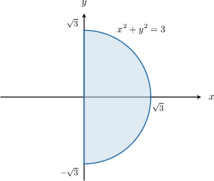
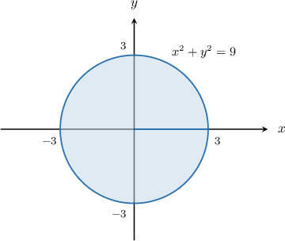
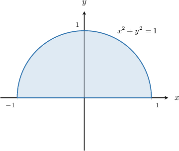
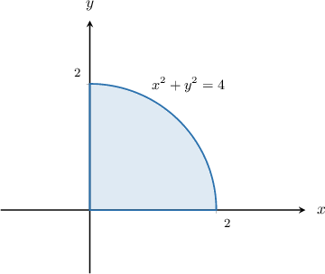
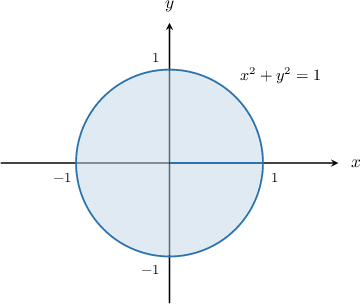

# Original and generated cylindrical evaluation review

Original raw records preserve source bytes and missing attributes. Generated records use authored complete method banks.

## Original 17592186129518 / radial_tilt

Evaluate the triple integral
$∭_(R)\sqrt{x^{2} + y^{2}}dV$
over the region $R$ enclosed inside the cylinder $x^{2} + y^{2} = 4$ and between the surfaces $z = 0$ and $z = 12 - 4y$.

- $72π$
- $52π$
- $24\sqrt{5}π$
- $64π$
- $12\sqrt{2}π$

[No captured worked solution.]

### Generated historical-bank evidence variant (integrand scale2; ineligible for learning)

Evaluate the triple integral
$∭_(R)2\left(\sqrt{x^{2} + y^{2}}\right)dV$
over the region $R$ enclosed inside the cylinder $x^{2} + y^{2} = 4$ and between the surfaces $z = 0$ and $z = 12 - 4y$.

- $2\left(72π\right)$
- $2\left(52π\right)$
- $2\left(24\sqrt{5}π\right)$
- $2\left(64π\right)$
- $2\left(12\sqrt{2}π\right)$

[No captured worked solution.]

## Original 17592186129767 / cross_z

Evaluate the triple integral
$∭_(R)2zdV$
over the region $R$ enclosed inside the cylinder $x^{2} + y^{2} = 9$ for $y \ge 0$ and between the surfaces $z =-x$ and $z = 2 + x$.

- $15π$
- $18π$
- $10π$
- $\frac{35π}{2}$
- $\frac{27π}{2}$

[No captured worked solution.]

### Generated historical-bank evidence variant (integrand scale2; ineligible for learning)

Evaluate the triple integral
$∭_(R)2\left(2z\right)dV$
over the region $R$ enclosed inside the cylinder $x^{2} + y^{2} = 9$ for $y \ge 0$ and between the surfaces $z =-x$ and $z = 2 + x$.

- $2\left(15π\right)$
- $2\left(18π\right)$
- $2\left(10π\right)$
- $2\left(\frac{35π}{2}\right)$
- $2\left(\frac{27π}{2}\right)$

[No captured worked solution.]

## Original 17592186367687 / half_xradial

Evaluate the triple integral 

$$
{∭}_{R}x\sqrt{{x}^{2}+{y}^{2}}\,\text{d}V
$$

over the region $R$ enclosed inside the cylinder ${x}^{2}+{y}^{2}=3$ for $x\ge 0$ and between the surfaces $z=y$ and $z=y+4.$

- $\frac{15\pi }{2}$
- $12\pi $
- $9\pi $
- $\frac{9\pi }{2}$
- $18$

We will use the change of variables formula in the form

$$
{∭}_{R}f(x,y,z)\,dV={∭}_{Δ}\,f(r\operatorname{cos}⁡\theta ,r\operatorname{sin}⁡\theta ,z)\,r\,dz\,dr\,d\theta .
$$

If $(r,\theta ,z)$ are the cylindrical polar coordinates of a point, then its Cartesian coordinates $(x,y,z)$ can be found by using the formulas

$$
x=r\operatorname{cos}⁡\theta ,\,y=r\operatorname{sin}⁡\theta ,\,z=z.
$$

First, let's sketch the projection of $R$ onto the $xy$-plane:

The region $R$ is a right vertical cylinder of radius $\sqrt{3}$ whose axis passes through the point $(0,0)$ in the $xy$-plane, and is

- bounded below by $z=y=r\operatorname{sin}⁡\theta ,$ and

- bounded above by $z=y+4=r\operatorname{sin}⁡\theta +4.$

As a result, in cylindrical polar coordinates, our region can be expressed as 

$$
Δ={(r,\theta ,z)\,:\,0\le r\le \sqrt{3},\,-\frac{\pi }{2}\le \theta <\frac{\pi }{2},\,r\operatorname{sin}⁡\theta \le z\le r\operatorname{sin}⁡\theta +4}.
$$

Therefore, using the change of variables formula, we obtain  

$$
\begin{aligned}{∭}_{R}x\sqrt{{x}^{2}+{y}^{2}}\,\text{d}V & ={∭}_{Δ}r\operatorname{cos}⁡\theta \sqrt{(r\operatorname{cos}⁡\theta )^{2}+(r\operatorname{sin}⁡\theta )^{2}}\,r\,dz\,dr\,d\theta  \\  & ={\int }_{-\pi /2}^{\pi /2}{\int }_{0}^{\sqrt{3}}{\int }_{r\operatorname{sin}⁡\theta }^{r\operatorname{sin}⁡\theta +4}{r}^{3}\operatorname{cos}⁡\theta \,dz\,\text{d}r\,\text{d}\theta  \\  & ={\int }_{-\pi /2}^{\pi /2}{\int }_{0}^{\sqrt{3}}{r}^{3}\operatorname{cos}⁡\theta [z]_{z=r\operatorname{sin}⁡\theta }^{z=r\operatorname{sin}⁡\theta +4}\,\text{d}r\,\text{d}\theta  \\  & ={\int }_{-\pi /2}^{\pi /2}{\int }_{0}^{\sqrt{3}}{r}^{3}\operatorname{cos}⁡\theta (r\operatorname{sin}⁡\theta +4-r\operatorname{sin}⁡\theta )\,\text{d}r\,\text{d}\theta  \\  & ={\int }_{-\pi /2}^{\pi /2}{\int }_{0}^{\sqrt{3}}4{r}^{3}\operatorname{cos}⁡\theta \,\text{d}r\,\text{d}\theta  \\  & ={\int }_{-\pi /2}^{\pi /2}[{r}^{4}\operatorname{cos}⁡\theta ]_{r=0}^{r=\sqrt{3}}\,\text{d}\theta  \\  & ={\int }_{-\pi /2}^{\pi /2}(\sqrt{3})^{4}\operatorname{cos}⁡\theta \,\text{d}\theta  \\  & ={\int }_{-\pi /2}^{\pi /2}9\operatorname{cos}⁡\theta \,\text{d}\theta  \\  & =[9\operatorname{sin}⁡\theta ]_{\theta =-\pi /2}^{\theta =\pi /2} \\  & =9(1-(-1)) \\  & =18.\end{aligned}
$$

### Generated historical-bank evidence variant (integrand scale2; ineligible for learning)

Evaluate the triple integral 

$$
{∭}_{R}2\left(x\sqrt{{x}^{2}+{y}^{2}}\right)\,\text{d}V
$$

over the region $R$ enclosed inside the cylinder ${x}^{2}+{y}^{2}=3$ for $x\ge 0$ and between the surfaces $z=y$ and $z=y+4.$

- $2\left(\frac{15\pi }{2}\right)$
- $2\left(12\pi \right)$
- $2\left(9\pi \right)$
- $2\left(\frac{9\pi }{2}\right)$
- $2\left(18\right)$

We will use the change of variables formula in the form

$$
{∭}_{R}f(x,y,z)\,dV={∭}_{Δ}\,f(r\operatorname{cos}⁡\theta ,r\operatorname{sin}⁡\theta ,z)\,r\,dz\,dr\,d\theta .
$$

If $(r,\theta ,z)$ are the cylindrical polar coordinates of a point, then its Cartesian coordinates $(x,y,z)$ can be found by using the formulas

$$
x=r\operatorname{cos}⁡\theta ,\,y=r\operatorname{sin}⁡\theta ,\,z=z.
$$

First, let's sketch the projection of $R$ onto the $xy$-plane:

The region $R$ is a right vertical cylinder of radius $\sqrt{3}$ whose axis passes through the point $(0,0)$ in the $xy$-plane, and is

- bounded below by $z=y=r\operatorname{sin}⁡\theta ,$ and

- bounded above by $z=y+4=r\operatorname{sin}⁡\theta +4.$

As a result, in cylindrical polar coordinates, our region can be expressed as 

$$
Δ={(r,\theta ,z)\,:\,0\le r\le \sqrt{3},\,-\frac{\pi }{2}\le \theta <\frac{\pi }{2},\,r\operatorname{sin}⁡\theta \le z\le r\operatorname{sin}⁡\theta +4}.
$$

Therefore, using the change of variables formula, we obtain  

$$
\begin{aligned}{∭}_{R}2\left(x\sqrt{{x}^{2}+{y}^{2}}\right)\,\text{d}V & = 2\left({∭}_{Δ}r\operatorname{cos}⁡\theta \sqrt{(r\operatorname{cos}⁡\theta )^{2}+(r\operatorname{sin}⁡\theta )^{2}}\,r\,dz\,dr\,d\theta  \right)\\  & =2\left({\int }_{-\pi /2}^{\pi /2}{\int }_{0}^{\sqrt{3}}{\int }_{r\operatorname{sin}⁡\theta }^{r\operatorname{sin}⁡\theta +4}{r}^{3}\operatorname{cos}⁡\theta \,dz\,\text{d}r\,\text{d}\theta\right)  \\  & =2\left({\int }_{-\pi /2}^{\pi /2}{\int }_{0}^{\sqrt{3}}{r}^{3}\operatorname{cos}⁡\theta [z]_{z=r\operatorname{sin}⁡\theta }^{z=r\operatorname{sin}⁡\theta +4}\,\text{d}r\,\text{d}\theta\right)  \\  & =2\left({\int }_{-\pi /2}^{\pi /2}{\int }_{0}^{\sqrt{3}}{r}^{3}\operatorname{cos}⁡\theta (r\operatorname{sin}⁡\theta +4-r\operatorname{sin}⁡\theta )\,\text{d}r\,\text{d}\theta\right)  \\  & =2\left({\int }_{-\pi /2}^{\pi /2}{\int }_{0}^{\sqrt{3}}4{r}^{3}\operatorname{cos}⁡\theta \,\text{d}r\,\text{d}\theta\right)  \\  & =2\left({\int }_{-\pi /2}^{\pi /2}[{r}^{4}\operatorname{cos}⁡\theta ]_{r=0}^{r=\sqrt{3}}\,\text{d}\theta\right)  \\  & =2\left({\int }_{-\pi /2}^{\pi /2}(\sqrt{3})^{4}\operatorname{cos}⁡\theta \,\text{d}\theta\right)  \\  & =2\left({\int }_{-\pi /2}^{\pi /2}9\operatorname{cos}⁡\theta \,\text{d}\theta\right)  \\  & =2\left([9\operatorname{sin}⁡\theta ]_{\theta =-\pi /2}^{\theta =\pi /2}\right) \\  & =2\left(9(1-(-1))\right) \\  & =2\left(18\right).\end{aligned}
$$

## Original 17592186367694 / reciprocal

Evaluate the triple integral 

$$
{∭}_{R}\frac{z}{\sqrt{{x}^{2}+{y}^{2}}}\,\text{d}V
$$

over the region $R$ enclosed inside the cylinder ${x}^{2}+{y}^{2}=9$ and between the surfaces $z=0$ and $z=\sqrt{9-({x}^{2}-{y}^{2})}.$

- $\frac{19\pi }{3}$
- $54\pi $
- $9\pi $
- $\frac{9\pi }{2}$
- $27\pi $

We will use the change of variables formula in the form

$$
{∭}_{R}f(x,y,z)\,dV={∭}_{Δ}\,f(r\operatorname{cos}⁡\theta ,r\operatorname{sin}⁡\theta ,z)\,r\,dz\,dr\,d\theta .
$$

If $(r,\theta ,z)$ are the cylindrical polar coordinates of a point, then its Cartesian coordinates $(x,y,z)$ can be found by using the formulas

$$
x=r\operatorname{cos}⁡\theta ,\,y=r\operatorname{sin}⁡\theta ,\,z=z.
$$

First, let's sketch the projection of $R$ onto the $xy$-plane:

The region $R$ is a right vertical cylinder of radius $3$ whose axis passes through the point $(0,0)$ in the $xy$-plane, and is

- bounded below by $z=0,$ and

- bounded above by $z=\sqrt{9-({x}^{2}-{y}^{2})}=\sqrt{9-{r}^{2}({cos}^{2}⁡\theta -{sin}^{2}⁡\theta )}=\sqrt{9-{r}^{2}\operatorname{cos}⁡(2\theta )}.$

As a result, in cylindrical polar coordinates, our region can be expressed as 

$$
Δ={(r,\theta ,z)\,:\,0\le r\le 3,\,0\le \theta <2\pi ,\,0\le z\le \sqrt{9-{r}^{2}\operatorname{cos}⁡(2\theta )}}.
$$

Therefore, using the change of variables formula, we obtain  

$$
\begin{aligned}{∭}_{R}\frac{z}{\sqrt{{x}^{2}+{y}^{2}}}\,\text{d}V & ={∭}_{Δ}\frac{z}{\sqrt{{r}^{2}{cos}^{2}⁡\theta +{r}^{2}\operatorname{sin}⁡\theta }}\,r\,dz\,dr\,d\theta  \\  & ={\int }_{0}^{2\pi }{\int }_{0}^{3}{\int }_{0}^{\sqrt{9-{r}^{2}\operatorname{cos}⁡(2\theta )}}z\,dz\,\text{d}r\,\text{d}\theta  \\  & ={\int }_{0}^{2\pi }{\int }_{0}^{3}{[\frac{1}{2}{z}^{2}]}_{z=0}^{z=\sqrt{9-{r}^{2}\operatorname{cos}⁡(2\theta )}}\,\text{d}r\,\text{d}\theta  \\  & ={\int }_{0}^{2\pi }{\int }_{0}^{3}\frac{1}{2}{(\sqrt{9-{r}^{2}\operatorname{cos}⁡(2\theta )})}^{2}\,\text{d}r\,\text{d}\theta  \\  & ={\int }_{0}^{2\pi }{\int }_{0}^{3}\frac{1}{2}(9-{r}^{2}\operatorname{cos}⁡(2\theta ))\,\text{d}r\,\text{d}\theta  \\  & ={\int }_{0}^{2\pi }{[\frac{9}{2}r-\frac{1}{6}{r}^{3}\operatorname{cos}⁡(2\theta )]}_{r=0}^{r=3}\,\text{d}\theta  \\  & ={\int }_{0}^{2\pi }\frac{9}{2}(3)-\frac{1}{6}(3)^{3}\operatorname{cos}⁡(2\theta )\,\text{d}\theta  \\  & ={\int }_{0}^{2\pi }\frac{27}{2}-\frac{9}{2}\operatorname{cos}⁡(2\theta )\,\text{d}\theta  \\  & ={[\frac{27}{2}\theta -\frac{9}{4}\operatorname{sin}⁡(2\theta )]}_{\theta =0}^{\theta =2\pi } \\  & =\frac{27}{2}(2\pi -0)-\frac{9}{4}(0-0) \\  & =27\pi .\end{aligned}
$$

### Generated historical-bank evidence variant (integrand scale2; ineligible for learning)

Evaluate the triple integral 

$$
{∭}_{R}2\left(\frac{z}{\sqrt{{x}^{2}+{y}^{2}}}\right)\,\text{d}V
$$

over the region $R$ enclosed inside the cylinder ${x}^{2}+{y}^{2}=9$ and between the surfaces $z=0$ and $z=\sqrt{9-({x}^{2}-{y}^{2})}.$

- $2\left(\frac{19\pi }{3}\right)$
- $2\left(54\pi \right)$
- $2\left(9\pi \right)$
- $2\left(\frac{9\pi }{2}\right)$
- $2\left(27\pi \right)$

We will use the change of variables formula in the form

$$
{∭}_{R}f(x,y,z)\,dV={∭}_{Δ}\,f(r\operatorname{cos}⁡\theta ,r\operatorname{sin}⁡\theta ,z)\,r\,dz\,dr\,d\theta .
$$

If $(r,\theta ,z)$ are the cylindrical polar coordinates of a point, then its Cartesian coordinates $(x,y,z)$ can be found by using the formulas

$$
x=r\operatorname{cos}⁡\theta ,\,y=r\operatorname{sin}⁡\theta ,\,z=z.
$$

First, let's sketch the projection of $R$ onto the $xy$-plane:

The region $R$ is a right vertical cylinder of radius $3$ whose axis passes through the point $(0,0)$ in the $xy$-plane, and is

- bounded below by $z=0,$ and

- bounded above by $z=\sqrt{9-({x}^{2}-{y}^{2})}=\sqrt{9-{r}^{2}({cos}^{2}⁡\theta -{sin}^{2}⁡\theta )}=\sqrt{9-{r}^{2}\operatorname{cos}⁡(2\theta )}.$

As a result, in cylindrical polar coordinates, our region can be expressed as 

$$
Δ={(r,\theta ,z)\,:\,0\le r\le 3,\,0\le \theta <2\pi ,\,0\le z\le \sqrt{9-{r}^{2}\operatorname{cos}⁡(2\theta )}}.
$$

Therefore, using the change of variables formula, we obtain  

$$
\begin{aligned}{∭}_{R}2\left(\frac{z}{\sqrt{{x}^{2}+{y}^{2}}}\right)\,\text{d}V & = 2\left({∭}_{Δ}\frac{z}{\sqrt{{r}^{2}{cos}^{2}⁡\theta +{r}^{2}\operatorname{sin}⁡\theta }}\,r\,dz\,dr\,d\theta  \right)\\  & =2\left({\int }_{0}^{2\pi }{\int }_{0}^{3}{\int }_{0}^{\sqrt{9-{r}^{2}\operatorname{cos}⁡(2\theta )}}z\,dz\,\text{d}r\,\text{d}\theta\right)  \\  & =2\left({\int }_{0}^{2\pi }{\int }_{0}^{3}{[\frac{1}{2}{z}^{2}]}_{z=0}^{z=\sqrt{9-{r}^{2}\operatorname{cos}⁡(2\theta )}}\,\text{d}r\,\text{d}\theta\right)  \\  & =2\left({\int }_{0}^{2\pi }{\int }_{0}^{3}\frac{1}{2}{(\sqrt{9-{r}^{2}\operatorname{cos}⁡(2\theta )})}^{2}\,\text{d}r\,\text{d}\theta\right)  \\  & =2\left({\int }_{0}^{2\pi }{\int }_{0}^{3}\frac{1}{2}(9-{r}^{2}\operatorname{cos}⁡(2\theta ))\,\text{d}r\,\text{d}\theta\right)  \\  & =2\left({\int }_{0}^{2\pi }{[\frac{9}{2}r-\frac{1}{6}{r}^{3}\operatorname{cos}⁡(2\theta )]}_{r=0}^{r=3}\,\text{d}\theta\right)  \\  & =2\left({\int }_{0}^{2\pi }\frac{9}{2}(3)-\frac{1}{6}(3)^{3}\operatorname{cos}⁡(2\theta )\,\text{d}\theta\right)  \\  & =2\left({\int }_{0}^{2\pi }\frac{27}{2}-\frac{9}{2}\operatorname{cos}⁡(2\theta )\,\text{d}\theta\right)  \\  & =2\left({[\frac{27}{2}\theta -\frac{9}{4}\operatorname{sin}⁡(2\theta )]}_{\theta =0}^{\theta =2\pi }\right) \\  & =2\left(\frac{27}{2}(2\pi -0)-\frac{9}{4}(0-0)\right) \\  & =2\left(27\pi \right).\end{aligned}
$$

## Original 17592186367701 / cone

Evaluate the triple integral 

$$
{∭}_{R}{x}^{2}+{y}^{2}\,\text{d}V
$$

over the region $R$ enclosed inside the cylinder ${x}^{2}+{y}^{2}=1$ and between the surfaces $z=\sqrt{{x}^{2}+{y}^{2}}$ and $z=1.$

- $5\pi $
- $\frac{\pi }{2}$
- $\frac{\pi }{10}$
- $\frac{5\pi }{2}$
- $2\pi $

We will use the change of variables formula in the form

$$
{∭}_{R}f(x,y,z)\,dV={∭}_{Δ}\,f(r\operatorname{cos}⁡\theta ,r\operatorname{sin}⁡\theta ,z)\,r\,dz\,dr\,d\theta .
$$

If $(r,\theta ,z)$ are the cylindrical polar coordinates of a point, then its Cartesian coordinates $(x,y,z)$ can be found by using the formulas

$$
x=r\operatorname{cos}⁡\theta ,\,y=r\operatorname{sin}⁡\theta ,\,z=z.
$$

First, let's sketch the projection of $R$ onto the $xy$-plane:

The region $R$ is a right vertical cylinder of radius $1$ whose axis passes through the point $(0,0)$ in the $xy$-plane, and is

- bounded below by  $z=\sqrt{{x}^{2}+{y}^{2}}=\sqrt{{r}^{2}{cos}^{2}⁡\theta +{r}^{2}{sin}^{2}⁡\theta }=r,$  and

- bounded above by $z=1.$

As a result, in cylindrical polar coordinates, our region can be expressed as 

$$
Δ={(r,\theta ,z)\,:\,0\le r\le 1,\,0\le \theta <2\pi ,\,r\le z\le 1}.
$$

Therefore, using the change of variables formula, we obtain  

$$
\begin{aligned}{∭}_{R}{x}^{2}+{y}^{2}\,\text{d}V & ={∭}_{Δ}({(r\operatorname{cos}⁡\theta )}^{2}+{(r\operatorname{sin}⁡\theta )}^{2})\,r\,dz\,dr\,d\theta  \\  & ={\int }_{0}^{2\pi }{\int }_{0}^{1}{\int }_{r}^{1}{r}^{3}\,dz\,\text{d}r\,\text{d}\theta  \\  & ={\int }_{0}^{2\pi }{\int }_{0}^{1}{r}^{3}[z]_{z=r}^{z=1}\,\text{d}r\,\text{d}\theta  \\  & ={\int }_{0}^{2\pi }{\int }_{0}^{1}{r}^{3}(1-r)\,\text{d}r\,\text{d}\theta  \\  & ={\int }_{0}^{2\pi }{\int }_{0}^{1}{r}^{3}-{r}^{4}\,\text{d}r\,\text{d}\theta  \\  & ={\int }_{0}^{2\pi }{[\frac{1}{4}{r}^{4}-\frac{1}{5}{r}^{5}]}_{r=0}^{r=1}\,\text{d}\theta  \\  & ={\int }_{0}^{2\pi }\frac{1}{4}-\frac{1}{5}\,\text{d}\theta  \\  & ={\int }_{0}^{2\pi }\frac{1}{20}\,\text{d}\theta  \\  & ={[\frac{1}{20}\theta ]}_{\theta =0}^{\theta =2\pi } \\  & =\frac{1}{20}(2\pi -0) \\  & =\frac{\pi }{10}.\end{aligned}
$$

### Generated historical-bank evidence variant (integrand scale2; ineligible for learning)

Evaluate the triple integral 

$$
{∭}_{R}2\left({x}^{2}+{y}^{2}\right)\,\text{d}V
$$

over the region $R$ enclosed inside the cylinder ${x}^{2}+{y}^{2}=1$ and between the surfaces $z=\sqrt{{x}^{2}+{y}^{2}}$ and $z=1.$

- $2\left(5\pi \right)$
- $2\left(\frac{\pi }{2}\right)$
- $2\left(\frac{\pi }{10}\right)$
- $2\left(\frac{5\pi }{2}\right)$
- $2\left(2\pi \right)$

We will use the change of variables formula in the form

$$
{∭}_{R}f(x,y,z)\,dV={∭}_{Δ}\,f(r\operatorname{cos}⁡\theta ,r\operatorname{sin}⁡\theta ,z)\,r\,dz\,dr\,d\theta .
$$

If $(r,\theta ,z)$ are the cylindrical polar coordinates of a point, then its Cartesian coordinates $(x,y,z)$ can be found by using the formulas

$$
x=r\operatorname{cos}⁡\theta ,\,y=r\operatorname{sin}⁡\theta ,\,z=z.
$$

First, let's sketch the projection of $R$ onto the $xy$-plane:

The region $R$ is a right vertical cylinder of radius $1$ whose axis passes through the point $(0,0)$ in the $xy$-plane, and is

- bounded below by  $z=\sqrt{{x}^{2}+{y}^{2}}=\sqrt{{r}^{2}{cos}^{2}⁡\theta +{r}^{2}{sin}^{2}⁡\theta }=r,$  and

- bounded above by $z=1.$

As a result, in cylindrical polar coordinates, our region can be expressed as 

$$
Δ={(r,\theta ,z)\,:\,0\le r\le 1,\,0\le \theta <2\pi ,\,r\le z\le 1}.
$$

Therefore, using the change of variables formula, we obtain  

$$
\begin{aligned}{∭}_{R}2\left({x}^{2}+{y}^{2}\right)\,\text{d}V & = 2\left({∭}_{Δ}({(r\operatorname{cos}⁡\theta )}^{2}+{(r\operatorname{sin}⁡\theta )}^{2})\,r\,dz\,dr\,d\theta  \right)\\  & =2\left({\int }_{0}^{2\pi }{\int }_{0}^{1}{\int }_{r}^{1}{r}^{3}\,dz\,\text{d}r\,\text{d}\theta\right)  \\  & =2\left({\int }_{0}^{2\pi }{\int }_{0}^{1}{r}^{3}[z]_{z=r}^{z=1}\,\text{d}r\,\text{d}\theta\right)  \\  & =2\left({\int }_{0}^{2\pi }{\int }_{0}^{1}{r}^{3}(1-r)\,\text{d}r\,\text{d}\theta\right)  \\  & =2\left({\int }_{0}^{2\pi }{\int }_{0}^{1}{r}^{3}-{r}^{4}\,\text{d}r\,\text{d}\theta\right)  \\  & =2\left({\int }_{0}^{2\pi }{[\frac{1}{4}{r}^{4}-\frac{1}{5}{r}^{5}]}_{r=0}^{r=1}\,\text{d}\theta\right)  \\  & =2\left({\int }_{0}^{2\pi }\frac{1}{4}-\frac{1}{5}\,\text{d}\theta\right)  \\  & =2\left({\int }_{0}^{2\pi }\frac{1}{20}\,\text{d}\theta\right)  \\  & =2\left({[\frac{1}{20}\theta ]}_{\theta =0}^{\theta =2\pi }\right) \\  & =2\left(\frac{1}{20}(2\pi -0)\right) \\  & =2\left(\frac{\pi }{10}\right).\end{aligned}
$$

## Original 17592186367708 / half_xz

Evaluate the triple integral 

$$
{∭}_{R}2xz\,\text{d}V
$$

over the region $R$ enclosed inside the cylinder ${x}^{2}+{y}^{2}=1$ for $y\ge 0$ and between the surfaces $z=-x$ and $z=x+2.$

- $\frac{\pi }{2}$
- $4\pi $
- $\frac{3\pi }{2}$
- $2\pi $
- $\frac{\pi }{4}$

We will use the change of variables formula in the form

$$
{∭}_{R}f(x,y,z)\,dV={∭}_{Δ}\,f(r\operatorname{cos}⁡\theta ,r\operatorname{sin}⁡\theta ,z)\,r\,dz\,dr\,d\theta .
$$

If $(r,\theta ,z)$ are the cylindrical polar coordinates of a point, then its Cartesian coordinates $(x,y,z)$ can be found by using the formulas

$$
x=r\operatorname{cos}⁡\theta ,\,y=r\operatorname{sin}⁡\theta ,\,z=z.
$$

First, let's sketch the projection of $R$ onto the $xy$-plane:

The region $R$ is a right vertical cylinder of radius $1$ whose axis passes through the point $(0,0)$ in the $xy$-plane, and is

- bounded below by $z=-x=-r\operatorname{cos}⁡\theta ,$ and

- bounded above by $z=x+2=r\operatorname{cos}⁡\theta +2.$

As a result, in cylindrical polar coordinates, our region can be expressed as 

$$
Δ={(r,\theta ,z)\,:\,0\le r\le 1,\,0\le \theta <\pi ,\,-r\operatorname{cos}⁡\theta \le z\le r\operatorname{cos}⁡\theta +2}.
$$

Therefore, using the change of variables formula, we obtain  

$$
\begin{aligned}{∭}_{R}2xz\,\text{d}V & ={∭}_{Δ}2z\cdot r\operatorname{cos}⁡\theta \cdot r\,dz\,dr\,d\theta  \\  & ={\int }_{0}^{\pi }{\int }_{0}^{1}{\int }_{-r\operatorname{cos}⁡\theta }^{r\operatorname{cos}⁡\theta +2}2z{r}^{2}\operatorname{cos}⁡\theta \,dz\,\text{d}r\,\text{d}\theta  \\  & ={\int }_{0}^{\pi }{\int }_{0}^{1}{r}^{2}\operatorname{cos}⁡\theta [{z}^{2}]_{z=-r\operatorname{cos}⁡\theta }^{z=r\operatorname{cos}⁡\theta +2}\,\text{d}r\,\text{d}\theta  \\  & ={\int }_{0}^{\pi }{\int }_{0}^{1}{r}^{2}\operatorname{cos}⁡\theta ({(r\operatorname{cos}⁡\theta +2)}^{2}-{(-r\operatorname{cos}⁡\theta )}^{2})\,\text{d}r\,\text{d}\theta  \\  & ={\int }_{0}^{\pi }{\int }_{0}^{1}{r}^{2}\operatorname{cos}⁡\theta ({r}^{2}{cos}^{2}⁡\theta +4r\operatorname{cos}⁡\theta +4-{r}^{2}{cos}^{2}⁡\theta )\,\text{d}r\,\text{d}\theta  \\  & ={\int }_{0}^{\pi }{\int }_{0}^{1}4{r}^{3}{cos}^{2}⁡\theta +4{r}^{2}\operatorname{cos}⁡\theta \,\text{d}r\,\text{d}\theta  \\  & ={\int }_{0}^{\pi }[{r}^{4}{cos}^{2}⁡\theta +\frac{4}{3}{r}^{3}\operatorname{cos}⁡\theta ]_{r=0}^{r=1}\,\text{d}\theta  \\  & ={\int }_{0}^{\pi }{cos}^{2}⁡\theta +\frac{4}{3}\operatorname{cos}⁡\theta \,\text{d}\theta  \\  & ={\int }_{0}^{\pi }\frac{1}{2}(1+\operatorname{cos}⁡(2\theta ))+\frac{4}{3}\operatorname{cos}⁡\theta \,\text{d}\theta  \\  & ={\int }_{0}^{\pi }\frac{1}{2}+\frac{1}{2}\operatorname{cos}⁡(2\theta )+\frac{4}{3}\operatorname{cos}⁡\theta \,\text{d}\theta  \\  & ={[\frac{1}{2}\theta +\frac{1}{4}\operatorname{sin}⁡(2\theta )+\frac{4}{3}\operatorname{sin}⁡\theta ]}_{\theta =0}^{\theta =\pi } \\  & =\frac{1}{2}(\pi -0)+\frac{1}{4}(0-0)+\frac{4}{3}(0-0) \\  & =\frac{\pi }{2}.\end{aligned}
$$

### Generated historical-bank evidence variant (integrand scale2; ineligible for learning)

Evaluate the triple integral 

$$
{∭}_{R}2\left(2xz\right)\,\text{d}V
$$

over the region $R$ enclosed inside the cylinder ${x}^{2}+{y}^{2}=1$ for $y\ge 0$ and between the surfaces $z=-x$ and $z=x+2.$

- $2\left(\frac{\pi }{2}\right)$
- $2\left(4\pi \right)$
- $2\left(\frac{3\pi }{2}\right)$
- $2\left(2\pi \right)$
- $2\left(\frac{\pi }{4}\right)$

We will use the change of variables formula in the form

$$
{∭}_{R}f(x,y,z)\,dV={∭}_{Δ}\,f(r\operatorname{cos}⁡\theta ,r\operatorname{sin}⁡\theta ,z)\,r\,dz\,dr\,d\theta .
$$

If $(r,\theta ,z)$ are the cylindrical polar coordinates of a point, then its Cartesian coordinates $(x,y,z)$ can be found by using the formulas

$$
x=r\operatorname{cos}⁡\theta ,\,y=r\operatorname{sin}⁡\theta ,\,z=z.
$$

First, let's sketch the projection of $R$ onto the $xy$-plane:

The region $R$ is a right vertical cylinder of radius $1$ whose axis passes through the point $(0,0)$ in the $xy$-plane, and is

- bounded below by $z=-x=-r\operatorname{cos}⁡\theta ,$ and

- bounded above by $z=x+2=r\operatorname{cos}⁡\theta +2.$

As a result, in cylindrical polar coordinates, our region can be expressed as 

$$
Δ={(r,\theta ,z)\,:\,0\le r\le 1,\,0\le \theta <\pi ,\,-r\operatorname{cos}⁡\theta \le z\le r\operatorname{cos}⁡\theta +2}.
$$

Therefore, using the change of variables formula, we obtain  

$$
\begin{aligned}{∭}_{R}2\left(2xz\right)\,\text{d}V & = 2\left({∭}_{Δ}2z\cdot r\operatorname{cos}⁡\theta \cdot r\,dz\,dr\,d\theta  \right)\\  & =2\left({\int }_{0}^{\pi }{\int }_{0}^{1}{\int }_{-r\operatorname{cos}⁡\theta }^{r\operatorname{cos}⁡\theta +2}2z{r}^{2}\operatorname{cos}⁡\theta \,dz\,\text{d}r\,\text{d}\theta\right)  \\  & =2\left({\int }_{0}^{\pi }{\int }_{0}^{1}{r}^{2}\operatorname{cos}⁡\theta [{z}^{2}]_{z=-r\operatorname{cos}⁡\theta }^{z=r\operatorname{cos}⁡\theta +2}\,\text{d}r\,\text{d}\theta\right)  \\  & =2\left({\int }_{0}^{\pi }{\int }_{0}^{1}{r}^{2}\operatorname{cos}⁡\theta ({(r\operatorname{cos}⁡\theta +2)}^{2}-{(-r\operatorname{cos}⁡\theta )}^{2})\,\text{d}r\,\text{d}\theta\right)  \\  & =2\left({\int }_{0}^{\pi }{\int }_{0}^{1}{r}^{2}\operatorname{cos}⁡\theta ({r}^{2}{cos}^{2}⁡\theta +4r\operatorname{cos}⁡\theta +4-{r}^{2}{cos}^{2}⁡\theta )\,\text{d}r\,\text{d}\theta\right)  \\  & =2\left({\int }_{0}^{\pi }{\int }_{0}^{1}4{r}^{3}{cos}^{2}⁡\theta +4{r}^{2}\operatorname{cos}⁡\theta \,\text{d}r\,\text{d}\theta\right)  \\  & =2\left({\int }_{0}^{\pi }[{r}^{4}{cos}^{2}⁡\theta +\frac{4}{3}{r}^{3}\operatorname{cos}⁡\theta ]_{r=0}^{r=1}\,\text{d}\theta\right)  \\  & =2\left({\int }_{0}^{\pi }{cos}^{2}⁡\theta +\frac{4}{3}\operatorname{cos}⁡\theta \,\text{d}\theta\right)  \\  & =2\left({\int }_{0}^{\pi }\frac{1}{2}(1+\operatorname{cos}⁡(2\theta ))+\frac{4}{3}\operatorname{cos}⁡\theta \,\text{d}\theta\right)  \\  & =2\left({\int }_{0}^{\pi }\frac{1}{2}+\frac{1}{2}\operatorname{cos}⁡(2\theta )+\frac{4}{3}\operatorname{cos}⁡\theta \,\text{d}\theta\right)  \\  & =2\left({[\frac{1}{2}\theta +\frac{1}{4}\operatorname{sin}⁡(2\theta )+\frac{4}{3}\operatorname{sin}⁡\theta ]}_{\theta =0}^{\theta =\pi }\right) \\  & =2\left(\frac{1}{2}(\pi -0)+\frac{1}{4}(0-0)+\frac{4}{3}(0-0)\right) \\  & =2\left(\frac{\pi }{2}\right).\end{aligned}
$$

## Original 17592186367715 / half_constant

Evaluate the triple integral 

$$
{∭}_{R}4\,\text{d}V
$$

over the region $R$ enclosed inside the cylinder ${x}^{2}+{y}^{2}=2$ for $y\ge 0$ and between the surfaces $z=0$ and $z=6-2x.$

- $\frac{10\pi }{3}$
- $24\pi $
- $12\pi $
- $6\pi $
- $\frac{16\pi }{3}$

We will use the change of variables formula in the form

$$
{∭}_{R}f(x,y,z)\,dV={∭}_{Δ}\,f(r\operatorname{cos}⁡\theta ,r\operatorname{sin}⁡\theta ,z)\,r\,dz\,dr\,d\theta .
$$

If $(r,\theta ,z)$ are the cylindrical polar coordinates of a point, then its Cartesian coordinates $(x,y,z)$ can be found by using the formulas

$$
x=r\operatorname{cos}⁡\theta ,\,y=r\operatorname{sin}⁡\theta ,\,z=z.
$$

First, let's sketch the projection of $R$ onto the $xy$-plane:

The region $R$ is a right vertical cylinder of radius $\sqrt{2}$ whose axis passes through the point $(0,0)$ in the $xy$-plane, and is

- bounded below by $z=0,$ and

- bounded above by $z=6-2x=6-2r\operatorname{cos}⁡\theta .$

As a result, in cylindrical polar coordinates, our region can be expressed as 

$$
Δ={(r,\theta ,z)\,:\,0\le r\le \sqrt{2},\,0\le \theta <\pi ,\,0\le z\le 6-2r\operatorname{cos}⁡\theta }.
$$

Therefore, using the change of variables formula, we obtain  

$$
\begin{aligned}{∭}_{R}4\,\text{d}V & ={∭}_{Δ}4\,r\,dz\,dr\,d\theta  \\  & ={\int }_{0}^{\pi }{\int }_{0}^{\sqrt{2}}{\int }_{0}^{6-2r\operatorname{cos}⁡\theta }4r\,dz\,\text{d}r\,\text{d}\theta  \\  & ={\int }_{0}^{\pi }{\int }_{0}^{\sqrt{2}}4r[z]_{z=0}^{z=6-2r\operatorname{cos}⁡\theta }\,\text{d}r\,\text{d}\theta  \\  & ={\int }_{0}^{\pi }{\int }_{0}^{\sqrt{2}}4r(6-2r\operatorname{cos}⁡\theta )\,\text{d}r\,\text{d}\theta  \\  & ={\int }_{0}^{\pi }{\int }_{0}^{\sqrt{2}}24r-8{r}^{2}\operatorname{cos}⁡\theta \,\text{d}r\,\text{d}\theta  \\  & ={\int }_{0}^{\pi }{[12{r}^{2}-\frac{8}{3}{r}^{3}\operatorname{cos}⁡\theta ]}_{r=0}^{r=\sqrt{2}}\,\text{d}\theta  \\  & ={\int }_{0}^{\pi }12(\sqrt{2})^{2}-\frac{8}{3}(\sqrt{2})^{3}\operatorname{cos}⁡\theta \,\text{d}\theta  \\  & ={\int }_{0}^{\pi }24-\frac{16\sqrt{2}}{3}\operatorname{cos}⁡\theta \,\text{d}\theta  \\  & ={[24\theta -\frac{16\sqrt{2}}{3}\operatorname{sin}⁡\theta ]}_{\theta =0}^{\theta =\pi } \\  & =24(\pi -0)-\frac{16\sqrt{2}}{3}(0-0) \\  & =24\pi .\end{aligned}
$$

### Generated historical-bank evidence variant (integrand scale2; ineligible for learning)

Evaluate the triple integral 

$$
{∭}_{R}2\left(4\right)\,\text{d}V
$$

over the region $R$ enclosed inside the cylinder ${x}^{2}+{y}^{2}=2$ for $y\ge 0$ and between the surfaces $z=0$ and $z=6-2x.$

- $2\left(\frac{10\pi }{3}\right)$
- $2\left(24\pi \right)$
- $2\left(12\pi \right)$
- $2\left(6\pi \right)$
- $2\left(\frac{16\pi }{3}\right)$

We will use the change of variables formula in the form

$$
{∭}_{R}f(x,y,z)\,dV={∭}_{Δ}\,f(r\operatorname{cos}⁡\theta ,r\operatorname{sin}⁡\theta ,z)\,r\,dz\,dr\,d\theta .
$$

If $(r,\theta ,z)$ are the cylindrical polar coordinates of a point, then its Cartesian coordinates $(x,y,z)$ can be found by using the formulas

$$
x=r\operatorname{cos}⁡\theta ,\,y=r\operatorname{sin}⁡\theta ,\,z=z.
$$

First, let's sketch the projection of $R$ onto the $xy$-plane:

The region $R$ is a right vertical cylinder of radius $\sqrt{2}$ whose axis passes through the point $(0,0)$ in the $xy$-plane, and is

- bounded below by $z=0,$ and

- bounded above by $z=6-2x=6-2r\operatorname{cos}⁡\theta .$

As a result, in cylindrical polar coordinates, our region can be expressed as 

$$
Δ={(r,\theta ,z)\,:\,0\le r\le \sqrt{2},\,0\le \theta <\pi ,\,0\le z\le 6-2r\operatorname{cos}⁡\theta }.
$$

Therefore, using the change of variables formula, we obtain  

$$
\begin{aligned}{∭}_{R}2\left(4\right)\,\text{d}V & = 2\left({∭}_{Δ}4\,r\,dz\,dr\,d\theta  \right)\\  & =2\left({\int }_{0}^{\pi }{\int }_{0}^{\sqrt{2}}{\int }_{0}^{6-2r\operatorname{cos}⁡\theta }4r\,dz\,\text{d}r\,\text{d}\theta\right)  \\  & =2\left({\int }_{0}^{\pi }{\int }_{0}^{\sqrt{2}}4r[z]_{z=0}^{z=6-2r\operatorname{cos}⁡\theta }\,\text{d}r\,\text{d}\theta\right)  \\  & =2\left({\int }_{0}^{\pi }{\int }_{0}^{\sqrt{2}}4r(6-2r\operatorname{cos}⁡\theta )\,\text{d}r\,\text{d}\theta\right)  \\  & =2\left({\int }_{0}^{\pi }{\int }_{0}^{\sqrt{2}}24r-8{r}^{2}\operatorname{cos}⁡\theta \,\text{d}r\,\text{d}\theta\right)  \\  & =2\left({\int }_{0}^{\pi }{[12{r}^{2}-\frac{8}{3}{r}^{3}\operatorname{cos}⁡\theta ]}_{r=0}^{r=\sqrt{2}}\,\text{d}\theta\right)  \\  & =2\left({\int }_{0}^{\pi }12(\sqrt{2})^{2}-\frac{8}{3}(\sqrt{2})^{3}\operatorname{cos}⁡\theta \,\text{d}\theta\right)  \\  & =2\left({\int }_{0}^{\pi }24-\frac{16\sqrt{2}}{3}\operatorname{cos}⁡\theta \,\text{d}\theta\right)  \\  & =2\left({[24\theta -\frac{16\sqrt{2}}{3}\operatorname{sin}⁡\theta ]}_{\theta =0}^{\theta =\pi }\right) \\  & =2\left(24(\pi -0)-\frac{16\sqrt{2}}{3}(0-0)\right) \\  & =2\left(24\pi \right).\end{aligned}
$$

## Original 17592186411857 / quarter_x

Evaluate the triple integral 

$$
{∭}_{R}4x\,\text{d}V
$$

over the region $R$ enclosed inside the cylinder ${x}^{2}+{y}^{2}=4$ for $x\ge 0,$ $y\ge 0$ and between the surfaces $z=0$ and $z=y+3.$

- $40$
- $8\pi $
- $20$
- $26\pi $
- $32$

We will use the change of variables formula in the form

$$
{∭}_{R}f(x,y,z)\,dV={∭}_{Δ}\,f(r\operatorname{cos}⁡\theta ,r\operatorname{sin}⁡\theta ,z)\,r\,dz\,dr\,d\theta .
$$

If $(r,\theta ,z)$ are the cylindrical polar coordinates of a point, then its Cartesian coordinates $(x,y,z)$ can be found by using the formulas

$$
x=r\operatorname{cos}⁡\theta ,\,y=r\operatorname{sin}⁡\theta ,\,z=z.
$$

First, let's sketch the projection of $R$ onto the $xy$-plane:

The region $R$ is a right vertical cylinder of radius $2$ whose axis passes through the point $(0,0)$ in the $xy$-plane, and is

- bounded below by $z=0,$ and

- bounded above by $z=y+3=r\operatorname{sin}⁡\theta +3.$

As a result, in cylindrical polar coordinates, our region can be expressed as 

$$
Δ=\{(r,\theta ,z)\,:\,0\le r\le 2,\,0\le \theta <\frac{\pi }{2},\,0\le z\le r\operatorname{sin}⁡\theta +3\}.
$$

Therefore, using the change of variables formula, we obtain  

$$
\begin{aligned}{∭}_{R}4x\,\text{d}V & ={∭}_{Δ}4r\operatorname{cos}⁡\theta \cdot r\,dz\,dr\,d\theta  \\  & ={\int }_{0}^{\pi /2}{\int }_{0}^{2}{\int }_{0}^{r\operatorname{sin}⁡\theta +3}4{r}^{2}\operatorname{cos}⁡\theta \,dz\,\text{d}r\,\text{d}\theta  \\  & ={\int }_{0}^{\pi /2}{\int }_{0}^{2}4{r}^{2}\operatorname{cos}⁡\theta [z]_{z=0}^{z=r\operatorname{sin}⁡\theta +3}\,\text{d}r\,\text{d}\theta  \\  & ={\int }_{0}^{\pi /2}{\int }_{0}^{2}4{r}^{2}\operatorname{cos}⁡\theta (r\operatorname{sin}⁡\theta +3)\,\text{d}r\,\text{d}\theta  \\  & ={\int }_{0}^{\pi /2}{\int }_{0}^{2}4{r}^{3}\operatorname{cos}⁡\theta \operatorname{sin}⁡\theta +12{r}^{2}\operatorname{cos}⁡\theta \,\text{d}r\,\text{d}\theta  \\  & ={\int }_{0}^{\pi /2}{\int }_{0}^{2}2{r}^{3}\operatorname{sin}⁡2\theta +12{r}^{2}\operatorname{cos}⁡\theta \,\text{d}r\,\text{d}\theta  \\  & ={\int }_{0}^{\pi /2}{[\frac{1}{2}{r}^{4}\operatorname{sin}⁡2\theta +4{r}^{3}\operatorname{cos}⁡\theta ]}_{r=0}^{r=2}\,\text{d}\theta  \\  & ={\int }_{0}^{\pi /2}\frac{1}{2}(2)^{4}\operatorname{sin}⁡2\theta +4(2)^{3}\operatorname{cos}⁡\theta \,\text{d}\theta  \\  & ={\int }_{0}^{\pi /2}8\operatorname{sin}⁡2\theta +32\operatorname{cos}⁡\theta \,\text{d}\theta  \\  & =[-4\operatorname{cos}⁡2\theta +32\operatorname{sin}⁡\theta ]_{\theta =0}^{\theta =\pi /2} \\  & =-4(-1-1)+32(1-0)) \\  & =40.\end{aligned}
$$

### Generated historical-bank evidence variant (integrand scale2; ineligible for learning)

Evaluate the triple integral 

$$
{∭}_{R}2\left(4x\right)\,\text{d}V
$$

over the region $R$ enclosed inside the cylinder ${x}^{2}+{y}^{2}=4$ for $x\ge 0,$ $y\ge 0$ and between the surfaces $z=0$ and $z=y+3.$

- $2\left(40\right)$
- $2\left(8\pi \right)$
- $2\left(20\right)$
- $2\left(26\pi \right)$
- $2\left(32\right)$

We will use the change of variables formula in the form

$$
{∭}_{R}f(x,y,z)\,dV={∭}_{Δ}\,f(r\operatorname{cos}⁡\theta ,r\operatorname{sin}⁡\theta ,z)\,r\,dz\,dr\,d\theta .
$$

If $(r,\theta ,z)$ are the cylindrical polar coordinates of a point, then its Cartesian coordinates $(x,y,z)$ can be found by using the formulas

$$
x=r\operatorname{cos}⁡\theta ,\,y=r\operatorname{sin}⁡\theta ,\,z=z.
$$

First, let's sketch the projection of $R$ onto the $xy$-plane:

The region $R$ is a right vertical cylinder of radius $2$ whose axis passes through the point $(0,0)$ in the $xy$-plane, and is

- bounded below by $z=0,$ and

- bounded above by $z=y+3=r\operatorname{sin}⁡\theta +3.$

As a result, in cylindrical polar coordinates, our region can be expressed as 

$$
Δ=\{(r,\theta ,z)\,:\,0\le r\le 2,\,0\le \theta <\frac{\pi }{2},\,0\le z\le r\operatorname{sin}⁡\theta +3\}.
$$

Therefore, using the change of variables formula, we obtain  

$$
\begin{aligned}{∭}_{R}2\left(4x\right)\,\text{d}V & = 2\left({∭}_{Δ}4r\operatorname{cos}⁡\theta \cdot r\,dz\,dr\,d\theta  \right)\\  & =2\left({\int }_{0}^{\pi /2}{\int }_{0}^{2}{\int }_{0}^{r\operatorname{sin}⁡\theta +3}4{r}^{2}\operatorname{cos}⁡\theta \,dz\,\text{d}r\,\text{d}\theta\right)  \\  & =2\left({\int }_{0}^{\pi /2}{\int }_{0}^{2}4{r}^{2}\operatorname{cos}⁡\theta [z]_{z=0}^{z=r\operatorname{sin}⁡\theta +3}\,\text{d}r\,\text{d}\theta\right)  \\  & =2\left({\int }_{0}^{\pi /2}{\int }_{0}^{2}4{r}^{2}\operatorname{cos}⁡\theta (r\operatorname{sin}⁡\theta +3)\,\text{d}r\,\text{d}\theta\right)  \\  & =2\left({\int }_{0}^{\pi /2}{\int }_{0}^{2}4{r}^{3}\operatorname{cos}⁡\theta \operatorname{sin}⁡\theta +12{r}^{2}\operatorname{cos}⁡\theta \,\text{d}r\,\text{d}\theta\right)  \\  & =2\left({\int }_{0}^{\pi /2}{\int }_{0}^{2}2{r}^{3}\operatorname{sin}⁡2\theta +12{r}^{2}\operatorname{cos}⁡\theta \,\text{d}r\,\text{d}\theta\right)  \\  & =2\left({\int }_{0}^{\pi /2}{[\frac{1}{2}{r}^{4}\operatorname{sin}⁡2\theta +4{r}^{3}\operatorname{cos}⁡\theta ]}_{r=0}^{r=2}\,\text{d}\theta\right)  \\  & =2\left({\int }_{0}^{\pi /2}\frac{1}{2}(2)^{4}\operatorname{sin}⁡2\theta +4(2)^{3}\operatorname{cos}⁡\theta \,\text{d}\theta\right)  \\  & =2\left({\int }_{0}^{\pi /2}8\operatorname{sin}⁡2\theta +32\operatorname{cos}⁡\theta \,\text{d}\theta\right)  \\  & =2\left([-4\operatorname{cos}⁡2\theta +32\operatorname{sin}⁡\theta ]_{\theta =0}^{\theta =\pi /2}\right) \\  & =2\left(-4(-1-1)+32(1-0))\right) \\  & =2\left(40\right).\end{aligned}
$$

## Original 17592186427903 / half_linear

Evaluate the triple integral 

$$
{∭}_{R}(x-y)\,\text{d}V
$$

over the region $R$ enclosed inside the cylinder ${x}^{2}+{y}^{2}=3$ for $x\ge 0$ and between the surfaces $z=x$ and $z=9+x.$

- $4\sqrt{6}$
- $\sqrt{6}$
- $18\sqrt{3}$
- $9\sqrt{3}$
- $27$

We will use the change of variables formula in the form

$$
{∭}_{R}f(x,y,z)\,dV={∭}_{Δ}\,f(r\operatorname{cos}⁡\theta ,r\operatorname{sin}⁡\theta ,z)\,r\,dz\,dr\,d\theta .
$$

If $(r,\theta ,z)$ are the cylindrical polar coordinates of a point, then its Cartesian coordinates $(x,y,z)$ can be found by using the formulas

$$
x=r\operatorname{cos}⁡\theta ,\,y=r\operatorname{sin}⁡\theta ,\,z=z.
$$

First, let's sketch the projection of $R$ onto the $xy$-plane:

The region $R$ is a right vertical cylinder of radius $\sqrt{3}$ whose axis passes through the point $(0,0)$ in the $xy$-plane, and is

- bounded below by $z=x=r\operatorname{cos}⁡\theta ,$ and

- bounded above by $z=x+9=r\operatorname{cos}⁡\theta +9.$

As a result, in cylindrical polar coordinates, our region can be expressed as 

$$
Δ=\{(r,\theta ,z)\,:\,0\le r\le \sqrt{3},\,-\frac{\pi }{2}\le \theta <\frac{\pi }{2},\,r\operatorname{cos}⁡\theta \le z\le r\operatorname{cos}⁡\theta +9\}.
$$

Therefore, using the change of variables formula, we obtain  

$$
\begin{aligned}{∭}_{R}(x-y)\,\text{d}V & ={∭}_{Δ}(r\operatorname{cos}⁡\theta -r\operatorname{sin}⁡\theta )\,r\,dz\,dr\,d\theta  \\  & ={\int }_{-\pi /2}^{\pi /2}{\int }_{0}^{\sqrt{3}}{\int }_{r\operatorname{cos}⁡\theta }^{r\operatorname{cos}⁡\theta +9}{r}^{2}(\operatorname{cos}⁡\theta -\operatorname{sin}⁡\theta )\,dz\,\text{d}r\,\text{d}\theta  \\  & ={\int }_{-\pi /2}^{\pi /2}{\int }_{0}^{\sqrt{3}}{r}^{2}(\operatorname{cos}⁡\theta -\operatorname{sin}⁡\theta )[z]_{z=r\operatorname{cos}⁡\theta }^{z=r\operatorname{cos}⁡\theta +9}\,\text{d}r\,\text{d}\theta  \\  & ={\int }_{-\pi /2}^{\pi /2}{\int }_{0}^{\sqrt{3}}{r}^{2}(\operatorname{cos}⁡\theta -\operatorname{sin}⁡\theta )(r\operatorname{cos}⁡\theta +9-r\operatorname{cos}⁡\theta )\,\text{d}r\,\text{d}\theta  \\  & ={\int }_{-\pi /2}^{\pi /2}{\int }_{0}^{\sqrt{3}}9{r}^{2}(\operatorname{cos}⁡\theta -\operatorname{sin}⁡\theta )\,\text{d}r\,\text{d}\theta  \\  & ={\int }_{-\pi /2}^{\pi /2}[3{r}^{3}(\operatorname{cos}⁡\theta -\operatorname{sin}⁡\theta )]_{r=0}^{r=\sqrt{3}}\,\text{d}\theta  \\  & ={\int }_{-\pi /2}^{\pi /2}3(\sqrt{3})^{3}(\operatorname{cos}⁡\theta -\operatorname{sin}⁡\theta )\,\text{d}\theta  \\  & ={\int }_{-\pi /2}^{\pi /2}9\sqrt{3}(\operatorname{cos}⁡\theta -\operatorname{sin}⁡\theta )\,\text{d}\theta  \\  & =9\sqrt{3}[\operatorname{sin}⁡\theta +\operatorname{cos}⁡\theta ]_{\theta =-\pi /2}^{\theta =\pi /2} \\  & =9\sqrt{3}(1-(-1))+9\sqrt{3}(0-0) \\  & =18\sqrt{3}.\end{aligned}
$$

### Generated historical-bank evidence variant (integrand scale2; ineligible for learning)

Evaluate the triple integral 

$$
{∭}_{R}2\left((x-y)\right)\,\text{d}V
$$

over the region $R$ enclosed inside the cylinder ${x}^{2}+{y}^{2}=3$ for $x\ge 0$ and between the surfaces $z=x$ and $z=9+x.$

- $2\left(4\sqrt{6}\right)$
- $2\left(\sqrt{6}\right)$
- $2\left(18\sqrt{3}\right)$
- $2\left(9\sqrt{3}\right)$
- $2\left(27\right)$

We will use the change of variables formula in the form

$$
{∭}_{R}f(x,y,z)\,dV={∭}_{Δ}\,f(r\operatorname{cos}⁡\theta ,r\operatorname{sin}⁡\theta ,z)\,r\,dz\,dr\,d\theta .
$$

If $(r,\theta ,z)$ are the cylindrical polar coordinates of a point, then its Cartesian coordinates $(x,y,z)$ can be found by using the formulas

$$
x=r\operatorname{cos}⁡\theta ,\,y=r\operatorname{sin}⁡\theta ,\,z=z.
$$

First, let's sketch the projection of $R$ onto the $xy$-plane:

The region $R$ is a right vertical cylinder of radius $\sqrt{3}$ whose axis passes through the point $(0,0)$ in the $xy$-plane, and is

- bounded below by $z=x=r\operatorname{cos}⁡\theta ,$ and

- bounded above by $z=x+9=r\operatorname{cos}⁡\theta +9.$

As a result, in cylindrical polar coordinates, our region can be expressed as 

$$
Δ=\{(r,\theta ,z)\,:\,0\le r\le \sqrt{3},\,-\frac{\pi }{2}\le \theta <\frac{\pi }{2},\,r\operatorname{cos}⁡\theta \le z\le r\operatorname{cos}⁡\theta +9\}.
$$

Therefore, using the change of variables formula, we obtain  

$$
\begin{aligned}{∭}_{R}2\left((x-y)\right)\,\text{d}V & = 2\left({∭}_{Δ}(r\operatorname{cos}⁡\theta -r\operatorname{sin}⁡\theta )\,r\,dz\,dr\,d\theta  \right)\\  & =2\left({\int }_{-\pi /2}^{\pi /2}{\int }_{0}^{\sqrt{3}}{\int }_{r\operatorname{cos}⁡\theta }^{r\operatorname{cos}⁡\theta +9}{r}^{2}(\operatorname{cos}⁡\theta -\operatorname{sin}⁡\theta )\,dz\,\text{d}r\,\text{d}\theta\right)  \\  & =2\left({\int }_{-\pi /2}^{\pi /2}{\int }_{0}^{\sqrt{3}}{r}^{2}(\operatorname{cos}⁡\theta -\operatorname{sin}⁡\theta )[z]_{z=r\operatorname{cos}⁡\theta }^{z=r\operatorname{cos}⁡\theta +9}\,\text{d}r\,\text{d}\theta\right)  \\  & =2\left({\int }_{-\pi /2}^{\pi /2}{\int }_{0}^{\sqrt{3}}{r}^{2}(\operatorname{cos}⁡\theta -\operatorname{sin}⁡\theta )(r\operatorname{cos}⁡\theta +9-r\operatorname{cos}⁡\theta )\,\text{d}r\,\text{d}\theta\right)  \\  & =2\left({\int }_{-\pi /2}^{\pi /2}{\int }_{0}^{\sqrt{3}}9{r}^{2}(\operatorname{cos}⁡\theta -\operatorname{sin}⁡\theta )\,\text{d}r\,\text{d}\theta\right)  \\  & =2\left({\int }_{-\pi /2}^{\pi /2}[3{r}^{3}(\operatorname{cos}⁡\theta -\operatorname{sin}⁡\theta )]_{r=0}^{r=\sqrt{3}}\,\text{d}\theta\right)  \\  & =2\left({\int }_{-\pi /2}^{\pi /2}3(\sqrt{3})^{3}(\operatorname{cos}⁡\theta -\operatorname{sin}⁡\theta )\,\text{d}\theta\right)  \\  & =2\left({\int }_{-\pi /2}^{\pi /2}9\sqrt{3}(\operatorname{cos}⁡\theta -\operatorname{sin}⁡\theta )\,\text{d}\theta\right)  \\  & =2\left(9\sqrt{3}[\operatorname{sin}⁡\theta +\operatorname{cos}⁡\theta ]_{\theta =-\pi /2}^{\theta =\pi /2}\right) \\  & =2\left(9\sqrt{3}(1-(-1))+9\sqrt{3}(0-0)\right) \\  & =2\left(18\sqrt{3}\right).\end{aligned}
$$

## Original 17592186427904 / power_tilt

Evaluate the triple integral 

$$
{∭}_{R}{x}^{2}+{y}^{2}\,\text{d}V
$$

over the region $R$ enclosed inside the cylinder ${x}^{2}+{y}^{2}=1$ and between the surfaces $z=0$ and $z=4-x.$

- $\frac{\pi }{5}$
- $\pi +\frac{1}{5}$
- $\frac{5\pi }{2}$
- $2\pi $
- $\frac{1}{5}$

We will use the change of variables formula in the form

$$
{∭}_{R}f(x,y,z)\,dV={∭}_{Δ}\,f(r\operatorname{cos}⁡\theta ,r\operatorname{sin}⁡\theta ,z)\,r\,dz\,dr\,d\theta .
$$

If $(r,\theta ,z)$ are the cylindrical polar coordinates of a point, then its Cartesian coordinates $(x,y,z)$ can be found by using the formulas

$$
x=r\operatorname{cos}⁡\theta ,\,y=r\operatorname{sin}⁡\theta ,\,z=z.
$$

First, let's sketch the projection of $R$ onto the $xy$-plane:

The region $R$ is a right vertical cylinder of radius $1$ whose axis passes through the point $(0,0)$ in the $xy$-plane, and is

- bounded below by $z=0,$ and

- bounded above by $z=4-x=4-r\operatorname{cos}⁡\theta .$

As a result, in cylindrical polar coordinates, our region can be expressed as 

$$
Δ=\{(r,\theta ,z)\,:\,0\le r\le 1,\,0\le \theta <2\pi ,\,0\le z\le 4-r\operatorname{cos}⁡\theta \}.
$$

Therefore, using the change of variables formula, we obtain  

$$
\begin{aligned}{∭}_{R}{x}^{2}+{y}^{2}\,\text{d}V & ={∭}_{Δ}({(r\operatorname{cos}⁡\theta )}^{2}+{(r\operatorname{sin}⁡\theta )}^{2})\,r\,dz\,dr\,d\theta  \\  & ={\int }_{0}^{2\pi }{\int }_{0}^{1}{\int }_{0}^{4-r\operatorname{cos}⁡\theta }{r}^{3}\,dz\,\text{d}r\,\text{d}\theta  \\  & ={\int }_{0}^{2\pi }{\int }_{0}^{1}{r}^{3}[z]_{z=0}^{z=4-r\operatorname{cos}⁡\theta }\,\text{d}r\,\text{d}\theta  \\  & ={\int }_{0}^{2\pi }{\int }_{0}^{1}{r}^{3}(4-r\operatorname{cos}⁡\theta )\,\text{d}r\,\text{d}\theta  \\  & ={\int }_{0}^{2\pi }{\int }_{0}^{1}4{r}^{3}-{r}^{4}\operatorname{cos}⁡\theta \,\text{d}r\,\text{d}\theta  \\  & ={\int }_{0}^{2\pi }{[{r}^{4}-\frac{1}{5}{r}^{5}\operatorname{cos}⁡\theta ]}_{r=0}^{r=1}\,\text{d}\theta  \\  & ={\int }_{0}^{2\pi }1-\frac{1}{5}\operatorname{cos}⁡\theta \,\text{d}\theta  \\  & =[\theta -\frac{1}{5}\operatorname{sin}⁡\theta ]_{\theta =0}^{\theta =2\pi } \\  & =(2\pi -0)-\frac{1}{5}(0-0) \\  & =2\pi .\end{aligned}
$$

### Generated historical-bank evidence variant (integrand scale2; ineligible for learning)

Evaluate the triple integral 

$$
{∭}_{R}2\left({x}^{2}+{y}^{2}\right)\,\text{d}V
$$

over the region $R$ enclosed inside the cylinder ${x}^{2}+{y}^{2}=1$ and between the surfaces $z=0$ and $z=4-x.$

- $2\left(\frac{\pi }{5}\right)$
- $2\left(\pi +\frac{1}{5}\right)$
- $2\left(\frac{5\pi }{2}\right)$
- $2\left(2\pi \right)$
- $2\left(\frac{1}{5}\right)$

We will use the change of variables formula in the form

$$
{∭}_{R}f(x,y,z)\,dV={∭}_{Δ}\,f(r\operatorname{cos}⁡\theta ,r\operatorname{sin}⁡\theta ,z)\,r\,dz\,dr\,d\theta .
$$

If $(r,\theta ,z)$ are the cylindrical polar coordinates of a point, then its Cartesian coordinates $(x,y,z)$ can be found by using the formulas

$$
x=r\operatorname{cos}⁡\theta ,\,y=r\operatorname{sin}⁡\theta ,\,z=z.
$$

First, let's sketch the projection of $R$ onto the $xy$-plane:

The region $R$ is a right vertical cylinder of radius $1$ whose axis passes through the point $(0,0)$ in the $xy$-plane, and is

- bounded below by $z=0,$ and

- bounded above by $z=4-x=4-r\operatorname{cos}⁡\theta .$

As a result, in cylindrical polar coordinates, our region can be expressed as 

$$
Δ=\{(r,\theta ,z)\,:\,0\le r\le 1,\,0\le \theta <2\pi ,\,0\le z\le 4-r\operatorname{cos}⁡\theta \}.
$$

Therefore, using the change of variables formula, we obtain  

$$
\begin{aligned}{∭}_{R}2\left({x}^{2}+{y}^{2}\right)\,\text{d}V & = 2\left({∭}_{Δ}({(r\operatorname{cos}⁡\theta )}^{2}+{(r\operatorname{sin}⁡\theta )}^{2})\,r\,dz\,dr\,d\theta  \right)\\  & =2\left({\int }_{0}^{2\pi }{\int }_{0}^{1}{\int }_{0}^{4-r\operatorname{cos}⁡\theta }{r}^{3}\,dz\,\text{d}r\,\text{d}\theta\right)  \\  & =2\left({\int }_{0}^{2\pi }{\int }_{0}^{1}{r}^{3}[z]_{z=0}^{z=4-r\operatorname{cos}⁡\theta }\,\text{d}r\,\text{d}\theta\right)  \\  & =2\left({\int }_{0}^{2\pi }{\int }_{0}^{1}{r}^{3}(4-r\operatorname{cos}⁡\theta )\,\text{d}r\,\text{d}\theta\right)  \\  & =2\left({\int }_{0}^{2\pi }{\int }_{0}^{1}4{r}^{3}-{r}^{4}\operatorname{cos}⁡\theta \,\text{d}r\,\text{d}\theta\right)  \\  & =2\left({\int }_{0}^{2\pi }{[{r}^{4}-\frac{1}{5}{r}^{5}\operatorname{cos}⁡\theta ]}_{r=0}^{r=1}\,\text{d}\theta\right)  \\  & =2\left({\int }_{0}^{2\pi }1-\frac{1}{5}\operatorname{cos}⁡\theta \,\text{d}\theta\right)  \\  & =2\left([\theta -\frac{1}{5}\operatorname{sin}⁡\theta ]_{\theta =0}^{\theta =2\pi }\right) \\  & =2\left((2\pi -0)-\frac{1}{5}(0-0)\right) \\  & =2\left(2\pi \right).\end{aligned}
$$

## Generated moderate / radial_tilt / {'n': 8, 'h': 9, 'b': 2, 'c': 5}

Evaluate the triple integral

$$
\iiint_R 5\cdot \sqrt{(x)^{2}+(y)^{2}}\,\mathrm{d}V
$$

over the region $R$ enclosed inside the cylinder $x^2+y^2=8$ and between the surfaces $z=0$ and $z=9-2\cdot y.$

- $60\cdot \pi\cdot \sqrt{2}$
- $-320+240\cdot \pi\cdot \sqrt{2}$
- $480\cdot \pi\cdot \sqrt{2}$
- $1440\cdot \pi$
- $960\cdot \pi\cdot \sqrt{2}$

We will use the change of variables formula in the form

$$
\iiint_R f(x,y,z)\,dV=\iiint_\Delta f(r\cos\theta,r\sin\theta,z)\,r\,dz\,dr\,d\theta.
$$

If $(r,\theta,z)$ are the cylindrical polar coordinates of a point, then its Cartesian coordinates $(x,y,z)$ can be found by using the formulas

$$
x=r\cos\theta,\quad y=r\sin\theta,\quad z=z.
$$

First, let's sketch the projection of $R$ onto the $xy$-plane:

The region $R$ is a right vertical cylinder of radius $2\cdot \sqrt{2}$ whose axis passes through the point $(0,0)$ in the $xy$-plane, and is

- bounded below by $z=0=0,$ and

- bounded above by $z=9-2\cdot y=-2\cdot r\cdot \sin(\theta)+9.$

As a result, in cylindrical polar coordinates, our region can be expressed as

$$
\Delta=\{(r,\theta,z):0\le r\le 2\cdot \sqrt{2},\ 0\le\theta<2\cdot \pi,\ 0\le z\le -2\cdot r\cdot \sin(\theta)+9\}.
$$

Therefore, using the change of variables formula, we obtain

$$
\begin{aligned}\iiint_R 5\cdot \sqrt{(x)^{2}+(y)^{2}}\,dV &=\iiint_\Delta (5\cdot \sqrt{(r\cdot \cos(\theta))^2+(r\cdot \sin(\theta))^2})\cdot r\,dz\,dr\,d\theta \\ &=\int_{0}^{2\cdot \pi}\int_0^{2\cdot \sqrt{2}}\int_{0}^{-2\cdot r\cdot \sin(\theta)+9}5\cdot (r)^{2}\,dz\,dr\,d\theta \\ &=\int_{0}^{2\cdot \pi}\int_0^{2\cdot \sqrt{2}}5\cdot (r)^{2}[z]_{z=0}^{z=-2\cdot r\cdot \sin(\theta)+9}\,dr\,d\theta \\ &=\int_{0}^{2\cdot \pi}\int_0^{2\cdot \sqrt{2}}5\cdot (r)^{2}((-2\cdot r\cdot \sin(\theta)+9)-(0))\,dr\,d\theta \\ &=\int_{0}^{2\cdot \pi}\int_0^{2\cdot \sqrt{2}}-10\cdot (r)^{3}\cdot \sin(\theta)+45\cdot (r)^{2}\,dr\,d\theta \\ &=\int_{0}^{2\cdot \pi}[-\frac{5}{2}\cdot (r)^{4}\cdot \sin(\theta)+15\cdot (r)^{3}]_{r=0}^{r=2\cdot \sqrt{2}}\,d\theta \\ &=\int_{0}^{2\cdot \pi}(-\frac{5}{2}\cdot ((2\cdot \sqrt{2}))^{4}\cdot \sin(\theta))-(-\frac{5}{2}\cdot ((0))^{4}\cdot \sin(\theta))+(15\cdot ((2\cdot \sqrt{2}))^{3})-(15\cdot ((0))^{3})\,d\theta \\ &=\int_{0}^{2\cdot \pi}(-160\cdot \sin(\theta))-(0)+(240\cdot \sqrt{2})-(0)\,d\theta \\ &=\int_{0}^{2\cdot \pi}-160\cdot \sin(\theta)+240\cdot \sqrt{2}\,d\theta \\ &=[240\cdot \theta\cdot \sqrt{2}+160\cdot \cos(\theta)]_{\theta=0}^{\theta=2\cdot \pi} \\ &=(480\cdot \pi\cdot \sqrt{2})-(0)+(160)-(160) \\ &=480\cdot \pi\cdot \sqrt{2}\end{aligned}
$$

## Generated moderate / radial_tilt / {'n': 7, 'h': 4, 'b': 1, 'c': 5}

Evaluate the triple integral

$$
\iiint_R 5\cdot \sqrt{(x)^{2}+(y)^{2}}\,\mathrm{d}V
$$

over the region $R$ enclosed inside the cylinder $x^2+y^2=7$ and between the surfaces $z=0$ and $z=4-y.$

- $-\frac{245}{2}+\frac{140}{3}\cdot \pi\cdot \sqrt{7}$
- $\frac{35}{3}\cdot \pi\cdot \sqrt{7}$
- $\frac{280}{3}\cdot \pi\cdot \sqrt{7}$
- $\frac{560}{3}\cdot \pi\cdot \sqrt{7}$
- $490\cdot \pi$

We will use the change of variables formula in the form

$$
\iiint_R f(x,y,z)\,dV=\iiint_\Delta f(r\cos\theta,r\sin\theta,z)\,r\,dz\,dr\,d\theta.
$$

If $(r,\theta,z)$ are the cylindrical polar coordinates of a point, then its Cartesian coordinates $(x,y,z)$ can be found by using the formulas

$$
x=r\cos\theta,\quad y=r\sin\theta,\quad z=z.
$$

First, let's sketch the projection of $R$ onto the $xy$-plane:

The region $R$ is a right vertical cylinder of radius $\sqrt{7}$ whose axis passes through the point $(0,0)$ in the $xy$-plane, and is

- bounded below by $z=0=0,$ and

- bounded above by $z=4-y=-r\cdot \sin(\theta)+4.$

As a result, in cylindrical polar coordinates, our region can be expressed as

$$
\Delta=\{(r,\theta,z):0\le r\le \sqrt{7},\ 0\le\theta<2\cdot \pi,\ 0\le z\le -r\cdot \sin(\theta)+4\}.
$$

Therefore, using the change of variables formula, we obtain

$$
\begin{aligned}\iiint_R 5\cdot \sqrt{(x)^{2}+(y)^{2}}\,dV &=\iiint_\Delta (5\cdot \sqrt{(r\cdot \cos(\theta))^2+(r\cdot \sin(\theta))^2})\cdot r\,dz\,dr\,d\theta \\ &=\int_{0}^{2\cdot \pi}\int_0^{\sqrt{7}}\int_{0}^{-r\cdot \sin(\theta)+4}5\cdot (r)^{2}\,dz\,dr\,d\theta \\ &=\int_{0}^{2\cdot \pi}\int_0^{\sqrt{7}}5\cdot (r)^{2}[z]_{z=0}^{z=-r\cdot \sin(\theta)+4}\,dr\,d\theta \\ &=\int_{0}^{2\cdot \pi}\int_0^{\sqrt{7}}5\cdot (r)^{2}((-r\cdot \sin(\theta)+4)-(0))\,dr\,d\theta \\ &=\int_{0}^{2\cdot \pi}\int_0^{\sqrt{7}}-5\cdot (r)^{3}\cdot \sin(\theta)+20\cdot (r)^{2}\,dr\,d\theta \\ &=\int_{0}^{2\cdot \pi}[-\frac{5}{4}\cdot (r)^{4}\cdot \sin(\theta)+\frac{20}{3}\cdot (r)^{3}]_{r=0}^{r=\sqrt{7}}\,d\theta \\ &=\int_{0}^{2\cdot \pi}(-\frac{5}{4}\cdot ((\sqrt{7}))^{4}\cdot \sin(\theta))-(-\frac{5}{4}\cdot ((0))^{4}\cdot \sin(\theta))+(\frac{20}{3}\cdot ((\sqrt{7}))^{3})-(\frac{20}{3}\cdot ((0))^{3})\,d\theta \\ &=\int_{0}^{2\cdot \pi}(-\frac{245}{4}\cdot \sin(\theta))-(0)+(\frac{140}{3}\cdot \sqrt{7})-(0)\,d\theta \\ &=\int_{0}^{2\cdot \pi}-\frac{245}{4}\cdot \sin(\theta)+\frac{140}{3}\cdot \sqrt{7}\,d\theta \\ &=[\frac{140}{3}\cdot \theta\cdot \sqrt{7}+\frac{245}{4}\cdot \cos(\theta)]_{\theta=0}^{\theta=2\cdot \pi} \\ &=(\frac{280}{3}\cdot \pi\cdot \sqrt{7})-(0)+(\frac{245}{4})-(\frac{245}{4}) \\ &=\frac{280}{3}\cdot \pi\cdot \sqrt{7}\end{aligned}
$$

## Generated hard / half_xradial / {'n': 8, 'h': 8, 'b': 2, 'c': 5}

Evaluate the triple integral

$$
\iiint_R 5\cdot x\cdot \sqrt{(x)^{2}+(y)^{2}}\,\mathrm{d}V
$$

over the region $R$ enclosed inside the cylinder $x^2+y^2=8$ for $x\ge 0$ and between the surfaces $z=2\cdot y$ and $z=2\cdot y+8.$

- $80$
- $640$
- $1280$
- $2048\cdot \sqrt{2}$
- $0$

We will use the change of variables formula in the form

$$
\iiint_R f(x,y,z)\,dV=\iiint_\Delta f(r\cos\theta,r\sin\theta,z)\,r\,dz\,dr\,d\theta.
$$

If $(r,\theta,z)$ are the cylindrical polar coordinates of a point, then its Cartesian coordinates $(x,y,z)$ can be found by using the formulas

$$
x=r\cos\theta,\quad y=r\sin\theta,\quad z=z.
$$

First, let's sketch the projection of $R$ onto the $xy$-plane:

The region $R$ is a right vertical cylinder of radius $2\cdot \sqrt{2}$ whose axis passes through the point $(0,0)$ in the $xy$-plane, and is

- bounded below by $z=2\cdot y=2\cdot r\cdot \sin(\theta),$ and

- bounded above by $z=2\cdot y+8=2\cdot r\cdot \sin(\theta)+8.$

As a result, in cylindrical polar coordinates, our region can be expressed as

$$
\Delta=\{(r,\theta,z):0\le r\le 2\cdot \sqrt{2},\ -\frac{1}{2}\cdot \pi\le\theta<\frac{1}{2}\cdot \pi,\ 2\cdot r\cdot \sin(\theta)\le z\le 2\cdot r\cdot \sin(\theta)+8\}.
$$

Therefore, using the change of variables formula, we obtain

$$
\begin{aligned}\iiint_R 5\cdot x\cdot \sqrt{(x)^{2}+(y)^{2}}\,dV &=\iiint_\Delta (5\cdot r\cdot \cos(\theta)\cdot\sqrt{(r\cdot \cos(\theta))^2+(r\cdot \sin(\theta))^2})\cdot r\,dz\,dr\,d\theta \\ &=\int_{-\frac{1}{2}\cdot \pi}^{\frac{1}{2}\cdot \pi}\int_0^{2\cdot \sqrt{2}}\int_{2\cdot r\cdot \sin(\theta)}^{2\cdot r\cdot \sin(\theta)+8}5\cdot (r)^{3}\cdot \cos(\theta)\,dz\,dr\,d\theta \\ &=\int_{-\frac{1}{2}\cdot \pi}^{\frac{1}{2}\cdot \pi}\int_0^{2\cdot \sqrt{2}}5\cdot (r)^{3}\cdot \cos(\theta)[z]_{z=2\cdot r\cdot \sin(\theta)}^{z=2\cdot r\cdot \sin(\theta)+8}\,dr\,d\theta \\ &=\int_{-\frac{1}{2}\cdot \pi}^{\frac{1}{2}\cdot \pi}\int_0^{2\cdot \sqrt{2}}5\cdot (r)^{3}\cdot \cos(\theta)((2\cdot r\cdot \sin(\theta)+8)-(2\cdot r\cdot \sin(\theta)))\,dr\,d\theta \\ &=\int_{-\frac{1}{2}\cdot \pi}^{\frac{1}{2}\cdot \pi}\int_0^{2\cdot \sqrt{2}}40\cdot (r)^{3}\cdot \cos(\theta)\,dr\,d\theta \\ &=\int_{-\frac{1}{2}\cdot \pi}^{\frac{1}{2}\cdot \pi}[10\cdot (r)^{4}\cdot \cos(\theta)]_{r=0}^{r=2\cdot \sqrt{2}}\,d\theta \\ &=\int_{-\frac{1}{2}\cdot \pi}^{\frac{1}{2}\cdot \pi}(10\cdot ((2\cdot \sqrt{2}))^{4}\cdot \cos(\theta))-(10\cdot ((0))^{4}\cdot \cos(\theta))\,d\theta \\ &=\int_{-\frac{1}{2}\cdot \pi}^{\frac{1}{2}\cdot \pi}(640\cdot \cos(\theta))-(0)\,d\theta \\ &=\int_{-\frac{1}{2}\cdot \pi}^{\frac{1}{2}\cdot \pi}640\cdot \cos(\theta)\,d\theta \\ &=[640\cdot \sin(\theta)]_{\theta=-\frac{1}{2}\cdot \pi}^{\theta=\frac{1}{2}\cdot \pi} \\ &=(640)-(-640) \\ &=1280\end{aligned}
$$

## Generated hard / half_xradial / {'n': 7, 'h': 4, 'b': 1, 'c': 5}

Evaluate the triple integral

$$
\iiint_R 5\cdot x\cdot \sqrt{(x)^{2}+(y)^{2}}\,\mathrm{d}V
$$

over the region $R$ enclosed inside the cylinder $x^2+y^2=7$ for $x\ge 0$ and between the surfaces $z=y$ and $z=y+4.$

- $245$
- $\frac{245}{8}$
- $490$
- $0$
- $392\cdot \sqrt{7}$

We will use the change of variables formula in the form

$$
\iiint_R f(x,y,z)\,dV=\iiint_\Delta f(r\cos\theta,r\sin\theta,z)\,r\,dz\,dr\,d\theta.
$$

If $(r,\theta,z)$ are the cylindrical polar coordinates of a point, then its Cartesian coordinates $(x,y,z)$ can be found by using the formulas

$$
x=r\cos\theta,\quad y=r\sin\theta,\quad z=z.
$$

First, let's sketch the projection of $R$ onto the $xy$-plane:

The region $R$ is a right vertical cylinder of radius $\sqrt{7}$ whose axis passes through the point $(0,0)$ in the $xy$-plane, and is

- bounded below by $z=y=r\cdot \sin(\theta),$ and

- bounded above by $z=y+4=r\cdot \sin(\theta)+4.$

As a result, in cylindrical polar coordinates, our region can be expressed as

$$
\Delta=\{(r,\theta,z):0\le r\le \sqrt{7},\ -\frac{1}{2}\cdot \pi\le\theta<\frac{1}{2}\cdot \pi,\ r\cdot \sin(\theta)\le z\le r\cdot \sin(\theta)+4\}.
$$

Therefore, using the change of variables formula, we obtain

$$
\begin{aligned}\iiint_R 5\cdot x\cdot \sqrt{(x)^{2}+(y)^{2}}\,dV &=\iiint_\Delta (5\cdot r\cdot \cos(\theta)\cdot\sqrt{(r\cdot \cos(\theta))^2+(r\cdot \sin(\theta))^2})\cdot r\,dz\,dr\,d\theta \\ &=\int_{-\frac{1}{2}\cdot \pi}^{\frac{1}{2}\cdot \pi}\int_0^{\sqrt{7}}\int_{r\cdot \sin(\theta)}^{r\cdot \sin(\theta)+4}5\cdot (r)^{3}\cdot \cos(\theta)\,dz\,dr\,d\theta \\ &=\int_{-\frac{1}{2}\cdot \pi}^{\frac{1}{2}\cdot \pi}\int_0^{\sqrt{7}}5\cdot (r)^{3}\cdot \cos(\theta)[z]_{z=r\cdot \sin(\theta)}^{z=r\cdot \sin(\theta)+4}\,dr\,d\theta \\ &=\int_{-\frac{1}{2}\cdot \pi}^{\frac{1}{2}\cdot \pi}\int_0^{\sqrt{7}}5\cdot (r)^{3}\cdot \cos(\theta)((r\cdot \sin(\theta)+4)-(r\cdot \sin(\theta)))\,dr\,d\theta \\ &=\int_{-\frac{1}{2}\cdot \pi}^{\frac{1}{2}\cdot \pi}\int_0^{\sqrt{7}}20\cdot (r)^{3}\cdot \cos(\theta)\,dr\,d\theta \\ &=\int_{-\frac{1}{2}\cdot \pi}^{\frac{1}{2}\cdot \pi}[5\cdot (r)^{4}\cdot \cos(\theta)]_{r=0}^{r=\sqrt{7}}\,d\theta \\ &=\int_{-\frac{1}{2}\cdot \pi}^{\frac{1}{2}\cdot \pi}(5\cdot ((\sqrt{7}))^{4}\cdot \cos(\theta))-(5\cdot ((0))^{4}\cdot \cos(\theta))\,d\theta \\ &=\int_{-\frac{1}{2}\cdot \pi}^{\frac{1}{2}\cdot \pi}(245\cdot \cos(\theta))-(0)\,d\theta \\ &=\int_{-\frac{1}{2}\cdot \pi}^{\frac{1}{2}\cdot \pi}245\cdot \cos(\theta)\,d\theta \\ &=[245\cdot \sin(\theta)]_{\theta=-\frac{1}{2}\cdot \pi}^{\theta=\frac{1}{2}\cdot \pi} \\ &=(245)-(-245) \\ &=490\end{aligned}
$$

## Generated moderate / reciprocal / {'n': 4, 'h': 15, 'b': 3, 'c': 2}

Evaluate the triple integral

$$
\iiint_R 2\cdot z\cdot ((x)^{2}+(y)^{2})^{-\frac{1}{2}}\,\mathrm{d}V
$$

over the region $R$ enclosed inside the cylinder $x^2+y^2=4$ and between the surfaces $z=0$ and $z=\sqrt{-3\cdot (x)^{2}+3\cdot (y)^{2}+15}.$

- $30\cdot \pi$
- $120\cdot \pi$
- $60\cdot \pi$
- $80\cdot \pi$
- $44\cdot \pi$

We will use the change of variables formula in the form

$$
\iiint_R f(x,y,z)\,dV=\iiint_\Delta f(r\cos\theta,r\sin\theta,z)\,r\,dz\,dr\,d\theta.
$$

If $(r,\theta,z)$ are the cylindrical polar coordinates of a point, then its Cartesian coordinates $(x,y,z)$ can be found by using the formulas

$$
x=r\cos\theta,\quad y=r\sin\theta,\quad z=z.
$$

First, let's sketch the projection of $R$ onto the $xy$-plane:

The region $R$ is a right vertical cylinder of radius $2$ whose axis passes through the point $(0,0)$ in the $xy$-plane, and is

- bounded below by $z=0=0,$ and

- bounded above by $z=\sqrt{-3\cdot (x)^{2}+3\cdot (y)^{2}+15}=\sqrt{-3\cdot (r)^{2}\cdot \cos(2\cdot \theta)+15}.$

As a result, in cylindrical polar coordinates, our region can be expressed as

$$
\Delta=\{(r,\theta,z):0\le r\le 2,\ 0\le\theta<2\cdot \pi,\ 0\le z\le \sqrt{-3\cdot (r)^{2}\cdot \cos(2\cdot \theta)+15}\}.
$$

Therefore, using the change of variables formula, we obtain

$$
\begin{aligned}\iiint_R 2\cdot z\cdot ((x)^{2}+(y)^{2})^{-\frac{1}{2}}\,dV &=\iiint_\Delta (2\cdot \frac{z}{\sqrt{(r\cdot \cos(\theta))^2+(r\cdot \sin(\theta))^2}})\cdot r\,dz\,dr\,d\theta \\ &=\int_{0}^{2\cdot \pi}\int_0^{2}\int_{0}^{\sqrt{-3\cdot (r)^{2}\cdot \cos(2\cdot \theta)+15}}2\cdot z\,dz\,dr\,d\theta \\ &=\int_{0}^{2\cdot \pi}\int_0^{2}[(z)^{2}]_{z=0}^{z=\sqrt{-3\cdot (r)^{2}\cdot \cos(2\cdot \theta)+15}}\,dr\,d\theta \\ &=\int_{0}^{2\cdot \pi}\int_0^{2}(((\sqrt{-3\cdot (r)^{2}\cdot \cos(2\cdot \theta)+15}))^{2})-(((0))^{2})\,dr\,d\theta \\ &=\int_{0}^{2\cdot \pi}\int_0^{2}-3\cdot (r)^{2}\cdot \cos(2\cdot \theta)+15\,dr\,d\theta \\ &=\int_{0}^{2\cdot \pi}[-(r)^{3}\cdot \cos(2\cdot \theta)+15\cdot r]_{r=0}^{r=2}\,d\theta \\ &=\int_{0}^{2\cdot \pi}(-((2))^{3}\cdot \cos(2\cdot \theta))-(-((0))^{3}\cdot \cos(2\cdot \theta))+(15\cdot (2))-(15\cdot (0))\,d\theta \\ &=\int_{0}^{2\cdot \pi}(-8\cdot \cos(2\cdot \theta))-(0)+(30)-(0)\,d\theta \\ &=\int_{0}^{2\cdot \pi}30-8\cdot \cos(2\cdot \theta)\,d\theta \\ &=[30\cdot \theta-8\cdot \cos(\theta)\cdot \sin(\theta)]_{\theta=0}^{\theta=2\cdot \pi} \\ &=(60\cdot \pi)-(0)+(0)-(0) \\ &=60\cdot \pi\end{aligned}
$$

## Generated moderate / reciprocal / {'n': 16, 'h': 16, 'b': 1, 'c': 5}

Evaluate the triple integral

$$
\iiint_R 5\cdot z\cdot ((x)^{2}+(y)^{2})^{-\frac{1}{2}}\,\mathrm{d}V
$$

over the region $R$ enclosed inside the cylinder $x^2+y^2=16$ and between the surfaces $z=0$ and $z=\sqrt{-(x)^{2}+(y)^{2}+16}.$

- $640\cdot \pi$
- $160\cdot \pi$
- $320\cdot \pi$
- $\frac{640}{3}\cdot \pi$
- $\frac{5120}{3}\cdot \pi$

We will use the change of variables formula in the form

$$
\iiint_R f(x,y,z)\,dV=\iiint_\Delta f(r\cos\theta,r\sin\theta,z)\,r\,dz\,dr\,d\theta.
$$

If $(r,\theta,z)$ are the cylindrical polar coordinates of a point, then its Cartesian coordinates $(x,y,z)$ can be found by using the formulas

$$
x=r\cos\theta,\quad y=r\sin\theta,\quad z=z.
$$

First, let's sketch the projection of $R$ onto the $xy$-plane:

The region $R$ is a right vertical cylinder of radius $4$ whose axis passes through the point $(0,0)$ in the $xy$-plane, and is

- bounded below by $z=0=0,$ and

- bounded above by $z=\sqrt{-(x)^{2}+(y)^{2}+16}=\sqrt{-(r)^{2}\cdot \cos(2\cdot \theta)+16}.$

As a result, in cylindrical polar coordinates, our region can be expressed as

$$
\Delta=\{(r,\theta,z):0\le r\le 4,\ 0\le\theta<2\cdot \pi,\ 0\le z\le \sqrt{-(r)^{2}\cdot \cos(2\cdot \theta)+16}\}.
$$

Therefore, using the change of variables formula, we obtain

$$
\begin{aligned}\iiint_R 5\cdot z\cdot ((x)^{2}+(y)^{2})^{-\frac{1}{2}}\,dV &=\iiint_\Delta (5\cdot \frac{z}{\sqrt{(r\cdot \cos(\theta))^2+(r\cdot \sin(\theta))^2}})\cdot r\,dz\,dr\,d\theta \\ &=\int_{0}^{2\cdot \pi}\int_0^{4}\int_{0}^{\sqrt{-(r)^{2}\cdot \cos(2\cdot \theta)+16}}5\cdot z\,dz\,dr\,d\theta \\ &=\int_{0}^{2\cdot \pi}\int_0^{4}[\frac{5}{2}\cdot (z)^{2}]_{z=0}^{z=\sqrt{-(r)^{2}\cdot \cos(2\cdot \theta)+16}}\,dr\,d\theta \\ &=\int_{0}^{2\cdot \pi}\int_0^{4}(\frac{5}{2}\cdot ((\sqrt{-(r)^{2}\cdot \cos(2\cdot \theta)+16}))^{2})-(\frac{5}{2}\cdot ((0))^{2})\,dr\,d\theta \\ &=\int_{0}^{2\cdot \pi}\int_0^{4}-\frac{5}{2}\cdot (r)^{2}\cdot \cos(2\cdot \theta)+40\,dr\,d\theta \\ &=\int_{0}^{2\cdot \pi}[-\frac{5}{6}\cdot (r)^{3}\cdot \cos(2\cdot \theta)+40\cdot r]_{r=0}^{r=4}\,d\theta \\ &=\int_{0}^{2\cdot \pi}(-\frac{5}{6}\cdot ((4))^{3}\cdot \cos(2\cdot \theta))-(-\frac{5}{6}\cdot ((0))^{3}\cdot \cos(2\cdot \theta))+(40\cdot (4))-(40\cdot (0))\,d\theta \\ &=\int_{0}^{2\cdot \pi}(-\frac{160}{3}\cdot \cos(2\cdot \theta))-(0)+(160)-(0)\,d\theta \\ &=\int_{0}^{2\cdot \pi}160-\frac{160}{3}\cdot \cos(2\cdot \theta)\,d\theta \\ &=[160\cdot \theta-\frac{160}{3}\cdot \cos(\theta)\cdot \sin(\theta)]_{\theta=0}^{\theta=2\cdot \pi} \\ &=(320\cdot \pi)-(0)+(0)-(0) \\ &=320\cdot \pi\end{aligned}
$$

## Generated moderate / cone / {'n': 16, 'h': 8, 'b': 2, 'c': 5}

Evaluate the triple integral

$$
\iiint_R 5\cdot (x)^{2}+5\cdot (y)^{2}\,\mathrm{d}V
$$

over the region $R$ enclosed inside the cylinder $x^2+y^2=16$ and between the surfaces $z=2\cdot \sqrt{(x)^{2}+(y)^{2}}$ and $z=8.$

- $192\cdot \pi$
- $2048\cdot \pi$
- $1024\cdot \pi$
- $\frac{8192}{3}\cdot \pi$
- $512\cdot \pi$

We will use the change of variables formula in the form

$$
\iiint_R f(x,y,z)\,dV=\iiint_\Delta f(r\cos\theta,r\sin\theta,z)\,r\,dz\,dr\,d\theta.
$$

If $(r,\theta,z)$ are the cylindrical polar coordinates of a point, then its Cartesian coordinates $(x,y,z)$ can be found by using the formulas

$$
x=r\cos\theta,\quad y=r\sin\theta,\quad z=z.
$$

First, let's sketch the projection of $R$ onto the $xy$-plane:

The region $R$ is a right vertical cylinder of radius $4$ whose axis passes through the point $(0,0)$ in the $xy$-plane, and is

- bounded below by $z=2\cdot \sqrt{(x)^{2}+(y)^{2}}=2\cdot r,$ and

- bounded above by $z=8=8.$

As a result, in cylindrical polar coordinates, our region can be expressed as

$$
\Delta=\{(r,\theta,z):0\le r\le 4,\ 0\le\theta<2\cdot \pi,\ 2\cdot r\le z\le 8\}.
$$

Therefore, using the change of variables formula, we obtain

$$
\begin{aligned}\iiint_R 5\cdot (x)^{2}+5\cdot (y)^{2}\,dV &=\iiint_\Delta (5\cdot ((r\cdot \cos(\theta))^2+(r\cdot \sin(\theta))^2))\cdot r\,dz\,dr\,d\theta \\ &=\int_{0}^{2\cdot \pi}\int_0^{4}\int_{2\cdot r}^{8}5\cdot (r)^{3}\,dz\,dr\,d\theta \\ &=\int_{0}^{2\cdot \pi}\int_0^{4}5\cdot (r)^{3}[z]_{z=2\cdot r}^{z=8}\,dr\,d\theta \\ &=\int_{0}^{2\cdot \pi}\int_0^{4}5\cdot (r)^{3}((8)-(2\cdot r))\,dr\,d\theta \\ &=\int_{0}^{2\cdot \pi}\int_0^{4}-10\cdot (r)^{4}+40\cdot (r)^{3}\,dr\,d\theta \\ &=\int_{0}^{2\cdot \pi}[-2\cdot (r)^{5}+10\cdot (r)^{4}]_{r=0}^{r=4}\,d\theta \\ &=\int_{0}^{2\cdot \pi}(-2\cdot ((4))^{5})-(-2\cdot ((0))^{5})+(10\cdot ((4))^{4})-(10\cdot ((0))^{4})\,d\theta \\ &=\int_{0}^{2\cdot \pi}(-2048)-(0)+(2560)-(0)\,d\theta \\ &=\int_{0}^{2\cdot \pi}512\,d\theta \\ &=[512\cdot \theta]_{\theta=0}^{\theta=2\cdot \pi} \\ &=(1024\cdot \pi)-(0) \\ &=1024\cdot \pi\end{aligned}
$$

## Generated moderate / cone / {'n': 16, 'h': 4, 'b': 1, 'c': 5}

Evaluate the triple integral

$$
\iiint_R 5\cdot (x)^{2}+5\cdot (y)^{2}\,\mathrm{d}V
$$

over the region $R$ enclosed inside the cylinder $x^2+y^2=16$ and between the surfaces $z=\sqrt{(x)^{2}+(y)^{2}}$ and $z=4.$

- $256\cdot \pi$
- $96\cdot \pi$
- $512\cdot \pi$
- $1024\cdot \pi$
- $\frac{4096}{3}\cdot \pi$

We will use the change of variables formula in the form

$$
\iiint_R f(x,y,z)\,dV=\iiint_\Delta f(r\cos\theta,r\sin\theta,z)\,r\,dz\,dr\,d\theta.
$$

If $(r,\theta,z)$ are the cylindrical polar coordinates of a point, then its Cartesian coordinates $(x,y,z)$ can be found by using the formulas

$$
x=r\cos\theta,\quad y=r\sin\theta,\quad z=z.
$$

First, let's sketch the projection of $R$ onto the $xy$-plane:

The region $R$ is a right vertical cylinder of radius $4$ whose axis passes through the point $(0,0)$ in the $xy$-plane, and is

- bounded below by $z=\sqrt{(x)^{2}+(y)^{2}}=r,$ and

- bounded above by $z=4=4.$

As a result, in cylindrical polar coordinates, our region can be expressed as

$$
\Delta=\{(r,\theta,z):0\le r\le 4,\ 0\le\theta<2\cdot \pi,\ r\le z\le 4\}.
$$

Therefore, using the change of variables formula, we obtain

$$
\begin{aligned}\iiint_R 5\cdot (x)^{2}+5\cdot (y)^{2}\,dV &=\iiint_\Delta (5\cdot ((r\cdot \cos(\theta))^2+(r\cdot \sin(\theta))^2))\cdot r\,dz\,dr\,d\theta \\ &=\int_{0}^{2\cdot \pi}\int_0^{4}\int_{r}^{4}5\cdot (r)^{3}\,dz\,dr\,d\theta \\ &=\int_{0}^{2\cdot \pi}\int_0^{4}5\cdot (r)^{3}[z]_{z=r}^{z=4}\,dr\,d\theta \\ &=\int_{0}^{2\cdot \pi}\int_0^{4}5\cdot (r)^{3}((4)-(r))\,dr\,d\theta \\ &=\int_{0}^{2\cdot \pi}\int_0^{4}-5\cdot (r)^{4}+20\cdot (r)^{3}\,dr\,d\theta \\ &=\int_{0}^{2\cdot \pi}[-(r)^{5}+5\cdot (r)^{4}]_{r=0}^{r=4}\,d\theta \\ &=\int_{0}^{2\cdot \pi}(-((4))^{5})-(-((0))^{5})+(5\cdot ((4))^{4})-(5\cdot ((0))^{4})\,d\theta \\ &=\int_{0}^{2\cdot \pi}(-1024)-(0)+(1280)-(0)\,d\theta \\ &=\int_{0}^{2\cdot \pi}256\,d\theta \\ &=[256\cdot \theta]_{\theta=0}^{\theta=2\cdot \pi} \\ &=(512\cdot \pi)-(0) \\ &=512\cdot \pi\end{aligned}
$$

## Generated hard / half_xz / {'n': 8, 'h': 15, 'b': 2, 'c': 5}

Evaluate the triple integral

$$
\iiint_R 5\cdot x\cdot z\,\mathrm{d}V
$$

over the region $R$ enclosed inside the cylinder $x^2+y^2=8$ for $y\ge 0$ and between the surfaces $z=-2\cdot x$ and $z=2\cdot x+15.$

- $75\cdot \pi$
- $600\cdot \pi+3000\cdot \sqrt{2}$
- $1200\cdot \pi$
- $1920\cdot \pi\cdot \sqrt{2}$
- $2400\cdot \pi$

We will use the change of variables formula in the form

$$
\iiint_R f(x,y,z)\,dV=\iiint_\Delta f(r\cos\theta,r\sin\theta,z)\,r\,dz\,dr\,d\theta.
$$

If $(r,\theta,z)$ are the cylindrical polar coordinates of a point, then its Cartesian coordinates $(x,y,z)$ can be found by using the formulas

$$
x=r\cos\theta,\quad y=r\sin\theta,\quad z=z.
$$

First, let's sketch the projection of $R$ onto the $xy$-plane:

The region $R$ is a right vertical cylinder of radius $2\cdot \sqrt{2}$ whose axis passes through the point $(0,0)$ in the $xy$-plane, and is

- bounded below by $z=-2\cdot x=-2\cdot r\cdot \cos(\theta),$ and

- bounded above by $z=2\cdot x+15=2\cdot r\cdot \cos(\theta)+15.$

As a result, in cylindrical polar coordinates, our region can be expressed as

$$
\Delta=\{(r,\theta,z):0\le r\le 2\cdot \sqrt{2},\ 0\le\theta<\pi,\ -2\cdot r\cdot \cos(\theta)\le z\le 2\cdot r\cdot \cos(\theta)+15\}.
$$

Therefore, using the change of variables formula, we obtain

$$
\begin{aligned}\iiint_R 5\cdot x\cdot z\,dV &=\iiint_\Delta (5\cdot z\cdot r\cdot \cos(\theta))\cdot r\,dz\,dr\,d\theta \\ &=\int_{0}^{\pi}\int_0^{2\cdot \sqrt{2}}\int_{-2\cdot r\cdot \cos(\theta)}^{2\cdot r\cdot \cos(\theta)+15}5\cdot z\cdot (r)^{2}\cdot \cos(\theta)\,dz\,dr\,d\theta \\ &=\int_{0}^{\pi}\int_0^{2\cdot \sqrt{2}}\frac{5}{2}\cdot (r)^{2}\cdot \cos(\theta)[(z)^2]_{z=-2\cdot r\cdot \cos(\theta)}^{z=2\cdot r\cdot \cos(\theta)+15}\,dr\,d\theta \\ &=\int_{0}^{\pi}\int_0^{2\cdot \sqrt{2}}\frac{5}{2}\cdot (r)^{2}\cdot \cos(\theta)((2\cdot r\cdot \cos(\theta)+15)^2-(-2\cdot r\cdot \cos(\theta))^2)\,dr\,d\theta \\ &=\int_{0}^{\pi}\int_0^{2\cdot \sqrt{2}}\frac{5}{2}\cdot (r)^{2}\cdot \cos(\theta)(4\cdot (r)^{2}\cdot (\cos(\theta))^{2}+60\cdot r\cdot \cos(\theta)+225-(4\cdot (r)^{2}\cdot (\cos(\theta))^{2}))\,dr\,d\theta \\ &=\int_{0}^{\pi}\int_0^{2\cdot \sqrt{2}}150\cdot (r)^{3}\cdot (\cos(\theta))^{2}+\frac{1125}{2}\cdot (r)^{2}\cdot \cos(\theta)\,dr\,d\theta \\ &=\int_{0}^{\pi}[\frac{75}{2}\cdot (r)^{4}\cdot (\cos(\theta))^{2}+\frac{375}{2}\cdot (r)^{3}\cdot \cos(\theta)]_{r=0}^{r=2\cdot \sqrt{2}}\,d\theta \\ &=\int_{0}^{\pi}(\frac{75}{2}\cdot ((2\cdot \sqrt{2}))^{4}\cdot (\cos(\theta))^{2})-(\frac{75}{2}\cdot ((0))^{4}\cdot (\cos(\theta))^{2})+(\frac{375}{2}\cdot ((2\cdot \sqrt{2}))^{3}\cdot \cos(\theta))-(\frac{375}{2}\cdot ((0))^{3}\cdot \cos(\theta))\,d\theta \\ &=\int_{0}^{\pi}(2400\cdot (\cos(\theta))^{2})-(0)+(3000\cdot \sqrt{2}\cdot \cos(\theta))-(0)\,d\theta \\ &=\int_{0}^{\pi}2400\cdot (\cos(\theta))^{2}+3000\cdot \sqrt{2}\cdot \cos(\theta)\,d\theta \\ &=\int_{0}^{\pi}2400(\frac{1}{2}(1+\cos(2\cdot \theta)))+3000\cdot \sqrt{2}\cdot \cos(\theta)\,d\theta \\ &=\int_{0}^{\pi}3000\cdot \sqrt{2}\cdot \cos(\theta)+1200\cdot \cos(2\cdot \theta)+1200\,d\theta \\ &=[1200\cdot \theta+3000\cdot \sqrt{2}\cdot \sin(\theta)+600\cdot \sin(2\cdot \theta)]_{\theta=0}^{\theta=\pi} \\ &=(1200\cdot \pi)-(0)+(0)-(0)+(0)-(0) \\ &=1200\cdot \pi\end{aligned}
$$

## Generated hard / half_xz / {'n': 7, 'h': 7, 'b': 1, 'c': 5}

Evaluate the triple integral

$$
\iiint_R 5\cdot x\cdot z\,\mathrm{d}V
$$

over the region $R$ enclosed inside the cylinder $x^2+y^2=7$ for $y\ge 0$ and between the surfaces $z=-x$ and $z=x+7.$

- $\frac{1715}{16}\cdot \pi+\frac{1715}{6}\cdot \sqrt{7}$
- $\frac{1715}{128}\cdot \pi$
- $\frac{1715}{8}\cdot \pi$
- $\frac{1715}{4}\cdot \pi$
- $\frac{343}{2}\cdot \pi\cdot \sqrt{7}$

We will use the change of variables formula in the form

$$
\iiint_R f(x,y,z)\,dV=\iiint_\Delta f(r\cos\theta,r\sin\theta,z)\,r\,dz\,dr\,d\theta.
$$

If $(r,\theta,z)$ are the cylindrical polar coordinates of a point, then its Cartesian coordinates $(x,y,z)$ can be found by using the formulas

$$
x=r\cos\theta,\quad y=r\sin\theta,\quad z=z.
$$

First, let's sketch the projection of $R$ onto the $xy$-plane:

The region $R$ is a right vertical cylinder of radius $\sqrt{7}$ whose axis passes through the point $(0,0)$ in the $xy$-plane, and is

- bounded below by $z=-x=-r\cdot \cos(\theta),$ and

- bounded above by $z=x+7=r\cdot \cos(\theta)+7.$

As a result, in cylindrical polar coordinates, our region can be expressed as

$$
\Delta=\{(r,\theta,z):0\le r\le \sqrt{7},\ 0\le\theta<\pi,\ -r\cdot \cos(\theta)\le z\le r\cdot \cos(\theta)+7\}.
$$

Therefore, using the change of variables formula, we obtain

$$
\begin{aligned}\iiint_R 5\cdot x\cdot z\,dV &=\iiint_\Delta (5\cdot z\cdot r\cdot \cos(\theta))\cdot r\,dz\,dr\,d\theta \\ &=\int_{0}^{\pi}\int_0^{\sqrt{7}}\int_{-r\cdot \cos(\theta)}^{r\cdot \cos(\theta)+7}5\cdot z\cdot (r)^{2}\cdot \cos(\theta)\,dz\,dr\,d\theta \\ &=\int_{0}^{\pi}\int_0^{\sqrt{7}}\frac{5}{2}\cdot (r)^{2}\cdot \cos(\theta)[(z)^2]_{z=-r\cdot \cos(\theta)}^{z=r\cdot \cos(\theta)+7}\,dr\,d\theta \\ &=\int_{0}^{\pi}\int_0^{\sqrt{7}}\frac{5}{2}\cdot (r)^{2}\cdot \cos(\theta)((r\cdot \cos(\theta)+7)^2-(-r\cdot \cos(\theta))^2)\,dr\,d\theta \\ &=\int_{0}^{\pi}\int_0^{\sqrt{7}}\frac{5}{2}\cdot (r)^{2}\cdot \cos(\theta)((r)^{2}\cdot (\cos(\theta))^{2}+14\cdot r\cdot \cos(\theta)+49-((r)^{2}\cdot (\cos(\theta))^{2}))\,dr\,d\theta \\ &=\int_{0}^{\pi}\int_0^{\sqrt{7}}35\cdot (r)^{3}\cdot (\cos(\theta))^{2}+\frac{245}{2}\cdot (r)^{2}\cdot \cos(\theta)\,dr\,d\theta \\ &=\int_{0}^{\pi}[\frac{35}{4}\cdot (r)^{4}\cdot (\cos(\theta))^{2}+\frac{245}{6}\cdot (r)^{3}\cdot \cos(\theta)]_{r=0}^{r=\sqrt{7}}\,d\theta \\ &=\int_{0}^{\pi}(\frac{35}{4}\cdot ((\sqrt{7}))^{4}\cdot (\cos(\theta))^{2})-(\frac{35}{4}\cdot ((0))^{4}\cdot (\cos(\theta))^{2})+(\frac{245}{6}\cdot ((\sqrt{7}))^{3}\cdot \cos(\theta))-(\frac{245}{6}\cdot ((0))^{3}\cdot \cos(\theta))\,d\theta \\ &=\int_{0}^{\pi}(\frac{1715}{4}\cdot (\cos(\theta))^{2})-(0)+(\frac{1715}{6}\cdot \sqrt{7}\cdot \cos(\theta))-(0)\,d\theta \\ &=\int_{0}^{\pi}\frac{1715}{4}\cdot (\cos(\theta))^{2}+\frac{1715}{6}\cdot \sqrt{7}\cdot \cos(\theta)\,d\theta \\ &=\int_{0}^{\pi}\frac{1715}{4}(\frac{1}{2}(1+\cos(2\cdot \theta)))+\frac{1715}{6}\cdot \sqrt{7}\cdot \cos(\theta)\,d\theta \\ &=\int_{0}^{\pi}\frac{1715}{6}\cdot \sqrt{7}\cdot \cos(\theta)+\frac{1715}{8}\cdot \cos(2\cdot \theta)+\frac{1715}{8}\,d\theta \\ &=[\frac{1715}{8}\cdot \theta+\frac{1715}{6}\cdot \sqrt{7}\cdot \sin(\theta)+\frac{1715}{16}\cdot \sin(2\cdot \theta)]_{\theta=0}^{\theta=\pi} \\ &=(\frac{1715}{8}\cdot \pi)-(0)+(0)-(0)+(0)-(0) \\ &=\frac{1715}{8}\cdot \pi\end{aligned}
$$

## Generated hard / half_constant / {'n': 8, 'h': 9, 'b': 2, 'c': 5}

Evaluate the triple integral

$$
\iiint_R 5\,\mathrm{d}V
$$

over the region $R$ enclosed inside the cylinder $x^2+y^2=8$ for $y\ge 0$ and between the surfaces $z=0$ and $z=9-2\cdot x.$

- $45\cdot \pi$
- $-\frac{160}{3}\cdot \sqrt{2}+90\cdot \pi$
- $180\cdot \pi$
- $240\cdot \pi\cdot \sqrt{2}$
- $360\cdot \pi$

We will use the change of variables formula in the form

$$
\iiint_R f(x,y,z)\,dV=\iiint_\Delta f(r\cos\theta,r\sin\theta,z)\,r\,dz\,dr\,d\theta.
$$

If $(r,\theta,z)$ are the cylindrical polar coordinates of a point, then its Cartesian coordinates $(x,y,z)$ can be found by using the formulas

$$
x=r\cos\theta,\quad y=r\sin\theta,\quad z=z.
$$

First, let's sketch the projection of $R$ onto the $xy$-plane:

The region $R$ is a right vertical cylinder of radius $2\cdot \sqrt{2}$ whose axis passes through the point $(0,0)$ in the $xy$-plane, and is

- bounded below by $z=0=0,$ and

- bounded above by $z=9-2\cdot x=-2\cdot r\cdot \cos(\theta)+9.$

As a result, in cylindrical polar coordinates, our region can be expressed as

$$
\Delta=\{(r,\theta,z):0\le r\le 2\cdot \sqrt{2},\ 0\le\theta<\pi,\ 0\le z\le -2\cdot r\cdot \cos(\theta)+9\}.
$$

Therefore, using the change of variables formula, we obtain

$$
\begin{aligned}\iiint_R 5\,dV &=\iiint_\Delta (5)\cdot r\,dz\,dr\,d\theta \\ &=\int_{0}^{\pi}\int_0^{2\cdot \sqrt{2}}\int_{0}^{-2\cdot r\cdot \cos(\theta)+9}5\cdot r\,dz\,dr\,d\theta \\ &=\int_{0}^{\pi}\int_0^{2\cdot \sqrt{2}}5\cdot r[z]_{z=0}^{z=-2\cdot r\cdot \cos(\theta)+9}\,dr\,d\theta \\ &=\int_{0}^{\pi}\int_0^{2\cdot \sqrt{2}}5\cdot r((-2\cdot r\cdot \cos(\theta)+9)-(0))\,dr\,d\theta \\ &=\int_{0}^{\pi}\int_0^{2\cdot \sqrt{2}}-10\cdot (r)^{2}\cdot \cos(\theta)+45\cdot r\,dr\,d\theta \\ &=\int_{0}^{\pi}[-\frac{10}{3}\cdot (r)^{3}\cdot \cos(\theta)+\frac{45}{2}\cdot (r)^{2}]_{r=0}^{r=2\cdot \sqrt{2}}\,d\theta \\ &=\int_{0}^{\pi}(-\frac{10}{3}\cdot ((2\cdot \sqrt{2}))^{3}\cdot \cos(\theta))-(-\frac{10}{3}\cdot ((0))^{3}\cdot \cos(\theta))+(\frac{45}{2}\cdot ((2\cdot \sqrt{2}))^{2})-(\frac{45}{2}\cdot ((0))^{2})\,d\theta \\ &=\int_{0}^{\pi}(-\frac{160}{3}\cdot \sqrt{2}\cdot \cos(\theta))-(0)+(180)-(0)\,d\theta \\ &=\int_{0}^{\pi}-\frac{160}{3}\cdot \sqrt{2}\cdot \cos(\theta)+180\,d\theta \\ &=[180\cdot \theta-\frac{160}{3}\cdot \sqrt{2}\cdot \sin(\theta)]_{\theta=0}^{\theta=\pi} \\ &=(180\cdot \pi)-(0)+(0)-(0) \\ &=180\cdot \pi\end{aligned}
$$

## Generated hard / half_constant / {'n': 7, 'h': 4, 'b': 1, 'c': 5}

Evaluate the triple integral

$$
\iiint_R 5\,\mathrm{d}V
$$

over the region $R$ enclosed inside the cylinder $x^2+y^2=7$ for $y\ge 0$ and between the surfaces $z=0$ and $z=4-x.$

- $-\frac{35}{3}\cdot \sqrt{7}+35\cdot \pi$
- $\frac{35}{2}\cdot \pi$
- $70\cdot \pi$
- $140\cdot \pi$
- $\frac{140}{3}\cdot \pi\cdot \sqrt{7}$

We will use the change of variables formula in the form

$$
\iiint_R f(x,y,z)\,dV=\iiint_\Delta f(r\cos\theta,r\sin\theta,z)\,r\,dz\,dr\,d\theta.
$$

If $(r,\theta,z)$ are the cylindrical polar coordinates of a point, then its Cartesian coordinates $(x,y,z)$ can be found by using the formulas

$$
x=r\cos\theta,\quad y=r\sin\theta,\quad z=z.
$$

First, let's sketch the projection of $R$ onto the $xy$-plane:

The region $R$ is a right vertical cylinder of radius $\sqrt{7}$ whose axis passes through the point $(0,0)$ in the $xy$-plane, and is

- bounded below by $z=0=0,$ and

- bounded above by $z=4-x=-r\cdot \cos(\theta)+4.$

As a result, in cylindrical polar coordinates, our region can be expressed as

$$
\Delta=\{(r,\theta,z):0\le r\le \sqrt{7},\ 0\le\theta<\pi,\ 0\le z\le -r\cdot \cos(\theta)+4\}.
$$

Therefore, using the change of variables formula, we obtain

$$
\begin{aligned}\iiint_R 5\,dV &=\iiint_\Delta (5)\cdot r\,dz\,dr\,d\theta \\ &=\int_{0}^{\pi}\int_0^{\sqrt{7}}\int_{0}^{-r\cdot \cos(\theta)+4}5\cdot r\,dz\,dr\,d\theta \\ &=\int_{0}^{\pi}\int_0^{\sqrt{7}}5\cdot r[z]_{z=0}^{z=-r\cdot \cos(\theta)+4}\,dr\,d\theta \\ &=\int_{0}^{\pi}\int_0^{\sqrt{7}}5\cdot r((-r\cdot \cos(\theta)+4)-(0))\,dr\,d\theta \\ &=\int_{0}^{\pi}\int_0^{\sqrt{7}}-5\cdot (r)^{2}\cdot \cos(\theta)+20\cdot r\,dr\,d\theta \\ &=\int_{0}^{\pi}[-\frac{5}{3}\cdot (r)^{3}\cdot \cos(\theta)+10\cdot (r)^{2}]_{r=0}^{r=\sqrt{7}}\,d\theta \\ &=\int_{0}^{\pi}(-\frac{5}{3}\cdot ((\sqrt{7}))^{3}\cdot \cos(\theta))-(-\frac{5}{3}\cdot ((0))^{3}\cdot \cos(\theta))+(10\cdot ((\sqrt{7}))^{2})-(10\cdot ((0))^{2})\,d\theta \\ &=\int_{0}^{\pi}(-\frac{35}{3}\cdot \sqrt{7}\cdot \cos(\theta))-(0)+(70)-(0)\,d\theta \\ &=\int_{0}^{\pi}-\frac{35}{3}\cdot \sqrt{7}\cdot \cos(\theta)+70\,d\theta \\ &=[70\cdot \theta-\frac{35}{3}\cdot \sqrt{7}\cdot \sin(\theta)]_{\theta=0}^{\theta=\pi} \\ &=(70\cdot \pi)-(0)+(0)-(0) \\ &=70\cdot \pi\end{aligned}
$$

## Generated hard / quarter_x / {'n': 8, 'h': 8, 'b': 2, 'c': 5}

Evaluate the triple integral

$$
\iiint_R 5\cdot x\,\mathrm{d}V
$$

over the region $R$ enclosed inside the cylinder $x^2+y^2=8$ for $x\ge 0,$ $y\ge 0$ and between the surfaces $z=0$ and $z=2\cdot y+8.$

- $5+\frac{80}{3}\cdot \sqrt{2}$
- $\frac{760}{3}$
- $80+\frac{640}{3}\cdot \sqrt{2}$
- $128\cdot \sqrt{2}+640$
- $0$

We will use the change of variables formula in the form

$$
\iiint_R f(x,y,z)\,dV=\iiint_\Delta f(r\cos\theta,r\sin\theta,z)\,r\,dz\,dr\,d\theta.
$$

If $(r,\theta,z)$ are the cylindrical polar coordinates of a point, then its Cartesian coordinates $(x,y,z)$ can be found by using the formulas

$$
x=r\cos\theta,\quad y=r\sin\theta,\quad z=z.
$$

First, let's sketch the projection of $R$ onto the $xy$-plane:

The region $R$ is a right vertical cylinder of radius $2\cdot \sqrt{2}$ whose axis passes through the point $(0,0)$ in the $xy$-plane, and is

- bounded below by $z=0=0,$ and

- bounded above by $z=2\cdot y+8=2\cdot r\cdot \sin(\theta)+8.$

As a result, in cylindrical polar coordinates, our region can be expressed as

$$
\Delta=\{(r,\theta,z):0\le r\le 2\cdot \sqrt{2},\ 0\le\theta<\frac{1}{2}\cdot \pi,\ 0\le z\le 2\cdot r\cdot \sin(\theta)+8\}.
$$

Therefore, using the change of variables formula, we obtain

$$
\begin{aligned}\iiint_R 5\cdot x\,dV &=\iiint_\Delta (5\cdot r\cdot \cos(\theta))\cdot r\,dz\,dr\,d\theta \\ &=\int_{0}^{\frac{1}{2}\cdot \pi}\int_0^{2\cdot \sqrt{2}}\int_{0}^{2\cdot r\cdot \sin(\theta)+8}5\cdot (r)^{2}\cdot \cos(\theta)\,dz\,dr\,d\theta \\ &=\int_{0}^{\frac{1}{2}\cdot \pi}\int_0^{2\cdot \sqrt{2}}5\cdot (r)^{2}\cdot \cos(\theta)[z]_{z=0}^{z=2\cdot r\cdot \sin(\theta)+8}\,dr\,d\theta \\ &=\int_{0}^{\frac{1}{2}\cdot \pi}\int_0^{2\cdot \sqrt{2}}5\cdot (r)^{2}\cdot \cos(\theta)((2\cdot r\cdot \sin(\theta)+8)-(0))\,dr\,d\theta \\ &=\int_{0}^{\frac{1}{2}\cdot \pi}\int_0^{2\cdot \sqrt{2}}10\cdot (r)^{3}\cdot \cos(\theta)\cdot \sin(\theta)+40\cdot (r)^{2}\cdot \cos(\theta)\,dr\,d\theta \\ &=\int_{0}^{\frac{1}{2}\cdot \pi}\int_0^{2\cdot \sqrt{2}}5\cdot (r)^{3}\cdot \sin(2\cdot \theta)+40\cdot (r)^{2}\cdot \cos(\theta)\,dr\,d\theta \\ &=\int_{0}^{\frac{1}{2}\cdot \pi}[\frac{5}{4}\cdot (r)^{4}\cdot \sin(2\cdot \theta)+\frac{40}{3}\cdot (r)^{3}\cdot \cos(\theta)]_{r=0}^{r=2\cdot \sqrt{2}}\,d\theta \\ &=\int_{0}^{\frac{1}{2}\cdot \pi}(\frac{5}{4}\cdot ((2\cdot \sqrt{2}))^{4}\cdot \sin(2\cdot \theta))-(\frac{5}{4}\cdot ((0))^{4}\cdot \sin(2\cdot \theta))+(\frac{40}{3}\cdot ((2\cdot \sqrt{2}))^{3}\cdot \cos(\theta))-(\frac{40}{3}\cdot ((0))^{3}\cdot \cos(\theta))\,d\theta \\ &=\int_{0}^{\frac{1}{2}\cdot \pi}(80\cdot \sin(2\cdot \theta))-(0)+(\frac{640}{3}\cdot \sqrt{2}\cdot \cos(\theta))-(0)\,d\theta \\ &=\int_{0}^{\frac{1}{2}\cdot \pi}80\cdot \sin(2\cdot \theta)+\frac{640}{3}\cdot \sqrt{2}\cdot \cos(\theta)\,d\theta \\ &=[\frac{640}{3}\cdot \sqrt{2}\cdot \sin(\theta)-40\cdot \cos(2\cdot \theta)]_{\theta=0}^{\theta=\frac{1}{2}\cdot \pi} \\ &=(\frac{640}{3}\cdot \sqrt{2})-(0)+(40)-(-40) \\ &=80+\frac{640}{3}\cdot \sqrt{2}\end{aligned}
$$

## Generated hard / quarter_x / {'n': 7, 'h': 4, 'b': 1, 'c': 5}

Evaluate the triple integral

$$
\iiint_R 5\cdot x\,\mathrm{d}V
$$

over the region $R$ enclosed inside the cylinder $x^2+y^2=7$ for $x\ge 0,$ $y\ge 0$ and between the surfaces $z=0$ and $z=y+4.$

- $\frac{245}{16}+\frac{70}{3}\cdot \sqrt{14}$
- $\frac{245}{128}+\frac{35}{6}\cdot \sqrt{7}$
- $\frac{245}{8}+\frac{140}{3}\cdot \sqrt{7}$
- $0$
- $\frac{49}{2}\cdot \sqrt{7}+245$

We will use the change of variables formula in the form

$$
\iiint_R f(x,y,z)\,dV=\iiint_\Delta f(r\cos\theta,r\sin\theta,z)\,r\,dz\,dr\,d\theta.
$$

If $(r,\theta,z)$ are the cylindrical polar coordinates of a point, then its Cartesian coordinates $(x,y,z)$ can be found by using the formulas

$$
x=r\cos\theta,\quad y=r\sin\theta,\quad z=z.
$$

First, let's sketch the projection of $R$ onto the $xy$-plane:

The region $R$ is a right vertical cylinder of radius $\sqrt{7}$ whose axis passes through the point $(0,0)$ in the $xy$-plane, and is

- bounded below by $z=0=0,$ and

- bounded above by $z=y+4=r\cdot \sin(\theta)+4.$

As a result, in cylindrical polar coordinates, our region can be expressed as

$$
\Delta=\{(r,\theta,z):0\le r\le \sqrt{7},\ 0\le\theta<\frac{1}{2}\cdot \pi,\ 0\le z\le r\cdot \sin(\theta)+4\}.
$$

Therefore, using the change of variables formula, we obtain

$$
\begin{aligned}\iiint_R 5\cdot x\,dV &=\iiint_\Delta (5\cdot r\cdot \cos(\theta))\cdot r\,dz\,dr\,d\theta \\ &=\int_{0}^{\frac{1}{2}\cdot \pi}\int_0^{\sqrt{7}}\int_{0}^{r\cdot \sin(\theta)+4}5\cdot (r)^{2}\cdot \cos(\theta)\,dz\,dr\,d\theta \\ &=\int_{0}^{\frac{1}{2}\cdot \pi}\int_0^{\sqrt{7}}5\cdot (r)^{2}\cdot \cos(\theta)[z]_{z=0}^{z=r\cdot \sin(\theta)+4}\,dr\,d\theta \\ &=\int_{0}^{\frac{1}{2}\cdot \pi}\int_0^{\sqrt{7}}5\cdot (r)^{2}\cdot \cos(\theta)((r\cdot \sin(\theta)+4)-(0))\,dr\,d\theta \\ &=\int_{0}^{\frac{1}{2}\cdot \pi}\int_0^{\sqrt{7}}5\cdot (r)^{3}\cdot \cos(\theta)\cdot \sin(\theta)+20\cdot (r)^{2}\cdot \cos(\theta)\,dr\,d\theta \\ &=\int_{0}^{\frac{1}{2}\cdot \pi}\int_0^{\sqrt{7}}\frac{5}{2}\cdot (r)^{3}\cdot \sin(2\cdot \theta)+20\cdot (r)^{2}\cdot \cos(\theta)\,dr\,d\theta \\ &=\int_{0}^{\frac{1}{2}\cdot \pi}[\frac{5}{8}\cdot (r)^{4}\cdot \sin(2\cdot \theta)+\frac{20}{3}\cdot (r)^{3}\cdot \cos(\theta)]_{r=0}^{r=\sqrt{7}}\,d\theta \\ &=\int_{0}^{\frac{1}{2}\cdot \pi}(\frac{5}{8}\cdot ((\sqrt{7}))^{4}\cdot \sin(2\cdot \theta))-(\frac{5}{8}\cdot ((0))^{4}\cdot \sin(2\cdot \theta))+(\frac{20}{3}\cdot ((\sqrt{7}))^{3}\cdot \cos(\theta))-(\frac{20}{3}\cdot ((0))^{3}\cdot \cos(\theta))\,d\theta \\ &=\int_{0}^{\frac{1}{2}\cdot \pi}(\frac{245}{8}\cdot \sin(2\cdot \theta))-(0)+(\frac{140}{3}\cdot \sqrt{7}\cdot \cos(\theta))-(0)\,d\theta \\ &=\int_{0}^{\frac{1}{2}\cdot \pi}\frac{245}{8}\cdot \sin(2\cdot \theta)+\frac{140}{3}\cdot \sqrt{7}\cdot \cos(\theta)\,d\theta \\ &=[\frac{140}{3}\cdot \sqrt{7}\cdot \sin(\theta)-\frac{245}{16}\cdot \cos(2\cdot \theta)]_{\theta=0}^{\theta=\frac{1}{2}\cdot \pi} \\ &=(\frac{140}{3}\cdot \sqrt{7})-(0)+(\frac{245}{16})-(-\frac{245}{16}) \\ &=\frac{245}{8}+\frac{140}{3}\cdot \sqrt{7}\end{aligned}
$$

## Generated hard / half_linear / {'n': 8, 'h': 8, 'b': 2, 'c': 5}

Evaluate the triple integral

$$
\iiint_R 5\cdot x-5\cdot y\,\mathrm{d}V
$$

over the region $R$ enclosed inside the cylinder $x^2+y^2=8$ for $x\ge 0$ and between the surfaces $z=2\cdot x$ and $z=2\cdot x+8.$

- $\frac{160}{3}\cdot \sqrt{2}$
- $-\frac{1280}{3}\cdot \sqrt{2}$
- $\frac{1280}{3}\cdot \sqrt{2}$
- $1280$
- $0$

We will use the change of variables formula in the form

$$
\iiint_R f(x,y,z)\,dV=\iiint_\Delta f(r\cos\theta,r\sin\theta,z)\,r\,dz\,dr\,d\theta.
$$

If $(r,\theta,z)$ are the cylindrical polar coordinates of a point, then its Cartesian coordinates $(x,y,z)$ can be found by using the formulas

$$
x=r\cos\theta,\quad y=r\sin\theta,\quad z=z.
$$

First, let's sketch the projection of $R$ onto the $xy$-plane:

The region $R$ is a right vertical cylinder of radius $2\cdot \sqrt{2}$ whose axis passes through the point $(0,0)$ in the $xy$-plane, and is

- bounded below by $z=2\cdot x=2\cdot r\cdot \cos(\theta),$ and

- bounded above by $z=2\cdot x+8=2\cdot r\cdot \cos(\theta)+8.$

As a result, in cylindrical polar coordinates, our region can be expressed as

$$
\Delta=\{(r,\theta,z):0\le r\le 2\cdot \sqrt{2},\ -\frac{1}{2}\cdot \pi\le\theta<\frac{1}{2}\cdot \pi,\ 2\cdot r\cdot \cos(\theta)\le z\le 2\cdot r\cdot \cos(\theta)+8\}.
$$

Therefore, using the change of variables formula, we obtain

$$
\begin{aligned}\iiint_R 5\cdot x-5\cdot y\,dV &=\iiint_\Delta (5\cdot (r\cdot \cos(\theta)-r\cdot \sin(\theta)))\cdot r\,dz\,dr\,d\theta \\ &=\int_{-\frac{1}{2}\cdot \pi}^{\frac{1}{2}\cdot \pi}\int_0^{2\cdot \sqrt{2}}\int_{2\cdot r\cdot \cos(\theta)}^{2\cdot r\cdot \cos(\theta)+8}5\cdot (r)^{2}\cdot (\cos(\theta)-\sin(\theta))\,dz\,dr\,d\theta \\ &=\int_{-\frac{1}{2}\cdot \pi}^{\frac{1}{2}\cdot \pi}\int_0^{2\cdot \sqrt{2}}5\cdot (r)^{2}\cdot (\cos(\theta)-\sin(\theta))[z]_{z=2\cdot r\cdot \cos(\theta)}^{z=2\cdot r\cdot \cos(\theta)+8}\,dr\,d\theta \\ &=\int_{-\frac{1}{2}\cdot \pi}^{\frac{1}{2}\cdot \pi}\int_0^{2\cdot \sqrt{2}}5\cdot (r)^{2}\cdot (\cos(\theta)-\sin(\theta))((2\cdot r\cdot \cos(\theta)+8)-(2\cdot r\cdot \cos(\theta)))\,dr\,d\theta \\ &=\int_{-\frac{1}{2}\cdot \pi}^{\frac{1}{2}\cdot \pi}\int_0^{2\cdot \sqrt{2}}40\cdot (r)^{2}\cdot (\cos(\theta)-\sin(\theta))\,dr\,d\theta \\ &=\int_{-\frac{1}{2}\cdot \pi}^{\frac{1}{2}\cdot \pi}[\frac{40}{3}\cdot (r)^{3}\cdot (\cos(\theta)-\sin(\theta))]_{r=0}^{r=2\cdot \sqrt{2}}\,d\theta \\ &=\int_{-\frac{1}{2}\cdot \pi}^{\frac{1}{2}\cdot \pi}((\frac{40}{3}\cdot ((2\cdot \sqrt{2}))^{3})-(\frac{40}{3}\cdot ((0))^{3}))\cdot (\cos(\theta)-\sin(\theta))\,d\theta \\ &=\int_{-\frac{1}{2}\cdot \pi}^{\frac{1}{2}\cdot \pi}((\frac{640}{3}\cdot \sqrt{2})-(0))\cdot (\cos(\theta)-\sin(\theta))\,d\theta \\ &=\int_{-\frac{1}{2}\cdot \pi}^{\frac{1}{2}\cdot \pi}\frac{640}{3}\cdot \sqrt{2}\cdot (\cos(\theta)-\sin(\theta))\,d\theta \\ &=\frac{640}{3}\cdot \sqrt{2}\cdot [\sin(\theta)+\cos(\theta)]_{\theta=-\frac{1}{2}\cdot \pi}^{\theta=\frac{1}{2}\cdot \pi} \\ &=\frac{640}{3}\cdot \sqrt{2}\cdot ((1)-(-1))+\frac{640}{3}\cdot \sqrt{2}\cdot ((0)-(0)) \\ &=(\frac{640}{3}\cdot \sqrt{2})-(-\frac{640}{3}\cdot \sqrt{2})+(0)-(0) \\ &=\frac{1280}{3}\cdot \sqrt{2}\end{aligned}
$$

## Generated hard / half_linear / {'n': 7, 'h': 4, 'b': 1, 'c': 5}

Evaluate the triple integral

$$
\iiint_R 5\cdot x-5\cdot y\,\mathrm{d}V
$$

over the region $R$ enclosed inside the cylinder $x^2+y^2=7$ for $x\ge 0$ and between the surfaces $z=x$ and $z=x+4.$

- $-\frac{280}{3}\cdot \sqrt{7}$
- $\frac{35}{3}\cdot \sqrt{7}$
- $\frac{280}{3}\cdot \sqrt{7}$
- $0$
- $490$

We will use the change of variables formula in the form

$$
\iiint_R f(x,y,z)\,dV=\iiint_\Delta f(r\cos\theta,r\sin\theta,z)\,r\,dz\,dr\,d\theta.
$$

If $(r,\theta,z)$ are the cylindrical polar coordinates of a point, then its Cartesian coordinates $(x,y,z)$ can be found by using the formulas

$$
x=r\cos\theta,\quad y=r\sin\theta,\quad z=z.
$$

First, let's sketch the projection of $R$ onto the $xy$-plane:

The region $R$ is a right vertical cylinder of radius $\sqrt{7}$ whose axis passes through the point $(0,0)$ in the $xy$-plane, and is

- bounded below by $z=x=r\cdot \cos(\theta),$ and

- bounded above by $z=x+4=r\cdot \cos(\theta)+4.$

As a result, in cylindrical polar coordinates, our region can be expressed as

$$
\Delta=\{(r,\theta,z):0\le r\le \sqrt{7},\ -\frac{1}{2}\cdot \pi\le\theta<\frac{1}{2}\cdot \pi,\ r\cdot \cos(\theta)\le z\le r\cdot \cos(\theta)+4\}.
$$

Therefore, using the change of variables formula, we obtain

$$
\begin{aligned}\iiint_R 5\cdot x-5\cdot y\,dV &=\iiint_\Delta (5\cdot (r\cdot \cos(\theta)-r\cdot \sin(\theta)))\cdot r\,dz\,dr\,d\theta \\ &=\int_{-\frac{1}{2}\cdot \pi}^{\frac{1}{2}\cdot \pi}\int_0^{\sqrt{7}}\int_{r\cdot \cos(\theta)}^{r\cdot \cos(\theta)+4}5\cdot (r)^{2}\cdot (\cos(\theta)-\sin(\theta))\,dz\,dr\,d\theta \\ &=\int_{-\frac{1}{2}\cdot \pi}^{\frac{1}{2}\cdot \pi}\int_0^{\sqrt{7}}5\cdot (r)^{2}\cdot (\cos(\theta)-\sin(\theta))[z]_{z=r\cdot \cos(\theta)}^{z=r\cdot \cos(\theta)+4}\,dr\,d\theta \\ &=\int_{-\frac{1}{2}\cdot \pi}^{\frac{1}{2}\cdot \pi}\int_0^{\sqrt{7}}5\cdot (r)^{2}\cdot (\cos(\theta)-\sin(\theta))((r\cdot \cos(\theta)+4)-(r\cdot \cos(\theta)))\,dr\,d\theta \\ &=\int_{-\frac{1}{2}\cdot \pi}^{\frac{1}{2}\cdot \pi}\int_0^{\sqrt{7}}20\cdot (r)^{2}\cdot (\cos(\theta)-\sin(\theta))\,dr\,d\theta \\ &=\int_{-\frac{1}{2}\cdot \pi}^{\frac{1}{2}\cdot \pi}[\frac{20}{3}\cdot (r)^{3}\cdot (\cos(\theta)-\sin(\theta))]_{r=0}^{r=\sqrt{7}}\,d\theta \\ &=\int_{-\frac{1}{2}\cdot \pi}^{\frac{1}{2}\cdot \pi}((\frac{20}{3}\cdot ((\sqrt{7}))^{3})-(\frac{20}{3}\cdot ((0))^{3}))\cdot (\cos(\theta)-\sin(\theta))\,d\theta \\ &=\int_{-\frac{1}{2}\cdot \pi}^{\frac{1}{2}\cdot \pi}((\frac{140}{3}\cdot \sqrt{7})-(0))\cdot (\cos(\theta)-\sin(\theta))\,d\theta \\ &=\int_{-\frac{1}{2}\cdot \pi}^{\frac{1}{2}\cdot \pi}\frac{140}{3}\cdot \sqrt{7}\cdot (\cos(\theta)-\sin(\theta))\,d\theta \\ &=\frac{140}{3}\cdot \sqrt{7}\cdot [\sin(\theta)+\cos(\theta)]_{\theta=-\frac{1}{2}\cdot \pi}^{\theta=\frac{1}{2}\cdot \pi} \\ &=\frac{140}{3}\cdot \sqrt{7}\cdot ((1)-(-1))+\frac{140}{3}\cdot \sqrt{7}\cdot ((0)-(0)) \\ &=(\frac{140}{3}\cdot \sqrt{7})-(-\frac{140}{3}\cdot \sqrt{7})+(0)-(0) \\ &=\frac{280}{3}\cdot \sqrt{7}\end{aligned}
$$

## Generated moderate / power_tilt / {'n': 8, 'h': 9, 'b': 2, 'c': 5}

Evaluate the triple integral

$$
\iiint_R 5\cdot (x)^{2}+5\cdot (y)^{2}\,\mathrm{d}V
$$

over the region $R$ enclosed inside the cylinder $x^2+y^2=8$ and between the surfaces $z=0$ and $z=9-2\cdot x.$

- $90\cdot \pi$
- $720\cdot \pi$
- $1440\cdot \pi$
- $2304\cdot \pi\cdot \sqrt{2}$
- $2880\cdot \pi$

We will use the change of variables formula in the form

$$
\iiint_R f(x,y,z)\,dV=\iiint_\Delta f(r\cos\theta,r\sin\theta,z)\,r\,dz\,dr\,d\theta.
$$

If $(r,\theta,z)$ are the cylindrical polar coordinates of a point, then its Cartesian coordinates $(x,y,z)$ can be found by using the formulas

$$
x=r\cos\theta,\quad y=r\sin\theta,\quad z=z.
$$

First, let's sketch the projection of $R$ onto the $xy$-plane:

The region $R$ is a right vertical cylinder of radius $2\cdot \sqrt{2}$ whose axis passes through the point $(0,0)$ in the $xy$-plane, and is

- bounded below by $z=0=0,$ and

- bounded above by $z=9-2\cdot x=-2\cdot r\cdot \cos(\theta)+9.$

As a result, in cylindrical polar coordinates, our region can be expressed as

$$
\Delta=\{(r,\theta,z):0\le r\le 2\cdot \sqrt{2},\ 0\le\theta<2\cdot \pi,\ 0\le z\le -2\cdot r\cdot \cos(\theta)+9\}.
$$

Therefore, using the change of variables formula, we obtain

$$
\begin{aligned}\iiint_R 5\cdot (x)^{2}+5\cdot (y)^{2}\,dV &=\iiint_\Delta (5\cdot ((r\cdot \cos(\theta))^2+(r\cdot \sin(\theta))^2))\cdot r\,dz\,dr\,d\theta \\ &=\int_{0}^{2\cdot \pi}\int_0^{2\cdot \sqrt{2}}\int_{0}^{-2\cdot r\cdot \cos(\theta)+9}5\cdot (r)^{3}\,dz\,dr\,d\theta \\ &=\int_{0}^{2\cdot \pi}\int_0^{2\cdot \sqrt{2}}5\cdot (r)^{3}[z]_{z=0}^{z=-2\cdot r\cdot \cos(\theta)+9}\,dr\,d\theta \\ &=\int_{0}^{2\cdot \pi}\int_0^{2\cdot \sqrt{2}}5\cdot (r)^{3}((-2\cdot r\cdot \cos(\theta)+9)-(0))\,dr\,d\theta \\ &=\int_{0}^{2\cdot \pi}\int_0^{2\cdot \sqrt{2}}-10\cdot (r)^{4}\cdot \cos(\theta)+45\cdot (r)^{3}\,dr\,d\theta \\ &=\int_{0}^{2\cdot \pi}[-2\cdot (r)^{5}\cdot \cos(\theta)+\frac{45}{4}\cdot (r)^{4}]_{r=0}^{r=2\cdot \sqrt{2}}\,d\theta \\ &=\int_{0}^{2\cdot \pi}(-2\cdot ((2\cdot \sqrt{2}))^{5}\cdot \cos(\theta))-(-2\cdot ((0))^{5}\cdot \cos(\theta))+(\frac{45}{4}\cdot ((2\cdot \sqrt{2}))^{4})-(\frac{45}{4}\cdot ((0))^{4})\,d\theta \\ &=\int_{0}^{2\cdot \pi}(-256\cdot \sqrt{2}\cdot \cos(\theta))-(0)+(720)-(0)\,d\theta \\ &=\int_{0}^{2\cdot \pi}-256\cdot \sqrt{2}\cdot \cos(\theta)+720\,d\theta \\ &=[720\cdot \theta-256\cdot \sqrt{2}\cdot \sin(\theta)]_{\theta=0}^{\theta=2\cdot \pi} \\ &=(1440\cdot \pi)-(0)+(0)-(0) \\ &=1440\cdot \pi\end{aligned}
$$

## Generated moderate / power_tilt / {'n': 7, 'h': 4, 'b': 1, 'c': 5}

Evaluate the triple integral

$$
\iiint_R 5\cdot (x)^{2}+5\cdot (y)^{2}\,\mathrm{d}V
$$

over the region $R$ enclosed inside the cylinder $x^2+y^2=7$ and between the surfaces $z=0$ and $z=4-x.$

- $245\cdot \pi$
- $\frac{245}{8}\cdot \pi$
- $490\cdot \pi$
- $980\cdot \pi$
- $392\cdot \pi\cdot \sqrt{7}$

We will use the change of variables formula in the form

$$
\iiint_R f(x,y,z)\,dV=\iiint_\Delta f(r\cos\theta,r\sin\theta,z)\,r\,dz\,dr\,d\theta.
$$

If $(r,\theta,z)$ are the cylindrical polar coordinates of a point, then its Cartesian coordinates $(x,y,z)$ can be found by using the formulas

$$
x=r\cos\theta,\quad y=r\sin\theta,\quad z=z.
$$

First, let's sketch the projection of $R$ onto the $xy$-plane:

The region $R$ is a right vertical cylinder of radius $\sqrt{7}$ whose axis passes through the point $(0,0)$ in the $xy$-plane, and is

- bounded below by $z=0=0,$ and

- bounded above by $z=4-x=-r\cdot \cos(\theta)+4.$

As a result, in cylindrical polar coordinates, our region can be expressed as

$$
\Delta=\{(r,\theta,z):0\le r\le \sqrt{7},\ 0\le\theta<2\cdot \pi,\ 0\le z\le -r\cdot \cos(\theta)+4\}.
$$

Therefore, using the change of variables formula, we obtain

$$
\begin{aligned}\iiint_R 5\cdot (x)^{2}+5\cdot (y)^{2}\,dV &=\iiint_\Delta (5\cdot ((r\cdot \cos(\theta))^2+(r\cdot \sin(\theta))^2))\cdot r\,dz\,dr\,d\theta \\ &=\int_{0}^{2\cdot \pi}\int_0^{\sqrt{7}}\int_{0}^{-r\cdot \cos(\theta)+4}5\cdot (r)^{3}\,dz\,dr\,d\theta \\ &=\int_{0}^{2\cdot \pi}\int_0^{\sqrt{7}}5\cdot (r)^{3}[z]_{z=0}^{z=-r\cdot \cos(\theta)+4}\,dr\,d\theta \\ &=\int_{0}^{2\cdot \pi}\int_0^{\sqrt{7}}5\cdot (r)^{3}((-r\cdot \cos(\theta)+4)-(0))\,dr\,d\theta \\ &=\int_{0}^{2\cdot \pi}\int_0^{\sqrt{7}}-5\cdot (r)^{4}\cdot \cos(\theta)+20\cdot (r)^{3}\,dr\,d\theta \\ &=\int_{0}^{2\cdot \pi}[-(r)^{5}\cdot \cos(\theta)+5\cdot (r)^{4}]_{r=0}^{r=\sqrt{7}}\,d\theta \\ &=\int_{0}^{2\cdot \pi}(-((\sqrt{7}))^{5}\cdot \cos(\theta))-(-((0))^{5}\cdot \cos(\theta))+(5\cdot ((\sqrt{7}))^{4})-(5\cdot ((0))^{4})\,d\theta \\ &=\int_{0}^{2\cdot \pi}(-49\cdot \sqrt{7}\cdot \cos(\theta))-(0)+(245)-(0)\,d\theta \\ &=\int_{0}^{2\cdot \pi}-49\cdot \sqrt{7}\cdot \cos(\theta)+245\,d\theta \\ &=[245\cdot \theta-49\cdot \sqrt{7}\cdot \sin(\theta)]_{\theta=0}^{\theta=2\cdot \pi} \\ &=(490\cdot \pi)-(0)+(0)-(0) \\ &=490\cdot \pi\end{aligned}
$$

## Generated easy / easy_radial / {'n': 16, 'h': 4, 'b': 0, 'c': 5}

Evaluate the triple integral

$$
\iiint_R 5\cdot \sqrt{(x)^{2}+(y)^{2}}\,\mathrm{d}V
$$

over the region $R$ enclosed inside the cylinder $x^2+y^2=16$ and between the surfaces $z=0$ and $z=4.$

- $\frac{320}{3}\cdot \pi$
- $\frac{5120}{3}\cdot \pi$
- $\frac{2560}{3}\cdot \pi$
- $2560\cdot \pi$
- $\frac{1280}{3}\cdot \pi$

We will use the change of variables formula in the form

$$
\iiint_R f(x,y,z)\,dV=\iiint_\Delta f(r\cos\theta,r\sin\theta,z)\,r\,dz\,dr\,d\theta.
$$

If $(r,\theta,z)$ are the cylindrical polar coordinates of a point, then its Cartesian coordinates $(x,y,z)$ can be found by using the formulas

$$
x=r\cos\theta,\quad y=r\sin\theta,\quad z=z.
$$

First, let's sketch the projection of $R$ onto the $xy$-plane:

The region $R$ is a right vertical cylinder of radius $4$ whose axis passes through the point $(0,0)$ in the $xy$-plane, and is

- bounded below by $z=0=0,$ and

- bounded above by $z=4=4.$

As a result, in cylindrical polar coordinates, our region can be expressed as

$$
\Delta=\{(r,\theta,z):0\le r\le 4,\ 0\le\theta<2\cdot \pi,\ 0\le z\le 4\}.
$$

Therefore, using the change of variables formula, we obtain

$$
\begin{aligned}\iiint_R 5\cdot \sqrt{(x)^{2}+(y)^{2}}\,dV &=\iiint_\Delta (5\cdot \sqrt{(r\cdot \cos(\theta))^2+(r\cdot \sin(\theta))^2})\cdot r\,dz\,dr\,d\theta \\ &=\int_{0}^{2\cdot \pi}\int_0^{4}\int_{0}^{4}5\cdot (r)^{2}\,dz\,dr\,d\theta \\ &=\int_{0}^{2\cdot \pi}\int_0^{4}5\cdot (r)^{2}[z]_{z=0}^{z=4}\,dr\,d\theta \\ &=\int_{0}^{2\cdot \pi}\int_0^{4}5\cdot (r)^{2}((4)-(0))\,dr\,d\theta \\ &=\int_{0}^{2\cdot \pi}\int_0^{4}20\cdot (r)^{2}\,dr\,d\theta \\ &=\int_{0}^{2\cdot \pi}[\frac{20}{3}\cdot (r)^{3}]_{r=0}^{r=4}\,d\theta \\ &=\int_{0}^{2\cdot \pi}(\frac{20}{3}\cdot ((4))^{3})-(\frac{20}{3}\cdot ((0))^{3})\,d\theta \\ &=\int_{0}^{2\cdot \pi}(\frac{1280}{3})-(0)\,d\theta \\ &=\int_{0}^{2\cdot \pi}\frac{1280}{3}\,d\theta \\ &=[\frac{1280}{3}\cdot \theta]_{\theta=0}^{\theta=2\cdot \pi} \\ &=(\frac{2560}{3}\cdot \pi)-(0) \\ &=\frac{2560}{3}\cdot \pi\end{aligned}
$$

## Generated easy / easy_radial / {'n': 16, 'h': 2, 'b': 0, 'c': 5}

Evaluate the triple integral

$$
\iiint_R 5\cdot \sqrt{(x)^{2}+(y)^{2}}\,\mathrm{d}V
$$

over the region $R$ enclosed inside the cylinder $x^2+y^2=16$ and between the surfaces $z=0$ and $z=2.$

- $\frac{640}{3}\cdot \pi$
- $\frac{160}{3}\cdot \pi$
- $\frac{1280}{3}\cdot \pi$
- $\frac{2560}{3}\cdot \pi$
- $1280\cdot \pi$

We will use the change of variables formula in the form

$$
\iiint_R f(x,y,z)\,dV=\iiint_\Delta f(r\cos\theta,r\sin\theta,z)\,r\,dz\,dr\,d\theta.
$$

If $(r,\theta,z)$ are the cylindrical polar coordinates of a point, then its Cartesian coordinates $(x,y,z)$ can be found by using the formulas

$$
x=r\cos\theta,\quad y=r\sin\theta,\quad z=z.
$$

First, let's sketch the projection of $R$ onto the $xy$-plane:

The region $R$ is a right vertical cylinder of radius $4$ whose axis passes through the point $(0,0)$ in the $xy$-plane, and is

- bounded below by $z=0=0,$ and

- bounded above by $z=2=2.$

As a result, in cylindrical polar coordinates, our region can be expressed as

$$
\Delta=\{(r,\theta,z):0\le r\le 4,\ 0\le\theta<2\cdot \pi,\ 0\le z\le 2\}.
$$

Therefore, using the change of variables formula, we obtain

$$
\begin{aligned}\iiint_R 5\cdot \sqrt{(x)^{2}+(y)^{2}}\,dV &=\iiint_\Delta (5\cdot \sqrt{(r\cdot \cos(\theta))^2+(r\cdot \sin(\theta))^2})\cdot r\,dz\,dr\,d\theta \\ &=\int_{0}^{2\cdot \pi}\int_0^{4}\int_{0}^{2}5\cdot (r)^{2}\,dz\,dr\,d\theta \\ &=\int_{0}^{2\cdot \pi}\int_0^{4}5\cdot (r)^{2}[z]_{z=0}^{z=2}\,dr\,d\theta \\ &=\int_{0}^{2\cdot \pi}\int_0^{4}5\cdot (r)^{2}((2)-(0))\,dr\,d\theta \\ &=\int_{0}^{2\cdot \pi}\int_0^{4}10\cdot (r)^{2}\,dr\,d\theta \\ &=\int_{0}^{2\cdot \pi}[\frac{10}{3}\cdot (r)^{3}]_{r=0}^{r=4}\,d\theta \\ &=\int_{0}^{2\cdot \pi}(\frac{10}{3}\cdot ((4))^{3})-(\frac{10}{3}\cdot ((0))^{3})\,d\theta \\ &=\int_{0}^{2\cdot \pi}(\frac{640}{3})-(0)\,d\theta \\ &=\int_{0}^{2\cdot \pi}\frac{640}{3}\,d\theta \\ &=[\frac{640}{3}\cdot \theta]_{\theta=0}^{\theta=2\cdot \pi} \\ &=(\frac{1280}{3}\cdot \pi)-(0) \\ &=\frac{1280}{3}\cdot \pi\end{aligned}
$$
