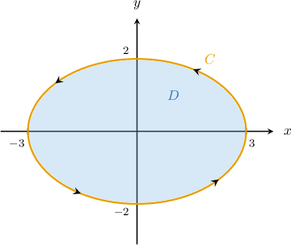
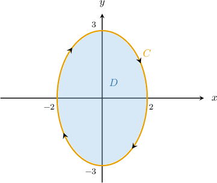
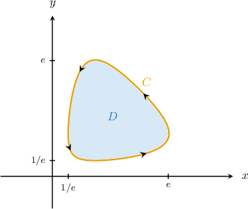
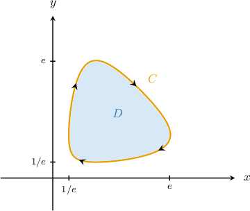
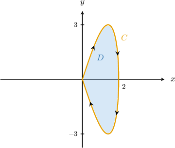
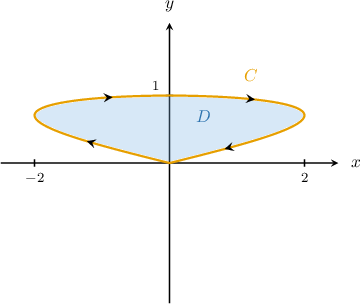
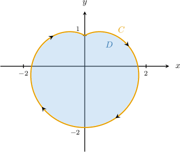
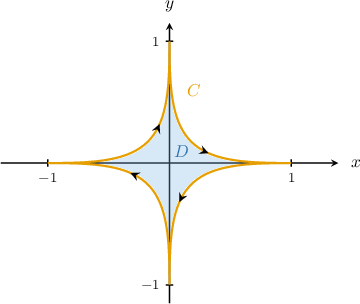

# Template extraction

The four stages below cover all practice questions and both legacy fields. Raw strings remain in source.json; generated UUIDs are new field-owned identities. Source database entity IDs and MA provenance IDs remain author metadata, not new question identities.
## 1. Specific source descriptions
### q-41466: ellipse_ccw

Observed parameters `{'a': 3, 'b': 2}`. Curve x(t)=3*cos(t), y(t)=2*sin(t); t∈(0, 2*pi); counterclockwise. Given field P=0, Q=x has scalar curl one. Prompt contains a curve plot, parametrization, area/double-integral/integral equality with missing integrand, and supplied P/Q. Full source solution verifies unit curl, states Green’s theorem, substitutes the supplied vector field, differentiates both coordinates, gives the unsimplified substitution product, and then collects its scalar factors. No area evaluation appears.

```text


Let $D$ be the region enclosed by the curve $C$ parametrized as
$r(t)=⟨3\operatorname{cos}⁡t,\,2\operatorname{sin}⁡t⟩$ for $t\in [0,2\pi ].$ The area of $D$ can be written as

$$
\text{Area}(D)={∬}_{D}(\frac{∂Q}{∂x}-\frac{∂P}{∂y})dA={\int }_{0}^{2\pi }\boxed{}\,dt,
$$

where $P(x,y)=0$ and $Q(x,y)=x.$ Determine the missing part of the equation.
```
### q-42238: ellipse_cw

Observed parameters `{'a': 2, 'b': 3}`. Curve x(t)=2*sin(t), y(t)=3*cos(t); t∈(0, 2*pi); clockwise. Given field P=-y, Q=0 has scalar curl one. Prompt contains a curve plot, parametrization, area/double-integral/integral equality with missing integrand, and supplied P/Q. Full source solution verifies unit curl, states Green’s theorem, explains negative orientation, substitutes the supplied vector field, differentiates both coordinates, gives the unsimplified substitution product, and then collects its scalar factors. No area evaluation appears.

```text


Let $D$ be the region enclosed by the curve $C$ parametrized as
$r(t)=⟨2\operatorname{sin}⁡t,\,3\operatorname{cos}⁡t⟩$ for $t\in [0,2\pi ].$ 
The area of $D$ can be written as

$$
\text{Area}(D)={∬}_{D}(\frac{∂Q}{∂x}-\frac{∂P}{∂y})dA={\int }_{0}^{2\pi }\boxed{}\,dt,
$$

where $P(x,y)=-y$ and $Q(x,y)=0.$ Determine the missing part of the equation.

*Hint: Note that $C$ is negatively oriented.*
```
### q-42221: exp_ccw

Observed parameters `{'a': 1, 'b': 1}`. Curve x(t)=exp(cos(t)), y(t)=exp(sin(t)); t∈(0, 2*pi); counterclockwise. Given field P=0, Q=x has scalar curl one. Prompt contains a curve plot, parametrization, area/double-integral/integral equality with missing integrand, and supplied P/Q. No solution or correct designation or difficulty survives in the frozen record. Original lesson JSON confirms one five-choice multiple-choice widget and literal AAAAAAA missing-value placeholder.

```text


Let $D$ be the region enclosed by the curve $C$ parametrized as
$r(t) = ⟨e^{\cos t}, e^{\sin t}⟩$ for $t ∈ [0, 2π]$. The area of $D$ can be written as

$Area(D) = ∬_(D)(\frac{∂Q}{∂x} - \frac{∂P}{∂y})dA = \displaystyle \int_{0}^{2π}AAAAAAAdt$,

where $P(x, y) = 0$ and $Q(x, y) = x$. Determine the missing part of the equation.
```
### q-126750: exp_cw

Observed parameters `{'a': 1, 'b': 1}`. Curve x(t)=exp(sin(t)), y(t)=exp(cos(t)); t∈(0, 2*pi); clockwise. Given field P=-y, Q=0 has scalar curl one. Prompt contains a curve plot, parametrization, area/double-integral/integral equality with missing integrand, and supplied P/Q. Full source solution verifies unit curl, states Green’s theorem, explains negative orientation, substitutes the supplied vector field, differentiates both coordinates, gives the unsimplified substitution product, and then collects its scalar factors. No area evaluation appears.

```text


Let $D$ be the region enclosed by the curve $C$ parametrized as
$r(t)=⟨{e}^{\operatorname{sin}⁡t},\,{e}^{\operatorname{cos}⁡t}⟩$ for $t\in [0,2\pi ].$ 
The area of $D$ can be written as

$$
\text{Area}(D)={∬}_{D}(\frac{∂Q}{∂x}-\frac{∂P}{∂y})dA={\int }_{0}^{2\pi }\boxed{}\,dt,
$$

where $P(x,y)=-y$ and $Q(x,y)=0.$ Determine the missing part of the equation.

*Hint: Note that $C$ is negatively oriented.*
```
### q-126751: double_sine

Observed parameters `{'a': 2, 'b': 3}`. Curve x(t)=2*sin(t), y(t)=3*sin(2*t); t∈(0, pi); clockwise. Given field P=0, Q=x has scalar curl one. Prompt contains a curve plot, parametrization, area/double-integral/integral equality with missing integrand, and supplied P/Q. Full source solution verifies unit curl, states Green’s theorem, explains negative orientation, substitutes the supplied vector field, differentiates both coordinates, gives the unsimplified substitution product, and then collects its scalar factors. No area evaluation appears.

```text


Let $D$ be the region enclosed by the curve $C$ parametrized as
$r(t)=⟨2\operatorname{sin}⁡t,\,3\operatorname{sin}⁡2t⟩$ for $t\in [0,\pi ].$ 
The area of $D$ can be written as

$$
\text{Area}(D)={∬}_{D}(\frac{∂Q}{∂x}-\frac{∂P}{∂y})dA={\int }_{0}^{\pi }\boxed{}\,dt,
$$

where $P(x,y)=0$ and $Q(x,y)=x.$ Determine the missing part of the equation.

*Hint: Note that $C$ is negatively oriented.*
```
### q-126748: double_cos

Observed parameters `{'a': 2, 'b': 1}`. Curve x(t)=2*sin(2*t), y(t)=cos(t); t∈(-pi/2, pi/2); clockwise. Given field P=-y, Q=0 has scalar curl one. Prompt contains a curve plot, parametrization, area/double-integral/integral equality with missing integrand, and supplied P/Q. Full source solution verifies unit curl, states Green’s theorem, explains negative orientation, substitutes the supplied vector field, differentiates both coordinates, gives the unsimplified substitution product, and then collects its scalar factors. No area evaluation appears.

```text


Let $D$ be the region enclosed by the curve $C$ parametrized as
$r(t)=⟨2\operatorname{sin}⁡2t,\,\operatorname{cos}⁡t⟩$ for $t\in [-\frac{\pi }{2},\frac{\pi }{2}].$ 
The area of $D$ can be written as

$$
\text{Area}(D)={∬}_{D}(\frac{∂Q}{∂x}-\frac{∂P}{∂y})dA={\int }_{-\pi /2}^{\pi /2}\boxed{}\,dt,
$$

where $P(x,y)=-y$ and $Q(x,y)=0.$ Determine the pointwise integrand obtained from the given $P$, $Q$, and parametrization using Green's theorem, with the sign adjusted for the orientation of $C$.

*Hint: Note that $C$ is negatively oriented.*
```
### q-126760: mixed

Observed parameters `{'a': 1, 'b': 1}`. Curve x(t)=sin(t) - sin(2*t), y(t)=cos(t) - cos(2*t); t∈(pi/3, 5*pi/3); clockwise. Given field P=0, Q=x has scalar curl one. Prompt contains a curve plot, parametrization, area/double-integral/integral equality with missing integrand, and supplied P/Q. Full source solution verifies unit curl, states Green’s theorem, explains negative orientation, substitutes the supplied vector field, differentiates both coordinates, gives the unsimplified substitution product, and then collects its scalar factors. No area evaluation appears.

```text


Let $D$ be the region enclosed by the curve $C$ parametrized as
$r(t)=⟨\operatorname{sin}⁡t-\operatorname{sin}⁡2t,\,\operatorname{cos}⁡t-\operatorname{cos}⁡2t⟩$ for $t\in [\frac{\pi }{3},\frac{5\pi }{3}].$ 
The area of $D$ can be written as

$$
\text{Area}(D)={∬}_{D}(\frac{∂Q}{∂x}-\frac{∂P}{∂y})dA={\int }_{\pi /3}^{5\pi /3}\boxed{}\,dt,
$$

where $P(x,y)=0$ and $Q(x,y)=x.$ Determine the missing part of the equation.

*Hint: Note that $C$ is negatively oriented.*
```
### q-126761: power

Observed parameters `{'a': 1, 'b': 1, 'm': 5}`. Curve x(t)=sin(t)**5, y(t)=cos(t)**5; t∈(0, 2*pi); clockwise. Given field P=0, Q=x has scalar curl one. Prompt contains a curve plot, parametrization, area/double-integral/integral equality with missing integrand, and supplied P/Q. Full source solution verifies unit curl, states Green’s theorem, explains negative orientation, substitutes the supplied vector field, differentiates both coordinates, gives the unsimplified substitution product, and then collects its scalar factors. No area evaluation appears.

```text


Let $D$ be the region enclosed by the curve $C$ parametrized as
$r(t)=⟨{sin}^{5}⁡t,\,{cos}^{5}⁡t⟩$ for $t\in [0,2\pi ].$ 
The area of $D$ can be written as

$$
\text{Area}(D)={∬}_{D}(\frac{∂Q}{∂x}-\frac{∂P}{∂y})dA={\int }_{0}^{2\pi }\boxed{}\,dt,
$$

where $P(x,y)=0$ and $Q(x,y)=x.$ Determine the missing part of the equation.

*Hint: Note that $C$ is negatively oriented.*
```
## 2. Generalized mathematical pattern

Given a simple closed parametrized curve with its traversal and a supplied unit-curl field, form the orientation-adjusted P(x(t),y(t))x′(t)+Q(x(t),y(t))y′(t). Return the pointwise integrand fragment. Fixed fields remain P=-y,Q=0 or P=0,Q=x. Domains and coordinate shapes remain the observed closed loops. No new field-identification demand or evaluated-area demand is introduced. The three levels each have fixed workload bounds, without a sequence of harder subskills within a level.
## 3. Components and every source choice

The following formulas are parameterized expression shapes. Error interpretations are hypotheses except the correct operation; a displayed expression does not reveal the original authoring code. Every bank is retained complete. All recipes reproduce original values exactly at original parameters. `a,b` are outer scales, `m` an odd positive power. Every field's presence/absence of a correct ref remains unchanged in raw replay.
### q-41466

Field 0: `selection`, `:answer-field.type/radio`, correct ref present.

| Captured exact value | Parameterized recipe | Operation-shape label | Correct ref |
|---|---|---|---|
| `6\operatorname{sin}⁡t\operatorname{cos}⁡t` | `a*b\operatorname{sin}⁡t\operatorname{cos}⁡t` | `wrong_derivative` | no |
| `6({sin}^{2}⁡t-{cos}^{2}⁡t)` | `a*b({sin}^{2}⁡t-{cos}^{2}⁡t)` | `antisymmetric_difference_reversed` | no |
| `6({cos}^{2}⁡t-{sin}^{2}⁡t)` | `a*b({cos}^{2}⁡t-{sin}^{2}⁡t)` | `antisymmetric_difference` | no |
| `6{sin}^{2}⁡t` | `a*b{sin}^{2}⁡t` | `wrong_coordinate_and_derivative` | no |
| `6{cos}^{2}⁡t` | `a*b{cos}^{2}⁡t` | `correct` | yes |

Prompt slots: complete coordinate tuple only. Solution slots: complete derivative tuple, complete unsimplified substitution product, complete collected integrand. All remaining prose and math stages are source-fixed. Complete component masks prevent short-token replacement from corrupting differentials or unrelated function labels.

### q-42238

Field 0: `selection`, `:answer-field.type/radio`, correct ref absent.

| Captured exact value | Parameterized recipe | Operation-shape label | Correct ref |
|---|---|---|---|
| `-6\cos^{2} t` | `-a*b\cos^{2} t` | `omit_orientation` | not captured |
| `-6\sin^{2} t` | `-a*b\sin^{2} t` | `swap_coordinate` | not captured |
| `6\cos^{2} t` | `a*b\cos^{2} t` | `correct` | not captured |
| `-6\sin t\cos t` | `-a*b\sin t\cos t` | `swap_coordinate_with_sign` | not captured |
| `6\sin t\cos t` | `a*b\sin t\cos t` | `omit_coordinate_derivative_sign` | not captured |
Field 1: `selection`, `:answer-field.type/radio`, correct ref present.

| Captured exact value | Parameterized recipe | Operation-shape label | Correct ref |
|---|---|---|---|
| `-6{sin}^{2}⁡t` | `-a*b{sin}^{2}⁡t` | `swap_coordinate` | no |
| `6\operatorname{sin}⁡t\operatorname{cos}⁡t` | `a*b\operatorname{sin}⁡t\operatorname{cos}⁡t` | `omit_coordinate_derivative_sign` | no |
| `-6{cos}^{2}⁡t` | `-a*b{cos}^{2}⁡t` | `omit_orientation` | no |
| `-6\operatorname{sin}⁡t\operatorname{cos}⁡t` | `-a*b\operatorname{sin}⁡t\operatorname{cos}⁡t` | `swap_coordinate_with_sign` | no |
| `6{cos}^{2}⁡t` | `a*b{cos}^{2}⁡t` | `correct` | yes |

Prompt slots: complete coordinate tuple only. Solution slots: complete derivative tuple, complete unsimplified substitution product, complete collected integrand. All remaining prose and math stages are source-fixed. Complete component masks prevent short-token replacement from corrupting differentials or unrelated function labels.

### q-42221

Field 0: `selection`, `:answer-field.type/radio`, correct ref absent.

| Captured exact value | Parameterized recipe | Operation-shape label | Correct ref |
|---|---|---|---|
| `\cos te^{\cos t + \sin t}` | `a*b\cos te^{\cos t + \sin t}` | `correct` | not captured |
| `\cos te^{\cos t}` | `b\cos te^{\cos t}` | `omit_x_and_wrong_exponent` | not captured |
| `\sin te^{\cos t}` | `a\sin te^{\cos t}` | `wrong_sign_x_derivative` | not captured |
| `-\sin te^{\sin t}` | `-b\sin te^{\sin t}` | `wrong_y_derivative` | not captured |
| `-\sin te^{\cos t + \sin t}` | `-a*b\sin te^{\cos t + \sin t}` | `use_dx_in_place_of_dy` | not captured |

Prompt slots: complete coordinate tuple only. Solution slots: complete derivative tuple, complete unsimplified substitution product, complete collected integrand. All remaining prose and math stages are source-fixed. Complete component masks prevent short-token replacement from corrupting differentials or unrelated function labels.

### q-126750

Field 0: `selection`, `:answer-field.type/radio`, correct ref present.

| Captured exact value | Parameterized recipe | Operation-shape label | Correct ref |
|---|---|---|---|
| `-\operatorname{sin}⁡t\,{e}^{\operatorname{cos}⁡t+\operatorname{sin}⁡t}` | `-a*b\operatorname{sin}⁡t\,{e}^{\operatorname{cos}⁡t+\operatorname{sin}⁡t}` | `use_y_derivative` | no |
| `\operatorname{cos}⁡t\,{e}^{\operatorname{cos}⁡t+\operatorname{sin}⁡t}` | `a*b\operatorname{cos}⁡t\,{e}^{\operatorname{cos}⁡t+\operatorname{sin}⁡t}` | `correct` | yes |
| `-\operatorname{sin}⁡t\,{e}^{2\operatorname{cos}⁡t}` | `-b**2\operatorname{sin}⁡t\,{e}^{2\operatorname{cos}⁡t}` | `use_y_times_y_derivative` | no |
| `\operatorname{cos}⁡t\,{e}^{2\operatorname{sin}⁡t}` | `a**2\operatorname{cos}⁡t\,{e}^{2\operatorname{sin}⁡t}` | `use_x_times_x_derivative` | no |
| `-\operatorname{cos}⁡t\,{e}^{\operatorname{cos}⁡t+\operatorname{sin}⁡t}` | `-a*b\operatorname{cos}⁡t\,{e}^{\operatorname{cos}⁡t+\operatorname{sin}⁡t}` | `omit_orientation` | no |

Prompt slots: complete coordinate tuple only. Solution slots: complete derivative tuple, complete unsimplified substitution product, complete collected integrand. All remaining prose and math stages are source-fixed. Complete component masks prevent short-token replacement from corrupting differentials or unrelated function labels.

### q-126751

Field 0: `selection`, `:answer-field.type/radio`, correct ref present.

| Captured exact value | Parameterized recipe | Operation-shape label | Correct ref |
|---|---|---|---|
| `-18\operatorname{sin}⁡2t\operatorname{cos}⁡2t` | `-2*b**2\operatorname{sin}⁡2t\operatorname{cos}⁡2t` | `use_y_times_y_derivative` | no |
| `-12\operatorname{sin}⁡t\operatorname{cos}⁡2t` | `-2*a*b\operatorname{sin}⁡t\operatorname{cos}⁡2t` | `correct` | yes |
| `-4\operatorname{sin}⁡t\operatorname{cos}⁡t` | `-a**2\operatorname{sin}⁡t\operatorname{cos}⁡t` | `use_x_times_x_derivative` | no |
| `6\operatorname{sin}⁡2t\operatorname{cos}⁡t` | `a*b\operatorname{sin}⁡2t\operatorname{cos}⁡t` | `use_y_times_x_derivative` | no |
| `-6\operatorname{sin}⁡2t\operatorname{cos}⁡t` | `-a*b\operatorname{sin}⁡2t\operatorname{cos}⁡t` | `use_negative_y_times_x_derivative` | no |

Prompt slots: complete coordinate tuple only. Solution slots: complete derivative tuple, complete unsimplified substitution product, complete collected integrand. All remaining prose and math stages are source-fixed. Complete component masks prevent short-token replacement from corrupting differentials or unrelated function labels.

### q-126748

Field 0: `selection`, `:answer-field.type/radio`, correct ref present.

| Captured exact value | Parameterized recipe | Operation-shape label | Correct ref |
|---|---|---|---|
| `4\operatorname{cos}⁡t\operatorname{cos}⁡2t` | `2*a*b\operatorname{cos}⁡t\operatorname{cos}⁡2t` | `correct` | yes |
| `2\operatorname{sin}⁡2t\operatorname{sin}⁡t` | `a*b\operatorname{sin}⁡2t\operatorname{sin}⁡t` | `use_negative_x_times_y_derivative` | no |
| `-\operatorname{cos}⁡t\operatorname{sin}⁡t` | `-b**2\operatorname{cos}⁡t\operatorname{sin}⁡t` | `use_y_times_y_derivative` | no |
| `-2\operatorname{sin}⁡2t\operatorname{sin}⁡t` | `-a*b\operatorname{sin}⁡2t\operatorname{sin}⁡t` | `use_x_times_y_derivative` | no |
| `-8\operatorname{sin}⁡2t\operatorname{cos}⁡2t` | `-2*a**2\operatorname{sin}⁡2t\operatorname{cos}⁡2t` | `use_negative_x_times_x_derivative` | no |

Prompt slots: complete coordinate tuple only. Solution slots: complete derivative tuple, complete unsimplified substitution product, complete collected integrand. All remaining prose and math stages are source-fixed. Complete component masks prevent short-token replacement from corrupting differentials or unrelated function labels.

### q-126760

Field 0: `selection`, `:answer-field.type/radio`, correct ref present.

| Captured exact value | Parameterized recipe | Operation-shape label | Correct ref |
|---|---|---|---|
| `(\operatorname{sin}⁡2t-\operatorname{sin}⁡t)(\operatorname{cos}⁡t-2\operatorname{cos}⁡2t)` | `a*b(\operatorname{sin}⁡2t-\operatorname{sin}⁡t)(\operatorname{cos}⁡t-2\operatorname{cos}⁡2t)` | `wrong_coordinate_derivative` | no |
| `(\operatorname{cos}⁡2t-\operatorname{cos}⁡t)(2\operatorname{sin}⁡2t-\operatorname{sin}⁡t)` | `a*b(\operatorname{cos}⁡2t-\operatorname{cos}⁡t)(2\operatorname{sin}⁡2t-\operatorname{sin}⁡t)` | `wrong_coordinate` | no |
| `(\operatorname{sin}⁡t-\operatorname{sin}⁡2t)(2\operatorname{sin}⁡2t-\operatorname{sin}⁡t)` | `a*b(\operatorname{sin}⁡t-\operatorname{sin}⁡2t)(2\operatorname{sin}⁡2t-\operatorname{sin}⁡t)` | `omit_orientation` | no |
| `(\operatorname{cos}⁡2t-\operatorname{cos}⁡t)(\operatorname{cos}⁡t-2\operatorname{cos}⁡2t)` | `a*b(\operatorname{cos}⁡2t-\operatorname{cos}⁡t)(\operatorname{cos}⁡t-2\operatorname{cos}⁡2t)` | `wrong_coordinate_and_derivative` | no |
| `(\operatorname{sin}⁡2t-\operatorname{sin}⁡t)(2\operatorname{sin}⁡2t-\operatorname{sin}⁡t)` | `a*b(\operatorname{sin}⁡2t-\operatorname{sin}⁡t)(2\operatorname{sin}⁡2t-\operatorname{sin}⁡t)` | `correct` | yes |

Prompt slots: complete coordinate tuple only. Solution slots: complete derivative tuple, complete unsimplified substitution product, complete collected integrand. All remaining prose and math stages are source-fixed. Complete component masks prevent short-token replacement from corrupting differentials or unrelated function labels.

### q-126761

Field 0: `selection`, `:answer-field.type/radio`, correct ref present.

| Captured exact value | Parameterized recipe | Operation-shape label | Correct ref |
|---|---|---|---|
| `5{cos}^{6}⁡t{sin}^{4}⁡t` | `5*a*b{cos}^{6}⁡t{sin}^{4}⁡t` | `swap_axes` | no |
| `-5{cos}^{5}⁡t{sin}^{5}⁡t` | `-5*a*b{cos}^{5}⁡t{sin}^{5}⁡t` | `multiply_coordinates_with_derivative_coefficient` | no |
| `5{cos}^{5}⁡t\operatorname{sin}⁡t` | `5*b{cos}^{5}⁡t\operatorname{sin}⁡t` | `omit_x_and_wrong_power` | no |
| `-5{sin}^{6}⁡t{cos}^{4}⁡t` | `-5*a*b{sin}^{6}⁡t{cos}^{4}⁡t` | `omit_orientation` | no |
| `5{sin}^{6}⁡t{cos}^{4}⁡t` | `5*a*b{sin}^{6}⁡t{cos}^{4}⁡t` | `correct` | yes |

Prompt slots: complete coordinate tuple only. Solution slots: complete derivative tuple, complete unsimplified substitution product, complete collected integrand. All remaining prose and math stages are source-fixed. Complete component masks prevent short-token replacement from corrupting differentials or unrelated function labels.

## 4. Reusable templates, constraints and calculations

`source_masks()` replaces complete mathematical components with named slots; `components()` emits them with source notation, including the exact source sentence/stage sequence. At original parameters, public `observed_raw` replays all eight complete prompts and all seven available solutions verbatim. The eighth solution is absent and stays absent in raw replay. Plot references stay raw when geometry is unchanged; changed-parameter raw evidence uses a rendered same-instance plot.

Shared exact calculations produce x,y,x′,y′, the unit-curl field substitution and the orientation-adjusted scalar product. Collection does not erase the unsimplified product row. For mixed harmonics, the two ordered source factor masks remain visible before the reordered factored final row. Powers retain their outer derivative coefficient m and derivative exponent m−1.

Parameter policy: easy clockwise circles a=b∈{2,3,4,5,6}; moderate unequal ellipse a,b∈1..6 with the scale in the first substitution factor greater than one; hard outer scales a,b∈1..6 with that same authored-bank restriction, and power m∈{3,5,7}. Explicit inputs follow the same bounds and reject complete-bank collisions without silent resampling. Raw replay permits original unit scales. These are authored bounds, not recovered source sampling code. Equal-product semiaxis pairs do not inflate mathematical task counts: fingerprint uses the demanded integrand and actual interval, omitting profile, seed, option order, coordinate aliases and intermediate scale spelling. Presentation identity includes full prompt, fixed solution, field types, complete banks and correct attribute presence.

The complete authored default bank is selected before parameters: correct product; reversed orientation; omitted first-coordinate scale; incorrectly doubled derivative; coordinate substituted in place of its derivative. This bank has exactly five expressions. The two omission/doubling recipes require a first-factor scale greater than one. Every instance is rejected whole if any pointwise expressions or complete definite integrals coincide. For exponential terms, full integrals use exact modified Bessel constants from the Fourier integral; high-precision separation is used only when SymPy does not settle equality of distinct Bessel constants. The actual grading engine receives radio IDs; its strict selections are tested separately from these mathematical criteria.

### Source anomalies, repairs and evidence limits

- q-42221: original lesson snapshot and frozen EDB both lack a correct key and worked solution; EDB also lacks difficulty. AAAAAAA is a captured missing-integrand placeholder. Derivation from x=e^(cos t), y=e^(sin t), positive orientation and Q=x gives cos(t)e^(cos t+sin t). Normal output authors that correct designation, a full standard solution with the shared source sentences, a hard level supported by q-126750, and a valid displayed integral with boxed missing fragment. None counts as a matched missing source designation or existing solution.
- q-42238: original MA lesson JSON (`/home/jake/Developer/MA/DATA/Lessons/2198/Source/2198.json`) shows one widget with five choices. Frozen EDB retains two selection fields; first has no correct designation, second is complete. Raw API preserves both; normal output uses one complete field.
- q-41466: cos² and sin² have equal full definite integrals. q-42238 likewise has repeated zero integral values among odd products. q-126750 has equal full integrals for negative sine/cosine exponential terms. Several other banks have equal zero integral values. `validation.json` reports every equal-value pair for all nine fields. Raw banks remain public evidence; no ambiguous full-integral bank is advertised as normal learner output.
- q-126748 explicitly requests the **pointwise** integrand in the frozen prompt. Its source is correct under that criterion even when whole integral values coincide. Full-integral coincidences are still recorded; normal authored bank uses unique complete values.
- q-126760 and q-126761 retain piecewise/smooth labels and actual negative traversal; no source geometry is inferred from an orientation label alone. All source arrows were inspected at original resolution.

Raw-exact fidelity is eight prompts, seven existing solutions, nine field layouts, forty-five displayed choice values and seven existing correct designations. Missing original keys stay absent. Normal presentation normalizes function notation, updates the plot reference, and explicitly requests the pointwise integrand using the q-126748 response criterion. These presentation changes are separately identified; raw evidence profiles are learner-ineligible and excluded from native delivery fixtures.

### Finite variety audit

`variety.json` enumerates the authored domain without counting equal product scales twice: easy circle 5 mathematical tasks; moderate ellipse 13; each simple hard family 17; odd-power hard family 51. These are finite practice families, not unlimited variety. Profile, plot aliases and option shuffle do not count as new tasks. Cross-family equal integrands/intervals share a fingerprint as well. The sampler preserves the same elementary multiplication/chain-rule workload.
