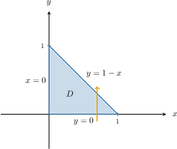
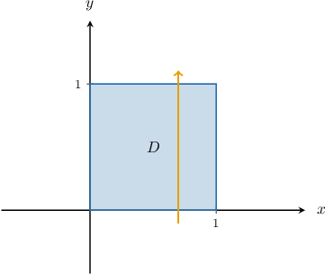
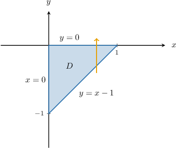
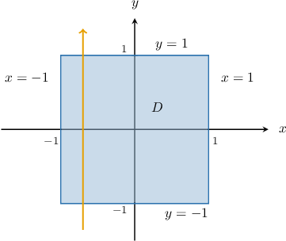
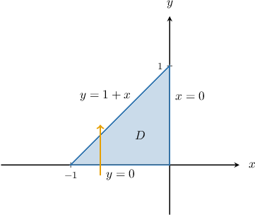

# Originals and clearly labelled generated variants

Frozen basis 1356. Raw originals are evidence only, including opaque banks.

## unrated — ORIGINAL EVIDENCE

Parameters: {"k": 1}

Use Stokes' theorem to evaluate
$∮_(C)F \cdot dr$,
where $curlF = ⟨0, 0,-2y⟩$, and $C$ is the intersection of the cylinder $x^{2} + y^{2} = 1$ and the plane $z = 4 - x - 2y$. The curve $C$ is oriented counter-clockwise when viewed from above.

- 0
- - π
- π
- \frac{π}{2}
- 2π

## triangle — ORIGINAL EVIDENCE

Parameters: {"k": 1}

Let $C$ be the intersection of the paraboloid $z=10-{x}^{2}-{y}^{2}$ and the boundary of the infinite vertical column enclosed by the planes $x+y=1,$ $x=0,$ and $y=0.$ Given that the curve $C$ is oriented counter-clockwise when viewed from above and $\text{curl}\,F=⟨-2z,\,0,\,0⟩,$ the circulation of $F$ along $C$ can be written as 

$$
{∮}_{C}F\cdot dr=
$$

- \displaystyle \int_{0}^{1}\displaystyle \int_{0}^{x}20 - 4 x 2 + 4 y 2dydx
- \displaystyle \int_{0}^{1}\displaystyle \int_{0}^{1 - x}4 x 3 + 4 x y 2 - 40 xdydx
- \displaystyle \int_{0}^{1}\displaystyle \int_{0}^{1}4 x 3 + 4 x y 2 - 40 xdydx
- \displaystyle \int_{0}^{1}\displaystyle \int_{0}^{1 - x}20 - 4 x 2 + 4 y 2dydx
- \displaystyle \int_{0}^{1}\displaystyle \int_{0}^{1}20 - 4 x 2 + 4 y 2dydx
- {\int }_{0}^{1}{\int }_{0}^{1-x}\,20-4{x}^{2}+4{y}^{2}\,\text{d}y\,\text{d}x
- {\int }_{0}^{1}{\int }_{0}^{1}\,4{x}^{3}+4x{y}^{2}-40x\,\text{d}y\,\text{d}x
- {\int }_{0}^{1}{\int }_{0}^{1}\,20-4{x}^{2}+4{y}^{2}\,\text{d}y\,\text{d}x
- {\int }_{0}^{1}{\int }_{0}^{x}\,20-4{x}^{2}+4{y}^{2}\,\text{d}y\,\text{d}x
- {\int }_{0}^{1}{\int }_{0}^{1-x}\,4{x}^{3}+4x{y}^{2}-40x\,\text{d}y\,\text{d}x

Let $S$ be an oriented piecewise-smooth surface bounded by a simple, closed, piecewise-smooth boundary $C$ with positive orientation. If a vector field $F$ has continuous partial derivatives for all its components in an open region in space that contains $S,$ then Stokes' theorem states that

$$
{∮}_{C}F\cdot dr={∬}_{S}\text{curl}\,F\cdot \text{d}S.
$$

There are many surfaces whose boundary is the curve $C$ representing the intersection of the paraboloid $z=10-{x}^{2}-{y}^{2}$ and the boundary of our infinite vertical column. One such surface is our paraboloid $S$ with the equation 

$$
z=g(x,y)=10-{x}^{2}-{y}^{2}.
$$

We first compute the partial derivatives of the graph $z=g(x,y):$

$$
\begin{aligned}\frac{∂g}{∂x} & =\frac{∂}{∂x}(10-{x}^{2}-{y}^{2})=-2x \\ \frac{∂g}{∂y} & =\frac{∂}{∂y}(10-{x}^{2}-{y}^{2})=-2y\end{aligned}
$$

Next, we substitute the equation $z=g(x,y)$ into expression for $\text{curl}\,F:$

$$
\begin{aligned}\text{curl}\,F\,{|}_{z=g(x,y)} & =⟨-2z,\,0,\,0⟩{|}_{z=10-{x}^{2}-{y}^{2}} \\  & =⟨-2(10-{x}^{2}-{y}^{2}),\,0,\,0⟩ \\  & =⟨{{2{x}^{2}+2{y}^{2}-20}_{⏟}}_{P},\,{{0}_{⏟}}_{Q},\,{{0}_{⏟}}_{R}⟩\end{aligned}
$$

So, we have 

$$
\begin{aligned}{∬}_{S}\text{curl}\,F\cdot \text{d}S & ={∬}_{D}(-P\frac{∂g}{∂x}-Q\frac{∂g}{∂y}+R)\text{d}A \\  & ={∬}_{D}(-(2{x}^{2}+2{y}^{2}-20)\cdot (-2x)-0\cdot (-2y)+0)\,\text{d}A \\  & ={∬}_{D}(4{x}^{3}+4x{y}^{2}-40x)\,\text{d}A,\end{aligned}
$$

where $D$ is region enclosed by the projection of $C$ onto the $xy$-plane, shown below.

Therefore, we obtain

$$
\begin{aligned}{∬}_{D}(4{x}^{3}+4x{y}^{2}-40x)\,\text{d}A & ={\int }_{0}^{1}{\int }_{0}^{1-x}\,4{x}^{3}+4x{y}^{2}-40x\,\text{d}y\,\text{d}x.\end{aligned}
$$

## tilted_blank — ORIGINAL EVIDENCE

Parameters: {"k": 1}

Let $C$ be the boundary of the top (tilted) surface of our solid. The curve $C$ is oriented counter-clockwise when viewed from above, as shown in the diagram. Use Stokes' theorem to write down the integral that gives the circulation of the air along $C.$

                            
                                    
                                        
                                            

                                                

                                        
                                        
                                        

                                    
                                
                                    
                                        
                                        The required circulation is ${∮}_{C}^{}F\cdot dr\,={\int }_{0}^{1}{\int }_{0}^{1}$

                                    
                                
                                    
                            
                                        {{field-1}}                
                                    
                                
                                    
                                        
                                         
$\text{d}y\,\text{d}x$

- 2xy-2x-{y}^{2}+8

Let $S$ be an oriented piecewise-smooth surface bounded by a simple, closed, piecewise-smooth boundary $C$ with positive orientation. If a vector field $F$ has continuous partial derivatives for all its components in an open region in space that contains $S,$ then Stokes' theorem states that

$$
{∮}_{C}F\cdot dr={∬}_{S}\text{curl}\,F\cdot \text{d}S.
$$

There are many surfaces whose boundary is the curve $C.$ One such surface is our top (tilted) surface ${S}_{T}$ with the equation 

$$
z=g(x,y)=4-x-y.
$$

We first compute the partial derivatives of the graph $z=g(x,y):$

$$
\begin{aligned}\frac{∂g}{∂x} & =\frac{∂}{∂x}(4-x-y)=-1 \\ \frac{∂g}{∂y} & =\frac{∂}{∂y}(4-x-y)=-1\end{aligned}
$$

Next, we substitute the equation $z=g(x,y)$ into expression for $\text{curl}\,F:$

$$
\begin{aligned}\text{curl}\,F\,{|}_{z=g(x,y)} & =⟨2xy,\,2z-{y}^{2},\,2y⟩{|}_{z=4-x-y} \\  & =⟨2xy,\,2(4-x-y)-{y}^{2},\,2y⟩ \\  & =⟨{{2xy}_{⏟}}_{P},\,{{8-2x-2y-{y}^{2}}_{⏟}}_{Q},\,{{2y}_{⏟}}_{R}⟩\end{aligned}
$$

So, we have 

$$
\begin{aligned}{∬}_{{S}_{T}}\text{curl}\,F\cdot \text{d}S & ={∬}_{D}(-P\frac{∂g}{∂x}-Q\frac{∂g}{∂y}+R)\text{d}A \\  & ={∬}_{D}(-(2xy)\cdot (-1)-(8-2x-2y-{y}^{2})\cdot (-1)+2y)\,\text{d}A \\  & ={∬}_{D}(2xy-2x-{y}^{2}+8)\,\text{d}A,\end{aligned}
$$

where $D$ is region enclosed by the projection of $C$ onto the $xy$-plane, shown below.

Therefore, we obtain

$$
{∬}_{D}(2xy-2x-{y}^{2}+8)\,\text{d}A={\int }_{0}^{1}{\int }_{0}^{1}2xy-2x-{y}^{2}+8\,\text{d}y\,\text{d}x.
$$

## xy_triangle — ORIGINAL EVIDENCE

Parameters: {"k": 1}

Let $C$ be the intersection of the paraboloid $z=1+{x}^{2}+2{y}^{2}$ and the boundary of the infinite vertical column enclosed by the planes $x-y=1,$ $x=0,$ and $y=0.$ Given that the curve $C$ is oriented counter-clockwise when viewed from above and $\text{curl}\,F=⟨y,\,-x,\,1⟩,$ the circulation of $F$ along $C$ can be written as 

$$
{∮}_{C}F\cdot dr=
$$

- $$
\begin{aligned}{\int }_{0}^{1}{\int }_{0}^{x-1}\,2xy+1\,\text{d}y\,\text{d}x\end{aligned}
$$
- $$
\begin{aligned}{\int }_{0}^{1}{\int }_{0}^{x-1}\,-2xy+1\,\text{d}y\,\text{d}x\end{aligned}
$$
- $$
\begin{aligned}{\int }_{0}^{1}{\int }_{0}^{1-x}\,{x}^{2}+2{y}^{2}\,\text{d}y\,\text{d}x\end{aligned}
$$
- $$
\begin{aligned}{\int }_{0}^{1}{\int }_{x-1}^{0}\,-2xy-1\,\text{d}y\,\text{d}x\end{aligned}
$$
- $$
\begin{aligned}{\int }_{0}^{1}{\int }_{x-1}^{0}\,2xy+1\,\text{d}y\,\text{d}x\end{aligned}
$$

Let $S$ be an oriented piecewise-smooth surface bounded by a simple, closed, piecewise-smooth boundary $C$ with positive orientation. If a vector field $F$ has continuous partial derivatives for all its components in an open region in space that contains $S,$ then Stokes' theorem states that

$$
{∮}_{C}F\cdot dr={∬}_{S}\text{curl}\,F\cdot \text{d}S.
$$

There are many surfaces whose boundary is the curve $C$ representing the intersection of the paraboloid $z=1+{x}^{2}+2{y}^{2}$ and the boundary of our infinite vertical column. One such surface is our paraboloid $S$ with the equation 

$$
z=g(x,y)=1+{x}^{2}+2{y}^{2}.
$$

We first compute the partial derivatives of the graph $z=g(x,y):$

$$
\begin{aligned}\frac{∂g}{∂x} & =\frac{∂}{∂x}(1+{x}^{2}+2{y}^{2})=2x \\ \frac{∂g}{∂y} & =\frac{∂}{∂y}(1+{x}^{2}+2{y}^{2})=4y\end{aligned}
$$

Next, we substitute the equation $z=g(x,y)$ into expression for $\text{curl}\,F:$

$$
\begin{aligned}\text{curl}\,F\,{|}_{z=g(x,y)} & =⟨y,\,-x,\,1⟩{|}_{z=1+{x}^{2}+2{y}^{2}} \\  & =⟨y,\,-x,\,1⟩ \\  & =⟨{{y}_{⏟}}_{P},\,{{-x}_{⏟}}_{Q},\,{{1}_{⏟}}_{R}⟩\end{aligned}
$$

So, we have 

$$
\begin{aligned}{∬}_{S}\text{curl}\,F\cdot \text{d}S & ={∬}_{D}(-P\frac{∂g}{∂x}-Q\frac{∂g}{∂y}+R)\text{d}A \\  & ={∬}_{D}(-y\cdot (2x)-(-x)\cdot (4y)+1)\,\text{d}A \\  & ={∬}_{D}(2xy+1)\,\text{d}A,\end{aligned}
$$

where $D$ is region enclosed by the projection of $C$ onto the $xy$-plane, shown below.

Therefore, we obtain

$$
\begin{aligned}{∬}_{D}(2xy+1)\,\text{d}A & ={\int }_{0}^{1}{\int }_{x-1}^{0}\,2xy+1\,\text{d}y\,\text{d}x.\end{aligned}
$$

## exponential — ORIGINAL EVIDENCE

Parameters: {"k": 1}

Use Stokes' theorem to evaluate 

$$
{∮}_{C}F\cdot dr,
$$

where $\text{curl}\,F=⟨-x{e}^{z},\,0,\,{e}^{z}⟩,$ and $C$ is the intersection of the paraboloid $z={x}^{2}+{y}^{2}$ and the plane $z=4.$ The curve $C$ is oriented counter-clockwise when viewed from above.

- 2\pi +{e}^{4}
- 4{\pi }^{2}+{e}^{2}
- 4\pi {e}^{4}
- 2\pi {e}^{2}
- 4\pi +{e}^{2}

Let $S$ be an oriented piecewise-smooth surface bounded by a simple, closed, piecewise-smooth boundary $C$ with positive orientation. If a vector field $F$ has continuous partial derivatives for all its components in an open region in space that contains $S,$ then Stokes' theorem states that

$$
{∮}_{C}F\cdot dr={∬}_{S}\text{curl}\,F\cdot \text{d}S.
$$

There are many surfaces whose boundary is the curve $C$ representing the intersection of the paraboloid $z={x}^{2}+{y}^{2}$ and the plane $z=4.$ One such surface would be the plane $S$ with the equation 

$$
z=g(x,y)=4.
$$

We first compute the partial derivatives of the graph $z=g(x,y):$

$$
\begin{aligned}\frac{∂g}{∂x} & =\frac{∂}{∂x}(4)=0 \\ \frac{∂g}{∂y} & =\frac{∂}{∂y}(4)=0\end{aligned}
$$

Next, we substitute the equation $z=g(x,y)$ into the expression for $\text{curl}\,F:$

$$
\begin{aligned}\text{curl}\,F\,{|}_{z=g(x,y)} & =⟨-x{e}^{z},\,0,\,{e}^{z}⟩{|}_{z=4} \\  & =⟨{{-x{e}^{4}}_{⏟}}_{P},\,{{0}_{⏟}}_{Q},\,{{{e}^{4}}_{⏟}}_{R}⟩\end{aligned}
$$

So, we have 

$$
\begin{aligned}{∬}_{S}\text{curl}\,F\cdot \text{d}S & ={∬}_{D}(-P\frac{∂g}{∂x}-Q\frac{∂g}{∂y}+R)\text{d}A \\  & ={∬}_{D}(-0\cdot (-x{e}^{4})-0\cdot 0+{e}^{4})\,\text{d}A \\  & ={∬}_{D}{e}^{4}\,\text{d}A,\end{aligned}
$$

where $D$ is region enclosed by the projection of $C$ onto the $xy$-plane.

Notice that the projection of $C$ onto the $xy$-plane is the circle ${x}^{2}+{y}^{2}=4$ with radius $2$ centered at the origin. Therefore, using the change of variables to polar coordinates

$$
x=r\operatorname{cos}⁡\theta ,\,y=r\operatorname{sin}⁡\theta ,\,\text{d}A=r\,\text{d}r\text{d}\theta ,
$$

 

we obtain

$$
\begin{aligned}{∬}_{D}{e}^{4}\,\text{d}A & ={\int }_{0}^{2\pi }{\int }_{0}^{2}{e}^{4}\cdot r\,\text{d}r\,\text{d}\theta  \\  & ={e}^{4}{\int }_{0}^{2\pi }\,\text{d}\theta \cdot {\int }_{0}^{2}r\,\text{d}r \\  & ={e}^{4}[\theta ]_{\theta =0}^{\theta =2\pi }\cdot {[\frac{{r}^{2}}{2}]}_{r=0}^{r=2} \\  & ={e}^{4}(2\pi -0)\cdot (2-0) \\  & =4\pi {e}^{4}.\end{aligned}
$$

## odd_plane — ORIGINAL EVIDENCE

Parameters: {"k": 1}

Use Stokes' theorem to evaluate 

$$
{∮}_{C}F\cdot dr,
$$

where $\text{curl}\,F=⟨0,\,z,\,x⟩,$ and $C$  is the intersection of the cylinder ${x}^{2}+{y}^{2}=1$ and the plane $z=x.$ The curve $C$ is oriented counter-clockwise when viewed from above.

- 4\pi 
- -\pi 
- 2\pi 
- \frac{3}{2}\pi 
- 0

Let $S$ be an oriented piecewise-smooth surface bounded by a simple, closed, piecewise-smooth boundary $C$ with positive orientation. If a vector field $F$ has continuous partial derivatives for all its components in an open region in space that contains $S,$ then Stokes' theorem states that

$$
{∮}_{C}F\cdot dr={∬}_{S}\text{curl}\,F\cdot \text{d}S.
$$

There are many surfaces whose boundary is the curve $C$ representing the intersection of the cylinder ${x}^{2}+{y}^{2}=1$ and the plane $z=x.$ One such surface would be the plane $S$ with the equation 

$$
z=g(x,y)=x.
$$

We first compute the partial derivatives of the graph $z=g(x,y):$

$$
\begin{aligned}\frac{∂g}{∂x} & =\frac{∂}{∂x}(x)=1 \\ \frac{∂g}{∂y} & =\frac{∂}{∂y}(x)=0\end{aligned}
$$

Next, we substitute the equation $z=g(x,y)$ into the expression for $\text{curl}\,F:$

$$
\begin{aligned}\text{curl}\,F\,{|}_{z=g(x,y)} & =⟨0,\,z,\,x⟩{|}_{z=x} \\  & =⟨{{0}_{⏟}}_{P},\,{{x}_{⏟}}_{Q},\,{{x}_{⏟}}_{R}⟩\end{aligned}
$$

So, we have 

$$
\begin{aligned}{∬}_{S}\text{curl}\,F\cdot \text{d}S & ={∬}_{D}(-P\frac{∂g}{∂x}-Q\frac{∂g}{∂y}+R)\text{d}A \\  & ={∬}_{D}(-0\cdot 1-x\cdot 0+x))\,\text{d}A \\  & ={∬}_{D}x\,\text{d}A,\end{aligned}
$$

where $D$ is region enclosed by the projection of $C$ onto the $xy$-plane.

Notice that the projection of $C$ onto the $xy$-plane is the circle ${x}^{2}+{y}^{2}=1$ with radius $1$ centered at the origin. Therefore, using the change of variables to polar coordinates

$$
x=r\operatorname{cos}⁡\theta ,\,y=r\operatorname{sin}⁡\theta ,\,\text{d}A=r\,\text{d}r\text{d}\theta ,
$$

 

we obtain

$$
\begin{aligned}{∬}_{D}x\,\text{d}A & ={\int }_{0}^{1}{\int }_{0}^{2\pi }r\operatorname{cos}⁡\theta \cdot r\,\text{d}\theta \,\text{d}r \\  & ={\int }_{0}^{1}{\int }_{0}^{2\pi }{r}^{2}\operatorname{cos}⁡\theta \,\text{d}\theta \,\text{d}r \\  & ={\int }_{0}^{1}{[{r}^{2}\operatorname{sin}⁡\theta ]}_{0}^{2\pi }\,\text{d}r \\  & =0.\end{aligned}
$$

## negative_cone — ORIGINAL EVIDENCE

Parameters: {"k": 1}

Use Stokes' theorem to evaluate 

$$
{∮}_{C}F\cdot dr,
$$

where $\text{curl}\,F=⟨y,\,2yz,\,-{z}^{2}+1⟩,$ and $C$ is the intersection of the half-cone $z=-\sqrt{{x}^{2}+{y}^{2}}$ and the plane $z=-3.$ The curve $C$ is oriented counter-clockwise when viewed from above.

- -36\pi 
- 144\pi 
- -72\pi 
- 18\pi 
- 0

Let $S$ be an oriented piecewise-smooth surface bounded by a simple, closed, piecewise-smooth boundary $C$ with positive orientation. If a vector field $F$ has continuous partial derivatives for all its components in an open region in space that contains $S,$ then Stokes' theorem states that

$$
{∮}_{C}F\cdot dr={∬}_{S}\text{curl}\,F\cdot \text{d}S.
$$

There are many surfaces whose boundary is the curve $C$ representing the intersection of the half-cone $z=-\sqrt{{x}^{2}+{y}^{2}}$ and the plane $z=-3.$ One such surface would be the plane $S$ with the equation 

$$
z=g(x,y)=-3.
$$

We first compute the partial derivatives of the graph $z=g(x,y):$

$$
\begin{aligned}\frac{∂g}{∂x} & =\frac{∂}{∂x}(-3)=0 \\ \frac{∂g}{∂y} & =\frac{∂}{∂y}(-3)=0\end{aligned}
$$

Next, we substitute the equation $z=g(x,y)$ into the expression for $\text{curl}\,F:$

$$
\begin{aligned}\text{curl}\,F\,{|}_{z=g(x,y)} & =⟨y,\,2yz,\,-{z}^{2}+1⟩{|}_{z=-3} \\  & =⟨{{y}_{⏟}}_{P},\,{{-6y}_{⏟}}_{Q},\,{{-8}_{⏟}}_{R}⟩\end{aligned}
$$

So, we have 

$$
\begin{aligned}{∬}_{S}\text{curl}\,F\cdot \text{d}S & ={∬}_{D}(-P\frac{∂g}{∂x}-Q\frac{∂g}{∂y}+R)\text{d}A \\  & ={∬}_{D}(-y\cdot 0-(-6y)\cdot 0-8)\,\text{d}A \\  & ={∬}_{D}-8\,\text{d}A,\end{aligned}
$$

where $D$ is region enclosed by the projection of $C$ onto the $xy$-plane.

Notice that the projection of $C$ onto the $xy$-plane is the circle ${x}^{2}+{y}^{2}=9$ with radius $3$ centered at the origin. Therefore, using the change of variables to polar coordinates

$$
x=r\operatorname{cos}⁡\theta ,\,y=r\operatorname{sin}⁡\theta ,\,\text{d}A=r\,\text{d}r\text{d}\theta ,
$$

 

we obtain

$$
\begin{aligned}{∬}_{D}-8\,\text{d}A & ={\int }_{0}^{2\pi }{\int }_{0}^{3}-8\cdot r\,\text{d}r\,\text{d}\theta  \\  & =-8{\int }_{0}^{2\pi }\,\text{d}\theta \cdot {\int }_{0}^{3}r\,\text{d}r \\  & =-8[\theta ]_{\theta =0}^{\theta =2\pi }\cdot {[\frac{{r}^{2}}{2}]}_{r=0}^{r=3} \\  & =-8(2\pi -0)\cdot (\frac{9}{2}-0) \\  & =-72\pi .\end{aligned}
$$

## tilted_disk — ORIGINAL EVIDENCE

Parameters: {"k": 1}

Use Stokes' theorem to evaluate 

$$
{∮}_{C}F\cdot dr,
$$

where $\text{curl}\,F=⟨-y,\,z,\,-2x⟩,$ and $C$ is the intersection of the cylinder ${x}^{2}+{y}^{2}=1$ and the plane $z=2+2x-y.$ The curve $C$ is oriented counter-clockwise when viewed from above.

- \pi 
- \frac{4}{3}\pi 
- \frac{2}{3}
- 0
- 2\pi 

Let $S$ be an oriented piecewise-smooth surface bounded by a simple, closed, piecewise-smooth boundary $C$ with positive orientation. If a vector field $F$ has continuous partial derivatives for all its components in an open region in space that contains $S,$ then Stokes' theorem states that

$$
{∮}_{C}F\cdot dr={∬}_{S}\text{curl}\,F\cdot \text{d}S.
$$

There are many surfaces whose boundary is the curve $C$ representing the intersection of the cylinder ${x}^{2}+{y}^{2}=1$ and the plane $z=2+2x-y.$ One such surface would be the plane $S$ with the equation 

$$
z=g(x,y)=2+2x-y.
$$

We first compute the partial derivatives of the graph $z=g(x,y):$

$$
\begin{aligned}\frac{∂g}{∂x} & =\frac{∂}{∂x}(2+2x-y)=2 \\ \frac{∂g}{∂y} & =\frac{∂}{∂y}(2+2x-y)=-1\end{aligned}
$$

Next, we substitute the equation $z=g(x,y)$ into the expression for $\text{curl}\,F:$

$$
\begin{aligned}\text{curl}\,F\,{|}_{z=g(x,y)} & =⟨-y,\,z,\,-2x⟩{|}_{z=2+2x-y} \\  & =⟨{{-y}_{⏟}}_{P},\,{{2+2x-y}_{⏟}}_{Q},\,{{-2x}_{⏟}}_{R}⟩\end{aligned}
$$

So, we have 

$$
\begin{aligned}{∬}_{S}\text{curl}\,F\cdot \text{d}S & ={∬}_{D}(-P\frac{∂g}{∂x}-Q\frac{∂g}{∂y}+R)\text{d}A \\  & ={∬}_{D}(-(-y)\cdot (2)-(2+2x-y)\cdot (-1)-2x)\,\text{d}A \\  & ={∬}_{D}(2y+2+2x-y-2x)\,\text{d}A \\  & ={∬}_{D}(2+y)\,\text{d}A,\end{aligned}
$$

where $D$ is region enclosed by the projection of $C$ onto the $xy$-plane.

Notice that the projection of $C$ onto the $xy$-plane is the circle ${x}^{2}+{y}^{2}=1$ with radius $1$ centered at the origin. Therefore, using the change of variables to polar coordinates

$$
x=r\operatorname{cos}⁡\theta ,\,y=r\operatorname{sin}⁡\theta ,\,\text{d}A=r\,\text{d}r\text{d}\theta ,
$$

 

we obtain

$$
\begin{aligned}{∬}_{D}(2+y)\,\text{d}A & ={\int }_{0}^{2\pi }{\int }_{0}^{1}(2+r\operatorname{sin}⁡\theta )\cdot r\,\text{d}r\,\text{d}\theta  \\  & ={\int }_{0}^{2\pi }{\int }_{0}^{1}2r+{r}^{2}\operatorname{sin}⁡\theta \,\text{d}r\,\text{d}\theta  \\  & ={\int }_{0}^{2\pi }{[{r}^{2}+\frac{{r}^{3}}{3}\operatorname{sin}⁡\theta ]}_{0}^{1}\,\text{d}\theta  \\  & ={\int }_{0}^{2\pi }(1+\frac{1}{3}\operatorname{sin}⁡\theta )\,\text{d}\theta  \\  & ={[\theta -\frac{1}{3}\operatorname{cos}⁡\theta ]}_{0}^{2\pi } \\  & =2\pi .\end{aligned}
$$

## reciprocal — ORIGINAL EVIDENCE

Parameters: {"k": 1}

Let $C$ be the intersection of the surface $z=\frac{1}{{x}^{2}+{y}^{2}+1}$ and the boundary of the infinite vertical column enclosed by the planes $x=\pm 1,$ and $y=\pm 1.$ Given that the curve $C$ is oriented counter-clockwise when viewed from above and $\text{curl}\,F=⟨x,\,y,\,-2z⟩,$ the circulation of $F$ along $C$ can be written as 

$$
{∮}_{C}F\cdot dr=
$$

- $$
\begin{aligned}{\int }_{-1}^{1}{\int }_{-1}^{1}\,\frac{{x}^{2}}{({x}^{2}+{y}^{2}+1)^{2}}\,\text{d}y\,\text{d}x\end{aligned}
$$
- $$
\begin{aligned}{\int }_{-1}^{1}{\int }_{-1}^{1}\,-\frac{xy}{({x}^{2}+{y}^{2}+1)^{2}}\,\text{d}y\,\text{d}x\end{aligned}
$$
- $$
\begin{aligned}{\int }_{-1}^{1}{\int }_{-1}^{1}\,-\frac{4}{({x}^{2}+{y}^{2}+1)^{2}}\,\text{d}y\,\text{d}x\end{aligned}
$$
- $$
\begin{aligned}{\int }_{-1}^{1}{\int }_{-1}^{1}\,-\frac{{y}^{2}}{({x}^{2}+{y}^{2}+1)^{2}}\,\text{d}y\,\text{d}x\end{aligned}
$$
- $$
\begin{aligned}{\int }_{-1}^{1}{\int }_{-1}^{1}\,-\frac{2}{({x}^{2}+{y}^{2}+1)^{2}}\,\text{d}y\,\text{d}x\end{aligned}
$$

Let $S$ be an oriented piecewise-smooth surface bounded by a simple, closed, piecewise-smooth boundary $C$ with positive orientation. If a vector field $F$ has continuous partial derivatives for all its components in an open region in space that contains $S,$ then Stokes' theorem states that

$$
{∮}_{C}F\cdot dr={∬}_{S}\text{curl}\,F\cdot \text{d}S.
$$

There are many surfaces whose boundary is the curve $C$ representing the intersection of the surface $z=\frac{1}{{x}^{2}+{y}^{2}+1}$ and the boundary of our infinite vertical column. One such surface is our surface $S$ with the equation 

$$
z=g(x,y)=\frac{1}{{x}^{2}+{y}^{2}+1}.
$$

We first compute the partial derivatives of the graph $z=g(x,y):$

$$
\begin{aligned}\frac{∂g}{∂x} & =\frac{∂}{∂x}(\frac{1}{{x}^{2}+{y}^{2}+1})=\frac{-2x}{({x}^{2}+{y}^{2}+1)^{2}} \\ \frac{∂g}{∂y} & =\frac{∂}{∂y}(\frac{1}{{x}^{2}+{y}^{2}+1})=\frac{-2y}{({x}^{2}+{y}^{2}+1)^{2}}\end{aligned}
$$

Next, we substitute the equation $z=g(x,y)$ into expression for $\text{curl}\,F:$

$$
\begin{aligned}\text{curl}\,F\,{|}_{z=g(x,y)} & =⟨x,\,y,\,-2z⟩{|}_{z=1/({x}^{2}+{y}^{2}+1)} \\  & =⟨{{x}_{⏟}}_{P},\,{{y}_{⏟}}_{Q},\,{{-\frac{2}{{x}^{2}+{y}^{2}+1}}_{⏟}}_{R}⟩\end{aligned}
$$

So, we have 

$$
\begin{aligned}{∬}_{S}\text{curl}\,F\cdot \text{d}S & ={∬}_{D}(-P\frac{∂g}{∂x}-Q\frac{∂g}{∂y}+R)\text{d}A \\  & ={∬}_{D}(-x\cdot \frac{-2x}{({x}^{2}+{y}^{2}+1)^{2}}-y\cdot \frac{-2y}{({x}^{2}+{y}^{2}+1)^{2}}-\frac{2}{{x}^{2}+{y}^{2}+1})\,\text{d}A \\  & ={∬}_{D}-\frac{2}{({x}^{2}+{y}^{2}+1)^{2}}\,\text{d}A,\end{aligned}
$$

where $D$ is region enclosed by the projection of $C$ onto the $xy$-plane, shown below.

Therefore, we obtain

$$
\begin{aligned}{∬}_{D}-\frac{2}{({x}^{2}+{y}^{2}+1)^{2}}\,\text{d}A & ={\int }_{-1}^{1}{\int }_{-1}^{1}\,-\frac{2}{({x}^{2}+{y}^{2}+1)^{2}}\,\text{d}y\,\text{d}x.\end{aligned}
$$

## shifted_paraboloid — ORIGINAL EVIDENCE

Parameters: {"k": 1}

Use Stokes' theorem to evaluate 

$$
{∮}_{C}F\cdot dr,
$$

where $\text{curl}\,F=⟨x+y,\,-x+y,\,-2z⟩,$ and $C$ is the intersection of the cylinder ${x}^{2}+{y}^{2}=1$ and the paraboloid $z=(x-1)^{2}+(y+1)^{2}.$ The curve $C$ is oriented counter-clockwise when viewed from above.

- -3\pi 
- -6\pi 
- 0
- 4\pi 
- 2\pi 

Let $S$ be an oriented piecewise-smooth surface bounded by a simple, closed, piecewise-smooth boundary $C$ with positive orientation. If a vector field $F$ has continuous partial derivatives for all its components in an open region in space that contains $S,$ then Stokes' theorem states that

$$
{∮}_{C}F\cdot dr={∬}_{S}\text{curl}\,F\cdot \text{d}S.
$$

There are many surfaces whose boundary is the curve $C$ representing the intersection of the cylinder ${x}^{2}+{y}^{2}=1$ and the paraboloid $z=(x-1)^{2}+(y+1)^{2}.$ One such surface would be the plane $S$ with the equation 

$$
z=g(x,y)=(x-1)^{2}+(y+1)^{2}.
$$

We first compute the partial derivatives of the graph $z=g(x,y):$

$$
\begin{aligned}\frac{∂g}{∂x} & =\frac{∂}{∂x}((x-1)^{2}+(y+1)^{2})=2(x-1) \\ \frac{∂g}{∂y} & =\frac{∂}{∂y}((x-1)^{2}+(y+1)^{2})=2(y+1)\end{aligned}
$$

Next, we substitute the equation $z=g(x,y)$ into the expression for $\text{curl}\,F:$

$$
\begin{aligned}\text{curl}\,F\,{|}_{z=g(x,y)} & =⟨x+y,\,-x+y,\,-2z⟩{|}_{z=(x-1)^{2}+(y+1)^{2}} \\  & =⟨{{x+y}_{⏟}}_{P},\,{{-x+y}_{⏟}}_{Q},\,{{-2(x-1)^{2}-2(y+1)^{2}}_{⏟}}_{R}⟩\end{aligned}
$$

So, we have 

$$
\begin{aligned}{∬}_{S}\text{curl}\,F\cdot \text{d}S & ={∬}_{D}(-P\frac{∂g}{∂x}-Q\frac{∂g}{∂y}+R)\text{d}A \\  & ={∬}_{D}(-(x+y)\cdot 2(x-1)-(-x+y)\cdot 2(y+1)-2((x-1)^{2}+(y+1)^{2}))\,\text{d}A \\  & ={∬}_{D}2((x+y)(1-x)+(x-y)(y+1)-(x-1)^{2}-(y+1)^{2})\,\text{d}A \\  & ={∬}_{D}4(-{x}^{2}-{y}^{2}+2x-y-1)\,\text{d}A,\end{aligned}
$$

where $D$ is region enclosed by the projection of $C$ onto the $xy$-plane.

Notice that the projection of $C$ onto the $xy$-plane is the circle ${x}^{2}+{y}^{2}=1$ with radius $1$ centered at the origin. Therefore, using the change of variables to polar coordinates

$$
x=r\operatorname{cos}⁡\theta ,\,y=r\operatorname{sin}⁡\theta ,\,\text{d}A=r\,\text{d}r\text{d}\theta ,
$$

 

we obtain

$$
\begin{aligned}{∬}_{D}4(-{x}^{2}-{y}^{2}+2x-y-1)\,\text{d}A & ={\int }_{0}^{1}{\int }_{0}^{2\pi }4(-{r}^{2}+2r\operatorname{cos}⁡\theta -r\operatorname{sin}⁡\theta -1)\cdot r\,\text{d}\theta \,\text{d}r \\  & =4{\int }_{0}^{1}{\int }_{0}^{2\pi }(-{r}^{3}+2{r}^{2}\operatorname{cos}⁡\theta -{r}^{2}\operatorname{sin}⁡\theta -r)\,\text{d}\theta \,\text{d}r \\  & =4{\int }_{0}^{1}{[-{r}^{3}\theta +2{r}^{2}\operatorname{cos}⁡\theta +{r}^{2}\operatorname{cos}⁡\theta -r\theta ]}_{0}^{2\pi }\,\text{d}r \\  & =4{\int }_{0}^{1}(-2\pi {r}^{3}-2\pi r)\,\text{d}r \\  & =-8\pi {[-\frac{{r}^{4}}{4}-\frac{{r}^{2}}{2}]}_{0}^{1} \\  & =-8\pi (-\frac{1}{4}-\frac{1}{2}) \\  & =-6\pi .\end{aligned}
$$

## cone_triangle — ORIGINAL EVIDENCE

Parameters: {"k": 1}

Let $C$ be the intersection of the half-cone $z=\sqrt{{x}^{2}+{y}^{2}}$ and the boundary of the infinite vertical column enclosed by the planes $y=1+x,$ $x=0,$ and $y=0.$ Given that the curve $C$ is oriented counter-clockwise when viewed from above and $\text{curl}\,F=⟨0,\,-{z}^{3},\,0⟩,$ the circulation of $F$ along $C$ can be written as 

$$
{∮}_{C}F\cdot dr=
$$

- $$
\begin{aligned}{\int }_{-1}^{0}{\int }_{0}^{1}\,y({x}^{2}+{y}^{2})^{3}\,\text{d}y\,\text{d}x\end{aligned}
$$
- $$
\begin{aligned}{\int }_{-1}^{0}{\int }_{0}^{1+x}\,{x}^{2}+{y}^{2}\,\text{d}y\,\text{d}x\end{aligned}
$$
- $$
\begin{aligned}{\int }_{-1}^{0}{\int }_{0}^{1+x}\,y({x}^{2}+{y}^{2})\,\text{d}y\,\text{d}x\end{aligned}
$$
- $$
\begin{aligned}{\int }_{-1}^{0}{\int }_{0}^{1+x}\,({x}^{2}+{y}^{2})^{2}\,\text{d}y\,\text{d}x\end{aligned}
$$
- $$
\begin{aligned}{\int }_{-1}^{0}{\int }_{0}^{1}\,\sqrt{{x}^{2}+{y}^{2}}\,\text{d}y\,\text{d}x\end{aligned}
$$

Let $S$ be an oriented piecewise-smooth surface bounded by a simple, closed, piecewise-smooth boundary $C$ with positive orientation. If a vector field $F$ has continuous partial derivatives for all its components in an open region in space that contains $S,$ then Stokes' theorem states that

$$
{∮}_{C}F\cdot dr={∬}_{S}\text{curl}\,F\cdot \text{d}S.
$$

There are many surfaces whose boundary is the curve $C$ representing the intersection of the half-cone $z=\sqrt{{x}^{2}+{y}^{2}}$ and the boundary of our infinite vertical column. One such surface is our paraboloid $S$ with the equation 

$$
z=g(x,y)=\sqrt{{x}^{2}+{y}^{2}}.
$$

We first compute the partial derivatives of the graph $z=g(x,y):$

$$
\begin{aligned}\frac{∂g}{∂x} & =\frac{∂}{∂x}\sqrt{{x}^{2}+{y}^{2}}=\frac{x}{\sqrt{{x}^{2}+{y}^{2}}} \\ \frac{∂g}{∂y} & =\frac{∂}{∂y}\sqrt{{x}^{2}+{y}^{2}}=\frac{y}{\sqrt{{x}^{2}+{y}^{2}}}\end{aligned}
$$

Next, we substitute the equation $z=g(x,y)$ into expression for $\text{curl}\,F:$

$$
\begin{aligned}\text{curl}\,F\,{|}_{z=g(x,y)} & =⟨0\,-{z}^{3},\,0⟩{|}_{z=\sqrt{{x}^{2}+{y}^{2}}} \\  & =⟨0,\,-({x}^{2}+{y}^{2})^{3/2},\,0⟩ \\  & =⟨{{0}_{⏟}}_{P},\,{{-({x}^{2}+{y}^{2})^{3/2}}_{⏟}}_{Q},\,{{0}_{⏟}}_{R}⟩\end{aligned}
$$

So, we have 

$$
\begin{aligned}{∬}_{S}\text{curl}\,F\cdot \text{d}S & ={∬}_{D}(-P\frac{∂g}{∂x}-Q\frac{∂g}{∂y}+R)\text{d}A \\  & ={∬}_{D}(-0\cdot \frac{x}{\sqrt{{x}^{2}+{y}^{2}}}+({x}^{2}+{y}^{2})^{3/2}\cdot \frac{y}{\sqrt{{x}^{2}+{y}^{2}}}+0)\,\text{d}A \\  & ={∬}_{D}y({x}^{2}+{y}^{2})\,\text{d}A,\end{aligned}
$$

where $D$ is region enclosed by the projection of $C$ onto the $xy$-plane, shown below.

Therefore, we obtain

$$
\begin{aligned}{∬}_{D}y({x}^{2}+{y}^{2})\,\text{d}A & ={\int }_{-1}^{0}{\int }_{0}^{1+x}\,y({x}^{2}+{y}^{2})\,\text{d}y\,\text{d}x.\end{aligned}
$$

## horizontal — GENERATED easy

Parameters: {"k": 3, "a": 3, "h": 4}

Let $C$ be the intersection of the cylinder $x^2+y^2=9$ and the plane $z=4$. The curve $C$ is oriented counter-clockwise when viewed from above. Given that $\text{curl}\,F=\langle - 3 x z,\,- 3 y z,\,3 x + 3 z^{2}\rangle$, use Stokes' theorem to evaluate $\oint_C F\cdot\mathrm{d}r.$

- 0
- - 432 \pi
- 432 \pi
- 288 \pi
- 675 \pi

Let $S$ be an oriented piecewise-smooth surface bounded by a simple, closed, piecewise-smooth boundary $C$ with positive orientation. If a vector field $F$ has continuous partial derivatives for all its components in an open region in space that contains $S,$ then Stokes' theorem states that

$$
{∮}_{C}F\cdot dr={∬}_{S}\text{curl}\,F\cdot \text{d}S.
$$

There are many surfaces whose boundary is the curve $C.$ One such surface is our graph $S$ with the equation

$$z=g(x,y)=4.$$

We first compute the partial derivatives of the graph $z=g(x,y):$

$$\begin{aligned}\frac{\partial g}{\partial x}&=\frac{\partial}{\partial x}\left(4\right)=0\\
\frac{\partial g}{\partial y}&=\frac{\partial}{\partial y}\left(4\right)=0.\end{aligned}$$

Next, we substitute the equation $z=g(x,y)$ into the expression for $\text{curl}\,F:$

$$\begin{aligned}\text{curl}\,F|_{z=g(x,y)}&=\langle - 3 x z,\,- 3 y z,\,3 x + 3 z^{2}\rangle|_{z=4}\\
&=\langle - 12 x,\,- 12 y,\,3 x + 48\rangle\\
&=\langle - 12 x,\,- 12 y,\,3 x + 48\rangle.\end{aligned}$$

So, we have

$$\begin{aligned}\iint_S\text{curl}\,F\cdot\mathrm{d}S&=\iint_D(-P g_x-Q g_y+R)\,\mathrm{d}A\\
&=\iint_D\left(-\left(- 12 x\right)\left(0\right)-\left(- 12 y\right)\left(0\right)+\left(3 x + 48\right)\right)\,\mathrm{d}A\\
&=\iint_D\left((0)+(0)+(3 x + 48)\right)\,\mathrm{d}A\\
&=\iint_D\left(3 x + 48\right)\,\mathrm{d}A.\end{aligned}$$

where $D$ is the region enclosed by the projection of $C$ onto the $xy$-plane.
Notice that the projection of $C$ onto the $xy$-plane is the circle $x^2+y^2=9.$ Therefore, using the change of variables to polar coordinates

$$x=r\cos\theta,\quad y=r\sin\theta,\quad \mathrm{d}A=r\,\mathrm{d}r\,\mathrm{d}\theta,$$

we obtain

$$\begin{aligned}\iint_D\left(3 x + 48\right)\,\mathrm{d}A
&=\int_0^{3}\int_0^{2\pi}\left(3 r \cos{\left(\theta \right)} + 48\right)r\,\mathrm{d}\theta\,\mathrm{d}r\\
&=\int_0^{3}\int_0^{2\pi}\left(3 r^{2} \cos{\left(\theta \right)} + 48 r\right)\,\mathrm{d}\theta\,\mathrm{d}r\\
&=\int_0^{3}\left[3 r^{2} \sin{\left(\theta \right)} + 48 r \theta\right]_0^{2\pi}\,\mathrm{d}r\\
&=\int_0^{3}\left[\left(96 \pi r\right)-\left(0\right)\right]\,\mathrm{d}r\\
&=\int_0^{3}\left(96 \pi r\right)\,\mathrm{d}r\\
&=\left[48 \pi r^{2}\right]_0^{3}\\
&=\left[\left(432 \pi\right)\right]-\left[\left(0\right)\right]\\
&=432 \pi.\end{aligned}$$

## horizontal — GENERATED easy

Parameters: {"k": 2, "a": 3, "h": 1}

Let $C$ be the intersection of the cylinder $x^2+y^2=9$ and the plane $z=1$. The curve $C$ is oriented counter-clockwise when viewed from above. Given that $\text{curl}\,F=\langle - 2 x z,\,- 2 y z,\,2 x + 2 z^{2}\rangle$, use Stokes' theorem to evaluate $\oint_C F\cdot\mathrm{d}r.$

- 0
- 72 \pi
- 12 \pi
- 18 \pi
- - 18 \pi

Let $S$ be an oriented piecewise-smooth surface bounded by a simple, closed, piecewise-smooth boundary $C$ with positive orientation. If a vector field $F$ has continuous partial derivatives for all its components in an open region in space that contains $S,$ then Stokes' theorem states that

$$
{∮}_{C}F\cdot dr={∬}_{S}\text{curl}\,F\cdot \text{d}S.
$$

There are many surfaces whose boundary is the curve $C.$ One such surface is our graph $S$ with the equation

$$z=g(x,y)=1.$$

We first compute the partial derivatives of the graph $z=g(x,y):$

$$\begin{aligned}\frac{\partial g}{\partial x}&=\frac{\partial}{\partial x}\left(1\right)=0\\
\frac{\partial g}{\partial y}&=\frac{\partial}{\partial y}\left(1\right)=0.\end{aligned}$$

Next, we substitute the equation $z=g(x,y)$ into the expression for $\text{curl}\,F:$

$$\begin{aligned}\text{curl}\,F|_{z=g(x,y)}&=\langle - 2 x z,\,- 2 y z,\,2 x + 2 z^{2}\rangle|_{z=1}\\
&=\langle - 2 x,\,- 2 y,\,2 x + 2\rangle\\
&=\langle - 2 x,\,- 2 y,\,2 x + 2\rangle.\end{aligned}$$

So, we have

$$\begin{aligned}\iint_S\text{curl}\,F\cdot\mathrm{d}S&=\iint_D(-P g_x-Q g_y+R)\,\mathrm{d}A\\
&=\iint_D\left(-\left(- 2 x\right)\left(0\right)-\left(- 2 y\right)\left(0\right)+\left(2 x + 2\right)\right)\,\mathrm{d}A\\
&=\iint_D\left((0)+(0)+(2 x + 2)\right)\,\mathrm{d}A\\
&=\iint_D\left(2 x + 2\right)\,\mathrm{d}A.\end{aligned}$$

where $D$ is the region enclosed by the projection of $C$ onto the $xy$-plane.
Notice that the projection of $C$ onto the $xy$-plane is the circle $x^2+y^2=9.$ Therefore, using the change of variables to polar coordinates

$$x=r\cos\theta,\quad y=r\sin\theta,\quad \mathrm{d}A=r\,\mathrm{d}r\,\mathrm{d}\theta,$$

we obtain

$$\begin{aligned}\iint_D\left(2 x + 2\right)\,\mathrm{d}A
&=\int_0^{3}\int_0^{2\pi}\left(2 r \cos{\left(\theta \right)} + 2\right)r\,\mathrm{d}\theta\,\mathrm{d}r\\
&=\int_0^{3}\int_0^{2\pi}\left(2 r^{2} \cos{\left(\theta \right)} + 2 r\right)\,\mathrm{d}\theta\,\mathrm{d}r\\
&=\int_0^{3}\left[2 r^{2} \sin{\left(\theta \right)} + 2 r \theta\right]_0^{2\pi}\,\mathrm{d}r\\
&=\int_0^{3}\left[\left(4 \pi r\right)-\left(0\right)\right]\,\mathrm{d}r\\
&=\int_0^{3}\left(4 \pi r\right)\,\mathrm{d}r\\
&=\left[2 \pi r^{2}\right]_0^{3}\\
&=\left[\left(18 \pi\right)\right]-\left[\left(0\right)\right]\\
&=18 \pi.\end{aligned}$$

## horizontal — GENERATED easy

Parameters: {"k": 1, "a": 1, "h": 1}

Let $C$ be the intersection of the cylinder $x^2+y^2=1$ and the plane $z=1$. The curve $C$ is oriented counter-clockwise when viewed from above. Given that $\text{curl}\,F=\langle - x z,\,- y z,\,x + z^{2}\rangle$, use Stokes' theorem to evaluate $\oint_C F\cdot\mathrm{d}r.$

- 0
- - \pi
- 4 \pi
- 2 \pi
- \pi

Let $S$ be an oriented piecewise-smooth surface bounded by a simple, closed, piecewise-smooth boundary $C$ with positive orientation. If a vector field $F$ has continuous partial derivatives for all its components in an open region in space that contains $S,$ then Stokes' theorem states that

$$
{∮}_{C}F\cdot dr={∬}_{S}\text{curl}\,F\cdot \text{d}S.
$$

There are many surfaces whose boundary is the curve $C.$ One such surface is our graph $S$ with the equation

$$z=g(x,y)=1.$$

We first compute the partial derivatives of the graph $z=g(x,y):$

$$\begin{aligned}\frac{\partial g}{\partial x}&=\frac{\partial}{\partial x}\left(1\right)=0\\
\frac{\partial g}{\partial y}&=\frac{\partial}{\partial y}\left(1\right)=0.\end{aligned}$$

Next, we substitute the equation $z=g(x,y)$ into the expression for $\text{curl}\,F:$

$$\begin{aligned}\text{curl}\,F|_{z=g(x,y)}&=\langle - x z,\,- y z,\,x + z^{2}\rangle|_{z=1}\\
&=\langle - x,\,- y,\,x + 1\rangle\\
&=\langle - x,\,- y,\,x + 1\rangle.\end{aligned}$$

So, we have

$$\begin{aligned}\iint_S\text{curl}\,F\cdot\mathrm{d}S&=\iint_D(-P g_x-Q g_y+R)\,\mathrm{d}A\\
&=\iint_D\left(-\left(- x\right)\left(0\right)-\left(- y\right)\left(0\right)+\left(x + 1\right)\right)\,\mathrm{d}A\\
&=\iint_D\left((0)+(0)+(x + 1)\right)\,\mathrm{d}A\\
&=\iint_D\left(x + 1\right)\,\mathrm{d}A.\end{aligned}$$

where $D$ is the region enclosed by the projection of $C$ onto the $xy$-plane.
Notice that the projection of $C$ onto the $xy$-plane is the circle $x^2+y^2=1.$ Therefore, using the change of variables to polar coordinates

$$x=r\cos\theta,\quad y=r\sin\theta,\quad \mathrm{d}A=r\,\mathrm{d}r\,\mathrm{d}\theta,$$

we obtain

$$\begin{aligned}\iint_D\left(x + 1\right)\,\mathrm{d}A
&=\int_0^{1}\int_0^{2\pi}\left(r \cos{\left(\theta \right)} + 1\right)r\,\mathrm{d}\theta\,\mathrm{d}r\\
&=\int_0^{1}\int_0^{2\pi}\left(r^{2} \cos{\left(\theta \right)} + r\right)\,\mathrm{d}\theta\,\mathrm{d}r\\
&=\int_0^{1}\left[r^{2} \sin{\left(\theta \right)} + r \theta\right]_0^{2\pi}\,\mathrm{d}r\\
&=\int_0^{1}\left[\left(2 \pi r\right)-\left(0\right)\right]\,\mathrm{d}r\\
&=\int_0^{1}\left(2 \pi r\right)\,\mathrm{d}r\\
&=\left[\pi r^{2}\right]_0^{1}\\
&=\left[\left(\pi\right)\right]-\left[\left(0\right)\right]\\
&=\pi.\end{aligned}$$

## horizontal — GENERATED easy

Parameters: {"k": 2, "a": 3, "h": 2}

Let $C$ be the intersection of the cylinder $x^2+y^2=9$ and the plane $z=2$. The curve $C$ is oriented counter-clockwise when viewed from above. Given that $\text{curl}\,F=\langle - 2 x z,\,- 2 y z,\,2 x + 2 z^{2}\rangle$, use Stokes' theorem to evaluate $\oint_C F\cdot\mathrm{d}r.$

- 72 \pi
- 0
- 162 \pi
- 48 \pi
- - 72 \pi

Let $S$ be an oriented piecewise-smooth surface bounded by a simple, closed, piecewise-smooth boundary $C$ with positive orientation. If a vector field $F$ has continuous partial derivatives for all its components in an open region in space that contains $S,$ then Stokes' theorem states that

$$
{∮}_{C}F\cdot dr={∬}_{S}\text{curl}\,F\cdot \text{d}S.
$$

There are many surfaces whose boundary is the curve $C.$ One such surface is our graph $S$ with the equation

$$z=g(x,y)=2.$$

We first compute the partial derivatives of the graph $z=g(x,y):$

$$\begin{aligned}\frac{\partial g}{\partial x}&=\frac{\partial}{\partial x}\left(2\right)=0\\
\frac{\partial g}{\partial y}&=\frac{\partial}{\partial y}\left(2\right)=0.\end{aligned}$$

Next, we substitute the equation $z=g(x,y)$ into the expression for $\text{curl}\,F:$

$$\begin{aligned}\text{curl}\,F|_{z=g(x,y)}&=\langle - 2 x z,\,- 2 y z,\,2 x + 2 z^{2}\rangle|_{z=2}\\
&=\langle - 4 x,\,- 4 y,\,2 x + 8\rangle\\
&=\langle - 4 x,\,- 4 y,\,2 x + 8\rangle.\end{aligned}$$

So, we have

$$\begin{aligned}\iint_S\text{curl}\,F\cdot\mathrm{d}S&=\iint_D(-P g_x-Q g_y+R)\,\mathrm{d}A\\
&=\iint_D\left(-\left(- 4 x\right)\left(0\right)-\left(- 4 y\right)\left(0\right)+\left(2 x + 8\right)\right)\,\mathrm{d}A\\
&=\iint_D\left((0)+(0)+(2 x + 8)\right)\,\mathrm{d}A\\
&=\iint_D\left(2 x + 8\right)\,\mathrm{d}A.\end{aligned}$$

where $D$ is the region enclosed by the projection of $C$ onto the $xy$-plane.
Notice that the projection of $C$ onto the $xy$-plane is the circle $x^2+y^2=9.$ Therefore, using the change of variables to polar coordinates

$$x=r\cos\theta,\quad y=r\sin\theta,\quad \mathrm{d}A=r\,\mathrm{d}r\,\mathrm{d}\theta,$$

we obtain

$$\begin{aligned}\iint_D\left(2 x + 8\right)\,\mathrm{d}A
&=\int_0^{3}\int_0^{2\pi}\left(2 r \cos{\left(\theta \right)} + 8\right)r\,\mathrm{d}\theta\,\mathrm{d}r\\
&=\int_0^{3}\int_0^{2\pi}\left(2 r^{2} \cos{\left(\theta \right)} + 8 r\right)\,\mathrm{d}\theta\,\mathrm{d}r\\
&=\int_0^{3}\left[2 r^{2} \sin{\left(\theta \right)} + 8 r \theta\right]_0^{2\pi}\,\mathrm{d}r\\
&=\int_0^{3}\left[\left(16 \pi r\right)-\left(0\right)\right]\,\mathrm{d}r\\
&=\int_0^{3}\left(16 \pi r\right)\,\mathrm{d}r\\
&=\left[8 \pi r^{2}\right]_0^{3}\\
&=\left[\left(72 \pi\right)\right]-\left[\left(0\right)\right]\\
&=72 \pi.\end{aligned}$$

## horizontal — GENERATED easy

Parameters: {"k": 1, "a": 1, "h": 2}

Let $C$ be the intersection of the cylinder $x^2+y^2=1$ and the plane $z=2$. The curve $C$ is oriented counter-clockwise when viewed from above. Given that $\text{curl}\,F=\langle - x z,\,- y z,\,x + z^{2}\rangle$, use Stokes' theorem to evaluate $\oint_C F\cdot\mathrm{d}r.$

- 0
- - 4 \pi
- 4 \pi
- 8 \pi
- 9 \pi

Let $S$ be an oriented piecewise-smooth surface bounded by a simple, closed, piecewise-smooth boundary $C$ with positive orientation. If a vector field $F$ has continuous partial derivatives for all its components in an open region in space that contains $S,$ then Stokes' theorem states that

$$
{∮}_{C}F\cdot dr={∬}_{S}\text{curl}\,F\cdot \text{d}S.
$$

There are many surfaces whose boundary is the curve $C.$ One such surface is our graph $S$ with the equation

$$z=g(x,y)=2.$$

We first compute the partial derivatives of the graph $z=g(x,y):$

$$\begin{aligned}\frac{\partial g}{\partial x}&=\frac{\partial}{\partial x}\left(2\right)=0\\
\frac{\partial g}{\partial y}&=\frac{\partial}{\partial y}\left(2\right)=0.\end{aligned}$$

Next, we substitute the equation $z=g(x,y)$ into the expression for $\text{curl}\,F:$

$$\begin{aligned}\text{curl}\,F|_{z=g(x,y)}&=\langle - x z,\,- y z,\,x + z^{2}\rangle|_{z=2}\\
&=\langle - 2 x,\,- 2 y,\,x + 4\rangle\\
&=\langle - 2 x,\,- 2 y,\,x + 4\rangle.\end{aligned}$$

So, we have

$$\begin{aligned}\iint_S\text{curl}\,F\cdot\mathrm{d}S&=\iint_D(-P g_x-Q g_y+R)\,\mathrm{d}A\\
&=\iint_D\left(-\left(- 2 x\right)\left(0\right)-\left(- 2 y\right)\left(0\right)+\left(x + 4\right)\right)\,\mathrm{d}A\\
&=\iint_D\left((0)+(0)+(x + 4)\right)\,\mathrm{d}A\\
&=\iint_D\left(x + 4\right)\,\mathrm{d}A.\end{aligned}$$

where $D$ is the region enclosed by the projection of $C$ onto the $xy$-plane.
Notice that the projection of $C$ onto the $xy$-plane is the circle $x^2+y^2=1.$ Therefore, using the change of variables to polar coordinates

$$x=r\cos\theta,\quad y=r\sin\theta,\quad \mathrm{d}A=r\,\mathrm{d}r\,\mathrm{d}\theta,$$

we obtain

$$\begin{aligned}\iint_D\left(x + 4\right)\,\mathrm{d}A
&=\int_0^{1}\int_0^{2\pi}\left(r \cos{\left(\theta \right)} + 4\right)r\,\mathrm{d}\theta\,\mathrm{d}r\\
&=\int_0^{1}\int_0^{2\pi}\left(r^{2} \cos{\left(\theta \right)} + 4 r\right)\,\mathrm{d}\theta\,\mathrm{d}r\\
&=\int_0^{1}\left[r^{2} \sin{\left(\theta \right)} + 4 r \theta\right]_0^{2\pi}\,\mathrm{d}r\\
&=\int_0^{1}\left[\left(8 \pi r\right)-\left(0\right)\right]\,\mathrm{d}r\\
&=\int_0^{1}\left(8 \pi r\right)\,\mathrm{d}r\\
&=\left[4 \pi r^{2}\right]_0^{1}\\
&=\left[\left(4 \pi\right)\right]-\left[\left(0\right)\right]\\
&=4 \pi.\end{aligned}$$

## horizontal — GENERATED easy

Parameters: {"k": 4, "a": 3, "h": 4}

Let $C$ be the intersection of the cylinder $x^2+y^2=9$ and the plane $z=4$. The curve $C$ is oriented counter-clockwise when viewed from above. Given that $\text{curl}\,F=\langle - 4 x z,\,- 4 y z,\,4 x + 4 z^{2}\rangle$, use Stokes' theorem to evaluate $\oint_C F\cdot\mathrm{d}r.$

- 0
- - 576 \pi
- 576 \pi
- 384 \pi
- 900 \pi

Let $S$ be an oriented piecewise-smooth surface bounded by a simple, closed, piecewise-smooth boundary $C$ with positive orientation. If a vector field $F$ has continuous partial derivatives for all its components in an open region in space that contains $S,$ then Stokes' theorem states that

$$
{∮}_{C}F\cdot dr={∬}_{S}\text{curl}\,F\cdot \text{d}S.
$$

There are many surfaces whose boundary is the curve $C.$ One such surface is our graph $S$ with the equation

$$z=g(x,y)=4.$$

We first compute the partial derivatives of the graph $z=g(x,y):$

$$\begin{aligned}\frac{\partial g}{\partial x}&=\frac{\partial}{\partial x}\left(4\right)=0\\
\frac{\partial g}{\partial y}&=\frac{\partial}{\partial y}\left(4\right)=0.\end{aligned}$$

Next, we substitute the equation $z=g(x,y)$ into the expression for $\text{curl}\,F:$

$$\begin{aligned}\text{curl}\,F|_{z=g(x,y)}&=\langle - 4 x z,\,- 4 y z,\,4 x + 4 z^{2}\rangle|_{z=4}\\
&=\langle - 16 x,\,- 16 y,\,4 x + 64\rangle\\
&=\langle - 16 x,\,- 16 y,\,4 x + 64\rangle.\end{aligned}$$

So, we have

$$\begin{aligned}\iint_S\text{curl}\,F\cdot\mathrm{d}S&=\iint_D(-P g_x-Q g_y+R)\,\mathrm{d}A\\
&=\iint_D\left(-\left(- 16 x\right)\left(0\right)-\left(- 16 y\right)\left(0\right)+\left(4 x + 64\right)\right)\,\mathrm{d}A\\
&=\iint_D\left((0)+(0)+(4 x + 64)\right)\,\mathrm{d}A\\
&=\iint_D\left(4 x + 64\right)\,\mathrm{d}A.\end{aligned}$$

where $D$ is the region enclosed by the projection of $C$ onto the $xy$-plane.
Notice that the projection of $C$ onto the $xy$-plane is the circle $x^2+y^2=9.$ Therefore, using the change of variables to polar coordinates

$$x=r\cos\theta,\quad y=r\sin\theta,\quad \mathrm{d}A=r\,\mathrm{d}r\,\mathrm{d}\theta,$$

we obtain

$$\begin{aligned}\iint_D\left(4 x + 64\right)\,\mathrm{d}A
&=\int_0^{3}\int_0^{2\pi}\left(4 r \cos{\left(\theta \right)} + 64\right)r\,\mathrm{d}\theta\,\mathrm{d}r\\
&=\int_0^{3}\int_0^{2\pi}\left(4 r^{2} \cos{\left(\theta \right)} + 64 r\right)\,\mathrm{d}\theta\,\mathrm{d}r\\
&=\int_0^{3}\left[4 r^{2} \sin{\left(\theta \right)} + 64 r \theta\right]_0^{2\pi}\,\mathrm{d}r\\
&=\int_0^{3}\left[\left(128 \pi r\right)-\left(0\right)\right]\,\mathrm{d}r\\
&=\int_0^{3}\left(128 \pi r\right)\,\mathrm{d}r\\
&=\left[64 \pi r^{2}\right]_0^{3}\\
&=\left[\left(576 \pi\right)\right]-\left[\left(0\right)\right]\\
&=576 \pi.\end{aligned}$$

## triangle — GENERATED moderate

Parameters: {"k": 4, "a": 2, "h": 3}

Let $C$ be the intersection of the surface $z=- x^{2} - y^{2} + 3$ and the vertical column over $D$, where $0\leq x\leq 2$ and $0\leq y\leq 2 - x$. The curve $C$ is oriented counter-clockwise when viewed from above. Given that $\text{curl}\,F=\langle - 8 z,\,0,\,0\rangle$, use Stokes' theorem to write down the integral that gives the circulation along $C.$

- \int_{0}^{2}\int_{0}^{x}\left(- 16 x^{2} + 16 y^{2} + 24\right)\,\mathrm{d}y\,\mathrm{d}x
- \int_{0}^{2}\int_{0}^{2}\left(16 x \left(x^{2} + y^{2} - 3\right)\right)\,\mathrm{d}y\,\mathrm{d}x
- \int_{0}^{2}\int_{0}^{2 - x}\left(16 x \left(x^{2} + y^{2} - 3\right)\right)\,\mathrm{d}y\,\mathrm{d}x
- \int_{0}^{2}\int_{0}^{2 - x}\left(- 16 x^{2} + 16 y^{2} + 24\right)\,\mathrm{d}y\,\mathrm{d}x
- \int_{0}^{2}\int_{0}^{2}\left(- 16 x^{2} + 16 y^{2} + 24\right)\,\mathrm{d}y\,\mathrm{d}x

Let $S$ be an oriented piecewise-smooth surface bounded by a simple, closed, piecewise-smooth boundary $C$ with positive orientation. If a vector field $F$ has continuous partial derivatives for all its components in an open region in space that contains $S,$ then Stokes' theorem states that

$$
{∮}_{C}F\cdot dr={∬}_{S}\text{curl}\,F\cdot \text{d}S.
$$

There are many surfaces whose boundary is the curve $C.$ One such surface is our graph $S$ with the equation

$$z=g(x,y)=- x^{2} - y^{2} + 3.$$

We first compute the partial derivatives of the graph $z=g(x,y):$

$$\begin{aligned}\frac{\partial g}{\partial x}&=\frac{\partial}{\partial x}\left(- x^{2} - y^{2} + 3\right)=- 2 x\\
\frac{\partial g}{\partial y}&=\frac{\partial}{\partial y}\left(- x^{2} - y^{2} + 3\right)=- 2 y.\end{aligned}$$

Next, we substitute the equation $z=g(x,y)$ into the expression for $\text{curl}\,F:$

$$\begin{aligned}\text{curl}\,F|_{z=g(x,y)}&=\langle - 8 z,\,0,\,0\rangle|_{z=- x^{2} - y^{2} + 3}\\
&=\langle 8 x^{2} + 8 y^{2} - 24,\,0,\,0\rangle\\
&=\langle 8 x^{2} + 8 y^{2} - 24,\,0,\,0\rangle.\end{aligned}$$

So, we have

$$\begin{aligned}\iint_S\text{curl}\,F\cdot\mathrm{d}S&=\iint_D(-P g_x-Q g_y+R)\,\mathrm{d}A\\
&=\iint_D\left(-\left(8 x^{2} + 8 y^{2} - 24\right)\left(- 2 x\right)-\left(0\right)\left(- 2 y\right)+\left(0\right)\right)\,\mathrm{d}A\\
&=\iint_D\left((- 2 x \left(- 8 x^{2} - 8 y^{2} + 24\right))+(0)+(0)\right)\,\mathrm{d}A\\
&=\iint_D\left(16 x \left(x^{2} + y^{2} - 3\right)\right)\,\mathrm{d}A.\end{aligned}$$

where $D$ is the region enclosed by the projection of $C$ onto the $xy$-plane.

Therefore, we obtain

$$\int_{0}^{2}\int_{0}^{2 - x}\left(16 x \left(x^{2} + y^{2} - 3\right)\right)\,\mathrm{d}y\,\mathrm{d}x.$$

## triangle — GENERATED moderate

Parameters: {"k": 2, "a": 3, "h": 3}

Let $C$ be the intersection of the surface $z=- x^{2} - y^{2} + 3$ and the vertical column over $D$, where $0\leq x\leq 3$ and $0\leq y\leq 3 - x$. The curve $C$ is oriented counter-clockwise when viewed from above. Given that $\text{curl}\,F=\langle - 4 z,\,0,\,0\rangle$, use Stokes' theorem to write down the integral that gives the circulation along $C.$

- \int_{0}^{3}\int_{0}^{x}\left(- 8 x^{2} + 8 y^{2} + 12\right)\,\mathrm{d}y\,\mathrm{d}x
- \int_{0}^{3}\int_{0}^{3}\left(- 8 x^{2} + 8 y^{2} + 12\right)\,\mathrm{d}y\,\mathrm{d}x
- \int_{0}^{3}\int_{0}^{3 - x}\left(- 8 x^{2} + 8 y^{2} + 12\right)\,\mathrm{d}y\,\mathrm{d}x
- \int_{0}^{3}\int_{0}^{3 - x}\left(8 x \left(x^{2} + y^{2} - 3\right)\right)\,\mathrm{d}y\,\mathrm{d}x
- \int_{0}^{3}\int_{0}^{3}\left(8 x \left(x^{2} + y^{2} - 3\right)\right)\,\mathrm{d}y\,\mathrm{d}x

Let $S$ be an oriented piecewise-smooth surface bounded by a simple, closed, piecewise-smooth boundary $C$ with positive orientation. If a vector field $F$ has continuous partial derivatives for all its components in an open region in space that contains $S,$ then Stokes' theorem states that

$$
{∮}_{C}F\cdot dr={∬}_{S}\text{curl}\,F\cdot \text{d}S.
$$

There are many surfaces whose boundary is the curve $C.$ One such surface is our graph $S$ with the equation

$$z=g(x,y)=- x^{2} - y^{2} + 3.$$

We first compute the partial derivatives of the graph $z=g(x,y):$

$$\begin{aligned}\frac{\partial g}{\partial x}&=\frac{\partial}{\partial x}\left(- x^{2} - y^{2} + 3\right)=- 2 x\\
\frac{\partial g}{\partial y}&=\frac{\partial}{\partial y}\left(- x^{2} - y^{2} + 3\right)=- 2 y.\end{aligned}$$

Next, we substitute the equation $z=g(x,y)$ into the expression for $\text{curl}\,F:$

$$\begin{aligned}\text{curl}\,F|_{z=g(x,y)}&=\langle - 4 z,\,0,\,0\rangle|_{z=- x^{2} - y^{2} + 3}\\
&=\langle 4 x^{2} + 4 y^{2} - 12,\,0,\,0\rangle\\
&=\langle 4 x^{2} + 4 y^{2} - 12,\,0,\,0\rangle.\end{aligned}$$

So, we have

$$\begin{aligned}\iint_S\text{curl}\,F\cdot\mathrm{d}S&=\iint_D(-P g_x-Q g_y+R)\,\mathrm{d}A\\
&=\iint_D\left(-\left(4 x^{2} + 4 y^{2} - 12\right)\left(- 2 x\right)-\left(0\right)\left(- 2 y\right)+\left(0\right)\right)\,\mathrm{d}A\\
&=\iint_D\left((- 2 x \left(- 4 x^{2} - 4 y^{2} + 12\right))+(0)+(0)\right)\,\mathrm{d}A\\
&=\iint_D\left(8 x \left(x^{2} + y^{2} - 3\right)\right)\,\mathrm{d}A.\end{aligned}$$

where $D$ is the region enclosed by the projection of $C$ onto the $xy$-plane.

Therefore, we obtain

$$\int_{0}^{3}\int_{0}^{3 - x}\left(8 x \left(x^{2} + y^{2} - 3\right)\right)\,\mathrm{d}y\,\mathrm{d}x.$$

## triangle — GENERATED moderate

Parameters: {"k": 1, "a": 1, "h": 3}

Let $C$ be the intersection of the surface $z=- x^{2} - y^{2} + 3$ and the vertical column over $D$, where $0\leq x\leq 1$ and $0\leq y\leq 1 - x$. The curve $C$ is oriented counter-clockwise when viewed from above. Given that $\text{curl}\,F=\langle - 2 z,\,0,\,0\rangle$, use Stokes' theorem to write down the integral that gives the circulation along $C.$

- \int_{0}^{1}\int_{0}^{x}\left(- 4 x^{2} + 4 y^{2} + 6\right)\,\mathrm{d}y\,\mathrm{d}x
- \int_{0}^{1}\int_{0}^{1}\left(4 x \left(x^{2} + y^{2} - 3\right)\right)\,\mathrm{d}y\,\mathrm{d}x
- \int_{0}^{1}\int_{0}^{1}\left(- 4 x^{2} + 4 y^{2} + 6\right)\,\mathrm{d}y\,\mathrm{d}x
- \int_{0}^{1}\int_{0}^{1 - x}\left(- 4 x^{2} + 4 y^{2} + 6\right)\,\mathrm{d}y\,\mathrm{d}x
- \int_{0}^{1}\int_{0}^{1 - x}\left(4 x \left(x^{2} + y^{2} - 3\right)\right)\,\mathrm{d}y\,\mathrm{d}x

Let $S$ be an oriented piecewise-smooth surface bounded by a simple, closed, piecewise-smooth boundary $C$ with positive orientation. If a vector field $F$ has continuous partial derivatives for all its components in an open region in space that contains $S,$ then Stokes' theorem states that

$$
{∮}_{C}F\cdot dr={∬}_{S}\text{curl}\,F\cdot \text{d}S.
$$

There are many surfaces whose boundary is the curve $C.$ One such surface is our graph $S$ with the equation

$$z=g(x,y)=- x^{2} - y^{2} + 3.$$

We first compute the partial derivatives of the graph $z=g(x,y):$

$$\begin{aligned}\frac{\partial g}{\partial x}&=\frac{\partial}{\partial x}\left(- x^{2} - y^{2} + 3\right)=- 2 x\\
\frac{\partial g}{\partial y}&=\frac{\partial}{\partial y}\left(- x^{2} - y^{2} + 3\right)=- 2 y.\end{aligned}$$

Next, we substitute the equation $z=g(x,y)$ into the expression for $\text{curl}\,F:$

$$\begin{aligned}\text{curl}\,F|_{z=g(x,y)}&=\langle - 2 z,\,0,\,0\rangle|_{z=- x^{2} - y^{2} + 3}\\
&=\langle 2 x^{2} + 2 y^{2} - 6,\,0,\,0\rangle\\
&=\langle 2 x^{2} + 2 y^{2} - 6,\,0,\,0\rangle.\end{aligned}$$

So, we have

$$\begin{aligned}\iint_S\text{curl}\,F\cdot\mathrm{d}S&=\iint_D(-P g_x-Q g_y+R)\,\mathrm{d}A\\
&=\iint_D\left(-\left(2 x^{2} + 2 y^{2} - 6\right)\left(- 2 x\right)-\left(0\right)\left(- 2 y\right)+\left(0\right)\right)\,\mathrm{d}A\\
&=\iint_D\left((- 2 x \left(- 2 x^{2} - 2 y^{2} + 6\right))+(0)+(0)\right)\,\mathrm{d}A\\
&=\iint_D\left(4 x \left(x^{2} + y^{2} - 3\right)\right)\,\mathrm{d}A.\end{aligned}$$

where $D$ is the region enclosed by the projection of $C$ onto the $xy$-plane.

Therefore, we obtain

$$\int_{0}^{1}\int_{0}^{1 - x}\left(4 x \left(x^{2} + y^{2} - 3\right)\right)\,\mathrm{d}y\,\mathrm{d}x.$$

## triangle — GENERATED moderate

Parameters: {"k": 2, "a": 3, "h": 3}

Let $C$ be the intersection of the surface $z=- x^{2} - y^{2} + 3$ and the vertical column over $D$, where $0\leq x\leq 3$ and $0\leq y\leq 3 - x$. The curve $C$ is oriented counter-clockwise when viewed from above. Given that $\text{curl}\,F=\langle - 4 z,\,0,\,0\rangle$, use Stokes' theorem to write down the integral that gives the circulation along $C.$

- \int_{0}^{3}\int_{0}^{3 - x}\left(8 x \left(x^{2} + y^{2} - 3\right)\right)\,\mathrm{d}y\,\mathrm{d}x
- \int_{0}^{3}\int_{0}^{x}\left(- 8 x^{2} + 8 y^{2} + 12\right)\,\mathrm{d}y\,\mathrm{d}x
- \int_{0}^{3}\int_{0}^{3}\left(- 8 x^{2} + 8 y^{2} + 12\right)\,\mathrm{d}y\,\mathrm{d}x
- \int_{0}^{3}\int_{0}^{3 - x}\left(- 8 x^{2} + 8 y^{2} + 12\right)\,\mathrm{d}y\,\mathrm{d}x
- \int_{0}^{3}\int_{0}^{3}\left(8 x \left(x^{2} + y^{2} - 3\right)\right)\,\mathrm{d}y\,\mathrm{d}x

Let $S$ be an oriented piecewise-smooth surface bounded by a simple, closed, piecewise-smooth boundary $C$ with positive orientation. If a vector field $F$ has continuous partial derivatives for all its components in an open region in space that contains $S,$ then Stokes' theorem states that

$$
{∮}_{C}F\cdot dr={∬}_{S}\text{curl}\,F\cdot \text{d}S.
$$

There are many surfaces whose boundary is the curve $C.$ One such surface is our graph $S$ with the equation

$$z=g(x,y)=- x^{2} - y^{2} + 3.$$

We first compute the partial derivatives of the graph $z=g(x,y):$

$$\begin{aligned}\frac{\partial g}{\partial x}&=\frac{\partial}{\partial x}\left(- x^{2} - y^{2} + 3\right)=- 2 x\\
\frac{\partial g}{\partial y}&=\frac{\partial}{\partial y}\left(- x^{2} - y^{2} + 3\right)=- 2 y.\end{aligned}$$

Next, we substitute the equation $z=g(x,y)$ into the expression for $\text{curl}\,F:$

$$\begin{aligned}\text{curl}\,F|_{z=g(x,y)}&=\langle - 4 z,\,0,\,0\rangle|_{z=- x^{2} - y^{2} + 3}\\
&=\langle 4 x^{2} + 4 y^{2} - 12,\,0,\,0\rangle\\
&=\langle 4 x^{2} + 4 y^{2} - 12,\,0,\,0\rangle.\end{aligned}$$

So, we have

$$\begin{aligned}\iint_S\text{curl}\,F\cdot\mathrm{d}S&=\iint_D(-P g_x-Q g_y+R)\,\mathrm{d}A\\
&=\iint_D\left(-\left(4 x^{2} + 4 y^{2} - 12\right)\left(- 2 x\right)-\left(0\right)\left(- 2 y\right)+\left(0\right)\right)\,\mathrm{d}A\\
&=\iint_D\left((- 2 x \left(- 4 x^{2} - 4 y^{2} + 12\right))+(0)+(0)\right)\,\mathrm{d}A\\
&=\iint_D\left(8 x \left(x^{2} + y^{2} - 3\right)\right)\,\mathrm{d}A.\end{aligned}$$

where $D$ is the region enclosed by the projection of $C$ onto the $xy$-plane.

Therefore, we obtain

$$\int_{0}^{3}\int_{0}^{3 - x}\left(8 x \left(x^{2} + y^{2} - 3\right)\right)\,\mathrm{d}y\,\mathrm{d}x.$$

## triangle — GENERATED moderate

Parameters: {"k": 1, "a": 1, "h": 2}

Let $C$ be the intersection of the surface $z=- x^{2} - y^{2} + 2$ and the vertical column over $D$, where $0\leq x\leq 1$ and $0\leq y\leq 1 - x$. The curve $C$ is oriented counter-clockwise when viewed from above. Given that $\text{curl}\,F=\langle - 2 z,\,0,\,0\rangle$, use Stokes' theorem to write down the integral that gives the circulation along $C.$

- \int_{0}^{1}\int_{0}^{x}\left(- 4 x^{2} + 4 y^{2} + 4\right)\,\mathrm{d}y\,\mathrm{d}x
- \int_{0}^{1}\int_{0}^{1}\left(4 x \left(x^{2} + y^{2} - 2\right)\right)\,\mathrm{d}y\,\mathrm{d}x
- \int_{0}^{1}\int_{0}^{1 - x}\left(4 x \left(x^{2} + y^{2} - 2\right)\right)\,\mathrm{d}y\,\mathrm{d}x
- \int_{0}^{1}\int_{0}^{1 - x}\left(- 4 x^{2} + 4 y^{2} + 4\right)\,\mathrm{d}y\,\mathrm{d}x
- \int_{0}^{1}\int_{0}^{1}\left(- 4 x^{2} + 4 y^{2} + 4\right)\,\mathrm{d}y\,\mathrm{d}x

Let $S$ be an oriented piecewise-smooth surface bounded by a simple, closed, piecewise-smooth boundary $C$ with positive orientation. If a vector field $F$ has continuous partial derivatives for all its components in an open region in space that contains $S,$ then Stokes' theorem states that

$$
{∮}_{C}F\cdot dr={∬}_{S}\text{curl}\,F\cdot \text{d}S.
$$

There are many surfaces whose boundary is the curve $C.$ One such surface is our graph $S$ with the equation

$$z=g(x,y)=- x^{2} - y^{2} + 2.$$

We first compute the partial derivatives of the graph $z=g(x,y):$

$$\begin{aligned}\frac{\partial g}{\partial x}&=\frac{\partial}{\partial x}\left(- x^{2} - y^{2} + 2\right)=- 2 x\\
\frac{\partial g}{\partial y}&=\frac{\partial}{\partial y}\left(- x^{2} - y^{2} + 2\right)=- 2 y.\end{aligned}$$

Next, we substitute the equation $z=g(x,y)$ into the expression for $\text{curl}\,F:$

$$\begin{aligned}\text{curl}\,F|_{z=g(x,y)}&=\langle - 2 z,\,0,\,0\rangle|_{z=- x^{2} - y^{2} + 2}\\
&=\langle 2 x^{2} + 2 y^{2} - 4,\,0,\,0\rangle\\
&=\langle 2 x^{2} + 2 y^{2} - 4,\,0,\,0\rangle.\end{aligned}$$

So, we have

$$\begin{aligned}\iint_S\text{curl}\,F\cdot\mathrm{d}S&=\iint_D(-P g_x-Q g_y+R)\,\mathrm{d}A\\
&=\iint_D\left(-\left(2 x^{2} + 2 y^{2} - 4\right)\left(- 2 x\right)-\left(0\right)\left(- 2 y\right)+\left(0\right)\right)\,\mathrm{d}A\\
&=\iint_D\left((- 2 x \left(- 2 x^{2} - 2 y^{2} + 4\right))+(0)+(0)\right)\,\mathrm{d}A\\
&=\iint_D\left(4 x \left(x^{2} + y^{2} - 2\right)\right)\,\mathrm{d}A.\end{aligned}$$

where $D$ is the region enclosed by the projection of $C$ onto the $xy$-plane.

Therefore, we obtain

$$\int_{0}^{1}\int_{0}^{1 - x}\left(4 x \left(x^{2} + y^{2} - 2\right)\right)\,\mathrm{d}y\,\mathrm{d}x.$$

## triangle — GENERATED moderate

Parameters: {"k": 4, "a": 3, "h": 4}

Let $C$ be the intersection of the surface $z=- x^{2} - y^{2} + 4$ and the vertical column over $D$, where $0\leq x\leq 3$ and $0\leq y\leq 3 - x$. The curve $C$ is oriented counter-clockwise when viewed from above. Given that $\text{curl}\,F=\langle - 8 z,\,0,\,0\rangle$, use Stokes' theorem to write down the integral that gives the circulation along $C.$

- \int_{0}^{3}\int_{0}^{x}\left(- 16 x^{2} + 16 y^{2} + 32\right)\,\mathrm{d}y\,\mathrm{d}x
- \int_{0}^{3}\int_{0}^{3}\left(16 x \left(x^{2} + y^{2} - 4\right)\right)\,\mathrm{d}y\,\mathrm{d}x
- \int_{0}^{3}\int_{0}^{3 - x}\left(16 x \left(x^{2} + y^{2} - 4\right)\right)\,\mathrm{d}y\,\mathrm{d}x
- \int_{0}^{3}\int_{0}^{3 - x}\left(- 16 x^{2} + 16 y^{2} + 32\right)\,\mathrm{d}y\,\mathrm{d}x
- \int_{0}^{3}\int_{0}^{3}\left(- 16 x^{2} + 16 y^{2} + 32\right)\,\mathrm{d}y\,\mathrm{d}x

Let $S$ be an oriented piecewise-smooth surface bounded by a simple, closed, piecewise-smooth boundary $C$ with positive orientation. If a vector field $F$ has continuous partial derivatives for all its components in an open region in space that contains $S,$ then Stokes' theorem states that

$$
{∮}_{C}F\cdot dr={∬}_{S}\text{curl}\,F\cdot \text{d}S.
$$

There are many surfaces whose boundary is the curve $C.$ One such surface is our graph $S$ with the equation

$$z=g(x,y)=- x^{2} - y^{2} + 4.$$

We first compute the partial derivatives of the graph $z=g(x,y):$

$$\begin{aligned}\frac{\partial g}{\partial x}&=\frac{\partial}{\partial x}\left(- x^{2} - y^{2} + 4\right)=- 2 x\\
\frac{\partial g}{\partial y}&=\frac{\partial}{\partial y}\left(- x^{2} - y^{2} + 4\right)=- 2 y.\end{aligned}$$

Next, we substitute the equation $z=g(x,y)$ into the expression for $\text{curl}\,F:$

$$\begin{aligned}\text{curl}\,F|_{z=g(x,y)}&=\langle - 8 z,\,0,\,0\rangle|_{z=- x^{2} - y^{2} + 4}\\
&=\langle 8 x^{2} + 8 y^{2} - 32,\,0,\,0\rangle\\
&=\langle 8 x^{2} + 8 y^{2} - 32,\,0,\,0\rangle.\end{aligned}$$

So, we have

$$\begin{aligned}\iint_S\text{curl}\,F\cdot\mathrm{d}S&=\iint_D(-P g_x-Q g_y+R)\,\mathrm{d}A\\
&=\iint_D\left(-\left(8 x^{2} + 8 y^{2} - 32\right)\left(- 2 x\right)-\left(0\right)\left(- 2 y\right)+\left(0\right)\right)\,\mathrm{d}A\\
&=\iint_D\left((- 2 x \left(- 8 x^{2} - 8 y^{2} + 32\right))+(0)+(0)\right)\,\mathrm{d}A\\
&=\iint_D\left(16 x \left(x^{2} + y^{2} - 4\right)\right)\,\mathrm{d}A.\end{aligned}$$

where $D$ is the region enclosed by the projection of $C$ onto the $xy$-plane.

Therefore, we obtain

$$\int_{0}^{3}\int_{0}^{3 - x}\left(16 x \left(x^{2} + y^{2} - 4\right)\right)\,\mathrm{d}y\,\mathrm{d}x.$$

## tilted_blank — GENERATED moderate

Parameters: {"k": 4, "a": 2, "h": 1}

Let $C$ be the intersection of the surface $z=- x - y + 1$ and the vertical column over $D$, where $0\leq x\leq 2$ and $0\leq y\leq 2$. The curve $C$ is oriented counter-clockwise when viewed from above. Given that $\text{curl}\,F=\langle 8 x y,\,- 4 y^{2} + 8 z,\,8 y\rangle$, use Stokes' theorem to write down the integral that gives the circulation along $C.$ The circulation is $\int_0^{2}\int_0^{2}$ {{field-1}} $\mathrm{d}y\,\mathrm{d}x$.

- 8 x y - 8 x - 4 y^{2} + 8

Let $S$ be an oriented piecewise-smooth surface bounded by a simple, closed, piecewise-smooth boundary $C$ with positive orientation. If a vector field $F$ has continuous partial derivatives for all its components in an open region in space that contains $S,$ then Stokes' theorem states that

$$
{∮}_{C}F\cdot dr={∬}_{S}\text{curl}\,F\cdot \text{d}S.
$$

There are many surfaces whose boundary is the curve $C.$ One such surface is our graph $S$ with the equation

$$z=g(x,y)=- x - y + 1.$$

We first compute the partial derivatives of the graph $z=g(x,y):$

$$\begin{aligned}\frac{\partial g}{\partial x}&=\frac{\partial}{\partial x}\left(- x - y + 1\right)=-1\\
\frac{\partial g}{\partial y}&=\frac{\partial}{\partial y}\left(- x - y + 1\right)=-1.\end{aligned}$$

Next, we substitute the equation $z=g(x,y)$ into the expression for $\text{curl}\,F:$

$$\begin{aligned}\text{curl}\,F|_{z=g(x,y)}&=\langle 8 x y,\,- 4 y^{2} + 8 z,\,8 y\rangle|_{z=- x - y + 1}\\
&=\langle 8 x y,\,- 8 x - 4 y^{2} - 8 y + 8,\,8 y\rangle\\
&=\langle 8 x y,\,- 8 x - 4 y^{2} - 8 y + 8,\,8 y\rangle.\end{aligned}$$

So, we have

$$\begin{aligned}\iint_S\text{curl}\,F\cdot\mathrm{d}S&=\iint_D(-P g_x-Q g_y+R)\,\mathrm{d}A\\
&=\iint_D\left(-\left(8 x y\right)\left(-1\right)-\left(- 8 x - 4 y^{2} - 8 y + 8\right)\left(-1\right)+\left(8 y\right)\right)\,\mathrm{d}A\\
&=\iint_D\left((8 x y)+(- 8 x - 4 y^{2} - 8 y + 8)+(8 y)\right)\,\mathrm{d}A\\
&=\iint_D\left(8 x y - 8 x - 4 y^{2} + 8\right)\,\mathrm{d}A.\end{aligned}$$

where $D$ is the region enclosed by the projection of $C$ onto the $xy$-plane.

Therefore, we obtain

$$\int_{0}^{2}\int_{0}^{2}\left(8 x y - 8 x - 4 y^{2} + 8\right)\,\mathrm{d}y\,\mathrm{d}x.$$

## tilted_blank — GENERATED moderate

Parameters: {"k": 2, "a": 3, "h": 1}

Let $C$ be the intersection of the surface $z=- x - y + 1$ and the vertical column over $D$, where $0\leq x\leq 3$ and $0\leq y\leq 3$. The curve $C$ is oriented counter-clockwise when viewed from above. Given that $\text{curl}\,F=\langle 4 x y,\,- 2 y^{2} + 4 z,\,4 y\rangle$, use Stokes' theorem to write down the integral that gives the circulation along $C.$ The circulation is $\int_0^{3}\int_0^{3}$ {{field-1}} $\mathrm{d}y\,\mathrm{d}x$.

- 4 x y - 4 x - 2 y^{2} + 4

Let $S$ be an oriented piecewise-smooth surface bounded by a simple, closed, piecewise-smooth boundary $C$ with positive orientation. If a vector field $F$ has continuous partial derivatives for all its components in an open region in space that contains $S,$ then Stokes' theorem states that

$$
{∮}_{C}F\cdot dr={∬}_{S}\text{curl}\,F\cdot \text{d}S.
$$

There are many surfaces whose boundary is the curve $C.$ One such surface is our graph $S$ with the equation

$$z=g(x,y)=- x - y + 1.$$

We first compute the partial derivatives of the graph $z=g(x,y):$

$$\begin{aligned}\frac{\partial g}{\partial x}&=\frac{\partial}{\partial x}\left(- x - y + 1\right)=-1\\
\frac{\partial g}{\partial y}&=\frac{\partial}{\partial y}\left(- x - y + 1\right)=-1.\end{aligned}$$

Next, we substitute the equation $z=g(x,y)$ into the expression for $\text{curl}\,F:$

$$\begin{aligned}\text{curl}\,F|_{z=g(x,y)}&=\langle 4 x y,\,- 2 y^{2} + 4 z,\,4 y\rangle|_{z=- x - y + 1}\\
&=\langle 4 x y,\,- 4 x - 2 y^{2} - 4 y + 4,\,4 y\rangle\\
&=\langle 4 x y,\,- 4 x - 2 y^{2} - 4 y + 4,\,4 y\rangle.\end{aligned}$$

So, we have

$$\begin{aligned}\iint_S\text{curl}\,F\cdot\mathrm{d}S&=\iint_D(-P g_x-Q g_y+R)\,\mathrm{d}A\\
&=\iint_D\left(-\left(4 x y\right)\left(-1\right)-\left(- 4 x - 2 y^{2} - 4 y + 4\right)\left(-1\right)+\left(4 y\right)\right)\,\mathrm{d}A\\
&=\iint_D\left((4 x y)+(- 4 x - 2 y^{2} - 4 y + 4)+(4 y)\right)\,\mathrm{d}A\\
&=\iint_D\left(4 x y - 4 x - 2 y^{2} + 4\right)\,\mathrm{d}A.\end{aligned}$$

where $D$ is the region enclosed by the projection of $C$ onto the $xy$-plane.

Therefore, we obtain

$$\int_{0}^{3}\int_{0}^{3}\left(4 x y - 4 x - 2 y^{2} + 4\right)\,\mathrm{d}y\,\mathrm{d}x.$$

## tilted_blank — GENERATED moderate

Parameters: {"k": 1, "a": 1, "h": 1}

Let $C$ be the intersection of the surface $z=- x - y + 1$ and the vertical column over $D$, where $0\leq x\leq 1$ and $0\leq y\leq 1$. The curve $C$ is oriented counter-clockwise when viewed from above. Given that $\text{curl}\,F=\langle 2 x y,\,- y^{2} + 2 z,\,2 y\rangle$, use Stokes' theorem to write down the integral that gives the circulation along $C.$ The circulation is $\int_0^{1}\int_0^{1}$ {{field-1}} $\mathrm{d}y\,\mathrm{d}x$.

- 2 x y - 2 x - y^{2} + 2

Let $S$ be an oriented piecewise-smooth surface bounded by a simple, closed, piecewise-smooth boundary $C$ with positive orientation. If a vector field $F$ has continuous partial derivatives for all its components in an open region in space that contains $S,$ then Stokes' theorem states that

$$
{∮}_{C}F\cdot dr={∬}_{S}\text{curl}\,F\cdot \text{d}S.
$$

There are many surfaces whose boundary is the curve $C.$ One such surface is our graph $S$ with the equation

$$z=g(x,y)=- x - y + 1.$$

We first compute the partial derivatives of the graph $z=g(x,y):$

$$\begin{aligned}\frac{\partial g}{\partial x}&=\frac{\partial}{\partial x}\left(- x - y + 1\right)=-1\\
\frac{\partial g}{\partial y}&=\frac{\partial}{\partial y}\left(- x - y + 1\right)=-1.\end{aligned}$$

Next, we substitute the equation $z=g(x,y)$ into the expression for $\text{curl}\,F:$

$$\begin{aligned}\text{curl}\,F|_{z=g(x,y)}&=\langle 2 x y,\,- y^{2} + 2 z,\,2 y\rangle|_{z=- x - y + 1}\\
&=\langle 2 x y,\,- 2 x - y^{2} - 2 y + 2,\,2 y\rangle\\
&=\langle 2 x y,\,- 2 x - y^{2} - 2 y + 2,\,2 y\rangle.\end{aligned}$$

So, we have

$$\begin{aligned}\iint_S\text{curl}\,F\cdot\mathrm{d}S&=\iint_D(-P g_x-Q g_y+R)\,\mathrm{d}A\\
&=\iint_D\left(-\left(2 x y\right)\left(-1\right)-\left(- 2 x - y^{2} - 2 y + 2\right)\left(-1\right)+\left(2 y\right)\right)\,\mathrm{d}A\\
&=\iint_D\left((2 x y)+(- 2 x - y^{2} - 2 y + 2)+(2 y)\right)\,\mathrm{d}A\\
&=\iint_D\left(2 x y - 2 x - y^{2} + 2\right)\,\mathrm{d}A.\end{aligned}$$

where $D$ is the region enclosed by the projection of $C$ onto the $xy$-plane.

Therefore, we obtain

$$\int_{0}^{1}\int_{0}^{1}\left(2 x y - 2 x - y^{2} + 2\right)\,\mathrm{d}y\,\mathrm{d}x.$$

## tilted_blank — GENERATED moderate

Parameters: {"k": 2, "a": 3, "h": 2}

Let $C$ be the intersection of the surface $z=- x - y + 2$ and the vertical column over $D$, where $0\leq x\leq 3$ and $0\leq y\leq 3$. The curve $C$ is oriented counter-clockwise when viewed from above. Given that $\text{curl}\,F=\langle 4 x y,\,- 2 y^{2} + 4 z,\,4 y\rangle$, use Stokes' theorem to write down the integral that gives the circulation along $C.$ The circulation is $\int_0^{3}\int_0^{3}$ {{field-1}} $\mathrm{d}y\,\mathrm{d}x$.

- 4 x y - 4 x - 2 y^{2} + 8

Let $S$ be an oriented piecewise-smooth surface bounded by a simple, closed, piecewise-smooth boundary $C$ with positive orientation. If a vector field $F$ has continuous partial derivatives for all its components in an open region in space that contains $S,$ then Stokes' theorem states that

$$
{∮}_{C}F\cdot dr={∬}_{S}\text{curl}\,F\cdot \text{d}S.
$$

There are many surfaces whose boundary is the curve $C.$ One such surface is our graph $S$ with the equation

$$z=g(x,y)=- x - y + 2.$$

We first compute the partial derivatives of the graph $z=g(x,y):$

$$\begin{aligned}\frac{\partial g}{\partial x}&=\frac{\partial}{\partial x}\left(- x - y + 2\right)=-1\\
\frac{\partial g}{\partial y}&=\frac{\partial}{\partial y}\left(- x - y + 2\right)=-1.\end{aligned}$$

Next, we substitute the equation $z=g(x,y)$ into the expression for $\text{curl}\,F:$

$$\begin{aligned}\text{curl}\,F|_{z=g(x,y)}&=\langle 4 x y,\,- 2 y^{2} + 4 z,\,4 y\rangle|_{z=- x - y + 2}\\
&=\langle 4 x y,\,- 4 x - 2 y^{2} - 4 y + 8,\,4 y\rangle\\
&=\langle 4 x y,\,- 4 x - 2 y^{2} - 4 y + 8,\,4 y\rangle.\end{aligned}$$

So, we have

$$\begin{aligned}\iint_S\text{curl}\,F\cdot\mathrm{d}S&=\iint_D(-P g_x-Q g_y+R)\,\mathrm{d}A\\
&=\iint_D\left(-\left(4 x y\right)\left(-1\right)-\left(- 4 x - 2 y^{2} - 4 y + 8\right)\left(-1\right)+\left(4 y\right)\right)\,\mathrm{d}A\\
&=\iint_D\left((4 x y)+(- 4 x - 2 y^{2} - 4 y + 8)+(4 y)\right)\,\mathrm{d}A\\
&=\iint_D\left(4 x y - 4 x - 2 y^{2} + 8\right)\,\mathrm{d}A.\end{aligned}$$

where $D$ is the region enclosed by the projection of $C$ onto the $xy$-plane.

Therefore, we obtain

$$\int_{0}^{3}\int_{0}^{3}\left(4 x y - 4 x - 2 y^{2} + 8\right)\,\mathrm{d}y\,\mathrm{d}x.$$

## tilted_blank — GENERATED moderate

Parameters: {"k": 1, "a": 1, "h": 2}

Let $C$ be the intersection of the surface $z=- x - y + 2$ and the vertical column over $D$, where $0\leq x\leq 1$ and $0\leq y\leq 1$. The curve $C$ is oriented counter-clockwise when viewed from above. Given that $\text{curl}\,F=\langle 2 x y,\,- y^{2} + 2 z,\,2 y\rangle$, use Stokes' theorem to write down the integral that gives the circulation along $C.$ The circulation is $\int_0^{1}\int_0^{1}$ {{field-1}} $\mathrm{d}y\,\mathrm{d}x$.

- 2 x y - 2 x - y^{2} + 4

Let $S$ be an oriented piecewise-smooth surface bounded by a simple, closed, piecewise-smooth boundary $C$ with positive orientation. If a vector field $F$ has continuous partial derivatives for all its components in an open region in space that contains $S,$ then Stokes' theorem states that

$$
{∮}_{C}F\cdot dr={∬}_{S}\text{curl}\,F\cdot \text{d}S.
$$

There are many surfaces whose boundary is the curve $C.$ One such surface is our graph $S$ with the equation

$$z=g(x,y)=- x - y + 2.$$

We first compute the partial derivatives of the graph $z=g(x,y):$

$$\begin{aligned}\frac{\partial g}{\partial x}&=\frac{\partial}{\partial x}\left(- x - y + 2\right)=-1\\
\frac{\partial g}{\partial y}&=\frac{\partial}{\partial y}\left(- x - y + 2\right)=-1.\end{aligned}$$

Next, we substitute the equation $z=g(x,y)$ into the expression for $\text{curl}\,F:$

$$\begin{aligned}\text{curl}\,F|_{z=g(x,y)}&=\langle 2 x y,\,- y^{2} + 2 z,\,2 y\rangle|_{z=- x - y + 2}\\
&=\langle 2 x y,\,- 2 x - y^{2} - 2 y + 4,\,2 y\rangle\\
&=\langle 2 x y,\,- 2 x - y^{2} - 2 y + 4,\,2 y\rangle.\end{aligned}$$

So, we have

$$\begin{aligned}\iint_S\text{curl}\,F\cdot\mathrm{d}S&=\iint_D(-P g_x-Q g_y+R)\,\mathrm{d}A\\
&=\iint_D\left(-\left(2 x y\right)\left(-1\right)-\left(- 2 x - y^{2} - 2 y + 4\right)\left(-1\right)+\left(2 y\right)\right)\,\mathrm{d}A\\
&=\iint_D\left((2 x y)+(- 2 x - y^{2} - 2 y + 4)+(2 y)\right)\,\mathrm{d}A\\
&=\iint_D\left(2 x y - 2 x - y^{2} + 4\right)\,\mathrm{d}A.\end{aligned}$$

where $D$ is the region enclosed by the projection of $C$ onto the $xy$-plane.

Therefore, we obtain

$$\int_{0}^{1}\int_{0}^{1}\left(2 x y - 2 x - y^{2} + 4\right)\,\mathrm{d}y\,\mathrm{d}x.$$

## tilted_blank — GENERATED moderate

Parameters: {"k": 4, "a": 3, "h": 4}

Let $C$ be the intersection of the surface $z=- x - y + 4$ and the vertical column over $D$, where $0\leq x\leq 3$ and $0\leq y\leq 3$. The curve $C$ is oriented counter-clockwise when viewed from above. Given that $\text{curl}\,F=\langle 8 x y,\,- 4 y^{2} + 8 z,\,8 y\rangle$, use Stokes' theorem to write down the integral that gives the circulation along $C.$ The circulation is $\int_0^{3}\int_0^{3}$ {{field-1}} $\mathrm{d}y\,\mathrm{d}x$.

- 8 x y - 8 x - 4 y^{2} + 32

Let $S$ be an oriented piecewise-smooth surface bounded by a simple, closed, piecewise-smooth boundary $C$ with positive orientation. If a vector field $F$ has continuous partial derivatives for all its components in an open region in space that contains $S,$ then Stokes' theorem states that

$$
{∮}_{C}F\cdot dr={∬}_{S}\text{curl}\,F\cdot \text{d}S.
$$

There are many surfaces whose boundary is the curve $C.$ One such surface is our graph $S$ with the equation

$$z=g(x,y)=- x - y + 4.$$

We first compute the partial derivatives of the graph $z=g(x,y):$

$$\begin{aligned}\frac{\partial g}{\partial x}&=\frac{\partial}{\partial x}\left(- x - y + 4\right)=-1\\
\frac{\partial g}{\partial y}&=\frac{\partial}{\partial y}\left(- x - y + 4\right)=-1.\end{aligned}$$

Next, we substitute the equation $z=g(x,y)$ into the expression for $\text{curl}\,F:$

$$\begin{aligned}\text{curl}\,F|_{z=g(x,y)}&=\langle 8 x y,\,- 4 y^{2} + 8 z,\,8 y\rangle|_{z=- x - y + 4}\\
&=\langle 8 x y,\,- 8 x - 4 y^{2} - 8 y + 32,\,8 y\rangle\\
&=\langle 8 x y,\,- 8 x - 4 y^{2} - 8 y + 32,\,8 y\rangle.\end{aligned}$$

So, we have

$$\begin{aligned}\iint_S\text{curl}\,F\cdot\mathrm{d}S&=\iint_D(-P g_x-Q g_y+R)\,\mathrm{d}A\\
&=\iint_D\left(-\left(8 x y\right)\left(-1\right)-\left(- 8 x - 4 y^{2} - 8 y + 32\right)\left(-1\right)+\left(8 y\right)\right)\,\mathrm{d}A\\
&=\iint_D\left((8 x y)+(- 8 x - 4 y^{2} - 8 y + 32)+(8 y)\right)\,\mathrm{d}A\\
&=\iint_D\left(8 x y - 8 x - 4 y^{2} + 32\right)\,\mathrm{d}A.\end{aligned}$$

where $D$ is the region enclosed by the projection of $C$ onto the $xy$-plane.

Therefore, we obtain

$$\int_{0}^{3}\int_{0}^{3}\left(8 x y - 8 x - 4 y^{2} + 32\right)\,\mathrm{d}y\,\mathrm{d}x.$$

## xy_triangle — GENERATED moderate

Parameters: {"k": 4, "a": 2, "h": 1}

Let $C$ be the intersection of the surface $z=x^{2} + 2 y^{2} + 1$ and the vertical column over $D$, where $0\leq x\leq 2$ and $x - 2\leq y\leq 0$. The curve $C$ is oriented counter-clockwise when viewed from above. Given that $\text{curl}\,F=\langle 4 y,\,- 4 x,\,4\rangle$, use Stokes' theorem to write down the integral that gives the circulation along $C.$

- $$
\begin{aligned}\int_{0}^{2}\int_{0}^{x - 2}\left(- 8 x y + 4\right)\,\mathrm{d}y\,\mathrm{d}x\end{aligned}
$$
- $$
\begin{aligned}\int_{0}^{2}\int_{0}^{2 - x}\left(4 x^{2} + 8 y^{2}\right)\,\mathrm{d}y\,\mathrm{d}x\end{aligned}
$$
- $$
\begin{aligned}\int_{0}^{2}\int_{x - 2}^{0}\left(8 x y + 4\right)\,\mathrm{d}y\,\mathrm{d}x\end{aligned}
$$
- $$
\begin{aligned}\int_{0}^{2}\int_{x - 2}^{0}\left(- 8 x y + 4\right)\,\mathrm{d}y\,\mathrm{d}x\end{aligned}
$$
- $$
\begin{aligned}\int_{0}^{2}\int_{0}^{x - 2}\left(8 x y + 4\right)\,\mathrm{d}y\,\mathrm{d}x\end{aligned}
$$

Let $S$ be an oriented piecewise-smooth surface bounded by a simple, closed, piecewise-smooth boundary $C$ with positive orientation. If a vector field $F$ has continuous partial derivatives for all its components in an open region in space that contains $S,$ then Stokes' theorem states that

$$
{∮}_{C}F\cdot dr={∬}_{S}\text{curl}\,F\cdot \text{d}S.
$$

There are many surfaces whose boundary is the curve $C.$ One such surface is our graph $S$ with the equation

$$z=g(x,y)=x^{2} + 2 y^{2} + 1.$$

We first compute the partial derivatives of the graph $z=g(x,y):$

$$\begin{aligned}\frac{\partial g}{\partial x}&=\frac{\partial}{\partial x}\left(x^{2} + 2 y^{2} + 1\right)=2 x\\
\frac{\partial g}{\partial y}&=\frac{\partial}{\partial y}\left(x^{2} + 2 y^{2} + 1\right)=4 y.\end{aligned}$$

Next, we substitute the equation $z=g(x,y)$ into the expression for $\text{curl}\,F:$

$$\begin{aligned}\text{curl}\,F|_{z=g(x,y)}&=\langle 4 y,\,- 4 x,\,4\rangle|_{z=x^{2} + 2 y^{2} + 1}\\
&=\langle 4 y,\,- 4 x,\,4\rangle\\
&=\langle 4 y,\,- 4 x,\,4\rangle.\end{aligned}$$

So, we have

$$\begin{aligned}\iint_S\text{curl}\,F\cdot\mathrm{d}S&=\iint_D(-P g_x-Q g_y+R)\,\mathrm{d}A\\
&=\iint_D\left(-\left(4 y\right)\left(2 x\right)-\left(- 4 x\right)\left(4 y\right)+\left(4\right)\right)\,\mathrm{d}A\\
&=\iint_D\left((- 8 x y)+(16 x y)+(4)\right)\,\mathrm{d}A\\
&=\iint_D\left(8 x y + 4\right)\,\mathrm{d}A.\end{aligned}$$

where $D$ is the region enclosed by the projection of $C$ onto the $xy$-plane.

Therefore, we obtain

$$\int_{0}^{2}\int_{x - 2}^{0}\left(8 x y + 4\right)\,\mathrm{d}y\,\mathrm{d}x.$$

## xy_triangle — GENERATED moderate

Parameters: {"k": 2, "a": 3, "h": 1}

Let $C$ be the intersection of the surface $z=x^{2} + 2 y^{2} + 1$ and the vertical column over $D$, where $0\leq x\leq 3$ and $x - 3\leq y\leq 0$. The curve $C$ is oriented counter-clockwise when viewed from above. Given that $\text{curl}\,F=\langle 2 y,\,- 2 x,\,2\rangle$, use Stokes' theorem to write down the integral that gives the circulation along $C.$

- $$
\begin{aligned}\int_{0}^{3}\int_{0}^{x - 3}\left(- 4 x y + 2\right)\,\mathrm{d}y\,\mathrm{d}x\end{aligned}
$$
- $$
\begin{aligned}\int_{0}^{3}\int_{0}^{x - 3}\left(4 x y + 2\right)\,\mathrm{d}y\,\mathrm{d}x\end{aligned}
$$
- $$
\begin{aligned}\int_{0}^{3}\int_{x - 3}^{0}\left(- 4 x y + 2\right)\,\mathrm{d}y\,\mathrm{d}x\end{aligned}
$$
- $$
\begin{aligned}\int_{0}^{3}\int_{x - 3}^{0}\left(4 x y + 2\right)\,\mathrm{d}y\,\mathrm{d}x\end{aligned}
$$
- $$
\begin{aligned}\int_{0}^{3}\int_{0}^{3 - x}\left(2 x^{2} + 4 y^{2}\right)\,\mathrm{d}y\,\mathrm{d}x\end{aligned}
$$

Let $S$ be an oriented piecewise-smooth surface bounded by a simple, closed, piecewise-smooth boundary $C$ with positive orientation. If a vector field $F$ has continuous partial derivatives for all its components in an open region in space that contains $S,$ then Stokes' theorem states that

$$
{∮}_{C}F\cdot dr={∬}_{S}\text{curl}\,F\cdot \text{d}S.
$$

There are many surfaces whose boundary is the curve $C.$ One such surface is our graph $S$ with the equation

$$z=g(x,y)=x^{2} + 2 y^{2} + 1.$$

We first compute the partial derivatives of the graph $z=g(x,y):$

$$\begin{aligned}\frac{\partial g}{\partial x}&=\frac{\partial}{\partial x}\left(x^{2} + 2 y^{2} + 1\right)=2 x\\
\frac{\partial g}{\partial y}&=\frac{\partial}{\partial y}\left(x^{2} + 2 y^{2} + 1\right)=4 y.\end{aligned}$$

Next, we substitute the equation $z=g(x,y)$ into the expression for $\text{curl}\,F:$

$$\begin{aligned}\text{curl}\,F|_{z=g(x,y)}&=\langle 2 y,\,- 2 x,\,2\rangle|_{z=x^{2} + 2 y^{2} + 1}\\
&=\langle 2 y,\,- 2 x,\,2\rangle\\
&=\langle 2 y,\,- 2 x,\,2\rangle.\end{aligned}$$

So, we have

$$\begin{aligned}\iint_S\text{curl}\,F\cdot\mathrm{d}S&=\iint_D(-P g_x-Q g_y+R)\,\mathrm{d}A\\
&=\iint_D\left(-\left(2 y\right)\left(2 x\right)-\left(- 2 x\right)\left(4 y\right)+\left(2\right)\right)\,\mathrm{d}A\\
&=\iint_D\left((- 4 x y)+(8 x y)+(2)\right)\,\mathrm{d}A\\
&=\iint_D\left(4 x y + 2\right)\,\mathrm{d}A.\end{aligned}$$

where $D$ is the region enclosed by the projection of $C$ onto the $xy$-plane.

Therefore, we obtain

$$\int_{0}^{3}\int_{x - 3}^{0}\left(4 x y + 2\right)\,\mathrm{d}y\,\mathrm{d}x.$$

## xy_triangle — GENERATED moderate

Parameters: {"k": 1, "a": 1, "h": 1}

Let $C$ be the intersection of the surface $z=x^{2} + 2 y^{2} + 1$ and the vertical column over $D$, where $0\leq x\leq 1$ and $x - 1\leq y\leq 0$. The curve $C$ is oriented counter-clockwise when viewed from above. Given that $\text{curl}\,F=\langle y,\,- x,\,1\rangle$, use Stokes' theorem to write down the integral that gives the circulation along $C.$

- $$
\begin{aligned}\int_{0}^{1}\int_{0}^{x - 1}\left(- 2 x y + 1\right)\,\mathrm{d}y\,\mathrm{d}x\end{aligned}
$$
- $$
\begin{aligned}\int_{0}^{1}\int_{0}^{1 - x}\left(x^{2} + 2 y^{2}\right)\,\mathrm{d}y\,\mathrm{d}x\end{aligned}
$$
- $$
\begin{aligned}\int_{0}^{1}\int_{0}^{x - 1}\left(2 x y + 1\right)\,\mathrm{d}y\,\mathrm{d}x\end{aligned}
$$
- $$
\begin{aligned}\int_{0}^{1}\int_{x - 1}^{0}\left(- 2 x y + 1\right)\,\mathrm{d}y\,\mathrm{d}x\end{aligned}
$$
- $$
\begin{aligned}\int_{0}^{1}\int_{x - 1}^{0}\left(2 x y + 1\right)\,\mathrm{d}y\,\mathrm{d}x\end{aligned}
$$

Let $S$ be an oriented piecewise-smooth surface bounded by a simple, closed, piecewise-smooth boundary $C$ with positive orientation. If a vector field $F$ has continuous partial derivatives for all its components in an open region in space that contains $S,$ then Stokes' theorem states that

$$
{∮}_{C}F\cdot dr={∬}_{S}\text{curl}\,F\cdot \text{d}S.
$$

There are many surfaces whose boundary is the curve $C.$ One such surface is our graph $S$ with the equation

$$z=g(x,y)=x^{2} + 2 y^{2} + 1.$$

We first compute the partial derivatives of the graph $z=g(x,y):$

$$\begin{aligned}\frac{\partial g}{\partial x}&=\frac{\partial}{\partial x}\left(x^{2} + 2 y^{2} + 1\right)=2 x\\
\frac{\partial g}{\partial y}&=\frac{\partial}{\partial y}\left(x^{2} + 2 y^{2} + 1\right)=4 y.\end{aligned}$$

Next, we substitute the equation $z=g(x,y)$ into the expression for $\text{curl}\,F:$

$$\begin{aligned}\text{curl}\,F|_{z=g(x,y)}&=\langle y,\,- x,\,1\rangle|_{z=x^{2} + 2 y^{2} + 1}\\
&=\langle y,\,- x,\,1\rangle\\
&=\langle y,\,- x,\,1\rangle.\end{aligned}$$

So, we have

$$\begin{aligned}\iint_S\text{curl}\,F\cdot\mathrm{d}S&=\iint_D(-P g_x-Q g_y+R)\,\mathrm{d}A\\
&=\iint_D\left(-\left(y\right)\left(2 x\right)-\left(- x\right)\left(4 y\right)+\left(1\right)\right)\,\mathrm{d}A\\
&=\iint_D\left((- 2 x y)+(4 x y)+(1)\right)\,\mathrm{d}A\\
&=\iint_D\left(2 x y + 1\right)\,\mathrm{d}A.\end{aligned}$$

where $D$ is the region enclosed by the projection of $C$ onto the $xy$-plane.

Therefore, we obtain

$$\int_{0}^{1}\int_{x - 1}^{0}\left(2 x y + 1\right)\,\mathrm{d}y\,\mathrm{d}x.$$

## xy_triangle — GENERATED moderate

Parameters: {"k": 2, "a": 3, "h": 2}

Let $C$ be the intersection of the surface $z=x^{2} + 2 y^{2} + 2$ and the vertical column over $D$, where $0\leq x\leq 3$ and $x - 3\leq y\leq 0$. The curve $C$ is oriented counter-clockwise when viewed from above. Given that $\text{curl}\,F=\langle 2 y,\,- 2 x,\,2\rangle$, use Stokes' theorem to write down the integral that gives the circulation along $C.$

- $$
\begin{aligned}\int_{0}^{3}\int_{x - 3}^{0}\left(4 x y + 2\right)\,\mathrm{d}y\,\mathrm{d}x\end{aligned}
$$
- $$
\begin{aligned}\int_{0}^{3}\int_{0}^{x - 3}\left(- 4 x y + 2\right)\,\mathrm{d}y\,\mathrm{d}x\end{aligned}
$$
- $$
\begin{aligned}\int_{0}^{3}\int_{0}^{x - 3}\left(4 x y + 2\right)\,\mathrm{d}y\,\mathrm{d}x\end{aligned}
$$
- $$
\begin{aligned}\int_{0}^{3}\int_{x - 3}^{0}\left(- 4 x y + 2\right)\,\mathrm{d}y\,\mathrm{d}x\end{aligned}
$$
- $$
\begin{aligned}\int_{0}^{3}\int_{0}^{3 - x}\left(2 x^{2} + 4 y^{2}\right)\,\mathrm{d}y\,\mathrm{d}x\end{aligned}
$$

Let $S$ be an oriented piecewise-smooth surface bounded by a simple, closed, piecewise-smooth boundary $C$ with positive orientation. If a vector field $F$ has continuous partial derivatives for all its components in an open region in space that contains $S,$ then Stokes' theorem states that

$$
{∮}_{C}F\cdot dr={∬}_{S}\text{curl}\,F\cdot \text{d}S.
$$

There are many surfaces whose boundary is the curve $C.$ One such surface is our graph $S$ with the equation

$$z=g(x,y)=x^{2} + 2 y^{2} + 2.$$

We first compute the partial derivatives of the graph $z=g(x,y):$

$$\begin{aligned}\frac{\partial g}{\partial x}&=\frac{\partial}{\partial x}\left(x^{2} + 2 y^{2} + 2\right)=2 x\\
\frac{\partial g}{\partial y}&=\frac{\partial}{\partial y}\left(x^{2} + 2 y^{2} + 2\right)=4 y.\end{aligned}$$

Next, we substitute the equation $z=g(x,y)$ into the expression for $\text{curl}\,F:$

$$\begin{aligned}\text{curl}\,F|_{z=g(x,y)}&=\langle 2 y,\,- 2 x,\,2\rangle|_{z=x^{2} + 2 y^{2} + 2}\\
&=\langle 2 y,\,- 2 x,\,2\rangle\\
&=\langle 2 y,\,- 2 x,\,2\rangle.\end{aligned}$$

So, we have

$$\begin{aligned}\iint_S\text{curl}\,F\cdot\mathrm{d}S&=\iint_D(-P g_x-Q g_y+R)\,\mathrm{d}A\\
&=\iint_D\left(-\left(2 y\right)\left(2 x\right)-\left(- 2 x\right)\left(4 y\right)+\left(2\right)\right)\,\mathrm{d}A\\
&=\iint_D\left((- 4 x y)+(8 x y)+(2)\right)\,\mathrm{d}A\\
&=\iint_D\left(4 x y + 2\right)\,\mathrm{d}A.\end{aligned}$$

where $D$ is the region enclosed by the projection of $C$ onto the $xy$-plane.

Therefore, we obtain

$$\int_{0}^{3}\int_{x - 3}^{0}\left(4 x y + 2\right)\,\mathrm{d}y\,\mathrm{d}x.$$

## xy_triangle — GENERATED moderate

Parameters: {"k": 1, "a": 1, "h": 2}

Let $C$ be the intersection of the surface $z=x^{2} + 2 y^{2} + 2$ and the vertical column over $D$, where $0\leq x\leq 1$ and $x - 1\leq y\leq 0$. The curve $C$ is oriented counter-clockwise when viewed from above. Given that $\text{curl}\,F=\langle y,\,- x,\,1\rangle$, use Stokes' theorem to write down the integral that gives the circulation along $C.$

- $$
\begin{aligned}\int_{0}^{1}\int_{0}^{x - 1}\left(- 2 x y + 1\right)\,\mathrm{d}y\,\mathrm{d}x\end{aligned}
$$
- $$
\begin{aligned}\int_{0}^{1}\int_{0}^{1 - x}\left(x^{2} + 2 y^{2}\right)\,\mathrm{d}y\,\mathrm{d}x\end{aligned}
$$
- $$
\begin{aligned}\int_{0}^{1}\int_{x - 1}^{0}\left(2 x y + 1\right)\,\mathrm{d}y\,\mathrm{d}x\end{aligned}
$$
- $$
\begin{aligned}\int_{0}^{1}\int_{x - 1}^{0}\left(- 2 x y + 1\right)\,\mathrm{d}y\,\mathrm{d}x\end{aligned}
$$
- $$
\begin{aligned}\int_{0}^{1}\int_{0}^{x - 1}\left(2 x y + 1\right)\,\mathrm{d}y\,\mathrm{d}x\end{aligned}
$$

Let $S$ be an oriented piecewise-smooth surface bounded by a simple, closed, piecewise-smooth boundary $C$ with positive orientation. If a vector field $F$ has continuous partial derivatives for all its components in an open region in space that contains $S,$ then Stokes' theorem states that

$$
{∮}_{C}F\cdot dr={∬}_{S}\text{curl}\,F\cdot \text{d}S.
$$

There are many surfaces whose boundary is the curve $C.$ One such surface is our graph $S$ with the equation

$$z=g(x,y)=x^{2} + 2 y^{2} + 2.$$

We first compute the partial derivatives of the graph $z=g(x,y):$

$$\begin{aligned}\frac{\partial g}{\partial x}&=\frac{\partial}{\partial x}\left(x^{2} + 2 y^{2} + 2\right)=2 x\\
\frac{\partial g}{\partial y}&=\frac{\partial}{\partial y}\left(x^{2} + 2 y^{2} + 2\right)=4 y.\end{aligned}$$

Next, we substitute the equation $z=g(x,y)$ into the expression for $\text{curl}\,F:$

$$\begin{aligned}\text{curl}\,F|_{z=g(x,y)}&=\langle y,\,- x,\,1\rangle|_{z=x^{2} + 2 y^{2} + 2}\\
&=\langle y,\,- x,\,1\rangle\\
&=\langle y,\,- x,\,1\rangle.\end{aligned}$$

So, we have

$$\begin{aligned}\iint_S\text{curl}\,F\cdot\mathrm{d}S&=\iint_D(-P g_x-Q g_y+R)\,\mathrm{d}A\\
&=\iint_D\left(-\left(y\right)\left(2 x\right)-\left(- x\right)\left(4 y\right)+\left(1\right)\right)\,\mathrm{d}A\\
&=\iint_D\left((- 2 x y)+(4 x y)+(1)\right)\,\mathrm{d}A\\
&=\iint_D\left(2 x y + 1\right)\,\mathrm{d}A.\end{aligned}$$

where $D$ is the region enclosed by the projection of $C$ onto the $xy$-plane.

Therefore, we obtain

$$\int_{0}^{1}\int_{x - 1}^{0}\left(2 x y + 1\right)\,\mathrm{d}y\,\mathrm{d}x.$$

## xy_triangle — GENERATED moderate

Parameters: {"k": 4, "a": 3, "h": 4}

Let $C$ be the intersection of the surface $z=x^{2} + 2 y^{2} + 4$ and the vertical column over $D$, where $0\leq x\leq 3$ and $x - 3\leq y\leq 0$. The curve $C$ is oriented counter-clockwise when viewed from above. Given that $\text{curl}\,F=\langle 4 y,\,- 4 x,\,4\rangle$, use Stokes' theorem to write down the integral that gives the circulation along $C.$

- $$
\begin{aligned}\int_{0}^{3}\int_{0}^{x - 3}\left(- 8 x y + 4\right)\,\mathrm{d}y\,\mathrm{d}x\end{aligned}
$$
- $$
\begin{aligned}\int_{0}^{3}\int_{0}^{3 - x}\left(4 x^{2} + 8 y^{2}\right)\,\mathrm{d}y\,\mathrm{d}x\end{aligned}
$$
- $$
\begin{aligned}\int_{0}^{3}\int_{x - 3}^{0}\left(8 x y + 4\right)\,\mathrm{d}y\,\mathrm{d}x\end{aligned}
$$
- $$
\begin{aligned}\int_{0}^{3}\int_{x - 3}^{0}\left(- 8 x y + 4\right)\,\mathrm{d}y\,\mathrm{d}x\end{aligned}
$$
- $$
\begin{aligned}\int_{0}^{3}\int_{0}^{x - 3}\left(8 x y + 4\right)\,\mathrm{d}y\,\mathrm{d}x\end{aligned}
$$

Let $S$ be an oriented piecewise-smooth surface bounded by a simple, closed, piecewise-smooth boundary $C$ with positive orientation. If a vector field $F$ has continuous partial derivatives for all its components in an open region in space that contains $S,$ then Stokes' theorem states that

$$
{∮}_{C}F\cdot dr={∬}_{S}\text{curl}\,F\cdot \text{d}S.
$$

There are many surfaces whose boundary is the curve $C.$ One such surface is our graph $S$ with the equation

$$z=g(x,y)=x^{2} + 2 y^{2} + 4.$$

We first compute the partial derivatives of the graph $z=g(x,y):$

$$\begin{aligned}\frac{\partial g}{\partial x}&=\frac{\partial}{\partial x}\left(x^{2} + 2 y^{2} + 4\right)=2 x\\
\frac{\partial g}{\partial y}&=\frac{\partial}{\partial y}\left(x^{2} + 2 y^{2} + 4\right)=4 y.\end{aligned}$$

Next, we substitute the equation $z=g(x,y)$ into the expression for $\text{curl}\,F:$

$$\begin{aligned}\text{curl}\,F|_{z=g(x,y)}&=\langle 4 y,\,- 4 x,\,4\rangle|_{z=x^{2} + 2 y^{2} + 4}\\
&=\langle 4 y,\,- 4 x,\,4\rangle\\
&=\langle 4 y,\,- 4 x,\,4\rangle.\end{aligned}$$

So, we have

$$\begin{aligned}\iint_S\text{curl}\,F\cdot\mathrm{d}S&=\iint_D(-P g_x-Q g_y+R)\,\mathrm{d}A\\
&=\iint_D\left(-\left(4 y\right)\left(2 x\right)-\left(- 4 x\right)\left(4 y\right)+\left(4\right)\right)\,\mathrm{d}A\\
&=\iint_D\left((- 8 x y)+(16 x y)+(4)\right)\,\mathrm{d}A\\
&=\iint_D\left(8 x y + 4\right)\,\mathrm{d}A.\end{aligned}$$

where $D$ is the region enclosed by the projection of $C$ onto the $xy$-plane.

Therefore, we obtain

$$\int_{0}^{3}\int_{x - 3}^{0}\left(8 x y + 4\right)\,\mathrm{d}y\,\mathrm{d}x.$$

## reciprocal — GENERATED moderate

Parameters: {"k": 4, "a": 2, "h": 1}

Let $C$ be the intersection of the surface $z=\frac{1}{x^{2} + y^{2} + 1}$ and the vertical column over $D$, where $-2\leq x\leq 2$ and $-2\leq y\leq 2$. The curve $C$ is oriented counter-clockwise when viewed from above. Given that $\text{curl}\,F=\langle 4 x,\,4 y,\,- 8 z\rangle$, use Stokes' theorem to write down the integral that gives the circulation along $C.$

- $$
\begin{aligned}\int_{-2}^{2}\int_{-2}^{2}\left(- \frac{4 x y}{\left(x^{2} + y^{2} + 1\right)^{2}}\right)\,\mathrm{d}y\,\mathrm{d}x\end{aligned}
$$
- $$
\begin{aligned}\int_{-2}^{2}\int_{-2}^{2}\left(- \frac{16}{\left(x^{2} + y^{2} + 1\right)^{2}}\right)\,\mathrm{d}y\,\mathrm{d}x\end{aligned}
$$
- $$
\begin{aligned}\int_{-2}^{2}\int_{-2}^{2}\left(- \frac{8}{\left(x^{2} + y^{2} + 1\right)^{2}}\right)\,\mathrm{d}y\,\mathrm{d}x\end{aligned}
$$
- $$
\begin{aligned}\int_{-2}^{2}\int_{-2}^{2}\left(- \frac{4 y^{2}}{\left(x^{2} + y^{2} + 1\right)^{2}}\right)\,\mathrm{d}y\,\mathrm{d}x\end{aligned}
$$
- $$
\begin{aligned}\int_{-2}^{2}\int_{-2}^{2}\left(\frac{4 x^{2}}{\left(x^{2} + y^{2} + 1\right)^{2}}\right)\,\mathrm{d}y\,\mathrm{d}x\end{aligned}
$$

Let $S$ be an oriented piecewise-smooth surface bounded by a simple, closed, piecewise-smooth boundary $C$ with positive orientation. If a vector field $F$ has continuous partial derivatives for all its components in an open region in space that contains $S,$ then Stokes' theorem states that

$$
{∮}_{C}F\cdot dr={∬}_{S}\text{curl}\,F\cdot \text{d}S.
$$

There are many surfaces whose boundary is the curve $C.$ One such surface is our graph $S$ with the equation

$$z=g(x,y)=\frac{1}{x^{2} + y^{2} + 1}.$$

We first compute the partial derivatives of the graph $z=g(x,y):$

$$\begin{aligned}\frac{\partial g}{\partial x}&=\frac{\partial}{\partial x}\left(\frac{1}{x^{2} + y^{2} + 1}\right)=- \frac{2 x}{\left(x^{2} + y^{2} + 1\right)^{2}}\\
\frac{\partial g}{\partial y}&=\frac{\partial}{\partial y}\left(\frac{1}{x^{2} + y^{2} + 1}\right)=- \frac{2 y}{\left(x^{2} + y^{2} + 1\right)^{2}}.\end{aligned}$$

Next, we substitute the equation $z=g(x,y)$ into the expression for $\text{curl}\,F:$

$$\begin{aligned}\text{curl}\,F|_{z=g(x,y)}&=\langle 4 x,\,4 y,\,- 8 z\rangle|_{z=\frac{1}{x^{2} + y^{2} + 1}}\\
&=\langle 4 x,\,4 y,\,- \frac{8}{x^{2} + y^{2} + 1}\rangle\\
&=\langle 4 x,\,4 y,\,- \frac{8}{x^{2} + y^{2} + 1}\rangle.\end{aligned}$$

So, we have

$$\begin{aligned}\iint_S\text{curl}\,F\cdot\mathrm{d}S&=\iint_D(-P g_x-Q g_y+R)\,\mathrm{d}A\\
&=\iint_D\left(-\left(4 x\right)\left(- \frac{2 x}{\left(x^{2} + y^{2} + 1\right)^{2}}\right)-\left(4 y\right)\left(- \frac{2 y}{\left(x^{2} + y^{2} + 1\right)^{2}}\right)+\left(- \frac{8}{x^{2} + y^{2} + 1}\right)\right)\,\mathrm{d}A\\
&=\iint_D\left((\frac{8 x^{2}}{\left(x^{2} + y^{2} + 1\right)^{2}})+(\frac{8 y^{2}}{\left(x^{2} + y^{2} + 1\right)^{2}})+(- \frac{8}{x^{2} + y^{2} + 1})\right)\,\mathrm{d}A\\
&=\iint_D\left(- \frac{8}{\left(x^{2} + y^{2} + 1\right)^{2}}\right)\,\mathrm{d}A.\end{aligned}$$

where $D$ is the region enclosed by the projection of $C$ onto the $xy$-plane.

Therefore, we obtain

$$\int_{-2}^{2}\int_{-2}^{2}\left(- \frac{8}{\left(x^{2} + y^{2} + 1\right)^{2}}\right)\,\mathrm{d}y\,\mathrm{d}x.$$

## reciprocal — GENERATED moderate

Parameters: {"k": 2, "a": 3, "h": 1}

Let $C$ be the intersection of the surface $z=\frac{1}{x^{2} + y^{2} + 1}$ and the vertical column over $D$, where $-3\leq x\leq 3$ and $-3\leq y\leq 3$. The curve $C$ is oriented counter-clockwise when viewed from above. Given that $\text{curl}\,F=\langle 2 x,\,2 y,\,- 4 z\rangle$, use Stokes' theorem to write down the integral that gives the circulation along $C.$

- $$
\begin{aligned}\int_{-3}^{3}\int_{-3}^{3}\left(- \frac{2 x y}{\left(x^{2} + y^{2} + 1\right)^{2}}\right)\,\mathrm{d}y\,\mathrm{d}x\end{aligned}
$$
- $$
\begin{aligned}\int_{-3}^{3}\int_{-3}^{3}\left(\frac{2 x^{2}}{\left(x^{2} + y^{2} + 1\right)^{2}}\right)\,\mathrm{d}y\,\mathrm{d}x\end{aligned}
$$
- $$
\begin{aligned}\int_{-3}^{3}\int_{-3}^{3}\left(- \frac{2 y^{2}}{\left(x^{2} + y^{2} + 1\right)^{2}}\right)\,\mathrm{d}y\,\mathrm{d}x\end{aligned}
$$
- $$
\begin{aligned}\int_{-3}^{3}\int_{-3}^{3}\left(- \frac{4}{\left(x^{2} + y^{2} + 1\right)^{2}}\right)\,\mathrm{d}y\,\mathrm{d}x\end{aligned}
$$
- $$
\begin{aligned}\int_{-3}^{3}\int_{-3}^{3}\left(- \frac{8}{\left(x^{2} + y^{2} + 1\right)^{2}}\right)\,\mathrm{d}y\,\mathrm{d}x\end{aligned}
$$

Let $S$ be an oriented piecewise-smooth surface bounded by a simple, closed, piecewise-smooth boundary $C$ with positive orientation. If a vector field $F$ has continuous partial derivatives for all its components in an open region in space that contains $S,$ then Stokes' theorem states that

$$
{∮}_{C}F\cdot dr={∬}_{S}\text{curl}\,F\cdot \text{d}S.
$$

There are many surfaces whose boundary is the curve $C.$ One such surface is our graph $S$ with the equation

$$z=g(x,y)=\frac{1}{x^{2} + y^{2} + 1}.$$

We first compute the partial derivatives of the graph $z=g(x,y):$

$$\begin{aligned}\frac{\partial g}{\partial x}&=\frac{\partial}{\partial x}\left(\frac{1}{x^{2} + y^{2} + 1}\right)=- \frac{2 x}{\left(x^{2} + y^{2} + 1\right)^{2}}\\
\frac{\partial g}{\partial y}&=\frac{\partial}{\partial y}\left(\frac{1}{x^{2} + y^{2} + 1}\right)=- \frac{2 y}{\left(x^{2} + y^{2} + 1\right)^{2}}.\end{aligned}$$

Next, we substitute the equation $z=g(x,y)$ into the expression for $\text{curl}\,F:$

$$\begin{aligned}\text{curl}\,F|_{z=g(x,y)}&=\langle 2 x,\,2 y,\,- 4 z\rangle|_{z=\frac{1}{x^{2} + y^{2} + 1}}\\
&=\langle 2 x,\,2 y,\,- \frac{4}{x^{2} + y^{2} + 1}\rangle\\
&=\langle 2 x,\,2 y,\,- \frac{4}{x^{2} + y^{2} + 1}\rangle.\end{aligned}$$

So, we have

$$\begin{aligned}\iint_S\text{curl}\,F\cdot\mathrm{d}S&=\iint_D(-P g_x-Q g_y+R)\,\mathrm{d}A\\
&=\iint_D\left(-\left(2 x\right)\left(- \frac{2 x}{\left(x^{2} + y^{2} + 1\right)^{2}}\right)-\left(2 y\right)\left(- \frac{2 y}{\left(x^{2} + y^{2} + 1\right)^{2}}\right)+\left(- \frac{4}{x^{2} + y^{2} + 1}\right)\right)\,\mathrm{d}A\\
&=\iint_D\left((\frac{4 x^{2}}{\left(x^{2} + y^{2} + 1\right)^{2}})+(\frac{4 y^{2}}{\left(x^{2} + y^{2} + 1\right)^{2}})+(- \frac{4}{x^{2} + y^{2} + 1})\right)\,\mathrm{d}A\\
&=\iint_D\left(- \frac{4}{\left(x^{2} + y^{2} + 1\right)^{2}}\right)\,\mathrm{d}A.\end{aligned}$$

where $D$ is the region enclosed by the projection of $C$ onto the $xy$-plane.

Therefore, we obtain

$$\int_{-3}^{3}\int_{-3}^{3}\left(- \frac{4}{\left(x^{2} + y^{2} + 1\right)^{2}}\right)\,\mathrm{d}y\,\mathrm{d}x.$$

## reciprocal — GENERATED moderate

Parameters: {"k": 1, "a": 1, "h": 1}

Let $C$ be the intersection of the surface $z=\frac{1}{x^{2} + y^{2} + 1}$ and the vertical column over $D$, where $-1\leq x\leq 1$ and $-1\leq y\leq 1$. The curve $C$ is oriented counter-clockwise when viewed from above. Given that $\text{curl}\,F=\langle x,\,y,\,- 2 z\rangle$, use Stokes' theorem to write down the integral that gives the circulation along $C.$

- $$
\begin{aligned}\int_{-1}^{1}\int_{-1}^{1}\left(- \frac{x y}{\left(x^{2} + y^{2} + 1\right)^{2}}\right)\,\mathrm{d}y\,\mathrm{d}x\end{aligned}
$$
- $$
\begin{aligned}\int_{-1}^{1}\int_{-1}^{1}\left(- \frac{4}{\left(x^{2} + y^{2} + 1\right)^{2}}\right)\,\mathrm{d}y\,\mathrm{d}x\end{aligned}
$$
- $$
\begin{aligned}\int_{-1}^{1}\int_{-1}^{1}\left(\frac{x^{2}}{\left(x^{2} + y^{2} + 1\right)^{2}}\right)\,\mathrm{d}y\,\mathrm{d}x\end{aligned}
$$
- $$
\begin{aligned}\int_{-1}^{1}\int_{-1}^{1}\left(- \frac{y^{2}}{\left(x^{2} + y^{2} + 1\right)^{2}}\right)\,\mathrm{d}y\,\mathrm{d}x\end{aligned}
$$
- $$
\begin{aligned}\int_{-1}^{1}\int_{-1}^{1}\left(- \frac{2}{\left(x^{2} + y^{2} + 1\right)^{2}}\right)\,\mathrm{d}y\,\mathrm{d}x\end{aligned}
$$

Let $S$ be an oriented piecewise-smooth surface bounded by a simple, closed, piecewise-smooth boundary $C$ with positive orientation. If a vector field $F$ has continuous partial derivatives for all its components in an open region in space that contains $S,$ then Stokes' theorem states that

$$
{∮}_{C}F\cdot dr={∬}_{S}\text{curl}\,F\cdot \text{d}S.
$$

There are many surfaces whose boundary is the curve $C.$ One such surface is our graph $S$ with the equation

$$z=g(x,y)=\frac{1}{x^{2} + y^{2} + 1}.$$

We first compute the partial derivatives of the graph $z=g(x,y):$

$$\begin{aligned}\frac{\partial g}{\partial x}&=\frac{\partial}{\partial x}\left(\frac{1}{x^{2} + y^{2} + 1}\right)=- \frac{2 x}{\left(x^{2} + y^{2} + 1\right)^{2}}\\
\frac{\partial g}{\partial y}&=\frac{\partial}{\partial y}\left(\frac{1}{x^{2} + y^{2} + 1}\right)=- \frac{2 y}{\left(x^{2} + y^{2} + 1\right)^{2}}.\end{aligned}$$

Next, we substitute the equation $z=g(x,y)$ into the expression for $\text{curl}\,F:$

$$\begin{aligned}\text{curl}\,F|_{z=g(x,y)}&=\langle x,\,y,\,- 2 z\rangle|_{z=\frac{1}{x^{2} + y^{2} + 1}}\\
&=\langle x,\,y,\,- \frac{2}{x^{2} + y^{2} + 1}\rangle\\
&=\langle x,\,y,\,- \frac{2}{x^{2} + y^{2} + 1}\rangle.\end{aligned}$$

So, we have

$$\begin{aligned}\iint_S\text{curl}\,F\cdot\mathrm{d}S&=\iint_D(-P g_x-Q g_y+R)\,\mathrm{d}A\\
&=\iint_D\left(-\left(x\right)\left(- \frac{2 x}{\left(x^{2} + y^{2} + 1\right)^{2}}\right)-\left(y\right)\left(- \frac{2 y}{\left(x^{2} + y^{2} + 1\right)^{2}}\right)+\left(- \frac{2}{x^{2} + y^{2} + 1}\right)\right)\,\mathrm{d}A\\
&=\iint_D\left((\frac{2 x^{2}}{\left(x^{2} + y^{2} + 1\right)^{2}})+(\frac{2 y^{2}}{\left(x^{2} + y^{2} + 1\right)^{2}})+(- \frac{2}{x^{2} + y^{2} + 1})\right)\,\mathrm{d}A\\
&=\iint_D\left(- \frac{2}{\left(x^{2} + y^{2} + 1\right)^{2}}\right)\,\mathrm{d}A.\end{aligned}$$

where $D$ is the region enclosed by the projection of $C$ onto the $xy$-plane.

Therefore, we obtain

$$\int_{-1}^{1}\int_{-1}^{1}\left(- \frac{2}{\left(x^{2} + y^{2} + 1\right)^{2}}\right)\,\mathrm{d}y\,\mathrm{d}x.$$

## reciprocal — GENERATED moderate

Parameters: {"k": 2, "a": 3, "h": 2}

Let $C$ be the intersection of the surface $z=\frac{2}{x^{2} + y^{2} + 1}$ and the vertical column over $D$, where $-3\leq x\leq 3$ and $-3\leq y\leq 3$. The curve $C$ is oriented counter-clockwise when viewed from above. Given that $\text{curl}\,F=\langle 2 x,\,2 y,\,- 4 z\rangle$, use Stokes' theorem to write down the integral that gives the circulation along $C.$

- $$
\begin{aligned}\int_{-3}^{3}\int_{-3}^{3}\left(- \frac{8}{\left(x^{2} + y^{2} + 1\right)^{2}}\right)\,\mathrm{d}y\,\mathrm{d}x\end{aligned}
$$
- $$
\begin{aligned}\int_{-3}^{3}\int_{-3}^{3}\left(- \frac{4 x y}{\left(x^{2} + y^{2} + 1\right)^{2}}\right)\,\mathrm{d}y\,\mathrm{d}x\end{aligned}
$$
- $$
\begin{aligned}\int_{-3}^{3}\int_{-3}^{3}\left(\frac{4 x^{2}}{\left(x^{2} + y^{2} + 1\right)^{2}}\right)\,\mathrm{d}y\,\mathrm{d}x\end{aligned}
$$
- $$
\begin{aligned}\int_{-3}^{3}\int_{-3}^{3}\left(- \frac{4 y^{2}}{\left(x^{2} + y^{2} + 1\right)^{2}}\right)\,\mathrm{d}y\,\mathrm{d}x\end{aligned}
$$
- $$
\begin{aligned}\int_{-3}^{3}\int_{-3}^{3}\left(- \frac{16}{\left(x^{2} + y^{2} + 1\right)^{2}}\right)\,\mathrm{d}y\,\mathrm{d}x\end{aligned}
$$

Let $S$ be an oriented piecewise-smooth surface bounded by a simple, closed, piecewise-smooth boundary $C$ with positive orientation. If a vector field $F$ has continuous partial derivatives for all its components in an open region in space that contains $S,$ then Stokes' theorem states that

$$
{∮}_{C}F\cdot dr={∬}_{S}\text{curl}\,F\cdot \text{d}S.
$$

There are many surfaces whose boundary is the curve $C.$ One such surface is our graph $S$ with the equation

$$z=g(x,y)=\frac{2}{x^{2} + y^{2} + 1}.$$

We first compute the partial derivatives of the graph $z=g(x,y):$

$$\begin{aligned}\frac{\partial g}{\partial x}&=\frac{\partial}{\partial x}\left(\frac{2}{x^{2} + y^{2} + 1}\right)=- \frac{4 x}{\left(x^{2} + y^{2} + 1\right)^{2}}\\
\frac{\partial g}{\partial y}&=\frac{\partial}{\partial y}\left(\frac{2}{x^{2} + y^{2} + 1}\right)=- \frac{4 y}{\left(x^{2} + y^{2} + 1\right)^{2}}.\end{aligned}$$

Next, we substitute the equation $z=g(x,y)$ into the expression for $\text{curl}\,F:$

$$\begin{aligned}\text{curl}\,F|_{z=g(x,y)}&=\langle 2 x,\,2 y,\,- 4 z\rangle|_{z=\frac{2}{x^{2} + y^{2} + 1}}\\
&=\langle 2 x,\,2 y,\,- \frac{8}{x^{2} + y^{2} + 1}\rangle\\
&=\langle 2 x,\,2 y,\,- \frac{8}{x^{2} + y^{2} + 1}\rangle.\end{aligned}$$

So, we have

$$\begin{aligned}\iint_S\text{curl}\,F\cdot\mathrm{d}S&=\iint_D(-P g_x-Q g_y+R)\,\mathrm{d}A\\
&=\iint_D\left(-\left(2 x\right)\left(- \frac{4 x}{\left(x^{2} + y^{2} + 1\right)^{2}}\right)-\left(2 y\right)\left(- \frac{4 y}{\left(x^{2} + y^{2} + 1\right)^{2}}\right)+\left(- \frac{8}{x^{2} + y^{2} + 1}\right)\right)\,\mathrm{d}A\\
&=\iint_D\left((\frac{8 x^{2}}{\left(x^{2} + y^{2} + 1\right)^{2}})+(\frac{8 y^{2}}{\left(x^{2} + y^{2} + 1\right)^{2}})+(- \frac{8}{x^{2} + y^{2} + 1})\right)\,\mathrm{d}A\\
&=\iint_D\left(- \frac{8}{\left(x^{2} + y^{2} + 1\right)^{2}}\right)\,\mathrm{d}A.\end{aligned}$$

where $D$ is the region enclosed by the projection of $C$ onto the $xy$-plane.

Therefore, we obtain

$$\int_{-3}^{3}\int_{-3}^{3}\left(- \frac{8}{\left(x^{2} + y^{2} + 1\right)^{2}}\right)\,\mathrm{d}y\,\mathrm{d}x.$$

## reciprocal — GENERATED moderate

Parameters: {"k": 1, "a": 1, "h": 2}

Let $C$ be the intersection of the surface $z=\frac{2}{x^{2} + y^{2} + 1}$ and the vertical column over $D$, where $-1\leq x\leq 1$ and $-1\leq y\leq 1$. The curve $C$ is oriented counter-clockwise when viewed from above. Given that $\text{curl}\,F=\langle x,\,y,\,- 2 z\rangle$, use Stokes' theorem to write down the integral that gives the circulation along $C.$

- $$
\begin{aligned}\int_{-1}^{1}\int_{-1}^{1}\left(- \frac{2 x y}{\left(x^{2} + y^{2} + 1\right)^{2}}\right)\,\mathrm{d}y\,\mathrm{d}x\end{aligned}
$$
- $$
\begin{aligned}\int_{-1}^{1}\int_{-1}^{1}\left(- \frac{8}{\left(x^{2} + y^{2} + 1\right)^{2}}\right)\,\mathrm{d}y\,\mathrm{d}x\end{aligned}
$$
- $$
\begin{aligned}\int_{-1}^{1}\int_{-1}^{1}\left(- \frac{4}{\left(x^{2} + y^{2} + 1\right)^{2}}\right)\,\mathrm{d}y\,\mathrm{d}x\end{aligned}
$$
- $$
\begin{aligned}\int_{-1}^{1}\int_{-1}^{1}\left(- \frac{2 y^{2}}{\left(x^{2} + y^{2} + 1\right)^{2}}\right)\,\mathrm{d}y\,\mathrm{d}x\end{aligned}
$$
- $$
\begin{aligned}\int_{-1}^{1}\int_{-1}^{1}\left(\frac{2 x^{2}}{\left(x^{2} + y^{2} + 1\right)^{2}}\right)\,\mathrm{d}y\,\mathrm{d}x\end{aligned}
$$

Let $S$ be an oriented piecewise-smooth surface bounded by a simple, closed, piecewise-smooth boundary $C$ with positive orientation. If a vector field $F$ has continuous partial derivatives for all its components in an open region in space that contains $S,$ then Stokes' theorem states that

$$
{∮}_{C}F\cdot dr={∬}_{S}\text{curl}\,F\cdot \text{d}S.
$$

There are many surfaces whose boundary is the curve $C.$ One such surface is our graph $S$ with the equation

$$z=g(x,y)=\frac{2}{x^{2} + y^{2} + 1}.$$

We first compute the partial derivatives of the graph $z=g(x,y):$

$$\begin{aligned}\frac{\partial g}{\partial x}&=\frac{\partial}{\partial x}\left(\frac{2}{x^{2} + y^{2} + 1}\right)=- \frac{4 x}{\left(x^{2} + y^{2} + 1\right)^{2}}\\
\frac{\partial g}{\partial y}&=\frac{\partial}{\partial y}\left(\frac{2}{x^{2} + y^{2} + 1}\right)=- \frac{4 y}{\left(x^{2} + y^{2} + 1\right)^{2}}.\end{aligned}$$

Next, we substitute the equation $z=g(x,y)$ into the expression for $\text{curl}\,F:$

$$\begin{aligned}\text{curl}\,F|_{z=g(x,y)}&=\langle x,\,y,\,- 2 z\rangle|_{z=\frac{2}{x^{2} + y^{2} + 1}}\\
&=\langle x,\,y,\,- \frac{4}{x^{2} + y^{2} + 1}\rangle\\
&=\langle x,\,y,\,- \frac{4}{x^{2} + y^{2} + 1}\rangle.\end{aligned}$$

So, we have

$$\begin{aligned}\iint_S\text{curl}\,F\cdot\mathrm{d}S&=\iint_D(-P g_x-Q g_y+R)\,\mathrm{d}A\\
&=\iint_D\left(-\left(x\right)\left(- \frac{4 x}{\left(x^{2} + y^{2} + 1\right)^{2}}\right)-\left(y\right)\left(- \frac{4 y}{\left(x^{2} + y^{2} + 1\right)^{2}}\right)+\left(- \frac{4}{x^{2} + y^{2} + 1}\right)\right)\,\mathrm{d}A\\
&=\iint_D\left((\frac{4 x^{2}}{\left(x^{2} + y^{2} + 1\right)^{2}})+(\frac{4 y^{2}}{\left(x^{2} + y^{2} + 1\right)^{2}})+(- \frac{4}{x^{2} + y^{2} + 1})\right)\,\mathrm{d}A\\
&=\iint_D\left(- \frac{4}{\left(x^{2} + y^{2} + 1\right)^{2}}\right)\,\mathrm{d}A.\end{aligned}$$

where $D$ is the region enclosed by the projection of $C$ onto the $xy$-plane.

Therefore, we obtain

$$\int_{-1}^{1}\int_{-1}^{1}\left(- \frac{4}{\left(x^{2} + y^{2} + 1\right)^{2}}\right)\,\mathrm{d}y\,\mathrm{d}x.$$

## reciprocal — GENERATED moderate

Parameters: {"k": 4, "a": 3, "h": 4}

Let $C$ be the intersection of the surface $z=\frac{4}{x^{2} + y^{2} + 1}$ and the vertical column over $D$, where $-3\leq x\leq 3$ and $-3\leq y\leq 3$. The curve $C$ is oriented counter-clockwise when viewed from above. Given that $\text{curl}\,F=\langle 4 x,\,4 y,\,- 8 z\rangle$, use Stokes' theorem to write down the integral that gives the circulation along $C.$

- $$
\begin{aligned}\int_{-3}^{3}\int_{-3}^{3}\left(- \frac{16 x y}{\left(x^{2} + y^{2} + 1\right)^{2}}\right)\,\mathrm{d}y\,\mathrm{d}x\end{aligned}
$$
- $$
\begin{aligned}\int_{-3}^{3}\int_{-3}^{3}\left(- \frac{64}{\left(x^{2} + y^{2} + 1\right)^{2}}\right)\,\mathrm{d}y\,\mathrm{d}x\end{aligned}
$$
- $$
\begin{aligned}\int_{-3}^{3}\int_{-3}^{3}\left(- \frac{32}{\left(x^{2} + y^{2} + 1\right)^{2}}\right)\,\mathrm{d}y\,\mathrm{d}x\end{aligned}
$$
- $$
\begin{aligned}\int_{-3}^{3}\int_{-3}^{3}\left(- \frac{16 y^{2}}{\left(x^{2} + y^{2} + 1\right)^{2}}\right)\,\mathrm{d}y\,\mathrm{d}x\end{aligned}
$$
- $$
\begin{aligned}\int_{-3}^{3}\int_{-3}^{3}\left(\frac{16 x^{2}}{\left(x^{2} + y^{2} + 1\right)^{2}}\right)\,\mathrm{d}y\,\mathrm{d}x\end{aligned}
$$

Let $S$ be an oriented piecewise-smooth surface bounded by a simple, closed, piecewise-smooth boundary $C$ with positive orientation. If a vector field $F$ has continuous partial derivatives for all its components in an open region in space that contains $S,$ then Stokes' theorem states that

$$
{∮}_{C}F\cdot dr={∬}_{S}\text{curl}\,F\cdot \text{d}S.
$$

There are many surfaces whose boundary is the curve $C.$ One such surface is our graph $S$ with the equation

$$z=g(x,y)=\frac{4}{x^{2} + y^{2} + 1}.$$

We first compute the partial derivatives of the graph $z=g(x,y):$

$$\begin{aligned}\frac{\partial g}{\partial x}&=\frac{\partial}{\partial x}\left(\frac{4}{x^{2} + y^{2} + 1}\right)=- \frac{8 x}{\left(x^{2} + y^{2} + 1\right)^{2}}\\
\frac{\partial g}{\partial y}&=\frac{\partial}{\partial y}\left(\frac{4}{x^{2} + y^{2} + 1}\right)=- \frac{8 y}{\left(x^{2} + y^{2} + 1\right)^{2}}.\end{aligned}$$

Next, we substitute the equation $z=g(x,y)$ into the expression for $\text{curl}\,F:$

$$\begin{aligned}\text{curl}\,F|_{z=g(x,y)}&=\langle 4 x,\,4 y,\,- 8 z\rangle|_{z=\frac{4}{x^{2} + y^{2} + 1}}\\
&=\langle 4 x,\,4 y,\,- \frac{32}{x^{2} + y^{2} + 1}\rangle\\
&=\langle 4 x,\,4 y,\,- \frac{32}{x^{2} + y^{2} + 1}\rangle.\end{aligned}$$

So, we have

$$\begin{aligned}\iint_S\text{curl}\,F\cdot\mathrm{d}S&=\iint_D(-P g_x-Q g_y+R)\,\mathrm{d}A\\
&=\iint_D\left(-\left(4 x\right)\left(- \frac{8 x}{\left(x^{2} + y^{2} + 1\right)^{2}}\right)-\left(4 y\right)\left(- \frac{8 y}{\left(x^{2} + y^{2} + 1\right)^{2}}\right)+\left(- \frac{32}{x^{2} + y^{2} + 1}\right)\right)\,\mathrm{d}A\\
&=\iint_D\left((\frac{32 x^{2}}{\left(x^{2} + y^{2} + 1\right)^{2}})+(\frac{32 y^{2}}{\left(x^{2} + y^{2} + 1\right)^{2}})+(- \frac{32}{x^{2} + y^{2} + 1})\right)\,\mathrm{d}A\\
&=\iint_D\left(- \frac{32}{\left(x^{2} + y^{2} + 1\right)^{2}}\right)\,\mathrm{d}A.\end{aligned}$$

where $D$ is the region enclosed by the projection of $C$ onto the $xy$-plane.

Therefore, we obtain

$$\int_{-3}^{3}\int_{-3}^{3}\left(- \frac{32}{\left(x^{2} + y^{2} + 1\right)^{2}}\right)\,\mathrm{d}y\,\mathrm{d}x.$$

## cone_triangle — GENERATED moderate

Parameters: {"k": 4, "a": 2, "h": 1}

Let $C$ be the intersection of the surface $z=\sqrt{x^{2} + y^{2}}$ and the vertical column over $D$, where $-2\leq x\leq 0$ and $0\leq y\leq x + 2$. The curve $C$ is oriented counter-clockwise when viewed from above. Given that $\text{curl}\,F=\langle 0,\,- 4 z^{3},\,0\rangle$, use Stokes' theorem to write down the integral that gives the circulation along $C.$

- $$
\begin{aligned}\int_{-2}^{0}\int_{0}^{2}\left(4 y \left(x^{2} + y^{2}\right)^{3}\right)\,\mathrm{d}y\,\mathrm{d}x\end{aligned}
$$
- $$
\begin{aligned}\int_{-2}^{0}\int_{0}^{x + 2}\left(4 x^{2} + 4 y^{2}\right)\,\mathrm{d}y\,\mathrm{d}x\end{aligned}
$$
- $$
\begin{aligned}\int_{-2}^{0}\int_{0}^{x + 2}\left(4 y \left(x^{2} + y^{2}\right)\right)\,\mathrm{d}y\,\mathrm{d}x\end{aligned}
$$
- $$
\begin{aligned}\int_{-2}^{0}\int_{0}^{x + 2}\left(4 \left(x^{2} + y^{2}\right)^{2}\right)\,\mathrm{d}y\,\mathrm{d}x\end{aligned}
$$
- $$
\begin{aligned}\int_{-2}^{0}\int_{0}^{2}\left(4 \sqrt{x^{2} + y^{2}}\right)\,\mathrm{d}y\,\mathrm{d}x\end{aligned}
$$

Let $S$ be an oriented piecewise-smooth surface bounded by a simple, closed, piecewise-smooth boundary $C$ with positive orientation. If a vector field $F$ has continuous partial derivatives for all its components in an open region in space that contains $S,$ then Stokes' theorem states that

$$
{∮}_{C}F\cdot dr={∬}_{S}\text{curl}\,F\cdot \text{d}S.
$$

There are many surfaces whose boundary is the curve $C.$ One such surface is our graph $S$ with the equation

$$z=g(x,y)=\sqrt{x^{2} + y^{2}}.$$

We first compute the partial derivatives of the graph $z=g(x,y):$

$$\begin{aligned}\frac{\partial g}{\partial x}&=\frac{\partial}{\partial x}\left(\sqrt{x^{2} + y^{2}}\right)=\frac{x}{\sqrt{x^{2} + y^{2}}}\\
\frac{\partial g}{\partial y}&=\frac{\partial}{\partial y}\left(\sqrt{x^{2} + y^{2}}\right)=\frac{y}{\sqrt{x^{2} + y^{2}}}.\end{aligned}$$

Next, we substitute the equation $z=g(x,y)$ into the expression for $\text{curl}\,F:$

$$\begin{aligned}\text{curl}\,F|_{z=g(x,y)}&=\langle 0,\,- 4 z^{3},\,0\rangle|_{z=\sqrt{x^{2} + y^{2}}}\\
&=\langle 0,\,- 4 \left(x^{2} + y^{2}\right)^{\frac{3}{2}},\,0\rangle\\
&=\langle 0,\,- 4 x^{2} \sqrt{x^{2} + y^{2}} - 4 y^{2} \sqrt{x^{2} + y^{2}},\,0\rangle.\end{aligned}$$

So, we have

$$\begin{aligned}\iint_S\text{curl}\,F\cdot\mathrm{d}S&=\iint_D(-P g_x-Q g_y+R)\,\mathrm{d}A\\
&=\iint_D\left(-\left(0\right)\left(\frac{x}{\sqrt{x^{2} + y^{2}}}\right)-\left(- 4 x^{2} \sqrt{x^{2} + y^{2}} - 4 y^{2} \sqrt{x^{2} + y^{2}}\right)\left(\frac{y}{\sqrt{x^{2} + y^{2}}}\right)+\left(0\right)\right)\,\mathrm{d}A\\
&=\iint_D\left((0)+(\frac{y \left(4 x^{2} \sqrt{x^{2} + y^{2}} + 4 y^{2} \sqrt{x^{2} + y^{2}}\right)}{\sqrt{x^{2} + y^{2}}})+(0)\right)\,\mathrm{d}A\\
&=\iint_D\left(4 y \left(x^{2} + y^{2}\right)\right)\,\mathrm{d}A.\end{aligned}$$

where $D$ is the region enclosed by the projection of $C$ onto the $xy$-plane.

Therefore, we obtain

$$\int_{-2}^{0}\int_{0}^{x + 2}\left(4 y \left(x^{2} + y^{2}\right)\right)\,\mathrm{d}y\,\mathrm{d}x.$$

## cone_triangle — GENERATED moderate

Parameters: {"k": 2, "a": 3, "h": 1}

Let $C$ be the intersection of the surface $z=\sqrt{x^{2} + y^{2}}$ and the vertical column over $D$, where $-3\leq x\leq 0$ and $0\leq y\leq x + 3$. The curve $C$ is oriented counter-clockwise when viewed from above. Given that $\text{curl}\,F=\langle 0,\,- 2 z^{3},\,0\rangle$, use Stokes' theorem to write down the integral that gives the circulation along $C.$

- $$
\begin{aligned}\int_{-3}^{0}\int_{0}^{3}\left(2 y \left(x^{2} + y^{2}\right)^{3}\right)\,\mathrm{d}y\,\mathrm{d}x\end{aligned}
$$
- $$
\begin{aligned}\int_{-3}^{0}\int_{0}^{3}\left(2 \sqrt{x^{2} + y^{2}}\right)\,\mathrm{d}y\,\mathrm{d}x\end{aligned}
$$
- $$
\begin{aligned}\int_{-3}^{0}\int_{0}^{x + 3}\left(2 \left(x^{2} + y^{2}\right)^{2}\right)\,\mathrm{d}y\,\mathrm{d}x\end{aligned}
$$
- $$
\begin{aligned}\int_{-3}^{0}\int_{0}^{x + 3}\left(2 y \left(x^{2} + y^{2}\right)\right)\,\mathrm{d}y\,\mathrm{d}x\end{aligned}
$$
- $$
\begin{aligned}\int_{-3}^{0}\int_{0}^{x + 3}\left(2 x^{2} + 2 y^{2}\right)\,\mathrm{d}y\,\mathrm{d}x\end{aligned}
$$

Let $S$ be an oriented piecewise-smooth surface bounded by a simple, closed, piecewise-smooth boundary $C$ with positive orientation. If a vector field $F$ has continuous partial derivatives for all its components in an open region in space that contains $S,$ then Stokes' theorem states that

$$
{∮}_{C}F\cdot dr={∬}_{S}\text{curl}\,F\cdot \text{d}S.
$$

There are many surfaces whose boundary is the curve $C.$ One such surface is our graph $S$ with the equation

$$z=g(x,y)=\sqrt{x^{2} + y^{2}}.$$

We first compute the partial derivatives of the graph $z=g(x,y):$

$$\begin{aligned}\frac{\partial g}{\partial x}&=\frac{\partial}{\partial x}\left(\sqrt{x^{2} + y^{2}}\right)=\frac{x}{\sqrt{x^{2} + y^{2}}}\\
\frac{\partial g}{\partial y}&=\frac{\partial}{\partial y}\left(\sqrt{x^{2} + y^{2}}\right)=\frac{y}{\sqrt{x^{2} + y^{2}}}.\end{aligned}$$

Next, we substitute the equation $z=g(x,y)$ into the expression for $\text{curl}\,F:$

$$\begin{aligned}\text{curl}\,F|_{z=g(x,y)}&=\langle 0,\,- 2 z^{3},\,0\rangle|_{z=\sqrt{x^{2} + y^{2}}}\\
&=\langle 0,\,- 2 \left(x^{2} + y^{2}\right)^{\frac{3}{2}},\,0\rangle\\
&=\langle 0,\,- 2 x^{2} \sqrt{x^{2} + y^{2}} - 2 y^{2} \sqrt{x^{2} + y^{2}},\,0\rangle.\end{aligned}$$

So, we have

$$\begin{aligned}\iint_S\text{curl}\,F\cdot\mathrm{d}S&=\iint_D(-P g_x-Q g_y+R)\,\mathrm{d}A\\
&=\iint_D\left(-\left(0\right)\left(\frac{x}{\sqrt{x^{2} + y^{2}}}\right)-\left(- 2 x^{2} \sqrt{x^{2} + y^{2}} - 2 y^{2} \sqrt{x^{2} + y^{2}}\right)\left(\frac{y}{\sqrt{x^{2} + y^{2}}}\right)+\left(0\right)\right)\,\mathrm{d}A\\
&=\iint_D\left((0)+(\frac{y \left(2 x^{2} \sqrt{x^{2} + y^{2}} + 2 y^{2} \sqrt{x^{2} + y^{2}}\right)}{\sqrt{x^{2} + y^{2}}})+(0)\right)\,\mathrm{d}A\\
&=\iint_D\left(2 y \left(x^{2} + y^{2}\right)\right)\,\mathrm{d}A.\end{aligned}$$

where $D$ is the region enclosed by the projection of $C$ onto the $xy$-plane.

Therefore, we obtain

$$\int_{-3}^{0}\int_{0}^{x + 3}\left(2 y \left(x^{2} + y^{2}\right)\right)\,\mathrm{d}y\,\mathrm{d}x.$$

## cone_triangle — GENERATED moderate

Parameters: {"k": 1, "a": 1, "h": 1}

Let $C$ be the intersection of the surface $z=\sqrt{x^{2} + y^{2}}$ and the vertical column over $D$, where $-1\leq x\leq 0$ and $0\leq y\leq x + 1$. The curve $C$ is oriented counter-clockwise when viewed from above. Given that $\text{curl}\,F=\langle 0,\,- z^{3},\,0\rangle$, use Stokes' theorem to write down the integral that gives the circulation along $C.$

- $$
\begin{aligned}\int_{-1}^{0}\int_{0}^{1}\left(y \left(x^{2} + y^{2}\right)^{3}\right)\,\mathrm{d}y\,\mathrm{d}x\end{aligned}
$$
- $$
\begin{aligned}\int_{-1}^{0}\int_{0}^{x + 1}\left(x^{2} + y^{2}\right)\,\mathrm{d}y\,\mathrm{d}x\end{aligned}
$$
- $$
\begin{aligned}\int_{-1}^{0}\int_{0}^{1}\left(\sqrt{x^{2} + y^{2}}\right)\,\mathrm{d}y\,\mathrm{d}x\end{aligned}
$$
- $$
\begin{aligned}\int_{-1}^{0}\int_{0}^{x + 1}\left(\left(x^{2} + y^{2}\right)^{2}\right)\,\mathrm{d}y\,\mathrm{d}x\end{aligned}
$$
- $$
\begin{aligned}\int_{-1}^{0}\int_{0}^{x + 1}\left(y \left(x^{2} + y^{2}\right)\right)\,\mathrm{d}y\,\mathrm{d}x\end{aligned}
$$

Let $S$ be an oriented piecewise-smooth surface bounded by a simple, closed, piecewise-smooth boundary $C$ with positive orientation. If a vector field $F$ has continuous partial derivatives for all its components in an open region in space that contains $S,$ then Stokes' theorem states that

$$
{∮}_{C}F\cdot dr={∬}_{S}\text{curl}\,F\cdot \text{d}S.
$$

There are many surfaces whose boundary is the curve $C.$ One such surface is our graph $S$ with the equation

$$z=g(x,y)=\sqrt{x^{2} + y^{2}}.$$

We first compute the partial derivatives of the graph $z=g(x,y):$

$$\begin{aligned}\frac{\partial g}{\partial x}&=\frac{\partial}{\partial x}\left(\sqrt{x^{2} + y^{2}}\right)=\frac{x}{\sqrt{x^{2} + y^{2}}}\\
\frac{\partial g}{\partial y}&=\frac{\partial}{\partial y}\left(\sqrt{x^{2} + y^{2}}\right)=\frac{y}{\sqrt{x^{2} + y^{2}}}.\end{aligned}$$

Next, we substitute the equation $z=g(x,y)$ into the expression for $\text{curl}\,F:$

$$\begin{aligned}\text{curl}\,F|_{z=g(x,y)}&=\langle 0,\,- z^{3},\,0\rangle|_{z=\sqrt{x^{2} + y^{2}}}\\
&=\langle 0,\,- \left(x^{2} + y^{2}\right)^{\frac{3}{2}},\,0\rangle\\
&=\langle 0,\,- x^{2} \sqrt{x^{2} + y^{2}} - y^{2} \sqrt{x^{2} + y^{2}},\,0\rangle.\end{aligned}$$

So, we have

$$\begin{aligned}\iint_S\text{curl}\,F\cdot\mathrm{d}S&=\iint_D(-P g_x-Q g_y+R)\,\mathrm{d}A\\
&=\iint_D\left(-\left(0\right)\left(\frac{x}{\sqrt{x^{2} + y^{2}}}\right)-\left(- x^{2} \sqrt{x^{2} + y^{2}} - y^{2} \sqrt{x^{2} + y^{2}}\right)\left(\frac{y}{\sqrt{x^{2} + y^{2}}}\right)+\left(0\right)\right)\,\mathrm{d}A\\
&=\iint_D\left((0)+(\frac{y \left(x^{2} \sqrt{x^{2} + y^{2}} + y^{2} \sqrt{x^{2} + y^{2}}\right)}{\sqrt{x^{2} + y^{2}}})+(0)\right)\,\mathrm{d}A\\
&=\iint_D\left(y \left(x^{2} + y^{2}\right)\right)\,\mathrm{d}A.\end{aligned}$$

where $D$ is the region enclosed by the projection of $C$ onto the $xy$-plane.

Therefore, we obtain

$$\int_{-1}^{0}\int_{0}^{x + 1}\left(y \left(x^{2} + y^{2}\right)\right)\,\mathrm{d}y\,\mathrm{d}x.$$

## cone_triangle — GENERATED moderate

Parameters: {"k": 2, "a": 3, "h": 2}

Let $C$ be the intersection of the surface $z=\sqrt{x^{2} + y^{2}}$ and the vertical column over $D$, where $-3\leq x\leq 0$ and $0\leq y\leq x + 3$. The curve $C$ is oriented counter-clockwise when viewed from above. Given that $\text{curl}\,F=\langle 0,\,- 2 z^{3},\,0\rangle$, use Stokes' theorem to write down the integral that gives the circulation along $C.$

- $$
\begin{aligned}\int_{-3}^{0}\int_{0}^{x + 3}\left(2 y \left(x^{2} + y^{2}\right)\right)\,\mathrm{d}y\,\mathrm{d}x\end{aligned}
$$
- $$
\begin{aligned}\int_{-3}^{0}\int_{0}^{3}\left(2 y \left(x^{2} + y^{2}\right)^{3}\right)\,\mathrm{d}y\,\mathrm{d}x\end{aligned}
$$
- $$
\begin{aligned}\int_{-3}^{0}\int_{0}^{3}\left(2 \sqrt{x^{2} + y^{2}}\right)\,\mathrm{d}y\,\mathrm{d}x\end{aligned}
$$
- $$
\begin{aligned}\int_{-3}^{0}\int_{0}^{x + 3}\left(2 \left(x^{2} + y^{2}\right)^{2}\right)\,\mathrm{d}y\,\mathrm{d}x\end{aligned}
$$
- $$
\begin{aligned}\int_{-3}^{0}\int_{0}^{x + 3}\left(2 x^{2} + 2 y^{2}\right)\,\mathrm{d}y\,\mathrm{d}x\end{aligned}
$$

Let $S$ be an oriented piecewise-smooth surface bounded by a simple, closed, piecewise-smooth boundary $C$ with positive orientation. If a vector field $F$ has continuous partial derivatives for all its components in an open region in space that contains $S,$ then Stokes' theorem states that

$$
{∮}_{C}F\cdot dr={∬}_{S}\text{curl}\,F\cdot \text{d}S.
$$

There are many surfaces whose boundary is the curve $C.$ One such surface is our graph $S$ with the equation

$$z=g(x,y)=\sqrt{x^{2} + y^{2}}.$$

We first compute the partial derivatives of the graph $z=g(x,y):$

$$\begin{aligned}\frac{\partial g}{\partial x}&=\frac{\partial}{\partial x}\left(\sqrt{x^{2} + y^{2}}\right)=\frac{x}{\sqrt{x^{2} + y^{2}}}\\
\frac{\partial g}{\partial y}&=\frac{\partial}{\partial y}\left(\sqrt{x^{2} + y^{2}}\right)=\frac{y}{\sqrt{x^{2} + y^{2}}}.\end{aligned}$$

Next, we substitute the equation $z=g(x,y)$ into the expression for $\text{curl}\,F:$

$$\begin{aligned}\text{curl}\,F|_{z=g(x,y)}&=\langle 0,\,- 2 z^{3},\,0\rangle|_{z=\sqrt{x^{2} + y^{2}}}\\
&=\langle 0,\,- 2 \left(x^{2} + y^{2}\right)^{\frac{3}{2}},\,0\rangle\\
&=\langle 0,\,- 2 x^{2} \sqrt{x^{2} + y^{2}} - 2 y^{2} \sqrt{x^{2} + y^{2}},\,0\rangle.\end{aligned}$$

So, we have

$$\begin{aligned}\iint_S\text{curl}\,F\cdot\mathrm{d}S&=\iint_D(-P g_x-Q g_y+R)\,\mathrm{d}A\\
&=\iint_D\left(-\left(0\right)\left(\frac{x}{\sqrt{x^{2} + y^{2}}}\right)-\left(- 2 x^{2} \sqrt{x^{2} + y^{2}} - 2 y^{2} \sqrt{x^{2} + y^{2}}\right)\left(\frac{y}{\sqrt{x^{2} + y^{2}}}\right)+\left(0\right)\right)\,\mathrm{d}A\\
&=\iint_D\left((0)+(\frac{y \left(2 x^{2} \sqrt{x^{2} + y^{2}} + 2 y^{2} \sqrt{x^{2} + y^{2}}\right)}{\sqrt{x^{2} + y^{2}}})+(0)\right)\,\mathrm{d}A\\
&=\iint_D\left(2 y \left(x^{2} + y^{2}\right)\right)\,\mathrm{d}A.\end{aligned}$$

where $D$ is the region enclosed by the projection of $C$ onto the $xy$-plane.

Therefore, we obtain

$$\int_{-3}^{0}\int_{0}^{x + 3}\left(2 y \left(x^{2} + y^{2}\right)\right)\,\mathrm{d}y\,\mathrm{d}x.$$

## cone_triangle — GENERATED moderate

Parameters: {"k": 1, "a": 1, "h": 2}

Let $C$ be the intersection of the surface $z=\sqrt{x^{2} + y^{2}}$ and the vertical column over $D$, where $-1\leq x\leq 0$ and $0\leq y\leq x + 1$. The curve $C$ is oriented counter-clockwise when viewed from above. Given that $\text{curl}\,F=\langle 0,\,- z^{3},\,0\rangle$, use Stokes' theorem to write down the integral that gives the circulation along $C.$

- $$
\begin{aligned}\int_{-1}^{0}\int_{0}^{1}\left(y \left(x^{2} + y^{2}\right)^{3}\right)\,\mathrm{d}y\,\mathrm{d}x\end{aligned}
$$
- $$
\begin{aligned}\int_{-1}^{0}\int_{0}^{x + 1}\left(x^{2} + y^{2}\right)\,\mathrm{d}y\,\mathrm{d}x\end{aligned}
$$
- $$
\begin{aligned}\int_{-1}^{0}\int_{0}^{x + 1}\left(y \left(x^{2} + y^{2}\right)\right)\,\mathrm{d}y\,\mathrm{d}x\end{aligned}
$$
- $$
\begin{aligned}\int_{-1}^{0}\int_{0}^{x + 1}\left(\left(x^{2} + y^{2}\right)^{2}\right)\,\mathrm{d}y\,\mathrm{d}x\end{aligned}
$$
- $$
\begin{aligned}\int_{-1}^{0}\int_{0}^{1}\left(\sqrt{x^{2} + y^{2}}\right)\,\mathrm{d}y\,\mathrm{d}x\end{aligned}
$$

Let $S$ be an oriented piecewise-smooth surface bounded by a simple, closed, piecewise-smooth boundary $C$ with positive orientation. If a vector field $F$ has continuous partial derivatives for all its components in an open region in space that contains $S,$ then Stokes' theorem states that

$$
{∮}_{C}F\cdot dr={∬}_{S}\text{curl}\,F\cdot \text{d}S.
$$

There are many surfaces whose boundary is the curve $C.$ One such surface is our graph $S$ with the equation

$$z=g(x,y)=\sqrt{x^{2} + y^{2}}.$$

We first compute the partial derivatives of the graph $z=g(x,y):$

$$\begin{aligned}\frac{\partial g}{\partial x}&=\frac{\partial}{\partial x}\left(\sqrt{x^{2} + y^{2}}\right)=\frac{x}{\sqrt{x^{2} + y^{2}}}\\
\frac{\partial g}{\partial y}&=\frac{\partial}{\partial y}\left(\sqrt{x^{2} + y^{2}}\right)=\frac{y}{\sqrt{x^{2} + y^{2}}}.\end{aligned}$$

Next, we substitute the equation $z=g(x,y)$ into the expression for $\text{curl}\,F:$

$$\begin{aligned}\text{curl}\,F|_{z=g(x,y)}&=\langle 0,\,- z^{3},\,0\rangle|_{z=\sqrt{x^{2} + y^{2}}}\\
&=\langle 0,\,- \left(x^{2} + y^{2}\right)^{\frac{3}{2}},\,0\rangle\\
&=\langle 0,\,- x^{2} \sqrt{x^{2} + y^{2}} - y^{2} \sqrt{x^{2} + y^{2}},\,0\rangle.\end{aligned}$$

So, we have

$$\begin{aligned}\iint_S\text{curl}\,F\cdot\mathrm{d}S&=\iint_D(-P g_x-Q g_y+R)\,\mathrm{d}A\\
&=\iint_D\left(-\left(0\right)\left(\frac{x}{\sqrt{x^{2} + y^{2}}}\right)-\left(- x^{2} \sqrt{x^{2} + y^{2}} - y^{2} \sqrt{x^{2} + y^{2}}\right)\left(\frac{y}{\sqrt{x^{2} + y^{2}}}\right)+\left(0\right)\right)\,\mathrm{d}A\\
&=\iint_D\left((0)+(\frac{y \left(x^{2} \sqrt{x^{2} + y^{2}} + y^{2} \sqrt{x^{2} + y^{2}}\right)}{\sqrt{x^{2} + y^{2}}})+(0)\right)\,\mathrm{d}A\\
&=\iint_D\left(y \left(x^{2} + y^{2}\right)\right)\,\mathrm{d}A.\end{aligned}$$

where $D$ is the region enclosed by the projection of $C$ onto the $xy$-plane.

Therefore, we obtain

$$\int_{-1}^{0}\int_{0}^{x + 1}\left(y \left(x^{2} + y^{2}\right)\right)\,\mathrm{d}y\,\mathrm{d}x.$$

## cone_triangle — GENERATED moderate

Parameters: {"k": 4, "a": 3, "h": 4}

Let $C$ be the intersection of the surface $z=\sqrt{x^{2} + y^{2}}$ and the vertical column over $D$, where $-3\leq x\leq 0$ and $0\leq y\leq x + 3$. The curve $C$ is oriented counter-clockwise when viewed from above. Given that $\text{curl}\,F=\langle 0,\,- 4 z^{3},\,0\rangle$, use Stokes' theorem to write down the integral that gives the circulation along $C.$

- $$
\begin{aligned}\int_{-3}^{0}\int_{0}^{3}\left(4 y \left(x^{2} + y^{2}\right)^{3}\right)\,\mathrm{d}y\,\mathrm{d}x\end{aligned}
$$
- $$
\begin{aligned}\int_{-3}^{0}\int_{0}^{x + 3}\left(4 x^{2} + 4 y^{2}\right)\,\mathrm{d}y\,\mathrm{d}x\end{aligned}
$$
- $$
\begin{aligned}\int_{-3}^{0}\int_{0}^{x + 3}\left(4 y \left(x^{2} + y^{2}\right)\right)\,\mathrm{d}y\,\mathrm{d}x\end{aligned}
$$
- $$
\begin{aligned}\int_{-3}^{0}\int_{0}^{x + 3}\left(4 \left(x^{2} + y^{2}\right)^{2}\right)\,\mathrm{d}y\,\mathrm{d}x\end{aligned}
$$
- $$
\begin{aligned}\int_{-3}^{0}\int_{0}^{3}\left(4 \sqrt{x^{2} + y^{2}}\right)\,\mathrm{d}y\,\mathrm{d}x\end{aligned}
$$

Let $S$ be an oriented piecewise-smooth surface bounded by a simple, closed, piecewise-smooth boundary $C$ with positive orientation. If a vector field $F$ has continuous partial derivatives for all its components in an open region in space that contains $S,$ then Stokes' theorem states that

$$
{∮}_{C}F\cdot dr={∬}_{S}\text{curl}\,F\cdot \text{d}S.
$$

There are many surfaces whose boundary is the curve $C.$ One such surface is our graph $S$ with the equation

$$z=g(x,y)=\sqrt{x^{2} + y^{2}}.$$

We first compute the partial derivatives of the graph $z=g(x,y):$

$$\begin{aligned}\frac{\partial g}{\partial x}&=\frac{\partial}{\partial x}\left(\sqrt{x^{2} + y^{2}}\right)=\frac{x}{\sqrt{x^{2} + y^{2}}}\\
\frac{\partial g}{\partial y}&=\frac{\partial}{\partial y}\left(\sqrt{x^{2} + y^{2}}\right)=\frac{y}{\sqrt{x^{2} + y^{2}}}.\end{aligned}$$

Next, we substitute the equation $z=g(x,y)$ into the expression for $\text{curl}\,F:$

$$\begin{aligned}\text{curl}\,F|_{z=g(x,y)}&=\langle 0,\,- 4 z^{3},\,0\rangle|_{z=\sqrt{x^{2} + y^{2}}}\\
&=\langle 0,\,- 4 \left(x^{2} + y^{2}\right)^{\frac{3}{2}},\,0\rangle\\
&=\langle 0,\,- 4 x^{2} \sqrt{x^{2} + y^{2}} - 4 y^{2} \sqrt{x^{2} + y^{2}},\,0\rangle.\end{aligned}$$

So, we have

$$\begin{aligned}\iint_S\text{curl}\,F\cdot\mathrm{d}S&=\iint_D(-P g_x-Q g_y+R)\,\mathrm{d}A\\
&=\iint_D\left(-\left(0\right)\left(\frac{x}{\sqrt{x^{2} + y^{2}}}\right)-\left(- 4 x^{2} \sqrt{x^{2} + y^{2}} - 4 y^{2} \sqrt{x^{2} + y^{2}}\right)\left(\frac{y}{\sqrt{x^{2} + y^{2}}}\right)+\left(0\right)\right)\,\mathrm{d}A\\
&=\iint_D\left((0)+(\frac{y \left(4 x^{2} \sqrt{x^{2} + y^{2}} + 4 y^{2} \sqrt{x^{2} + y^{2}}\right)}{\sqrt{x^{2} + y^{2}}})+(0)\right)\,\mathrm{d}A\\
&=\iint_D\left(4 y \left(x^{2} + y^{2}\right)\right)\,\mathrm{d}A.\end{aligned}$$

where $D$ is the region enclosed by the projection of $C$ onto the $xy$-plane.

Therefore, we obtain

$$\int_{-3}^{0}\int_{0}^{x + 3}\left(4 y \left(x^{2} + y^{2}\right)\right)\,\mathrm{d}y\,\mathrm{d}x.$$

## exponential — GENERATED hard

Parameters: {"k": 4, "a": 2, "h": 1}

Let $C$ be the intersection of the paraboloid $z=x^2+y^2$ and the plane $z=1$. The curve $C$ is oriented counter-clockwise when viewed from above. Given that $\text{curl}\,F=\langle - 4 x e^{z},\,0,\,4 e^{z}\rangle$, use Stokes' theorem to evaluate $\oint_C F\cdot\mathrm{d}r.$

- 0
- - 4 e \pi
- 4 e \pi
- 4 \pi
- 4 \pi e^{2}

Let $S$ be an oriented piecewise-smooth surface bounded by a simple, closed, piecewise-smooth boundary $C$ with positive orientation. If a vector field $F$ has continuous partial derivatives for all its components in an open region in space that contains $S,$ then Stokes' theorem states that

$$
{∮}_{C}F\cdot dr={∬}_{S}\text{curl}\,F\cdot \text{d}S.
$$

There are many surfaces whose boundary is the curve $C.$ One such surface is our graph $S$ with the equation

$$z=g(x,y)=1.$$

We first compute the partial derivatives of the graph $z=g(x,y):$

$$\begin{aligned}\frac{\partial g}{\partial x}&=\frac{\partial}{\partial x}\left(1\right)=0\\
\frac{\partial g}{\partial y}&=\frac{\partial}{\partial y}\left(1\right)=0.\end{aligned}$$

Next, we substitute the equation $z=g(x,y)$ into the expression for $\text{curl}\,F:$

$$\begin{aligned}\text{curl}\,F|_{z=g(x,y)}&=\langle - 4 x e^{z},\,0,\,4 e^{z}\rangle|_{z=1}\\
&=\langle - 4 e x,\,0,\,4 e\rangle\\
&=\langle - 4 e x,\,0,\,4 e\rangle.\end{aligned}$$

So, we have

$$\begin{aligned}\iint_S\text{curl}\,F\cdot\mathrm{d}S&=\iint_D(-P g_x-Q g_y+R)\,\mathrm{d}A\\
&=\iint_D\left(-\left(- 4 e x\right)\left(0\right)-\left(0\right)\left(0\right)+\left(4 e\right)\right)\,\mathrm{d}A\\
&=\iint_D\left((0)+(0)+(4 e)\right)\,\mathrm{d}A\\
&=\iint_D\left(4 e\right)\,\mathrm{d}A.\end{aligned}$$

where $D$ is the region enclosed by the projection of $C$ onto the $xy$-plane.
Notice that the projection of $C$ onto the $xy$-plane is the circle $x^2+y^2=1.$ Therefore, using the change of variables to polar coordinates

$$x=r\cos\theta,\quad y=r\sin\theta,\quad \mathrm{d}A=r\,\mathrm{d}r\,\mathrm{d}\theta,$$

we obtain

$$\begin{aligned}\iint_D\left(4 e\right)\,\mathrm{d}A
&=\int_0^{1}\int_0^{2\pi}\left(4 e\right)r\,\mathrm{d}\theta\,\mathrm{d}r\\
&=\int_0^{1}\int_0^{2\pi}\left(4 e r\right)\,\mathrm{d}\theta\,\mathrm{d}r\\
&=\int_0^{1}\left[4 e r \theta\right]_0^{2\pi}\,\mathrm{d}r\\
&=\int_0^{1}\left[\left(8 e \pi r\right)-\left(0\right)\right]\,\mathrm{d}r\\
&=\int_0^{1}\left(8 e \pi r\right)\,\mathrm{d}r\\
&=\left[4 e \pi r^{2}\right]_0^{1}\\
&=\left[\left(4 e \pi\right)\right]-\left[\left(0\right)\right]\\
&=4 e \pi.\end{aligned}$$

## exponential — GENERATED hard

Parameters: {"k": 2, "a": 3, "h": 1}

Let $C$ be the intersection of the paraboloid $z=x^2+y^2$ and the plane $z=1$. The curve $C$ is oriented counter-clockwise when viewed from above. Given that $\text{curl}\,F=\langle - 2 x e^{z},\,0,\,2 e^{z}\rangle$, use Stokes' theorem to evaluate $\oint_C F\cdot\mathrm{d}r.$

- 0
- 2 \pi e^{2}
- 2 \pi
- 2 e \pi
- - 2 e \pi

Let $S$ be an oriented piecewise-smooth surface bounded by a simple, closed, piecewise-smooth boundary $C$ with positive orientation. If a vector field $F$ has continuous partial derivatives for all its components in an open region in space that contains $S,$ then Stokes' theorem states that

$$
{∮}_{C}F\cdot dr={∬}_{S}\text{curl}\,F\cdot \text{d}S.
$$

There are many surfaces whose boundary is the curve $C.$ One such surface is our graph $S$ with the equation

$$z=g(x,y)=1.$$

We first compute the partial derivatives of the graph $z=g(x,y):$

$$\begin{aligned}\frac{\partial g}{\partial x}&=\frac{\partial}{\partial x}\left(1\right)=0\\
\frac{\partial g}{\partial y}&=\frac{\partial}{\partial y}\left(1\right)=0.\end{aligned}$$

Next, we substitute the equation $z=g(x,y)$ into the expression for $\text{curl}\,F:$

$$\begin{aligned}\text{curl}\,F|_{z=g(x,y)}&=\langle - 2 x e^{z},\,0,\,2 e^{z}\rangle|_{z=1}\\
&=\langle - 2 e x,\,0,\,2 e\rangle\\
&=\langle - 2 e x,\,0,\,2 e\rangle.\end{aligned}$$

So, we have

$$\begin{aligned}\iint_S\text{curl}\,F\cdot\mathrm{d}S&=\iint_D(-P g_x-Q g_y+R)\,\mathrm{d}A\\
&=\iint_D\left(-\left(- 2 e x\right)\left(0\right)-\left(0\right)\left(0\right)+\left(2 e\right)\right)\,\mathrm{d}A\\
&=\iint_D\left((0)+(0)+(2 e)\right)\,\mathrm{d}A\\
&=\iint_D\left(2 e\right)\,\mathrm{d}A.\end{aligned}$$

where $D$ is the region enclosed by the projection of $C$ onto the $xy$-plane.
Notice that the projection of $C$ onto the $xy$-plane is the circle $x^2+y^2=1.$ Therefore, using the change of variables to polar coordinates

$$x=r\cos\theta,\quad y=r\sin\theta,\quad \mathrm{d}A=r\,\mathrm{d}r\,\mathrm{d}\theta,$$

we obtain

$$\begin{aligned}\iint_D\left(2 e\right)\,\mathrm{d}A
&=\int_0^{1}\int_0^{2\pi}\left(2 e\right)r\,\mathrm{d}\theta\,\mathrm{d}r\\
&=\int_0^{1}\int_0^{2\pi}\left(2 e r\right)\,\mathrm{d}\theta\,\mathrm{d}r\\
&=\int_0^{1}\left[2 e r \theta\right]_0^{2\pi}\,\mathrm{d}r\\
&=\int_0^{1}\left[\left(4 e \pi r\right)-\left(0\right)\right]\,\mathrm{d}r\\
&=\int_0^{1}\left(4 e \pi r\right)\,\mathrm{d}r\\
&=\left[2 e \pi r^{2}\right]_0^{1}\\
&=\left[\left(2 e \pi\right)\right]-\left[\left(0\right)\right]\\
&=2 e \pi.\end{aligned}$$

## exponential — GENERATED hard

Parameters: {"k": 1, "a": 1, "h": 1}

Let $C$ be the intersection of the paraboloid $z=x^2+y^2$ and the plane $z=1$. The curve $C$ is oriented counter-clockwise when viewed from above. Given that $\text{curl}\,F=\langle - x e^{z},\,0,\,e^{z}\rangle$, use Stokes' theorem to evaluate $\oint_C F\cdot\mathrm{d}r.$

- 0
- - e \pi
- \pi e^{2}
- \pi
- e \pi

Let $S$ be an oriented piecewise-smooth surface bounded by a simple, closed, piecewise-smooth boundary $C$ with positive orientation. If a vector field $F$ has continuous partial derivatives for all its components in an open region in space that contains $S,$ then Stokes' theorem states that

$$
{∮}_{C}F\cdot dr={∬}_{S}\text{curl}\,F\cdot \text{d}S.
$$

There are many surfaces whose boundary is the curve $C.$ One such surface is our graph $S$ with the equation

$$z=g(x,y)=1.$$

We first compute the partial derivatives of the graph $z=g(x,y):$

$$\begin{aligned}\frac{\partial g}{\partial x}&=\frac{\partial}{\partial x}\left(1\right)=0\\
\frac{\partial g}{\partial y}&=\frac{\partial}{\partial y}\left(1\right)=0.\end{aligned}$$

Next, we substitute the equation $z=g(x,y)$ into the expression for $\text{curl}\,F:$

$$\begin{aligned}\text{curl}\,F|_{z=g(x,y)}&=\langle - x e^{z},\,0,\,e^{z}\rangle|_{z=1}\\
&=\langle - e x,\,0,\,e\rangle\\
&=\langle - e x,\,0,\,e\rangle.\end{aligned}$$

So, we have

$$\begin{aligned}\iint_S\text{curl}\,F\cdot\mathrm{d}S&=\iint_D(-P g_x-Q g_y+R)\,\mathrm{d}A\\
&=\iint_D\left(-\left(- e x\right)\left(0\right)-\left(0\right)\left(0\right)+\left(e\right)\right)\,\mathrm{d}A\\
&=\iint_D\left((0)+(0)+(e)\right)\,\mathrm{d}A\\
&=\iint_D\left(e\right)\,\mathrm{d}A.\end{aligned}$$

where $D$ is the region enclosed by the projection of $C$ onto the $xy$-plane.
Notice that the projection of $C$ onto the $xy$-plane is the circle $x^2+y^2=1.$ Therefore, using the change of variables to polar coordinates

$$x=r\cos\theta,\quad y=r\sin\theta,\quad \mathrm{d}A=r\,\mathrm{d}r\,\mathrm{d}\theta,$$

we obtain

$$\begin{aligned}\iint_D\left(e\right)\,\mathrm{d}A
&=\int_0^{1}\int_0^{2\pi}\left(e\right)r\,\mathrm{d}\theta\,\mathrm{d}r\\
&=\int_0^{1}\int_0^{2\pi}\left(e r\right)\,\mathrm{d}\theta\,\mathrm{d}r\\
&=\int_0^{1}\left[e r \theta\right]_0^{2\pi}\,\mathrm{d}r\\
&=\int_0^{1}\left[\left(2 e \pi r\right)-\left(0\right)\right]\,\mathrm{d}r\\
&=\int_0^{1}\left(2 e \pi r\right)\,\mathrm{d}r\\
&=\left[e \pi r^{2}\right]_0^{1}\\
&=\left[\left(e \pi\right)\right]-\left[\left(0\right)\right]\\
&=e \pi.\end{aligned}$$

## exponential — GENERATED hard

Parameters: {"k": 2, "a": 3, "h": 2}

Let $C$ be the intersection of the paraboloid $z=x^2+y^2$ and the plane $z=2$. The curve $C$ is oriented counter-clockwise when viewed from above. Given that $\text{curl}\,F=\langle - 2 x e^{z},\,0,\,2 e^{z}\rangle$, use Stokes' theorem to evaluate $\oint_C F\cdot\mathrm{d}r.$

- 4 \pi e^{2}
- 0
- 4 \pi e^{3}
- 4 \pi
- - 4 \pi e^{2}

Let $S$ be an oriented piecewise-smooth surface bounded by a simple, closed, piecewise-smooth boundary $C$ with positive orientation. If a vector field $F$ has continuous partial derivatives for all its components in an open region in space that contains $S,$ then Stokes' theorem states that

$$
{∮}_{C}F\cdot dr={∬}_{S}\text{curl}\,F\cdot \text{d}S.
$$

There are many surfaces whose boundary is the curve $C.$ One such surface is our graph $S$ with the equation

$$z=g(x,y)=2.$$

We first compute the partial derivatives of the graph $z=g(x,y):$

$$\begin{aligned}\frac{\partial g}{\partial x}&=\frac{\partial}{\partial x}\left(2\right)=0\\
\frac{\partial g}{\partial y}&=\frac{\partial}{\partial y}\left(2\right)=0.\end{aligned}$$

Next, we substitute the equation $z=g(x,y)$ into the expression for $\text{curl}\,F:$

$$\begin{aligned}\text{curl}\,F|_{z=g(x,y)}&=\langle - 2 x e^{z},\,0,\,2 e^{z}\rangle|_{z=2}\\
&=\langle - 2 x e^{2},\,0,\,2 e^{2}\rangle\\
&=\langle - 2 x e^{2},\,0,\,2 e^{2}\rangle.\end{aligned}$$

So, we have

$$\begin{aligned}\iint_S\text{curl}\,F\cdot\mathrm{d}S&=\iint_D(-P g_x-Q g_y+R)\,\mathrm{d}A\\
&=\iint_D\left(-\left(- 2 x e^{2}\right)\left(0\right)-\left(0\right)\left(0\right)+\left(2 e^{2}\right)\right)\,\mathrm{d}A\\
&=\iint_D\left((0)+(0)+(2 e^{2})\right)\,\mathrm{d}A\\
&=\iint_D\left(2 e^{2}\right)\,\mathrm{d}A.\end{aligned}$$

where $D$ is the region enclosed by the projection of $C$ onto the $xy$-plane.
Notice that the projection of $C$ onto the $xy$-plane is the circle $x^2+y^2=2.$ Therefore, using the change of variables to polar coordinates

$$x=r\cos\theta,\quad y=r\sin\theta,\quad \mathrm{d}A=r\,\mathrm{d}r\,\mathrm{d}\theta,$$

we obtain

$$\begin{aligned}\iint_D\left(2 e^{2}\right)\,\mathrm{d}A
&=\int_0^{\sqrt{2}}\int_0^{2\pi}\left(2 e^{2}\right)r\,\mathrm{d}\theta\,\mathrm{d}r\\
&=\int_0^{\sqrt{2}}\int_0^{2\pi}\left(2 r e^{2}\right)\,\mathrm{d}\theta\,\mathrm{d}r\\
&=\int_0^{\sqrt{2}}\left[2 r \theta e^{2}\right]_0^{2\pi}\,\mathrm{d}r\\
&=\int_0^{\sqrt{2}}\left[\left(4 \pi r e^{2}\right)-\left(0\right)\right]\,\mathrm{d}r\\
&=\int_0^{\sqrt{2}}\left(4 \pi r e^{2}\right)\,\mathrm{d}r\\
&=\left[2 \pi r^{2} e^{2}\right]_0^{\sqrt{2}}\\
&=\left[\left(4 \pi e^{2}\right)\right]-\left[\left(0\right)\right]\\
&=4 \pi e^{2}.\end{aligned}$$

## exponential — GENERATED hard

Parameters: {"k": 1, "a": 1, "h": 2}

Let $C$ be the intersection of the paraboloid $z=x^2+y^2$ and the plane $z=2$. The curve $C$ is oriented counter-clockwise when viewed from above. Given that $\text{curl}\,F=\langle - x e^{z},\,0,\,e^{z}\rangle$, use Stokes' theorem to evaluate $\oint_C F\cdot\mathrm{d}r.$

- 0
- - 2 \pi e^{2}
- 2 \pi e^{2}
- 2 \pi
- 2 \pi e^{3}

Let $S$ be an oriented piecewise-smooth surface bounded by a simple, closed, piecewise-smooth boundary $C$ with positive orientation. If a vector field $F$ has continuous partial derivatives for all its components in an open region in space that contains $S,$ then Stokes' theorem states that

$$
{∮}_{C}F\cdot dr={∬}_{S}\text{curl}\,F\cdot \text{d}S.
$$

There are many surfaces whose boundary is the curve $C.$ One such surface is our graph $S$ with the equation

$$z=g(x,y)=2.$$

We first compute the partial derivatives of the graph $z=g(x,y):$

$$\begin{aligned}\frac{\partial g}{\partial x}&=\frac{\partial}{\partial x}\left(2\right)=0\\
\frac{\partial g}{\partial y}&=\frac{\partial}{\partial y}\left(2\right)=0.\end{aligned}$$

Next, we substitute the equation $z=g(x,y)$ into the expression for $\text{curl}\,F:$

$$\begin{aligned}\text{curl}\,F|_{z=g(x,y)}&=\langle - x e^{z},\,0,\,e^{z}\rangle|_{z=2}\\
&=\langle - x e^{2},\,0,\,e^{2}\rangle\\
&=\langle - x e^{2},\,0,\,e^{2}\rangle.\end{aligned}$$

So, we have

$$\begin{aligned}\iint_S\text{curl}\,F\cdot\mathrm{d}S&=\iint_D(-P g_x-Q g_y+R)\,\mathrm{d}A\\
&=\iint_D\left(-\left(- x e^{2}\right)\left(0\right)-\left(0\right)\left(0\right)+\left(e^{2}\right)\right)\,\mathrm{d}A\\
&=\iint_D\left((0)+(0)+(e^{2})\right)\,\mathrm{d}A\\
&=\iint_D\left(e^{2}\right)\,\mathrm{d}A.\end{aligned}$$

where $D$ is the region enclosed by the projection of $C$ onto the $xy$-plane.
Notice that the projection of $C$ onto the $xy$-plane is the circle $x^2+y^2=2.$ Therefore, using the change of variables to polar coordinates

$$x=r\cos\theta,\quad y=r\sin\theta,\quad \mathrm{d}A=r\,\mathrm{d}r\,\mathrm{d}\theta,$$

we obtain

$$\begin{aligned}\iint_D\left(e^{2}\right)\,\mathrm{d}A
&=\int_0^{\sqrt{2}}\int_0^{2\pi}\left(e^{2}\right)r\,\mathrm{d}\theta\,\mathrm{d}r\\
&=\int_0^{\sqrt{2}}\int_0^{2\pi}\left(r e^{2}\right)\,\mathrm{d}\theta\,\mathrm{d}r\\
&=\int_0^{\sqrt{2}}\left[r \theta e^{2}\right]_0^{2\pi}\,\mathrm{d}r\\
&=\int_0^{\sqrt{2}}\left[\left(2 \pi r e^{2}\right)-\left(0\right)\right]\,\mathrm{d}r\\
&=\int_0^{\sqrt{2}}\left(2 \pi r e^{2}\right)\,\mathrm{d}r\\
&=\left[\pi r^{2} e^{2}\right]_0^{\sqrt{2}}\\
&=\left[\left(2 \pi e^{2}\right)\right]-\left[\left(0\right)\right]\\
&=2 \pi e^{2}.\end{aligned}$$

## exponential — GENERATED hard

Parameters: {"k": 4, "a": 3, "h": 4}

Let $C$ be the intersection of the paraboloid $z=x^2+y^2$ and the plane $z=4$. The curve $C$ is oriented counter-clockwise when viewed from above. Given that $\text{curl}\,F=\langle - 4 x e^{z},\,0,\,4 e^{z}\rangle$, use Stokes' theorem to evaluate $\oint_C F\cdot\mathrm{d}r.$

- 0
- - 16 \pi e^{4}
- 16 \pi e^{4}
- 16 \pi
- 16 \pi e^{5}

Let $S$ be an oriented piecewise-smooth surface bounded by a simple, closed, piecewise-smooth boundary $C$ with positive orientation. If a vector field $F$ has continuous partial derivatives for all its components in an open region in space that contains $S,$ then Stokes' theorem states that

$$
{∮}_{C}F\cdot dr={∬}_{S}\text{curl}\,F\cdot \text{d}S.
$$

There are many surfaces whose boundary is the curve $C.$ One such surface is our graph $S$ with the equation

$$z=g(x,y)=4.$$

We first compute the partial derivatives of the graph $z=g(x,y):$

$$\begin{aligned}\frac{\partial g}{\partial x}&=\frac{\partial}{\partial x}\left(4\right)=0\\
\frac{\partial g}{\partial y}&=\frac{\partial}{\partial y}\left(4\right)=0.\end{aligned}$$

Next, we substitute the equation $z=g(x,y)$ into the expression for $\text{curl}\,F:$

$$\begin{aligned}\text{curl}\,F|_{z=g(x,y)}&=\langle - 4 x e^{z},\,0,\,4 e^{z}\rangle|_{z=4}\\
&=\langle - 4 x e^{4},\,0,\,4 e^{4}\rangle\\
&=\langle - 4 x e^{4},\,0,\,4 e^{4}\rangle.\end{aligned}$$

So, we have

$$\begin{aligned}\iint_S\text{curl}\,F\cdot\mathrm{d}S&=\iint_D(-P g_x-Q g_y+R)\,\mathrm{d}A\\
&=\iint_D\left(-\left(- 4 x e^{4}\right)\left(0\right)-\left(0\right)\left(0\right)+\left(4 e^{4}\right)\right)\,\mathrm{d}A\\
&=\iint_D\left((0)+(0)+(4 e^{4})\right)\,\mathrm{d}A\\
&=\iint_D\left(4 e^{4}\right)\,\mathrm{d}A.\end{aligned}$$

where $D$ is the region enclosed by the projection of $C$ onto the $xy$-plane.
Notice that the projection of $C$ onto the $xy$-plane is the circle $x^2+y^2=4.$ Therefore, using the change of variables to polar coordinates

$$x=r\cos\theta,\quad y=r\sin\theta,\quad \mathrm{d}A=r\,\mathrm{d}r\,\mathrm{d}\theta,$$

we obtain

$$\begin{aligned}\iint_D\left(4 e^{4}\right)\,\mathrm{d}A
&=\int_0^{2}\int_0^{2\pi}\left(4 e^{4}\right)r\,\mathrm{d}\theta\,\mathrm{d}r\\
&=\int_0^{2}\int_0^{2\pi}\left(4 r e^{4}\right)\,\mathrm{d}\theta\,\mathrm{d}r\\
&=\int_0^{2}\left[4 r \theta e^{4}\right]_0^{2\pi}\,\mathrm{d}r\\
&=\int_0^{2}\left[\left(8 \pi r e^{4}\right)-\left(0\right)\right]\,\mathrm{d}r\\
&=\int_0^{2}\left(8 \pi r e^{4}\right)\,\mathrm{d}r\\
&=\left[4 \pi r^{2} e^{4}\right]_0^{2}\\
&=\left[\left(16 \pi e^{4}\right)\right]-\left[\left(0\right)\right]\\
&=16 \pi e^{4}.\end{aligned}$$

## odd_plane — GENERATED hard

Parameters: {"k": 4, "a": 2, "h": 1}

Let $C$ be the intersection of the cylinder $x^2+y^2=4$ and the surface $z=x$. The curve $C$ is oriented counter-clockwise when viewed from above. Given that $\text{curl}\,F=\langle 0,\,4 z,\,4 x\rangle$, use Stokes' theorem to evaluate $\oint_C F\cdot\mathrm{d}r.$

- - \frac{128}{3}
- 32 \pi
- 0
- 16
- \frac{64}{3}

Let $S$ be an oriented piecewise-smooth surface bounded by a simple, closed, piecewise-smooth boundary $C$ with positive orientation. If a vector field $F$ has continuous partial derivatives for all its components in an open region in space that contains $S,$ then Stokes' theorem states that

$$
{∮}_{C}F\cdot dr={∬}_{S}\text{curl}\,F\cdot \text{d}S.
$$

There are many surfaces whose boundary is the curve $C.$ One such surface is our graph $S$ with the equation

$$z=g(x,y)=x.$$

We first compute the partial derivatives of the graph $z=g(x,y):$

$$\begin{aligned}\frac{\partial g}{\partial x}&=\frac{\partial}{\partial x}\left(x\right)=1\\
\frac{\partial g}{\partial y}&=\frac{\partial}{\partial y}\left(x\right)=0.\end{aligned}$$

Next, we substitute the equation $z=g(x,y)$ into the expression for $\text{curl}\,F:$

$$\begin{aligned}\text{curl}\,F|_{z=g(x,y)}&=\langle 0,\,4 z,\,4 x\rangle|_{z=x}\\
&=\langle 0,\,4 x,\,4 x\rangle\\
&=\langle 0,\,4 x,\,4 x\rangle.\end{aligned}$$

So, we have

$$\begin{aligned}\iint_S\text{curl}\,F\cdot\mathrm{d}S&=\iint_D(-P g_x-Q g_y+R)\,\mathrm{d}A\\
&=\iint_D\left(-\left(0\right)\left(1\right)-\left(4 x\right)\left(0\right)+\left(4 x\right)\right)\,\mathrm{d}A\\
&=\iint_D\left((0)+(0)+(4 x)\right)\,\mathrm{d}A\\
&=\iint_D\left(4 x\right)\,\mathrm{d}A.\end{aligned}$$

where $D$ is the region enclosed by the projection of $C$ onto the $xy$-plane.
Notice that the projection of $C$ onto the $xy$-plane is the circle $x^2+y^2=4.$ Therefore, using the change of variables to polar coordinates

$$x=r\cos\theta,\quad y=r\sin\theta,\quad \mathrm{d}A=r\,\mathrm{d}r\,\mathrm{d}\theta,$$

we obtain

$$\begin{aligned}\iint_D\left(4 x\right)\,\mathrm{d}A
&=\int_0^{2}\int_0^{2\pi}\left(4 r \cos{\left(\theta \right)}\right)r\,\mathrm{d}\theta\,\mathrm{d}r\\
&=\int_0^{2}\int_0^{2\pi}\left(4 r^{2} \cos{\left(\theta \right)}\right)\,\mathrm{d}\theta\,\mathrm{d}r\\
&=\int_0^{2}\left[4 r^{2} \sin{\left(\theta \right)}\right]_0^{2\pi}\,\mathrm{d}r\\
&=\int_0^{2}\left[\left(0\right)-\left(0\right)\right]\,\mathrm{d}r\\
&=\int_0^{2}\left(0\right)\,\mathrm{d}r\\
&=\left[0\right]_0^{2}\\
&=\left[\left(0\right)\right]-\left[\left(0\right)\right]\\
&=0.\end{aligned}$$

## odd_plane — GENERATED hard

Parameters: {"k": 2, "a": 3, "h": 1}

Let $C$ be the intersection of the cylinder $x^2+y^2=9$ and the surface $z=x$. The curve $C$ is oriented counter-clockwise when viewed from above. Given that $\text{curl}\,F=\langle 0,\,2 z,\,2 x\rangle$, use Stokes' theorem to evaluate $\oint_C F\cdot\mathrm{d}r.$

- -72
- 36
- 18
- 0
- 54 \pi

Let $S$ be an oriented piecewise-smooth surface bounded by a simple, closed, piecewise-smooth boundary $C$ with positive orientation. If a vector field $F$ has continuous partial derivatives for all its components in an open region in space that contains $S,$ then Stokes' theorem states that

$$
{∮}_{C}F\cdot dr={∬}_{S}\text{curl}\,F\cdot \text{d}S.
$$

There are many surfaces whose boundary is the curve $C.$ One such surface is our graph $S$ with the equation

$$z=g(x,y)=x.$$

We first compute the partial derivatives of the graph $z=g(x,y):$

$$\begin{aligned}\frac{\partial g}{\partial x}&=\frac{\partial}{\partial x}\left(x\right)=1\\
\frac{\partial g}{\partial y}&=\frac{\partial}{\partial y}\left(x\right)=0.\end{aligned}$$

Next, we substitute the equation $z=g(x,y)$ into the expression for $\text{curl}\,F:$

$$\begin{aligned}\text{curl}\,F|_{z=g(x,y)}&=\langle 0,\,2 z,\,2 x\rangle|_{z=x}\\
&=\langle 0,\,2 x,\,2 x\rangle\\
&=\langle 0,\,2 x,\,2 x\rangle.\end{aligned}$$

So, we have

$$\begin{aligned}\iint_S\text{curl}\,F\cdot\mathrm{d}S&=\iint_D(-P g_x-Q g_y+R)\,\mathrm{d}A\\
&=\iint_D\left(-\left(0\right)\left(1\right)-\left(2 x\right)\left(0\right)+\left(2 x\right)\right)\,\mathrm{d}A\\
&=\iint_D\left((0)+(0)+(2 x)\right)\,\mathrm{d}A\\
&=\iint_D\left(2 x\right)\,\mathrm{d}A.\end{aligned}$$

where $D$ is the region enclosed by the projection of $C$ onto the $xy$-plane.
Notice that the projection of $C$ onto the $xy$-plane is the circle $x^2+y^2=9.$ Therefore, using the change of variables to polar coordinates

$$x=r\cos\theta,\quad y=r\sin\theta,\quad \mathrm{d}A=r\,\mathrm{d}r\,\mathrm{d}\theta,$$

we obtain

$$\begin{aligned}\iint_D\left(2 x\right)\,\mathrm{d}A
&=\int_0^{3}\int_0^{2\pi}\left(2 r \cos{\left(\theta \right)}\right)r\,\mathrm{d}\theta\,\mathrm{d}r\\
&=\int_0^{3}\int_0^{2\pi}\left(2 r^{2} \cos{\left(\theta \right)}\right)\,\mathrm{d}\theta\,\mathrm{d}r\\
&=\int_0^{3}\left[2 r^{2} \sin{\left(\theta \right)}\right]_0^{2\pi}\,\mathrm{d}r\\
&=\int_0^{3}\left[\left(0\right)-\left(0\right)\right]\,\mathrm{d}r\\
&=\int_0^{3}\left(0\right)\,\mathrm{d}r\\
&=\left[0\right]_0^{3}\\
&=\left[\left(0\right)\right]-\left[\left(0\right)\right]\\
&=0.\end{aligned}$$

## odd_plane — GENERATED hard

Parameters: {"k": 1, "a": 1, "h": 1}

Let $C$ be the intersection of the cylinder $x^2+y^2=1$ and the surface $z=x$. The curve $C$ is oriented counter-clockwise when viewed from above. Given that $\text{curl}\,F=\langle 0,\,z,\,x\rangle$, use Stokes' theorem to evaluate $\oint_C F\cdot\mathrm{d}r.$

- - \frac{4}{3}
- \pi
- \frac{2}{3}
- 1
- 0

Let $S$ be an oriented piecewise-smooth surface bounded by a simple, closed, piecewise-smooth boundary $C$ with positive orientation. If a vector field $F$ has continuous partial derivatives for all its components in an open region in space that contains $S,$ then Stokes' theorem states that

$$
{∮}_{C}F\cdot dr={∬}_{S}\text{curl}\,F\cdot \text{d}S.
$$

There are many surfaces whose boundary is the curve $C.$ One such surface is our graph $S$ with the equation

$$z=g(x,y)=x.$$

We first compute the partial derivatives of the graph $z=g(x,y):$

$$\begin{aligned}\frac{\partial g}{\partial x}&=\frac{\partial}{\partial x}\left(x\right)=1\\
\frac{\partial g}{\partial y}&=\frac{\partial}{\partial y}\left(x\right)=0.\end{aligned}$$

Next, we substitute the equation $z=g(x,y)$ into the expression for $\text{curl}\,F:$

$$\begin{aligned}\text{curl}\,F|_{z=g(x,y)}&=\langle 0,\,z,\,x\rangle|_{z=x}\\
&=\langle 0,\,x,\,x\rangle\\
&=\langle 0,\,x,\,x\rangle.\end{aligned}$$

So, we have

$$\begin{aligned}\iint_S\text{curl}\,F\cdot\mathrm{d}S&=\iint_D(-P g_x-Q g_y+R)\,\mathrm{d}A\\
&=\iint_D\left(-\left(0\right)\left(1\right)-\left(x\right)\left(0\right)+\left(x\right)\right)\,\mathrm{d}A\\
&=\iint_D\left((0)+(0)+(x)\right)\,\mathrm{d}A\\
&=\iint_D\left(x\right)\,\mathrm{d}A.\end{aligned}$$

where $D$ is the region enclosed by the projection of $C$ onto the $xy$-plane.
Notice that the projection of $C$ onto the $xy$-plane is the circle $x^2+y^2=1.$ Therefore, using the change of variables to polar coordinates

$$x=r\cos\theta,\quad y=r\sin\theta,\quad \mathrm{d}A=r\,\mathrm{d}r\,\mathrm{d}\theta,$$

we obtain

$$\begin{aligned}\iint_D\left(x\right)\,\mathrm{d}A
&=\int_0^{1}\int_0^{2\pi}\left(r \cos{\left(\theta \right)}\right)r\,\mathrm{d}\theta\,\mathrm{d}r\\
&=\int_0^{1}\int_0^{2\pi}\left(r^{2} \cos{\left(\theta \right)}\right)\,\mathrm{d}\theta\,\mathrm{d}r\\
&=\int_0^{1}\left[r^{2} \sin{\left(\theta \right)}\right]_0^{2\pi}\,\mathrm{d}r\\
&=\int_0^{1}\left[\left(0\right)-\left(0\right)\right]\,\mathrm{d}r\\
&=\int_0^{1}\left(0\right)\,\mathrm{d}r\\
&=\left[0\right]_0^{1}\\
&=\left[\left(0\right)\right]-\left[\left(0\right)\right]\\
&=0.\end{aligned}$$

## odd_plane — GENERATED hard

Parameters: {"k": 2, "a": 3, "h": 2}

Let $C$ be the intersection of the cylinder $x^2+y^2=9$ and the surface $z=2 x$. The curve $C$ is oriented counter-clockwise when viewed from above. Given that $\text{curl}\,F=\langle 0,\,2 z,\,2 x\rangle$, use Stokes' theorem to evaluate $\oint_C F\cdot\mathrm{d}r.$

- 0
- -144
- 36
- 18
- 54 \pi

Let $S$ be an oriented piecewise-smooth surface bounded by a simple, closed, piecewise-smooth boundary $C$ with positive orientation. If a vector field $F$ has continuous partial derivatives for all its components in an open region in space that contains $S,$ then Stokes' theorem states that

$$
{∮}_{C}F\cdot dr={∬}_{S}\text{curl}\,F\cdot \text{d}S.
$$

There are many surfaces whose boundary is the curve $C.$ One such surface is our graph $S$ with the equation

$$z=g(x,y)=2 x.$$

We first compute the partial derivatives of the graph $z=g(x,y):$

$$\begin{aligned}\frac{\partial g}{\partial x}&=\frac{\partial}{\partial x}\left(2 x\right)=2\\
\frac{\partial g}{\partial y}&=\frac{\partial}{\partial y}\left(2 x\right)=0.\end{aligned}$$

Next, we substitute the equation $z=g(x,y)$ into the expression for $\text{curl}\,F:$

$$\begin{aligned}\text{curl}\,F|_{z=g(x,y)}&=\langle 0,\,2 z,\,2 x\rangle|_{z=2 x}\\
&=\langle 0,\,4 x,\,2 x\rangle\\
&=\langle 0,\,4 x,\,2 x\rangle.\end{aligned}$$

So, we have

$$\begin{aligned}\iint_S\text{curl}\,F\cdot\mathrm{d}S&=\iint_D(-P g_x-Q g_y+R)\,\mathrm{d}A\\
&=\iint_D\left(-\left(0\right)\left(2\right)-\left(4 x\right)\left(0\right)+\left(2 x\right)\right)\,\mathrm{d}A\\
&=\iint_D\left((0)+(0)+(2 x)\right)\,\mathrm{d}A\\
&=\iint_D\left(2 x\right)\,\mathrm{d}A.\end{aligned}$$

where $D$ is the region enclosed by the projection of $C$ onto the $xy$-plane.
Notice that the projection of $C$ onto the $xy$-plane is the circle $x^2+y^2=9.$ Therefore, using the change of variables to polar coordinates

$$x=r\cos\theta,\quad y=r\sin\theta,\quad \mathrm{d}A=r\,\mathrm{d}r\,\mathrm{d}\theta,$$

we obtain

$$\begin{aligned}\iint_D\left(2 x\right)\,\mathrm{d}A
&=\int_0^{3}\int_0^{2\pi}\left(2 r \cos{\left(\theta \right)}\right)r\,\mathrm{d}\theta\,\mathrm{d}r\\
&=\int_0^{3}\int_0^{2\pi}\left(2 r^{2} \cos{\left(\theta \right)}\right)\,\mathrm{d}\theta\,\mathrm{d}r\\
&=\int_0^{3}\left[2 r^{2} \sin{\left(\theta \right)}\right]_0^{2\pi}\,\mathrm{d}r\\
&=\int_0^{3}\left[\left(0\right)-\left(0\right)\right]\,\mathrm{d}r\\
&=\int_0^{3}\left(0\right)\,\mathrm{d}r\\
&=\left[0\right]_0^{3}\\
&=\left[\left(0\right)\right]-\left[\left(0\right)\right]\\
&=0.\end{aligned}$$

## odd_plane — GENERATED hard

Parameters: {"k": 1, "a": 1, "h": 2}

Let $C$ be the intersection of the cylinder $x^2+y^2=1$ and the surface $z=2 x$. The curve $C$ is oriented counter-clockwise when viewed from above. Given that $\text{curl}\,F=\langle 0,\,z,\,x\rangle$, use Stokes' theorem to evaluate $\oint_C F\cdot\mathrm{d}r.$

- - \frac{8}{3}
- \pi
- 0
- 1
- \frac{2}{3}

Let $S$ be an oriented piecewise-smooth surface bounded by a simple, closed, piecewise-smooth boundary $C$ with positive orientation. If a vector field $F$ has continuous partial derivatives for all its components in an open region in space that contains $S,$ then Stokes' theorem states that

$$
{∮}_{C}F\cdot dr={∬}_{S}\text{curl}\,F\cdot \text{d}S.
$$

There are many surfaces whose boundary is the curve $C.$ One such surface is our graph $S$ with the equation

$$z=g(x,y)=2 x.$$

We first compute the partial derivatives of the graph $z=g(x,y):$

$$\begin{aligned}\frac{\partial g}{\partial x}&=\frac{\partial}{\partial x}\left(2 x\right)=2\\
\frac{\partial g}{\partial y}&=\frac{\partial}{\partial y}\left(2 x\right)=0.\end{aligned}$$

Next, we substitute the equation $z=g(x,y)$ into the expression for $\text{curl}\,F:$

$$\begin{aligned}\text{curl}\,F|_{z=g(x,y)}&=\langle 0,\,z,\,x\rangle|_{z=2 x}\\
&=\langle 0,\,2 x,\,x\rangle\\
&=\langle 0,\,2 x,\,x\rangle.\end{aligned}$$

So, we have

$$\begin{aligned}\iint_S\text{curl}\,F\cdot\mathrm{d}S&=\iint_D(-P g_x-Q g_y+R)\,\mathrm{d}A\\
&=\iint_D\left(-\left(0\right)\left(2\right)-\left(2 x\right)\left(0\right)+\left(x\right)\right)\,\mathrm{d}A\\
&=\iint_D\left((0)+(0)+(x)\right)\,\mathrm{d}A\\
&=\iint_D\left(x\right)\,\mathrm{d}A.\end{aligned}$$

where $D$ is the region enclosed by the projection of $C$ onto the $xy$-plane.
Notice that the projection of $C$ onto the $xy$-plane is the circle $x^2+y^2=1.$ Therefore, using the change of variables to polar coordinates

$$x=r\cos\theta,\quad y=r\sin\theta,\quad \mathrm{d}A=r\,\mathrm{d}r\,\mathrm{d}\theta,$$

we obtain

$$\begin{aligned}\iint_D\left(x\right)\,\mathrm{d}A
&=\int_0^{1}\int_0^{2\pi}\left(r \cos{\left(\theta \right)}\right)r\,\mathrm{d}\theta\,\mathrm{d}r\\
&=\int_0^{1}\int_0^{2\pi}\left(r^{2} \cos{\left(\theta \right)}\right)\,\mathrm{d}\theta\,\mathrm{d}r\\
&=\int_0^{1}\left[r^{2} \sin{\left(\theta \right)}\right]_0^{2\pi}\,\mathrm{d}r\\
&=\int_0^{1}\left[\left(0\right)-\left(0\right)\right]\,\mathrm{d}r\\
&=\int_0^{1}\left(0\right)\,\mathrm{d}r\\
&=\left[0\right]_0^{1}\\
&=\left[\left(0\right)\right]-\left[\left(0\right)\right]\\
&=0.\end{aligned}$$

## odd_plane — GENERATED hard

Parameters: {"k": 4, "a": 3, "h": 4}

Let $C$ be the intersection of the cylinder $x^2+y^2=9$ and the surface $z=4 x$. The curve $C$ is oriented counter-clockwise when viewed from above. Given that $\text{curl}\,F=\langle 0,\,4 z,\,4 x\rangle$, use Stokes' theorem to evaluate $\oint_C F\cdot\mathrm{d}r.$

- -576
- 108 \pi
- 0
- 36
- 72

Let $S$ be an oriented piecewise-smooth surface bounded by a simple, closed, piecewise-smooth boundary $C$ with positive orientation. If a vector field $F$ has continuous partial derivatives for all its components in an open region in space that contains $S,$ then Stokes' theorem states that

$$
{∮}_{C}F\cdot dr={∬}_{S}\text{curl}\,F\cdot \text{d}S.
$$

There are many surfaces whose boundary is the curve $C.$ One such surface is our graph $S$ with the equation

$$z=g(x,y)=4 x.$$

We first compute the partial derivatives of the graph $z=g(x,y):$

$$\begin{aligned}\frac{\partial g}{\partial x}&=\frac{\partial}{\partial x}\left(4 x\right)=4\\
\frac{\partial g}{\partial y}&=\frac{\partial}{\partial y}\left(4 x\right)=0.\end{aligned}$$

Next, we substitute the equation $z=g(x,y)$ into the expression for $\text{curl}\,F:$

$$\begin{aligned}\text{curl}\,F|_{z=g(x,y)}&=\langle 0,\,4 z,\,4 x\rangle|_{z=4 x}\\
&=\langle 0,\,16 x,\,4 x\rangle\\
&=\langle 0,\,16 x,\,4 x\rangle.\end{aligned}$$

So, we have

$$\begin{aligned}\iint_S\text{curl}\,F\cdot\mathrm{d}S&=\iint_D(-P g_x-Q g_y+R)\,\mathrm{d}A\\
&=\iint_D\left(-\left(0\right)\left(4\right)-\left(16 x\right)\left(0\right)+\left(4 x\right)\right)\,\mathrm{d}A\\
&=\iint_D\left((0)+(0)+(4 x)\right)\,\mathrm{d}A\\
&=\iint_D\left(4 x\right)\,\mathrm{d}A.\end{aligned}$$

where $D$ is the region enclosed by the projection of $C$ onto the $xy$-plane.
Notice that the projection of $C$ onto the $xy$-plane is the circle $x^2+y^2=9.$ Therefore, using the change of variables to polar coordinates

$$x=r\cos\theta,\quad y=r\sin\theta,\quad \mathrm{d}A=r\,\mathrm{d}r\,\mathrm{d}\theta,$$

we obtain

$$\begin{aligned}\iint_D\left(4 x\right)\,\mathrm{d}A
&=\int_0^{3}\int_0^{2\pi}\left(4 r \cos{\left(\theta \right)}\right)r\,\mathrm{d}\theta\,\mathrm{d}r\\
&=\int_0^{3}\int_0^{2\pi}\left(4 r^{2} \cos{\left(\theta \right)}\right)\,\mathrm{d}\theta\,\mathrm{d}r\\
&=\int_0^{3}\left[4 r^{2} \sin{\left(\theta \right)}\right]_0^{2\pi}\,\mathrm{d}r\\
&=\int_0^{3}\left[\left(0\right)-\left(0\right)\right]\,\mathrm{d}r\\
&=\int_0^{3}\left(0\right)\,\mathrm{d}r\\
&=\left[0\right]_0^{3}\\
&=\left[\left(0\right)\right]-\left[\left(0\right)\right]\\
&=0.\end{aligned}$$

## negative_cone — GENERATED hard

Parameters: {"k": 4, "a": 2, "h": 3}

Let $C$ be the intersection of the half-cone $z=-\sqrt{x^2+y^2}$ and the plane $z=-3$. The curve $C$ is oriented counter-clockwise when viewed from above. Given that $\text{curl}\,F=\langle 4 y,\,8 y z,\,4 - 4 z^{2}\rangle$, use Stokes' theorem to evaluate $\oint_C F\cdot\mathrm{d}r.$

- - 324 \pi
- 288 \pi
- - 288 \pi
- - 2592 \pi
- - 72 \pi

Let $S$ be an oriented piecewise-smooth surface bounded by a simple, closed, piecewise-smooth boundary $C$ with positive orientation. If a vector field $F$ has continuous partial derivatives for all its components in an open region in space that contains $S,$ then Stokes' theorem states that

$$
{∮}_{C}F\cdot dr={∬}_{S}\text{curl}\,F\cdot \text{d}S.
$$

There are many surfaces whose boundary is the curve $C.$ One such surface is our graph $S$ with the equation

$$z=g(x,y)=-3.$$

We first compute the partial derivatives of the graph $z=g(x,y):$

$$\begin{aligned}\frac{\partial g}{\partial x}&=\frac{\partial}{\partial x}\left(-3\right)=0\\
\frac{\partial g}{\partial y}&=\frac{\partial}{\partial y}\left(-3\right)=0.\end{aligned}$$

Next, we substitute the equation $z=g(x,y)$ into the expression for $\text{curl}\,F:$

$$\begin{aligned}\text{curl}\,F|_{z=g(x,y)}&=\langle 4 y,\,8 y z,\,4 - 4 z^{2}\rangle|_{z=-3}\\
&=\langle 4 y,\,- 24 y,\,-32\rangle\\
&=\langle 4 y,\,- 24 y,\,-32\rangle.\end{aligned}$$

So, we have

$$\begin{aligned}\iint_S\text{curl}\,F\cdot\mathrm{d}S&=\iint_D(-P g_x-Q g_y+R)\,\mathrm{d}A\\
&=\iint_D\left(-\left(4 y\right)\left(0\right)-\left(- 24 y\right)\left(0\right)+\left(-32\right)\right)\,\mathrm{d}A\\
&=\iint_D\left((0)+(0)+(-32)\right)\,\mathrm{d}A\\
&=\iint_D\left(-32\right)\,\mathrm{d}A.\end{aligned}$$

where $D$ is the region enclosed by the projection of $C$ onto the $xy$-plane.
Notice that the projection of $C$ onto the $xy$-plane is the circle $x^2+y^2=9.$ Therefore, using the change of variables to polar coordinates

$$x=r\cos\theta,\quad y=r\sin\theta,\quad \mathrm{d}A=r\,\mathrm{d}r\,\mathrm{d}\theta,$$

we obtain

$$\begin{aligned}\iint_D\left(-32\right)\,\mathrm{d}A
&=\int_0^{3}\int_0^{2\pi}\left(-32\right)r\,\mathrm{d}\theta\,\mathrm{d}r\\
&=\int_0^{3}\int_0^{2\pi}\left(- 32 r\right)\,\mathrm{d}\theta\,\mathrm{d}r\\
&=\int_0^{3}\left[- 32 r \theta\right]_0^{2\pi}\,\mathrm{d}r\\
&=\int_0^{3}\left[\left(- 64 \pi r\right)-\left(0\right)\right]\,\mathrm{d}r\\
&=\int_0^{3}\left(- 64 \pi r\right)\,\mathrm{d}r\\
&=\left[- 32 \pi r^{2}\right]_0^{3}\\
&=\left[\left(- 288 \pi\right)\right]-\left[\left(0\right)\right]\\
&=- 288 \pi.\end{aligned}$$

## negative_cone — GENERATED hard

Parameters: {"k": 2, "a": 3, "h": 3}

Let $C$ be the intersection of the half-cone $z=-\sqrt{x^2+y^2}$ and the plane $z=-3$. The curve $C$ is oriented counter-clockwise when viewed from above. Given that $\text{curl}\,F=\langle 2 y,\,4 y z,\,2 - 2 z^{2}\rangle$, use Stokes' theorem to evaluate $\oint_C F\cdot\mathrm{d}r.$

- - 162 \pi
- - 36 \pi
- - 1296 \pi
- - 144 \pi
- 144 \pi

Let $S$ be an oriented piecewise-smooth surface bounded by a simple, closed, piecewise-smooth boundary $C$ with positive orientation. If a vector field $F$ has continuous partial derivatives for all its components in an open region in space that contains $S,$ then Stokes' theorem states that

$$
{∮}_{C}F\cdot dr={∬}_{S}\text{curl}\,F\cdot \text{d}S.
$$

There are many surfaces whose boundary is the curve $C.$ One such surface is our graph $S$ with the equation

$$z=g(x,y)=-3.$$

We first compute the partial derivatives of the graph $z=g(x,y):$

$$\begin{aligned}\frac{\partial g}{\partial x}&=\frac{\partial}{\partial x}\left(-3\right)=0\\
\frac{\partial g}{\partial y}&=\frac{\partial}{\partial y}\left(-3\right)=0.\end{aligned}$$

Next, we substitute the equation $z=g(x,y)$ into the expression for $\text{curl}\,F:$

$$\begin{aligned}\text{curl}\,F|_{z=g(x,y)}&=\langle 2 y,\,4 y z,\,2 - 2 z^{2}\rangle|_{z=-3}\\
&=\langle 2 y,\,- 12 y,\,-16\rangle\\
&=\langle 2 y,\,- 12 y,\,-16\rangle.\end{aligned}$$

So, we have

$$\begin{aligned}\iint_S\text{curl}\,F\cdot\mathrm{d}S&=\iint_D(-P g_x-Q g_y+R)\,\mathrm{d}A\\
&=\iint_D\left(-\left(2 y\right)\left(0\right)-\left(- 12 y\right)\left(0\right)+\left(-16\right)\right)\,\mathrm{d}A\\
&=\iint_D\left((0)+(0)+(-16)\right)\,\mathrm{d}A\\
&=\iint_D\left(-16\right)\,\mathrm{d}A.\end{aligned}$$

where $D$ is the region enclosed by the projection of $C$ onto the $xy$-plane.
Notice that the projection of $C$ onto the $xy$-plane is the circle $x^2+y^2=9.$ Therefore, using the change of variables to polar coordinates

$$x=r\cos\theta,\quad y=r\sin\theta,\quad \mathrm{d}A=r\,\mathrm{d}r\,\mathrm{d}\theta,$$

we obtain

$$\begin{aligned}\iint_D\left(-16\right)\,\mathrm{d}A
&=\int_0^{3}\int_0^{2\pi}\left(-16\right)r\,\mathrm{d}\theta\,\mathrm{d}r\\
&=\int_0^{3}\int_0^{2\pi}\left(- 16 r\right)\,\mathrm{d}\theta\,\mathrm{d}r\\
&=\int_0^{3}\left[- 16 r \theta\right]_0^{2\pi}\,\mathrm{d}r\\
&=\int_0^{3}\left[\left(- 32 \pi r\right)-\left(0\right)\right]\,\mathrm{d}r\\
&=\int_0^{3}\left(- 32 \pi r\right)\,\mathrm{d}r\\
&=\left[- 16 \pi r^{2}\right]_0^{3}\\
&=\left[\left(- 144 \pi\right)\right]-\left[\left(0\right)\right]\\
&=- 144 \pi.\end{aligned}$$

## negative_cone — GENERATED hard

Parameters: {"k": 1, "a": 1, "h": 3}

Let $C$ be the intersection of the half-cone $z=-\sqrt{x^2+y^2}$ and the plane $z=-3$. The curve $C$ is oriented counter-clockwise when viewed from above. Given that $\text{curl}\,F=\langle y,\,2 y z,\,1 - z^{2}\rangle$, use Stokes' theorem to evaluate $\oint_C F\cdot\mathrm{d}r.$

- - 81 \pi
- 72 \pi
- - 18 \pi
- - 648 \pi
- - 72 \pi

Let $S$ be an oriented piecewise-smooth surface bounded by a simple, closed, piecewise-smooth boundary $C$ with positive orientation. If a vector field $F$ has continuous partial derivatives for all its components in an open region in space that contains $S,$ then Stokes' theorem states that

$$
{∮}_{C}F\cdot dr={∬}_{S}\text{curl}\,F\cdot \text{d}S.
$$

There are many surfaces whose boundary is the curve $C.$ One such surface is our graph $S$ with the equation

$$z=g(x,y)=-3.$$

We first compute the partial derivatives of the graph $z=g(x,y):$

$$\begin{aligned}\frac{\partial g}{\partial x}&=\frac{\partial}{\partial x}\left(-3\right)=0\\
\frac{\partial g}{\partial y}&=\frac{\partial}{\partial y}\left(-3\right)=0.\end{aligned}$$

Next, we substitute the equation $z=g(x,y)$ into the expression for $\text{curl}\,F:$

$$\begin{aligned}\text{curl}\,F|_{z=g(x,y)}&=\langle y,\,2 y z,\,1 - z^{2}\rangle|_{z=-3}\\
&=\langle y,\,- 6 y,\,-8\rangle\\
&=\langle y,\,- 6 y,\,-8\rangle.\end{aligned}$$

So, we have

$$\begin{aligned}\iint_S\text{curl}\,F\cdot\mathrm{d}S&=\iint_D(-P g_x-Q g_y+R)\,\mathrm{d}A\\
&=\iint_D\left(-\left(y\right)\left(0\right)-\left(- 6 y\right)\left(0\right)+\left(-8\right)\right)\,\mathrm{d}A\\
&=\iint_D\left((0)+(0)+(-8)\right)\,\mathrm{d}A\\
&=\iint_D\left(-8\right)\,\mathrm{d}A.\end{aligned}$$

where $D$ is the region enclosed by the projection of $C$ onto the $xy$-plane.
Notice that the projection of $C$ onto the $xy$-plane is the circle $x^2+y^2=9.$ Therefore, using the change of variables to polar coordinates

$$x=r\cos\theta,\quad y=r\sin\theta,\quad \mathrm{d}A=r\,\mathrm{d}r\,\mathrm{d}\theta,$$

we obtain

$$\begin{aligned}\iint_D\left(-8\right)\,\mathrm{d}A
&=\int_0^{3}\int_0^{2\pi}\left(-8\right)r\,\mathrm{d}\theta\,\mathrm{d}r\\
&=\int_0^{3}\int_0^{2\pi}\left(- 8 r\right)\,\mathrm{d}\theta\,\mathrm{d}r\\
&=\int_0^{3}\left[- 8 r \theta\right]_0^{2\pi}\,\mathrm{d}r\\
&=\int_0^{3}\left[\left(- 16 \pi r\right)-\left(0\right)\right]\,\mathrm{d}r\\
&=\int_0^{3}\left(- 16 \pi r\right)\,\mathrm{d}r\\
&=\left[- 8 \pi r^{2}\right]_0^{3}\\
&=\left[\left(- 72 \pi\right)\right]-\left[\left(0\right)\right]\\
&=- 72 \pi.\end{aligned}$$

## negative_cone — GENERATED hard

Parameters: {"k": 2, "a": 3, "h": 3}

Let $C$ be the intersection of the half-cone $z=-\sqrt{x^2+y^2}$ and the plane $z=-3$. The curve $C$ is oriented counter-clockwise when viewed from above. Given that $\text{curl}\,F=\langle 2 y,\,4 y z,\,2 - 2 z^{2}\rangle$, use Stokes' theorem to evaluate $\oint_C F\cdot\mathrm{d}r.$

- - 144 \pi
- - 162 \pi
- - 36 \pi
- - 1296 \pi
- 144 \pi

Let $S$ be an oriented piecewise-smooth surface bounded by a simple, closed, piecewise-smooth boundary $C$ with positive orientation. If a vector field $F$ has continuous partial derivatives for all its components in an open region in space that contains $S,$ then Stokes' theorem states that

$$
{∮}_{C}F\cdot dr={∬}_{S}\text{curl}\,F\cdot \text{d}S.
$$

There are many surfaces whose boundary is the curve $C.$ One such surface is our graph $S$ with the equation

$$z=g(x,y)=-3.$$

We first compute the partial derivatives of the graph $z=g(x,y):$

$$\begin{aligned}\frac{\partial g}{\partial x}&=\frac{\partial}{\partial x}\left(-3\right)=0\\
\frac{\partial g}{\partial y}&=\frac{\partial}{\partial y}\left(-3\right)=0.\end{aligned}$$

Next, we substitute the equation $z=g(x,y)$ into the expression for $\text{curl}\,F:$

$$\begin{aligned}\text{curl}\,F|_{z=g(x,y)}&=\langle 2 y,\,4 y z,\,2 - 2 z^{2}\rangle|_{z=-3}\\
&=\langle 2 y,\,- 12 y,\,-16\rangle\\
&=\langle 2 y,\,- 12 y,\,-16\rangle.\end{aligned}$$

So, we have

$$\begin{aligned}\iint_S\text{curl}\,F\cdot\mathrm{d}S&=\iint_D(-P g_x-Q g_y+R)\,\mathrm{d}A\\
&=\iint_D\left(-\left(2 y\right)\left(0\right)-\left(- 12 y\right)\left(0\right)+\left(-16\right)\right)\,\mathrm{d}A\\
&=\iint_D\left((0)+(0)+(-16)\right)\,\mathrm{d}A\\
&=\iint_D\left(-16\right)\,\mathrm{d}A.\end{aligned}$$

where $D$ is the region enclosed by the projection of $C$ onto the $xy$-plane.
Notice that the projection of $C$ onto the $xy$-plane is the circle $x^2+y^2=9.$ Therefore, using the change of variables to polar coordinates

$$x=r\cos\theta,\quad y=r\sin\theta,\quad \mathrm{d}A=r\,\mathrm{d}r\,\mathrm{d}\theta,$$

we obtain

$$\begin{aligned}\iint_D\left(-16\right)\,\mathrm{d}A
&=\int_0^{3}\int_0^{2\pi}\left(-16\right)r\,\mathrm{d}\theta\,\mathrm{d}r\\
&=\int_0^{3}\int_0^{2\pi}\left(- 16 r\right)\,\mathrm{d}\theta\,\mathrm{d}r\\
&=\int_0^{3}\left[- 16 r \theta\right]_0^{2\pi}\,\mathrm{d}r\\
&=\int_0^{3}\left[\left(- 32 \pi r\right)-\left(0\right)\right]\,\mathrm{d}r\\
&=\int_0^{3}\left(- 32 \pi r\right)\,\mathrm{d}r\\
&=\left[- 16 \pi r^{2}\right]_0^{3}\\
&=\left[\left(- 144 \pi\right)\right]-\left[\left(0\right)\right]\\
&=- 144 \pi.\end{aligned}$$

## negative_cone — GENERATED hard

Parameters: {"k": 1, "a": 1, "h": 2}

Let $C$ be the intersection of the half-cone $z=-\sqrt{x^2+y^2}$ and the plane $z=-2$. The curve $C$ is oriented counter-clockwise when viewed from above. Given that $\text{curl}\,F=\langle y,\,2 y z,\,1 - z^{2}\rangle$, use Stokes' theorem to evaluate $\oint_C F\cdot\mathrm{d}r.$

- - 16 \pi
- 12 \pi
- - 12 \pi
- - 48 \pi
- - 4 \pi

Let $S$ be an oriented piecewise-smooth surface bounded by a simple, closed, piecewise-smooth boundary $C$ with positive orientation. If a vector field $F$ has continuous partial derivatives for all its components in an open region in space that contains $S,$ then Stokes' theorem states that

$$
{∮}_{C}F\cdot dr={∬}_{S}\text{curl}\,F\cdot \text{d}S.
$$

There are many surfaces whose boundary is the curve $C.$ One such surface is our graph $S$ with the equation

$$z=g(x,y)=-2.$$

We first compute the partial derivatives of the graph $z=g(x,y):$

$$\begin{aligned}\frac{\partial g}{\partial x}&=\frac{\partial}{\partial x}\left(-2\right)=0\\
\frac{\partial g}{\partial y}&=\frac{\partial}{\partial y}\left(-2\right)=0.\end{aligned}$$

Next, we substitute the equation $z=g(x,y)$ into the expression for $\text{curl}\,F:$

$$\begin{aligned}\text{curl}\,F|_{z=g(x,y)}&=\langle y,\,2 y z,\,1 - z^{2}\rangle|_{z=-2}\\
&=\langle y,\,- 4 y,\,-3\rangle\\
&=\langle y,\,- 4 y,\,-3\rangle.\end{aligned}$$

So, we have

$$\begin{aligned}\iint_S\text{curl}\,F\cdot\mathrm{d}S&=\iint_D(-P g_x-Q g_y+R)\,\mathrm{d}A\\
&=\iint_D\left(-\left(y\right)\left(0\right)-\left(- 4 y\right)\left(0\right)+\left(-3\right)\right)\,\mathrm{d}A\\
&=\iint_D\left((0)+(0)+(-3)\right)\,\mathrm{d}A\\
&=\iint_D\left(-3\right)\,\mathrm{d}A.\end{aligned}$$

where $D$ is the region enclosed by the projection of $C$ onto the $xy$-plane.
Notice that the projection of $C$ onto the $xy$-plane is the circle $x^2+y^2=4.$ Therefore, using the change of variables to polar coordinates

$$x=r\cos\theta,\quad y=r\sin\theta,\quad \mathrm{d}A=r\,\mathrm{d}r\,\mathrm{d}\theta,$$

we obtain

$$\begin{aligned}\iint_D\left(-3\right)\,\mathrm{d}A
&=\int_0^{2}\int_0^{2\pi}\left(-3\right)r\,\mathrm{d}\theta\,\mathrm{d}r\\
&=\int_0^{2}\int_0^{2\pi}\left(- 3 r\right)\,\mathrm{d}\theta\,\mathrm{d}r\\
&=\int_0^{2}\left[- 3 r \theta\right]_0^{2\pi}\,\mathrm{d}r\\
&=\int_0^{2}\left[\left(- 6 \pi r\right)-\left(0\right)\right]\,\mathrm{d}r\\
&=\int_0^{2}\left(- 6 \pi r\right)\,\mathrm{d}r\\
&=\left[- 3 \pi r^{2}\right]_0^{2}\\
&=\left[\left(- 12 \pi\right)\right]-\left[\left(0\right)\right]\\
&=- 12 \pi.\end{aligned}$$

## negative_cone — GENERATED hard

Parameters: {"k": 4, "a": 3, "h": 4}

Let $C$ be the intersection of the half-cone $z=-\sqrt{x^2+y^2}$ and the plane $z=-4$. The curve $C$ is oriented counter-clockwise when viewed from above. Given that $\text{curl}\,F=\langle 4 y,\,8 y z,\,4 - 4 z^{2}\rangle$, use Stokes' theorem to evaluate $\oint_C F\cdot\mathrm{d}r.$

- - 1024 \pi
- 960 \pi
- - 960 \pi
- - 15360 \pi
- - 192 \pi

Let $S$ be an oriented piecewise-smooth surface bounded by a simple, closed, piecewise-smooth boundary $C$ with positive orientation. If a vector field $F$ has continuous partial derivatives for all its components in an open region in space that contains $S,$ then Stokes' theorem states that

$$
{∮}_{C}F\cdot dr={∬}_{S}\text{curl}\,F\cdot \text{d}S.
$$

There are many surfaces whose boundary is the curve $C.$ One such surface is our graph $S$ with the equation

$$z=g(x,y)=-4.$$

We first compute the partial derivatives of the graph $z=g(x,y):$

$$\begin{aligned}\frac{\partial g}{\partial x}&=\frac{\partial}{\partial x}\left(-4\right)=0\\
\frac{\partial g}{\partial y}&=\frac{\partial}{\partial y}\left(-4\right)=0.\end{aligned}$$

Next, we substitute the equation $z=g(x,y)$ into the expression for $\text{curl}\,F:$

$$\begin{aligned}\text{curl}\,F|_{z=g(x,y)}&=\langle 4 y,\,8 y z,\,4 - 4 z^{2}\rangle|_{z=-4}\\
&=\langle 4 y,\,- 32 y,\,-60\rangle\\
&=\langle 4 y,\,- 32 y,\,-60\rangle.\end{aligned}$$

So, we have

$$\begin{aligned}\iint_S\text{curl}\,F\cdot\mathrm{d}S&=\iint_D(-P g_x-Q g_y+R)\,\mathrm{d}A\\
&=\iint_D\left(-\left(4 y\right)\left(0\right)-\left(- 32 y\right)\left(0\right)+\left(-60\right)\right)\,\mathrm{d}A\\
&=\iint_D\left((0)+(0)+(-60)\right)\,\mathrm{d}A\\
&=\iint_D\left(-60\right)\,\mathrm{d}A.\end{aligned}$$

where $D$ is the region enclosed by the projection of $C$ onto the $xy$-plane.
Notice that the projection of $C$ onto the $xy$-plane is the circle $x^2+y^2=16.$ Therefore, using the change of variables to polar coordinates

$$x=r\cos\theta,\quad y=r\sin\theta,\quad \mathrm{d}A=r\,\mathrm{d}r\,\mathrm{d}\theta,$$

we obtain

$$\begin{aligned}\iint_D\left(-60\right)\,\mathrm{d}A
&=\int_0^{4}\int_0^{2\pi}\left(-60\right)r\,\mathrm{d}\theta\,\mathrm{d}r\\
&=\int_0^{4}\int_0^{2\pi}\left(- 60 r\right)\,\mathrm{d}\theta\,\mathrm{d}r\\
&=\int_0^{4}\left[- 60 r \theta\right]_0^{2\pi}\,\mathrm{d}r\\
&=\int_0^{4}\left[\left(- 120 \pi r\right)-\left(0\right)\right]\,\mathrm{d}r\\
&=\int_0^{4}\left(- 120 \pi r\right)\,\mathrm{d}r\\
&=\left[- 60 \pi r^{2}\right]_0^{4}\\
&=\left[\left(- 960 \pi\right)\right]-\left[\left(0\right)\right]\\
&=- 960 \pi.\end{aligned}$$

## tilted_disk — GENERATED hard

Parameters: {"k": 3, "a": 3, "h": 4}

Let $C$ be the intersection of the cylinder $x^2+y^2=9$ and the surface $z=2 x - y + 4$. The curve $C$ is oriented counter-clockwise when viewed from above. Given that $\text{curl}\,F=\langle - 3 y,\,3 z,\,- 6 x\rangle$, use Stokes' theorem to evaluate $\oint_C F\cdot\mathrm{d}r.$

- 0
- - 108 \pi
- 108 \pi
- 135 \pi
- 72 \pi

Let $S$ be an oriented piecewise-smooth surface bounded by a simple, closed, piecewise-smooth boundary $C$ with positive orientation. If a vector field $F$ has continuous partial derivatives for all its components in an open region in space that contains $S,$ then Stokes' theorem states that

$$
{∮}_{C}F\cdot dr={∬}_{S}\text{curl}\,F\cdot \text{d}S.
$$

There are many surfaces whose boundary is the curve $C.$ One such surface is our graph $S$ with the equation

$$z=g(x,y)=2 x - y + 4.$$

We first compute the partial derivatives of the graph $z=g(x,y):$

$$\begin{aligned}\frac{\partial g}{\partial x}&=\frac{\partial}{\partial x}\left(2 x - y + 4\right)=2\\
\frac{\partial g}{\partial y}&=\frac{\partial}{\partial y}\left(2 x - y + 4\right)=-1.\end{aligned}$$

Next, we substitute the equation $z=g(x,y)$ into the expression for $\text{curl}\,F:$

$$\begin{aligned}\text{curl}\,F|_{z=g(x,y)}&=\langle - 3 y,\,3 z,\,- 6 x\rangle|_{z=2 x - y + 4}\\
&=\langle - 3 y,\,6 x - 3 y + 12,\,- 6 x\rangle\\
&=\langle - 3 y,\,6 x - 3 y + 12,\,- 6 x\rangle.\end{aligned}$$

So, we have

$$\begin{aligned}\iint_S\text{curl}\,F\cdot\mathrm{d}S&=\iint_D(-P g_x-Q g_y+R)\,\mathrm{d}A\\
&=\iint_D\left(-\left(- 3 y\right)\left(2\right)-\left(6 x - 3 y + 12\right)\left(-1\right)+\left(- 6 x\right)\right)\,\mathrm{d}A\\
&=\iint_D\left((6 y)+(6 x - 3 y + 12)+(- 6 x)\right)\,\mathrm{d}A\\
&=\iint_D\left(3 y + 12\right)\,\mathrm{d}A.\end{aligned}$$

where $D$ is the region enclosed by the projection of $C$ onto the $xy$-plane.
Notice that the projection of $C$ onto the $xy$-plane is the circle $x^2+y^2=9.$ Therefore, using the change of variables to polar coordinates

$$x=r\cos\theta,\quad y=r\sin\theta,\quad \mathrm{d}A=r\,\mathrm{d}r\,\mathrm{d}\theta,$$

we obtain

$$\begin{aligned}\iint_D\left(3 y + 12\right)\,\mathrm{d}A
&=\int_0^{3}\int_0^{2\pi}\left(3 r \sin{\left(\theta \right)} + 12\right)r\,\mathrm{d}\theta\,\mathrm{d}r\\
&=\int_0^{3}\int_0^{2\pi}\left(3 r^{2} \sin{\left(\theta \right)} + 12 r\right)\,\mathrm{d}\theta\,\mathrm{d}r\\
&=\int_0^{3}\left[- 3 r^{2} \cos{\left(\theta \right)} + 12 r \theta\right]_0^{2\pi}\,\mathrm{d}r\\
&=\int_0^{3}\left[\left(- 3 r^{2} + 24 \pi r\right)-\left(- 3 r^{2}\right)\right]\,\mathrm{d}r\\
&=\int_0^{3}\left(24 \pi r\right)\,\mathrm{d}r\\
&=\left[12 \pi r^{2}\right]_0^{3}\\
&=\left[\left(108 \pi\right)\right]-\left[\left(0\right)\right]\\
&=108 \pi.\end{aligned}$$

## tilted_disk — GENERATED hard

Parameters: {"k": 2, "a": 3, "h": 1}

Let $C$ be the intersection of the cylinder $x^2+y^2=9$ and the surface $z=2 x - y + 1$. The curve $C$ is oriented counter-clockwise when viewed from above. Given that $\text{curl}\,F=\langle - 2 y,\,2 z,\,- 4 x\rangle$, use Stokes' theorem to evaluate $\oint_C F\cdot\mathrm{d}r.$

- 0
- 12 \pi
- 36 \pi
- 18 \pi
- - 18 \pi

Let $S$ be an oriented piecewise-smooth surface bounded by a simple, closed, piecewise-smooth boundary $C$ with positive orientation. If a vector field $F$ has continuous partial derivatives for all its components in an open region in space that contains $S,$ then Stokes' theorem states that

$$
{∮}_{C}F\cdot dr={∬}_{S}\text{curl}\,F\cdot \text{d}S.
$$

There are many surfaces whose boundary is the curve $C.$ One such surface is our graph $S$ with the equation

$$z=g(x,y)=2 x - y + 1.$$

We first compute the partial derivatives of the graph $z=g(x,y):$

$$\begin{aligned}\frac{\partial g}{\partial x}&=\frac{\partial}{\partial x}\left(2 x - y + 1\right)=2\\
\frac{\partial g}{\partial y}&=\frac{\partial}{\partial y}\left(2 x - y + 1\right)=-1.\end{aligned}$$

Next, we substitute the equation $z=g(x,y)$ into the expression for $\text{curl}\,F:$

$$\begin{aligned}\text{curl}\,F|_{z=g(x,y)}&=\langle - 2 y,\,2 z,\,- 4 x\rangle|_{z=2 x - y + 1}\\
&=\langle - 2 y,\,4 x - 2 y + 2,\,- 4 x\rangle\\
&=\langle - 2 y,\,4 x - 2 y + 2,\,- 4 x\rangle.\end{aligned}$$

So, we have

$$\begin{aligned}\iint_S\text{curl}\,F\cdot\mathrm{d}S&=\iint_D(-P g_x-Q g_y+R)\,\mathrm{d}A\\
&=\iint_D\left(-\left(- 2 y\right)\left(2\right)-\left(4 x - 2 y + 2\right)\left(-1\right)+\left(- 4 x\right)\right)\,\mathrm{d}A\\
&=\iint_D\left((4 y)+(4 x - 2 y + 2)+(- 4 x)\right)\,\mathrm{d}A\\
&=\iint_D\left(2 y + 2\right)\,\mathrm{d}A.\end{aligned}$$

where $D$ is the region enclosed by the projection of $C$ onto the $xy$-plane.
Notice that the projection of $C$ onto the $xy$-plane is the circle $x^2+y^2=9.$ Therefore, using the change of variables to polar coordinates

$$x=r\cos\theta,\quad y=r\sin\theta,\quad \mathrm{d}A=r\,\mathrm{d}r\,\mathrm{d}\theta,$$

we obtain

$$\begin{aligned}\iint_D\left(2 y + 2\right)\,\mathrm{d}A
&=\int_0^{3}\int_0^{2\pi}\left(2 r \sin{\left(\theta \right)} + 2\right)r\,\mathrm{d}\theta\,\mathrm{d}r\\
&=\int_0^{3}\int_0^{2\pi}\left(2 r^{2} \sin{\left(\theta \right)} + 2 r\right)\,\mathrm{d}\theta\,\mathrm{d}r\\
&=\int_0^{3}\left[- 2 r^{2} \cos{\left(\theta \right)} + 2 r \theta\right]_0^{2\pi}\,\mathrm{d}r\\
&=\int_0^{3}\left[\left(- 2 r^{2} + 4 \pi r\right)-\left(- 2 r^{2}\right)\right]\,\mathrm{d}r\\
&=\int_0^{3}\left(4 \pi r\right)\,\mathrm{d}r\\
&=\left[2 \pi r^{2}\right]_0^{3}\\
&=\left[\left(18 \pi\right)\right]-\left[\left(0\right)\right]\\
&=18 \pi.\end{aligned}$$

## tilted_disk — GENERATED hard

Parameters: {"k": 3, "a": 1, "h": 3}

Let $C$ be the intersection of the cylinder $x^2+y^2=1$ and the surface $z=2 x - y + 3$. The curve $C$ is oriented counter-clockwise when viewed from above. Given that $\text{curl}\,F=\langle - 3 y,\,3 z,\,- 6 x\rangle$, use Stokes' theorem to evaluate $\oint_C F\cdot\mathrm{d}r.$

- 0
- - 9 \pi
- 18 \pi
- 12 \pi
- 9 \pi

Let $S$ be an oriented piecewise-smooth surface bounded by a simple, closed, piecewise-smooth boundary $C$ with positive orientation. If a vector field $F$ has continuous partial derivatives for all its components in an open region in space that contains $S,$ then Stokes' theorem states that

$$
{∮}_{C}F\cdot dr={∬}_{S}\text{curl}\,F\cdot \text{d}S.
$$

There are many surfaces whose boundary is the curve $C.$ One such surface is our graph $S$ with the equation

$$z=g(x,y)=2 x - y + 3.$$

We first compute the partial derivatives of the graph $z=g(x,y):$

$$\begin{aligned}\frac{\partial g}{\partial x}&=\frac{\partial}{\partial x}\left(2 x - y + 3\right)=2\\
\frac{\partial g}{\partial y}&=\frac{\partial}{\partial y}\left(2 x - y + 3\right)=-1.\end{aligned}$$

Next, we substitute the equation $z=g(x,y)$ into the expression for $\text{curl}\,F:$

$$\begin{aligned}\text{curl}\,F|_{z=g(x,y)}&=\langle - 3 y,\,3 z,\,- 6 x\rangle|_{z=2 x - y + 3}\\
&=\langle - 3 y,\,6 x - 3 y + 9,\,- 6 x\rangle\\
&=\langle - 3 y,\,6 x - 3 y + 9,\,- 6 x\rangle.\end{aligned}$$

So, we have

$$\begin{aligned}\iint_S\text{curl}\,F\cdot\mathrm{d}S&=\iint_D(-P g_x-Q g_y+R)\,\mathrm{d}A\\
&=\iint_D\left(-\left(- 3 y\right)\left(2\right)-\left(6 x - 3 y + 9\right)\left(-1\right)+\left(- 6 x\right)\right)\,\mathrm{d}A\\
&=\iint_D\left((6 y)+(6 x - 3 y + 9)+(- 6 x)\right)\,\mathrm{d}A\\
&=\iint_D\left(3 y + 9\right)\,\mathrm{d}A.\end{aligned}$$

where $D$ is the region enclosed by the projection of $C$ onto the $xy$-plane.
Notice that the projection of $C$ onto the $xy$-plane is the circle $x^2+y^2=1.$ Therefore, using the change of variables to polar coordinates

$$x=r\cos\theta,\quad y=r\sin\theta,\quad \mathrm{d}A=r\,\mathrm{d}r\,\mathrm{d}\theta,$$

we obtain

$$\begin{aligned}\iint_D\left(3 y + 9\right)\,\mathrm{d}A
&=\int_0^{1}\int_0^{2\pi}\left(3 r \sin{\left(\theta \right)} + 9\right)r\,\mathrm{d}\theta\,\mathrm{d}r\\
&=\int_0^{1}\int_0^{2\pi}\left(3 r^{2} \sin{\left(\theta \right)} + 9 r\right)\,\mathrm{d}\theta\,\mathrm{d}r\\
&=\int_0^{1}\left[- 3 r^{2} \cos{\left(\theta \right)} + 9 r \theta\right]_0^{2\pi}\,\mathrm{d}r\\
&=\int_0^{1}\left[\left(- 3 r^{2} + 18 \pi r\right)-\left(- 3 r^{2}\right)\right]\,\mathrm{d}r\\
&=\int_0^{1}\left(18 \pi r\right)\,\mathrm{d}r\\
&=\left[9 \pi r^{2}\right]_0^{1}\\
&=\left[\left(9 \pi\right)\right]-\left[\left(0\right)\right]\\
&=9 \pi.\end{aligned}$$

## tilted_disk — GENERATED hard

Parameters: {"k": 2, "a": 3, "h": 2}

Let $C$ be the intersection of the cylinder $x^2+y^2=9$ and the surface $z=2 x - y + 2$. The curve $C$ is oriented counter-clockwise when viewed from above. Given that $\text{curl}\,F=\langle - 2 y,\,2 z,\,- 4 x\rangle$, use Stokes' theorem to evaluate $\oint_C F\cdot\mathrm{d}r.$

- 36 \pi
- 0
- 24 \pi
- 54 \pi
- - 36 \pi

Let $S$ be an oriented piecewise-smooth surface bounded by a simple, closed, piecewise-smooth boundary $C$ with positive orientation. If a vector field $F$ has continuous partial derivatives for all its components in an open region in space that contains $S,$ then Stokes' theorem states that

$$
{∮}_{C}F\cdot dr={∬}_{S}\text{curl}\,F\cdot \text{d}S.
$$

There are many surfaces whose boundary is the curve $C.$ One such surface is our graph $S$ with the equation

$$z=g(x,y)=2 x - y + 2.$$

We first compute the partial derivatives of the graph $z=g(x,y):$

$$\begin{aligned}\frac{\partial g}{\partial x}&=\frac{\partial}{\partial x}\left(2 x - y + 2\right)=2\\
\frac{\partial g}{\partial y}&=\frac{\partial}{\partial y}\left(2 x - y + 2\right)=-1.\end{aligned}$$

Next, we substitute the equation $z=g(x,y)$ into the expression for $\text{curl}\,F:$

$$\begin{aligned}\text{curl}\,F|_{z=g(x,y)}&=\langle - 2 y,\,2 z,\,- 4 x\rangle|_{z=2 x - y + 2}\\
&=\langle - 2 y,\,4 x - 2 y + 4,\,- 4 x\rangle\\
&=\langle - 2 y,\,4 x - 2 y + 4,\,- 4 x\rangle.\end{aligned}$$

So, we have

$$\begin{aligned}\iint_S\text{curl}\,F\cdot\mathrm{d}S&=\iint_D(-P g_x-Q g_y+R)\,\mathrm{d}A\\
&=\iint_D\left(-\left(- 2 y\right)\left(2\right)-\left(4 x - 2 y + 4\right)\left(-1\right)+\left(- 4 x\right)\right)\,\mathrm{d}A\\
&=\iint_D\left((4 y)+(4 x - 2 y + 4)+(- 4 x)\right)\,\mathrm{d}A\\
&=\iint_D\left(2 y + 4\right)\,\mathrm{d}A.\end{aligned}$$

where $D$ is the region enclosed by the projection of $C$ onto the $xy$-plane.
Notice that the projection of $C$ onto the $xy$-plane is the circle $x^2+y^2=9.$ Therefore, using the change of variables to polar coordinates

$$x=r\cos\theta,\quad y=r\sin\theta,\quad \mathrm{d}A=r\,\mathrm{d}r\,\mathrm{d}\theta,$$

we obtain

$$\begin{aligned}\iint_D\left(2 y + 4\right)\,\mathrm{d}A
&=\int_0^{3}\int_0^{2\pi}\left(2 r \sin{\left(\theta \right)} + 4\right)r\,\mathrm{d}\theta\,\mathrm{d}r\\
&=\int_0^{3}\int_0^{2\pi}\left(2 r^{2} \sin{\left(\theta \right)} + 4 r\right)\,\mathrm{d}\theta\,\mathrm{d}r\\
&=\int_0^{3}\left[- 2 r^{2} \cos{\left(\theta \right)} + 4 r \theta\right]_0^{2\pi}\,\mathrm{d}r\\
&=\int_0^{3}\left[\left(- 2 r^{2} + 8 \pi r\right)-\left(- 2 r^{2}\right)\right]\,\mathrm{d}r\\
&=\int_0^{3}\left(8 \pi r\right)\,\mathrm{d}r\\
&=\left[4 \pi r^{2}\right]_0^{3}\\
&=\left[\left(36 \pi\right)\right]-\left[\left(0\right)\right]\\
&=36 \pi.\end{aligned}$$

## tilted_disk — GENERATED hard

Parameters: {"k": 1, "a": 1, "h": 2}

Let $C$ be the intersection of the cylinder $x^2+y^2=1$ and the surface $z=2 x - y + 2$. The curve $C$ is oriented counter-clockwise when viewed from above. Given that $\text{curl}\,F=\langle - y,\,z,\,- 2 x\rangle$, use Stokes' theorem to evaluate $\oint_C F\cdot\mathrm{d}r.$

- 0
- - 2 \pi
- 2 \pi
- 3 \pi
- 4 \pi

Let $S$ be an oriented piecewise-smooth surface bounded by a simple, closed, piecewise-smooth boundary $C$ with positive orientation. If a vector field $F$ has continuous partial derivatives for all its components in an open region in space that contains $S,$ then Stokes' theorem states that

$$
{∮}_{C}F\cdot dr={∬}_{S}\text{curl}\,F\cdot \text{d}S.
$$

There are many surfaces whose boundary is the curve $C.$ One such surface is our graph $S$ with the equation

$$z=g(x,y)=2 x - y + 2.$$

We first compute the partial derivatives of the graph $z=g(x,y):$

$$\begin{aligned}\frac{\partial g}{\partial x}&=\frac{\partial}{\partial x}\left(2 x - y + 2\right)=2\\
\frac{\partial g}{\partial y}&=\frac{\partial}{\partial y}\left(2 x - y + 2\right)=-1.\end{aligned}$$

Next, we substitute the equation $z=g(x,y)$ into the expression for $\text{curl}\,F:$

$$\begin{aligned}\text{curl}\,F|_{z=g(x,y)}&=\langle - y,\,z,\,- 2 x\rangle|_{z=2 x - y + 2}\\
&=\langle - y,\,2 x - y + 2,\,- 2 x\rangle\\
&=\langle - y,\,2 x - y + 2,\,- 2 x\rangle.\end{aligned}$$

So, we have

$$\begin{aligned}\iint_S\text{curl}\,F\cdot\mathrm{d}S&=\iint_D(-P g_x-Q g_y+R)\,\mathrm{d}A\\
&=\iint_D\left(-\left(- y\right)\left(2\right)-\left(2 x - y + 2\right)\left(-1\right)+\left(- 2 x\right)\right)\,\mathrm{d}A\\
&=\iint_D\left((2 y)+(2 x - y + 2)+(- 2 x)\right)\,\mathrm{d}A\\
&=\iint_D\left(y + 2\right)\,\mathrm{d}A.\end{aligned}$$

where $D$ is the region enclosed by the projection of $C$ onto the $xy$-plane.
Notice that the projection of $C$ onto the $xy$-plane is the circle $x^2+y^2=1.$ Therefore, using the change of variables to polar coordinates

$$x=r\cos\theta,\quad y=r\sin\theta,\quad \mathrm{d}A=r\,\mathrm{d}r\,\mathrm{d}\theta,$$

we obtain

$$\begin{aligned}\iint_D\left(y + 2\right)\,\mathrm{d}A
&=\int_0^{1}\int_0^{2\pi}\left(r \sin{\left(\theta \right)} + 2\right)r\,\mathrm{d}\theta\,\mathrm{d}r\\
&=\int_0^{1}\int_0^{2\pi}\left(r^{2} \sin{\left(\theta \right)} + 2 r\right)\,\mathrm{d}\theta\,\mathrm{d}r\\
&=\int_0^{1}\left[- r^{2} \cos{\left(\theta \right)} + 2 r \theta\right]_0^{2\pi}\,\mathrm{d}r\\
&=\int_0^{1}\left[\left(- r^{2} + 4 \pi r\right)-\left(- r^{2}\right)\right]\,\mathrm{d}r\\
&=\int_0^{1}\left(4 \pi r\right)\,\mathrm{d}r\\
&=\left[2 \pi r^{2}\right]_0^{1}\\
&=\left[\left(2 \pi\right)\right]-\left[\left(0\right)\right]\\
&=2 \pi.\end{aligned}$$

## tilted_disk — GENERATED hard

Parameters: {"k": 4, "a": 3, "h": 4}

Let $C$ be the intersection of the cylinder $x^2+y^2=9$ and the surface $z=2 x - y + 4$. The curve $C$ is oriented counter-clockwise when viewed from above. Given that $\text{curl}\,F=\langle - 4 y,\,4 z,\,- 8 x\rangle$, use Stokes' theorem to evaluate $\oint_C F\cdot\mathrm{d}r.$

- 0
- - 144 \pi
- 144 \pi
- 180 \pi
- 96 \pi

Let $S$ be an oriented piecewise-smooth surface bounded by a simple, closed, piecewise-smooth boundary $C$ with positive orientation. If a vector field $F$ has continuous partial derivatives for all its components in an open region in space that contains $S,$ then Stokes' theorem states that

$$
{∮}_{C}F\cdot dr={∬}_{S}\text{curl}\,F\cdot \text{d}S.
$$

There are many surfaces whose boundary is the curve $C.$ One such surface is our graph $S$ with the equation

$$z=g(x,y)=2 x - y + 4.$$

We first compute the partial derivatives of the graph $z=g(x,y):$

$$\begin{aligned}\frac{\partial g}{\partial x}&=\frac{\partial}{\partial x}\left(2 x - y + 4\right)=2\\
\frac{\partial g}{\partial y}&=\frac{\partial}{\partial y}\left(2 x - y + 4\right)=-1.\end{aligned}$$

Next, we substitute the equation $z=g(x,y)$ into the expression for $\text{curl}\,F:$

$$\begin{aligned}\text{curl}\,F|_{z=g(x,y)}&=\langle - 4 y,\,4 z,\,- 8 x\rangle|_{z=2 x - y + 4}\\
&=\langle - 4 y,\,8 x - 4 y + 16,\,- 8 x\rangle\\
&=\langle - 4 y,\,8 x - 4 y + 16,\,- 8 x\rangle.\end{aligned}$$

So, we have

$$\begin{aligned}\iint_S\text{curl}\,F\cdot\mathrm{d}S&=\iint_D(-P g_x-Q g_y+R)\,\mathrm{d}A\\
&=\iint_D\left(-\left(- 4 y\right)\left(2\right)-\left(8 x - 4 y + 16\right)\left(-1\right)+\left(- 8 x\right)\right)\,\mathrm{d}A\\
&=\iint_D\left((8 y)+(8 x - 4 y + 16)+(- 8 x)\right)\,\mathrm{d}A\\
&=\iint_D\left(4 y + 16\right)\,\mathrm{d}A.\end{aligned}$$

where $D$ is the region enclosed by the projection of $C$ onto the $xy$-plane.
Notice that the projection of $C$ onto the $xy$-plane is the circle $x^2+y^2=9.$ Therefore, using the change of variables to polar coordinates

$$x=r\cos\theta,\quad y=r\sin\theta,\quad \mathrm{d}A=r\,\mathrm{d}r\,\mathrm{d}\theta,$$

we obtain

$$\begin{aligned}\iint_D\left(4 y + 16\right)\,\mathrm{d}A
&=\int_0^{3}\int_0^{2\pi}\left(4 r \sin{\left(\theta \right)} + 16\right)r\,\mathrm{d}\theta\,\mathrm{d}r\\
&=\int_0^{3}\int_0^{2\pi}\left(4 r^{2} \sin{\left(\theta \right)} + 16 r\right)\,\mathrm{d}\theta\,\mathrm{d}r\\
&=\int_0^{3}\left[- 4 r^{2} \cos{\left(\theta \right)} + 16 r \theta\right]_0^{2\pi}\,\mathrm{d}r\\
&=\int_0^{3}\left[\left(- 4 r^{2} + 32 \pi r\right)-\left(- 4 r^{2}\right)\right]\,\mathrm{d}r\\
&=\int_0^{3}\left(32 \pi r\right)\,\mathrm{d}r\\
&=\left[16 \pi r^{2}\right]_0^{3}\\
&=\left[\left(144 \pi\right)\right]-\left[\left(0\right)\right]\\
&=144 \pi.\end{aligned}$$

## shifted_paraboloid — GENERATED hard

Parameters: {"k": 4, "a": 2, "h": 1}

Let $C$ be the intersection of the cylinder $x^2+y^2=4$ and the surface $z=\left(x - 1\right)^{2} + \left(y + 1\right)^{2}$. The curve $C$ is oriented counter-clockwise when viewed from above. Given that $\text{curl}\,F=\langle 4 x + 4 y,\,- 4 x + 4 y,\,- 8 z\rangle$, use Stokes' theorem to evaluate $\oint_C F\cdot\mathrm{d}r.$

- - 128 \pi
- 192 \pi
- - 192 \pi
- - \frac{448 \pi}{3}
- - 64 \pi

Let $S$ be an oriented piecewise-smooth surface bounded by a simple, closed, piecewise-smooth boundary $C$ with positive orientation. If a vector field $F$ has continuous partial derivatives for all its components in an open region in space that contains $S,$ then Stokes' theorem states that

$$
{∮}_{C}F\cdot dr={∬}_{S}\text{curl}\,F\cdot \text{d}S.
$$

There are many surfaces whose boundary is the curve $C.$ One such surface is our graph $S$ with the equation

$$z=g(x,y)=\left(x - 1\right)^{2} + \left(y + 1\right)^{2}.$$

We first compute the partial derivatives of the graph $z=g(x,y):$

$$\begin{aligned}\frac{\partial g}{\partial x}&=\frac{\partial}{\partial x}\left(\left(x - 1\right)^{2} + \left(y + 1\right)^{2}\right)=2 x - 2\\
\frac{\partial g}{\partial y}&=\frac{\partial}{\partial y}\left(\left(x - 1\right)^{2} + \left(y + 1\right)^{2}\right)=2 y + 2.\end{aligned}$$

Next, we substitute the equation $z=g(x,y)$ into the expression for $\text{curl}\,F:$

$$\begin{aligned}\text{curl}\,F|_{z=g(x,y)}&=\langle 4 x + 4 y,\,- 4 x + 4 y,\,- 8 z\rangle|_{z=\left(x - 1\right)^{2} + \left(y + 1\right)^{2}}\\
&=\langle 4 x + 4 y,\,- 4 x + 4 y,\,- 8 \left(x - 1\right)^{2} - 8 \left(y + 1\right)^{2}\rangle\\
&=\langle 4 x + 4 y,\,- 4 x + 4 y,\,- 8 x^{2} + 16 x - 8 y^{2} - 16 y - 16\rangle.\end{aligned}$$

So, we have

$$\begin{aligned}\iint_S\text{curl}\,F\cdot\mathrm{d}S&=\iint_D(-P g_x-Q g_y+R)\,\mathrm{d}A\\
&=\iint_D\left(-\left(4 x + 4 y\right)\left(2 x - 2\right)-\left(- 4 x + 4 y\right)\left(2 y + 2\right)+\left(- 8 x^{2} + 16 x - 8 y^{2} - 16 y - 16\right)\right)\,\mathrm{d}A\\
&=\iint_D\left((\left(- 4 x - 4 y\right) \left(2 x - 2\right))+(\left(4 x - 4 y\right) \left(2 y + 2\right))+(- 8 x^{2} + 16 x - 8 y^{2} - 16 y - 16)\right)\,\mathrm{d}A\\
&=\iint_D\left(- 16 x^{2} + 32 x - 16 y^{2} - 16 y - 16\right)\,\mathrm{d}A.\end{aligned}$$

where $D$ is the region enclosed by the projection of $C$ onto the $xy$-plane.
Notice that the projection of $C$ onto the $xy$-plane is the circle $x^2+y^2=4.$ Therefore, using the change of variables to polar coordinates

$$x=r\cos\theta,\quad y=r\sin\theta,\quad \mathrm{d}A=r\,\mathrm{d}r\,\mathrm{d}\theta,$$

we obtain

$$\begin{aligned}\iint_D\left(- 16 x^{2} + 32 x - 16 y^{2} - 16 y - 16\right)\,\mathrm{d}A
&=\int_0^{2}\int_0^{2\pi}\left(- 16 r^{2} \sin^{2}{\left(\theta \right)} - 16 r^{2} \cos^{2}{\left(\theta \right)} - 16 r \sin{\left(\theta \right)} + 32 r \cos{\left(\theta \right)} - 16\right)r\,\mathrm{d}\theta\,\mathrm{d}r\\
&=\int_0^{2}\int_0^{2\pi}\left(- 16 r^{3} \sin^{2}{\left(\theta \right)} - 16 r^{3} \cos^{2}{\left(\theta \right)} - 16 r^{2} \sin{\left(\theta \right)} + 32 r^{2} \cos{\left(\theta \right)} - 16 r\right)\,\mathrm{d}\theta\,\mathrm{d}r\\
&=\int_0^{2}\left[- 16 r^{3} \left(\frac{\theta}{2} - \frac{\sin{\left(\theta \right)} \cos{\left(\theta \right)}}{2}\right) - 16 r^{3} \left(\frac{\theta}{2} + \frac{\sin{\left(\theta \right)} \cos{\left(\theta \right)}}{2}\right) + 32 r^{2} \sin{\left(\theta \right)} + 16 r^{2} \cos{\left(\theta \right)} - 16 r \theta\right]_0^{2\pi}\,\mathrm{d}r\\
&=\int_0^{2}\left[\left(- 32 \pi r^{3} + 16 r^{2} - 32 \pi r\right)-\left(16 r^{2}\right)\right]\,\mathrm{d}r\\
&=\int_0^{2}\left(32 \pi r \left(- r^{2} - 1\right)\right)\,\mathrm{d}r\\
&=\left[- 8 \pi r^{4} - 16 \pi r^{2}\right]_0^{2}\\
&=\left[\left(- 64 \pi\right)+\left(- 128 \pi\right)\right]-\left[\left(0\right)+\left(0\right)\right]\\
&=- 192 \pi.\end{aligned}$$

## shifted_paraboloid — GENERATED hard

Parameters: {"k": 2, "a": 3, "h": 1}

Let $C$ be the intersection of the cylinder $x^2+y^2=9$ and the surface $z=\left(x - 1\right)^{2} + \left(y + 1\right)^{2}$. The curve $C$ is oriented counter-clockwise when viewed from above. Given that $\text{curl}\,F=\langle 2 x + 2 y,\,- 2 x + 2 y,\,- 4 z\rangle$, use Stokes' theorem to evaluate $\oint_C F\cdot\mathrm{d}r.$

- - 234 \pi
- - 162 \pi
- - 192 \pi
- - 396 \pi
- 396 \pi

Let $S$ be an oriented piecewise-smooth surface bounded by a simple, closed, piecewise-smooth boundary $C$ with positive orientation. If a vector field $F$ has continuous partial derivatives for all its components in an open region in space that contains $S,$ then Stokes' theorem states that

$$
{∮}_{C}F\cdot dr={∬}_{S}\text{curl}\,F\cdot \text{d}S.
$$

There are many surfaces whose boundary is the curve $C.$ One such surface is our graph $S$ with the equation

$$z=g(x,y)=\left(x - 1\right)^{2} + \left(y + 1\right)^{2}.$$

We first compute the partial derivatives of the graph $z=g(x,y):$

$$\begin{aligned}\frac{\partial g}{\partial x}&=\frac{\partial}{\partial x}\left(\left(x - 1\right)^{2} + \left(y + 1\right)^{2}\right)=2 x - 2\\
\frac{\partial g}{\partial y}&=\frac{\partial}{\partial y}\left(\left(x - 1\right)^{2} + \left(y + 1\right)^{2}\right)=2 y + 2.\end{aligned}$$

Next, we substitute the equation $z=g(x,y)$ into the expression for $\text{curl}\,F:$

$$\begin{aligned}\text{curl}\,F|_{z=g(x,y)}&=\langle 2 x + 2 y,\,- 2 x + 2 y,\,- 4 z\rangle|_{z=\left(x - 1\right)^{2} + \left(y + 1\right)^{2}}\\
&=\langle 2 x + 2 y,\,- 2 x + 2 y,\,- 4 \left(x - 1\right)^{2} - 4 \left(y + 1\right)^{2}\rangle\\
&=\langle 2 x + 2 y,\,- 2 x + 2 y,\,- 4 x^{2} + 8 x - 4 y^{2} - 8 y - 8\rangle.\end{aligned}$$

So, we have

$$\begin{aligned}\iint_S\text{curl}\,F\cdot\mathrm{d}S&=\iint_D(-P g_x-Q g_y+R)\,\mathrm{d}A\\
&=\iint_D\left(-\left(2 x + 2 y\right)\left(2 x - 2\right)-\left(- 2 x + 2 y\right)\left(2 y + 2\right)+\left(- 4 x^{2} + 8 x - 4 y^{2} - 8 y - 8\right)\right)\,\mathrm{d}A\\
&=\iint_D\left((\left(- 2 x - 2 y\right) \left(2 x - 2\right))+(\left(2 x - 2 y\right) \left(2 y + 2\right))+(- 4 x^{2} + 8 x - 4 y^{2} - 8 y - 8)\right)\,\mathrm{d}A\\
&=\iint_D\left(- 8 x^{2} + 16 x - 8 y^{2} - 8 y - 8\right)\,\mathrm{d}A.\end{aligned}$$

where $D$ is the region enclosed by the projection of $C$ onto the $xy$-plane.
Notice that the projection of $C$ onto the $xy$-plane is the circle $x^2+y^2=9.$ Therefore, using the change of variables to polar coordinates

$$x=r\cos\theta,\quad y=r\sin\theta,\quad \mathrm{d}A=r\,\mathrm{d}r\,\mathrm{d}\theta,$$

we obtain

$$\begin{aligned}\iint_D\left(- 8 x^{2} + 16 x - 8 y^{2} - 8 y - 8\right)\,\mathrm{d}A
&=\int_0^{3}\int_0^{2\pi}\left(- 8 r^{2} \sin^{2}{\left(\theta \right)} - 8 r^{2} \cos^{2}{\left(\theta \right)} - 8 r \sin{\left(\theta \right)} + 16 r \cos{\left(\theta \right)} - 8\right)r\,\mathrm{d}\theta\,\mathrm{d}r\\
&=\int_0^{3}\int_0^{2\pi}\left(- 8 r^{3} \sin^{2}{\left(\theta \right)} - 8 r^{3} \cos^{2}{\left(\theta \right)} - 8 r^{2} \sin{\left(\theta \right)} + 16 r^{2} \cos{\left(\theta \right)} - 8 r\right)\,\mathrm{d}\theta\,\mathrm{d}r\\
&=\int_0^{3}\left[- 8 r^{3} \left(\frac{\theta}{2} - \frac{\sin{\left(\theta \right)} \cos{\left(\theta \right)}}{2}\right) - 8 r^{3} \left(\frac{\theta}{2} + \frac{\sin{\left(\theta \right)} \cos{\left(\theta \right)}}{2}\right) + 16 r^{2} \sin{\left(\theta \right)} + 8 r^{2} \cos{\left(\theta \right)} - 8 r \theta\right]_0^{2\pi}\,\mathrm{d}r\\
&=\int_0^{3}\left[\left(- 16 \pi r^{3} + 8 r^{2} - 16 \pi r\right)-\left(8 r^{2}\right)\right]\,\mathrm{d}r\\
&=\int_0^{3}\left(16 \pi r \left(- r^{2} - 1\right)\right)\,\mathrm{d}r\\
&=\left[- 4 \pi r^{4} - 8 \pi r^{2}\right]_0^{3}\\
&=\left[\left(- 72 \pi\right)+\left(- 324 \pi\right)\right]-\left[\left(0\right)+\left(0\right)\right]\\
&=- 396 \pi.\end{aligned}$$

## shifted_paraboloid — GENERATED hard

Parameters: {"k": 1, "a": 1, "h": 1}

Let $C$ be the intersection of the cylinder $x^2+y^2=1$ and the surface $z=\left(x - 1\right)^{2} + \left(y + 1\right)^{2}$. The curve $C$ is oriented counter-clockwise when viewed from above. Given that $\text{curl}\,F=\langle x + y,\,- x + y,\,- 2 z\rangle$, use Stokes' theorem to evaluate $\oint_C F\cdot\mathrm{d}r.$

- - 5 \pi
- 6 \pi
- - \pi
- - \frac{32 \pi}{3}
- - 6 \pi

Let $S$ be an oriented piecewise-smooth surface bounded by a simple, closed, piecewise-smooth boundary $C$ with positive orientation. If a vector field $F$ has continuous partial derivatives for all its components in an open region in space that contains $S,$ then Stokes' theorem states that

$$
{∮}_{C}F\cdot dr={∬}_{S}\text{curl}\,F\cdot \text{d}S.
$$

There are many surfaces whose boundary is the curve $C.$ One such surface is our graph $S$ with the equation

$$z=g(x,y)=\left(x - 1\right)^{2} + \left(y + 1\right)^{2}.$$

We first compute the partial derivatives of the graph $z=g(x,y):$

$$\begin{aligned}\frac{\partial g}{\partial x}&=\frac{\partial}{\partial x}\left(\left(x - 1\right)^{2} + \left(y + 1\right)^{2}\right)=2 x - 2\\
\frac{\partial g}{\partial y}&=\frac{\partial}{\partial y}\left(\left(x - 1\right)^{2} + \left(y + 1\right)^{2}\right)=2 y + 2.\end{aligned}$$

Next, we substitute the equation $z=g(x,y)$ into the expression for $\text{curl}\,F:$

$$\begin{aligned}\text{curl}\,F|_{z=g(x,y)}&=\langle x + y,\,- x + y,\,- 2 z\rangle|_{z=\left(x - 1\right)^{2} + \left(y + 1\right)^{2}}\\
&=\langle x + y,\,- x + y,\,- 2 \left(x - 1\right)^{2} - 2 \left(y + 1\right)^{2}\rangle\\
&=\langle x + y,\,- x + y,\,- 2 x^{2} + 4 x - 2 y^{2} - 4 y - 4\rangle.\end{aligned}$$

So, we have

$$\begin{aligned}\iint_S\text{curl}\,F\cdot\mathrm{d}S&=\iint_D(-P g_x-Q g_y+R)\,\mathrm{d}A\\
&=\iint_D\left(-\left(x + y\right)\left(2 x - 2\right)-\left(- x + y\right)\left(2 y + 2\right)+\left(- 2 x^{2} + 4 x - 2 y^{2} - 4 y - 4\right)\right)\,\mathrm{d}A\\
&=\iint_D\left((\left(- x - y\right) \left(2 x - 2\right))+(\left(x - y\right) \left(2 y + 2\right))+(- 2 x^{2} + 4 x - 2 y^{2} - 4 y - 4)\right)\,\mathrm{d}A\\
&=\iint_D\left(- 4 x^{2} + 8 x - 4 y^{2} - 4 y - 4\right)\,\mathrm{d}A.\end{aligned}$$

where $D$ is the region enclosed by the projection of $C$ onto the $xy$-plane.
Notice that the projection of $C$ onto the $xy$-plane is the circle $x^2+y^2=1.$ Therefore, using the change of variables to polar coordinates

$$x=r\cos\theta,\quad y=r\sin\theta,\quad \mathrm{d}A=r\,\mathrm{d}r\,\mathrm{d}\theta,$$

we obtain

$$\begin{aligned}\iint_D\left(- 4 x^{2} + 8 x - 4 y^{2} - 4 y - 4\right)\,\mathrm{d}A
&=\int_0^{1}\int_0^{2\pi}\left(- 4 r^{2} \sin^{2}{\left(\theta \right)} - 4 r^{2} \cos^{2}{\left(\theta \right)} - 4 r \sin{\left(\theta \right)} + 8 r \cos{\left(\theta \right)} - 4\right)r\,\mathrm{d}\theta\,\mathrm{d}r\\
&=\int_0^{1}\int_0^{2\pi}\left(- 4 r^{3} \sin^{2}{\left(\theta \right)} - 4 r^{3} \cos^{2}{\left(\theta \right)} - 4 r^{2} \sin{\left(\theta \right)} + 8 r^{2} \cos{\left(\theta \right)} - 4 r\right)\,\mathrm{d}\theta\,\mathrm{d}r\\
&=\int_0^{1}\left[- 4 r^{3} \left(\frac{\theta}{2} - \frac{\sin{\left(\theta \right)} \cos{\left(\theta \right)}}{2}\right) - 4 r^{3} \left(\frac{\theta}{2} + \frac{\sin{\left(\theta \right)} \cos{\left(\theta \right)}}{2}\right) + 8 r^{2} \sin{\left(\theta \right)} + 4 r^{2} \cos{\left(\theta \right)} - 4 r \theta\right]_0^{2\pi}\,\mathrm{d}r\\
&=\int_0^{1}\left[\left(- 8 \pi r^{3} + 4 r^{2} - 8 \pi r\right)-\left(4 r^{2}\right)\right]\,\mathrm{d}r\\
&=\int_0^{1}\left(8 \pi r \left(- r^{2} - 1\right)\right)\,\mathrm{d}r\\
&=\left[- 2 \pi r^{4} - 4 \pi r^{2}\right]_0^{1}\\
&=\left[\left(- 4 \pi\right)+\left(- 2 \pi\right)\right]-\left[\left(0\right)+\left(0\right)\right]\\
&=- 6 \pi.\end{aligned}$$

## shifted_paraboloid — GENERATED hard

Parameters: {"k": 2, "a": 3, "h": 2}

Let $C$ be the intersection of the cylinder $x^2+y^2=9$ and the surface $z=\left(x - 2\right)^{2} + \left(y + 2\right)^{2}$. The curve $C$ is oriented counter-clockwise when viewed from above. Given that $\text{curl}\,F=\langle 2 x + 2 y,\,- 2 x + 2 y,\,- 4 z\rangle$, use Stokes' theorem to evaluate $\oint_C F\cdot\mathrm{d}r.$

- - 612 \pi
- - 450 \pi
- - 162 \pi
- - 336 \pi
- 612 \pi

Let $S$ be an oriented piecewise-smooth surface bounded by a simple, closed, piecewise-smooth boundary $C$ with positive orientation. If a vector field $F$ has continuous partial derivatives for all its components in an open region in space that contains $S,$ then Stokes' theorem states that

$$
{∮}_{C}F\cdot dr={∬}_{S}\text{curl}\,F\cdot \text{d}S.
$$

There are many surfaces whose boundary is the curve $C.$ One such surface is our graph $S$ with the equation

$$z=g(x,y)=\left(x - 2\right)^{2} + \left(y + 2\right)^{2}.$$

We first compute the partial derivatives of the graph $z=g(x,y):$

$$\begin{aligned}\frac{\partial g}{\partial x}&=\frac{\partial}{\partial x}\left(\left(x - 2\right)^{2} + \left(y + 2\right)^{2}\right)=2 x - 4\\
\frac{\partial g}{\partial y}&=\frac{\partial}{\partial y}\left(\left(x - 2\right)^{2} + \left(y + 2\right)^{2}\right)=2 y + 4.\end{aligned}$$

Next, we substitute the equation $z=g(x,y)$ into the expression for $\text{curl}\,F:$

$$\begin{aligned}\text{curl}\,F|_{z=g(x,y)}&=\langle 2 x + 2 y,\,- 2 x + 2 y,\,- 4 z\rangle|_{z=\left(x - 2\right)^{2} + \left(y + 2\right)^{2}}\\
&=\langle 2 x + 2 y,\,- 2 x + 2 y,\,- 4 \left(x - 2\right)^{2} - 4 \left(y + 2\right)^{2}\rangle\\
&=\langle 2 x + 2 y,\,- 2 x + 2 y,\,- 4 x^{2} + 16 x - 4 y^{2} - 16 y - 32\rangle.\end{aligned}$$

So, we have

$$\begin{aligned}\iint_S\text{curl}\,F\cdot\mathrm{d}S&=\iint_D(-P g_x-Q g_y+R)\,\mathrm{d}A\\
&=\iint_D\left(-\left(2 x + 2 y\right)\left(2 x - 4\right)-\left(- 2 x + 2 y\right)\left(2 y + 4\right)+\left(- 4 x^{2} + 16 x - 4 y^{2} - 16 y - 32\right)\right)\,\mathrm{d}A\\
&=\iint_D\left((\left(- 2 x - 2 y\right) \left(2 x - 4\right))+(\left(2 x - 2 y\right) \left(2 y + 4\right))+(- 4 x^{2} + 16 x - 4 y^{2} - 16 y - 32)\right)\,\mathrm{d}A\\
&=\iint_D\left(- 8 x^{2} + 32 x - 8 y^{2} - 16 y - 32\right)\,\mathrm{d}A.\end{aligned}$$

where $D$ is the region enclosed by the projection of $C$ onto the $xy$-plane.
Notice that the projection of $C$ onto the $xy$-plane is the circle $x^2+y^2=9.$ Therefore, using the change of variables to polar coordinates

$$x=r\cos\theta,\quad y=r\sin\theta,\quad \mathrm{d}A=r\,\mathrm{d}r\,\mathrm{d}\theta,$$

we obtain

$$\begin{aligned}\iint_D\left(- 8 x^{2} + 32 x - 8 y^{2} - 16 y - 32\right)\,\mathrm{d}A
&=\int_0^{3}\int_0^{2\pi}\left(- 8 r^{2} \sin^{2}{\left(\theta \right)} - 8 r^{2} \cos^{2}{\left(\theta \right)} - 16 r \sin{\left(\theta \right)} + 32 r \cos{\left(\theta \right)} - 32\right)r\,\mathrm{d}\theta\,\mathrm{d}r\\
&=\int_0^{3}\int_0^{2\pi}\left(- 8 r^{3} \sin^{2}{\left(\theta \right)} - 8 r^{3} \cos^{2}{\left(\theta \right)} - 16 r^{2} \sin{\left(\theta \right)} + 32 r^{2} \cos{\left(\theta \right)} - 32 r\right)\,\mathrm{d}\theta\,\mathrm{d}r\\
&=\int_0^{3}\left[- 8 r^{3} \left(\frac{\theta}{2} - \frac{\sin{\left(\theta \right)} \cos{\left(\theta \right)}}{2}\right) - 8 r^{3} \left(\frac{\theta}{2} + \frac{\sin{\left(\theta \right)} \cos{\left(\theta \right)}}{2}\right) + 32 r^{2} \sin{\left(\theta \right)} + 16 r^{2} \cos{\left(\theta \right)} - 32 r \theta\right]_0^{2\pi}\,\mathrm{d}r\\
&=\int_0^{3}\left[\left(- 16 \pi r^{3} + 16 r^{2} - 64 \pi r\right)-\left(16 r^{2}\right)\right]\,\mathrm{d}r\\
&=\int_0^{3}\left(16 \pi r \left(- r^{2} - 4\right)\right)\,\mathrm{d}r\\
&=\left[- 4 \pi r^{4} - 32 \pi r^{2}\right]_0^{3}\\
&=\left[\left(- 288 \pi\right)+\left(- 324 \pi\right)\right]-\left[\left(0\right)+\left(0\right)\right]\\
&=- 612 \pi.\end{aligned}$$

## shifted_paraboloid — GENERATED hard

Parameters: {"k": 1, "a": 1, "h": 2}

Let $C$ be the intersection of the cylinder $x^2+y^2=1$ and the surface $z=\left(x - 2\right)^{2} + \left(y + 2\right)^{2}$. The curve $C$ is oriented counter-clockwise when viewed from above. Given that $\text{curl}\,F=\langle x + y,\,- x + y,\,- 2 z\rangle$, use Stokes' theorem to evaluate $\oint_C F\cdot\mathrm{d}r.$

- - 17 \pi
- 18 \pi
- - 18 \pi
- - \frac{104 \pi}{3}
- - \pi

Let $S$ be an oriented piecewise-smooth surface bounded by a simple, closed, piecewise-smooth boundary $C$ with positive orientation. If a vector field $F$ has continuous partial derivatives for all its components in an open region in space that contains $S,$ then Stokes' theorem states that

$$
{∮}_{C}F\cdot dr={∬}_{S}\text{curl}\,F\cdot \text{d}S.
$$

There are many surfaces whose boundary is the curve $C.$ One such surface is our graph $S$ with the equation

$$z=g(x,y)=\left(x - 2\right)^{2} + \left(y + 2\right)^{2}.$$

We first compute the partial derivatives of the graph $z=g(x,y):$

$$\begin{aligned}\frac{\partial g}{\partial x}&=\frac{\partial}{\partial x}\left(\left(x - 2\right)^{2} + \left(y + 2\right)^{2}\right)=2 x - 4\\
\frac{\partial g}{\partial y}&=\frac{\partial}{\partial y}\left(\left(x - 2\right)^{2} + \left(y + 2\right)^{2}\right)=2 y + 4.\end{aligned}$$

Next, we substitute the equation $z=g(x,y)$ into the expression for $\text{curl}\,F:$

$$\begin{aligned}\text{curl}\,F|_{z=g(x,y)}&=\langle x + y,\,- x + y,\,- 2 z\rangle|_{z=\left(x - 2\right)^{2} + \left(y + 2\right)^{2}}\\
&=\langle x + y,\,- x + y,\,- 2 \left(x - 2\right)^{2} - 2 \left(y + 2\right)^{2}\rangle\\
&=\langle x + y,\,- x + y,\,- 2 x^{2} + 8 x - 2 y^{2} - 8 y - 16\rangle.\end{aligned}$$

So, we have

$$\begin{aligned}\iint_S\text{curl}\,F\cdot\mathrm{d}S&=\iint_D(-P g_x-Q g_y+R)\,\mathrm{d}A\\
&=\iint_D\left(-\left(x + y\right)\left(2 x - 4\right)-\left(- x + y\right)\left(2 y + 4\right)+\left(- 2 x^{2} + 8 x - 2 y^{2} - 8 y - 16\right)\right)\,\mathrm{d}A\\
&=\iint_D\left((\left(- x - y\right) \left(2 x - 4\right))+(\left(x - y\right) \left(2 y + 4\right))+(- 2 x^{2} + 8 x - 2 y^{2} - 8 y - 16)\right)\,\mathrm{d}A\\
&=\iint_D\left(- 4 x^{2} + 16 x - 4 y^{2} - 8 y - 16\right)\,\mathrm{d}A.\end{aligned}$$

where $D$ is the region enclosed by the projection of $C$ onto the $xy$-plane.
Notice that the projection of $C$ onto the $xy$-plane is the circle $x^2+y^2=1.$ Therefore, using the change of variables to polar coordinates

$$x=r\cos\theta,\quad y=r\sin\theta,\quad \mathrm{d}A=r\,\mathrm{d}r\,\mathrm{d}\theta,$$

we obtain

$$\begin{aligned}\iint_D\left(- 4 x^{2} + 16 x - 4 y^{2} - 8 y - 16\right)\,\mathrm{d}A
&=\int_0^{1}\int_0^{2\pi}\left(- 4 r^{2} \sin^{2}{\left(\theta \right)} - 4 r^{2} \cos^{2}{\left(\theta \right)} - 8 r \sin{\left(\theta \right)} + 16 r \cos{\left(\theta \right)} - 16\right)r\,\mathrm{d}\theta\,\mathrm{d}r\\
&=\int_0^{1}\int_0^{2\pi}\left(- 4 r^{3} \sin^{2}{\left(\theta \right)} - 4 r^{3} \cos^{2}{\left(\theta \right)} - 8 r^{2} \sin{\left(\theta \right)} + 16 r^{2} \cos{\left(\theta \right)} - 16 r\right)\,\mathrm{d}\theta\,\mathrm{d}r\\
&=\int_0^{1}\left[- 4 r^{3} \left(\frac{\theta}{2} - \frac{\sin{\left(\theta \right)} \cos{\left(\theta \right)}}{2}\right) - 4 r^{3} \left(\frac{\theta}{2} + \frac{\sin{\left(\theta \right)} \cos{\left(\theta \right)}}{2}\right) + 16 r^{2} \sin{\left(\theta \right)} + 8 r^{2} \cos{\left(\theta \right)} - 16 r \theta\right]_0^{2\pi}\,\mathrm{d}r\\
&=\int_0^{1}\left[\left(- 8 \pi r^{3} + 8 r^{2} - 32 \pi r\right)-\left(8 r^{2}\right)\right]\,\mathrm{d}r\\
&=\int_0^{1}\left(8 \pi r \left(- r^{2} - 4\right)\right)\,\mathrm{d}r\\
&=\left[- 2 \pi r^{4} - 16 \pi r^{2}\right]_0^{1}\\
&=\left[\left(- 16 \pi\right)+\left(- 2 \pi\right)\right]-\left[\left(0\right)+\left(0\right)\right]\\
&=- 18 \pi.\end{aligned}$$

## shifted_paraboloid — GENERATED hard

Parameters: {"k": 4, "a": 3, "h": 4}

Let $C$ be the intersection of the cylinder $x^2+y^2=9$ and the surface $z=\left(x - 4\right)^{2} + \left(y + 4\right)^{2}$. The curve $C$ is oriented counter-clockwise when viewed from above. Given that $\text{curl}\,F=\langle 4 x + 4 y,\,- 4 x + 4 y,\,- 8 z\rangle$, use Stokes' theorem to evaluate $\oint_C F\cdot\mathrm{d}r.$

- - 2628 \pi
- 2952 \pi
- - 2952 \pi
- - 1824 \pi
- - 324 \pi

Let $S$ be an oriented piecewise-smooth surface bounded by a simple, closed, piecewise-smooth boundary $C$ with positive orientation. If a vector field $F$ has continuous partial derivatives for all its components in an open region in space that contains $S,$ then Stokes' theorem states that

$$
{∮}_{C}F\cdot dr={∬}_{S}\text{curl}\,F\cdot \text{d}S.
$$

There are many surfaces whose boundary is the curve $C.$ One such surface is our graph $S$ with the equation

$$z=g(x,y)=\left(x - 4\right)^{2} + \left(y + 4\right)^{2}.$$

We first compute the partial derivatives of the graph $z=g(x,y):$

$$\begin{aligned}\frac{\partial g}{\partial x}&=\frac{\partial}{\partial x}\left(\left(x - 4\right)^{2} + \left(y + 4\right)^{2}\right)=2 x - 8\\
\frac{\partial g}{\partial y}&=\frac{\partial}{\partial y}\left(\left(x - 4\right)^{2} + \left(y + 4\right)^{2}\right)=2 y + 8.\end{aligned}$$

Next, we substitute the equation $z=g(x,y)$ into the expression for $\text{curl}\,F:$

$$\begin{aligned}\text{curl}\,F|_{z=g(x,y)}&=\langle 4 x + 4 y,\,- 4 x + 4 y,\,- 8 z\rangle|_{z=\left(x - 4\right)^{2} + \left(y + 4\right)^{2}}\\
&=\langle 4 x + 4 y,\,- 4 x + 4 y,\,- 8 \left(x - 4\right)^{2} - 8 \left(y + 4\right)^{2}\rangle\\
&=\langle 4 x + 4 y,\,- 4 x + 4 y,\,- 8 x^{2} + 64 x - 8 y^{2} - 64 y - 256\rangle.\end{aligned}$$

So, we have

$$\begin{aligned}\iint_S\text{curl}\,F\cdot\mathrm{d}S&=\iint_D(-P g_x-Q g_y+R)\,\mathrm{d}A\\
&=\iint_D\left(-\left(4 x + 4 y\right)\left(2 x - 8\right)-\left(- 4 x + 4 y\right)\left(2 y + 8\right)+\left(- 8 x^{2} + 64 x - 8 y^{2} - 64 y - 256\right)\right)\,\mathrm{d}A\\
&=\iint_D\left((\left(- 4 x - 4 y\right) \left(2 x - 8\right))+(\left(4 x - 4 y\right) \left(2 y + 8\right))+(- 8 x^{2} + 64 x - 8 y^{2} - 64 y - 256)\right)\,\mathrm{d}A\\
&=\iint_D\left(- 16 x^{2} + 128 x - 16 y^{2} - 64 y - 256\right)\,\mathrm{d}A.\end{aligned}$$

where $D$ is the region enclosed by the projection of $C$ onto the $xy$-plane.
Notice that the projection of $C$ onto the $xy$-plane is the circle $x^2+y^2=9.$ Therefore, using the change of variables to polar coordinates

$$x=r\cos\theta,\quad y=r\sin\theta,\quad \mathrm{d}A=r\,\mathrm{d}r\,\mathrm{d}\theta,$$

we obtain

$$\begin{aligned}\iint_D\left(- 16 x^{2} + 128 x - 16 y^{2} - 64 y - 256\right)\,\mathrm{d}A
&=\int_0^{3}\int_0^{2\pi}\left(- 16 r^{2} \sin^{2}{\left(\theta \right)} - 16 r^{2} \cos^{2}{\left(\theta \right)} - 64 r \sin{\left(\theta \right)} + 128 r \cos{\left(\theta \right)} - 256\right)r\,\mathrm{d}\theta\,\mathrm{d}r\\
&=\int_0^{3}\int_0^{2\pi}\left(- 16 r^{3} \sin^{2}{\left(\theta \right)} - 16 r^{3} \cos^{2}{\left(\theta \right)} - 64 r^{2} \sin{\left(\theta \right)} + 128 r^{2} \cos{\left(\theta \right)} - 256 r\right)\,\mathrm{d}\theta\,\mathrm{d}r\\
&=\int_0^{3}\left[- 16 r^{3} \left(\frac{\theta}{2} - \frac{\sin{\left(\theta \right)} \cos{\left(\theta \right)}}{2}\right) - 16 r^{3} \left(\frac{\theta}{2} + \frac{\sin{\left(\theta \right)} \cos{\left(\theta \right)}}{2}\right) + 128 r^{2} \sin{\left(\theta \right)} + 64 r^{2} \cos{\left(\theta \right)} - 256 r \theta\right]_0^{2\pi}\,\mathrm{d}r\\
&=\int_0^{3}\left[\left(- 32 \pi r^{3} + 64 r^{2} - 512 \pi r\right)-\left(64 r^{2}\right)\right]\,\mathrm{d}r\\
&=\int_0^{3}\left(32 \pi r \left(- r^{2} - 16\right)\right)\,\mathrm{d}r\\
&=\left[- 8 \pi r^{4} - 256 \pi r^{2}\right]_0^{3}\\
&=\left[\left(- 2304 \pi\right)+\left(- 648 \pi\right)\right]-\left[\left(0\right)+\left(0\right)\right]\\
&=- 2952 \pi.\end{aligned}$$

