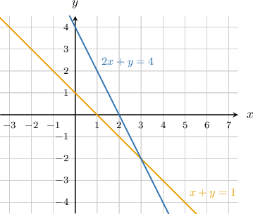
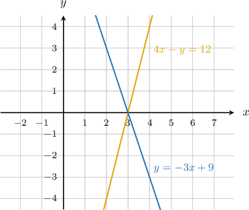

# Graphical-system generator review

All level labels below are authored; both practice captures are unrated.


## Original q-171700

Raw capture preserved verbatim (malformed TeX):

```markdown


Consider the following system of equations:
${x + y = 1; 2x + y = 4$

Use the diagram provided to determine the solution $(x, y)$ of this system.

The solution is
$($
{{field-1}}
$$,
{{field-2}}
$)$.

```





### Presentation-normalized replay; answers and solution independently derived


Consider the following system of equations:
$$
\left\{\begin{array}{l}x + y = 1\\2x + y = 4\end{array}\right.
$$

Use the diagram provided to determine the solution $(x, y)$ of this system.

The solution is
$($ {{field-1}} $,$ {{field-2}} $)$.

Entries: 3, -2

The solution of the system corresponds to the point of intersection of the lines.


In this case, we have the point $(3,-2)$. Therefore, the solution to the given system is $(3,-2)$.


## Original q-238014

Raw capture preserved verbatim (malformed TeX):

```markdown


Consider the following system of equations:
${4x - y = 12; y =-3x + 9$

Use the diagram provided to determine the solution $(x, y)$ of this system.

The solution is
$($
{{field-1}}
$$,
{{field-2}}
$)$.

```





### Presentation-normalized replay; answers and solution independently derived


Consider the following system of equations:
$$
\left\{\begin{array}{l}4x - y = 12\\y =-3x + 9\end{array}\right.
$$

Use the diagram provided to determine the solution $(x, y)$ of this system.

The solution is
$($ {{field-1}} $,$ {{field-2}} $)$.

Entries: 3, 0

The solution of the system corresponds to the point of intersection of the lines.


In this case, we have the point $(3,0)$. Therefore, the solution to the given system is $(3,0)$.


## Generated authored easy — standard_standard


Consider the following system of equations:
$$
\left\{\begin{array}{l}x + y = 7\\x - y = -1\end{array}\right.
$$

Use the diagram provided to determine the solution $(x, y)$ of this system.

The solution is
$($ {{field-1}} $,$ {{field-2}} $)$.

Entries: 3, 4

The solution of the system corresponds to the point of intersection of the lines.


In this case, we have the point $(3,4)$. Therefore, the solution to the given system is $(3,4)$.


## Generated authored easy — standard_standard


Consider the following system of equations:
$$
\left\{\begin{array}{l}x - 2y = -3\\x + 2y = 9\end{array}\right.
$$

Use the diagram provided to determine the solution $(x, y)$ of this system.

The solution is
$($ {{field-1}} $,$ {{field-2}} $)$.

Entries: 3, 3

The solution of the system corresponds to the point of intersection of the lines.


In this case, we have the point $(3,3)$. Therefore, the solution to the given system is $(3,3)$.


## Generated authored easy — standard_slope


Consider the following system of equations:
$$
\left\{\begin{array}{l}x + 2y = 7\\y =2x - 4\end{array}\right.
$$

Use the diagram provided to determine the solution $(x, y)$ of this system.

The solution is
$($ {{field-1}} $,$ {{field-2}} $)$.

Entries: 3, 2

The solution of the system corresponds to the point of intersection of the lines.


In this case, we have the point $(3,2)$. Therefore, the solution to the given system is $(3,2)$.


## Generated authored easy — standard_slope


Consider the following system of equations:
$$
\left\{\begin{array}{l}x + y = 5\\y =x - 1\end{array}\right.
$$

Use the diagram provided to determine the solution $(x, y)$ of this system.

The solution is
$($ {{field-1}} $,$ {{field-2}} $)$.

Entries: 3, 2

The solution of the system corresponds to the point of intersection of the lines.


In this case, we have the point $(3,2)$. Therefore, the solution to the given system is $(3,2)$.


## Generated authored moderate — standard_standard


Consider the following system of equations:
$$
\left\{\begin{array}{l}3x + y = -2\\x - y = 2\end{array}\right.
$$

Use the diagram provided to determine the solution $(x, y)$ of this system.

The solution is
$($ {{field-1}} $,$ {{field-2}} $)$.

Entries: 0, -2

The solution of the system corresponds to the point of intersection of the lines.


In this case, we have the point $(0,-2)$. Therefore, the solution to the given system is $(0,-2)$.


## Generated authored moderate — standard_standard


Consider the following system of equations:
$$
\left\{\begin{array}{l}2x + y = -4\\x + y = -4\end{array}\right.
$$

Use the diagram provided to determine the solution $(x, y)$ of this system.

The solution is
$($ {{field-1}} $,$ {{field-2}} $)$.

Entries: 0, -4

The solution of the system corresponds to the point of intersection of the lines.


In this case, we have the point $(0,-4)$. Therefore, the solution to the given system is $(0,-4)$.


## Generated authored moderate — standard_slope


Consider the following system of equations:
$$
\left\{\begin{array}{l}3x + y = -2\\y =x - 2\end{array}\right.
$$

Use the diagram provided to determine the solution $(x, y)$ of this system.

The solution is
$($ {{field-1}} $,$ {{field-2}} $)$.

Entries: 0, -2

The solution of the system corresponds to the point of intersection of the lines.


In this case, we have the point $(0,-2)$. Therefore, the solution to the given system is $(0,-2)$.


## Generated authored moderate — standard_slope


Consider the following system of equations:
$$
\left\{\begin{array}{l}2x + y = -4\\y =-x - 4\end{array}\right.
$$

Use the diagram provided to determine the solution $(x, y)$ of this system.

The solution is
$($ {{field-1}} $,$ {{field-2}} $)$.

Entries: 0, -4

The solution of the system corresponds to the point of intersection of the lines.


In this case, we have the point $(0,-4)$. Therefore, the solution to the given system is $(0,-4)$.


## Generated authored hard — standard_standard


Consider the following system of equations:
$$
\left\{\begin{array}{l}x + y = 4\\2x + y = 5\end{array}\right.
$$

Use the diagram provided to determine the solution $(x, y)$ of this system.

The solution is
$($ {{field-1}} $,$ {{field-2}} $)$.

Entries: 1, 3

The solution of the system corresponds to the point of intersection of the lines.


In this case, we have the point $(1,3)$. Therefore, the solution to the given system is $(1,3)$.


## Generated authored hard — standard_standard


Consider the following system of equations:
$$
\left\{\begin{array}{l}2x - y = 1\\2x + y = -5\end{array}\right.
$$

Use the diagram provided to determine the solution $(x, y)$ of this system.

The solution is
$($ {{field-1}} $,$ {{field-2}} $)$.

Entries: -1, -3

The solution of the system corresponds to the point of intersection of the lines.


In this case, we have the point $(-1,-3)$. Therefore, the solution to the given system is $(-1,-3)$.


## Generated authored hard — standard_slope


Consider the following system of equations:
$$
\left\{\begin{array}{l}x + y = 4\\y =-2x + 5\end{array}\right.
$$

Use the diagram provided to determine the solution $(x, y)$ of this system.

The solution is
$($ {{field-1}} $,$ {{field-2}} $)$.

Entries: 1, 3

The solution of the system corresponds to the point of intersection of the lines.


In this case, we have the point $(1,3)$. Therefore, the solution to the given system is $(1,3)$.


## Generated authored hard — standard_slope


Consider the following system of equations:
$$
\left\{\begin{array}{l}2x - y = 1\\y =-2x - 5\end{array}\right.
$$

Use the diagram provided to determine the solution $(x, y)$ of this system.

The solution is
$($ {{field-1}} $,$ {{field-2}} $)$.

Entries: -1, -3

The solution of the system corresponds to the point of intersection of the lines.


In this case, we have the point $(-1,-3)$. Therefore, the solution to the given system is $(-1,-3)$.
