## cars / 0

The graph above shows the speed of cars $A$ and $B$ as a function of the distance that they traveled during a brake test. At which distance, in meters, did both cars reach the same speed?

- $15$
- $30$
- $40$
- $20$
- $80$

**Worked solution**

The cars have the same speed when the two graphs intersect.

In this case, we have the point $(80,20)$. So, both cars have the same speed ($20\,\textrm{km/h}$) at a distance of $80$ meters.

---

## trucks / 1

Two trucks, Truck $A$ and Truck $B$, are carrying shipments between distribution centers. The graph above shows the distances (in miles) of Truck $A$ and Truck $B$ from one of the centers as a function of time (in hours). At what time are Truck $A$ and Truck $B$ the same distance from the center?

- $5h$
- $6h$
- $3h$
- $4h$
- $2h$

**Worked solution**

The trucks are the same distance from the center when the two graphs intersect.

In this case, we have the point $(6,300)$. So, both trucks are the same distance ($300\,\textrm{miles}$) from the center at $t=6$ hours.

---

## planes / 2

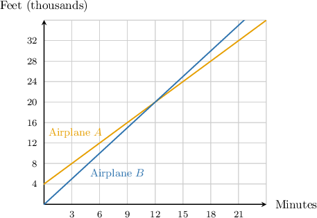

The graph above shows the altitude of airplane $A$ and airplane $B$ after they have taken off, one after the other. After how many minutes will both planes be at the same altitude?

- $12$
- $20$
- $9$
- $16$
- $15$

**Worked solution**

Here, we need to find the point of intersection of the two graphs.

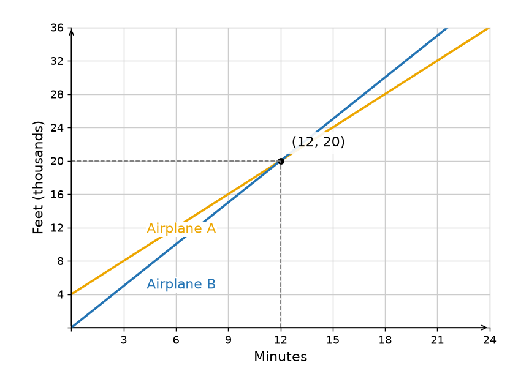

In this case, we have the point $(12,20).$ So, it takes $12$ minutes for both planes to get to the same altitude (of $20,000\,\text{ft}$).

---

## tanks / 3

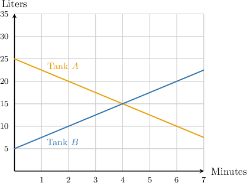

Water is being pumped from tank $A$ to tank $B.$ The graph above shows the amount of water (in liters) in each tank as a function of time (in minutes). At what time do tanks $A$ and $B$ contain the same amount of water?

The tanks contain the same amount of water after{{field-1}}minutes.

**Worked solution**

The tanks contain the same amount when the two graphs intersect.

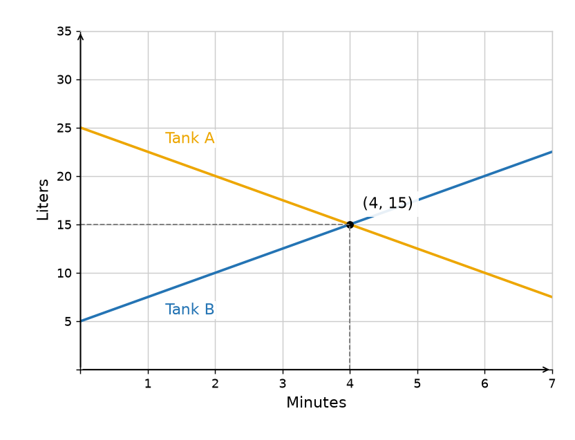

In this case, we have the point $(4,15).$ So, the tanks contain the same amount ($15\,\text{L}$) of water after $t=4$ minutes.

---

## walkers / 4

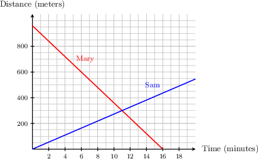

Sam left home to go to the community park at the same time that Mary left the community park to go home. Both Mary's and Sam's distances from home are shown in the graph above. Based on the graph, we conclude that:

Mary and Sam met$\,$
{{field-1}}$\,$minutes since they both started moving.

They met at a distance of$\,$ 
{{field-2}}$\,$meters from their home.

**Worked solution**

Mary and Sam meet when they are at the same distance from home. At this moment, their graphs intersect.

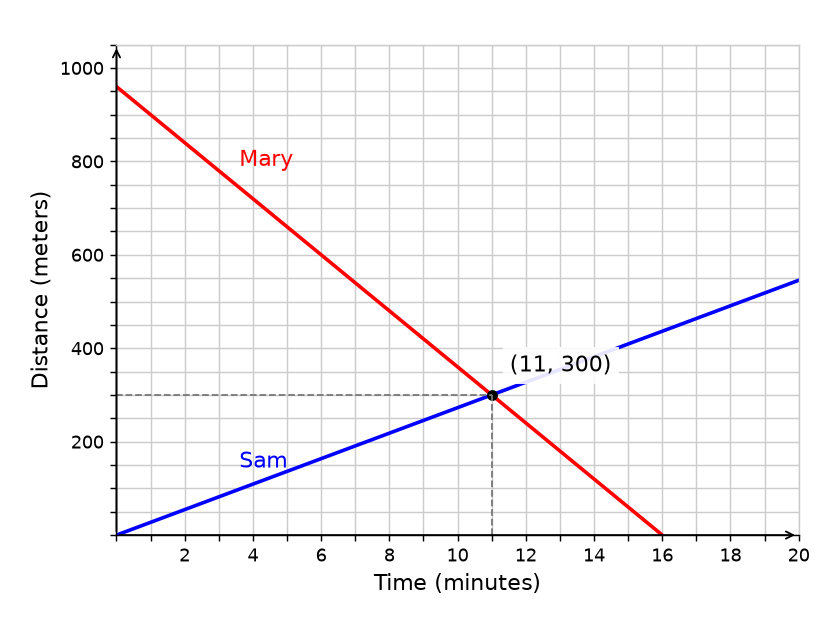

In this case, we have the point $(11,300).$ So, Mary and Sam met $11$ minutes since they started moving at a distance of $300\,\text{m}$ away from their home.

---

## trucks / 5

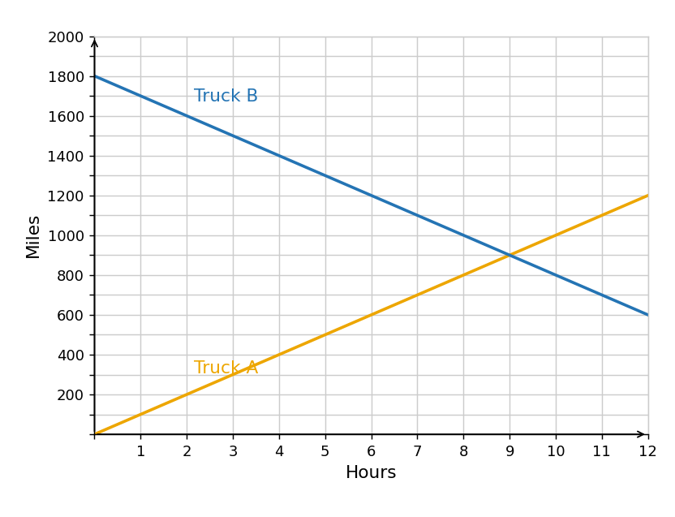

Two trucks, Truck $A$ and Truck $B$, are carrying shipments between distribution centers. The graph above shows the distances (in miles) of Truck $A$ and Truck $B$ from one of the centers as a function of time (in hours). At what time are Truck $A$ and Truck $B$ the same distance from the center?

- $11h$
- $7h$
- $10h$
- $8h$
- $9h$

**Worked solution**

The trucks are the same distance from the center when the two graphs intersect.

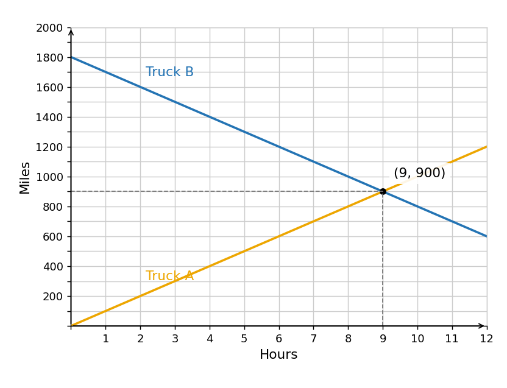

In this case, we have the point $(9,900)$. So, both trucks are the same distance ($900\,\textrm{miles}$) from the center at $t=9$ hours.

---

## trucks / 6

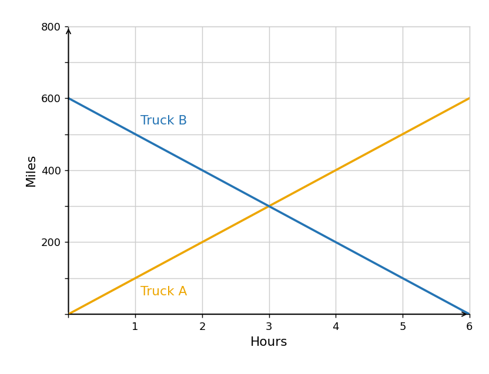

Two trucks, Truck $A$ and Truck $B$, are carrying shipments between distribution centers. The graph above shows the distances (in miles) of Truck $A$ and Truck $B$ from one of the centers as a function of time (in hours). At what time are Truck $A$ and Truck $B$ the same distance from the center?

- $1h$
- $2h$
- $3h$
- $5h$
- $4h$

**Worked solution**

The trucks are the same distance from the center when the two graphs intersect.

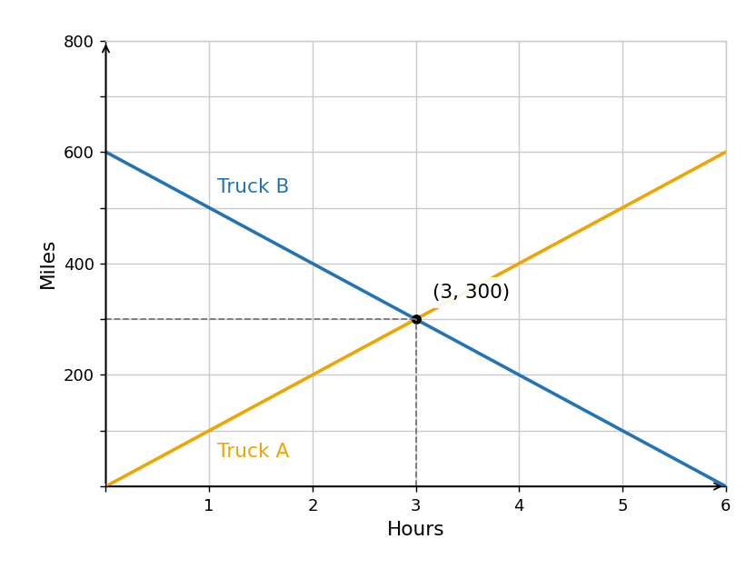

In this case, we have the point $(3,300)$. So, both trucks are the same distance ($300\,\textrm{miles}$) from the center at $t=3$ hours.

---

## trucks / 7

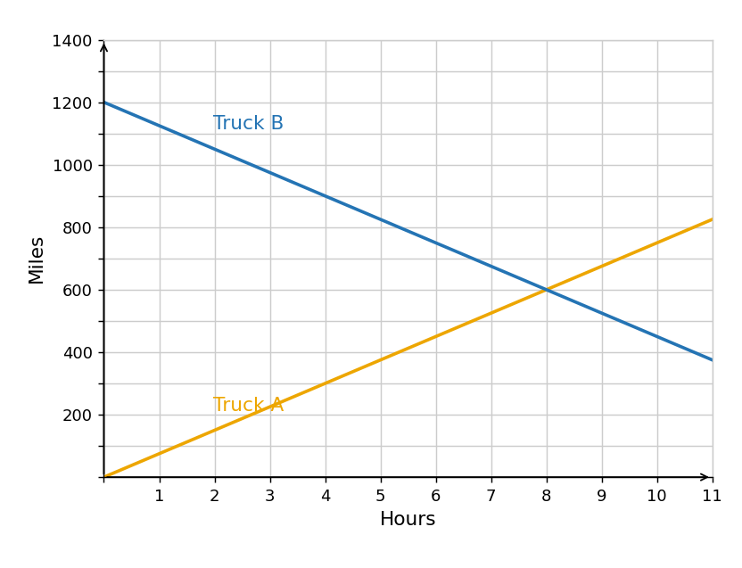

Two trucks, Truck $A$ and Truck $B$, are carrying shipments between distribution centers. The graph above shows the distances (in miles) of Truck $A$ and Truck $B$ from one of the centers as a function of time (in hours). At what time are Truck $A$ and Truck $B$ the same distance from the center?

- $9h$
- $8h$
- $7h$
- $6h$
- $10h$

**Worked solution**

The trucks are the same distance from the center when the two graphs intersect.

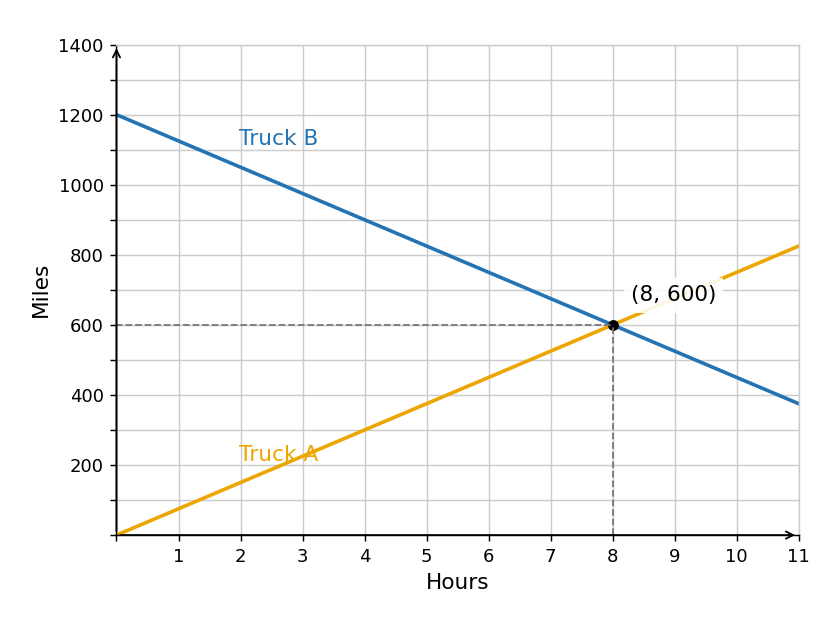

In this case, we have the point $(8,600)$. So, both trucks are the same distance ($600\,\textrm{miles}$) from the center at $t=8$ hours.

---

## trucks / 8

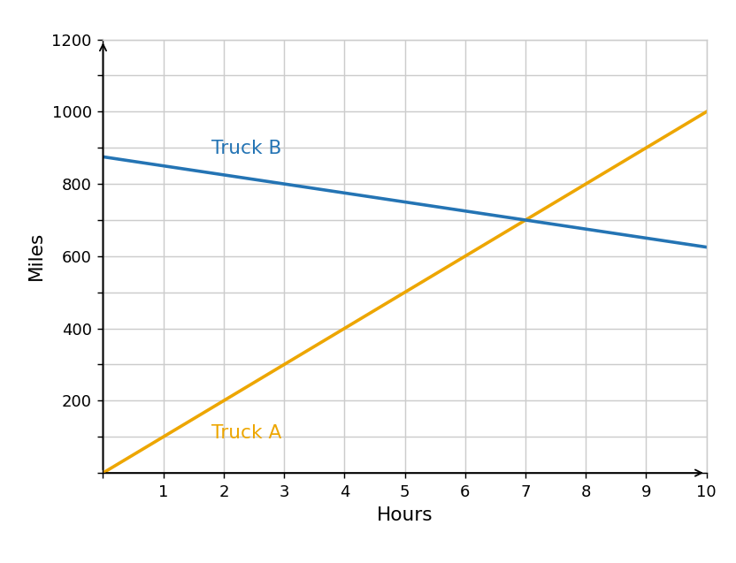

Two trucks, Truck $A$ and Truck $B$, are carrying shipments between distribution centers. The graph above shows the distances (in miles) of Truck $A$ and Truck $B$ from one of the centers as a function of time (in hours). At what time are Truck $A$ and Truck $B$ the same distance from the center?

- $8h$
- $6h$
- $5h$
- $7h$
- $9h$

**Worked solution**

The trucks are the same distance from the center when the two graphs intersect.

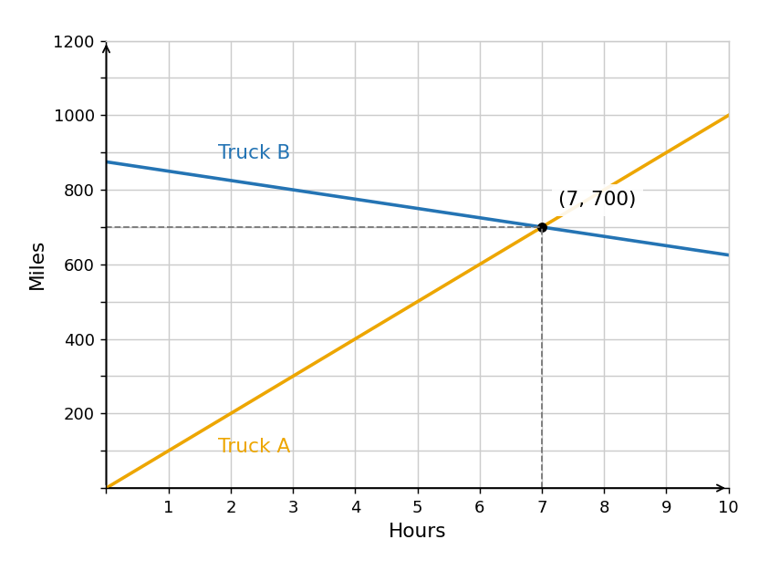

In this case, we have the point $(7,700)$. So, both trucks are the same distance ($700\,\textrm{miles}$) from the center at $t=7$ hours.

---

## trucks / 9

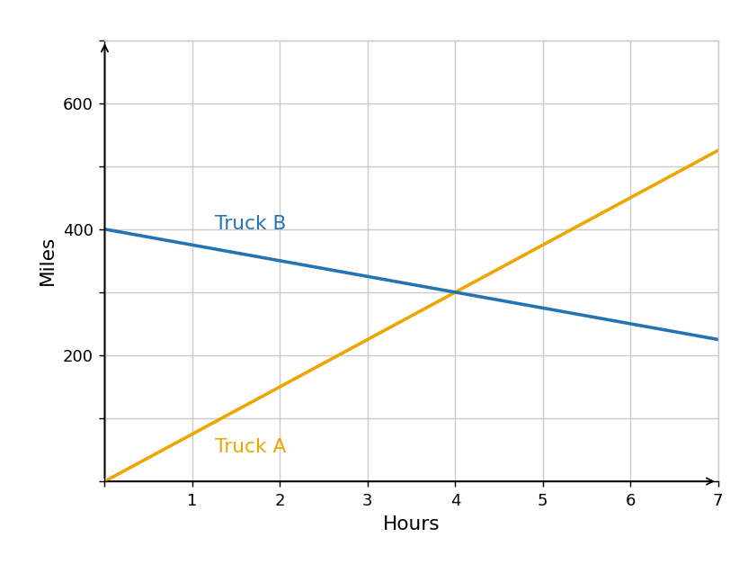

Two trucks, Truck $A$ and Truck $B$, are carrying shipments between distribution centers. The graph above shows the distances (in miles) of Truck $A$ and Truck $B$ from one of the centers as a function of time (in hours). At what time are Truck $A$ and Truck $B$ the same distance from the center?

- $2h$
- $3h$
- $4h$
- $6h$
- $5h$

**Worked solution**

The trucks are the same distance from the center when the two graphs intersect.

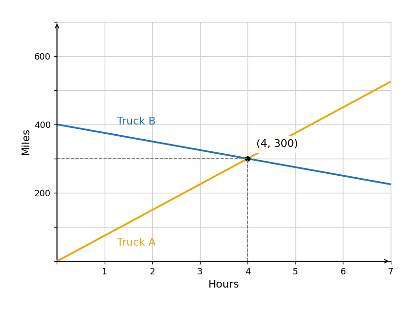

In this case, we have the point $(4,300)$. So, both trucks are the same distance ($300\,\textrm{miles}$) from the center at $t=4$ hours.

---

## trucks / 10

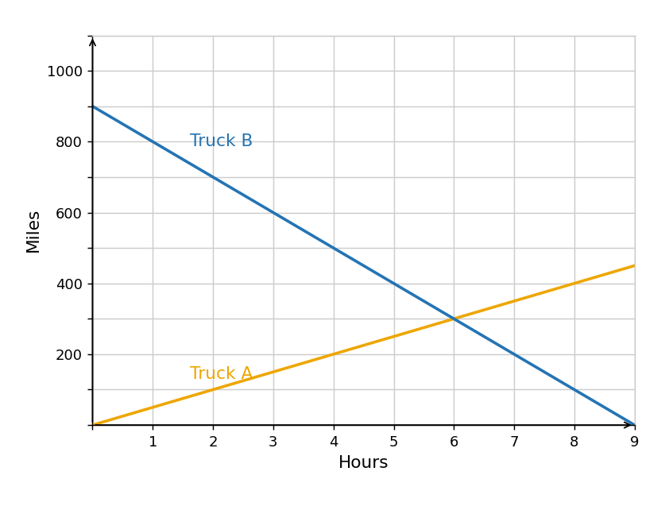

Two trucks, Truck $A$ and Truck $B$, are carrying shipments between distribution centers. The graph above shows the distances (in miles) of Truck $A$ and Truck $B$ from one of the centers as a function of time (in hours). At what time are Truck $A$ and Truck $B$ the same distance from the center?

- $4h$
- $7h$
- $5h$
- $6h$
- $8h$

**Worked solution**

The trucks are the same distance from the center when the two graphs intersect.

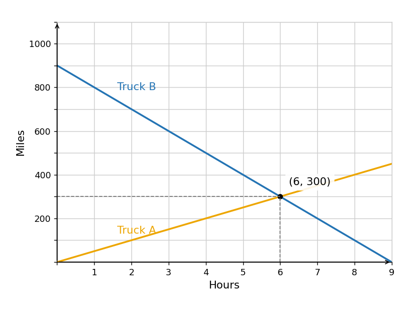

In this case, we have the point $(6,300)$. So, both trucks are the same distance ($300\,\textrm{miles}$) from the center at $t=6$ hours.

---

## trucks / 11

Two trucks, Truck $A$ and Truck $B$, are carrying shipments between distribution centers. The graph above shows the distances (in miles) of Truck $A$ and Truck $B$ from one of the centers as a function of time (in hours). At what time are Truck $A$ and Truck $B$ the same distance from the center?

- $5h$
- $4h$
- $7h$
- $6h$
- $8h$

**Worked solution**

The trucks are the same distance from the center when the two graphs intersect.

In this case, we have the point $(6,300)$. So, both trucks are the same distance ($300\,\textrm{miles}$) from the center at $t=6$ hours.

---

## trucks / 12

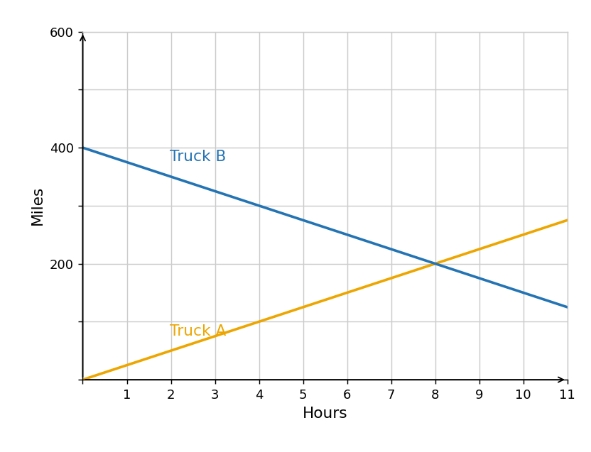

Two trucks, Truck $A$ and Truck $B$, are carrying shipments between distribution centers. The graph above shows the distances (in miles) of Truck $A$ and Truck $B$ from one of the centers as a function of time (in hours). At what time are Truck $A$ and Truck $B$ the same distance from the center?

- $7h$
- $9h$
- $6h$
- $8h$
- $10h$

**Worked solution**

The trucks are the same distance from the center when the two graphs intersect.

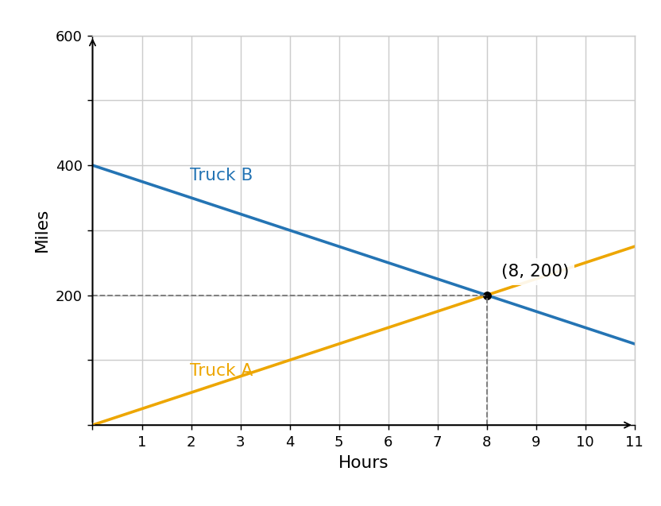

In this case, we have the point $(8,200)$. So, both trucks are the same distance ($200\,\textrm{miles}$) from the center at $t=8$ hours.

---

## pools / 13

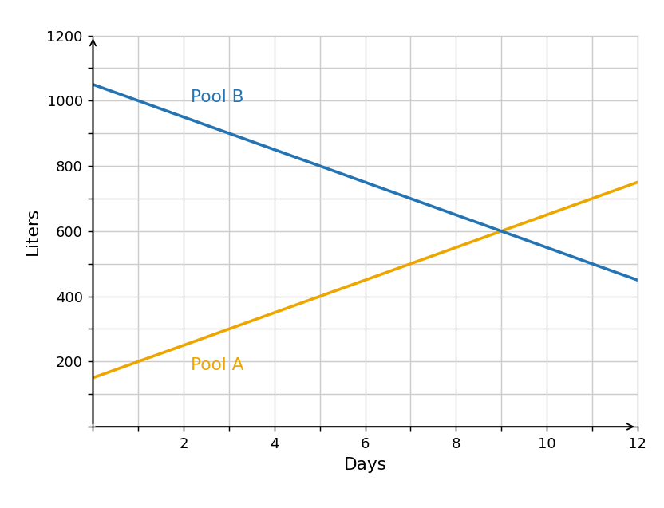

The graph above shows the number of liters of water in pool $A$ and pool $B$ as a function of time, measured in days. How many days will it take for both pools to contain the same amount of water?

- $9$
- $8$
- $7$
- $10$
- $11$

**Worked solution**

The pools have the same amount of water when the two graphs intersect.

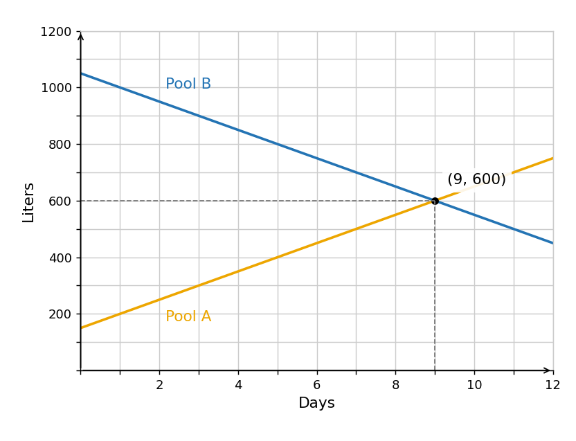

In this case, we have the point $(9,600)$. So, both pools have the same amount ($600\,\textrm{L}$) of water at $t=9$ days.

---

## pools / 14

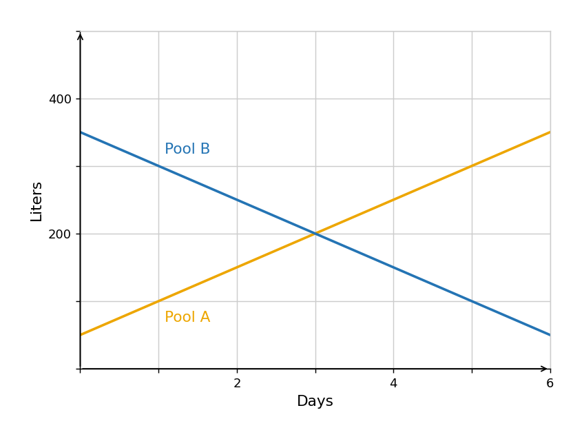

The graph above shows the number of liters of water in pool $A$ and pool $B$ as a function of time, measured in days. How many days will it take for both pools to contain the same amount of water?

- $2$
- $4$
- $1$
- $5$
- $3$

**Worked solution**

The pools have the same amount of water when the two graphs intersect.

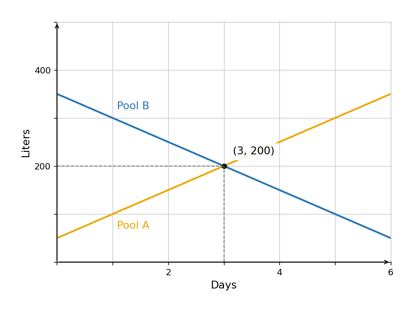

In this case, we have the point $(3,200)$. So, both pools have the same amount ($200\,\textrm{L}$) of water at $t=3$ days.

---

## pools / 15

The graph above shows the number of liters of water in pool $A$ and pool $B$ as a function of time, measured in days. How many days will it take for both pools to contain the same amount of water?

- $9$
- $10$
- $7$
- $8$
- $11$

**Worked solution**

The pools have the same amount of water when the two graphs intersect.

In this case, we have the point $(9,600)$. So, both pools have the same amount ($600\,\textrm{L}$) of water at $t=9$ days.

---

## pools / 16

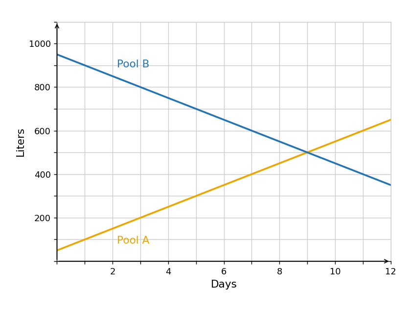

The graph above shows the number of liters of water in pool $A$ and pool $B$ as a function of time, measured in days. How many days will it take for both pools to contain the same amount of water?

- $10$
- $8$
- $7$
- $9$
- $11$

**Worked solution**

The pools have the same amount of water when the two graphs intersect.

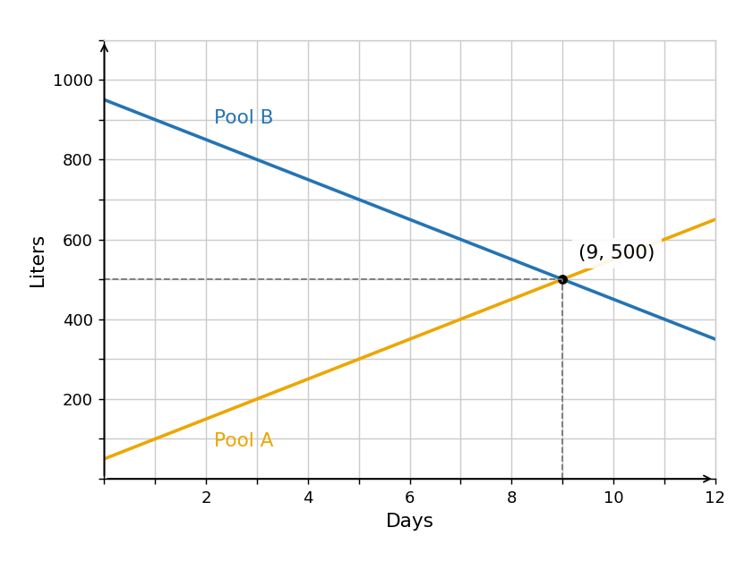

In this case, we have the point $(9,500)$. So, both pools have the same amount ($500\,\textrm{L}$) of water at $t=9$ days.

---

## pools / 17

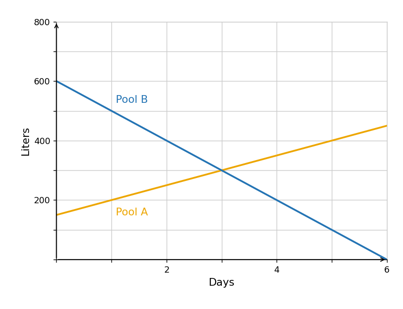

The graph above shows the number of liters of water in pool $A$ and pool $B$ as a function of time, measured in days. How many days will it take for both pools to contain the same amount of water?

- $5$
- $4$
- $2$
- $1$
- $3$

**Worked solution**

The pools have the same amount of water when the two graphs intersect.

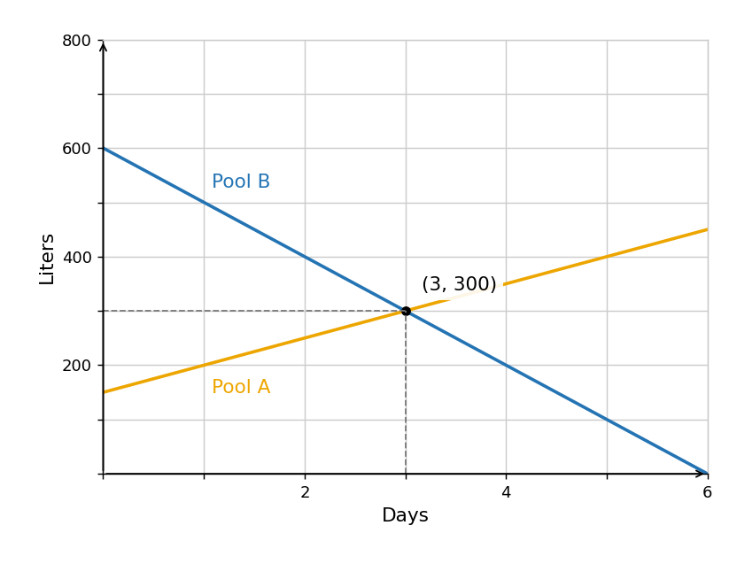

In this case, we have the point $(3,300)$. So, both pools have the same amount ($300\,\textrm{L}$) of water at $t=3$ days.

---

## pools / 18

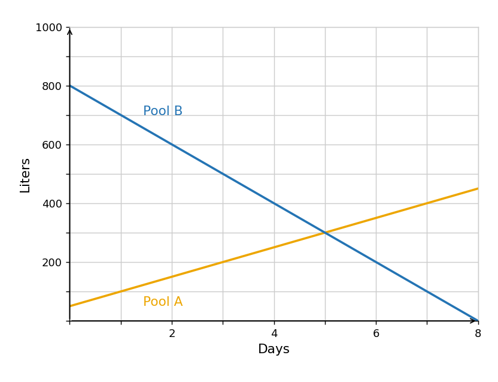

The graph above shows the number of liters of water in pool $A$ and pool $B$ as a function of time, measured in days. How many days will it take for both pools to contain the same amount of water?

- $6$
- $4$
- $5$
- $3$
- $7$

**Worked solution**

The pools have the same amount of water when the two graphs intersect.

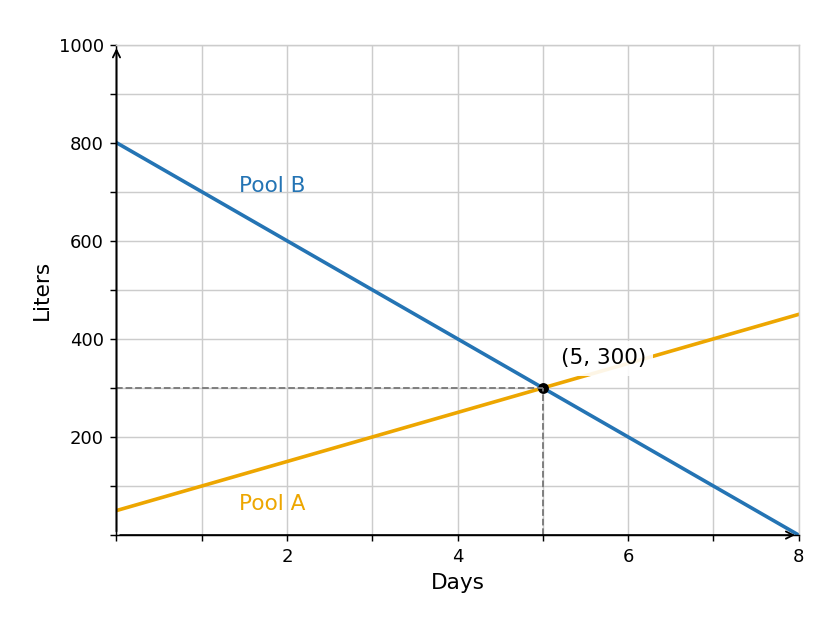

In this case, we have the point $(5,300)$. So, both pools have the same amount ($300\,\textrm{L}$) of water at $t=5$ days.

---

## pools / 19

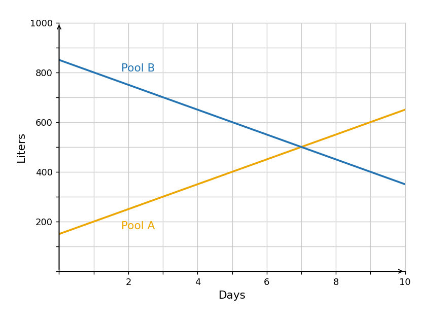

The graph above shows the number of liters of water in pool $A$ and pool $B$ as a function of time, measured in days. How many days will it take for both pools to contain the same amount of water?

- $7$
- $9$
- $6$
- $5$
- $8$

**Worked solution**

The pools have the same amount of water when the two graphs intersect.

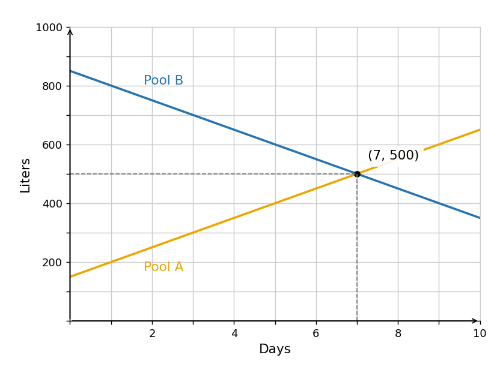

In this case, we have the point $(7,500)$. So, both pools have the same amount ($500\,\textrm{L}$) of water at $t=7$ days.

---

## pools / 20

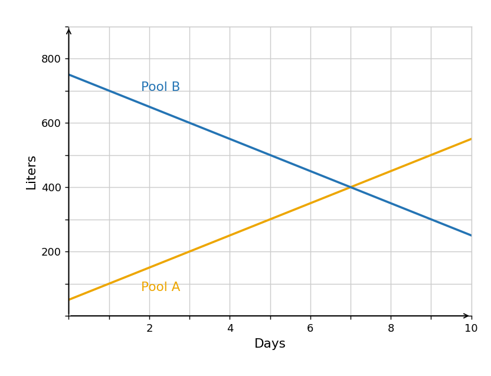

The graph above shows the number of liters of water in pool $A$ and pool $B$ as a function of time, measured in days. How many days will it take for both pools to contain the same amount of water?

- $5$
- $7$
- $8$
- $6$
- $9$

**Worked solution**

The pools have the same amount of water when the two graphs intersect.

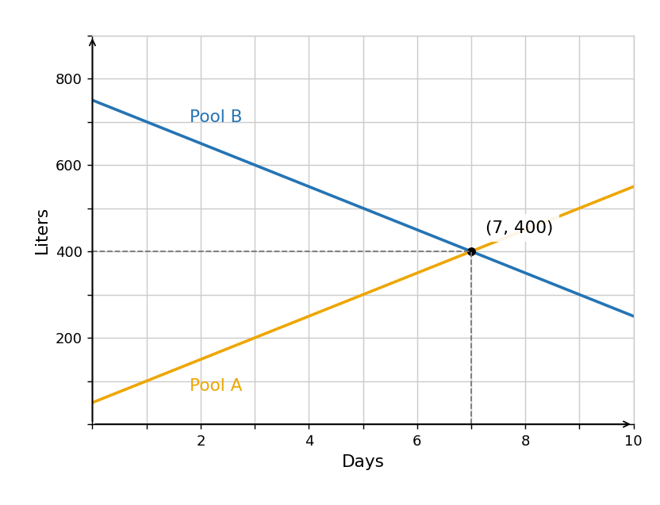

In this case, we have the point $(7,400)$. So, both pools have the same amount ($400\,\textrm{L}$) of water at $t=7$ days.

---

## cars / 21

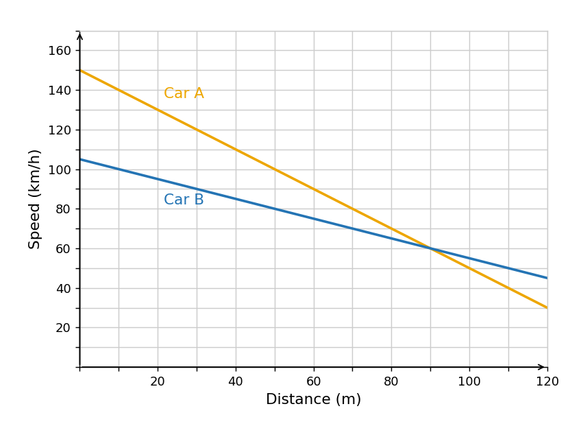

The graph above shows the speed of cars $A$ and $B$ as a function of the distance that they traveled during a brake test. At which distance, in meters, did both cars reach the same speed?

- $80$
- $70$
- $100$
- $110$
- $90$

**Worked solution**

The cars have the same speed when the two graphs intersect.

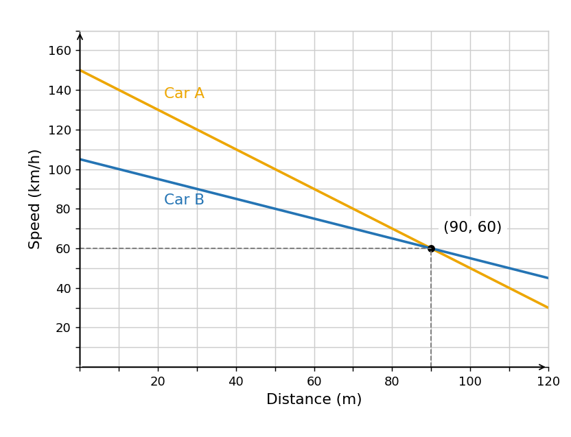

In this case, we have the point $(90,60)$. So, both cars have the same speed ($60\,\textrm{km/h}$) at a distance of $90$ meters.

---

## cars / 22

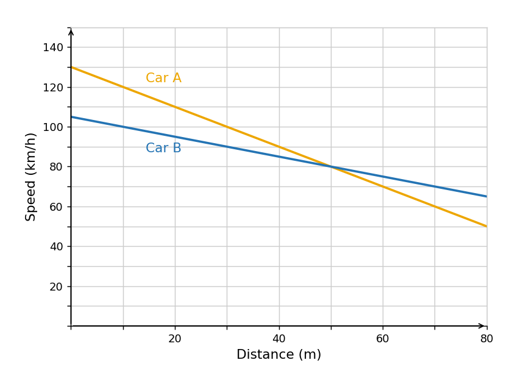

The graph above shows the speed of cars $A$ and $B$ as a function of the distance that they traveled during a brake test. At which distance, in meters, did both cars reach the same speed?

- $70$
- $30$
- $60$
- $40$
- $50$

**Worked solution**

The cars have the same speed when the two graphs intersect.

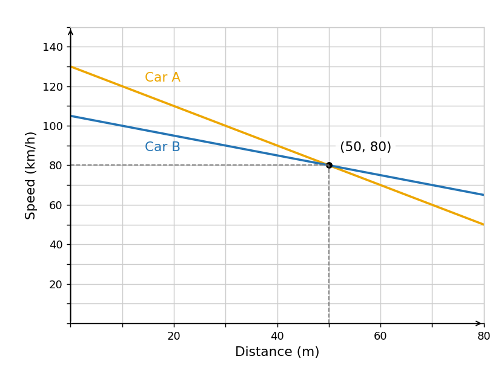

In this case, we have the point $(50,80)$. So, both cars have the same speed ($80\,\textrm{km/h}$) at a distance of $50$ meters.

---

## cars / 23

The graph above shows the speed of cars $A$ and $B$ as a function of the distance that they traveled during a brake test. At which distance, in meters, did both cars reach the same speed?

- $60$
- $50$
- $70$
- $30$
- $40$

**Worked solution**

The cars have the same speed when the two graphs intersect.

In this case, we have the point $(50,80)$. So, both cars have the same speed ($80\,\textrm{km/h}$) at a distance of $50$ meters.

---

## cars / 24

The graph above shows the speed of cars $A$ and $B$ as a function of the distance that they traveled during a brake test. At which distance, in meters, did both cars reach the same speed?

- $70$
- $30$
- $60$
- $50$
- $40$

**Worked solution**

The cars have the same speed when the two graphs intersect.

In this case, we have the point $(50,80)$. So, both cars have the same speed ($80\,\textrm{km/h}$) at a distance of $50$ meters.

---

## cars / 25

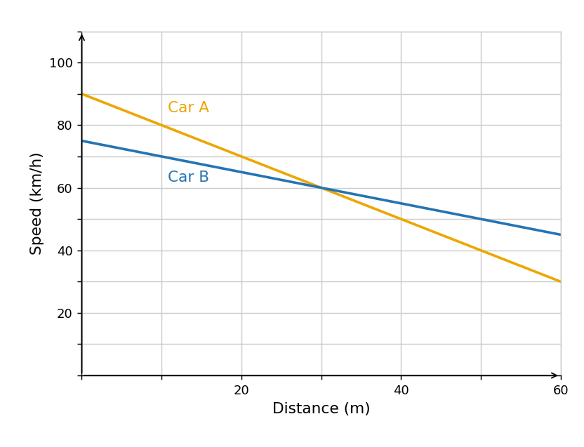

The graph above shows the speed of cars $A$ and $B$ as a function of the distance that they traveled during a brake test. At which distance, in meters, did both cars reach the same speed?

- $50$
- $40$
- $20$
- $10$
- $30$

**Worked solution**

The cars have the same speed when the two graphs intersect.

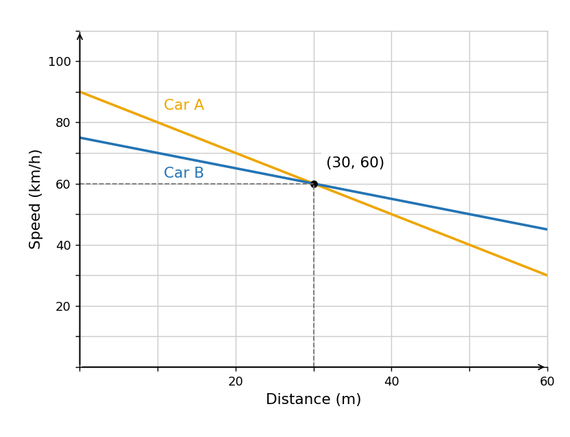

In this case, we have the point $(30,60)$. So, both cars have the same speed ($60\,\textrm{km/h}$) at a distance of $30$ meters.

---

## cars / 26

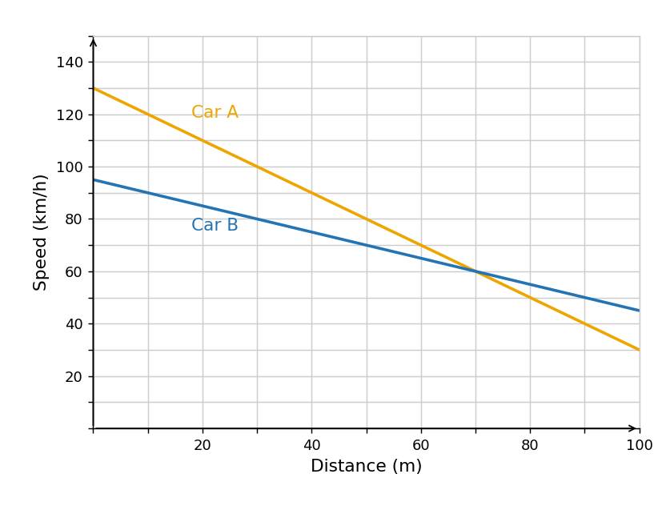

The graph above shows the speed of cars $A$ and $B$ as a function of the distance that they traveled during a brake test. At which distance, in meters, did both cars reach the same speed?

- $60$
- $70$
- $90$
- $80$
- $50$

**Worked solution**

The cars have the same speed when the two graphs intersect.

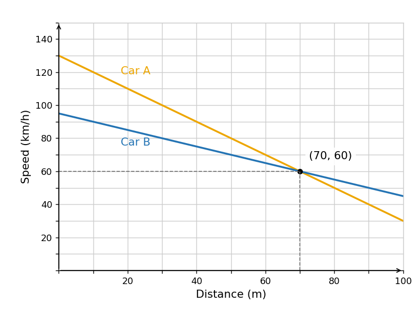

In this case, we have the point $(70,60)$. So, both cars have the same speed ($60\,\textrm{km/h}$) at a distance of $70$ meters.

---

## cars / 27

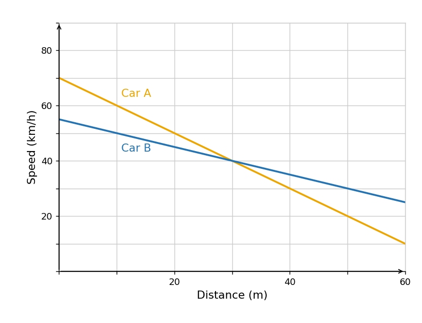

The graph above shows the speed of cars $A$ and $B$ as a function of the distance that they traveled during a brake test. At which distance, in meters, did both cars reach the same speed?

- $40$
- $10$
- $30$
- $50$
- $20$

**Worked solution**

The cars have the same speed when the two graphs intersect.

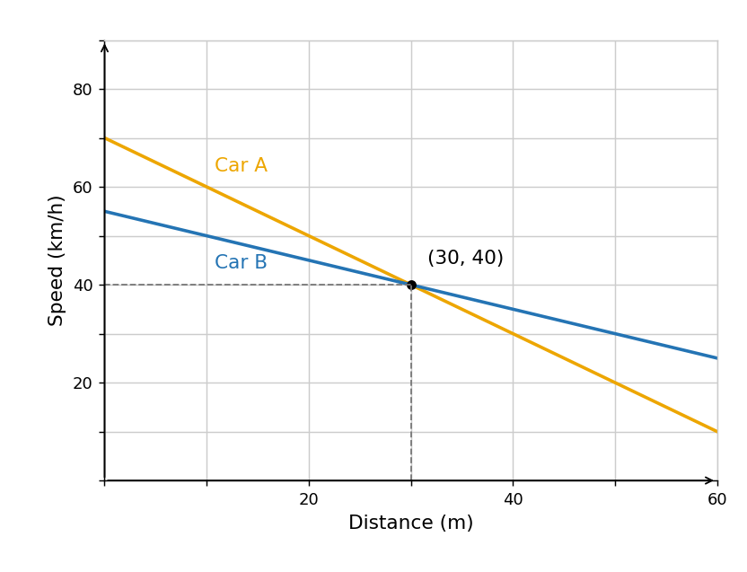

In this case, we have the point $(30,40)$. So, both cars have the same speed ($40\,\textrm{km/h}$) at a distance of $30$ meters.

---

## cars / 28

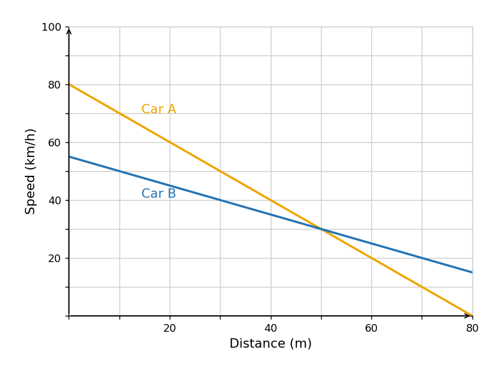

The graph above shows the speed of cars $A$ and $B$ as a function of the distance that they traveled during a brake test. At which distance, in meters, did both cars reach the same speed?

- $30$
- $40$
- $60$
- $70$
- $50$

**Worked solution**

The cars have the same speed when the two graphs intersect.

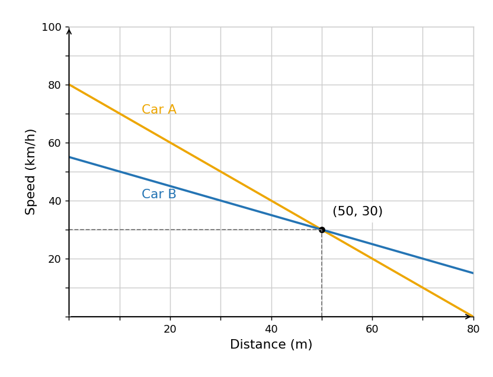

In this case, we have the point $(50,30)$. So, both cars have the same speed ($30\,\textrm{km/h}$) at a distance of $50$ meters.

---

## planes / 29

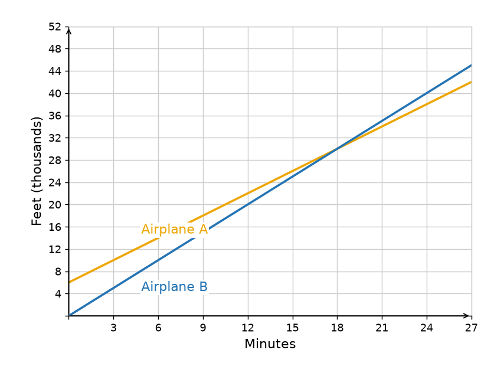

The graph above shows the altitude of airplane $A$ and airplane $B$ after they have taken off, one after the other. After how many minutes will both planes be at the same altitude?

- $18$
- $24$
- $12$
- $21$
- $15$

**Worked solution**

Here, we need to find the point of intersection of the two graphs.

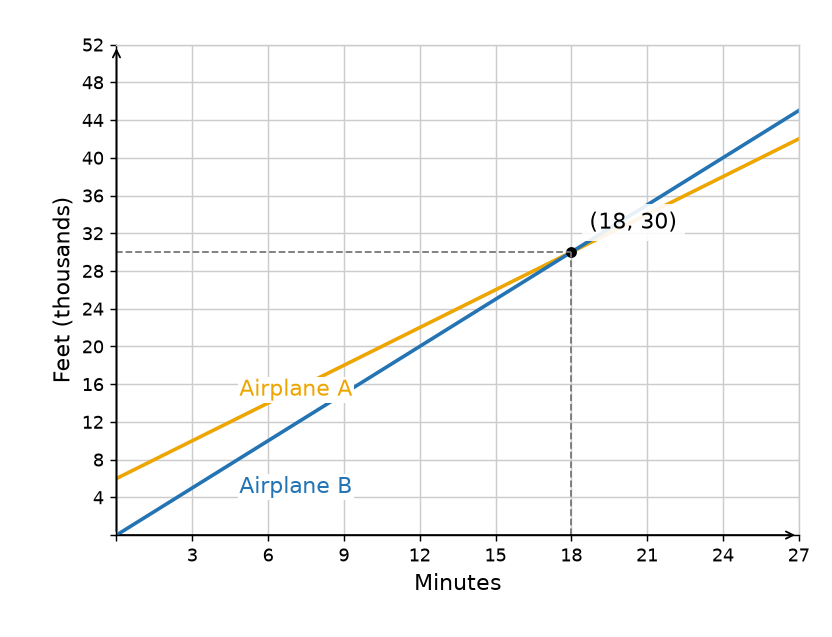

In this case, we have the point $(18,30).$ So, it takes $18$ minutes for both planes to get to the same altitude (of $30,000\,\text{ft}$).

---

## planes / 30

The graph above shows the altitude of airplane $A$ and airplane $B$ after they have taken off, one after the other. After how many minutes will both planes be at the same altitude?

- $15$
- $18$
- $6$
- $12$
- $9$

**Worked solution**

Here, we need to find the point of intersection of the two graphs.

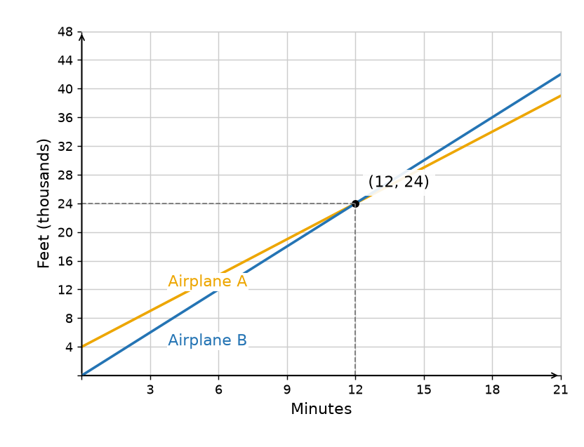

In this case, we have the point $(12,24).$ So, it takes $12$ minutes for both planes to get to the same altitude (of $24,000\,\text{ft}$).

---

## planes / 31

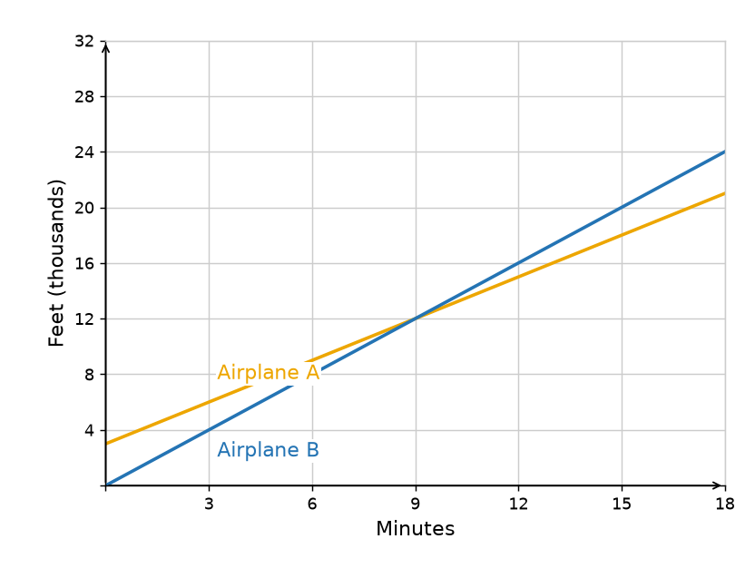

The graph above shows the altitude of airplane $A$ and airplane $B$ after they have taken off, one after the other. After how many minutes will both planes be at the same altitude?

- $9$
- $12$
- $15$
- $3$
- $6$

**Worked solution**

Here, we need to find the point of intersection of the two graphs.

In this case, we have the point $(9,12).$ So, it takes $9$ minutes for both planes to get to the same altitude (of $12,000\,\text{ft}$).

---

## planes / 32

The graph above shows the altitude of airplane $A$ and airplane $B$ after they have taken off, one after the other. After how many minutes will both planes be at the same altitude?

- $6$
- $12$
- $18$
- $15$
- $9$

**Worked solution**

Here, we need to find the point of intersection of the two graphs.

In this case, we have the point $(12,24).$ So, it takes $12$ minutes for both planes to get to the same altitude (of $24,000\,\text{ft}$).

---

## planes / 33

The graph above shows the altitude of airplane $A$ and airplane $B$ after they have taken off, one after the other. After how many minutes will both planes be at the same altitude?

- $6$
- $9$
- $12$
- $18$
- $15$

**Worked solution**

Here, we need to find the point of intersection of the two graphs.

In this case, we have the point $(12,20).$ So, it takes $12$ minutes for both planes to get to the same altitude (of $20,000\,\text{ft}$).

---

## planes / 34

The graph above shows the altitude of airplane $A$ and airplane $B$ after they have taken off, one after the other. After how many minutes will both planes be at the same altitude?

- $12$
- $18$
- $9$
- $15$
- $21$

**Worked solution**

Here, we need to find the point of intersection of the two graphs.

In this case, we have the point $(15,30).$ So, it takes $15$ minutes for both planes to get to the same altitude (of $30,000\,\text{ft}$).

---

## planes / 35

The graph above shows the altitude of airplane $A$ and airplane $B$ after they have taken off, one after the other. After how many minutes will both planes be at the same altitude?

- $6$
- $3$
- $12$
- $15$
- $9$

**Worked solution**

Here, we need to find the point of intersection of the two graphs.

In this case, we have the point $(9,15).$ So, it takes $9$ minutes for both planes to get to the same altitude (of $15,000\,\text{ft}$).

---

## planes / 36

The graph above shows the altitude of airplane $A$ and airplane $B$ after they have taken off, one after the other. After how many minutes will both planes be at the same altitude?

- $9$
- $18$
- $12$
- $21$
- $15$

**Worked solution**

Here, we need to find the point of intersection of the two graphs.

In this case, we have the point $(15,20).$ So, it takes $15$ minutes for both planes to get to the same altitude (of $20,000\,\text{ft}$).

---

## tanks / 37

Water is being pumped from tank $A$ to tank $B.$ The graph above shows the amount of water (in liters) in each tank as a function of time (in minutes). At what time do tanks $A$ and $B$ contain the same amount of water?

The tanks contain the same amount of water after{{field-1}}minutes.

**Worked solution**

The tanks contain the same amount when the two graphs intersect.

In this case, we have the point $(5,25).$ So, the tanks contain the same amount ($25\,\text{L}$) of water after $t=5$ minutes.

---

## tanks / 38

Water is being pumped from tank $A$ to tank $B.$ The graph above shows the amount of water (in liters) in each tank as a function of time (in minutes). At what time do tanks $A$ and $B$ contain the same amount of water?

The tanks contain the same amount of water after{{field-1}}minutes.

**Worked solution**

The tanks contain the same amount when the two graphs intersect.

In this case, we have the point $(3,25/2).$ So, the tanks contain the same amount ($25/2\,\text{L}$) of water after $t=3$ minutes.

---

## tanks / 39

Water is being pumped from tank $A$ to tank $B.$ The graph above shows the amount of water (in liters) in each tank as a function of time (in minutes). At what time do tanks $A$ and $B$ contain the same amount of water?

The tanks contain the same amount of water after{{field-1}}minutes.

**Worked solution**

The tanks contain the same amount when the two graphs intersect.

In this case, we have the point $(2,5).$ So, the tanks contain the same amount ($5\,\text{L}$) of water after $t=2$ minutes.

---

## tanks / 40

Water is being pumped from tank $A$ to tank $B.$ The graph above shows the amount of water (in liters) in each tank as a function of time (in minutes). At what time do tanks $A$ and $B$ contain the same amount of water?

The tanks contain the same amount of water after{{field-1}}minutes.

**Worked solution**

The tanks contain the same amount when the two graphs intersect.

In this case, we have the point $(3,25/2).$ So, the tanks contain the same amount ($25/2\,\text{L}$) of water after $t=3$ minutes.

---

## tanks / 41

Water is being pumped from tank $A$ to tank $B.$ The graph above shows the amount of water (in liters) in each tank as a function of time (in minutes). At what time do tanks $A$ and $B$ contain the same amount of water?

The tanks contain the same amount of water after{{field-1}}minutes.

**Worked solution**

The tanks contain the same amount when the two graphs intersect.

In this case, we have the point $(3,15).$ So, the tanks contain the same amount ($15\,\text{L}$) of water after $t=3$ minutes.

---

## tanks / 42

Water is being pumped from tank $A$ to tank $B.$ The graph above shows the amount of water (in liters) in each tank as a function of time (in minutes). At what time do tanks $A$ and $B$ contain the same amount of water?

The tanks contain the same amount of water after{{field-1}}minutes.

**Worked solution**

The tanks contain the same amount when the two graphs intersect.

In this case, we have the point $(6,40).$ So, the tanks contain the same amount ($40\,\text{L}$) of water after $t=6$ minutes.

---

## tanks / 43

Water is being pumped from tank $A$ to tank $B.$ The graph above shows the amount of water (in liters) in each tank as a function of time (in minutes). At what time do tanks $A$ and $B$ contain the same amount of water?

The tanks contain the same amount of water after{{field-1}}minutes.

**Worked solution**

The tanks contain the same amount when the two graphs intersect.

In this case, we have the point $(6,20).$ So, the tanks contain the same amount ($20\,\text{L}$) of water after $t=6$ minutes.

---

## tanks / 44

Water is being pumped from tank $A$ to tank $B.$ The graph above shows the amount of water (in liters) in each tank as a function of time (in minutes). At what time do tanks $A$ and $B$ contain the same amount of water?

The tanks contain the same amount of water after{{field-1}}minutes.

**Worked solution**

The tanks contain the same amount when the two graphs intersect.

In this case, we have the point $(4,15).$ So, the tanks contain the same amount ($15\,\text{L}$) of water after $t=4$ minutes.

---

## walkers / 45

Sam left home to go to the community park at the same time that Mary left the community park to go home. Both Mary's and Sam's distances from home are shown in the graph above. Based on the graph, we conclude that:

Mary and Sam met$\,$
{{field-1}}$\,$minutes since they both started moving.

They met at a distance of$\,$ 
{{field-2}}$\,$meters from their home.

**Worked solution**

Mary and Sam meet when they are at the same distance from home. At this moment, their graphs intersect.

In this case, we have the point $(11,500).$ So, Mary and Sam met $11$ minutes since they started moving at a distance of $500\,\text{m}$ away from their home.

---

## walkers / 46

Sam left home to go to the community park at the same time that Mary left the community park to go home. Both Mary's and Sam's distances from home are shown in the graph above. Based on the graph, we conclude that:

Mary and Sam met$\,$
{{field-1}}$\,$minutes since they both started moving.

They met at a distance of$\,$ 
{{field-2}}$\,$meters from their home.

**Worked solution**

Mary and Sam meet when they are at the same distance from home. At this moment, their graphs intersect.

In this case, we have the point $(7,200).$ So, Mary and Sam met $7$ minutes since they started moving at a distance of $200\,\text{m}$ away from their home.

---

## walkers / 47

Sam left home to go to the community park at the same time that Mary left the community park to go home. Both Mary's and Sam's distances from home are shown in the graph above. Based on the graph, we conclude that:

Mary and Sam met$\,$
{{field-1}}$\,$minutes since they both started moving.

They met at a distance of$\,$ 
{{field-2}}$\,$meters from their home.

**Worked solution**

Mary and Sam meet when they are at the same distance from home. At this moment, their graphs intersect.

In this case, we have the point $(5,200).$ So, Mary and Sam met $5$ minutes since they started moving at a distance of $200\,\text{m}$ away from their home.

---

## walkers / 48

Sam left home to go to the community park at the same time that Mary left the community park to go home. Both Mary's and Sam's distances from home are shown in the graph above. Based on the graph, we conclude that:

Mary and Sam met$\,$
{{field-1}}$\,$minutes since they both started moving.

They met at a distance of$\,$ 
{{field-2}}$\,$meters from their home.

**Worked solution**

Mary and Sam meet when they are at the same distance from home. At this moment, their graphs intersect.

In this case, we have the point $(7,300).$ So, Mary and Sam met $7$ minutes since they started moving at a distance of $300\,\text{m}$ away from their home.

---

## walkers / 49

Sam left home to go to the community park at the same time that Mary left the community park to go home. Both Mary's and Sam's distances from home are shown in the graph above. Based on the graph, we conclude that:

Mary and Sam met$\,$
{{field-1}}$\,$minutes since they both started moving.

They met at a distance of$\,$ 
{{field-2}}$\,$meters from their home.

**Worked solution**

Mary and Sam meet when they are at the same distance from home. At this moment, their graphs intersect.

In this case, we have the point $(7,400).$ So, Mary and Sam met $7$ minutes since they started moving at a distance of $400\,\text{m}$ away from their home.

---

## walkers / 50

Sam left home to go to the community park at the same time that Mary left the community park to go home. Both Mary's and Sam's distances from home are shown in the graph above. Based on the graph, we conclude that:

Mary and Sam met$\,$
{{field-1}}$\,$minutes since they both started moving.

They met at a distance of$\,$ 
{{field-2}}$\,$meters from their home.

**Worked solution**

Mary and Sam meet when they are at the same distance from home. At this moment, their graphs intersect.

In this case, we have the point $(13,400).$ So, Mary and Sam met $13$ minutes since they started moving at a distance of $400\,\text{m}$ away from their home.

---

## walkers / 51

Sam left home to go to the community park at the same time that Mary left the community park to go home. Both Mary's and Sam's distances from home are shown in the graph above. Based on the graph, we conclude that:

Mary and Sam met$\,$
{{field-1}}$\,$minutes since they both started moving.

They met at a distance of$\,$ 
{{field-2}}$\,$meters from their home.

**Worked solution**

Mary and Sam meet when they are at the same distance from home. At this moment, their graphs intersect.

In this case, we have the point $(13,200).$ So, Mary and Sam met $13$ minutes since they started moving at a distance of $200\,\text{m}$ away from their home.

---

## walkers / 52

Sam left home to go to the community park at the same time that Mary left the community park to go home. Both Mary's and Sam's distances from home are shown in the graph above. Based on the graph, we conclude that:

Mary and Sam met$\,$
{{field-1}}$\,$minutes since they both started moving.

They met at a distance of$\,$ 
{{field-2}}$\,$meters from their home.

**Worked solution**

Mary and Sam meet when they are at the same distance from home. At this moment, their graphs intersect.

In this case, we have the point $(9,300).$ So, Mary and Sam met $9$ minutes since they started moving at a distance of $300\,\text{m}$ away from their home.
