# Review

Original practice records have missing levels, correct designations and solutions. Source replays below retain exact prompts/banks/plots; solutions and refs are explicitly authored repairs. Generated examples use authored level bands and adjacent_grid bank.

---

## Original q-45165 replay — correct ref/solution/level authored

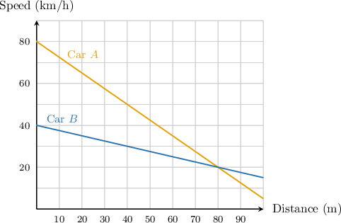

The graph above shows the speed of cars $A$ and $B$ as a function of the distance that they traveled during a brake test. At which distance, in meters, did both cars reach the same speed?

- $15$
- $30$
- $40$
- $20$
- $80$

**Worked solution**

The cars have the same speed when the two graphs intersect.

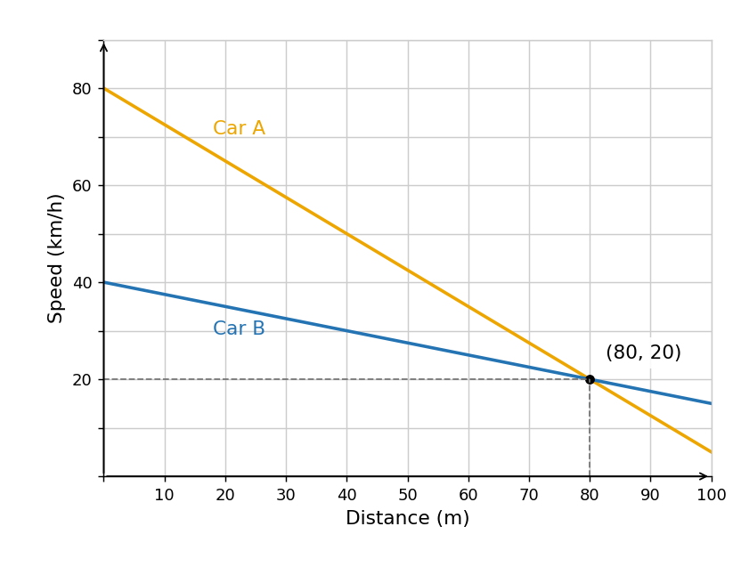

In this case, we have the point $(80,20)$. So, both cars have the same speed ($20\,\textrm{km/h}$) at a distance of $80$ meters.

---

## Original q-59886 replay — correct ref/solution/level authored

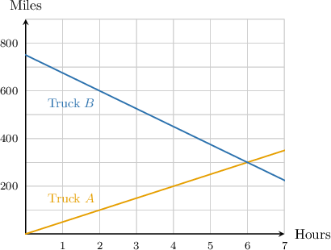

Two trucks, Truck $A$ and Truck $B$, are carrying shipments between distribution centers. The graph above shows the distances (in miles) of Truck $A$ and Truck $B$ from one of the centers as a function of time (in hours). At what time are Truck $A$ and Truck $B$ the same distance from the center?

- $5h$
- $6h$
- $3h$
- $4h$
- $2h$

**Worked solution**

The trucks are the same distance from the center when the two graphs intersect.

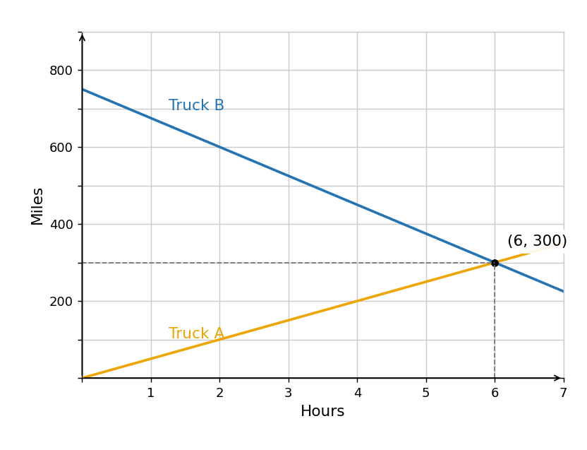

In this case, we have the point $(6,300)$. So, both trucks are the same distance ($300\,\textrm{miles}$) from the center at $t=6$ hours.

---

## Generated authored easy variant

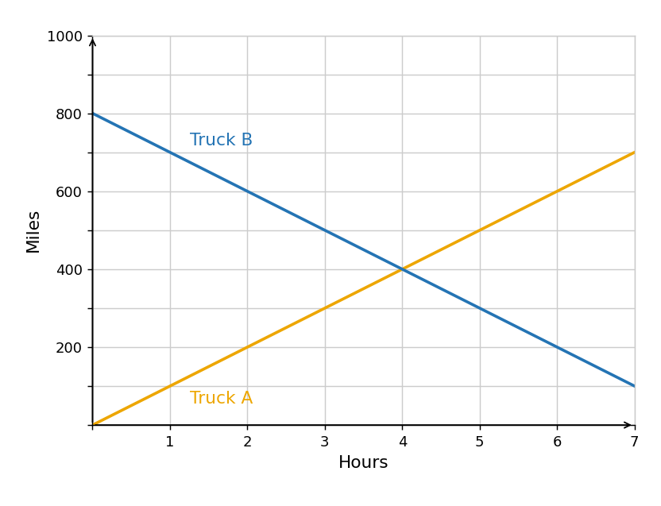

Two trucks, Truck $A$ and Truck $B$, are carrying shipments between distribution centers. The graph above shows the distances (in miles) of Truck $A$ and Truck $B$ from one of the centers as a function of time (in hours). At what time are Truck $A$ and Truck $B$ the same distance from the center?

- $6h$
- $2h$
- $4h$
- $5h$
- $3h$

**Worked solution**

The trucks are the same distance from the center when the two graphs intersect.

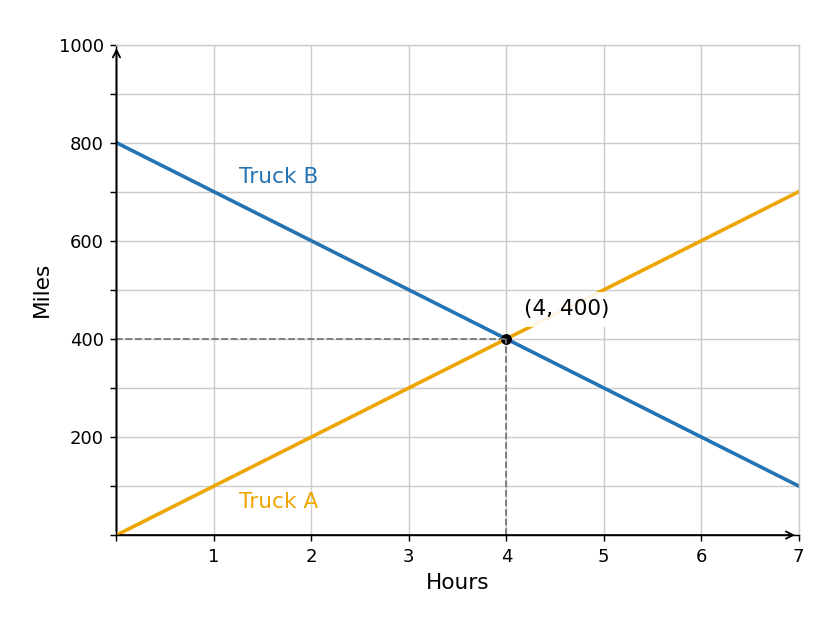

In this case, we have the point $(4,400)$. So, both trucks are the same distance ($400\,\textrm{miles}$) from the center at $t=4$ hours.

---

## Generated authored easy variant

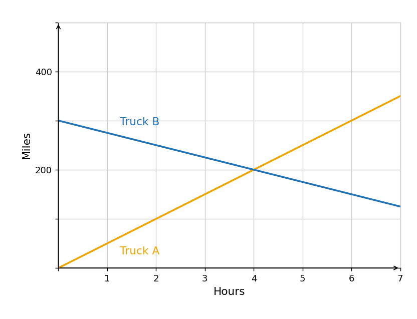

Two trucks, Truck $A$ and Truck $B$, are carrying shipments between distribution centers. The graph above shows the distances (in miles) of Truck $A$ and Truck $B$ from one of the centers as a function of time (in hours). At what time are Truck $A$ and Truck $B$ the same distance from the center?

- $2h$
- $3h$
- $4h$
- $5h$
- $6h$

**Worked solution**

The trucks are the same distance from the center when the two graphs intersect.

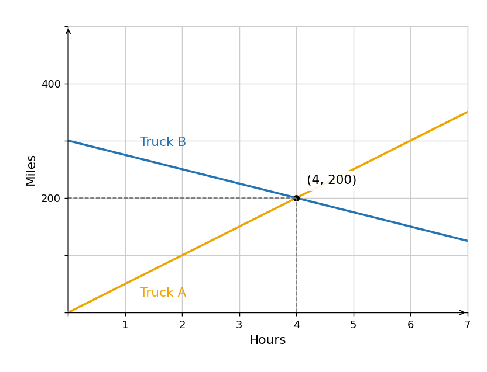

In this case, we have the point $(4,200)$. So, both trucks are the same distance ($200\,\textrm{miles}$) from the center at $t=4$ hours.

---

## Generated authored moderate variant

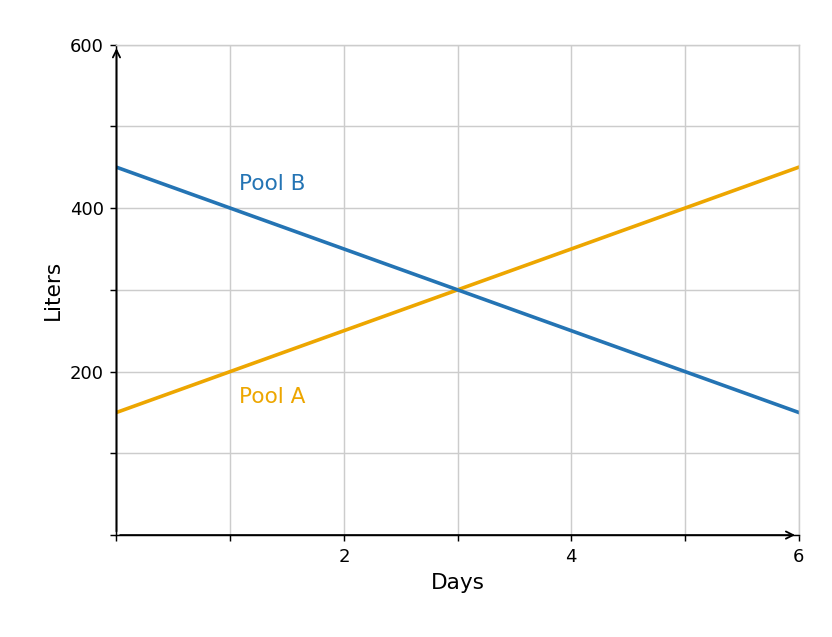

The graph above shows the number of liters of water in pool $A$ and pool $B$ as a function of time, measured in days. How many days will it take for both pools to contain the same amount of water?

- $1$
- $2$
- $3$
- $5$
- $4$

**Worked solution**

The pools have the same amount of water when the two graphs intersect.

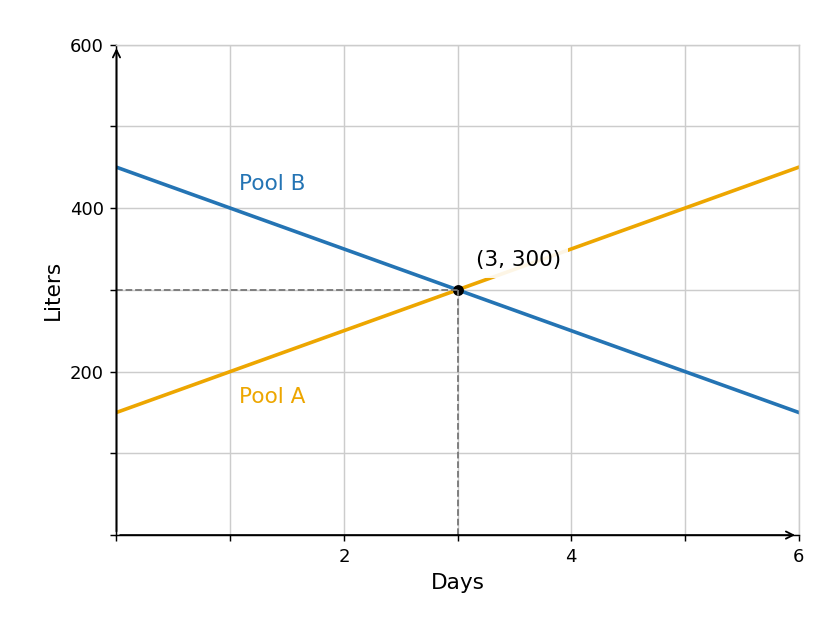

In this case, we have the point $(3,300)$. So, both pools have the same amount ($300\,\textrm{L}$) of water at $t=3$ days.

---

## Generated authored moderate variant

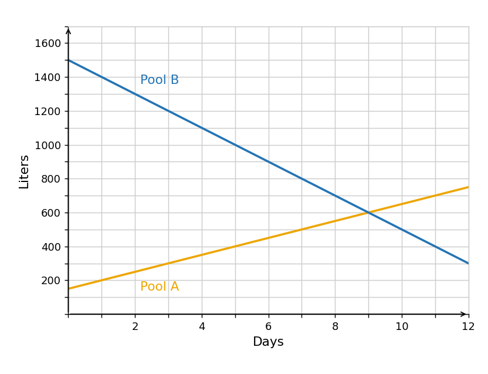

The graph above shows the number of liters of water in pool $A$ and pool $B$ as a function of time, measured in days. How many days will it take for both pools to contain the same amount of water?

- $8$
- $9$
- $7$
- $10$
- $11$

**Worked solution**

The pools have the same amount of water when the two graphs intersect.

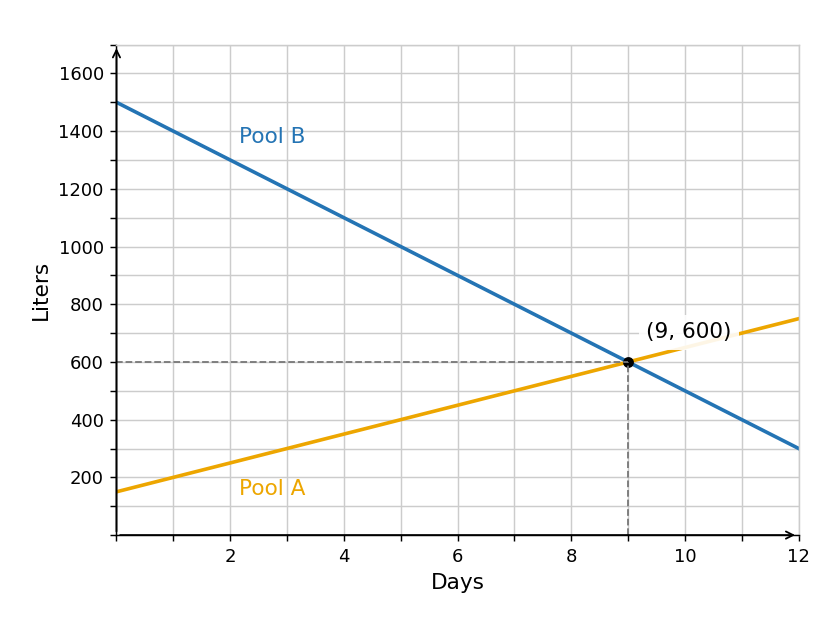

In this case, we have the point $(9,600)$. So, both pools have the same amount ($600\,\textrm{L}$) of water at $t=9$ days.

---

## Generated authored hard variant

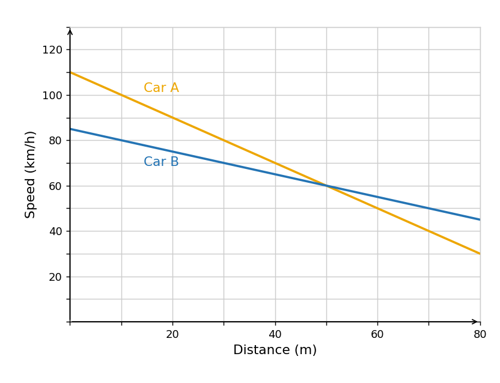

The graph above shows the speed of cars $A$ and $B$ as a function of the distance that they traveled during a brake test. At which distance, in meters, did both cars reach the same speed?

- $70$
- $30$
- $50$
- $60$
- $40$

**Worked solution**

The cars have the same speed when the two graphs intersect.

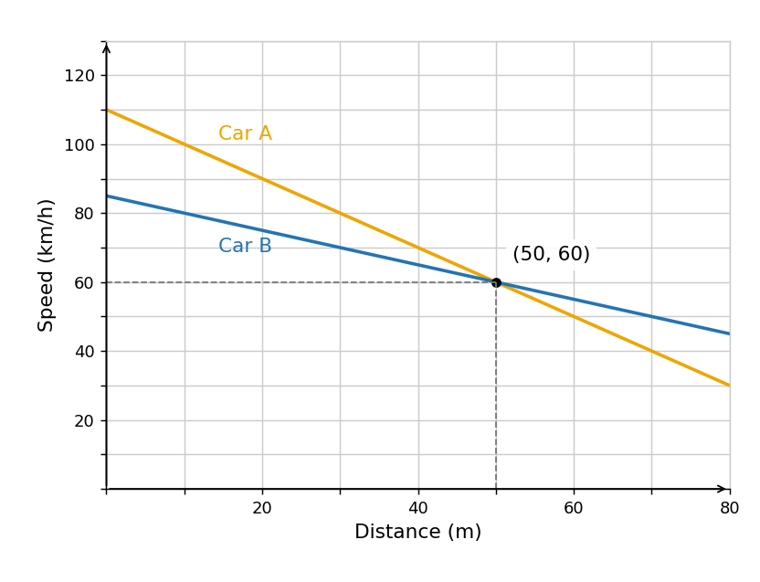

In this case, we have the point $(50,60)$. So, both cars have the same speed ($60\,\textrm{km/h}$) at a distance of $50$ meters.

---

## Generated authored hard variant

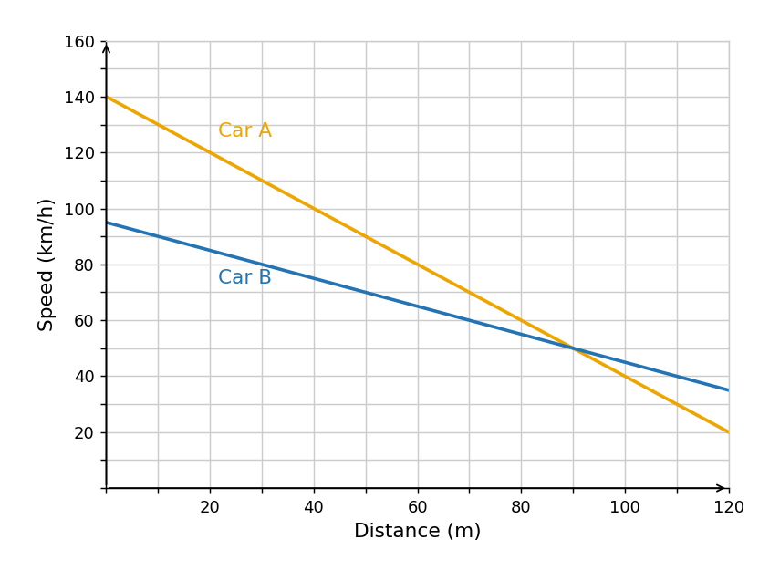

The graph above shows the speed of cars $A$ and $B$ as a function of the distance that they traveled during a brake test. At which distance, in meters, did both cars reach the same speed?

- $80$
- $90$
- $70$
- $100$
- $110$

**Worked solution**

The cars have the same speed when the two graphs intersect.

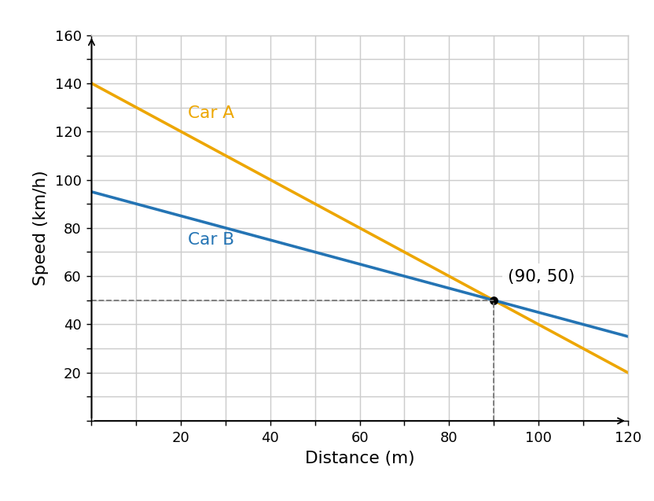

In this case, we have the point $(90,50)$. So, both cars have the same speed ($50\,\textrm{km/h}$) at a distance of $90$ meters.

---

## Generated variant of observed-expression replay profile; intent unknown

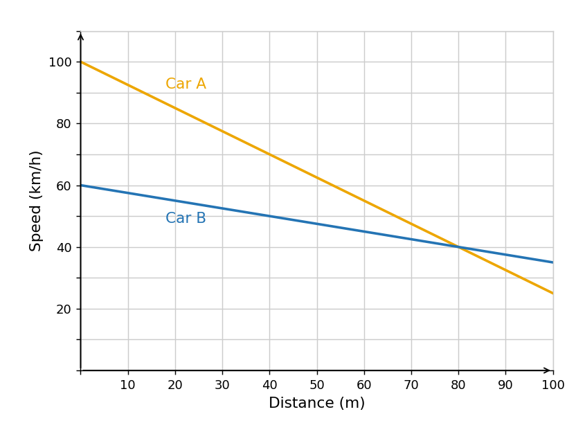

The graph above shows the speed of cars $A$ and $B$ as a function of the distance that they traveled during a brake test. At which distance, in meters, did both cars reach the same speed?

- $15$
- $30$
- $40$
- $20$
- $80$

**Worked solution**

The cars have the same speed when the two graphs intersect.

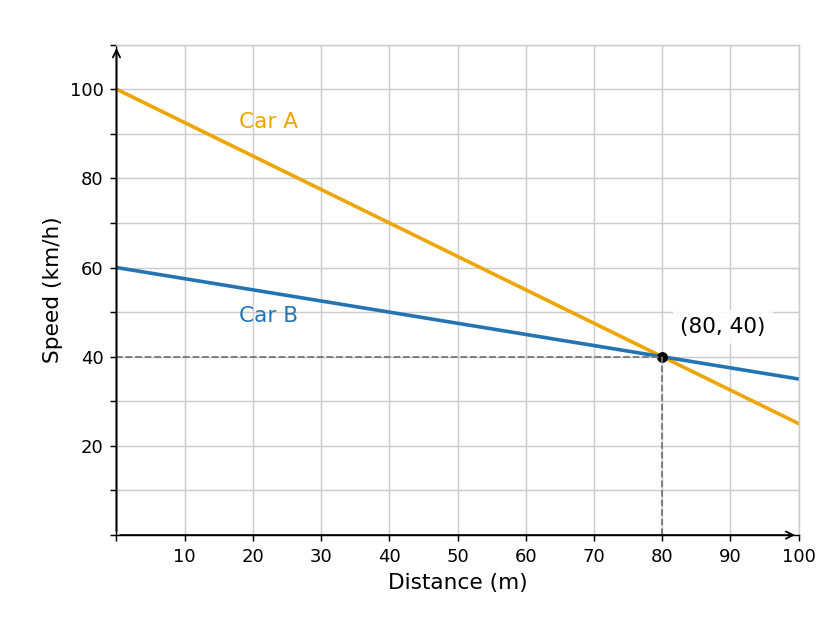

In this case, we have the point $(80,40)$. So, both cars have the same speed ($40\,\textrm{km/h}$) at a distance of $80$ meters.

---

## Generated variant of observed-expression replay profile; intent unknown

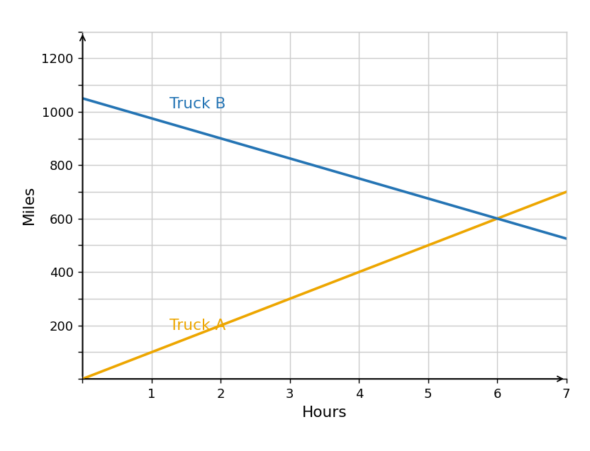

Two trucks, Truck $A$ and Truck $B$, are carrying shipments between distribution centers. The graph above shows the distances (in miles) of Truck $A$ and Truck $B$ from one of the centers as a function of time (in hours). At what time are Truck $A$ and Truck $B$ the same distance from the center?

- $5h$
- $6h$
- $3h$
- $4h$
- $2h$

**Worked solution**

The trucks are the same distance from the center when the two graphs intersect.

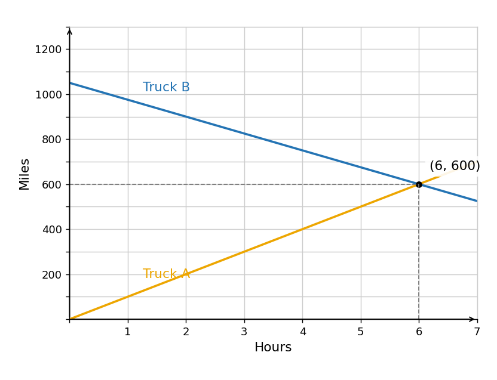

In this case, we have the point $(6,600)$. So, both trucks are the same distance ($600\,\textrm{miles}$) from the center at $t=6$ hours.
