# Origin-centered ellipse review

Raw originals preserve missing keys; changed examples use parameterized masks. Opaque/legacy evidence is labeled in metadata.

## ORIGINAL RAW

### ORIGINAL SOURCE EVIDENCE / parameterized replay — unrated (raw; easy routing authored) — graph — observed:q-15803

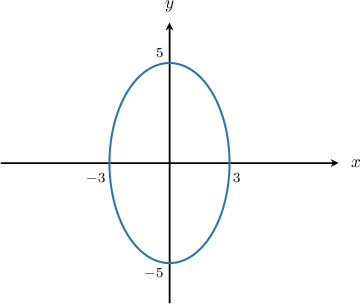

Which of the following sets of parametric equations, defined for $θ ∈ [0, 2π)$, generate the ellipse shown above?

Field selection (:answer-field.type/radio)

Correct designation absent in raw source.

• $x = 9\cos θ, y = 25\sin θ$

• $x = 5\cos θ, y = 3\sin θ$

• $x = \sqrt{5}\cos θ, y = \sqrt{3}\cos θ$

• $x = 3\cos θ, y = 5\sin θ$

• $x = 25\cos θ, y = 9\sin θ$

Worked solution absent in raw source.

## ORIGINAL RAW

### ORIGINAL SOURCE EVIDENCE / parameterized replay — moderate — traversal — observed:q-15856

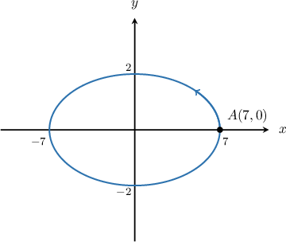

Consider the ellipse centered at the origin with horizontal radius $7$ and vertical radius $2,$ as shown above. Which of the following sets of parametric equations, defined for $\theta \in [0,2\pi ),$  traverse the ellipse once in the counterclockwise direction starting at the point $A(7,0)?$

Field selection (:answer-field.type/radio)

Correct designation absent in raw source.

• $x = 7\sin θ, y = 2\cos θ$

• $x = 2\cos θ, y = 7\sin θ$

• $x = 7\cos θ, y = 2\sin θ$

• $x = 2\sin θ, y = 7\cos θ$

• $x = 4\cos θ, y = 49\sin θ$

Field selection (:answer-field.type/radio)

• $x=4\operatorname{cos}⁡\theta ,\,y=49\operatorname{sin}⁡\theta $

• $x=2\operatorname{sin}⁡\theta ,\,y=7\operatorname{cos}⁡\theta $

• $x=7\operatorname{sin}⁡\theta ,\,y=2\operatorname{cos}⁡\theta $

• $x=2\operatorname{cos}⁡\theta ,\,y=7\operatorname{sin}⁡\theta $

✓ $x=7\operatorname{cos}⁡\theta ,\,y=2\operatorname{sin}⁡\theta $

Worked solution

The parametric equations of an ellipse centered at the origin with a horizontal radius of length $a$ and a vertical radius of length $b$ are

$$
x=a\operatorname{cos}⁡\theta ,\,y=b\operatorname{sin}⁡\theta ,\,\theta \in [0,2\pi ).
$$

Under this parametrization, the ellipse is traversed once in the counterclockwise direction, starting from $(a,0).$

In our case, $a=7$ and $b=2.$ Therefore, the parametric equations of the ellipse are

$$
x=7\operatorname{cos}⁡\theta ,\,y=2\operatorname{sin}⁡\theta ,\,\theta \in [0,2\pi ).
$$

## ORIGINAL RAW

### ORIGINAL SOURCE EVIDENCE / parameterized replay — easy — graph — observed:q-106392

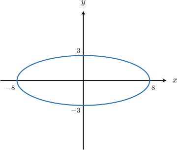

Which of the following sets of parametric equations, defined for $\theta \in [0,2\pi ),$ generate the ellipse shown above?

Field selection (:answer-field.type/radio)

• $x=9\operatorname{cos}⁡\theta ,\,y=64\operatorname{sin}⁡\theta $

• $x=2 \sqrt{2}\operatorname{cos}⁡\theta ,\,y=\sqrt{3}\operatorname{sin}⁡\theta $

✓ $x=8\operatorname{cos}⁡\theta ,\,y=3\operatorname{sin}⁡\theta $

• $x=3\operatorname{cos}⁡\theta ,\,y=8\operatorname{sin}⁡\theta $

• $x=64\operatorname{cos}⁡\theta ,\,y=9\operatorname{sin}⁡\theta $

Worked solution

The parametric equations of an ellipse centered at the origin with a horizontal radius of length $a$ and a vertical radius of length $b$ are

$$
x=a\operatorname{cos}⁡\theta ,\,y=b\operatorname{sin}⁡\theta ,\,\theta \in [0,2\pi ).
$$

In our case, $a=8$ and $b=3.$ Therefore, the parametric equations of the ellipse are

$$
x=8\operatorname{cos}⁡\theta ,\,y=3\operatorname{sin}⁡\theta ,\,\theta \in [0,2\pi ).
$$

## ORIGINAL RAW

### ORIGINAL SOURCE EVIDENCE / parameterized replay — moderate — traversal — observed:q-106393

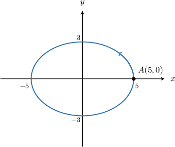

Consider the ellipse centered at the origin with horizontal radius $5$ and vertical radius $3,$ as shown above. Which of the following sets of parametric equations, defined for $\theta \in [0,2\pi ),$  traverse the ellipse once in the counterclockwise direction starting at the point $A(5,0)?$

Field selection (:answer-field.type/radio)

• $x=3\operatorname{sin}⁡\theta ,\,y=5\operatorname{cos}⁡\theta $

• $x=3\operatorname{cos}⁡\theta ,\,y=5\operatorname{sin}⁡\theta $

• $x=5\operatorname{sin}⁡\theta ,\,y=3\operatorname{cos}⁡\theta $

✓ $x=5\operatorname{cos}⁡\theta ,\,y=3\operatorname{sin}⁡\theta $

• $x=9\operatorname{cos}⁡\theta ,\,y=25\operatorname{sin}⁡\theta $

Worked solution

The parametric equations of an ellipse centered at the origin with a horizontal radius of length $a$ and a vertical radius of length $b$ are

$$
x=a\operatorname{cos}⁡\theta ,\,y=b\operatorname{sin}⁡\theta ,\,\theta \in [0,2\pi ).
$$

Under this parametrization, the ellipse is traversed once in the counterclockwise direction, starting from $(a,0).$

In our case, $a=5$ and $b=3.$ Therefore, the parametric equations of the ellipse are

$$
x=5\operatorname{cos}⁡\theta ,\,y=3\operatorname{sin}⁡\theta ,\,\theta \in [0,2\pi ).
$$

## ORIGINAL RAW

### ORIGINAL SOURCE EVIDENCE / parameterized replay — moderate — traversal — observed:q-106394

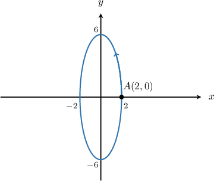

Consider the ellipse centered at the origin with horizontal radius $2$ and vertical radius $6,$ as shown above. Which of the following sets of parametric equations, defined for $\theta \in [0,2\pi ),$  traverse the ellipse once in the counterclockwise direction starting at the point $A(2,0)?$

Field selection (:answer-field.type/radio)

• $x=6\operatorname{sin}⁡\theta ,\,y=2\operatorname{cos}⁡\theta $

✓ $x=2\operatorname{cos}⁡\theta ,\,y=6\operatorname{sin}⁡\theta $

• $x=6\operatorname{cos}⁡\theta ,\,y=2\operatorname{sin}⁡\theta $

• $x=4\operatorname{sin}⁡\theta ,\,y=36\operatorname{cos}⁡\theta $

• $x=2\operatorname{sin}⁡\theta ,\,y=6\operatorname{cos}⁡\theta $

Worked solution

The parametric equations of an ellipse centered at the origin with a horizontal radius of length $a$ and a vertical radius of length $b$ are

$$
x=a\operatorname{cos}⁡\theta ,\,y=b\operatorname{sin}⁡\theta ,\,\theta \in [0,2\pi ).
$$

Under this parametrization, the ellipse is traversed once in the counterclockwise direction, starting from $(a,0).$

In our case, $a=2$ and $b=6.$ Therefore, the parametric equations of the ellipse are

$$
x=2\operatorname{cos}⁡\theta ,\,y=6\operatorname{sin}⁡\theta ,\,\theta \in [0,2\pi ).
$$

## ORIGINAL RAW

### ORIGINAL SOURCE EVIDENCE / parameterized replay — easy — graph — observed:q-106701

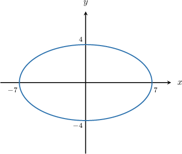

Which of the following sets of parametric equations, defined for $\theta \in [0,2\pi ),$ generate the ellipse shown above?

Field selection (:answer-field.type/radio)

• $x=16\operatorname{cos}⁡\theta ,\,y=49\operatorname{sin}⁡\theta $

• $x=4\operatorname{cos}⁡\theta ,\,y=8\operatorname{sin}⁡\theta $

• $x=\sqrt{7}\operatorname{cos}⁡\theta ,\,y=2\operatorname{sin}⁡\theta $

• $x=49\operatorname{cos}⁡\theta ,\,y=16\operatorname{sin}⁡\theta $

✓ $x=7\operatorname{cos}⁡\theta ,\,y=4\operatorname{sin}⁡\theta $

Worked solution

The parametric equations of an ellipse centered at the origin with a horizontal radius of length $a$ and a vertical radius of length $b$ are

$$
x=a\operatorname{cos}⁡\theta ,\,y=b\operatorname{sin}⁡\theta ,\,\theta \in [0,2\pi ).
$$

In our case, $a=7$ and $b=4.$ Therefore, the parametric equations of the ellipse are

$$
x=7\operatorname{cos}⁡\theta ,\,y=4\operatorname{sin}⁡\theta ,\,\theta \in [0,2\pi ).
$$

## ORIGINAL RAW

### ORIGINAL SOURCE EVIDENCE / parameterized replay — moderate — construct — observed:q-274855

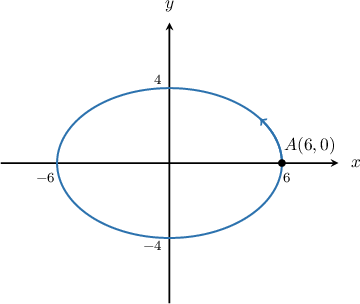

Consider the ellipse centered at the origin with horizontal radius $6$ and vertical radius $4,$ as shown above. Construct a set of parametric equations, defined for $\theta \in [0,2\pi ),$ that traverse the ellipse once in the counterclockwise direction starting at the point $A(6,0).$

$x=$
{{field-1}}$,\,y=$
{{field-2}}$,\,\theta \in [0,2\pi ).$

Field field-1 (:answer-field.type/blank)

✓ $6\operatorname{cos}\theta $

Field field-2 (:answer-field.type/blank)

✓ $4\operatorname{sin}\theta $

Worked solution

The parametric equations of an ellipse centered at the origin with a horizontal radius of length $a$ and a vertical radius of length $b$ are

$$
x=a\operatorname{cos}⁡\theta ,\,y=b\operatorname{sin}⁡\theta ,\,\theta \in [0,2\pi ).
$$

Under this parametrization, the ellipse is traversed once in the counterclockwise direction, starting from $(a,0).$

In our case, $a=6$ and $b=4.$ Therefore, the parametric equations of the ellipse are

$$
x=6\operatorname{cos}⁡\theta ,\,y=4\operatorname{sin}⁡\theta ,\,\theta \in [0,2\pi ).
$$

## ORIGINAL RAW

### ORIGINAL SOURCE EVIDENCE / parameterized replay — moderate — construct — observed:q-326267

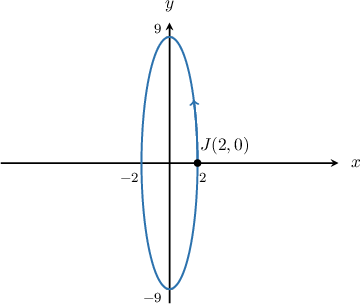

Consider the ellipse centered at the origin with horizontal radius $2$ and vertical radius $9,$ as shown above. Construct a set of parametric equations, defined for $\theta \in [0,2\pi ),$ that traverse the ellipse once in the counterclockwise direction starting at the point $J(2,0).$

$x=$ 
{{field-1}}$,\,y=$ 
{{field-2}}$,\,\theta \in [0,2\pi ).$

Field field-1 (:answer-field.type/blank)

✓ $2\operatorname{cos}\theta $

Field field-2 (:answer-field.type/blank)

✓ $9\operatorname{sin}\theta $

Worked solution

The parametric equations of an ellipse centered at the origin with a horizontal radius of length $a$ and a vertical radius of length $b$ are

$$
x=a\operatorname{cos}⁡\theta ,\,y=b\operatorname{sin}⁡\theta ,\,\theta \in [0,2\pi ).
$$

Under this parametrization, the ellipse is traversed once in the counterclockwise direction, starting from $(a,0).$

In our case, $a=2$ and $b=9.$ Therefore, the parametric equations of the ellipse are

$$
x=2\operatorname{cos}⁡\theta ,\,y=9\operatorname{sin}⁡\theta ,\,\theta \in [0,2\pi ).
$$

## ORIGINAL RAW

### ORIGINAL SOURCE EVIDENCE / parameterized replay — easy — graph — observed:q-6889

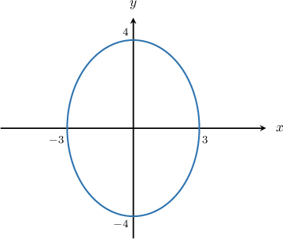

Which of the following sets of parametric equations, defined for $\theta \in [0,2\pi ),$ generate the ellipse shown above?

Field selection (:answer-field.type/radio)

• $x=6\operatorname{cos}⁡\theta ,\,y=8\operatorname{sin}⁡\theta $

• $x=16\operatorname{cos}⁡\theta ,\,y=9\operatorname{cos}⁡\theta $

✓ $x=3\operatorname{cos}⁡\theta ,\,y=4\operatorname{sin}⁡\theta $

• $x=8\operatorname{cos}⁡\theta ,\,y=6\operatorname{sin}⁡\theta $

• $x=4\operatorname{cos}⁡\theta ,\,y=3\operatorname{sin}⁡\theta $

Worked solution

The parametric equations of an ellipse centered at the origin with a horizontal radius of length $a$ and a vertical radius of length $b$ are

$$
x=a\operatorname{cos}⁡\theta ,\,y=b\operatorname{sin}⁡\theta ,\,\theta \in [0,2\pi ).
$$

In our case, $a=3$ and $b=4.$ Therefore, the parametric equations of the ellipse are

$$
x=3\operatorname{cos}⁡\theta ,\,y=4\operatorname{sin}⁡\theta ,\,\theta \in [0,2\pi ).
$$

## ORIGINAL RAW

### ORIGINAL SOURCE EVIDENCE / parameterized replay — moderate — traversal — observed:q-79284

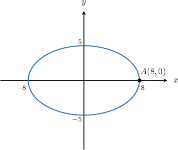

Consider the ellipse centered at the origin with horizontal radius $8$ and vertical radius $5,$ as shown above. Which of the following sets of parametric equations, defined for $\theta \in [0,2\pi ),$  traverse the ellipse once in the counterclockwise direction starting at the point $A(8,0)?$

Field selection (:answer-field.type/radio)

• $x=5\operatorname{cos}⁡\theta ,\,y=8\operatorname{sin}⁡\theta $

• $x=25\operatorname{sin}⁡\theta ,\,y=64\operatorname{cos}⁡\theta $

✓ $x=8\operatorname{cos}⁡\theta ,\,y=5\operatorname{sin}⁡\theta $

• $x=8\operatorname{sin}⁡\theta ,\,y=5\operatorname{cos}⁡\theta $

• $x=5\operatorname{sin}⁡\theta ,\,y=8\operatorname{cos}⁡\theta $

Worked solution

The parametric equations of an ellipse centered at the origin with a horizontal radius of length $a$ and a vertical radius of length $b$ are

$$
x=a\operatorname{cos}⁡\theta ,\,y=b\operatorname{sin}⁡\theta ,\,\theta \in [0,2\pi ).
$$

Under this parametrization, the ellipse is traversed once in the counterclockwise direction, starting from $(a,0).$

In our case, $a=8$ and $b=5.$ Therefore, the parametric equations of the ellipse are

$$
x=8\operatorname{cos}⁡\theta ,\,y=5\operatorname{sin}⁡\theta ,\,\theta \in [0,2\pi ).
$$

## ORIGINAL RAW

### ORIGINAL SOURCE EVIDENCE / parameterized replay — easy — graph — observed:q-106391

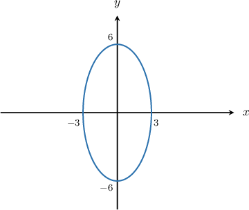

Which of the following sets of parametric equations, defined for $\theta \in [0,2\pi ),$ generate the ellipse shown above?

Field selection (:answer-field.type/radio)

• $x=36\operatorname{sin}⁡\theta ,\,y=9\operatorname{cos}⁡\theta $

• $x=\sqrt{3}\operatorname{cos}⁡\theta ,\,y=\sqrt{6}\operatorname{sin}⁡\theta $

✓ $x=3\operatorname{cos}⁡\theta ,\,y=6\operatorname{sin}⁡\theta $

• $x=6\operatorname{sin}⁡\theta ,\,y=3\operatorname{cos}⁡\theta $

• $x=9\operatorname{cos}⁡\theta ,\,y=36\operatorname{sin}⁡\theta $

Worked solution

The parametric equations of an ellipse centered at the origin with a horizontal radius of length $a$ and a vertical radius of length $b$ are

$$
x=a\operatorname{cos}⁡\theta ,\,y=b\operatorname{sin}⁡\theta ,\,\theta \in [0,2\pi ).
$$

In our case, $a=3$ and $b=6.$ Therefore, the parametric equations of the ellipse are

$$
x=3\operatorname{cos}⁡\theta ,\,y=6\operatorname{sin}⁡\theta ,\,\theta \in [0,2\pi ).
$$

## ORIGINAL RAW

### ORIGINAL SOURCE EVIDENCE / parameterized replay — easy — graph — observed:q-6880

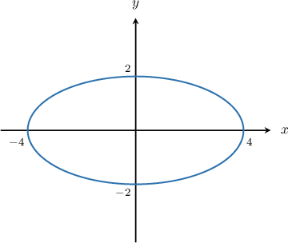

Which of the following sets of parametric equations, defined for $\theta \in [0,2\pi ),$ generate the ellipse shown above?

Field selection (:answer-field.type/radio)

• $x=2\operatorname{cos}⁡\theta ,\,y=4\operatorname{sin}⁡\theta $

✓ $x=4\operatorname{cos}⁡\theta ,\,y=2\operatorname{sin}⁡\theta $

• $x=16\operatorname{cos}⁡\theta ,\,y=4\operatorname{sin}⁡\theta $

• $x=2\operatorname{cos}⁡\theta ,\,y=\sqrt{2}\operatorname{cos}⁡\theta $

• $x=4\operatorname{cos}⁡\theta ,\,y=16\operatorname{sin}⁡\theta $

Worked solution

The parametric equations of an ellipse centered at the origin with a horizontal radius of length $a$ and a vertical radius of length $b$ are

$$
x=a\operatorname{cos}⁡\theta ,\,y=b\operatorname{sin}⁡\theta ,\,\theta \in [0,2\pi ).
$$

In our case, $a=4$ and $b=2.$ Therefore, the parametric equations of the ellipse are

$$
x=4\operatorname{cos}⁡\theta ,\,y=2\operatorname{sin}⁡\theta ,\,\theta \in [0,2\pi ).
$$

## ORIGINAL RAW

### ORIGINAL SOURCE EVIDENCE / parameterized replay — moderate — traversal — observed:q-79281

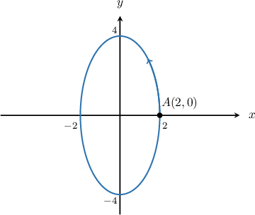

Consider the ellipse centered at the origin with horizontal radius $2$ and vertical radius $4,$ as shown above. Which of the following sets of parametric equations, defined for $\theta \in [0,2\pi ),$  traverse the ellipse once in the counterclockwise direction starting at the point $A(2,0)?$

Field selection (:answer-field.type/radio)

✓ $x=2\operatorname{cos}⁡\theta ,\,y=4\operatorname{sin}⁡\theta $

• $x=4\operatorname{cos}⁡\theta ,\,y=2\operatorname{sin}⁡\theta $

• $x=2\operatorname{sin}⁡\theta ,\,y=4\operatorname{cos}⁡\theta $

• $x=4\operatorname{sin}⁡\theta ,\,y=2\operatorname{cos}⁡\theta $

• $x=4\operatorname{cos}⁡\theta ,\,y=16\operatorname{sin}⁡\theta $

Worked solution

The parametric equations of an ellipse centered at the origin with a horizontal radius of length $a$ and a vertical radius of length $b$ are

$$
x=a\operatorname{cos}⁡\theta ,\,y=b\operatorname{sin}⁡\theta ,\,\theta \in [0,2\pi ).
$$

Under this parametrization, the ellipse is traversed once in the counterclockwise direction, starting from $(a,0).$

In our case, $a=2$ and $b=4.$ Therefore, the parametric equations of the ellipse are

$$
x=2\operatorname{cos}⁡\theta ,\,y=4\operatorname{sin}⁡\theta ,\,\theta \in [0,2\pi ).
$$

## CHANGED OBSERVED BANK

### ORIGINAL SOURCE EVIDENCE / parameterized replay — unrated (raw; easy routing authored) — graph — observed:q-15803

Which of the following sets of parametric equations, defined for $θ ∈ [0, 2π)$, generate the ellipse shown above?

Field selection (:answer-field.type/radio)

Correct designation absent in raw source.

• $x = 9\cos θ, y = 36\sin θ$

• $x = 3\cos θ, y = 6\sin θ$

• $x = \sqrt{3}\cos θ, y = \sqrt{6}\cos θ$

• $x = 36\cos θ, y = 9\sin θ$

• $x = 6\cos θ, y = 3\sin θ$

Worked solution absent in raw source.

## CHANGED OBSERVED BANK

### ORIGINAL SOURCE EVIDENCE / parameterized replay — moderate — traversal — observed:q-15856

Consider the ellipse centered at the origin with horizontal radius $6$ and vertical radius $3,$ as shown above. Which of the following sets of parametric equations, defined for $\theta \in [0,2\pi ),$  traverse the ellipse once in the counterclockwise direction starting at the point $A(6,0)?$

Field selection (:answer-field.type/radio)

Correct designation absent in raw source.

• $x = 9\cos θ, y = 36\sin θ$

• $x = 3\cos θ, y = 6\sin θ$

• $x = 6\cos θ, y = 3\sin θ$

• $x = 6\sin θ, y = 3\cos θ$

• $x = 3\sin θ, y = 6\cos θ$

Field selection (:answer-field.type/radio)

• $x=3\operatorname{cos}⁡\theta ,\,y=6\operatorname{sin}⁡\theta $

• $x=3\operatorname{sin}⁡\theta ,\,y=6\operatorname{cos}⁡\theta $

• $x=9\operatorname{cos}⁡\theta ,\,y=36\operatorname{sin}⁡\theta $

✓ $x=6\operatorname{cos}⁡\theta ,\,y=3\operatorname{sin}⁡\theta $

• $x=6\operatorname{sin}⁡\theta ,\,y=3\operatorname{cos}⁡\theta $

Worked solution

The parametric equations of an ellipse centered at the origin with a horizontal radius of length $a$ and a vertical radius of length $b$ are

$$
x=a\operatorname{cos}⁡\theta ,\,y=b\operatorname{sin}⁡\theta ,\,\theta \in [0,2\pi ).
$$

Under this parametrization, the ellipse is traversed once in the counterclockwise direction, starting from $(a,0).$

In our case, $a=6$ and $b=3.$ Therefore, the parametric equations of the ellipse are

$$
x=6\operatorname{cos}⁡\theta ,\,y=3\operatorname{sin}⁡\theta ,\,\theta \in [0,2\pi ).
$$

## CHANGED OBSERVED BANK

### ORIGINAL SOURCE EVIDENCE / parameterized replay — easy — graph — observed:q-106392

Which of the following sets of parametric equations, defined for $\theta \in [0,2\pi ),$ generate the ellipse shown above?

Field selection (:answer-field.type/radio)

• $x=36\operatorname{cos}⁡\theta ,\,y=9\operatorname{sin}⁡\theta $

• $x=\sqrt{6}\operatorname{cos}⁡\theta ,\,y=\sqrt{3}\operatorname{sin}⁡\theta $

✓ $x=6\operatorname{cos}⁡\theta ,\,y=3\operatorname{sin}⁡\theta $

• $x=9\operatorname{cos}⁡\theta ,\,y=36\operatorname{sin}⁡\theta $

• $x=3\operatorname{cos}⁡\theta ,\,y=6\operatorname{sin}⁡\theta $

Worked solution

The parametric equations of an ellipse centered at the origin with a horizontal radius of length $a$ and a vertical radius of length $b$ are

$$
x=a\operatorname{cos}⁡\theta ,\,y=b\operatorname{sin}⁡\theta ,\,\theta \in [0,2\pi ).
$$

In our case, $a=6$ and $b=3.$ Therefore, the parametric equations of the ellipse are

$$
x=6\operatorname{cos}⁡\theta ,\,y=3\operatorname{sin}⁡\theta ,\,\theta \in [0,2\pi ).
$$

## CHANGED OBSERVED BANK

### ORIGINAL SOURCE EVIDENCE / parameterized replay — moderate — traversal — observed:q-106393

Consider the ellipse centered at the origin with horizontal radius $6$ and vertical radius $3,$ as shown above. Which of the following sets of parametric equations, defined for $\theta \in [0,2\pi ),$  traverse the ellipse once in the counterclockwise direction starting at the point $A(6,0)?$

Field selection (:answer-field.type/radio)

• $x=9\operatorname{cos}⁡\theta ,\,y=36\operatorname{sin}⁡\theta $

• $x=3\operatorname{cos}⁡\theta ,\,y=6\operatorname{sin}⁡\theta $

• $x=6\operatorname{sin}⁡\theta ,\,y=3\operatorname{cos}⁡\theta $

• $x=3\operatorname{sin}⁡\theta ,\,y=6\operatorname{cos}⁡\theta $

✓ $x=6\operatorname{cos}⁡\theta ,\,y=3\operatorname{sin}⁡\theta $

Worked solution

The parametric equations of an ellipse centered at the origin with a horizontal radius of length $a$ and a vertical radius of length $b$ are

$$
x=a\operatorname{cos}⁡\theta ,\,y=b\operatorname{sin}⁡\theta ,\,\theta \in [0,2\pi ).
$$

Under this parametrization, the ellipse is traversed once in the counterclockwise direction, starting from $(a,0).$

In our case, $a=6$ and $b=3.$ Therefore, the parametric equations of the ellipse are

$$
x=6\operatorname{cos}⁡\theta ,\,y=3\operatorname{sin}⁡\theta ,\,\theta \in [0,2\pi ).
$$

## CHANGED OBSERVED BANK

### ORIGINAL SOURCE EVIDENCE / parameterized replay — moderate — traversal — observed:q-106394

Consider the ellipse centered at the origin with horizontal radius $6$ and vertical radius $3,$ as shown above. Which of the following sets of parametric equations, defined for $\theta \in [0,2\pi ),$  traverse the ellipse once in the counterclockwise direction starting at the point $A(6,0)?$

Field selection (:answer-field.type/radio)

• $x=6\operatorname{sin}⁡\theta ,\,y=3\operatorname{cos}⁡\theta $

✓ $x=6\operatorname{cos}⁡\theta ,\,y=3\operatorname{sin}⁡\theta $

• $x=3\operatorname{cos}⁡\theta ,\,y=6\operatorname{sin}⁡\theta $

• $x=3\operatorname{sin}⁡\theta ,\,y=6\operatorname{cos}⁡\theta $

• $x=36\operatorname{sin}⁡\theta ,\,y=9\operatorname{cos}⁡\theta $

Worked solution

The parametric equations of an ellipse centered at the origin with a horizontal radius of length $a$ and a vertical radius of length $b$ are

$$
x=a\operatorname{cos}⁡\theta ,\,y=b\operatorname{sin}⁡\theta ,\,\theta \in [0,2\pi ).
$$

Under this parametrization, the ellipse is traversed once in the counterclockwise direction, starting from $(a,0).$

In our case, $a=6$ and $b=3.$ Therefore, the parametric equations of the ellipse are

$$
x=6\operatorname{cos}⁡\theta ,\,y=3\operatorname{sin}⁡\theta ,\,\theta \in [0,2\pi ).
$$

## CHANGED OBSERVED BANK

### ORIGINAL SOURCE EVIDENCE / parameterized replay — easy — graph — observed:q-106701

Which of the following sets of parametric equations, defined for $\theta \in [0,2\pi ),$ generate the ellipse shown above?

Field selection (:answer-field.type/radio)

✓ $x=6\operatorname{cos}⁡\theta ,\,y=3\operatorname{sin}⁡\theta $

• $x=3\operatorname{cos}⁡\theta ,\,y=7\operatorname{sin}⁡\theta $

• $x=\sqrt{6}\operatorname{cos}⁡\theta ,\,y=\sqrt{3}\operatorname{sin}⁡\theta $

• $x=9\operatorname{cos}⁡\theta ,\,y=36\operatorname{sin}⁡\theta $

• $x=36\operatorname{cos}⁡\theta ,\,y=9\operatorname{sin}⁡\theta $

Worked solution

The parametric equations of an ellipse centered at the origin with a horizontal radius of length $a$ and a vertical radius of length $b$ are

$$
x=a\operatorname{cos}⁡\theta ,\,y=b\operatorname{sin}⁡\theta ,\,\theta \in [0,2\pi ).
$$

In our case, $a=6$ and $b=3.$ Therefore, the parametric equations of the ellipse are

$$
x=6\operatorname{cos}⁡\theta ,\,y=3\operatorname{sin}⁡\theta ,\,\theta \in [0,2\pi ).
$$

## CHANGED OBSERVED BANK

### ORIGINAL SOURCE EVIDENCE / parameterized replay — moderate — construct — observed:q-274855

Consider the ellipse centered at the origin with horizontal radius $6$ and vertical radius $3,$ as shown above. Construct a set of parametric equations, defined for $\theta \in [0,2\pi ),$ that traverse the ellipse once in the counterclockwise direction starting at the point $A(6,0).$

$x=$
{{field-1}}$,\,y=$
{{field-2}}$,\,\theta \in [0,2\pi ).$

Field field-1 (:answer-field.type/blank)

✓ $6\operatorname{cos}\theta $

Field field-2 (:answer-field.type/blank)

✓ $3\operatorname{sin}\theta $

Worked solution

The parametric equations of an ellipse centered at the origin with a horizontal radius of length $a$ and a vertical radius of length $b$ are

$$
x=a\operatorname{cos}⁡\theta ,\,y=b\operatorname{sin}⁡\theta ,\,\theta \in [0,2\pi ).
$$

Under this parametrization, the ellipse is traversed once in the counterclockwise direction, starting from $(a,0).$

In our case, $a=6$ and $b=3.$ Therefore, the parametric equations of the ellipse are

$$
x=6\operatorname{cos}⁡\theta ,\,y=3\operatorname{sin}⁡\theta ,\,\theta \in [0,2\pi ).
$$

## CHANGED OBSERVED BANK

### ORIGINAL SOURCE EVIDENCE / parameterized replay — moderate — construct — observed:q-326267

Consider the ellipse centered at the origin with horizontal radius $6$ and vertical radius $3,$ as shown above. Construct a set of parametric equations, defined for $\theta \in [0,2\pi ),$ that traverse the ellipse once in the counterclockwise direction starting at the point $J(6,0).$

$x=$ 
{{field-1}}$,\,y=$ 
{{field-2}}$,\,\theta \in [0,2\pi ).$

Field field-1 (:answer-field.type/blank)

✓ $6\operatorname{cos}\theta $

Field field-2 (:answer-field.type/blank)

✓ $3\operatorname{sin}\theta $

Worked solution

The parametric equations of an ellipse centered at the origin with a horizontal radius of length $a$ and a vertical radius of length $b$ are

$$
x=a\operatorname{cos}⁡\theta ,\,y=b\operatorname{sin}⁡\theta ,\,\theta \in [0,2\pi ).
$$

Under this parametrization, the ellipse is traversed once in the counterclockwise direction, starting from $(a,0).$

In our case, $a=6$ and $b=3.$ Therefore, the parametric equations of the ellipse are

$$
x=6\operatorname{cos}⁡\theta ,\,y=3\operatorname{sin}⁡\theta ,\,\theta \in [0,2\pi ).
$$

## CHANGED OBSERVED BANK

### ORIGINAL SOURCE EVIDENCE / parameterized replay — easy — graph — observed:q-6889

Which of the following sets of parametric equations, defined for $\theta \in [0,2\pi ),$ generate the ellipse shown above?

Field selection (:answer-field.type/radio)

• $x=3\operatorname{cos}⁡\theta ,\,y=6\operatorname{sin}⁡\theta $

• $x=9\operatorname{cos}⁡\theta ,\,y=36\operatorname{cos}⁡\theta $

✓ $x=6\operatorname{cos}⁡\theta ,\,y=3\operatorname{sin}⁡\theta $

• $x=12\operatorname{cos}⁡\theta ,\,y=6\operatorname{sin}⁡\theta $

• $x=6\operatorname{cos}⁡\theta ,\,y=12\operatorname{sin}⁡\theta $

Worked solution

The parametric equations of an ellipse centered at the origin with a horizontal radius of length $a$ and a vertical radius of length $b$ are

$$
x=a\operatorname{cos}⁡\theta ,\,y=b\operatorname{sin}⁡\theta ,\,\theta \in [0,2\pi ).
$$

In our case, $a=6$ and $b=3.$ Therefore, the parametric equations of the ellipse are

$$
x=6\operatorname{cos}⁡\theta ,\,y=3\operatorname{sin}⁡\theta ,\,\theta \in [0,2\pi ).
$$

## CHANGED OBSERVED BANK

### ORIGINAL SOURCE EVIDENCE / parameterized replay — moderate — traversal — observed:q-79284

Consider the ellipse centered at the origin with horizontal radius $6$ and vertical radius $3,$ as shown above. Which of the following sets of parametric equations, defined for $\theta \in [0,2\pi ),$  traverse the ellipse once in the counterclockwise direction starting at the point $A(6,0)?$

Field selection (:answer-field.type/radio)

• $x=3\operatorname{sin}⁡\theta ,\,y=6\operatorname{cos}⁡\theta $

• $x=9\operatorname{sin}⁡\theta ,\,y=36\operatorname{cos}⁡\theta $

✓ $x=6\operatorname{cos}⁡\theta ,\,y=3\operatorname{sin}⁡\theta $

• $x=3\operatorname{cos}⁡\theta ,\,y=6\operatorname{sin}⁡\theta $

• $x=6\operatorname{sin}⁡\theta ,\,y=3\operatorname{cos}⁡\theta $

Worked solution

The parametric equations of an ellipse centered at the origin with a horizontal radius of length $a$ and a vertical radius of length $b$ are

$$
x=a\operatorname{cos}⁡\theta ,\,y=b\operatorname{sin}⁡\theta ,\,\theta \in [0,2\pi ).
$$

Under this parametrization, the ellipse is traversed once in the counterclockwise direction, starting from $(a,0).$

In our case, $a=6$ and $b=3.$ Therefore, the parametric equations of the ellipse are

$$
x=6\operatorname{cos}⁡\theta ,\,y=3\operatorname{sin}⁡\theta ,\,\theta \in [0,2\pi ).
$$

## CHANGED OBSERVED BANK

### ORIGINAL SOURCE EVIDENCE / parameterized replay — easy — graph — observed:q-106391

Which of the following sets of parametric equations, defined for $\theta \in [0,2\pi ),$ generate the ellipse shown above?

Field selection (:answer-field.type/radio)

• $x=36\operatorname{cos}⁡\theta ,\,y=9\operatorname{sin}⁡\theta $

• $x=\sqrt{6}\operatorname{cos}⁡\theta ,\,y=\sqrt{3}\operatorname{sin}⁡\theta $

✓ $x=6\operatorname{cos}⁡\theta ,\,y=3\operatorname{sin}⁡\theta $

• $x=9\operatorname{sin}⁡\theta ,\,y=36\operatorname{cos}⁡\theta $

• $x=3\operatorname{sin}⁡\theta ,\,y=6\operatorname{cos}⁡\theta $

Worked solution

The parametric equations of an ellipse centered at the origin with a horizontal radius of length $a$ and a vertical radius of length $b$ are

$$
x=a\operatorname{cos}⁡\theta ,\,y=b\operatorname{sin}⁡\theta ,\,\theta \in [0,2\pi ).
$$

In our case, $a=6$ and $b=3.$ Therefore, the parametric equations of the ellipse are

$$
x=6\operatorname{cos}⁡\theta ,\,y=3\operatorname{sin}⁡\theta ,\,\theta \in [0,2\pi ).
$$

## CHANGED OBSERVED BANK

### ORIGINAL SOURCE EVIDENCE / parameterized replay — easy — graph — observed:q-6880

Which of the following sets of parametric equations, defined for $\theta \in [0,2\pi ),$ generate the ellipse shown above?

Field selection (:answer-field.type/radio)

• $x=9\operatorname{cos}⁡\theta ,\,y=36\operatorname{sin}⁡\theta $

✓ $x=6\operatorname{cos}⁡\theta ,\,y=3\operatorname{sin}⁡\theta $

• $x=36\operatorname{cos}⁡\theta ,\,y=9\operatorname{sin}⁡\theta $

• $x=3\operatorname{cos}⁡\theta ,\,y=6\operatorname{sin}⁡\theta $

• $x=3\operatorname{cos}⁡\theta ,\,y=\sqrt{3}\operatorname{cos}⁡\theta $

Worked solution

The parametric equations of an ellipse centered at the origin with a horizontal radius of length $a$ and a vertical radius of length $b$ are

$$
x=a\operatorname{cos}⁡\theta ,\,y=b\operatorname{sin}⁡\theta ,\,\theta \in [0,2\pi ).
$$

In our case, $a=6$ and $b=3.$ Therefore, the parametric equations of the ellipse are

$$
x=6\operatorname{cos}⁡\theta ,\,y=3\operatorname{sin}⁡\theta ,\,\theta \in [0,2\pi ).
$$

## CHANGED OBSERVED BANK

### ORIGINAL SOURCE EVIDENCE / parameterized replay — moderate — traversal — observed:q-79281

Consider the ellipse centered at the origin with horizontal radius $6$ and vertical radius $3,$ as shown above. Which of the following sets of parametric equations, defined for $\theta \in [0,2\pi ),$  traverse the ellipse once in the counterclockwise direction starting at the point $A(6,0)?$

Field selection (:answer-field.type/radio)

• $x=36\operatorname{cos}⁡\theta ,\,y=9\operatorname{sin}⁡\theta $

• $x=3\operatorname{cos}⁡\theta ,\,y=6\operatorname{sin}⁡\theta $

• $x=6\operatorname{sin}⁡\theta ,\,y=3\operatorname{cos}⁡\theta $

✓ $x=6\operatorname{cos}⁡\theta ,\,y=3\operatorname{sin}⁡\theta $

• $x=3\operatorname{sin}⁡\theta ,\,y=6\operatorname{cos}⁡\theta $

Worked solution

The parametric equations of an ellipse centered at the origin with a horizontal radius of length $a$ and a vertical radius of length $b$ are

$$
x=a\operatorname{cos}⁡\theta ,\,y=b\operatorname{sin}⁡\theta ,\,\theta \in [0,2\pi ).
$$

Under this parametrization, the ellipse is traversed once in the counterclockwise direction, starting from $(a,0).$

In our case, $a=6$ and $b=3.$ Therefore, the parametric equations of the ellipse are

$$
x=6\operatorname{cos}⁡\theta ,\,y=3\operatorname{sin}⁡\theta ,\,\theta \in [0,2\pi ).
$$

## AUTHORED/NORMAL LEVEL EXAMPLE

### GENERATED — easy — graph — q-106391

Which of the following sets of parametric equations, defined for $\theta \in [0,2\pi ),$ generate the ellipse shown above?

Field selection (:answer-field.type/radio)

• $x=2\operatorname{cos}⁡\theta ,\,y=\sqrt{3}\operatorname{sin}⁡\theta $

✓ $x=4\operatorname{cos}⁡\theta ,\,y=3\operatorname{sin}⁡\theta $

• $x=3\operatorname{sin}⁡\theta ,\,y=4\operatorname{cos}⁡\theta $

• $x=16\operatorname{cos}⁡\theta ,\,y=9\operatorname{sin}⁡\theta $

• $x=9\operatorname{sin}⁡\theta ,\,y=16\operatorname{cos}⁡\theta $

Worked solution

The parametric equations of an ellipse centered at the origin with a horizontal radius of length $a$ and a vertical radius of length $b$ are

$$
x=a\operatorname{cos}⁡\theta ,\,y=b\operatorname{sin}⁡\theta ,\,\theta \in [0,2\pi ).
$$

In our case, $a=4$ and $b=3.$ Therefore, the parametric equations of the ellipse are

$$
x=4\operatorname{cos}⁡\theta ,\,y=3\operatorname{sin}⁡\theta ,\,\theta \in [0,2\pi ).
$$

## AUTHORED/NORMAL LEVEL EXAMPLE

### GENERATED — easy — graph — q-106392

Which of the following sets of parametric equations, defined for $\theta \in [0,2\pi ),$ generate the ellipse shown above?

Field selection (:answer-field.type/radio)

✓ $x=5\operatorname{cos}⁡\theta ,\,y=2\operatorname{sin}⁡\theta $

• $x=4\operatorname{cos}⁡\theta ,\,y=25\operatorname{sin}⁡\theta $

• $x=2\operatorname{cos}⁡\theta ,\,y=5\operatorname{sin}⁡\theta $

• $x=25\operatorname{cos}⁡\theta ,\,y=4\operatorname{sin}⁡\theta $

• $x=\sqrt{5}\operatorname{cos}⁡\theta ,\,y=\sqrt{2}\operatorname{sin}⁡\theta $

Worked solution

The parametric equations of an ellipse centered at the origin with a horizontal radius of length $a$ and a vertical radius of length $b$ are

$$
x=a\operatorname{cos}⁡\theta ,\,y=b\operatorname{sin}⁡\theta ,\,\theta \in [0,2\pi ).
$$

In our case, $a=5$ and $b=2.$ Therefore, the parametric equations of the ellipse are

$$
x=5\operatorname{cos}⁡\theta ,\,y=2\operatorname{sin}⁡\theta ,\,\theta \in [0,2\pi ).
$$

## AUTHORED/NORMAL LEVEL EXAMPLE

### GENERATED — moderate — traversal — q-15856

Consider the ellipse centered at the origin with horizontal radius $6$ and vertical radius $3,$ as shown above. Which of the following sets of parametric equations, defined for $\theta \in [0,2\pi ),$  traverse the ellipse once in the counterclockwise direction starting at the point $A(6,0)?$

Field selection (:answer-field.type/radio)

• $x=6\operatorname{sin}⁡\theta ,\,y=3\operatorname{cos}⁡\theta $

✓ $x=6\operatorname{cos}⁡\theta ,\,y=3\operatorname{sin}⁡\theta $

• $x=3\operatorname{sin}⁡\theta ,\,y=6\operatorname{cos}⁡\theta $

• $x=3\operatorname{cos}⁡\theta ,\,y=6\operatorname{sin}⁡\theta $

• $x=9\operatorname{cos}⁡\theta ,\,y=36\operatorname{sin}⁡\theta $

Worked solution

The parametric equations of an ellipse centered at the origin with a horizontal radius of length $a$ and a vertical radius of length $b$ are

$$
x=a\operatorname{cos}⁡\theta ,\,y=b\operatorname{sin}⁡\theta ,\,\theta \in [0,2\pi ).
$$

Under this parametrization, the ellipse is traversed once in the counterclockwise direction, starting from $(a,0).$

In our case, $a=6$ and $b=3.$ Therefore, the parametric equations of the ellipse are

$$
x=6\operatorname{cos}⁡\theta ,\,y=3\operatorname{sin}⁡\theta ,\,\theta \in [0,2\pi ).
$$

## AUTHORED/NORMAL LEVEL EXAMPLE

### GENERATED — moderate — construct — q-274855

Consider the ellipse centered at the origin with horizontal radius $4$ and vertical radius $2,$ as shown above. Construct a set of parametric equations, defined for $\theta \in [0,2\pi ),$ that traverse the ellipse once in the counterclockwise direction starting at the point $A(4,0).$

$x=$
{{field-1}}$,\,y=$
{{field-2}}$,\,\theta \in [0,2\pi ).$

Field field-1 (:answer-field.type/blank)

✓ $4\operatorname{cos}\theta $

Field field-2 (:answer-field.type/blank)

✓ $2\operatorname{sin}\theta $

Worked solution

The parametric equations of an ellipse centered at the origin with a horizontal radius of length $a$ and a vertical radius of length $b$ are

$$
x=a\operatorname{cos}⁡\theta ,\,y=b\operatorname{sin}⁡\theta ,\,\theta \in [0,2\pi ).
$$

Under this parametrization, the ellipse is traversed once in the counterclockwise direction, starting from $(a,0).$

In our case, $a=4$ and $b=2.$ Therefore, the parametric equations of the ellipse are

$$
x=4\operatorname{cos}⁡\theta ,\,y=2\operatorname{sin}⁡\theta ,\,\theta \in [0,2\pi ).
$$

## AUTHORED/NORMAL LEVEL EXAMPLE

### GENERATED — hard — traversal — method-hard

The axes have half-unit ticks, with even integers labeled on the grid margins. The ellipse is centered at the origin. Which of the following sets of parametric equations, defined for $\theta \in [0,2\pi ),$ traverse the ellipse once in the counterclockwise direction starting at the marked point $A$?

Field selection (:answer-field.type/radio)

• $x=\frac{169}{4}\operatorname{cos}⁡\theta ,\,y=9\operatorname{sin}⁡\theta $

• $x=\frac{13}{2}\operatorname{cos}⁡\theta ,\,y=-3\operatorname{sin}⁡\theta $

✓ $x=\frac{13}{2}\operatorname{cos}⁡\theta ,\,y=3\operatorname{sin}⁡\theta $

• $x=\frac{13}{2}\operatorname{sin}⁡\theta ,\,y=3\operatorname{cos}⁡\theta $

• $x=3\operatorname{cos}⁡\theta ,\,y=\frac{13}{2}\operatorname{sin}⁡\theta $

Worked solution

The parametric equations of an ellipse centered at the origin with a horizontal radius of length $a$ and a vertical radius of length $b$ are

$$
x=a\operatorname{cos}⁡\theta ,\,y=b\operatorname{sin}⁡\theta ,\,\theta \in [0,2\pi ).
$$

Under this parametrization, the ellipse is traversed once in the counterclockwise direction, starting from $(a,0).$

In our case, $a=\frac{13}{2}$ and $b=3.$ Therefore, the parametric equations of the ellipse are

$$
x=\frac{13}{2}\operatorname{cos}⁡\theta ,\,y=3\operatorname{sin}⁡\theta ,\,\theta \in [0,2\pi ).
$$

## AUTHORED/NORMAL LEVEL EXAMPLE

### GENERATED — hard — construct — method-hard

The axes have half-unit ticks, with even integers labeled on the grid margins. The ellipse is centered at the origin. Construct a set of parametric equations, defined for $\theta \in [0,2\pi ),$ that traverse the ellipse once in the counterclockwise direction starting at the marked point $A$?

$x=$
{{field-1}}$,\,y=$
{{field-2}}$,\,\theta \in [0,2\pi ).$

Field field-1 (:answer-field.type/blank)

✓ $\frac{7}{2}\operatorname{cos}\theta $

Field field-2 (:answer-field.type/blank)

✓ $5\operatorname{sin}\theta $

Worked solution

The parametric equations of an ellipse centered at the origin with a horizontal radius of length $a$ and a vertical radius of length $b$ are

$$
x=a\operatorname{cos}⁡\theta ,\,y=b\operatorname{sin}⁡\theta ,\,\theta \in [0,2\pi ).
$$

Under this parametrization, the ellipse is traversed once in the counterclockwise direction, starting from $(a,0).$

In our case, $a=\frac{7}{2}$ and $b=5.$ Therefore, the parametric equations of the ellipse are

$$
x=\frac{7}{2}\operatorname{cos}⁡\theta ,\,y=5\operatorname{sin}⁡\theta ,\,\theta \in [0,2\pi ).
$$

## AUTHORED/NORMAL LEVEL EXAMPLE

### GENERATED — hard — traversal — method-hard

The axes have half-unit ticks, with even integers labeled on the grid margins. The ellipse is centered at the origin. Which of the following sets of parametric equations, defined for $\theta \in [0,2\pi ),$ traverse the ellipse once in the counterclockwise direction starting at the marked point $A$?

Field selection (:answer-field.type/radio)

• $x=2\operatorname{sin}⁡\theta ,\,y=\frac{17}{2}\operatorname{cos}⁡\theta $

• $x=\frac{17}{2}\operatorname{cos}⁡\theta ,\,y=2\operatorname{sin}⁡\theta $

✓ $x=2\operatorname{cos}⁡\theta ,\,y=\frac{17}{2}\operatorname{sin}⁡\theta $

• $x=2\operatorname{cos}⁡\theta ,\,y=- \frac{17}{2}\operatorname{sin}⁡\theta $

• $x=4\operatorname{cos}⁡\theta ,\,y=\frac{289}{4}\operatorname{sin}⁡\theta $

Worked solution

The parametric equations of an ellipse centered at the origin with a horizontal radius of length $a$ and a vertical radius of length $b$ are

$$
x=a\operatorname{cos}⁡\theta ,\,y=b\operatorname{sin}⁡\theta ,\,\theta \in [0,2\pi ).
$$

Under this parametrization, the ellipse is traversed once in the counterclockwise direction, starting from $(a,0).$

In our case, $a=2$ and $b=\frac{17}{2}.$ Therefore, the parametric equations of the ellipse are

$$
x=2\operatorname{cos}⁡\theta ,\,y=\frac{17}{2}\operatorname{sin}⁡\theta ,\,\theta \in [0,2\pi ).
$$

## AUTHORED/NORMAL LEVEL EXAMPLE

### GENERATED — hard — traversal — method-hard

The axes have half-unit ticks, with even integers labeled on the grid margins. The ellipse is centered at the origin. Which of the following sets of parametric equations, defined for $\theta \in [0,2\pi ),$ traverse the ellipse once in the counterclockwise direction starting at the marked point $A$?

Field selection (:answer-field.type/radio)

• $x=\frac{17}{2}\operatorname{sin}⁡\theta ,\,y=2\operatorname{cos}⁡\theta $

• $x=2\operatorname{cos}⁡\theta ,\,y=\frac{17}{2}\operatorname{sin}⁡\theta $

✓ $x=\frac{17}{2}\operatorname{cos}⁡\theta ,\,y=2\operatorname{sin}⁡\theta $

• $x=\frac{17}{2}\operatorname{cos}⁡\theta ,\,y=-2\operatorname{sin}⁡\theta $

• $x=\frac{289}{4}\operatorname{cos}⁡\theta ,\,y=4\operatorname{sin}⁡\theta $

Worked solution

The parametric equations of an ellipse centered at the origin with a horizontal radius of length $a$ and a vertical radius of length $b$ are

$$
x=a\operatorname{cos}⁡\theta ,\,y=b\operatorname{sin}⁡\theta ,\,\theta \in [0,2\pi ).
$$

Under this parametrization, the ellipse is traversed once in the counterclockwise direction, starting from $(a,0).$

In our case, $a=\frac{17}{2}$ and $b=2.$ Therefore, the parametric equations of the ellipse are

$$
x=\frac{17}{2}\operatorname{cos}⁡\theta ,\,y=2\operatorname{sin}⁡\theta ,\,\theta \in [0,2\pi ).
$$

## AUTHORED/NORMAL LEVEL EXAMPLE

### GENERATED — hard — traversal — method-hard

The axes have half-unit ticks, with even integers labeled on the grid margins. The ellipse is centered at the origin. Which of the following sets of parametric equations, defined for $\theta \in [0,2\pi ),$ traverse the ellipse once in the counterclockwise direction starting at the marked point $A$?

Field selection (:answer-field.type/radio)

• $x=\frac{5}{2}\operatorname{sin}⁡\theta ,\,y=9\operatorname{cos}⁡\theta $

• $x=9\operatorname{cos}⁡\theta ,\,y=\frac{5}{2}\operatorname{sin}⁡\theta $

✓ $x=\frac{5}{2}\operatorname{cos}⁡\theta ,\,y=9\operatorname{sin}⁡\theta $

• $x=\frac{5}{2}\operatorname{cos}⁡\theta ,\,y=-9\operatorname{sin}⁡\theta $

• $x=\frac{25}{4}\operatorname{cos}⁡\theta ,\,y=81\operatorname{sin}⁡\theta $

Worked solution

The parametric equations of an ellipse centered at the origin with a horizontal radius of length $a$ and a vertical radius of length $b$ are

$$
x=a\operatorname{cos}⁡\theta ,\,y=b\operatorname{sin}⁡\theta ,\,\theta \in [0,2\pi ).
$$

Under this parametrization, the ellipse is traversed once in the counterclockwise direction, starting from $(a,0).$

In our case, $a=\frac{5}{2}$ and $b=9.$ Therefore, the parametric equations of the ellipse are

$$
x=\frac{5}{2}\operatorname{cos}⁡\theta ,\,y=9\operatorname{sin}⁡\theta ,\,\theta \in [0,2\pi ).
$$

## AUTHORED/NORMAL LEVEL EXAMPLE

### GENERATED — hard — traversal — method-hard

The axes have half-unit ticks, with even integers labeled on the grid margins. The ellipse is centered at the origin. Which of the following sets of parametric equations, defined for $\theta \in [0,2\pi ),$ traverse the ellipse once in the counterclockwise direction starting at the marked point $A$?

Field selection (:answer-field.type/radio)

• $x=9\operatorname{sin}⁡\theta ,\,y=\frac{5}{2}\operatorname{cos}⁡\theta $

• $x=\frac{5}{2}\operatorname{cos}⁡\theta ,\,y=9\operatorname{sin}⁡\theta $

✓ $x=9\operatorname{cos}⁡\theta ,\,y=\frac{5}{2}\operatorname{sin}⁡\theta $

• $x=9\operatorname{cos}⁡\theta ,\,y=- \frac{5}{2}\operatorname{sin}⁡\theta $

• $x=81\operatorname{cos}⁡\theta ,\,y=\frac{25}{4}\operatorname{sin}⁡\theta $

Worked solution

The parametric equations of an ellipse centered at the origin with a horizontal radius of length $a$ and a vertical radius of length $b$ are

$$
x=a\operatorname{cos}⁡\theta ,\,y=b\operatorname{sin}⁡\theta ,\,\theta \in [0,2\pi ).
$$

Under this parametrization, the ellipse is traversed once in the counterclockwise direction, starting from $(a,0).$

In our case, $a=9$ and $b=\frac{5}{2}.$ Therefore, the parametric equations of the ellipse are

$$
x=9\operatorname{cos}⁡\theta ,\,y=\frac{5}{2}\operatorname{sin}⁡\theta ,\,\theta \in [0,2\pi ).
$$

## AUTHORED/NORMAL LEVEL EXAMPLE

### GENERATED — hard — traversal — method-hard

The axes have half-unit ticks, with even integers labeled on the grid margins. The ellipse is centered at the origin. Which of the following sets of parametric equations, defined for $\theta \in [0,2\pi ),$ traverse the ellipse once in the counterclockwise direction starting at the marked point $A$?

Field selection (:answer-field.type/radio)

• $x=\frac{17}{2}\operatorname{sin}⁡\theta ,\,y=9\operatorname{cos}⁡\theta $

• $x=9\operatorname{cos}⁡\theta ,\,y=\frac{17}{2}\operatorname{sin}⁡\theta $

✓ $x=\frac{17}{2}\operatorname{cos}⁡\theta ,\,y=9\operatorname{sin}⁡\theta $

• $x=\frac{17}{2}\operatorname{cos}⁡\theta ,\,y=-9\operatorname{sin}⁡\theta $

• $x=\frac{289}{4}\operatorname{cos}⁡\theta ,\,y=81\operatorname{sin}⁡\theta $

Worked solution

The parametric equations of an ellipse centered at the origin with a horizontal radius of length $a$ and a vertical radius of length $b$ are

$$
x=a\operatorname{cos}⁡\theta ,\,y=b\operatorname{sin}⁡\theta ,\,\theta \in [0,2\pi ).
$$

Under this parametrization, the ellipse is traversed once in the counterclockwise direction, starting from $(a,0).$

In our case, $a=\frac{17}{2}$ and $b=9.$ Therefore, the parametric equations of the ellipse are

$$
x=\frac{17}{2}\operatorname{cos}⁡\theta ,\,y=9\operatorname{sin}⁡\theta ,\,\theta \in [0,2\pi ).
$$

## AUTHORED/NORMAL LEVEL EXAMPLE

### GENERATED — moderate — traversal — q-106393

Consider the ellipse centered at the origin with horizontal radius $2$ and vertical radius $9,$ as shown above. Which of the following sets of parametric equations, defined for $\theta \in [0,2\pi ),$  traverse the ellipse once in the counterclockwise direction starting at the point $A(2,0)?$

Field selection (:answer-field.type/radio)

• $x=2\operatorname{sin}⁡\theta ,\,y=9\operatorname{cos}⁡\theta $

✓ $x=2\operatorname{cos}⁡\theta ,\,y=9\operatorname{sin}⁡\theta $

• $x=81\operatorname{cos}⁡\theta ,\,y=4\operatorname{sin}⁡\theta $

• $x=9\operatorname{cos}⁡\theta ,\,y=2\operatorname{sin}⁡\theta $

• $x=9\operatorname{sin}⁡\theta ,\,y=2\operatorname{cos}⁡\theta $

Worked solution

The parametric equations of an ellipse centered at the origin with a horizontal radius of length $a$ and a vertical radius of length $b$ are

$$
x=a\operatorname{cos}⁡\theta ,\,y=b\operatorname{sin}⁡\theta ,\,\theta \in [0,2\pi ).
$$

Under this parametrization, the ellipse is traversed once in the counterclockwise direction, starting from $(a,0).$

In our case, $a=2$ and $b=9.$ Therefore, the parametric equations of the ellipse are

$$
x=2\operatorname{cos}⁡\theta ,\,y=9\operatorname{sin}⁡\theta ,\,\theta \in [0,2\pi ).
$$

## AUTHORED/NORMAL LEVEL EXAMPLE

### GENERATED — moderate — traversal — q-106393

Consider the ellipse centered at the origin with horizontal radius $9$ and vertical radius $2,$ as shown above. Which of the following sets of parametric equations, defined for $\theta \in [0,2\pi ),$  traverse the ellipse once in the counterclockwise direction starting at the point $A(9,0)?$

Field selection (:answer-field.type/radio)

• $x=9\operatorname{sin}⁡\theta ,\,y=2\operatorname{cos}⁡\theta $

✓ $x=9\operatorname{cos}⁡\theta ,\,y=2\operatorname{sin}⁡\theta $

• $x=4\operatorname{cos}⁡\theta ,\,y=81\operatorname{sin}⁡\theta $

• $x=2\operatorname{cos}⁡\theta ,\,y=9\operatorname{sin}⁡\theta $

• $x=2\operatorname{sin}⁡\theta ,\,y=9\operatorname{cos}⁡\theta $

Worked solution

The parametric equations of an ellipse centered at the origin with a horizontal radius of length $a$ and a vertical radius of length $b$ are

$$
x=a\operatorname{cos}⁡\theta ,\,y=b\operatorname{sin}⁡\theta ,\,\theta \in [0,2\pi ).
$$

Under this parametrization, the ellipse is traversed once in the counterclockwise direction, starting from $(a,0).$

In our case, $a=9$ and $b=2.$ Therefore, the parametric equations of the ellipse are

$$
x=9\operatorname{cos}⁡\theta ,\,y=2\operatorname{sin}⁡\theta ,\,\theta \in [0,2\pi ).
$$