# Original and generated review

Original profiles below preserve omissions and legacy fields and are evidence-only. Generated bank variants are labeled evidence-only as well. Normal examples are authored method-derived complete records.

## q-78679 — original replay

White-composited original raster at full resolution:

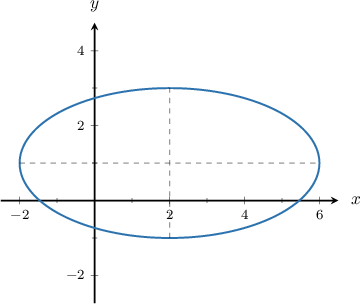

Which of the following sets of parametric equations, defined for $θ ∈ [0, 2π)$, generate the ellipse shown above?

selection:
- $x = 2\cos θ + 2, y = 1\sin θ - 1$
- $x = 8\cos θ + 2, y = 4\sin θ + 1$
- $x = 4\cos θ - 2, y = 2\sin θ - 1$
- $x = 8\cos θ - 2, y = 4\sin θ - 1$
- $x = 4\cos θ + 2, y = 2\sin θ + 1$

[Source worked solution absent]

### Changed parameters, same complete source profile (evidence-only)

Which of the following sets of parametric equations, defined for $θ ∈ [0, 2π)$, generate the ellipse shown above?

selection:
- $x = \frac{7}{2}\cos θ - 5, y = 1\sin θ - 3$
- $x = 14\cos θ - 5, y = 4\sin θ + 3$
- $x = 14\cos θ + 5, y = 4\sin θ - 3$
- $x = 7\cos θ + 5, y = 2\sin θ - 3$
- $x = 7\cos θ - 5, y = 2\sin θ + 3$

[Source worked solution absent]

## q-78680 — original replay

White-composited original raster at full resolution:

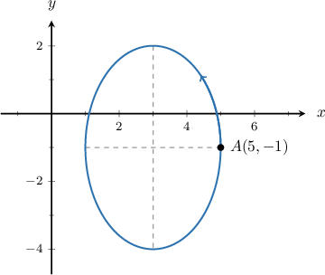

Consider the ellipse centered at $(3,-1)$ with horizontal radius $2$ and vertical radius $3,$ as shown above. Which of the following sets of parametric equations, defined for $\theta \in [0,2\pi ),$  traverse the ellipse once in the counterclockwise direction starting at the point $A(5,-1)?$

selection:
- $x = \cos θ - 3, y = \sin θ + 2$
- $x = 4\sin θ + 3, y = 6\cos θ - 1$
- $x = 4\cos θ + 3, y = 6\sin θ - 1$
- $x = 2\cos θ + 3, y = 3\sin θ - 1$
- $x = 2\sin θ + 3, y = 3\cos θ - 1$
selection:
- $x=2\operatorname{sin}⁡\theta +3,\,y=3\operatorname{cos}⁡\theta -1$
- $x=2\operatorname{cos}⁡\theta +3,\,y=3\operatorname{sin}⁡\theta -1$
- $x=\operatorname{cos}⁡\theta -3,\,y=\operatorname{sin}⁡\theta +2$
- $x=4\operatorname{cos}⁡\theta +3,\,y=6\operatorname{sin}⁡\theta -1$
- $x=4\operatorname{sin}⁡\theta +3,\,y=6\operatorname{cos}⁡\theta -1$

The parametric equations of an ellipse centered at the point $(h,k)$ with a horizontal radius of length $a$ and a vertical radius of length $b$ are

$$
x=a\operatorname{cos}⁡\theta +h,\,y=b\operatorname{sin}⁡\theta +k,\,\theta \in [0,2\pi ).
$$

Under this parametrization, the ellipse is traversed once in the counterclockwise direction, starting from $(h+a,k).$

In our case, the ellipse is centered at the point $(3,-1),$ $a=2$ and $b=3.$ Therefore, the parametric equations of the ellipse are 

$$
x=2\operatorname{cos}⁡\theta +3,\,y=3\operatorname{sin}⁡\theta -1,\,\theta \in [0,2\pi ).
$$

### Changed parameters, same complete source profile (evidence-only)

Consider the ellipse centered at $(-5,3)$ with horizontal radius $7$ and vertical radius $2,$ as shown above. Which of the following sets of parametric equations, defined for $\theta \in [0,2\pi ),$  traverse the ellipse once in the counterclockwise direction starting at the point $A(2,3)?$

selection:
- $x = \cos θ + 5, y = \sin θ + 7$
- $x = 14\sin θ - 5, y = 4\cos θ + 3$
- $x = 7\cos θ - 5, y = 2\sin θ + 3$
- $x = 14\cos θ - 5, y = 4\sin θ + 3$
- $x = 7\sin θ - 5, y = 2\cos θ + 3$
selection:
- $x=14\operatorname{sin}⁡\theta -5,\,y=4\operatorname{cos}⁡\theta +3$
- $x=14\operatorname{cos}⁡\theta -5,\,y=4\operatorname{sin}⁡\theta +3$
- $x=7\operatorname{sin}⁡\theta -5,\,y=2\operatorname{cos}⁡\theta +3$
- $x=7\operatorname{cos}⁡\theta -5,\,y=2\operatorname{sin}⁡\theta +3$
- $x=\operatorname{cos}⁡\theta +5,\,y=\operatorname{sin}⁡\theta +7$

The parametric equations of an ellipse centered at the point $(h,k)$ with a horizontal radius of length $a$ and a vertical radius of length $b$ are

$$
x=a\operatorname{cos}⁡\theta +h,\,y=b\operatorname{sin}⁡\theta +k,\,\theta \in [0,2\pi ).
$$

Under this parametrization, the ellipse is traversed once in the counterclockwise direction, starting from $(h+a,k).$

In our case, the ellipse is centered at the point $(-5,3),$ $a=7$ and $b=2.$ Therefore, the parametric equations of the ellipse are 

$$
x=7\operatorname{cos}⁡\theta -5,\,y=2\operatorname{sin}⁡\theta +3,\,\theta \in [0,2\pi ).
$$

## q-106398 — original replay

White-composited original raster at full resolution:

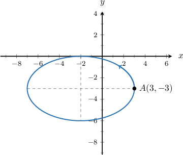

Consider the ellipse centered at $(-2,-3)$ with horizontal radius $5$ and vertical radius $3,$ as shown above. Which of the following sets of parametric equations, defined for $\theta \in [0,2\pi ),$  traverse the ellipse once in the counterclockwise direction starting at the point $A(3,-3)?$

selection:
- $x=5\operatorname{cos}⁡\theta -3,\,y=3\operatorname{sin}⁡\theta -2$
- $x=10\operatorname{sin}⁡\theta -2,\,y=6\operatorname{cos}⁡\theta -3$
- $x=5\operatorname{cos}⁡\theta -2,\,y=3\operatorname{sin}⁡\theta -3$
- $x=25\operatorname{cos}⁡\theta -3,\,y=9\operatorname{sin}⁡\theta -2$
- $x=5\operatorname{sin}⁡\theta -2,\,y=3\operatorname{cos}⁡\theta -3$

The parametric equations of an ellipse centered at the point $(h,k)$ with a horizontal radius of length $a$ and a vertical radius of length $b$ are

$$
x=a\operatorname{cos}⁡\theta +h,\,y=b\operatorname{sin}⁡\theta +k,\,\theta \in [0,2\pi ).
$$

Under this parametrization, the ellipse is traversed once in the counterclockwise direction, starting from $(h+a,k).$

In our case, the ellipse is centered at the point $(-2,-3),$ $a=5$ and $b=3.$ Therefore, the parametric equations of the ellipse are 

$$
x=5\operatorname{cos}⁡\theta -2,\,y=3\operatorname{sin}⁡\theta -3,\,\theta \in [0,2\pi ).
$$

### Changed parameters, same complete source profile (evidence-only)

Consider the ellipse centered at $(-5,3)$ with horizontal radius $7$ and vertical radius $2,$ as shown above. Which of the following sets of parametric equations, defined for $\theta \in [0,2\pi ),$  traverse the ellipse once in the counterclockwise direction starting at the point $A(2,3)?$

selection:
- $x=7\operatorname{cos}⁡\theta +3,\,y=2\operatorname{sin}⁡\theta -5$
- $x=14\operatorname{sin}⁡\theta -5,\,y=4\operatorname{cos}⁡\theta +3$
- $x=49\operatorname{cos}⁡\theta +3,\,y=4\operatorname{sin}⁡\theta -5$
- $x=7\operatorname{cos}⁡\theta -5,\,y=2\operatorname{sin}⁡\theta +3$
- $x=7\operatorname{sin}⁡\theta -5,\,y=2\operatorname{cos}⁡\theta +3$

The parametric equations of an ellipse centered at the point $(h,k)$ with a horizontal radius of length $a$ and a vertical radius of length $b$ are

$$
x=a\operatorname{cos}⁡\theta +h,\,y=b\operatorname{sin}⁡\theta +k,\,\theta \in [0,2\pi ).
$$

Under this parametrization, the ellipse is traversed once in the counterclockwise direction, starting from $(h+a,k).$

In our case, the ellipse is centered at the point $(-5,3),$ $a=7$ and $b=2.$ Therefore, the parametric equations of the ellipse are 

$$
x=7\operatorname{cos}⁡\theta -5,\,y=2\operatorname{sin}⁡\theta +3,\,\theta \in [0,2\pi ).
$$

## q-106399 — original replay

White-composited original raster at full resolution:

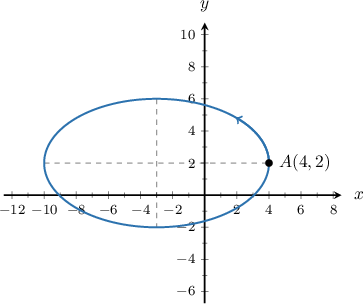

Consider the ellipse centered at $(-3,2)$ with horizontal radius $7$ and vertical radius $4,$ as shown above. Which of the following sets of parametric equations, defined for $\theta \in [0,2\pi ),$  traverse the ellipse once in the counterclockwise direction starting at the point $A(4,2)?$

selection:
- $x=7\operatorname{cos}⁡\theta -3,\,y=4\operatorname{sin}⁡\theta +2$
- $x=4\operatorname{cos}⁡\theta -3,\,y=7\operatorname{sin}⁡\theta +2$
- $x=7\operatorname{cos}⁡\theta +2,\,y=4\operatorname{sin}⁡\theta -3$
- $x=7\operatorname{sin}⁡\theta +3,\,y=4\operatorname{cos}⁡\theta -2$
- $x=14\operatorname{sin}⁡\theta -3,\,y=8\operatorname{sin}⁡\theta +2$

The parametric equations of an ellipse centered at the point $(h,k)$ with a horizontal radius of length $a$ and a vertical radius of length $b$ are

$$
x=a\operatorname{cos}⁡\theta +h,\,y=b\operatorname{sin}⁡\theta +k,\,\theta \in [0,2\pi ).
$$

Under this parametrization, the ellipse is traversed once in the counterclockwise direction, starting from $(h+a,k).$

In our case, the ellipse is centered at the point $(-3,2),$ $a=7$ and $b=4.$ Therefore, the parametric equations of the ellipse are 

$$
x=7\operatorname{cos}⁡\theta -3,\,y=4\operatorname{sin}⁡\theta +2,\,\theta \in [0,2\pi ).
$$

### Changed parameters, same complete source profile (evidence-only)

Consider the ellipse centered at $(-5,3)$ with horizontal radius $7$ and vertical radius $2,$ as shown above. Which of the following sets of parametric equations, defined for $\theta \in [0,2\pi ),$  traverse the ellipse once in the counterclockwise direction starting at the point $A(2,3)?$

selection:
- $x=7\operatorname{cos}⁡\theta -5,\,y=2\operatorname{sin}⁡\theta +3$
- $x=2\operatorname{cos}⁡\theta -5,\,y=7\operatorname{sin}⁡\theta +3$
- $x=7\operatorname{sin}⁡\theta +5,\,y=2\operatorname{cos}⁡\theta -3$
- $x=7\operatorname{cos}⁡\theta +3,\,y=2\operatorname{sin}⁡\theta -5$
- $x=14\operatorname{sin}⁡\theta -5,\,y=4\operatorname{sin}⁡\theta +3$

The parametric equations of an ellipse centered at the point $(h,k)$ with a horizontal radius of length $a$ and a vertical radius of length $b$ are

$$
x=a\operatorname{cos}⁡\theta +h,\,y=b\operatorname{sin}⁡\theta +k,\,\theta \in [0,2\pi ).
$$

Under this parametrization, the ellipse is traversed once in the counterclockwise direction, starting from $(h+a,k).$

In our case, the ellipse is centered at the point $(-5,3),$ $a=7$ and $b=2.$ Therefore, the parametric equations of the ellipse are 

$$
x=7\operatorname{cos}⁡\theta -5,\,y=2\operatorname{sin}⁡\theta +3,\,\theta \in [0,2\pi ).
$$

## q-106704 — original replay

White-composited original raster at full resolution:

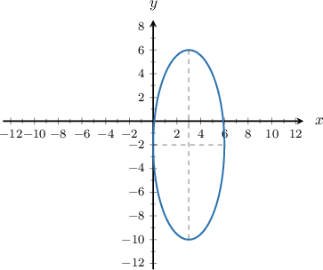

Which of the following sets of parametric equations, defined for $\theta \in [0,2\pi ),$ generate the ellipse shown above?

selection:
- $x=8\operatorname{cos}⁡\theta +3,\,y=3\operatorname{sin}⁡\theta -2$
- $x=64\operatorname{cos}⁡\theta +3,\,y=9\operatorname{sin}⁡\theta -2$
- $x=8\operatorname{cos}⁡\theta -3,\,y=3\operatorname{sin}⁡\theta +2$
- $x=3\operatorname{cos}⁡\theta +3,\,y=8\operatorname{sin}⁡\theta -2$
- $x=3\operatorname{cos}⁡\theta -3,\,y=8\operatorname{sin}⁡\theta +2$

The parametric equations of an ellipse centered at the point $(h,k)$ with a horizontal radius of length $a$ and a vertical radius of length $b$ are

$$
x=a\operatorname{cos}⁡\theta +h,\,y=b\operatorname{sin}⁡\theta +k,\,\theta \in [0,2\pi ).
$$

In our case, the ellipse is centered at the point $(3,-2),$ $a=3$ and $b=8.$ Therefore, the parametric equations of the ellipse are

$$
x=3\operatorname{cos}⁡\theta +3,\,y=8\operatorname{sin}⁡\theta -2,\,\theta \in [0,2\pi ).
$$

### Changed parameters, same complete source profile (evidence-only)

Which of the following sets of parametric equations, defined for $\theta \in [0,2\pi ),$ generate the ellipse shown above?

selection:
- $x=2\operatorname{cos}⁡\theta -5,\,y=7\operatorname{sin}⁡\theta +3$
- $x=4\operatorname{cos}⁡\theta -5,\,y=49\operatorname{sin}⁡\theta +3$
- $x=7\operatorname{cos}⁡\theta -5,\,y=2\operatorname{sin}⁡\theta +3$
- $x=2\operatorname{cos}⁡\theta +5,\,y=7\operatorname{sin}⁡\theta -3$
- $x=7\operatorname{cos}⁡\theta +5,\,y=2\operatorname{sin}⁡\theta -3$

The parametric equations of an ellipse centered at the point $(h,k)$ with a horizontal radius of length $a$ and a vertical radius of length $b$ are

$$
x=a\operatorname{cos}⁡\theta +h,\,y=b\operatorname{sin}⁡\theta +k,\,\theta \in [0,2\pi ).
$$

In our case, the ellipse is centered at the point $(-5,3),$ $a=7$ and $b=2.$ Therefore, the parametric equations of the ellipse are

$$
x=7\operatorname{cos}⁡\theta -5,\,y=2\operatorname{sin}⁡\theta +3,\,\theta \in [0,2\pi ).
$$

## q-274862 — original replay

White-composited original raster at full resolution:

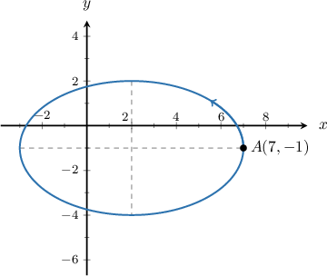

Consider the ellipse centered at $(2,-1)$ with horizontal radius $5$ and vertical radius $3,$ as shown above. Construct a set of parametric equations, defined for $\theta \in [0,2\pi ),$ that traverse the ellipse once in the counterclockwise direction starting at the point $A(7,-1).$

$x=$
{{field-1}}$,\,y=$
{{field-2}}$,\,\theta \in [0,2\pi ).$

field-2:
- $3\operatorname{sin}\theta -1$
field-1:
- $5\operatorname{cos}\theta +2$

The parametric equations of an ellipse centered at the point $(h,k)$ with a horizontal radius of length $a$ and a vertical radius of length $b$ are

$$
x=a\operatorname{cos}⁡\theta +h,\,y=b\operatorname{sin}⁡\theta +k,\,\theta \in [0,2\pi ).
$$

Under this parametrization, the ellipse is traversed once in the counterclockwise direction, starting from $(h+a,k).$

In our case, the ellipse is centered at the point $(2,-1),$ $a=5$ and $b=3.$ Therefore, the parametric equations of the ellipse are 

$$
x=5\operatorname{cos}⁡\theta +2,\,y=3\operatorname{sin}⁡\theta -1,\,\theta \in [0,2\pi ).
$$

### Changed parameters, same complete source profile (evidence-only)

Consider the ellipse centered at $(-5,3)$ with horizontal radius $7$ and vertical radius $2,$ as shown above. Construct a set of parametric equations, defined for $\theta \in [0,2\pi ),$ that traverse the ellipse once in the counterclockwise direction starting at the point $A(2,3).$

$x=$
{{field-1}}$,\,y=$
{{field-2}}$,\,\theta \in [0,2\pi ).$

field-2:
- $2\operatorname{sin}\theta +3$
field-1:
- $7\operatorname{cos}\theta -5$

The parametric equations of an ellipse centered at the point $(h,k)$ with a horizontal radius of length $a$ and a vertical radius of length $b$ are

$$
x=a\operatorname{cos}⁡\theta +h,\,y=b\operatorname{sin}⁡\theta +k,\,\theta \in [0,2\pi ).
$$

Under this parametrization, the ellipse is traversed once in the counterclockwise direction, starting from $(h+a,k).$

In our case, the ellipse is centered at the point $(-5,3),$ $a=7$ and $b=2.$ Therefore, the parametric equations of the ellipse are 

$$
x=7\operatorname{cos}⁡\theta -5,\,y=2\operatorname{sin}⁡\theta +3,\,\theta \in [0,2\pi ).
$$

## q-327171 — original replay

White-composited original raster at full resolution:

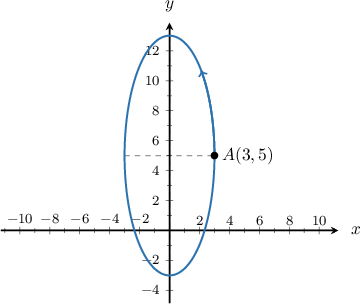

Consider the ellipse centered at $(0,5)$ with horizontal radius $3$ and vertical radius $8,$ as shown above. Construct a set of parametric equations, defined for $\theta \in [0,2\pi ),$ that traverse the ellipse once in the counterclockwise direction starting at the point $A(3,5).$

$x=$ 
{{field-1}}$,\,y=$ 
{{field-2}}$,\,\theta \in [0,2\pi ).$

field-1:
- $3\operatorname{cos}\theta $
field-2:
- $8\operatorname{sin}\theta +5$

The parametric equations of an ellipse centered at the point $(h,k)$ with a horizontal radius of length $a$ and a vertical radius of length $b$ are

$$
x=a\operatorname{cos}⁡\theta +h,\,y=b\operatorname{sin}⁡\theta +k,\,\theta \in [0,2\pi ).
$$

Under this parametrization, the ellipse is traversed once in the counterclockwise direction, starting from $(h+a,k).$

In our case, the ellipse is centered at the point $(0,5),$ $a=3$ and $b=8.$ Therefore, the parametric equations of the ellipse are 

$$
x=3\operatorname{cos}⁡\theta ,\,y=8\operatorname{sin}⁡\theta +5,\,\theta \in [0,2\pi ).
$$

### Changed parameters, same complete source profile (evidence-only)

Consider the ellipse centered at $(-5,3)$ with horizontal radius $7$ and vertical radius $2,$ as shown above. Construct a set of parametric equations, defined for $\theta \in [0,2\pi ),$ that traverse the ellipse once in the counterclockwise direction starting at the point $A(2,3).$

$x=$ 
{{field-1}}$,\,y=$ 
{{field-2}}$,\,\theta \in [0,2\pi ).$

field-1:
- $7\operatorname{cos}\theta -5$
field-2:
- $2\operatorname{sin}\theta +3$

The parametric equations of an ellipse centered at the point $(h,k)$ with a horizontal radius of length $a$ and a vertical radius of length $b$ are

$$
x=a\operatorname{cos}⁡\theta +h,\,y=b\operatorname{sin}⁡\theta +k,\,\theta \in [0,2\pi ).
$$

Under this parametrization, the ellipse is traversed once in the counterclockwise direction, starting from $(h+a,k).$

In our case, the ellipse is centered at the point $(-5,3),$ $a=7$ and $b=2.$ Therefore, the parametric equations of the ellipse are 

$$
x=7\operatorname{cos}⁡\theta -5,\,y=2\operatorname{sin}⁡\theta +3,\,\theta \in [0,2\pi ).
$$

## q-327172 — original replay

White-composited original raster at full resolution:

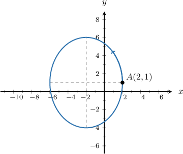

Consider the ellipse centered at $(-2,1)$ with horizontal radius $4$ and vertical radius $5,$ as shown above. Construct a set of parametric equations, defined for $\theta \in [0,2\pi ),$ that traverse the ellipse once in the counterclockwise direction starting at the point $A(2,1).$

$x=$ 
{{field-1}}$,\,y=$ 
{{field-2}}$,\,\theta \in [0,2\pi ).$

field-1:
- $4\operatorname{cos}\theta -2$
field-2:
- $5\operatorname{sin}\theta +1$

The parametric equations of an ellipse centered at the point $(h,k)$ with a horizontal radius of length $a$ and a vertical radius of length $b$ are

$$
x=a\operatorname{cos}⁡\theta +h,\,y=b\operatorname{sin}⁡\theta +k,\,\theta \in [0,2\pi ).
$$

Under this parametrization, the ellipse is traversed once in the counterclockwise direction, starting from $(h+a,k).$

In our case, the ellipse is centered at the point $(-2,1),$ $a=4$ and $b=5.$ Therefore, the parametric equations of the ellipse are 

$$
x=4\operatorname{cos}⁡\theta -2,\,y=5\operatorname{sin}⁡\theta +1,\,\theta \in [0,2\pi ).
$$

### Changed parameters, same complete source profile (evidence-only)

Consider the ellipse centered at $(-5,3)$ with horizontal radius $7$ and vertical radius $2,$ as shown above. Construct a set of parametric equations, defined for $\theta \in [0,2\pi ),$ that traverse the ellipse once in the counterclockwise direction starting at the point $A(2,3).$

$x=$ 
{{field-1}}$,\,y=$ 
{{field-2}}$,\,\theta \in [0,2\pi ).$

field-1:
- $7\operatorname{cos}\theta -5$
field-2:
- $2\operatorname{sin}\theta +3$

The parametric equations of an ellipse centered at the point $(h,k)$ with a horizontal radius of length $a$ and a vertical radius of length $b$ are

$$
x=a\operatorname{cos}⁡\theta +h,\,y=b\operatorname{sin}⁡\theta +k,\,\theta \in [0,2\pi ).
$$

Under this parametrization, the ellipse is traversed once in the counterclockwise direction, starting from $(h+a,k).$

In our case, the ellipse is centered at the point $(-5,3),$ $a=7$ and $b=2.$ Therefore, the parametric equations of the ellipse are 

$$
x=7\operatorname{cos}⁡\theta -5,\,y=2\operatorname{sin}⁡\theta +3,\,\theta \in [0,2\pi ).
$$

## q-79289 — original replay

White-composited original raster at full resolution:

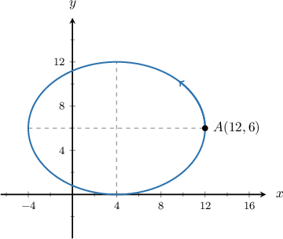

Consider the ellipse centered at $(4,6)$ with horizontal radius $8$ and vertical radius $6,$ as shown above. Which of the following sets of parametric equations, defined for $\theta \in [0,2\pi ),$  traverse the ellipse once in the counterclockwise direction starting at the point $A(12,6)?$

selection:
- $x=6\operatorname{cos}⁡\theta +6,\,y=8\operatorname{sin}⁡\theta +4$
- $x=8\operatorname{cos}⁡\theta +6,\,y=6\operatorname{sin}⁡\theta +4$
- $x=8\operatorname{cos}⁡\theta +4,\,y=6\operatorname{sin}⁡\theta +6$
- $x=8\operatorname{sin}⁡\theta +4,\,y=6\operatorname{cos}⁡\theta +6$
- $x=16\operatorname{sin}⁡\theta +4,\,y=12\operatorname{cos}⁡\theta +6$

The parametric equations of an ellipse centered at the point $(h,k)$ with a horizontal radius of length $a$ and a vertical radius of length $b$ are

$$
x=a\operatorname{cos}⁡\theta +h,\,y=b\operatorname{sin}⁡\theta +k,\,\theta \in [0,2\pi ).
$$

Under this parametrization, the ellipse is traversed once in the counterclockwise direction, starting from $(h+a,k).$

In our case, the ellipse is centered at the point $(4,6),$ $a=8$ and $b=6.$ Therefore, the parametric equations of the ellipse are 

$$
x=8\operatorname{cos}⁡\theta +4,\,y=6\operatorname{sin}⁡\theta +6,\,\theta \in [0,2\pi ).
$$

### Changed parameters, same complete source profile (evidence-only)

Consider the ellipse centered at $(-5,3)$ with horizontal radius $7$ and vertical radius $2,$ as shown above. Which of the following sets of parametric equations, defined for $\theta \in [0,2\pi ),$  traverse the ellipse once in the counterclockwise direction starting at the point $A(2,3)?$

selection:
- $x=2\operatorname{cos}⁡\theta +3,\,y=7\operatorname{sin}⁡\theta -5$
- $x=7\operatorname{cos}⁡\theta +3,\,y=2\operatorname{sin}⁡\theta -5$
- $x=7\operatorname{sin}⁡\theta -5,\,y=2\operatorname{cos}⁡\theta +3$
- $x=7\operatorname{cos}⁡\theta -5,\,y=2\operatorname{sin}⁡\theta +3$
- $x=14\operatorname{sin}⁡\theta -5,\,y=4\operatorname{cos}⁡\theta +3$

The parametric equations of an ellipse centered at the point $(h,k)$ with a horizontal radius of length $a$ and a vertical radius of length $b$ are

$$
x=a\operatorname{cos}⁡\theta +h,\,y=b\operatorname{sin}⁡\theta +k,\,\theta \in [0,2\pi ).
$$

Under this parametrization, the ellipse is traversed once in the counterclockwise direction, starting from $(h+a,k).$

In our case, the ellipse is centered at the point $(-5,3),$ $a=7$ and $b=2.$ Therefore, the parametric equations of the ellipse are 

$$
x=7\operatorname{cos}⁡\theta -5,\,y=2\operatorname{sin}⁡\theta +3,\,\theta \in [0,2\pi ).
$$

## q-79290 — original replay

White-composited original raster at full resolution:

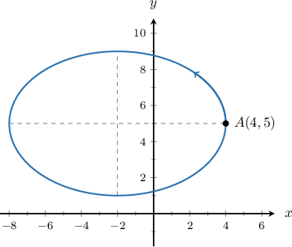

Consider the ellipse centered at $(-2,5)$ with horizontal radius $6$ and vertical radius $4,$ as shown above. Which of the following sets of parametric equations, defined for $\theta \in [0,2\pi ),$  traverse the ellipse once in the counterclockwise direction starting at the point $A(4,5)?$

selection:
- $x=12\operatorname{sin}⁡\theta -2,\,y=8\operatorname{cos}⁡\theta +5$
- $x=4\operatorname{cos}⁡\theta +5,\,y=6\operatorname{sin}⁡\theta -2$
- $x=6\operatorname{cos}⁡\theta -2,\,y=4\operatorname{sin}⁡\theta +5$
- $x=6\operatorname{sin}⁡\theta -2,\,y=4\operatorname{cos}⁡\theta +5$
- $x=12\operatorname{cos}⁡\theta -2,\,y=8\operatorname{sin}⁡\theta +5$

The parametric equations of an ellipse centered at the point $(h,k)$ with a horizontal radius of length $a$ and a vertical radius of length $b$ are

$$
x=a\operatorname{cos}⁡\theta +h,\,y=b\operatorname{sin}⁡\theta +k,\,\theta \in [0,2\pi ).
$$

Under this parametrization, the ellipse is traversed once in the counterclockwise direction, starting from $(h+a,k).$

In our case, the ellipse is centered at the point $(-2,5),$ $a=6$ and $b=4.$ Therefore, the parametric equations of the ellipse are 

$$
x=6\operatorname{cos}⁡\theta -2,\,y=4\operatorname{sin}⁡\theta +5,\,\theta \in [0,2\pi ).
$$

### Changed parameters, same complete source profile (evidence-only)

Consider the ellipse centered at $(-5,3)$ with horizontal radius $7$ and vertical radius $2,$ as shown above. Which of the following sets of parametric equations, defined for $\theta \in [0,2\pi ),$  traverse the ellipse once in the counterclockwise direction starting at the point $A(2,3)?$

selection:
- $x=14\operatorname{sin}⁡\theta -5,\,y=4\operatorname{cos}⁡\theta +3$
- $x=2\operatorname{cos}⁡\theta +3,\,y=7\operatorname{sin}⁡\theta -5$
- $x=7\operatorname{sin}⁡\theta -5,\,y=2\operatorname{cos}⁡\theta +3$
- $x=7\operatorname{cos}⁡\theta -5,\,y=2\operatorname{sin}⁡\theta +3$
- $x=14\operatorname{cos}⁡\theta -5,\,y=4\operatorname{sin}⁡\theta +3$

The parametric equations of an ellipse centered at the point $(h,k)$ with a horizontal radius of length $a$ and a vertical radius of length $b$ are

$$
x=a\operatorname{cos}⁡\theta +h,\,y=b\operatorname{sin}⁡\theta +k,\,\theta \in [0,2\pi ).
$$

Under this parametrization, the ellipse is traversed once in the counterclockwise direction, starting from $(h+a,k).$

In our case, the ellipse is centered at the point $(-5,3),$ $a=7$ and $b=2.$ Therefore, the parametric equations of the ellipse are 

$$
x=7\operatorname{cos}⁡\theta -5,\,y=2\operatorname{sin}⁡\theta +3,\,\theta \in [0,2\pi ).
$$

## q-106706 — original replay

White-composited original raster at full resolution:

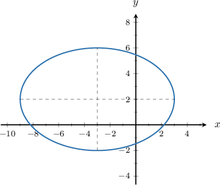

Which of the following sets of parametric equations, defined for $\theta \in [0,2\pi ),$ generate the ellipse shown above?

selection:
- $x=12\operatorname{cos}⁡\theta +2,\,y=8\operatorname{sin}⁡\theta -3$
- $x=6\operatorname{cos}⁡\theta +3,\,y=4\operatorname{sin}⁡\theta -2$
- $x=36\operatorname{cos}⁡\theta -2,\,y=16\operatorname{sin}⁡\theta +3$
- $x=6\operatorname{cos}⁡\theta -3,\,y=4\operatorname{sin}⁡\theta +2$
- $x=12\operatorname{cos}⁡\theta -3,\,y=8\operatorname{sin}⁡\theta +2$

The parametric equations of an ellipse centered at the point $(h,k)$ with a horizontal radius of length $a$ and a vertical radius of length $b$ are

$$
x=a\operatorname{cos}⁡\theta +h,\,y=b\operatorname{sin}⁡\theta +k,\,\theta \in [0,2\pi ).
$$

In our case, the ellipse is centered at the point $(-3,2),$ $a=6$ and $b=4.$ Therefore, the parametric equations of the ellipse are

$$
x=6\operatorname{cos}⁡\theta -3,\,y=4\operatorname{sin}⁡\theta +2,\,\theta \in [0,2\pi ).
$$

### Changed parameters, same complete source profile (evidence-only)

Which of the following sets of parametric equations, defined for $\theta \in [0,2\pi ),$ generate the ellipse shown above?

selection:
- $x=14\operatorname{cos}⁡\theta +3,\,y=4\operatorname{sin}⁡\theta -5$
- $x=7\operatorname{cos}⁡\theta +5,\,y=2\operatorname{sin}⁡\theta -3$
- $x=7\operatorname{cos}⁡\theta -5,\,y=2\operatorname{sin}⁡\theta +3$
- $x=49\operatorname{cos}⁡\theta -3,\,y=4\operatorname{sin}⁡\theta +5$
- $x=14\operatorname{cos}⁡\theta -5,\,y=4\operatorname{sin}⁡\theta +3$

The parametric equations of an ellipse centered at the point $(h,k)$ with a horizontal radius of length $a$ and a vertical radius of length $b$ are

$$
x=a\operatorname{cos}⁡\theta +h,\,y=b\operatorname{sin}⁡\theta +k,\,\theta \in [0,2\pi ).
$$

In our case, the ellipse is centered at the point $(-5,3),$ $a=7$ and $b=2.$ Therefore, the parametric equations of the ellipse are

$$
x=7\operatorname{cos}⁡\theta -5,\,y=2\operatorname{sin}⁡\theta +3,\,\theta \in [0,2\pi ).
$$

## q-79285 — original replay

White-composited original raster at full resolution:

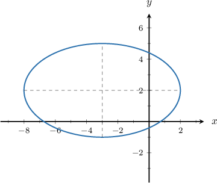

Which of the following sets of parametric equations, defined for $\theta \in [0,2\pi ),$ generate the ellipse shown above?

selection:
- $x=10\operatorname{cos}⁡\theta +2,\,y=6\operatorname{sin}⁡\theta -3$
- $x=5\operatorname{cos}⁡\theta +3,\,y=3\operatorname{sin}⁡\theta -2$
- $x=5\operatorname{cos}⁡\theta -3,\,y=3\operatorname{sin}⁡\theta +2$
- $x=25\operatorname{cos}⁡\theta -2,\,y=9\operatorname{sin}⁡\theta +3$
- $x=10\operatorname{cos}⁡\theta -3,\,y=6\operatorname{sin}⁡\theta +2$

The parametric equations of an ellipse centered at the point $(h,k)$ with a horizontal radius of length $a$ and a vertical radius of length $b$ are

$$
x=a\operatorname{cos}⁡\theta +h,\,y=b\operatorname{sin}⁡\theta +k,\,\theta \in [0,2\pi ).
$$

In our case, the ellipse is centered at the point $(-3,2),$ $a=5$ and $b=3.$ Therefore, the parametric equations of the ellipse are

$$
x=5\operatorname{cos}⁡\theta -3,\,y=3\operatorname{sin}⁡\theta +2,\,\theta \in [0,2\pi ).
$$

### Changed parameters, same complete source profile (evidence-only)

Which of the following sets of parametric equations, defined for $\theta \in [0,2\pi ),$ generate the ellipse shown above?

selection:
- $x=14\operatorname{cos}⁡\theta +3,\,y=4\operatorname{sin}⁡\theta -5$
- $x=7\operatorname{cos}⁡\theta +5,\,y=2\operatorname{sin}⁡\theta -3$
- $x=49\operatorname{cos}⁡\theta -3,\,y=4\operatorname{sin}⁡\theta +5$
- $x=7\operatorname{cos}⁡\theta -5,\,y=2\operatorname{sin}⁡\theta +3$
- $x=14\operatorname{cos}⁡\theta -5,\,y=4\operatorname{sin}⁡\theta +3$

The parametric equations of an ellipse centered at the point $(h,k)$ with a horizontal radius of length $a$ and a vertical radius of length $b$ are

$$
x=a\operatorname{cos}⁡\theta +h,\,y=b\operatorname{sin}⁡\theta +k,\,\theta \in [0,2\pi ).
$$

In our case, the ellipse is centered at the point $(-5,3),$ $a=7$ and $b=2.$ Therefore, the parametric equations of the ellipse are

$$
x=7\operatorname{cos}⁡\theta -5,\,y=2\operatorname{sin}⁡\theta +3,\,\theta \in [0,2\pi ).
$$

## q-79286 — original replay

White-composited original raster at full resolution:

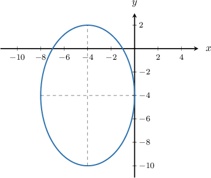

Which of the following sets of parametric equations, defined for $\theta \in [0,2\pi ),$ generate the ellipse shown above?

selection:
- $x=4\operatorname{cos}⁡\theta +4,\,y=6\operatorname{sin}⁡\theta +4$
- $x=36\operatorname{cos}⁡\theta -4,\,y=16\operatorname{sin}⁡\theta -4$
- $x=4\operatorname{cos}⁡\theta -4,\,y=6\operatorname{sin}⁡\theta -4$
- $x=6\operatorname{cos}⁡\theta -4,\,y=4\operatorname{sin}⁡\theta -4$
- $x=6\operatorname{cos}⁡\theta +4,\,y=4\operatorname{sin}⁡\theta +4$

The parametric equations of an ellipse centered at the point $(h,k)$ with a horizontal radius of length $a$ and a vertical radius of length $b$ are

$$
x=a\operatorname{cos}⁡\theta +h,\,y=b\operatorname{sin}⁡\theta +k,\,\theta \in [0,2\pi ).
$$

In our case, the ellipse is centered at the point $(-4,-4),$ $a=4$ and $b=6.$ Therefore, the parametric equations of the ellipse are

$$
x=4\operatorname{cos}⁡\theta -4,\,y=6\operatorname{sin}⁡\theta -4,\,\theta \in [0,2\pi ).
$$

### Changed parameters, same complete source profile (evidence-only)

Which of the following sets of parametric equations, defined for $\theta \in [0,2\pi ),$ generate the ellipse shown above?

selection:
- $x=7\operatorname{cos}⁡\theta +5,\,y=2\operatorname{sin}⁡\theta -3$
- $x=4\operatorname{cos}⁡\theta -5,\,y=49\operatorname{sin}⁡\theta +3$
- $x=2\operatorname{cos}⁡\theta -5,\,y=7\operatorname{sin}⁡\theta +3$
- $x=7\operatorname{cos}⁡\theta -5,\,y=2\operatorname{sin}⁡\theta +3$
- $x=2\operatorname{cos}⁡\theta +5,\,y=7\operatorname{sin}⁡\theta -3$

The parametric equations of an ellipse centered at the point $(h,k)$ with a horizontal radius of length $a$ and a vertical radius of length $b$ are

$$
x=a\operatorname{cos}⁡\theta +h,\,y=b\operatorname{sin}⁡\theta +k,\,\theta \in [0,2\pi ).
$$

In our case, the ellipse is centered at the point $(-5,3),$ $a=7$ and $b=2.$ Therefore, the parametric equations of the ellipse are

$$
x=7\operatorname{cos}⁡\theta -5,\,y=2\operatorname{sin}⁡\theta +3,\,\theta \in [0,2\pi ).
$$

## q-79287 — original replay

White-composited original raster at full resolution:

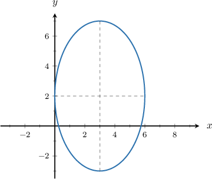

Which of the following sets of parametric equations, defined for $\theta \in [0,2\pi ),$ generate the ellipse shown above?

selection:
- $x=5\operatorname{cos}⁡\theta -3,\,y=3\operatorname{sin}⁡\theta -2$
- $x=3\operatorname{cos}⁡\theta +3,\,y=5\operatorname{sin}⁡\theta +2$
- $x=9\operatorname{cos}⁡\theta -2,\,y=25\operatorname{sin}⁡\theta +3$
- $x=3\operatorname{cos}⁡\theta +2,\,y=5\operatorname{sin}⁡\theta -3$
- $x=5\operatorname{cos}⁡\theta +3,\,y=3\operatorname{sin}⁡\theta +2$

The parametric equations of an ellipse centered at the point $(h,k)$ with a horizontal radius of length $a$ and a vertical radius of length $b$ are

$$
x=a\operatorname{cos}⁡\theta +h,\,y=b\operatorname{sin}⁡\theta +k,\,\theta \in [0,2\pi ).
$$

In our case, the ellipse is centered at the point $(3,2),$ $a=3$ and $b=5.$ Therefore, the parametric equations of the ellipse are

$$
x=3\operatorname{cos}⁡\theta +3,\,y=5\operatorname{sin}⁡\theta +2,\,\theta \in [0,2\pi ).
$$

### Changed parameters, same complete source profile (evidence-only)

Which of the following sets of parametric equations, defined for $\theta \in [0,2\pi ),$ generate the ellipse shown above?

selection:
- $x=2\operatorname{cos}⁡\theta +5,\,y=7\operatorname{sin}⁡\theta -3$
- $x=7\operatorname{cos}⁡\theta -5,\,y=2\operatorname{sin}⁡\theta +3$
- $x=7\operatorname{cos}⁡\theta +3,\,y=2\operatorname{sin}⁡\theta +5$
- $x=49\operatorname{cos}⁡\theta -3,\,y=4\operatorname{sin}⁡\theta -5$
- $x=2\operatorname{cos}⁡\theta -5,\,y=7\operatorname{sin}⁡\theta +3$

The parametric equations of an ellipse centered at the point $(h,k)$ with a horizontal radius of length $a$ and a vertical radius of length $b$ are

$$
x=a\operatorname{cos}⁡\theta +h,\,y=b\operatorname{sin}⁡\theta +k,\,\theta \in [0,2\pi ).
$$

In our case, the ellipse is centered at the point $(-5,3),$ $a=7$ and $b=2.$ Therefore, the parametric equations of the ellipse are

$$
x=7\operatorname{cos}⁡\theta -5,\,y=2\operatorname{sin}⁡\theta +3,\,\theta \in [0,2\pi ).
$$

## q-79292 — original replay

White-composited original raster at full resolution:

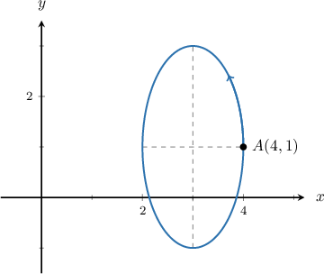

Consider the ellipse centered at $(3,1)$ with horizontal radius $1$ and vertical radius $2,$ as shown above. Which of the following sets of parametric equations, defined for $\theta \in [0,2\pi ),$  traverse the ellipse once in the counterclockwise direction starting at the point $A(4,1)?$

selection:
- $x=\operatorname{sin}⁡\theta +3,\,y=2\operatorname{cos}⁡\theta +1$
- $x=2\operatorname{cos}⁡\theta +3,\,y=4\operatorname{sin}⁡\theta +1$
- $x=\operatorname{cos}⁡\theta +3,\,y=2\operatorname{sin}⁡\theta +1$
- $x=2\operatorname{sin}⁡\theta +1,\,y=4\operatorname{cos}⁡\theta +3$
- $x=\operatorname{cos}⁡\theta +1,\,y=2\operatorname{sin}⁡\theta +3$

The parametric equations of an ellipse centered at the point $(h,k)$ with a horizontal radius of length $a$ and a vertical radius of length $b$ are

$$
x=a\operatorname{cos}⁡\theta +h,\,y=b\operatorname{sin}⁡\theta +k,\,\theta \in [0,2\pi ).
$$

Under this parametrization, the ellipse is traversed once in the counterclockwise direction, starting from $(h+a,k).$

In our case, the ellipse is centered at the point $(3,1),$ $a=1$ and $b=2.$ Therefore, the parametric equations of the ellipse are 

$$
x=\operatorname{cos}⁡\theta +3,\,y=2\operatorname{sin}⁡\theta +1,\,\theta \in [0,2\pi ).
$$

### Changed parameters, same complete source profile (evidence-only)

Consider the ellipse centered at $(-5,3)$ with horizontal radius $7$ and vertical radius $2,$ as shown above. Which of the following sets of parametric equations, defined for $\theta \in [0,2\pi ),$  traverse the ellipse once in the counterclockwise direction starting at the point $A(2,3)?$

selection:
- $x=7\operatorname{sin}⁡\theta -5,\,y=2\operatorname{cos}⁡\theta +3$
- $x=14\operatorname{cos}⁡\theta -5,\,y=4\operatorname{sin}⁡\theta +3$
- $x=14\operatorname{sin}⁡\theta +3,\,y=4\operatorname{cos}⁡\theta -5$
- $x=7\operatorname{cos}⁡\theta -5,\,y=2\operatorname{sin}⁡\theta +3$
- $x=7\operatorname{cos}⁡\theta +3,\,y=2\operatorname{sin}⁡\theta -5$

The parametric equations of an ellipse centered at the point $(h,k)$ with a horizontal radius of length $a$ and a vertical radius of length $b$ are

$$
x=a\operatorname{cos}⁡\theta +h,\,y=b\operatorname{sin}⁡\theta +k,\,\theta \in [0,2\pi ).
$$

Under this parametrization, the ellipse is traversed once in the counterclockwise direction, starting from $(h+a,k).$

In our case, the ellipse is centered at the point $(-5,3),$ $a=7$ and $b=2.$ Therefore, the parametric equations of the ellipse are 

$$
x=7\operatorname{cos}⁡\theta -5,\,y=2\operatorname{sin}⁡\theta +3,\,\theta \in [0,2\pi ).
$$

## Authored normal easy — seed 21

Consider the ellipse centered at $(5,0)$ with horizontal radius $3$ and vertical radius $7.$ Which of the following sets of parametric equations, defined for $\theta \in [0,2\pi ),$ generate the ellipse?

selection:
- $x=49\cos\theta+5,\,y=9\sin\theta$
- $x=6\cos\theta+5,\,y=14\sin\theta$
- $x=3\cos\theta+5,\,y=7\sin\theta$
- $x=3\cos\theta-5,\,y=7\sin\theta$
- $x=7\cos\theta+5,\,y=3\sin\theta$

The parametric equations of an ellipse centered at the point $(h,k)$ with a horizontal radius of length $a$ and a vertical radius of length $b$ are

$$
x=a\cos\theta+h,\,y=b\sin\theta+k,\,\theta \in [0,2\pi ).
$$

In our case, the ellipse is centered at the point $(5,0),$ $a=3$ and $b=7.$ Therefore, the parametric equations of the ellipse are

$$
x=3\cos\theta+5,\,y=7\sin\theta,\,\theta \in [0,2\pi ).
$$

## Authored normal easy — seed 22

Consider the ellipse centered at $(-6,3)$ with horizontal radius $3$ and vertical radius $4.$ Which of the following sets of parametric equations, defined for $\theta \in [0,2\pi ),$ generate the ellipse?

selection:
- $x=16\cos\theta-6,\,y=9\sin\theta+3$
- $x=3\cos\theta-6,\,y=4\sin\theta+3$
- $x=4\cos\theta-6,\,y=3\sin\theta+3$
- $x=6\cos\theta-6,\,y=8\sin\theta+3$
- $x=3\cos\theta+6,\,y=4\sin\theta-3$

The parametric equations of an ellipse centered at the point $(h,k)$ with a horizontal radius of length $a$ and a vertical radius of length $b$ are

$$
x=a\cos\theta+h,\,y=b\sin\theta+k,\,\theta \in [0,2\pi ).
$$

In our case, the ellipse is centered at the point $(-6,3),$ $a=3$ and $b=4.$ Therefore, the parametric equations of the ellipse are

$$
x=3\cos\theta-6,\,y=4\sin\theta+3,\,\theta \in [0,2\pi ).
$$

## Authored normal moderate — seed 21

Which of the following sets of parametric equations, defined for $\theta \in [0,2\pi ),$ generate the ellipse shown above?

selection:
- $x=49\cos\theta+5,\,y=9\sin\theta$
- $x=6\cos\theta+5,\,y=14\sin\theta$
- $x=3\cos\theta+5,\,y=7\sin\theta$
- $x=3\cos\theta-5,\,y=7\sin\theta$
- $x=7\cos\theta+5,\,y=3\sin\theta$

The parametric equations of an ellipse centered at the point $(h,k)$ with a horizontal radius of length $a$ and a vertical radius of length $b$ are

$$
x=a\cos\theta+h,\,y=b\sin\theta+k,\,\theta \in [0,2\pi ).
$$

In our case, the ellipse is centered at the point $(5,0),$ $a=3$ and $b=7.$ Therefore, the parametric equations of the ellipse are

$$
x=3\cos\theta+5,\,y=7\sin\theta,\,\theta \in [0,2\pi ).
$$

## Authored normal moderate — seed 22

Which of the following sets of parametric equations, defined for $\theta \in [0,2\pi ),$ generate the ellipse shown above?

selection:
- $x=16\cos\theta-6,\,y=9\sin\theta+3$
- $x=3\cos\theta-6,\,y=4\sin\theta+3$
- $x=4\cos\theta-6,\,y=3\sin\theta+3$
- $x=6\cos\theta-6,\,y=8\sin\theta+3$
- $x=3\cos\theta+6,\,y=4\sin\theta-3$

The parametric equations of an ellipse centered at the point $(h,k)$ with a horizontal radius of length $a$ and a vertical radius of length $b$ are

$$
x=a\cos\theta+h,\,y=b\sin\theta+k,\,\theta \in [0,2\pi ).
$$

In our case, the ellipse is centered at the point $(-6,3),$ $a=3$ and $b=4.$ Therefore, the parametric equations of the ellipse are

$$
x=3\cos\theta-6,\,y=4\sin\theta+3,\,\theta \in [0,2\pi ).
$$

## Authored normal hard — seed 21

Consider the ellipse centered at $(5,0)$ with horizontal radius $3$ and vertical radius $7.$ Which of the following sets of parametric equations, defined for $\theta \in [0,2\pi ),$ traverse the ellipse once in the counterclockwise direction starting at the point $A(8,0)?$

selection:
- $x=3\cos\theta-5,\,y=7\sin\theta$
- $x=3\sin\theta+5,\,y=7\cos\theta$
- $x=3\cos\theta+5,\,y=7\sin\theta$
- $x=7\cos\theta+5,\,y=3\sin\theta$
- $x=6\sin\theta+5,\,y=14\cos\theta$

The parametric equations of an ellipse centered at the point $(h,k)$ with a horizontal radius of length $a$ and a vertical radius of length $b$ are

$$
x=a\cos\theta+h,\,y=b\sin\theta+k,\,\theta \in [0,2\pi ).
$$

Under this parametrization, the ellipse is traversed once in the counterclockwise direction, starting from $(h+a,k).$

In our case, the ellipse is centered at the point $(5,0),$ $a=3$ and $b=7.$ Therefore, the parametric equations of the ellipse are

$$
x=3\cos\theta+5,\,y=7\sin\theta,\,\theta \in [0,2\pi ).
$$

## Authored normal hard — seed 22

Consider the ellipse centered at $(-6,3)$ with horizontal radius $3$ and vertical radius $4.$ Construct a set of parametric equations, defined for $\theta \in [0,2\pi ),$ that traverse the ellipse once in the counterclockwise direction starting at the point $A(-3,3).$

$x=$ {{field-1}}$,\,y=$ {{field-2}}$,\,\theta \in [0,2\pi ).$

field-1:
- $3\cos\theta-6$
field-2:
- $4\sin\theta+3$

The parametric equations of an ellipse centered at the point $(h,k)$ with a horizontal radius of length $a$ and a vertical radius of length $b$ are

$$
x=a\cos\theta+h,\,y=b\sin\theta+k,\,\theta \in [0,2\pi ).
$$

Under this parametrization, the ellipse is traversed once in the counterclockwise direction, starting from $(h+a,k).$

In our case, the ellipse is centered at the point $(-6,3),$ $a=3$ and $b=4.$ Therefore, the parametric equations of the ellipse are

$$
x=3\cos\theta-6,\,y=4\sin\theta+3,\,\theta \in [0,2\pi ).
$$

## Visual and mathematical review findings

All original rasters were viewed at full resolution on white; source tick signs, centers, extrema, guides, A labels, and direction arrows were checked. Independent raster extents fit every individual axis transform within the recorded 2.8-pixel stroke allowance. Normal moderate and hard plots and changed source-profile plots were viewed at full resolution. A tick-label collision in the initial render was corrected by measuring actual label boxes and trying clear positions; final sidecars enforce clearance rather than covering axes. Every source bank and changed bank was mathematically checked, including loci that match while traversal does not. No source choice was discarded. Native limitations are documented in engine.json/validation.json, not hidden by mathematical passes.

## Canonical example context (not practice coverage)

The original e-6816 raster was also inspected at full resolution. It confirms center (1,−2), semiaxes (6,4), rightmost A(7,−2), and an upward-left arrow on the upper-right arc.

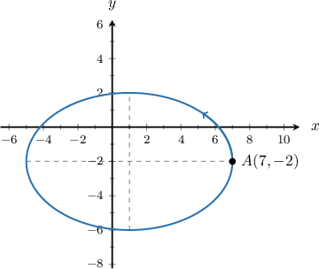
