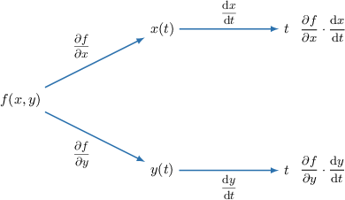
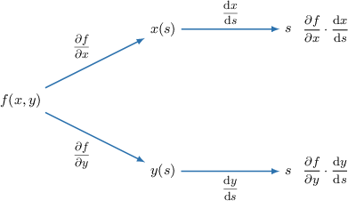

# Originals and generated variants

Raw evidence is ineligible; all normal examples use complete method-derived banks.

## Generated easy exp_product

If $f(x,y)=x e^{x y},$ $x=5 t^{3}$ and $y=4 t,$ compute $\frac{\text{d}f}{\text{d}t}$.

- $- 100 t^{6} e^{20 t^{4}} + 15 t^{2} (20 t^{4} e^{20 t^{4}} + e^{20 t^{4}})$
- $15 t^{2} (20 t^{4} e^{20 t^{4}} + e^{20 t^{4}})$
- $5 t^{2} (80 t^{4} + 3) e^{20 t^{4}}$
- $- 5 t^{2} (80 t^{4} + 3) e^{20 t^{4}}$
- $100 t^{6} e^{20 t^{4}}$

The chain rule for a multivariable function $f(x,y)$ with one independent variable $t,$ where $x=x(t)$ and $y=y(t),$ can be expressed as follows:

$$
\frac{\text{d}f}{\text{d}t}=\frac{∂f}{∂x}\cdot \frac{\text{d}x}{\text{d}t}+\frac{∂f}{∂y}\cdot \frac{\text{d}y}{\text{d}t}
$$

First, we find the partial derivatives of $f$ with respect to $x$ and $y:$ 

$$
\begin{aligned}\frac{∂f}{∂x}=x y e^{x y} + e^{x y},\,\frac{∂f}{∂y}=x^{2} e^{x y}\end{aligned}
$$

Writing the above results in terms of $t,$ we get

$$
\begin{aligned}\frac{∂f}{∂x} & =20 t^{4} e^{20 t^{4}} + e^{20 t^{4}} \\ \frac{∂f}{∂y} & =25 t^{6} e^{20 t^{4}}\end{aligned}
$$

Next, we take the derivatives of $x$ and $y$ with respect to $t,$ and we get

$$
\begin{aligned}\frac{\text{d}x}{\text{d}t}=15 t^{2},\,\frac{\text{d}y}{\text{d}t}=4.\end{aligned}
$$

Finally, substituting all of our derivatives into the multivariable chain rule, we get

$$
\begin{aligned}\frac{\text{d}f}{\text{d}t} & =\frac{∂f}{∂x}\cdot \frac{\text{d}x}{\text{d}t}+\frac{∂f}{∂y}\cdot \frac{\text{d}y}{\text{d}t} \\  & =(20 t^{4} e^{20 t^{4}} + e^{20 t^{4}})\cdot (15 t^{2})+(25 t^{6} e^{20 t^{4}})\cdot (4) \\  & =15 t^{2} e^{20 t^{4}} + (300 t^{6} e^{20 t^{4}}) + (100 t^{6} e^{20 t^{4}}) \\  & =5 t^{2} (80 t^{4} + 3) e^{20 t^{4}}.\end{aligned}
$$

## Generated easy exp_product

If $f(x,y)=x e^{x y},$ $x=2 t^{4}$ and $y=t,$ compute $\frac{\text{d}f}{\text{d}t}$.

- $8 t^{3} (2 t^{5} e^{2 t^{5}} + e^{2 t^{5}})$
- $- 4 t^{3} (5 t^{5} + 2) e^{2 t^{5}}$
- $4 t^{3} (5 t^{5} + 2) e^{2 t^{5}}$
- $4 t^{8} e^{2 t^{5}}$
- $- 4 t^{8} e^{2 t^{5}} + 8 t^{3} (2 t^{5} e^{2 t^{5}} + e^{2 t^{5}})$

The chain rule for a multivariable function $f(x,y)$ with one independent variable $t,$ where $x=x(t)$ and $y=y(t),$ can be expressed as follows:

$$
\frac{\text{d}f}{\text{d}t}=\frac{∂f}{∂x}\cdot \frac{\text{d}x}{\text{d}t}+\frac{∂f}{∂y}\cdot \frac{\text{d}y}{\text{d}t}
$$

First, we find the partial derivatives of $f$ with respect to $x$ and $y:$ 

$$
\begin{aligned}\frac{∂f}{∂x}=x y e^{x y} + e^{x y},\,\frac{∂f}{∂y}=x^{2} e^{x y}\end{aligned}
$$

Writing the above results in terms of $t,$ we get

$$
\begin{aligned}\frac{∂f}{∂x} & =2 t^{5} e^{2 t^{5}} + e^{2 t^{5}} \\ \frac{∂f}{∂y} & =4 t^{8} e^{2 t^{5}}\end{aligned}
$$

Next, we take the derivatives of $x$ and $y$ with respect to $t,$ and we get

$$
\begin{aligned}\frac{\text{d}x}{\text{d}t}=8 t^{3},\,\frac{\text{d}y}{\text{d}t}=1.\end{aligned}
$$

Finally, substituting all of our derivatives into the multivariable chain rule, we get

$$
\begin{aligned}\frac{\text{d}f}{\text{d}t} & =\frac{∂f}{∂x}\cdot \frac{\text{d}x}{\text{d}t}+\frac{∂f}{∂y}\cdot \frac{\text{d}y}{\text{d}t} \\  & =(2 t^{5} e^{2 t^{5}} + e^{2 t^{5}})\cdot (8 t^{3})+(4 t^{8} e^{2 t^{5}})\cdot (1) \\  & =8 t^{3} e^{2 t^{5}} + (16 t^{8} e^{2 t^{5}}) + (4 t^{8} e^{2 t^{5}}) \\  & =4 t^{3} (5 t^{5} + 2) e^{2 t^{5}}.\end{aligned}
$$

## Generated full historical bank evidence translation exp_product

If $f(x, y) = xe^{xy}, x = (t+1)^{2}$, and $y = (t+1)$, compute $\frac{df}{dt}$.

- $(2 + 3(t+1)^{3})e^{(t+1)^{2}}$
- $(2(t+1) + 3(t+1)^{4})e^{(t+1)^{3}}$
- $(3(t+1) + 2(t+1)^{4})e^{(t+1)^{3}}$
- $(3(t+1) + 2(t+1)^{3})e^{(t+1)^{2}}$
- $(2 + (t+1)^{2})e^{(t+1)^{3}}$

The chain rule for a multivariable function $f(x,y)$ with one independent variable $t,$ where $x=x(t)$ and $y=y(t),$ can be expressed as follows:

$$
\frac{\text{d}f}{\text{d}t}=\frac{∂f}{∂x}\cdot \frac{\text{d}x}{\text{d}t}+\frac{∂f}{∂y}\cdot \frac{\text{d}y}{\text{d}t}
$$

First, we find the partial derivatives of $f$ with respect to $x$ and $y:$ 

$$
\begin{aligned}\frac{∂f}{∂x}=x y e^{x y} + e^{x y},\,\frac{∂f}{∂y}=x^{2} e^{x y}\end{aligned}
$$

Writing the above results in terms of $t,$ we get

$$
\begin{aligned}\frac{∂f}{∂x} & =(t + 1)^{3} e^{(t + 1)^{3}} + e^{(t + 1)^{3}} \\ \frac{∂f}{∂y} & =(t + 1)^{4} e^{(t + 1)^{3}}\end{aligned}
$$

Next, we take the derivatives of $x$ and $y$ with respect to $t,$ and we get

$$
\begin{aligned}\frac{\text{d}x}{\text{d}t}=2 t + 2,\,\frac{\text{d}y}{\text{d}t}=1.\end{aligned}
$$

Finally, substituting all of our derivatives into the multivariable chain rule, we get

$$
\begin{aligned}\frac{\text{d}f}{\text{d}t} & =\frac{∂f}{∂x}\cdot \frac{\text{d}x}{\text{d}t}+\frac{∂f}{∂y}\cdot \frac{\text{d}y}{\text{d}t} \\  & =((t + 1)^{3} e^{(t + 1)^{3}} + e^{(t + 1)^{3}})\cdot (2 t + 2)+((t + 1)^{4} e^{(t + 1)^{3}})\cdot (1) \\  & =(2 t + 2) e^{(t + 1)^{3}} + ((t + 1)^{3} (2 t + 2) e^{(t + 1)^{3}}) + ((t + 1)^{4} e^{(t + 1)^{3}}) \\  & =(t + 1) (3 (t + 1)^{3} + 2) e^{(t + 1)^{3}}.\end{aligned}
$$

## Original public raw exp_product

If $f(x, y) = xe^{xy}, x = t^{2}$, and $y = t$, compute $\frac{df}{dt}$.

- $(3t + 2t^{4})e^{t^{3}}$
- $(2t + 3t^{4})e^{t^{3}}$
- $(2 + 3t^{3})e^{t^{2}}$
- $(2 + t^{2})e^{t^{3}}$
- $(3t + 2t^{3})e^{t^{2}}$

[Source has no worked solution]

## Minimal repaired evidence exp_product

If $f(x, y) = xe^{xy}, x = t^{2}$, and $y = t$, compute $\frac{df}{dt}$.

- $(2 + 3t^{3})e^{t^{2}}$
- $(2t + 3t^{4})e^{t^{3}}$
- $(3t + 2t^{4})e^{t^{3}}$
- $(3t + 2t^{3})e^{t^{2}}$
- $(2 + t^{2})e^{t^{3}}$

The chain rule for a multivariable function $f(x,y)$ with one independent variable $t,$ where $x=x(t)$ and $y=y(t),$ can be expressed as follows:

$$
\frac{\text{d}f}{\text{d}t}=\frac{∂f}{∂x}\cdot \frac{\text{d}x}{\text{d}t}+\frac{∂f}{∂y}\cdot \frac{\text{d}y}{\text{d}t}
$$

First, we find the partial derivatives of $f$ with respect to $x$ and $y:$ 

$$
\begin{aligned}\frac{∂f}{∂x}=x y e^{x y} + e^{x y},\,\frac{∂f}{∂y}=x^{2} e^{x y}\end{aligned}
$$

Writing the above results in terms of $t,$ we get

$$
\begin{aligned}\frac{∂f}{∂x} & =t^{3} e^{t^{3}} + e^{t^{3}} \\ \frac{∂f}{∂y} & =t^{4} e^{t^{3}}\end{aligned}
$$

Next, we take the derivatives of $x$ and $y$ with respect to $t,$ and we get

$$
\begin{aligned}\frac{\text{d}x}{\text{d}t}=2 t,\,\frac{\text{d}y}{\text{d}t}=1.\end{aligned}
$$

Finally, substituting all of our derivatives into the multivariable chain rule, we get

$$
\begin{aligned}\frac{\text{d}f}{\text{d}t} & =\frac{∂f}{∂x}\cdot \frac{\text{d}x}{\text{d}t}+\frac{∂f}{∂y}\cdot \frac{\text{d}y}{\text{d}t} \\  & =(t^{3} e^{t^{3}} + e^{t^{3}})\cdot (2 t)+(t^{4} e^{t^{3}})\cdot (1) \\  & =2 t e^{t^{3}} + (2 t^{4} e^{t^{3}}) + (t^{4} e^{t^{3}}) \\  & =t (3 t^{3} + 2) e^{t^{3}}.\end{aligned}
$$

## Normal at original mathematics exp_product

If $f(x,y)=x e^{x y},$ $x=t^{2}$ and $y=t,$ compute $\frac{\text{d}f}{\text{d}t}$.

- $t^{4} e^{t^{3}}$
- $2 t (t^{3} e^{t^{3}} + e^{t^{3}})$
- $t (3 t^{3} + 2) e^{t^{3}}$
- $- t (3 t^{3} + 2) e^{t^{3}}$
- $- t^{4} e^{t^{3}} + 2 t (t^{3} e^{t^{3}} + e^{t^{3}})$

The chain rule for a multivariable function $f(x,y)$ with one independent variable $t,$ where $x=x(t)$ and $y=y(t),$ can be expressed as follows:

$$
\frac{\text{d}f}{\text{d}t}=\frac{∂f}{∂x}\cdot \frac{\text{d}x}{\text{d}t}+\frac{∂f}{∂y}\cdot \frac{\text{d}y}{\text{d}t}
$$

First, we find the partial derivatives of $f$ with respect to $x$ and $y:$ 

$$
\begin{aligned}\frac{∂f}{∂x}=x y e^{x y} + e^{x y},\,\frac{∂f}{∂y}=x^{2} e^{x y}\end{aligned}
$$

Writing the above results in terms of $t,$ we get

$$
\begin{aligned}\frac{∂f}{∂x} & =t^{3} e^{t^{3}} + e^{t^{3}} \\ \frac{∂f}{∂y} & =t^{4} e^{t^{3}}\end{aligned}
$$

Next, we take the derivatives of $x$ and $y$ with respect to $t,$ and we get

$$
\begin{aligned}\frac{\text{d}x}{\text{d}t}=2 t,\,\frac{\text{d}y}{\text{d}t}=1.\end{aligned}
$$

Finally, substituting all of our derivatives into the multivariable chain rule, we get

$$
\begin{aligned}\frac{\text{d}f}{\text{d}t} & =\frac{∂f}{∂x}\cdot \frac{\text{d}x}{\text{d}t}+\frac{∂f}{∂y}\cdot \frac{\text{d}y}{\text{d}t} \\  & =(t^{3} e^{t^{3}} + e^{t^{3}})\cdot (2 t)+(t^{4} e^{t^{3}})\cdot (1) \\  & =2 t e^{t^{3}} + (2 t^{4} e^{t^{3}}) + (t^{4} e^{t^{3}}) \\  & =t (3 t^{3} + 2) e^{t^{3}}.\end{aligned}
$$

## Generated easy log_trig

If $f(x,y)=\ln{(x y^{3} )},$ $x=\cos{(5 t )}$ and $y=\sin{(5 t )},$ compute $\frac{\text{d}f}{\text{d}t}$ for $0<5 t<\frac{\pi}{2}$.

- $- \frac{5 \sin{(5 t )}}{\cos{(5 t )}} - \frac{15 \cos{(5 t )}}{\sin{(5 t )}}$
- $- \frac{5 \sin{(5 t )}}{\cos{(5 t )}}$
- $- 5 \tan{(5 t )} + 15 \cot{(5 t )}$
- $5 \tan{(5 t )} - 15 \cot{(5 t )}$
- $\frac{15 \cos{(5 t )}}{\sin{(5 t )}}$

The chain rule for a multivariable function $f(x,y)$ with one independent variable $t,$ where $x=x(t)$ and $y=y(t),$ can be expressed as follows:

$$
\frac{\text{d}f}{\text{d}t}=\frac{∂f}{∂x}\cdot \frac{\text{d}x}{\text{d}t}+\frac{∂f}{∂y}\cdot \frac{\text{d}y}{\text{d}t}
$$

First, we find the partial derivatives of $f$ with respect to $x$ and $y:$ 

$$
\begin{aligned}\frac{∂f}{∂x}=\frac{y^{3}}{x y^{3}}=\frac{1}{x},\,\frac{∂f}{∂y}=\frac{3 x y^{2}}{x y^{3}}=\frac{3}{y}\end{aligned}
$$

Writing the above results in terms of $t,$ we get

$$
\begin{aligned}\frac{∂f}{∂x} & =\frac{1}{\cos{(5 t )}} \\ \frac{∂f}{∂y} & =\frac{3}{\sin{(5 t )}}\end{aligned}
$$

Next, we take the derivatives of $x$ and $y$ with respect to $t,$ and we get

$$
\begin{aligned}\frac{\text{d}x}{\text{d}t}=- 5 \sin{(5 t )},\,\frac{\text{d}y}{\text{d}t}=5 \cos{(5 t )}.\end{aligned}
$$

Finally, substituting all of our derivatives into the multivariable chain rule, we get

$$
\begin{aligned}\frac{\text{d}f}{\text{d}t} & =\frac{∂f}{∂x}\cdot \frac{\text{d}x}{\text{d}t}+\frac{∂f}{∂y}\cdot \frac{\text{d}y}{\text{d}t} \\  & =(\frac{1}{\cos{(5 t )}})\cdot (- 5 \sin{(5 t )})+(\frac{3}{\sin{(5 t )}})\cdot (5 \cos{(5 t )}) \\  & =- \frac{5 \sin{(5 t )}}{\cos{(5 t )}} + (\frac{15 \cos{(5 t )}}{\sin{(5 t )}}) \\  & =- 5 \tan{(5 t )} + 15 \cot{(5 t )}.\end{aligned}
$$

## Generated easy log_trig

If $f(x,y)=\ln{(x y^{4} )},$ $x=\cos{(2 t )}$ and $y=\sin{(2 t )},$ compute $\frac{\text{d}f}{\text{d}t}$ for $0<2 t<\frac{\pi}{2}$.

- $- \frac{2 \sin{(2 t )}}{\cos{(2 t )}}$
- $2 \tan{(2 t )} - 8 \cot{(2 t )}$
- $- 2 \tan{(2 t )} + 8 \cot{(2 t )}$
- $\frac{8 \cos{(2 t )}}{\sin{(2 t )}}$
- $- \frac{2 \sin{(2 t )}}{\cos{(2 t )}} - \frac{8 \cos{(2 t )}}{\sin{(2 t )}}$

The chain rule for a multivariable function $f(x,y)$ with one independent variable $t,$ where $x=x(t)$ and $y=y(t),$ can be expressed as follows:

$$
\frac{\text{d}f}{\text{d}t}=\frac{∂f}{∂x}\cdot \frac{\text{d}x}{\text{d}t}+\frac{∂f}{∂y}\cdot \frac{\text{d}y}{\text{d}t}
$$

First, we find the partial derivatives of $f$ with respect to $x$ and $y:$ 

$$
\begin{aligned}\frac{∂f}{∂x}=\frac{y^{4}}{x y^{4}}=\frac{1}{x},\,\frac{∂f}{∂y}=\frac{4 x y^{3}}{x y^{4}}=\frac{4}{y}\end{aligned}
$$

Writing the above results in terms of $t,$ we get

$$
\begin{aligned}\frac{∂f}{∂x} & =\frac{1}{\cos{(2 t )}} \\ \frac{∂f}{∂y} & =\frac{4}{\sin{(2 t )}}\end{aligned}
$$

Next, we take the derivatives of $x$ and $y$ with respect to $t,$ and we get

$$
\begin{aligned}\frac{\text{d}x}{\text{d}t}=- 2 \sin{(2 t )},\,\frac{\text{d}y}{\text{d}t}=2 \cos{(2 t )}.\end{aligned}
$$

Finally, substituting all of our derivatives into the multivariable chain rule, we get

$$
\begin{aligned}\frac{\text{d}f}{\text{d}t} & =\frac{∂f}{∂x}\cdot \frac{\text{d}x}{\text{d}t}+\frac{∂f}{∂y}\cdot \frac{\text{d}y}{\text{d}t} \\  & =(\frac{1}{\cos{(2 t )}})\cdot (- 2 \sin{(2 t )})+(\frac{4}{\sin{(2 t )}})\cdot (2 \cos{(2 t )}) \\  & =- \frac{2 \sin{(2 t )}}{\cos{(2 t )}} + (\frac{8 \cos{(2 t )}}{\sin{(2 t )}}) \\  & =- 2 \tan{(2 t )} + 8 \cot{(2 t )}.\end{aligned}
$$

## Generated full historical bank evidence translation log_trig

If $f(x,y)=\operatorname{ln}⁡(x{y}^{2}),x=\operatorname{cos}⁡(t+1)$ and $y=\operatorname{sin}⁡(t+1),$ compute $\frac{\text{d}f}{\text{d}t}$ for $0<(t+1)<\frac{\pi }{2}.$

- $2\operatorname{tan}⁡(t+1)-\operatorname{cot}⁡(t+1)$
- $2\operatorname{csc}⁡(t+1)-\operatorname{tan}⁡(t+1)$
- $\operatorname{cot}⁡(t+1)+2\operatorname{csc}⁡(t+1)$
- $\operatorname{sec}⁡(t+1)-\operatorname{tan}⁡(t+1)$
- $2\operatorname{cot}⁡(t+1)-\operatorname{tan}⁡(t+1)$

The chain rule for a multivariable function $f(x,y)$ with one independent variable $t,$ where $x=x(t)$ and $y=y(t),$ can be expressed as follows:

$$
\frac{\text{d}f}{\text{d}t}=\frac{∂f}{∂x}\cdot \frac{\text{d}x}{\text{d}t}+\frac{∂f}{∂y}\cdot \frac{\text{d}y}{\text{d}t}
$$

First, we find the partial derivatives of $f$ with respect to $x$ and $y:$ 

$$
\begin{aligned}\frac{∂f}{∂x}=\frac{{y}^{2}}{x{y}^{2}}=\frac{1}{x},\,\frac{∂f}{∂y}=\frac{2xy}{x{y}^{2}}=\frac{2}{y}\end{aligned}
$$

Writing the above results in terms of $t,$ we get

$$
\begin{aligned}\frac{∂f}{∂x} & =\frac{1}{\operatorname{cos}⁡(t+1)}, \\ \frac{∂f}{∂y} & =\frac{2}{\operatorname{sin}⁡(t+1)}.\end{aligned}
$$

Next, we take the derivatives of $x$ and $y$ with respect to $t,$ and we get

$$
\begin{aligned}\frac{\text{d}x}{\text{d}t}=-\operatorname{sin}⁡(t+1),\,\frac{\text{d}y}{\text{d}t}=\operatorname{cos}⁡(t+1).\end{aligned}
$$

Finally, substituting all of our derivatives into the multivariable chain rule, we get

$$
\begin{aligned}\frac{\text{d}f}{\text{d}t} & =\frac{∂f}{∂x}\cdot \frac{\text{d}x}{\text{d}t}+\frac{∂f}{∂y}\cdot \frac{\text{d}y}{\text{d}t} \\  & =\frac{1}{\operatorname{cos}⁡(t+1)}\cdot (-\operatorname{sin}⁡(t+1))+\frac{2}{\operatorname{sin}⁡(t+1)}\cdot \operatorname{cos}⁡(t+1) \\  & =-\frac{\operatorname{sin}⁡(t+1)}{\operatorname{cos}⁡(t+1)}+2\cdot \frac{\operatorname{cos}⁡(t+1)}{\operatorname{sin}⁡(t+1)} \\  & =2\operatorname{cot}⁡(t+1)-\operatorname{tan}⁡(t+1).\end{aligned}
$$

## Original public raw log_trig

If $f(x,y)=\operatorname{ln}⁡(x{y}^{2}),x=\operatorname{cos}⁡t$ and $y=\operatorname{sin}⁡t,$ compute $\frac{\text{d}f}{\text{d}t}$ for $0<t<\frac{\pi }{2}.$

- $\operatorname{cot}⁡t+2\operatorname{csc}⁡t$
- $2\operatorname{csc}⁡t-\operatorname{tan}⁡t$
- $2\operatorname{tan}⁡t-\operatorname{cot}⁡t$
- $2\operatorname{cot}⁡t-\operatorname{tan}⁡t$
- $\operatorname{sec}⁡t-\operatorname{tan}⁡t$

The chain rule for a multivariable function $f(x,y)$ with one independent variable $t,$ where $x=x(t)$ and $y=y(t),$ can be expressed as follows:

$$
\frac{\text{d}f}{\text{d}t}=\frac{∂f}{∂x}\cdot \frac{\text{d}x}{\text{d}t}+\frac{∂f}{∂y}\cdot \frac{\text{d}y}{\text{d}t}
$$

First, we find the partial derivatives of $f$ with respect to $x$ and $y:$ 

$$
\begin{aligned}\frac{∂f}{∂x}=\frac{{y}^{2}}{x{y}^{2}}=\frac{1}{x},\,\frac{∂f}{∂y}=\frac{2xy}{x{y}^{2}}=\frac{2}{y}\end{aligned}
$$

Writing the above results in terms of $t,$ we get

$$
\begin{aligned}\frac{∂f}{∂x} & =\frac{1}{\operatorname{cos}⁡t}, \\ \frac{∂f}{∂y} & =\frac{2}{\operatorname{sin}⁡t}.\end{aligned}
$$

Next, we take the derivatives of $x$ and $y$ with respect to $t,$ and we get

$$
\begin{aligned}\frac{\text{d}x}{\text{d}t}=-\operatorname{sin}⁡t,\,\frac{\text{d}y}{\text{d}t}=\operatorname{cos}⁡t.\end{aligned}
$$

Finally, substituting all of our derivatives into the multivariable chain rule, we get

$$
\begin{aligned}\frac{\text{d}f}{\text{d}t} & =\frac{∂f}{∂x}\cdot \frac{\text{d}x}{\text{d}t}+\frac{∂f}{∂y}\cdot \frac{\text{d}y}{\text{d}t} \\  & =\frac{1}{\operatorname{cos}⁡t}\cdot (-\operatorname{sin}⁡t)+\frac{2}{\operatorname{sin}⁡t}\cdot \operatorname{cos}⁡t \\  & =-\frac{\operatorname{sin}⁡t}{\operatorname{cos}⁡t}+2\cdot \frac{\operatorname{cos}⁡t}{\operatorname{sin}⁡t} \\  & =2\operatorname{cot}⁡t-\operatorname{tan}⁡t.\end{aligned}
$$

## Minimal repaired evidence log_trig

If $f(x,y)=\operatorname{ln}⁡(x{y}^{2}),x=\operatorname{cos}⁡t$ and $y=\operatorname{sin}⁡t,$ compute $\frac{\text{d}f}{\text{d}t}$ for $0<t<\frac{\pi }{2}.$

- $2\operatorname{tan}⁡t-\operatorname{cot}⁡t$
- $2\operatorname{csc}⁡t-\operatorname{tan}⁡t$
- $\operatorname{cot}⁡t+2\operatorname{csc}⁡t$
- $\operatorname{sec}⁡t-\operatorname{tan}⁡t$
- $2\operatorname{cot}⁡t-\operatorname{tan}⁡t$

The chain rule for a multivariable function $f(x,y)$ with one independent variable $t,$ where $x=x(t)$ and $y=y(t),$ can be expressed as follows:

$$
\frac{\text{d}f}{\text{d}t}=\frac{∂f}{∂x}\cdot \frac{\text{d}x}{\text{d}t}+\frac{∂f}{∂y}\cdot \frac{\text{d}y}{\text{d}t}
$$

First, we find the partial derivatives of $f$ with respect to $x$ and $y:$ 

$$
\begin{aligned}\frac{∂f}{∂x}=\frac{{y}^{2}}{x{y}^{2}}=\frac{1}{x},\,\frac{∂f}{∂y}=\frac{2xy}{x{y}^{2}}=\frac{2}{y}\end{aligned}
$$

Writing the above results in terms of $t,$ we get

$$
\begin{aligned}\frac{∂f}{∂x} & =\frac{1}{\operatorname{cos}⁡t}, \\ \frac{∂f}{∂y} & =\frac{2}{\operatorname{sin}⁡t}.\end{aligned}
$$

Next, we take the derivatives of $x$ and $y$ with respect to $t,$ and we get

$$
\begin{aligned}\frac{\text{d}x}{\text{d}t}=-\operatorname{sin}⁡t,\,\frac{\text{d}y}{\text{d}t}=\operatorname{cos}⁡t.\end{aligned}
$$

Finally, substituting all of our derivatives into the multivariable chain rule, we get

$$
\begin{aligned}\frac{\text{d}f}{\text{d}t} & =\frac{∂f}{∂x}\cdot \frac{\text{d}x}{\text{d}t}+\frac{∂f}{∂y}\cdot \frac{\text{d}y}{\text{d}t} \\  & =\frac{1}{\operatorname{cos}⁡t}\cdot (-\operatorname{sin}⁡t)+\frac{2}{\operatorname{sin}⁡t}\cdot \operatorname{cos}⁡t \\  & =-\frac{\operatorname{sin}⁡t}{\operatorname{cos}⁡t}+2\cdot \frac{\operatorname{cos}⁡t}{\operatorname{sin}⁡t} \\  & =2\operatorname{cot}⁡t-\operatorname{tan}⁡t.\end{aligned}
$$

## Normal at original mathematics log_trig

If $f(x,y)=\ln{(x y^{2} )},$ $x=\cos{(t )}$ and $y=\sin{(t )},$ compute $\frac{\text{d}f}{\text{d}t}$ for $0<t<\frac{\pi}{2}$.

- $\frac{2 \cos{(t )}}{\sin{(t )}}$
- $- \frac{\sin{(t )}}{\cos{(t )}}$
- $- \tan{(t )} + 2 \cot{(t )}$
- $\tan{(t )} - 2 \cot{(t )}$
- $- \frac{\sin{(t )}}{\cos{(t )}} - \frac{2 \cos{(t )}}{\sin{(t )}}$

The chain rule for a multivariable function $f(x,y)$ with one independent variable $t,$ where $x=x(t)$ and $y=y(t),$ can be expressed as follows:

$$
\frac{\text{d}f}{\text{d}t}=\frac{∂f}{∂x}\cdot \frac{\text{d}x}{\text{d}t}+\frac{∂f}{∂y}\cdot \frac{\text{d}y}{\text{d}t}
$$

First, we find the partial derivatives of $f$ with respect to $x$ and $y:$ 

$$
\begin{aligned}\frac{∂f}{∂x}=\frac{y^{2}}{x y^{2}}=\frac{1}{x},\,\frac{∂f}{∂y}=\frac{2 x y}{x y^{2}}=\frac{2}{y}\end{aligned}
$$

Writing the above results in terms of $t,$ we get

$$
\begin{aligned}\frac{∂f}{∂x} & =\frac{1}{\cos{(t )}} \\ \frac{∂f}{∂y} & =\frac{2}{\sin{(t )}}\end{aligned}
$$

Next, we take the derivatives of $x$ and $y$ with respect to $t,$ and we get

$$
\begin{aligned}\frac{\text{d}x}{\text{d}t}=- \sin{(t )},\,\frac{\text{d}y}{\text{d}t}=\cos{(t )}.\end{aligned}
$$

Finally, substituting all of our derivatives into the multivariable chain rule, we get

$$
\begin{aligned}\frac{\text{d}f}{\text{d}t} & =\frac{∂f}{∂x}\cdot \frac{\text{d}x}{\text{d}t}+\frac{∂f}{∂y}\cdot \frac{\text{d}y}{\text{d}t} \\  & =(\frac{1}{\cos{(t )}})\cdot (- \sin{(t )})+(\frac{2}{\sin{(t )}})\cdot (\cos{(t )}) \\  & =- \frac{\sin{(t )}}{\cos{(t )}} + (\frac{2 \cos{(t )}}{\sin{(t )}}) \\  & =- \tan{(t )} + 2 \cot{(t )}.\end{aligned}
$$

## Generated easy trig_product

If $f(x,y)=\sin{(x )} \cos{(y )},$ $x=5 t^{3}$ and $y=4 t,$ compute $\frac{\text{d}f}{\text{d}t}$.

- $15 t^{2} \cos{(4 t )} \cos{(5 t^{3} )} + 4 \sin{(4 t )} \sin{(5 t^{3} )}$
- $15 t^{2} \cos{(4 t )} \cos{(5 t^{3} )}$
- $15 t^{2} \cos{(4 t )} \cos{(5 t^{3} )} - 4 \sin{(4 t )} \sin{(5 t^{3} )}$
- $- 15 t^{2} \cos{(4 t )} \cos{(5 t^{3} )} + 4 \sin{(4 t )} \sin{(5 t^{3} )}$
- $- 4 \sin{(4 t )} \sin{(5 t^{3} )}$

The chain rule for a multivariable function $f(x,y)$ with one independent variable $t,$ where $x=x(t)$ and $y=y(t),$ can be expressed as follows:

$$
\frac{\text{d}f}{\text{d}t}=\frac{∂f}{∂x}\cdot \frac{\text{d}x}{\text{d}t}+\frac{∂f}{∂y}\cdot \frac{\text{d}y}{\text{d}t}
$$

First, we find the partial derivatives of $f$ with respect to $x$ and $y:$ 

$$
\begin{aligned}\frac{∂f}{∂x}=\cos{(x )} \cos{(y )},\,\frac{∂f}{∂y}=- \sin{(x )} \sin{(y )}\end{aligned}
$$

Writing the above results in terms of $t,$ we get

$$
\begin{aligned}\frac{∂f}{∂x} & =\cos{(4 t )} \cos{(5 t^{3} )} \\ \frac{∂f}{∂y} & =- \sin{(4 t )} \sin{(5 t^{3} )}\end{aligned}
$$

Next, we take the derivatives of $x$ and $y$ with respect to $t,$ and we get

$$
\begin{aligned}\frac{\text{d}x}{\text{d}t}=15 t^{2},\,\frac{\text{d}y}{\text{d}t}=4.\end{aligned}
$$

Finally, substituting all of our derivatives into the multivariable chain rule, we get

$$
\begin{aligned}\frac{\text{d}f}{\text{d}t} & =\frac{∂f}{∂x}\cdot \frac{\text{d}x}{\text{d}t}+\frac{∂f}{∂y}\cdot \frac{\text{d}y}{\text{d}t} \\  & =(\cos{(4 t )} \cos{(5 t^{3} )})\cdot (15 t^{2})+(- \sin{(4 t )} \sin{(5 t^{3} )})\cdot (4) \\  & =15 t^{2} \cos{(4 t )} \cos{(5 t^{3} )} - 4 \sin{(4 t )} \sin{(5 t^{3} )}.\end{aligned}
$$

## Generated easy trig_product

If $f(x,y)=\sin{(x )} \cos{(y )},$ $x=2 t^{4}$ and $y=t,$ compute $\frac{\text{d}f}{\text{d}t}$.

- $8 t^{3} \cos{(t )} \cos{(2 t^{4} )}$
- $- 8 t^{3} \cos{(t )} \cos{(2 t^{4} )} + \sin{(t )} \sin{(2 t^{4} )}$
- $8 t^{3} \cos{(t )} \cos{(2 t^{4} )} - \sin{(t )} \sin{(2 t^{4} )}$
- $- \sin{(t )} \sin{(2 t^{4} )}$
- $8 t^{3} \cos{(t )} \cos{(2 t^{4} )} + \sin{(t )} \sin{(2 t^{4} )}$

The chain rule for a multivariable function $f(x,y)$ with one independent variable $t,$ where $x=x(t)$ and $y=y(t),$ can be expressed as follows:

$$
\frac{\text{d}f}{\text{d}t}=\frac{∂f}{∂x}\cdot \frac{\text{d}x}{\text{d}t}+\frac{∂f}{∂y}\cdot \frac{\text{d}y}{\text{d}t}
$$

First, we find the partial derivatives of $f$ with respect to $x$ and $y:$ 

$$
\begin{aligned}\frac{∂f}{∂x}=\cos{(x )} \cos{(y )},\,\frac{∂f}{∂y}=- \sin{(x )} \sin{(y )}\end{aligned}
$$

Writing the above results in terms of $t,$ we get

$$
\begin{aligned}\frac{∂f}{∂x} & =\cos{(t )} \cos{(2 t^{4} )} \\ \frac{∂f}{∂y} & =- \sin{(t )} \sin{(2 t^{4} )}\end{aligned}
$$

Next, we take the derivatives of $x$ and $y$ with respect to $t,$ and we get

$$
\begin{aligned}\frac{\text{d}x}{\text{d}t}=8 t^{3},\,\frac{\text{d}y}{\text{d}t}=1.\end{aligned}
$$

Finally, substituting all of our derivatives into the multivariable chain rule, we get

$$
\begin{aligned}\frac{\text{d}f}{\text{d}t} & =\frac{∂f}{∂x}\cdot \frac{\text{d}x}{\text{d}t}+\frac{∂f}{∂y}\cdot \frac{\text{d}y}{\text{d}t} \\  & =(\cos{(t )} \cos{(2 t^{4} )})\cdot (8 t^{3})+(- \sin{(t )} \sin{(2 t^{4} )})\cdot (1) \\  & =8 t^{3} \cos{(t )} \cos{(2 t^{4} )} - \sin{(t )} \sin{(2 t^{4} )}.\end{aligned}
$$

## Generated full historical bank evidence translation trig_product

If $f(x,y)=\operatorname{sin}⁡x\operatorname{cos}⁡y,x={(t+1)}^{2},$ and $y=(t+1),$ compute $\frac{\text{d}f}{\text{d}t}.$

- $2(t+1)\operatorname{cos}⁡({(t+1)}^{2})\operatorname{cos}⁡((t+1))-\operatorname{sin}⁡({(t+1)}^{2})\operatorname{sin}⁡((t+1))$
- $\operatorname{cos}⁡({(t+1)}^{2})\operatorname{cos}⁡((t+1))-\operatorname{sin}⁡({(t+1)}^{2})\operatorname{sin}⁡((t+1))$
- ${(t+1)}^{2}\operatorname{cos}⁡({(t+1)}^{2})\operatorname{cos}⁡((t+1))-(t+1)\operatorname{sin}⁡({(t+1)}^{2})$
- $-2(t+1)\operatorname{cos}⁡({(t+1)}^{2})\operatorname{cos}⁡((t+1))$
- $-2(t+1)\operatorname{sin}⁡({(t+1)}^{2})\operatorname{cos}⁡((t+1))$

The chain rule for a multivariable function $f(x,y)$ with one independent variable $t,$ where $x=x(t)$ and $y=y(t),$ can be expressed as follows:

$$
\frac{\text{d}f}{\text{d}t}=\frac{∂f}{∂x}\cdot \frac{\text{d}x}{\text{d}t}+\frac{∂f}{∂y}\cdot \frac{\text{d}y}{\text{d}t}
$$

First, we find the partial derivatives of $f$ with respect to $x$ and $y:$ 

$$
\begin{aligned}\frac{∂f}{∂x}=\operatorname{cos}⁡x\operatorname{cos}⁡y,\,\frac{∂f}{∂y}=-\operatorname{sin}⁡x\operatorname{sin}⁡y\end{aligned}
$$

Writing the above results in terms of $t,$ we get

$$
\begin{aligned}\frac{∂f}{∂x} & =\operatorname{cos}⁡({(t+1)}^{2})\operatorname{cos}⁡((t+1)), \\ \frac{∂f}{∂y} & =-\operatorname{sin}⁡({(t+1)}^{2})\operatorname{sin}⁡((t+1)).\end{aligned}
$$

Next, we take the derivatives of $x$ and $y$ with respect to $t,$ and we get

$$
\begin{aligned}\frac{\text{d}x}{\text{d}t}=2(t+1),\,\frac{\text{d}y}{\text{d}t}=1.\end{aligned}
$$

Finally, substituting all of our derivatives into the multivariable chain rule, we get

$$
\begin{aligned}\frac{\text{d}f}{\text{d}t} & =\frac{∂f}{∂x}\cdot \frac{\text{d}x}{\text{d}t}+\frac{∂f}{∂y}\cdot \frac{\text{d}y}{\text{d}t} \\  & =\operatorname{cos}⁡({(t+1)}^{2})\operatorname{cos}⁡((t+1))\cdot 2(t+1)+(-\operatorname{sin}⁡({(t+1)}^{2})\operatorname{sin}⁡((t+1)))\cdot 1 \\  & =2(t+1)\operatorname{cos}⁡({(t+1)}^{2})\operatorname{cos}⁡((t+1))-\operatorname{sin}⁡({(t+1)}^{2})\operatorname{sin}⁡((t+1)).\end{aligned}
$$

## Original public raw trig_product

If $f(x,y)=\operatorname{sin}⁡x\operatorname{cos}⁡y,x={t}^{2},$ and $y=t,$ compute $\frac{\text{d}f}{\text{d}t}.$

- ${t}^{2}\operatorname{cos}⁡({t}^{2})\operatorname{cos}⁡(t)-t\operatorname{sin}⁡({t}^{2})$
- $\operatorname{cos}⁡({t}^{2})\operatorname{cos}⁡(t)-\operatorname{sin}⁡({t}^{2})\operatorname{sin}⁡(t)$
- $2t\operatorname{cos}⁡({t}^{2})\operatorname{cos}⁡(t)-\operatorname{sin}⁡({t}^{2})\operatorname{sin}⁡(t)$
- $-2t\operatorname{sin}⁡({t}^{2})\operatorname{cos}⁡(t)$
- $-2t\operatorname{cos}⁡({t}^{2})\operatorname{cos}⁡(t)$

The chain rule for a multivariable function $f(x,y)$ with one independent variable $t,$ where $x=x(t)$ and $y=y(t),$ can be expressed as follows:

$$
\frac{\text{d}f}{\text{d}t}=\frac{∂f}{∂x}\cdot \frac{\text{d}x}{\text{d}t}+\frac{∂f}{∂y}\cdot \frac{\text{d}y}{\text{d}t}
$$

First, we find the partial derivatives of $f$ with respect to $x$ and $y:$ 

$$
\begin{aligned}\frac{∂f}{∂x}=\operatorname{cos}⁡x\operatorname{cos}⁡y,\,\frac{∂f}{∂y}=-\operatorname{sin}⁡x\operatorname{sin}⁡y\end{aligned}
$$

Writing the above results in terms of $t,$ we get

$$
\begin{aligned}\frac{∂f}{∂x} & =\operatorname{cos}⁡({t}^{2})\operatorname{cos}⁡(t), \\ \frac{∂f}{∂y} & =-\operatorname{sin}⁡({t}^{2})\operatorname{sin}⁡(t).\end{aligned}
$$

Next, we take the derivatives of $x$ and $y$ with respect to $t,$ and we get

$$
\begin{aligned}\frac{\text{d}x}{\text{d}t}=2t,\,\frac{\text{d}y}{\text{d}t}=1.\end{aligned}
$$

Finally, substituting all of our derivatives into the multivariable chain rule, we get

$$
\begin{aligned}\frac{\text{d}f}{\text{d}t} & =\frac{∂f}{∂x}\cdot \frac{\text{d}x}{\text{d}t}+\frac{∂f}{∂y}\cdot \frac{\text{d}y}{\text{d}t} \\  & =\operatorname{cos}⁡({t}^{2})\operatorname{cos}⁡(t)\cdot 2t+(-\operatorname{sin}⁡({t}^{2})\operatorname{sin}⁡(t))\cdot 1 \\  & =2t\operatorname{cos}⁡({t}^{2})\operatorname{cos}⁡(t)-\operatorname{sin}⁡({t}^{2})\operatorname{sin}⁡(t).\end{aligned}
$$

## Minimal repaired evidence trig_product

If $f(x,y)=\operatorname{sin}⁡x\operatorname{cos}⁡y,x={t}^{2},$ and $y=t,$ compute $\frac{\text{d}f}{\text{d}t}.$

- $2t\operatorname{cos}⁡({t}^{2})\operatorname{cos}⁡(t)-\operatorname{sin}⁡({t}^{2})\operatorname{sin}⁡(t)$
- $\operatorname{cos}⁡({t}^{2})\operatorname{cos}⁡(t)-\operatorname{sin}⁡({t}^{2})\operatorname{sin}⁡(t)$
- ${t}^{2}\operatorname{cos}⁡({t}^{2})\operatorname{cos}⁡(t)-t\operatorname{sin}⁡({t}^{2})$
- $-2t\operatorname{cos}⁡({t}^{2})\operatorname{cos}⁡(t)$
- $-2t\operatorname{sin}⁡({t}^{2})\operatorname{cos}⁡(t)$

The chain rule for a multivariable function $f(x,y)$ with one independent variable $t,$ where $x=x(t)$ and $y=y(t),$ can be expressed as follows:

$$
\frac{\text{d}f}{\text{d}t}=\frac{∂f}{∂x}\cdot \frac{\text{d}x}{\text{d}t}+\frac{∂f}{∂y}\cdot \frac{\text{d}y}{\text{d}t}
$$

First, we find the partial derivatives of $f$ with respect to $x$ and $y:$ 

$$
\begin{aligned}\frac{∂f}{∂x}=\operatorname{cos}⁡x\operatorname{cos}⁡y,\,\frac{∂f}{∂y}=-\operatorname{sin}⁡x\operatorname{sin}⁡y\end{aligned}
$$

Writing the above results in terms of $t,$ we get

$$
\begin{aligned}\frac{∂f}{∂x} & =\operatorname{cos}⁡({t}^{2})\operatorname{cos}⁡(t), \\ \frac{∂f}{∂y} & =-\operatorname{sin}⁡({t}^{2})\operatorname{sin}⁡(t).\end{aligned}
$$

Next, we take the derivatives of $x$ and $y$ with respect to $t,$ and we get

$$
\begin{aligned}\frac{\text{d}x}{\text{d}t}=2t,\,\frac{\text{d}y}{\text{d}t}=1.\end{aligned}
$$

Finally, substituting all of our derivatives into the multivariable chain rule, we get

$$
\begin{aligned}\frac{\text{d}f}{\text{d}t} & =\frac{∂f}{∂x}\cdot \frac{\text{d}x}{\text{d}t}+\frac{∂f}{∂y}\cdot \frac{\text{d}y}{\text{d}t} \\  & =\operatorname{cos}⁡({t}^{2})\operatorname{cos}⁡(t)\cdot 2t+(-\operatorname{sin}⁡({t}^{2})\operatorname{sin}⁡(t))\cdot 1 \\  & =2t\operatorname{cos}⁡({t}^{2})\operatorname{cos}⁡(t)-\operatorname{sin}⁡({t}^{2})\operatorname{sin}⁡(t).\end{aligned}
$$

## Normal at original mathematics trig_product

If $f(x,y)=\sin{(x )} \cos{(y )},$ $x=t^{2}$ and $y=t,$ compute $\frac{\text{d}f}{\text{d}t}$.

- $- \sin{(t )} \sin{(t^{2} )}$
- $2 t \cos{(t )} \cos{(t^{2} )}$
- $2 t \cos{(t )} \cos{(t^{2} )} - \sin{(t )} \sin{(t^{2} )}$
- $- 2 t \cos{(t )} \cos{(t^{2} )} + \sin{(t )} \sin{(t^{2} )}$
- $2 t \cos{(t )} \cos{(t^{2} )} + \sin{(t )} \sin{(t^{2} )}$

The chain rule for a multivariable function $f(x,y)$ with one independent variable $t,$ where $x=x(t)$ and $y=y(t),$ can be expressed as follows:

$$
\frac{\text{d}f}{\text{d}t}=\frac{∂f}{∂x}\cdot \frac{\text{d}x}{\text{d}t}+\frac{∂f}{∂y}\cdot \frac{\text{d}y}{\text{d}t}
$$

First, we find the partial derivatives of $f$ with respect to $x$ and $y:$ 

$$
\begin{aligned}\frac{∂f}{∂x}=\cos{(x )} \cos{(y )},\,\frac{∂f}{∂y}=- \sin{(x )} \sin{(y )}\end{aligned}
$$

Writing the above results in terms of $t,$ we get

$$
\begin{aligned}\frac{∂f}{∂x} & =\cos{(t )} \cos{(t^{2} )} \\ \frac{∂f}{∂y} & =- \sin{(t )} \sin{(t^{2} )}\end{aligned}
$$

Next, we take the derivatives of $x$ and $y$ with respect to $t,$ and we get

$$
\begin{aligned}\frac{\text{d}x}{\text{d}t}=2 t,\,\frac{\text{d}y}{\text{d}t}=1.\end{aligned}
$$

Finally, substituting all of our derivatives into the multivariable chain rule, we get

$$
\begin{aligned}\frac{\text{d}f}{\text{d}t} & =\frac{∂f}{∂x}\cdot \frac{\text{d}x}{\text{d}t}+\frac{∂f}{∂y}\cdot \frac{\text{d}y}{\text{d}t} \\  & =(\cos{(t )} \cos{(t^{2} )})\cdot (2 t)+(- \sin{(t )} \sin{(t^{2} )})\cdot (1) \\  & =2 t \cos{(t )} \cos{(t^{2} )} - \sin{(t )} \sin{(t^{2} )}.\end{aligned}
$$

## Generated easy power_exp

If $f(x,y)=x^{2} e^{y},$ $x=5 t$ and $y=4 t^{3},$ compute $\frac{\text{d}f}{\text{d}t}$.

- $- 300 t^{4} e^{4 t^{3}} + 50 t e^{4 t^{3}}$
- $50 t e^{4 t^{3}}$
- $50 t (6 t^{3} + 1) e^{4 t^{3}}$
- $- 50 t (6 t^{3} + 1) e^{4 t^{3}}$
- $300 t^{4} e^{4 t^{3}}$

The chain rule for a multivariable function $f(x,y)$ with one independent variable $t,$ where $x=x(t)$ and $y=y(t),$ can be expressed as follows:

$$
\frac{\text{d}f}{\text{d}t}=\frac{∂f}{∂x}\cdot \frac{\text{d}x}{\text{d}t}+\frac{∂f}{∂y}\cdot \frac{\text{d}y}{\text{d}t}
$$

First, we find the partial derivatives of $f$ with respect to $x$ and $y:$ 

$$
\begin{aligned}\frac{∂f}{∂x}=2 x e^{y},\,\frac{∂f}{∂y}=x^{2} e^{y}\end{aligned}
$$

Writing the above results in terms of $t,$ we get

$$
\begin{aligned}\frac{∂f}{∂x} & =2 (5 t) e^{(4 t^{3})}=10 t e^{4 t^{3}} \\ \frac{∂f}{∂y} & =(5 t)^{2} e^{(4 t^{3})}=25 t^{2} e^{4 t^{3}}\end{aligned}
$$

Next, we take the derivatives of $x$ and $y$ with respect to $t,$ and we get

$$
\begin{aligned}\frac{\text{d}x}{\text{d}t}=5,\,\frac{\text{d}y}{\text{d}t}=12 t^{2}.\end{aligned}
$$

Finally, substituting all of our derivatives into the multivariable chain rule, we get

$$
\begin{aligned}\frac{\text{d}f}{\text{d}t} & =\frac{∂f}{∂x}\cdot \frac{\text{d}x}{\text{d}t}+\frac{∂f}{∂y}\cdot \frac{\text{d}y}{\text{d}t} \\  & =(10 t e^{4 t^{3}})\cdot (5)+(25 t^{2} e^{4 t^{3}})\cdot (12 t^{2}) \\  & =50 t e^{4 t^{3}} + (300 t^{4} e^{4 t^{3}}) \\  & =50 t (6 t^{3} + 1) e^{4 t^{3}}.\end{aligned}
$$

## Generated easy power_exp

If $f(x,y)=x^{2} e^{y},$ $x=2 t$ and $y=t^{4},$ compute $\frac{\text{d}f}{\text{d}t}$.

- $8 t e^{t^{4}}$
- $- 8 t (2 t^{4} + 1) e^{t^{4}}$
- $8 t (2 t^{4} + 1) e^{t^{4}}$
- $16 t^{5} e^{t^{4}}$
- $- 16 t^{5} e^{t^{4}} + 8 t e^{t^{4}}$

The chain rule for a multivariable function $f(x,y)$ with one independent variable $t,$ where $x=x(t)$ and $y=y(t),$ can be expressed as follows:

$$
\frac{\text{d}f}{\text{d}t}=\frac{∂f}{∂x}\cdot \frac{\text{d}x}{\text{d}t}+\frac{∂f}{∂y}\cdot \frac{\text{d}y}{\text{d}t}
$$

First, we find the partial derivatives of $f$ with respect to $x$ and $y:$ 

$$
\begin{aligned}\frac{∂f}{∂x}=2 x e^{y},\,\frac{∂f}{∂y}=x^{2} e^{y}\end{aligned}
$$

Writing the above results in terms of $t,$ we get

$$
\begin{aligned}\frac{∂f}{∂x} & =2 (2 t) e^{(t^{4})}=4 t e^{t^{4}} \\ \frac{∂f}{∂y} & =(2 t)^{2} e^{(t^{4})}=4 t^{2} e^{t^{4}}\end{aligned}
$$

Next, we take the derivatives of $x$ and $y$ with respect to $t,$ and we get

$$
\begin{aligned}\frac{\text{d}x}{\text{d}t}=2,\,\frac{\text{d}y}{\text{d}t}=4 t^{3}.\end{aligned}
$$

Finally, substituting all of our derivatives into the multivariable chain rule, we get

$$
\begin{aligned}\frac{\text{d}f}{\text{d}t} & =\frac{∂f}{∂x}\cdot \frac{\text{d}x}{\text{d}t}+\frac{∂f}{∂y}\cdot \frac{\text{d}y}{\text{d}t} \\  & =(4 t e^{t^{4}})\cdot (2)+(4 t^{2} e^{t^{4}})\cdot (4 t^{3}) \\  & =8 t e^{t^{4}} + (16 t^{5} e^{t^{4}}) \\  & =8 t (2 t^{4} + 1) e^{t^{4}}.\end{aligned}
$$

## Generated full historical bank evidence translation power_exp

If $f(x,y)={x}^{2}{e}^{y},x=2(t+1)$ and $y={(t+1)}^{2},$ compute $\frac{\text{d}f}{\text{d}t}.$

- $8(t+1)(1+{(t+1)}^{2}){e}^{{(t+1)}^{2}}$
- $2{(t+1)}^{2}(1+{(t+1)}^{2}){e}^{{(t+1)}^{2}}$
- $4(t+1)(1+2(t+1)){e}^{{(t+1)}^{2}}$
- $4(t+1)(2+(t+1)){e}^{{(t+1)}^{2}}$
- $8{(t+1)}^{3}(2+(t+1)){e}^{{(t+1)}^{2}}$

The chain rule for a multivariable function $f(x,y)$ with one independent variable $t,$ where $x=x(t)$ and $y=y(t),$ can be expressed as follows:

$$
\frac{\text{d}f}{\text{d}t}=\frac{∂f}{∂x}\cdot \frac{\text{d}x}{\text{d}t}+\frac{∂f}{∂y}\cdot \frac{\text{d}y}{\text{d}t}
$$

First, we find the partial derivatives of $f$ with respect to $x$ and $y:$ 

$$
\begin{aligned}\frac{∂f}{∂x}=2x{e}^{y},\,\frac{∂f}{∂y}={x}^{2}{e}^{y}\end{aligned}
$$

Writing the above results in terms of $t,$ we get

$$
\begin{aligned}\frac{∂f}{∂x} & =2(2(t+1)){e}^{{(t+1)}^{2}}=4(t+1){e}^{{(t+1)}^{2}}, \\ \frac{∂f}{∂y} & =(2(t+1))^{2}{e}^{{(t+1)}^{2}}=4{(t+1)}^{2}{e}^{{(t+1)}^{2}}.\end{aligned}
$$

Next, we take the derivatives of $x$ and $y$ with respect to $t,$ and we get

$$
\begin{aligned}\frac{\text{d}x}{\text{d}t}=2,\,\frac{\text{d}y}{\text{d}t}=2(t+1).\end{aligned}
$$

Finally, substituting all of our derivatives into the multivariable chain rule, we get

$$
\begin{aligned}\frac{\text{d}f}{\text{d}t} & =\frac{∂f}{∂x}\cdot \frac{\text{d}x}{\text{d}t}+\frac{∂f}{∂y}\cdot \frac{\text{d}y}{\text{d}t} \\  & =4(t+1){e}^{{(t+1)}^{2}}\cdot 2+4{(t+1)}^{2}{e}^{{(t+1)}^{2}}\cdot 2(t+1) \\  & =8(t+1){e}^{{(t+1)}^{2}}+8{(t+1)}^{3}{e}^{{(t+1)}^{2}} \\  & =8(t+1)(1+{(t+1)}^{2}){e}^{{(t+1)}^{2}}.\end{aligned}
$$

## Original public raw power_exp

If $f(x,y)={x}^{2}{e}^{y},x=2t$ and $y={t}^{2},$ compute $\frac{\text{d}f}{\text{d}t}.$

- $4t(1+2t){e}^{{t}^{2}}$
- $2{t}^{2}(1+{t}^{2}){e}^{{t}^{2}}$
- $8t(1+{t}^{2}){e}^{{t}^{2}}$
- $8{t}^{3}(2+t){e}^{{t}^{2}}$
- $4t(2+t){e}^{{t}^{2}}$

The chain rule for a multivariable function $f(x,y)$ with one independent variable $t,$ where $x=x(t)$ and $y=y(t),$ can be expressed as follows:

$$
\frac{\text{d}f}{\text{d}t}=\frac{∂f}{∂x}\cdot \frac{\text{d}x}{\text{d}t}+\frac{∂f}{∂y}\cdot \frac{\text{d}y}{\text{d}t}
$$

First, we find the partial derivatives of $f$ with respect to $x$ and $y:$ 

$$
\begin{aligned}\frac{∂f}{∂x}=2x{e}^{y},\,\frac{∂f}{∂y}={x}^{2}{e}^{y}\end{aligned}
$$

Writing the above results in terms of $t,$ we get

$$
\begin{aligned}\frac{∂f}{∂x} & =2(2t){e}^{{t}^{2}}=4t{e}^{{t}^{2}}, \\ \frac{∂f}{∂y} & =(2t)^{2}{e}^{{t}^{2}}=4{t}^{2}{e}^{{t}^{2}}.\end{aligned}
$$

Next, we take the derivatives of $x$ and $y$ with respect to $t,$ and we get

$$
\begin{aligned}\frac{\text{d}x}{\text{d}t}=2,\,\frac{\text{d}y}{\text{d}t}=2t.\end{aligned}
$$

Finally, substituting all of our derivatives into the multivariable chain rule, we get

$$
\begin{aligned}\frac{\text{d}f}{\text{d}t} & =\frac{∂f}{∂x}\cdot \frac{\text{d}x}{\text{d}t}+\frac{∂f}{∂y}\cdot \frac{\text{d}y}{\text{d}t} \\  & =4t{e}^{{t}^{2}}\cdot 2+4{t}^{2}{e}^{{t}^{2}}\cdot 2t \\  & =8t{e}^{{t}^{2}}+8{t}^{3}{e}^{{t}^{2}} \\  & =8t(1+{t}^{2}){e}^{{t}^{2}}.\end{aligned}
$$

## Minimal repaired evidence power_exp

If $f(x,y)={x}^{2}{e}^{y},x=2t$ and $y={t}^{2},$ compute $\frac{\text{d}f}{\text{d}t}.$

- $8t(1+{t}^{2}){e}^{{t}^{2}}$
- $2{t}^{2}(1+{t}^{2}){e}^{{t}^{2}}$
- $4t(1+2t){e}^{{t}^{2}}$
- $4t(2+t){e}^{{t}^{2}}$
- $8{t}^{3}(2+t){e}^{{t}^{2}}$

The chain rule for a multivariable function $f(x,y)$ with one independent variable $t,$ where $x=x(t)$ and $y=y(t),$ can be expressed as follows:

$$
\frac{\text{d}f}{\text{d}t}=\frac{∂f}{∂x}\cdot \frac{\text{d}x}{\text{d}t}+\frac{∂f}{∂y}\cdot \frac{\text{d}y}{\text{d}t}
$$

First, we find the partial derivatives of $f$ with respect to $x$ and $y:$ 

$$
\begin{aligned}\frac{∂f}{∂x}=2x{e}^{y},\,\frac{∂f}{∂y}={x}^{2}{e}^{y}\end{aligned}
$$

Writing the above results in terms of $t,$ we get

$$
\begin{aligned}\frac{∂f}{∂x} & =2(2t){e}^{{t}^{2}}=4t{e}^{{t}^{2}}, \\ \frac{∂f}{∂y} & =(2t)^{2}{e}^{{t}^{2}}=4{t}^{2}{e}^{{t}^{2}}.\end{aligned}
$$

Next, we take the derivatives of $x$ and $y$ with respect to $t,$ and we get

$$
\begin{aligned}\frac{\text{d}x}{\text{d}t}=2,\,\frac{\text{d}y}{\text{d}t}=2t.\end{aligned}
$$

Finally, substituting all of our derivatives into the multivariable chain rule, we get

$$
\begin{aligned}\frac{\text{d}f}{\text{d}t} & =\frac{∂f}{∂x}\cdot \frac{\text{d}x}{\text{d}t}+\frac{∂f}{∂y}\cdot \frac{\text{d}y}{\text{d}t} \\  & =4t{e}^{{t}^{2}}\cdot 2+4{t}^{2}{e}^{{t}^{2}}\cdot 2t \\  & =8t{e}^{{t}^{2}}+8{t}^{3}{e}^{{t}^{2}} \\  & =8t(1+{t}^{2}){e}^{{t}^{2}}.\end{aligned}
$$

## Normal at original mathematics power_exp

If $f(x,y)=x^{2} e^{y},$ $x=2 t$ and $y=t^{2},$ compute $\frac{\text{d}f}{\text{d}t}$.

- $8 t^{3} e^{t^{2}}$
- $8 t e^{t^{2}}$
- $8 t (t^{2} + 1) e^{t^{2}}$
- $- 8 t (t^{2} + 1) e^{t^{2}}$
- $- 8 t^{3} e^{t^{2}} + 8 t e^{t^{2}}$

The chain rule for a multivariable function $f(x,y)$ with one independent variable $t,$ where $x=x(t)$ and $y=y(t),$ can be expressed as follows:

$$
\frac{\text{d}f}{\text{d}t}=\frac{∂f}{∂x}\cdot \frac{\text{d}x}{\text{d}t}+\frac{∂f}{∂y}\cdot \frac{\text{d}y}{\text{d}t}
$$

First, we find the partial derivatives of $f$ with respect to $x$ and $y:$ 

$$
\begin{aligned}\frac{∂f}{∂x}=2 x e^{y},\,\frac{∂f}{∂y}=x^{2} e^{y}\end{aligned}
$$

Writing the above results in terms of $t,$ we get

$$
\begin{aligned}\frac{∂f}{∂x} & =2 (2 t) e^{(t^{2})}=4 t e^{t^{2}} \\ \frac{∂f}{∂y} & =(2 t)^{2} e^{(t^{2})}=4 t^{2} e^{t^{2}}\end{aligned}
$$

Next, we take the derivatives of $x$ and $y$ with respect to $t,$ and we get

$$
\begin{aligned}\frac{\text{d}x}{\text{d}t}=2,\,\frac{\text{d}y}{\text{d}t}=2 t.\end{aligned}
$$

Finally, substituting all of our derivatives into the multivariable chain rule, we get

$$
\begin{aligned}\frac{\text{d}f}{\text{d}t} & =\frac{∂f}{∂x}\cdot \frac{\text{d}x}{\text{d}t}+\frac{∂f}{∂y}\cdot \frac{\text{d}y}{\text{d}t} \\  & =(4 t e^{t^{2}})\cdot (2)+(4 t^{2} e^{t^{2}})\cdot (2 t) \\  & =8 t e^{t^{2}} + (8 t^{3} e^{t^{2}}) \\  & =8 t (t^{2} + 1) e^{t^{2}}.\end{aligned}
$$

## Generated easy root_log

If $f(x,y)=\sqrt{2xy},$ $x=5 t^{3}$ and $y=\ln{(4 t )},$ compute $\frac{\text{d}f}{\text{d}t}$ for $t>0$ and $4 t>1$.

- $\frac{3 \sqrt{10} \sqrt{t} \sqrt{\ln{(4 t )}}}{2} - \frac{\sqrt{10} \sqrt{t}}{2 \sqrt{\ln{(4 t )}}}$
- $\frac{3 \sqrt{10} \sqrt{t} \sqrt{\ln{(4 t )}}}{2}$
- $\frac{\sqrt{10} \sqrt{t} (3 \ln{(t )} + 1 + 6 \ln{(2 )})}{2 \sqrt{\ln{(t )} + 2 \ln{(2 )}}}$
- $- \frac{\sqrt{10} \sqrt{t} (3 \ln{(t )} + 1 + 6 \ln{(2 )})}{2 \sqrt{\ln{(t )} + 2 \ln{(2 )}}}$
- $\frac{\sqrt{10} \sqrt{t}}{2 \sqrt{\ln{(4 t )}}}$

The chain rule for a multivariable function $f(x,y)$ with one independent variable $t,$ where $x=x(t)$ and $y=y(t),$ can be expressed as follows:

$$
\frac{\text{d}f}{\text{d}t}=\frac{∂f}{∂x}\cdot \frac{\text{d}x}{\text{d}t}+\frac{∂f}{∂y}\cdot \frac{\text{d}y}{\text{d}t}
$$

First, we find the partial derivatives of $f$ with respect to $x$ and $y:$ 

$$
\begin{aligned}\frac{∂f}{∂x}=\frac{y}{\sqrt{2xy}},\,\frac{∂f}{∂y}=\frac{x}{\sqrt{2xy}}\end{aligned}
$$

Writing the above results in terms of $t,$ we get

$$
\begin{aligned}\frac{∂f}{∂x} & =\frac{\ln{(4 t )}}{\sqrt{2(5 t^{3})(\ln{(4 t )})}} \\ \frac{∂f}{∂y} & =\frac{5 t^{3}}{\sqrt{2(5 t^{3})(\ln{(4 t )})}}\end{aligned}
$$

Next, we take the derivatives of $x$ and $y$ with respect to $t,$ and we get

$$
\begin{aligned}\frac{\text{d}x}{\text{d}t}=15 t^{2},\,\frac{\text{d}y}{\text{d}t}=\frac{1}{t}.\end{aligned}
$$

Finally, substituting all of our derivatives into the multivariable chain rule, we get

$$
\begin{aligned}\frac{\text{d}f}{\text{d}t} & =\frac{∂f}{∂x}\cdot \frac{\text{d}x}{\text{d}t}+\frac{∂f}{∂y}\cdot \frac{\text{d}y}{\text{d}t} \\  & =(\frac{\ln{(4 t )}}{\sqrt{2(5 t^{3})(\ln{(4 t )})}})\cdot (15 t^{2})+(\frac{5 t^{3}}{\sqrt{2(5 t^{3})(\ln{(4 t )})}})\cdot (\frac{1}{t}) \\  & =\frac{15 t^{2} \ln{(4 t )}}{\sqrt{2(5 t^{3})(\ln{(4 t )})}}+\frac{5 t^{2}}{\sqrt{2(5 t^{3})(\ln{(4 t )})}} \\  & =\frac{5 t^{2} (\ln{(64 t^{3} )} + 1)}{\sqrt{2(5 t^{3})(\ln{(4 t )})}}.\end{aligned}
$$

## Generated easy root_log

If $f(x,y)=\sqrt{2xy},$ $x=2 t^{4}$ and $y=\ln{(t )},$ compute $\frac{\text{d}f}{\text{d}t}$ for $t>0$ and $t>1$.

- $4 t \sqrt{\ln{(t )}}$
- $- \frac{t (4 \ln{(t )} + 1)}{\sqrt{\ln{(t )}}}$
- $\frac{t (4 \ln{(t )} + 1)}{\sqrt{\ln{(t )}}}$
- $\frac{t}{\sqrt{\ln{(t )}}}$
- $4 t \sqrt{\ln{(t )}} - \frac{t}{\sqrt{\ln{(t )}}}$

The chain rule for a multivariable function $f(x,y)$ with one independent variable $t,$ where $x=x(t)$ and $y=y(t),$ can be expressed as follows:

$$
\frac{\text{d}f}{\text{d}t}=\frac{∂f}{∂x}\cdot \frac{\text{d}x}{\text{d}t}+\frac{∂f}{∂y}\cdot \frac{\text{d}y}{\text{d}t}
$$

First, we find the partial derivatives of $f$ with respect to $x$ and $y:$ 

$$
\begin{aligned}\frac{∂f}{∂x}=\frac{y}{\sqrt{2xy}},\,\frac{∂f}{∂y}=\frac{x}{\sqrt{2xy}}\end{aligned}
$$

Writing the above results in terms of $t,$ we get

$$
\begin{aligned}\frac{∂f}{∂x} & =\frac{\ln{(t )}}{\sqrt{2(2 t^{4})(\ln{(t )})}} \\ \frac{∂f}{∂y} & =\frac{2 t^{4}}{\sqrt{2(2 t^{4})(\ln{(t )})}}\end{aligned}
$$

Next, we take the derivatives of $x$ and $y$ with respect to $t,$ and we get

$$
\begin{aligned}\frac{\text{d}x}{\text{d}t}=8 t^{3},\,\frac{\text{d}y}{\text{d}t}=\frac{1}{t}.\end{aligned}
$$

Finally, substituting all of our derivatives into the multivariable chain rule, we get

$$
\begin{aligned}\frac{\text{d}f}{\text{d}t} & =\frac{∂f}{∂x}\cdot \frac{\text{d}x}{\text{d}t}+\frac{∂f}{∂y}\cdot \frac{\text{d}y}{\text{d}t} \\  & =(\frac{\ln{(t )}}{\sqrt{2(2 t^{4})(\ln{(t )})}})\cdot (8 t^{3})+(\frac{2 t^{4}}{\sqrt{2(2 t^{4})(\ln{(t )})}})\cdot (\frac{1}{t}) \\  & =\frac{8 t^{3} \ln{(t )}}{\sqrt{2(2 t^{4})(\ln{(t )})}}+\frac{2 t^{3}}{\sqrt{2(2 t^{4})(\ln{(t )})}} \\  & =\frac{t^{3} (8 \ln{(t )} + 2)}{\sqrt{2(2 t^{4})(\ln{(t )})}}.\end{aligned}
$$

## Generated full historical bank evidence translation root_log

If $f(x,y)=\sqrt{2xy},x=(t+1)$ and $y=\operatorname{ln}⁡(t+1),$ compute $\frac{\text{d}f}{\text{d}t}.$

- $\frac{1}{\sqrt{2\operatorname{ln}⁡(t+1)}}$
- $\frac{\operatorname{ln}⁡(t+1)}{\sqrt{2(t+1)\operatorname{ln}⁡(t+1)}}$
- $\frac{2+(t+1)}{\sqrt{(t+1)\operatorname{ln}⁡(t+1)}}$
- $\frac{1+\operatorname{ln}⁡(t+1)}{\sqrt{2(t+1)\operatorname{ln}⁡(t+1)}}$
- $\frac{1+\sqrt{(t+1)}}{\sqrt{2\operatorname{ln}⁡(t+1)}}$

The chain rule for a multivariable function $f(x,y)$ with one independent variable $t,$ where $x=x(t)$ and $y=y(t),$ can be expressed as follows:

$$
\frac{\text{d}f}{\text{d}t}=\frac{∂f}{∂x}\cdot \frac{\text{d}x}{\text{d}t}+\frac{∂f}{∂y}\cdot \frac{\text{d}y}{\text{d}t}
$$

First, we find the partial derivatives of $f$ with respect to $x$ and $y:$ 

$$
\begin{aligned}\frac{∂f}{∂x}=\frac{y}{\sqrt{2xy}},\,\frac{∂f}{∂y}=\frac{x}{\sqrt{2xy}}\end{aligned}
$$

Writing the above results in terms of $t,$ we get

$$
\begin{aligned}\frac{∂f}{∂x} & =\frac{\operatorname{ln}⁡(t+1)}{\sqrt{2(t+1)\operatorname{ln}⁡(t+1)}}, \\ \frac{∂f}{∂y} & =\frac{(t+1)}{\sqrt{2(t+1)\operatorname{ln}⁡(t+1)}}.\end{aligned}
$$

Next, we take the derivatives of $x$ and $y$ with respect to $t,$ and we get

$$
\begin{aligned}\frac{\text{d}x}{\text{d}t}=1,\,\frac{\text{d}y}{\text{d}t}=\frac{1}{(t+1)}.\end{aligned}
$$

Finally, substituting all of our derivatives into the multivariable chain rule, we get

$$
\begin{aligned}\frac{\text{d}f}{\text{d}t} & =\frac{∂f}{∂x}\cdot \frac{\text{d}x}{\text{d}t}+\frac{∂f}{∂y}\cdot \frac{\text{d}y}{\text{d}t} \\  & =\frac{\operatorname{ln}⁡(t+1)}{\sqrt{2(t+1)\operatorname{ln}⁡(t+1)}}\cdot 1+\frac{(t+1)}{\sqrt{2(t+1)\operatorname{ln}⁡(t+1)}}\cdot \frac{1}{(t+1)} \\  & =\frac{\operatorname{ln}⁡(t+1)}{\sqrt{2(t+1)\operatorname{ln}⁡(t+1)}}+\frac{1}{\sqrt{2(t+1)\operatorname{ln}⁡(t+1)}} \\  & =\frac{1+\operatorname{ln}⁡(t+1)}{\sqrt{2(t+1)\operatorname{ln}⁡(t+1)}}.\end{aligned}
$$

## Original public raw root_log

If $f(x,y)=\sqrt{2xy},x=t$ and $y=\operatorname{ln}⁡t,$ compute $\frac{\text{d}f}{\text{d}t}.$

- $\frac{2+t}{\sqrt{t\operatorname{ln}⁡t}}$
- $\frac{\operatorname{ln}⁡t}{\sqrt{2t\operatorname{ln}⁡t}}$
- $\frac{1}{\sqrt{2\operatorname{ln}⁡t}}$
- $\frac{1+\sqrt{t}}{\sqrt{2\operatorname{ln}⁡t}}$
- $\frac{1+\operatorname{ln}⁡t}{\sqrt{2t\operatorname{ln}⁡t}}$

The chain rule for a multivariable function $f(x,y)$ with one independent variable $t,$ where $x=x(t)$ and $y=y(t),$ can be expressed as follows:

$$
\frac{\text{d}f}{\text{d}t}=\frac{∂f}{∂x}\cdot \frac{\text{d}x}{\text{d}t}+\frac{∂f}{∂y}\cdot \frac{\text{d}y}{\text{d}t}
$$

First, we find the partial derivatives of $f$ with respect to $x$ and $y:$ 

$$
\begin{aligned}\frac{∂f}{∂x}=\frac{y}{\sqrt{2xy}},\,\frac{∂f}{∂y}=\frac{x}{\sqrt{2xy}}\end{aligned}
$$

Writing the above results in terms of $t,$ we get

$$
\begin{aligned}\frac{∂f}{∂x} & =\frac{\operatorname{ln}⁡t}{\sqrt{2t\operatorname{ln}⁡t}}, \\ \frac{∂f}{∂y} & =\frac{t}{\sqrt{2t\operatorname{ln}⁡t}}.\end{aligned}
$$

Next, we take the derivatives of $x$ and $y$ with respect to $t,$ and we get

$$
\begin{aligned}\frac{\text{d}x}{\text{d}t}=1,\,\frac{\text{d}y}{\text{d}t}=\frac{1}{t}.\end{aligned}
$$

Finally, substituting all of our derivatives into the multivariable chain rule, we get

$$
\begin{aligned}\frac{\text{d}f}{\text{d}t} & =\frac{∂f}{∂x}\cdot \frac{\text{d}x}{\text{d}t}+\frac{∂f}{∂y}\cdot \frac{\text{d}y}{\text{d}t} \\  & =\frac{\operatorname{ln}⁡t}{\sqrt{2t\operatorname{ln}⁡t}}\cdot 1+\frac{t}{\sqrt{2t\operatorname{ln}⁡t}}\cdot \frac{1}{t} \\  & =\frac{\operatorname{ln}⁡t}{\sqrt{2t\operatorname{ln}⁡t}}+\frac{1}{\sqrt{2t\operatorname{ln}⁡t}} \\  & =\frac{1+\operatorname{ln}⁡t}{\sqrt{2t\operatorname{ln}⁡t}}.\end{aligned}
$$

## Minimal repaired evidence root_log

If $f(x,y)=\sqrt{2xy},x=t$ and $y=\operatorname{ln}⁡t,$ compute $\frac{\text{d}f}{\text{d}t}.$

- $\frac{1}{\sqrt{2\operatorname{ln}⁡t}}$
- $\frac{\operatorname{ln}⁡t}{\sqrt{2t\operatorname{ln}⁡t}}$
- $\frac{2+t}{\sqrt{t\operatorname{ln}⁡t}}$
- $\frac{1+\operatorname{ln}⁡t}{\sqrt{2t\operatorname{ln}⁡t}}$
- $\frac{1+\sqrt{t}}{\sqrt{2\operatorname{ln}⁡t}}$

The chain rule for a multivariable function $f(x,y)$ with one independent variable $t,$ where $x=x(t)$ and $y=y(t),$ can be expressed as follows:

$$
\frac{\text{d}f}{\text{d}t}=\frac{∂f}{∂x}\cdot \frac{\text{d}x}{\text{d}t}+\frac{∂f}{∂y}\cdot \frac{\text{d}y}{\text{d}t}
$$

First, we find the partial derivatives of $f$ with respect to $x$ and $y:$ 

$$
\begin{aligned}\frac{∂f}{∂x}=\frac{y}{\sqrt{2xy}},\,\frac{∂f}{∂y}=\frac{x}{\sqrt{2xy}}\end{aligned}
$$

Writing the above results in terms of $t,$ we get

$$
\begin{aligned}\frac{∂f}{∂x} & =\frac{\operatorname{ln}⁡t}{\sqrt{2t\operatorname{ln}⁡t}}, \\ \frac{∂f}{∂y} & =\frac{t}{\sqrt{2t\operatorname{ln}⁡t}}.\end{aligned}
$$

Next, we take the derivatives of $x$ and $y$ with respect to $t,$ and we get

$$
\begin{aligned}\frac{\text{d}x}{\text{d}t}=1,\,\frac{\text{d}y}{\text{d}t}=\frac{1}{t}.\end{aligned}
$$

Finally, substituting all of our derivatives into the multivariable chain rule, we get

$$
\begin{aligned}\frac{\text{d}f}{\text{d}t} & =\frac{∂f}{∂x}\cdot \frac{\text{d}x}{\text{d}t}+\frac{∂f}{∂y}\cdot \frac{\text{d}y}{\text{d}t} \\  & =\frac{\operatorname{ln}⁡t}{\sqrt{2t\operatorname{ln}⁡t}}\cdot 1+\frac{t}{\sqrt{2t\operatorname{ln}⁡t}}\cdot \frac{1}{t} \\  & =\frac{\operatorname{ln}⁡t}{\sqrt{2t\operatorname{ln}⁡t}}+\frac{1}{\sqrt{2t\operatorname{ln}⁡t}} \\  & =\frac{1+\operatorname{ln}⁡t}{\sqrt{2t\operatorname{ln}⁡t}}.\end{aligned}
$$

## Normal at original mathematics root_log

If $f(x,y)=\sqrt{2xy},$ $x=t$ and $y=\ln{(t )},$ compute $\frac{\text{d}f}{\text{d}t}$ for $t>0$ and $t>1$.

- $\frac{\sqrt{2}}{2 \sqrt{t} \sqrt{\ln{(t )}}}$
- $\frac{\sqrt{2} \sqrt{\ln{(t )}}}{2 \sqrt{t}}$
- $\frac{\sqrt{2} (\ln{(t )} + 1)}{2 \sqrt{t} \sqrt{\ln{(t )}}}$
- $- \frac{\sqrt{2} (\ln{(t )} + 1)}{2 \sqrt{t} \sqrt{\ln{(t )}}}$
- $\frac{\sqrt{2} \sqrt{\ln{(t )}}}{2 \sqrt{t}} - \frac{\sqrt{2}}{2 \sqrt{t} \sqrt{\ln{(t )}}}$

The chain rule for a multivariable function $f(x,y)$ with one independent variable $t,$ where $x=x(t)$ and $y=y(t),$ can be expressed as follows:

$$
\frac{\text{d}f}{\text{d}t}=\frac{∂f}{∂x}\cdot \frac{\text{d}x}{\text{d}t}+\frac{∂f}{∂y}\cdot \frac{\text{d}y}{\text{d}t}
$$

First, we find the partial derivatives of $f$ with respect to $x$ and $y:$ 

$$
\begin{aligned}\frac{∂f}{∂x}=\frac{y}{\sqrt{2xy}},\,\frac{∂f}{∂y}=\frac{x}{\sqrt{2xy}}\end{aligned}
$$

Writing the above results in terms of $t,$ we get

$$
\begin{aligned}\frac{∂f}{∂x} & =\frac{\ln{(t )}}{\sqrt{2(t)(\ln{(t )})}} \\ \frac{∂f}{∂y} & =\frac{t}{\sqrt{2(t)(\ln{(t )})}}\end{aligned}
$$

Next, we take the derivatives of $x$ and $y$ with respect to $t,$ and we get

$$
\begin{aligned}\frac{\text{d}x}{\text{d}t}=1,\,\frac{\text{d}y}{\text{d}t}=\frac{1}{t}.\end{aligned}
$$

Finally, substituting all of our derivatives into the multivariable chain rule, we get

$$
\begin{aligned}\frac{\text{d}f}{\text{d}t} & =\frac{∂f}{∂x}\cdot \frac{\text{d}x}{\text{d}t}+\frac{∂f}{∂y}\cdot \frac{\text{d}y}{\text{d}t} \\  & =(\frac{\ln{(t )}}{\sqrt{2(t)(\ln{(t )})}})\cdot (1)+(\frac{t}{\sqrt{2(t)(\ln{(t )})}})\cdot (\frac{1}{t}) \\  & =\frac{\ln{(t )}}{\sqrt{2(t)(\ln{(t )})}}+\frac{1}{\sqrt{2(t)(\ln{(t )})}} \\  & =\frac{\ln{(t )} + 1}{\sqrt{2(t)(\ln{(t )})}}.\end{aligned}
$$

## Generated easy linear_cos

If $f(x,y)=x \cos{(y )},$ $x=5 t$ and $y=4 t,$ compute $\frac{\text{d}f}{\text{d}t}$.

- $20 t \sin{(4 t )} + 5 \cos{(4 t )}$
- $5 (- 4 t \sin{(4 t )} + \cos{(4 t )})$
- $5 \cos{(4 t )}$
- $- 5 (- 4 t \sin{(4 t )} + \cos{(4 t )})$
- $- 20 t \sin{(4 t )}$

The chain rule for a multivariable function $f(x,y)$ with one independent variable $t,$ where $x=x(t)$ and $y=y(t),$ can be expressed as follows:

$$
\frac{\text{d}f}{\text{d}t}=\frac{∂f}{∂x}\cdot \frac{\text{d}x}{\text{d}t}+\frac{∂f}{∂y}\cdot \frac{\text{d}y}{\text{d}t}
$$

First, we find the partial derivatives of $f$ with respect to $x$ and $y:$ 

$$
\begin{aligned}\frac{∂f}{∂x}=\cos{(y )},\,\frac{∂f}{∂y}=- x \sin{(y )}\end{aligned}
$$

Writing the above results in terms of $t,$ we get

$$
\begin{aligned}\frac{∂f}{∂x} & =\cos{(4 t )} \\ \frac{∂f}{∂y} & =- 5 t \sin{(4 t )}\end{aligned}
$$

Next, we take the derivatives of $x$ and $y$ with respect to $t,$ and we get

$$
\begin{aligned}\frac{\text{d}x}{\text{d}t}=5,\,\frac{\text{d}y}{\text{d}t}=4.\end{aligned}
$$

Finally, substituting all of our derivatives into the multivariable chain rule, we get

$$
\begin{aligned}\frac{\text{d}f}{\text{d}t} & =\frac{∂f}{∂x}\cdot \frac{\text{d}x}{\text{d}t}+\frac{∂f}{∂y}\cdot \frac{\text{d}y}{\text{d}t} \\  & =(\cos{(4 t )})\cdot (5)+(- 5 t \sin{(4 t )})\cdot (4) \\  & =5 (- 4 t \sin{(4 t )} + \cos{(4 t )}).\end{aligned}
$$

## Generated easy linear_cos

If $f(x,y)=x \cos{(y )},$ $x=2 t$ and $y=t,$ compute $\frac{\text{d}f}{\text{d}t}$.

- $2 \cos{(t )}$
- $- 2 (- t \sin{(t )} + \cos{(t )})$
- $2 (- t \sin{(t )} + \cos{(t )})$
- $- 2 t \sin{(t )}$
- $2 t \sin{(t )} + 2 \cos{(t )}$

The chain rule for a multivariable function $f(x,y)$ with one independent variable $t,$ where $x=x(t)$ and $y=y(t),$ can be expressed as follows:

$$
\frac{\text{d}f}{\text{d}t}=\frac{∂f}{∂x}\cdot \frac{\text{d}x}{\text{d}t}+\frac{∂f}{∂y}\cdot \frac{\text{d}y}{\text{d}t}
$$

First, we find the partial derivatives of $f$ with respect to $x$ and $y:$ 

$$
\begin{aligned}\frac{∂f}{∂x}=\cos{(y )},\,\frac{∂f}{∂y}=- x \sin{(y )}\end{aligned}
$$

Writing the above results in terms of $t,$ we get

$$
\begin{aligned}\frac{∂f}{∂x} & =\cos{(t )} \\ \frac{∂f}{∂y} & =- 2 t \sin{(t )}\end{aligned}
$$

Next, we take the derivatives of $x$ and $y$ with respect to $t,$ and we get

$$
\begin{aligned}\frac{\text{d}x}{\text{d}t}=2,\,\frac{\text{d}y}{\text{d}t}=1.\end{aligned}
$$

Finally, substituting all of our derivatives into the multivariable chain rule, we get

$$
\begin{aligned}\frac{\text{d}f}{\text{d}t} & =\frac{∂f}{∂x}\cdot \frac{\text{d}x}{\text{d}t}+\frac{∂f}{∂y}\cdot \frac{\text{d}y}{\text{d}t} \\  & =(\cos{(t )})\cdot (2)+(- 2 t \sin{(t )})\cdot (1) \\  & =2 (- t \sin{(t )} + \cos{(t )}).\end{aligned}
$$

## Generated full historical bank evidence translation linear_cos

If $f(x,y)=x\operatorname{cos}⁡y,x=4(t+1)$ and $y=(t+1),$ compute $\frac{\text{d}f}{\text{d}t}.$

- $4(\operatorname{sin}⁡(t+1)-(t+1)\operatorname{cos}⁡(t+1))$
- $4(\operatorname{cos}⁡(t+1)-(t+1)\operatorname{sin}⁡(t+1))$
- $\operatorname{sin}⁡(t+1)+4(t+1)\operatorname{cos}⁡(t+1)$
- $\operatorname{sin}⁡(t+1)-4(t+1)\operatorname{cos}⁡(t+1)$
- $4(\operatorname{cos}⁡(t+1)+(t+1)\operatorname{sin}⁡(t+1))$

The chain rule for a multivariable function $f(x,y)$ with one independent variable $t,$ where $x=x(t)$ and $y=y(t),$ can be expressed as follows:

$$
\frac{\text{d}f}{\text{d}t}=\frac{∂f}{∂x}\cdot \frac{\text{d}x}{\text{d}t}+\frac{∂f}{∂y}\cdot \frac{\text{d}y}{\text{d}t}
$$

First, we find the partial derivatives of $f$ with respect to $x$ and $y:$ 

$$
\begin{aligned}\frac{∂f}{∂x}=\operatorname{cos}⁡y,\,\frac{∂f}{∂y}=-x\operatorname{sin}⁡y\end{aligned}
$$

Writing the above results in terms of $t,$ we get

$$
\begin{aligned}\frac{∂f}{∂x} & =\operatorname{cos}⁡(t+1) \\ \frac{∂f}{∂y} & =-4(t+1)\operatorname{sin}⁡(t+1).\end{aligned}
$$

Next, we take the derivatives of $x$ and $y$ with respect to $t,$ and we get

$$
\begin{aligned}\frac{\text{d}x}{\text{d}t}=4,\,\frac{\text{d}y}{\text{d}t}=1.\end{aligned}
$$

Finally, substituting all of our derivatives into the multivariable chain rule, we get

$$
\begin{aligned}\frac{\text{d}f}{\text{d}t} & =\frac{∂f}{∂x}\cdot \frac{\text{d}x}{\text{d}t}+\frac{∂f}{∂y}\cdot \frac{\text{d}y}{\text{d}t} \\  & =\operatorname{cos}⁡(t+1)\cdot 4+(-4(t+1)\operatorname{sin}⁡(t+1))\cdot 1 \\  & =4(\operatorname{cos}⁡(t+1)-(t+1)\operatorname{sin}⁡(t+1)).\end{aligned}
$$

## Original public raw linear_cos

If $f(x,y)=x\operatorname{cos}⁡y,x=4t$ and $y=t,$ compute $\frac{\text{d}f}{\text{d}t}.$

- $\operatorname{sin}⁡t+4t\operatorname{cos}⁡t$
- $4(\operatorname{cos}⁡t-t\operatorname{sin}⁡t)$
- $4(\operatorname{sin}⁡t-t\operatorname{cos}⁡t)$
- $4(\operatorname{cos}⁡t+t\operatorname{sin}⁡t)$
- $\operatorname{sin}⁡t-4t\operatorname{cos}⁡t$

The chain rule for a multivariable function $f(x,y)$ with one independent variable $t,$ where $x=x(t)$ and $y=y(t),$ can be expressed as follows:

$$
\frac{\text{d}f}{\text{d}t}=\frac{∂f}{∂x}\cdot \frac{\text{d}x}{\text{d}t}+\frac{∂f}{∂y}\cdot \frac{\text{d}y}{\text{d}t}
$$

First, we find the partial derivatives of $f$ with respect to $x$ and $y:$ 

$$
\begin{aligned}\frac{∂f}{∂x}=\operatorname{cos}⁡y,\,\frac{∂f}{∂y}=-x\operatorname{sin}⁡y\end{aligned}
$$

Writing the above results in terms of $t,$ we get

$$
\begin{aligned}\frac{∂f}{∂x} & =\operatorname{cos}⁡t \\ \frac{∂f}{∂y} & =-4t\operatorname{sin}⁡t.\end{aligned}
$$

Next, we take the derivatives of $x$ and $y$ with respect to $t,$ and we get

$$
\begin{aligned}\frac{\text{d}x}{\text{d}t}=4,\,\frac{\text{d}y}{\text{d}t}=1.\end{aligned}
$$

Finally, substituting all of our derivatives into the multivariable chain rule, we get

$$
\begin{aligned}\frac{\text{d}f}{\text{d}t} & =\frac{∂f}{∂x}\cdot \frac{\text{d}x}{\text{d}t}+\frac{∂f}{∂y}\cdot \frac{\text{d}y}{\text{d}t} \\  & =\operatorname{cos}⁡t\cdot 4+(-4t\operatorname{sin}⁡t)\cdot 1 \\  & =4(\operatorname{cos}⁡t-t\operatorname{sin}⁡t).\end{aligned}
$$

## Minimal repaired evidence linear_cos

If $f(x,y)=x\operatorname{cos}⁡y,x=4t$ and $y=t,$ compute $\frac{\text{d}f}{\text{d}t}.$

- $4(\operatorname{sin}⁡t-t\operatorname{cos}⁡t)$
- $4(\operatorname{cos}⁡t-t\operatorname{sin}⁡t)$
- $\operatorname{sin}⁡t+4t\operatorname{cos}⁡t$
- $\operatorname{sin}⁡t-4t\operatorname{cos}⁡t$
- $4(\operatorname{cos}⁡t+t\operatorname{sin}⁡t)$

The chain rule for a multivariable function $f(x,y)$ with one independent variable $t,$ where $x=x(t)$ and $y=y(t),$ can be expressed as follows:

$$
\frac{\text{d}f}{\text{d}t}=\frac{∂f}{∂x}\cdot \frac{\text{d}x}{\text{d}t}+\frac{∂f}{∂y}\cdot \frac{\text{d}y}{\text{d}t}
$$

First, we find the partial derivatives of $f$ with respect to $x$ and $y:$ 

$$
\begin{aligned}\frac{∂f}{∂x}=\operatorname{cos}⁡y,\,\frac{∂f}{∂y}=-x\operatorname{sin}⁡y\end{aligned}
$$

Writing the above results in terms of $t,$ we get

$$
\begin{aligned}\frac{∂f}{∂x} & =\operatorname{cos}⁡t \\ \frac{∂f}{∂y} & =-4t\operatorname{sin}⁡t.\end{aligned}
$$

Next, we take the derivatives of $x$ and $y$ with respect to $t,$ and we get

$$
\begin{aligned}\frac{\text{d}x}{\text{d}t}=4,\,\frac{\text{d}y}{\text{d}t}=1.\end{aligned}
$$

Finally, substituting all of our derivatives into the multivariable chain rule, we get

$$
\begin{aligned}\frac{\text{d}f}{\text{d}t} & =\frac{∂f}{∂x}\cdot \frac{\text{d}x}{\text{d}t}+\frac{∂f}{∂y}\cdot \frac{\text{d}y}{\text{d}t} \\  & =\operatorname{cos}⁡t\cdot 4+(-4t\operatorname{sin}⁡t)\cdot 1 \\  & =4(\operatorname{cos}⁡t-t\operatorname{sin}⁡t).\end{aligned}
$$

## Normal at original mathematics linear_cos

If $f(x,y)=x \cos{(y )},$ $x=4 t$ and $y=t,$ compute $\frac{\text{d}f}{\text{d}t}$.

- $- 4 t \sin{(t )}$
- $4 \cos{(t )}$
- $4 (- t \sin{(t )} + \cos{(t )})$
- $- 4 (- t \sin{(t )} + \cos{(t )})$
- $4 t \sin{(t )} + 4 \cos{(t )}$

The chain rule for a multivariable function $f(x,y)$ with one independent variable $t,$ where $x=x(t)$ and $y=y(t),$ can be expressed as follows:

$$
\frac{\text{d}f}{\text{d}t}=\frac{∂f}{∂x}\cdot \frac{\text{d}x}{\text{d}t}+\frac{∂f}{∂y}\cdot \frac{\text{d}y}{\text{d}t}
$$

First, we find the partial derivatives of $f$ with respect to $x$ and $y:$ 

$$
\begin{aligned}\frac{∂f}{∂x}=\cos{(y )},\,\frac{∂f}{∂y}=- x \sin{(y )}\end{aligned}
$$

Writing the above results in terms of $t,$ we get

$$
\begin{aligned}\frac{∂f}{∂x} & =\cos{(t )} \\ \frac{∂f}{∂y} & =- 4 t \sin{(t )}\end{aligned}
$$

Next, we take the derivatives of $x$ and $y$ with respect to $t,$ and we get

$$
\begin{aligned}\frac{\text{d}x}{\text{d}t}=4,\,\frac{\text{d}y}{\text{d}t}=1.\end{aligned}
$$

Finally, substituting all of our derivatives into the multivariable chain rule, we get

$$
\begin{aligned}\frac{\text{d}f}{\text{d}t} & =\frac{∂f}{∂x}\cdot \frac{\text{d}x}{\text{d}t}+\frac{∂f}{∂y}\cdot \frac{\text{d}y}{\text{d}t} \\  & =(\cos{(t )})\cdot (4)+(- 4 t \sin{(t )})\cdot (1) \\  & =4 (- t \sin{(t )} + \cos{(t )}).\end{aligned}
$$

## Generated easy exp_power

If $f(x,y)=e^{x + 4 y},$ $x=5 s^{3}$ and $y=s,$ compute $\frac{\text{d}f}{\text{d}s}$.

- $15 s^{2} e^{5 s^{3} + 4 s} - 4 e^{5 s^{3} + 4 s}$
- $15 s^{2} e^{5 s^{3} + 4 s}$
- $(15 s^{2} + 4) e^{5 s^{3} + 4 s}$
- $- (15 s^{2} + 4) e^{5 s^{3} + 4 s}$
- $4 e^{5 s^{3} + 4 s}$

The chain rule for a multivariable function $f(x,y)$ with one independent variable $s,$ where $x=x(s)$ and $y=y(s),$ can be expressed as follows:

$$
\frac{\text{d}f}{\text{d}s}=\frac{∂f}{∂x}\cdot \frac{\text{d}x}{\text{d}s}+\frac{∂f}{∂y}\cdot \frac{\text{d}y}{\text{d}s}
$$

First, we find the partial derivatives of $f$ with respect to $x$ and $y:$ 

$$
\begin{aligned}\frac{∂f}{∂x}=e^{x + 4 y},\,\frac{∂f}{∂y}=4 e^{x + 4 y}\end{aligned}
$$

Writing the above results in terms of $s,$ we get

$$
\begin{aligned}\frac{∂f}{∂x} & =e^{5 s^{3} + 4 s} \\ \frac{∂f}{∂y} & =4 e^{5 s^{3} + 4 s}\end{aligned}
$$

Next, we take the derivatives of $x$ and $y$ with respect to $s,$ and we get

$$
\begin{aligned}\frac{\text{d}x}{\text{d}s}=15 s^{2},\,\frac{\text{d}y}{\text{d}s}=1.\end{aligned}
$$

Finally, substituting all of our derivatives into the multivariable chain rule, we get

$$
\begin{aligned}\frac{\text{d}f}{\text{d}s} & =\frac{∂f}{∂x}\cdot \frac{\text{d}x}{\text{d}s}+\frac{∂f}{∂y}\cdot \frac{\text{d}y}{\text{d}s} \\  & =(e^{5 s^{3} + 4 s})\cdot (15 s^{2})+(4 e^{5 s^{3} + 4 s})\cdot (1) \\  & =15 s^{2} e^{5 s^{3} + 4 s} + (4 e^{5 s^{3} + 4 s}) \\  & =(15 s^{2} + 4) e^{5 s^{3} + 4 s}.\end{aligned}
$$

## Generated easy exp_power

If $f(x,y)=e^{x + y},$ $x=2 s^{4}$ and $y=s,$ compute $\frac{\text{d}f}{\text{d}s}$.

- $8 s^{3} e^{2 s^{4} + s}$
- $- (8 s^{3} + 1) e^{2 s^{4} + s}$
- $(8 s^{3} + 1) e^{2 s^{4} + s}$
- $e^{2 s^{4} + s}$
- $8 s^{3} e^{2 s^{4} + s} - e^{2 s^{4} + s}$

The chain rule for a multivariable function $f(x,y)$ with one independent variable $s,$ where $x=x(s)$ and $y=y(s),$ can be expressed as follows:

$$
\frac{\text{d}f}{\text{d}s}=\frac{∂f}{∂x}\cdot \frac{\text{d}x}{\text{d}s}+\frac{∂f}{∂y}\cdot \frac{\text{d}y}{\text{d}s}
$$

First, we find the partial derivatives of $f$ with respect to $x$ and $y:$ 

$$
\begin{aligned}\frac{∂f}{∂x}=e^{x + y},\,\frac{∂f}{∂y}=e^{x + y}\end{aligned}
$$

Writing the above results in terms of $s,$ we get

$$
\begin{aligned}\frac{∂f}{∂x} & =e^{2 s^{4} + s} \\ \frac{∂f}{∂y} & =e^{2 s^{4} + s}\end{aligned}
$$

Next, we take the derivatives of $x$ and $y$ with respect to $s,$ and we get

$$
\begin{aligned}\frac{\text{d}x}{\text{d}s}=8 s^{3},\,\frac{\text{d}y}{\text{d}s}=1.\end{aligned}
$$

Finally, substituting all of our derivatives into the multivariable chain rule, we get

$$
\begin{aligned}\frac{\text{d}f}{\text{d}s} & =\frac{∂f}{∂x}\cdot \frac{\text{d}x}{\text{d}s}+\frac{∂f}{∂y}\cdot \frac{\text{d}y}{\text{d}s} \\  & =(e^{2 s^{4} + s})\cdot (8 s^{3})+(e^{2 s^{4} + s})\cdot (1) \\  & =8 s^{3} e^{2 s^{4} + s} + (e^{2 s^{4} + s}) \\  & =(8 s^{3} + 1) e^{2 s^{4} + s}.\end{aligned}
$$

## Generated full historical bank evidence translation exp_power

If $f(x,y)={e}^{x+2y},x={(s+1)}^{2},$ and $y=(s+1),$ compute $\frac{\text{d}f}{\text{d}s}.$

- $2((s+1)+1){e}^{{(s+1)}^{2}+2(s+1)}$
- $2((s+1)+2){e}^{{(s+1)}^{2}+2(s+1)}$
- $2(s+1){e}^{{(s+1)}^{2}+2(s+1)}$
- ${(s+1)}^{2}{e}^{{(s+1)}^{2}+2(s+1)}$
- $(s+1)((s+1)+2){e}^{{(s+1)}^{2}+2(s+1)}$

The chain rule for a multivariable function $f(x,y)$ with one independent variable $s,$ where $x=x(s)$ and $y=y(s),$ can be expressed as follows:

$$
\frac{\text{d}f}{\text{d}s}=\frac{∂f}{∂x}\cdot \frac{\text{d}x}{\text{d}s}+\frac{∂f}{∂y}\cdot \frac{\text{d}y}{\text{d}s}
$$

First, we find the partial derivatives of $f$ with respect to $x$ and $y:$ 

$$
\begin{aligned}\frac{∂f}{∂x}={e}^{x+2y},\,\frac{∂f}{∂y}=2{e}^{x+2y}\end{aligned}
$$

Writing the above results in terms of $s,$ we get

$$
\begin{aligned}\frac{∂f}{∂x} & ={e}^{{(s+1)}^{2}+2(s+1)}, \\ \frac{∂f}{∂y} & =2{e}^{{(s+1)}^{2}+2(s+1)}.\end{aligned}
$$

Next, we take the derivatives of $x$ and $y$ with respect to $s,$ and we get

$$
\begin{aligned}\frac{\text{d}x}{\text{d}s}=2(s+1),\,\frac{\text{d}y}{\text{d}s}=1.\end{aligned}
$$

Finally, substituting all of our derivatives into the multivariable chain rule, we get

$$
\begin{aligned}\frac{\text{d}f}{\text{d}s} & =\frac{∂f}{∂x}\cdot \frac{\text{d}x}{\text{d}s}+\frac{∂f}{∂y}\cdot \frac{\text{d}y}{\text{d}s} \\  & ={e}^{{(s+1)}^{2}+2(s+1)}\cdot 2(s+1)+2{e}^{{(s+1)}^{2}+2(s+1)}\cdot 1 \\  & =2(s+1){e}^{{(s+1)}^{2}+2(s+1)}+2{e}^{{(s+1)}^{2}+2(s+1)} \\  & =2((s+1)+1){e}^{{(s+1)}^{2}+2(s+1)}.\end{aligned}
$$

## Original public raw exp_power

If $f(x,y)={e}^{x+2y},x={s}^{2},$ and $y=s,$ compute $\frac{\text{d}f}{\text{d}s}.$

- $2s{e}^{{s}^{2}+2s}$
- $2(s+2){e}^{{s}^{2}+2s}$
- $2(s+1){e}^{{s}^{2}+2s}$
- $s(s+2){e}^{{s}^{2}+2s}$
- ${s}^{2}{e}^{{s}^{2}+2s}$

The chain rule for a multivariable function $f(x,y)$ with one independent variable $s,$ where $x=x(s)$ and $y=y(s),$ can be expressed as follows:

$$
\frac{\text{d}f}{\text{d}s}=\frac{∂f}{∂x}\cdot \frac{\text{d}x}{\text{d}s}+\frac{∂f}{∂y}\cdot \frac{\text{d}y}{\text{d}s}
$$

First, we find the partial derivatives of $f$ with respect to $x$ and $y:$ 

$$
\begin{aligned}\frac{∂f}{∂x}={e}^{x+2y},\,\frac{∂f}{∂y}=2{e}^{x+2y}\end{aligned}
$$

Writing the above results in terms of $s,$ we get

$$
\begin{aligned}\frac{∂f}{∂x} & ={e}^{{s}^{2}+2s}, \\ \frac{∂f}{∂y} & =2{e}^{{s}^{2}+2s}.\end{aligned}
$$

Next, we take the derivatives of $x$ and $y$ with respect to $s,$ and we get

$$
\begin{aligned}\frac{\text{d}x}{\text{d}s}=2s,\,\frac{\text{d}y}{\text{d}s}=1.\end{aligned}
$$

Finally, substituting all of our derivatives into the multivariable chain rule, we get

$$
\begin{aligned}\frac{\text{d}f}{\text{d}s} & =\frac{∂f}{∂x}\cdot \frac{\text{d}x}{\text{d}s}+\frac{∂f}{∂y}\cdot \frac{\text{d}y}{\text{d}s} \\  & ={e}^{{s}^{2}+2s}\cdot 2s+2{e}^{{s}^{2}+2s}\cdot 1 \\  & =2s{e}^{{s}^{2}+2s}+2{e}^{{s}^{2}+2s} \\  & =2(s+1){e}^{{s}^{2}+2s}.\end{aligned}
$$

## Minimal repaired evidence exp_power

If $f(x,y)={e}^{x+2y},x={s}^{2},$ and $y=s,$ compute $\frac{\text{d}f}{\text{d}s}.$

- $2(s+1){e}^{{s}^{2}+2s}$
- $2(s+2){e}^{{s}^{2}+2s}$
- $2s{e}^{{s}^{2}+2s}$
- ${s}^{2}{e}^{{s}^{2}+2s}$
- $s(s+2){e}^{{s}^{2}+2s}$

The chain rule for a multivariable function $f(x,y)$ with one independent variable $s,$ where $x=x(s)$ and $y=y(s),$ can be expressed as follows:

$$
\frac{\text{d}f}{\text{d}s}=\frac{∂f}{∂x}\cdot \frac{\text{d}x}{\text{d}s}+\frac{∂f}{∂y}\cdot \frac{\text{d}y}{\text{d}s}
$$

First, we find the partial derivatives of $f$ with respect to $x$ and $y:$ 

$$
\begin{aligned}\frac{∂f}{∂x}={e}^{x+2y},\,\frac{∂f}{∂y}=2{e}^{x+2y}\end{aligned}
$$

Writing the above results in terms of $s,$ we get

$$
\begin{aligned}\frac{∂f}{∂x} & ={e}^{{s}^{2}+2s}, \\ \frac{∂f}{∂y} & =2{e}^{{s}^{2}+2s}.\end{aligned}
$$

Next, we take the derivatives of $x$ and $y$ with respect to $s,$ and we get

$$
\begin{aligned}\frac{\text{d}x}{\text{d}s}=2s,\,\frac{\text{d}y}{\text{d}s}=1.\end{aligned}
$$

Finally, substituting all of our derivatives into the multivariable chain rule, we get

$$
\begin{aligned}\frac{\text{d}f}{\text{d}s} & =\frac{∂f}{∂x}\cdot \frac{\text{d}x}{\text{d}s}+\frac{∂f}{∂y}\cdot \frac{\text{d}y}{\text{d}s} \\  & ={e}^{{s}^{2}+2s}\cdot 2s+2{e}^{{s}^{2}+2s}\cdot 1 \\  & =2s{e}^{{s}^{2}+2s}+2{e}^{{s}^{2}+2s} \\  & =2(s+1){e}^{{s}^{2}+2s}.\end{aligned}
$$

## Normal at original mathematics exp_power

If $f(x,y)=e^{x + 2 y},$ $x=s^{2}$ and $y=s,$ compute $\frac{\text{d}f}{\text{d}s}$.

- $2 e^{s^{2} + 2 s}$
- $2 s e^{s^{2} + 2 s}$
- $2 (s + 1) e^{s^{2} + 2 s}$
- $- 2 (s + 1) e^{s^{2} + 2 s}$
- $2 s e^{s^{2} + 2 s} - 2 e^{s^{2} + 2 s}$

The chain rule for a multivariable function $f(x,y)$ with one independent variable $s,$ where $x=x(s)$ and $y=y(s),$ can be expressed as follows:

$$
\frac{\text{d}f}{\text{d}s}=\frac{∂f}{∂x}\cdot \frac{\text{d}x}{\text{d}s}+\frac{∂f}{∂y}\cdot \frac{\text{d}y}{\text{d}s}
$$

First, we find the partial derivatives of $f$ with respect to $x$ and $y:$ 

$$
\begin{aligned}\frac{∂f}{∂x}=e^{x + 2 y},\,\frac{∂f}{∂y}=2 e^{x + 2 y}\end{aligned}
$$

Writing the above results in terms of $s,$ we get

$$
\begin{aligned}\frac{∂f}{∂x} & =e^{s^{2} + 2 s} \\ \frac{∂f}{∂y} & =2 e^{s^{2} + 2 s}\end{aligned}
$$

Next, we take the derivatives of $x$ and $y$ with respect to $s,$ and we get

$$
\begin{aligned}\frac{\text{d}x}{\text{d}s}=2 s,\,\frac{\text{d}y}{\text{d}s}=1.\end{aligned}
$$

Finally, substituting all of our derivatives into the multivariable chain rule, we get

$$
\begin{aligned}\frac{\text{d}f}{\text{d}s} & =\frac{∂f}{∂x}\cdot \frac{\text{d}x}{\text{d}s}+\frac{∂f}{∂y}\cdot \frac{\text{d}y}{\text{d}s} \\  & =(e^{s^{2} + 2 s})\cdot (2 s)+(2 e^{s^{2} + 2 s})\cdot (1) \\  & =2 s e^{s^{2} + 2 s} + (2 e^{s^{2} + 2 s}) \\  & =2 (s + 1) e^{s^{2} + 2 s}.\end{aligned}
$$

## Generated easy linear_log

If $f(x,y)=x \ln{(y )} + y,$ $x=5 s$ and $y=4 s,$ compute $\frac{\text{d}f}{\text{d}s}$ for $s>0$.

- $5 \ln{(4 s )} - 9$
- $5 \ln{(4 s )} + 9$
- $5 \ln{(4 s )}$
- $- 5 \ln{(4 s )} - 9$
- $9$

The chain rule for a multivariable function $f(x,y)$ with one independent variable $s,$ where $x=x(s)$ and $y=y(s),$ can be expressed as follows:

$$
\frac{\text{d}f}{\text{d}s}=\frac{∂f}{∂x}\cdot \frac{\text{d}x}{\text{d}s}+\frac{∂f}{∂y}\cdot \frac{\text{d}y}{\text{d}s}
$$

First, we find the partial derivatives of $f$ with respect to $x$ and $y:$ 

$$
\begin{aligned}\frac{∂f}{∂x}=\ln{(y )},\,\frac{∂f}{∂y}=\frac{x}{y} + 1\end{aligned}
$$

Writing the above results in terms of $s,$ we get

$$
\begin{aligned}\frac{∂f}{∂x} & =\ln{(4 s )} \\ \frac{∂f}{∂y} & =\frac{(5 s)}{(4 s)} + 1=\frac{9}{4}\end{aligned}
$$

Next, we take the derivatives of $x$ and $y$ with respect to $s,$ and we get

$$
\begin{aligned}\frac{\text{d}x}{\text{d}s}=5,\,\frac{\text{d}y}{\text{d}s}=4.\end{aligned}
$$

Finally, substituting all of our derivatives into the multivariable chain rule, we get

$$
\begin{aligned}\frac{\text{d}f}{\text{d}s} & =\frac{∂f}{∂x}\cdot \frac{\text{d}x}{\text{d}s}+\frac{∂f}{∂y}\cdot \frac{\text{d}y}{\text{d}s} \\  & =(\ln{(4 s )})\cdot (5)+(\frac{9}{4})\cdot (4) \\  & =5 \ln{(4 s )} + 9.\end{aligned}
$$

## Generated easy linear_log

If $f(x,y)=x \ln{(y )} + y,$ $x=2 s$ and $y=s,$ compute $\frac{\text{d}f}{\text{d}s}$ for $s>0$.

- $2 \ln{(s )}$
- $- 2 \ln{(s )} - 3$
- $2 \ln{(s )} + 3$
- $3$
- $2 \ln{(s )} - 3$

The chain rule for a multivariable function $f(x,y)$ with one independent variable $s,$ where $x=x(s)$ and $y=y(s),$ can be expressed as follows:

$$
\frac{\text{d}f}{\text{d}s}=\frac{∂f}{∂x}\cdot \frac{\text{d}x}{\text{d}s}+\frac{∂f}{∂y}\cdot \frac{\text{d}y}{\text{d}s}
$$

First, we find the partial derivatives of $f$ with respect to $x$ and $y:$ 

$$
\begin{aligned}\frac{∂f}{∂x}=\ln{(y )},\,\frac{∂f}{∂y}=\frac{x}{y} + 1\end{aligned}
$$

Writing the above results in terms of $s,$ we get

$$
\begin{aligned}\frac{∂f}{∂x} & =\ln{(s )} \\ \frac{∂f}{∂y} & =\frac{(2 s)}{(s)} + 1=3\end{aligned}
$$

Next, we take the derivatives of $x$ and $y$ with respect to $s,$ and we get

$$
\begin{aligned}\frac{\text{d}x}{\text{d}s}=2,\,\frac{\text{d}y}{\text{d}s}=1.\end{aligned}
$$

Finally, substituting all of our derivatives into the multivariable chain rule, we get

$$
\begin{aligned}\frac{\text{d}f}{\text{d}s} & =\frac{∂f}{∂x}\cdot \frac{\text{d}x}{\text{d}s}+\frac{∂f}{∂y}\cdot \frac{\text{d}y}{\text{d}s} \\  & =(\ln{(s )})\cdot (2)+(3)\cdot (1) \\  & =2 \ln{(s )} + 3.\end{aligned}
$$

## Generated full historical bank evidence translation linear_log

If $f(x,y)=y+x\operatorname{ln}⁡y,\,x=(s+1)$ and $y=2(s+1),$ compute $\frac{\text{d}f}{\text{d}s}.$

- $3\operatorname{ln}⁡2(s+1)$
- $3+\operatorname{ln}⁡2(s+1)$
- $\operatorname{ln}⁡2(s+1)$
- $\frac{3}{2}+\operatorname{ln}⁡2(s+1)$
- $\frac{3}{4}+\operatorname{ln}⁡2(s+1)$

The chain rule for a multivariable function $f(x,y)$ with one independent variable $s,$ where $x=x(s)$ and $y=y(s),$ can be expressed as follows:

$$
\frac{\text{d}f}{\text{d}s}=\frac{∂f}{∂x}\cdot \frac{\text{d}x}{\text{d}s}+\frac{∂f}{∂y}\cdot \frac{\text{d}y}{\text{d}s}
$$

First, we find the partial derivatives of $f$ with respect to $x$ and $y:$ 

$$
\begin{aligned}\frac{∂f}{∂x}=\operatorname{ln}⁡y,\,\frac{∂f}{∂y}=1+\frac{x}{y}\end{aligned}
$$

Writing the above results in terms of $s,$ we get

$$
\begin{aligned}\frac{∂f}{∂x} & =\operatorname{ln}⁡2(s+1), \\ \frac{∂f}{∂y} & =1+\frac{(s+1)}{2(s+1)}=\frac{3}{2}.\end{aligned}
$$

Next, we take the derivatives of $x$ and $y$ with respect to $s,$ and we get

$$
\begin{aligned}\frac{\text{d}x}{\text{d}s}=1,\,\frac{\text{d}y}{\text{d}s}=2.\end{aligned}
$$

Finally, substituting all of our derivatives into the multivariable chain rule, we get

$$
\begin{aligned}\frac{\text{d}f}{\text{d}s} & =\frac{∂f}{∂x}\cdot \frac{\text{d}x}{\text{d}s}+\frac{∂f}{∂y}\cdot \frac{\text{d}y}{\text{d}s} \\  & =\operatorname{ln}⁡2(s+1)\cdot 1+\frac{3}{2}\cdot 2 \\  & =3+\operatorname{ln}⁡2(s+1).\end{aligned}
$$

## Original public raw linear_log

If $f(x,y)=y+x\operatorname{ln}⁡y,\,x=s$ and $y=2s,$ compute $\frac{\text{d}f}{\text{d}s}.$

- $\operatorname{ln}⁡2s$
- $3+\operatorname{ln}⁡2s$
- $3\operatorname{ln}⁡2s$
- $\frac{3}{4}+\operatorname{ln}⁡2s$
- $\frac{3}{2}+\operatorname{ln}⁡2s$

The chain rule for a multivariable function $f(x,y)$ with one independent variable $s,$ where $x=x(s)$ and $y=y(s),$ can be expressed as follows:

$$
\frac{\text{d}f}{\text{d}s}=\frac{∂f}{∂x}\cdot \frac{\text{d}x}{\text{d}s}+\frac{∂f}{∂y}\cdot \frac{\text{d}y}{\text{d}s}
$$

First, we find the partial derivatives of $f$ with respect to $x$ and $y:$ 

$$
\begin{aligned}\frac{∂f}{∂x}=\operatorname{ln}⁡y,\,\frac{∂f}{∂y}=1+\frac{x}{y}\end{aligned}
$$

Writing the above results in terms of $s,$ we get

$$
\begin{aligned}\frac{∂f}{∂x} & =\operatorname{ln}⁡2s, \\ \frac{∂f}{∂y} & =1+\frac{s}{2s}=\frac{3}{2}.\end{aligned}
$$

Next, we take the derivatives of $x$ and $y$ with respect to $s,$ and we get

$$
\begin{aligned}\frac{\text{d}x}{\text{d}s}=1,\,\frac{\text{d}y}{\text{d}s}=2.\end{aligned}
$$

Finally, substituting all of our derivatives into the multivariable chain rule, we get

$$
\begin{aligned}\frac{\text{d}f}{\text{d}s} & =\frac{∂f}{∂x}\cdot \frac{\text{d}x}{\text{d}s}+\frac{∂f}{∂y}\cdot \frac{\text{d}y}{\text{d}s} \\  & =\operatorname{ln}⁡2s\cdot 1+\frac{3}{2}\cdot 2 \\  & =3+\operatorname{ln}⁡2s.\end{aligned}
$$

## Minimal repaired evidence linear_log

If $f(x,y)=y+x\operatorname{ln}⁡y,\,x=s$ and $y=2s,$ compute $\frac{\text{d}f}{\text{d}s}.$

- $3\operatorname{ln}⁡2s$
- $3+\operatorname{ln}⁡2s$
- $\operatorname{ln}⁡2s$
- $\frac{3}{2}+\operatorname{ln}⁡2s$
- $\frac{3}{4}+\operatorname{ln}⁡2s$

The chain rule for a multivariable function $f(x,y)$ with one independent variable $s,$ where $x=x(s)$ and $y=y(s),$ can be expressed as follows:

$$
\frac{\text{d}f}{\text{d}s}=\frac{∂f}{∂x}\cdot \frac{\text{d}x}{\text{d}s}+\frac{∂f}{∂y}\cdot \frac{\text{d}y}{\text{d}s}
$$

First, we find the partial derivatives of $f$ with respect to $x$ and $y:$ 

$$
\begin{aligned}\frac{∂f}{∂x}=\operatorname{ln}⁡y,\,\frac{∂f}{∂y}=1+\frac{x}{y}\end{aligned}
$$

Writing the above results in terms of $s,$ we get

$$
\begin{aligned}\frac{∂f}{∂x} & =\operatorname{ln}⁡2s, \\ \frac{∂f}{∂y} & =1+\frac{s}{2s}=\frac{3}{2}.\end{aligned}
$$

Next, we take the derivatives of $x$ and $y$ with respect to $s,$ and we get

$$
\begin{aligned}\frac{\text{d}x}{\text{d}s}=1,\,\frac{\text{d}y}{\text{d}s}=2.\end{aligned}
$$

Finally, substituting all of our derivatives into the multivariable chain rule, we get

$$
\begin{aligned}\frac{\text{d}f}{\text{d}s} & =\frac{∂f}{∂x}\cdot \frac{\text{d}x}{\text{d}s}+\frac{∂f}{∂y}\cdot \frac{\text{d}y}{\text{d}s} \\  & =\operatorname{ln}⁡2s\cdot 1+\frac{3}{2}\cdot 2 \\  & =3+\operatorname{ln}⁡2s.\end{aligned}
$$

## Normal at original mathematics linear_log

If $f(x,y)=x \ln{(y )} + y,$ $x=s$ and $y=2 s,$ compute $\frac{\text{d}f}{\text{d}s}$ for $s>0$.

- $3$
- $\ln{(2 s )}$
- $\ln{(2 s )} + 3$
- $- \ln{(2 s )} - 3$
- $\ln{(2 s )} - 3$

The chain rule for a multivariable function $f(x,y)$ with one independent variable $s,$ where $x=x(s)$ and $y=y(s),$ can be expressed as follows:

$$
\frac{\text{d}f}{\text{d}s}=\frac{∂f}{∂x}\cdot \frac{\text{d}x}{\text{d}s}+\frac{∂f}{∂y}\cdot \frac{\text{d}y}{\text{d}s}
$$

First, we find the partial derivatives of $f$ with respect to $x$ and $y:$ 

$$
\begin{aligned}\frac{∂f}{∂x}=\ln{(y )},\,\frac{∂f}{∂y}=\frac{x}{y} + 1\end{aligned}
$$

Writing the above results in terms of $s,$ we get

$$
\begin{aligned}\frac{∂f}{∂x} & =\ln{(2 s )} \\ \frac{∂f}{∂y} & =\frac{(s)}{(2 s)} + 1=\frac{3}{2}\end{aligned}
$$

Next, we take the derivatives of $x$ and $y$ with respect to $s,$ and we get

$$
\begin{aligned}\frac{\text{d}x}{\text{d}s}=1,\,\frac{\text{d}y}{\text{d}s}=2.\end{aligned}
$$

Finally, substituting all of our derivatives into the multivariable chain rule, we get

$$
\begin{aligned}\frac{\text{d}f}{\text{d}s} & =\frac{∂f}{∂x}\cdot \frac{\text{d}x}{\text{d}s}+\frac{∂f}{∂y}\cdot \frac{\text{d}y}{\text{d}s} \\  & =(\ln{(2 s )})\cdot (1)+(\frac{3}{2})\cdot (2) \\  & =\ln{(2 s )} + 3.\end{aligned}
$$

## Generated easy trig_quotient

If $f(x,y)=\frac{x}{y},$ $x=\cos{(5 s )}$ and $y=\sin{(5 s )},$ compute $\frac{\text{d}f}{\text{d}s}$ where $\sin(5 s)\ne0$.

- $-5 + \frac{5 \cos^{2}{(5 s )}}{\sin^{2}{(5 s )}}$
- $- 5 \csc^{2}{(5 s )}$
- $-5$
- $5 \csc^{2}{(5 s )}$
- $- \frac{5 \cos^{2}{(5 s )}}{\sin^{2}{(5 s )}}$

The chain rule for a multivariable function $f(x,y)$ with one independent variable $s,$ where $x=x(s)$ and $y=y(s),$ can be expressed as follows:

$$
\frac{\text{d}f}{\text{d}s}=\frac{∂f}{∂x}\cdot \frac{\text{d}x}{\text{d}s}+\frac{∂f}{∂y}\cdot \frac{\text{d}y}{\text{d}s}
$$

First, we find the partial derivatives of $f$ with respect to $x$ and $y:$ 

$$
\begin{aligned}\frac{∂f}{∂x}=\frac{1}{y},\,\frac{∂f}{∂y}=- \frac{x}{y^{2}}\end{aligned}
$$

Writing the above results in terms of $s,$ we get

$$
\begin{aligned}\frac{∂f}{∂x} & =\frac{1}{\sin{(5 s )}} \\ \frac{∂f}{∂y} & =- \frac{\cos{(5 s )}}{\sin^{2}{(5 s )}}\end{aligned}
$$

Next, we take the derivatives of $x$ and $y$ with respect to $s,$ and we get

$$
\begin{aligned}\frac{\text{d}x}{\text{d}s}=- 5 \sin{(5 s )},\,\frac{\text{d}y}{\text{d}s}=5 \cos{(5 s )}.\end{aligned}
$$

Finally, substituting all of our derivatives into the multivariable chain rule, we get

$$
\begin{aligned}\frac{\text{d}f}{\text{d}s} & =\frac{∂f}{∂x}\cdot \frac{\text{d}x}{\text{d}s}+\frac{∂f}{∂y}\cdot \frac{\text{d}y}{\text{d}s} \\  & =(\frac{1}{\sin{(5 s )}})\cdot (- 5 \sin{(5 s )})+(- \frac{\cos{(5 s )}}{\sin^{2}{(5 s )}})\cdot (5 \cos{(5 s )}) \\  & =-5 - \frac{5 \cos^{2}{(5 s )}}{\sin^{2}{(5 s )}} \\  & =- 5 \cot^{2}{(5 s )} - 5 \\  & =- 5 \csc^{2}{(5 s )}.\end{aligned}
$$

## Generated easy trig_quotient

If $f(x,y)=\frac{x}{y},$ $x=\cos{(2 s )}$ and $y=\sin{(2 s )},$ compute $\frac{\text{d}f}{\text{d}s}$ where $\sin(2 s)\ne0$.

- $-2$
- $2 \csc^{2}{(2 s )}$
- $- 2 \csc^{2}{(2 s )}$
- $- \frac{2 \cos^{2}{(2 s )}}{\sin^{2}{(2 s )}}$
- $-2 + \frac{2 \cos^{2}{(2 s )}}{\sin^{2}{(2 s )}}$

The chain rule for a multivariable function $f(x,y)$ with one independent variable $s,$ where $x=x(s)$ and $y=y(s),$ can be expressed as follows:

$$
\frac{\text{d}f}{\text{d}s}=\frac{∂f}{∂x}\cdot \frac{\text{d}x}{\text{d}s}+\frac{∂f}{∂y}\cdot \frac{\text{d}y}{\text{d}s}
$$

First, we find the partial derivatives of $f$ with respect to $x$ and $y:$ 

$$
\begin{aligned}\frac{∂f}{∂x}=\frac{1}{y},\,\frac{∂f}{∂y}=- \frac{x}{y^{2}}\end{aligned}
$$

Writing the above results in terms of $s,$ we get

$$
\begin{aligned}\frac{∂f}{∂x} & =\frac{1}{\sin{(2 s )}} \\ \frac{∂f}{∂y} & =- \frac{\cos{(2 s )}}{\sin^{2}{(2 s )}}\end{aligned}
$$

Next, we take the derivatives of $x$ and $y$ with respect to $s,$ and we get

$$
\begin{aligned}\frac{\text{d}x}{\text{d}s}=- 2 \sin{(2 s )},\,\frac{\text{d}y}{\text{d}s}=2 \cos{(2 s )}.\end{aligned}
$$

Finally, substituting all of our derivatives into the multivariable chain rule, we get

$$
\begin{aligned}\frac{\text{d}f}{\text{d}s} & =\frac{∂f}{∂x}\cdot \frac{\text{d}x}{\text{d}s}+\frac{∂f}{∂y}\cdot \frac{\text{d}y}{\text{d}s} \\  & =(\frac{1}{\sin{(2 s )}})\cdot (- 2 \sin{(2 s )})+(- \frac{\cos{(2 s )}}{\sin^{2}{(2 s )}})\cdot (2 \cos{(2 s )}) \\  & =-2 - \frac{2 \cos^{2}{(2 s )}}{\sin^{2}{(2 s )}} \\  & =- 2 \cot^{2}{(2 s )} - 2 \\  & =- 2 \csc^{2}{(2 s )}.\end{aligned}
$$

## Generated full historical bank evidence translation trig_quotient

If $f(x,y)=\frac{x}{y},x=\operatorname{cos}⁡2(s+1)$ and $y=\operatorname{sin}⁡2(s+1),$ compute $\frac{\text{d}f}{\text{d}s}.$

- $\operatorname{cot}⁡2(s+1)$
- $\operatorname{tan}⁡2(s+1)+{csc}^{2}⁡2(s+1)$
- $-2{csc}^{2}⁡2(s+1)$
- $2{sec}^{2}⁡2(s+1)$
- $\operatorname{tan}⁡2(s+1)$

The chain rule for a multivariable function $f(x,y)$ with one independent variable $s,$ where $x=x(s)$ and $y=y(s),$ can be expressed as follows:

$$
\frac{\text{d}f}{\text{d}s}=\frac{∂f}{∂x}\cdot \frac{\text{d}x}{\text{d}s}+\frac{∂f}{∂y}\cdot \frac{\text{d}y}{\text{d}s}
$$

First, we find the partial derivatives of $f$ with respect to $x$ and $y:$ 

$$
\begin{aligned}\frac{∂f}{∂x}=\frac{1}{y},\,\frac{∂f}{∂y}=-\frac{x}{{y}^{2}}\end{aligned}
$$

Writing the above results in terms of $s,$ we get

$$
\begin{aligned}\frac{∂f}{∂x} & =\frac{1}{\operatorname{sin}⁡2(s+1)}, \\ \frac{∂f}{∂y} & =-\frac{\operatorname{cos}⁡2(s+1)}{{sin}^{2}⁡2(s+1)}.\end{aligned}
$$

Next, we take the derivatives of $x$ and $y$ with respect to $s,$ and we get

$$
\begin{aligned}\frac{\text{d}x}{\text{d}s}=-2\operatorname{sin}⁡2(s+1),\,\frac{\text{d}y}{\text{d}s}=2\operatorname{cos}⁡2(s+1).\end{aligned}
$$

Finally, substituting all of our derivatives into the multivariable chain rule, we get

$$
\begin{aligned}\frac{\text{d}f}{\text{d}s} & =\frac{∂f}{∂x}\cdot \frac{\text{d}x}{\text{d}s}+\frac{∂f}{∂y}\cdot \frac{\text{d}y}{\text{d}s} \\  & =\frac{1}{\operatorname{sin}⁡2(s+1)}\cdot (-2\operatorname{sin}⁡2(s+1))+(-\frac{\operatorname{cos}⁡2(s+1)}{{sin}^{2}⁡2(s+1)})\cdot 2\operatorname{cos}⁡2(s+1) \\  & =-2-2\cdot \frac{{cos}^{2}⁡2(s+1)}{{sin}^{2}⁡2(s+1)} \\  & =-2-2{cot}^{2}⁡2(s+1) \\  & =-2{csc}^{2}⁡2(s+1).\end{aligned}
$$

## Original public raw trig_quotient

If $f(x,y)=\frac{x}{y},x=\operatorname{cos}⁡2s$ and $y=\operatorname{sin}⁡2s,$ compute $\frac{\text{d}f}{\text{d}s}.$

- $-2{csc}^{2}⁡2s$
- $\operatorname{tan}⁡2s+{csc}^{2}⁡2s$
- $\operatorname{cot}⁡2s$
- $\operatorname{tan}⁡2s$
- $2{sec}^{2}⁡2s$

The chain rule for a multivariable function $f(x,y)$ with one independent variable $s,$ where $x=x(s)$ and $y=y(s),$ can be expressed as follows:

$$
\frac{\text{d}f}{\text{d}s}=\frac{∂f}{∂x}\cdot \frac{\text{d}x}{\text{d}s}+\frac{∂f}{∂y}\cdot \frac{\text{d}y}{\text{d}s}
$$

First, we find the partial derivatives of $f$ with respect to $x$ and $y:$ 

$$
\begin{aligned}\frac{∂f}{∂x}=\frac{1}{y},\,\frac{∂f}{∂y}=-\frac{x}{{y}^{2}}\end{aligned}
$$

Writing the above results in terms of $s,$ we get

$$
\begin{aligned}\frac{∂f}{∂x} & =\frac{1}{\operatorname{sin}⁡2s}, \\ \frac{∂f}{∂y} & =-\frac{\operatorname{cos}⁡2s}{{sin}^{2}⁡2s}.\end{aligned}
$$

Next, we take the derivatives of $x$ and $y$ with respect to $s,$ and we get

$$
\begin{aligned}\frac{\text{d}x}{\text{d}s}=-2\operatorname{sin}⁡2s,\,\frac{\text{d}y}{\text{d}s}=2\operatorname{cos}⁡2s.\end{aligned}
$$

Finally, substituting all of our derivatives into the multivariable chain rule, we get

$$
\begin{aligned}\frac{\text{d}f}{\text{d}s} & =\frac{∂f}{∂x}\cdot \frac{\text{d}x}{\text{d}s}+\frac{∂f}{∂y}\cdot \frac{\text{d}y}{\text{d}s} \\  & =\frac{1}{\operatorname{sin}⁡2s}\cdot (-2\operatorname{sin}⁡2s)+(-\frac{\operatorname{cos}⁡2s}{{sin}^{2}⁡2s})\cdot 2\operatorname{cos}⁡2s \\  & =-2-2\cdot \frac{{cos}^{2}⁡2s}{{sin}^{2}⁡2s} \\  & =-2-2{cot}^{2}⁡2s \\  & =-2{csc}^{2}⁡2s.\end{aligned}
$$

## Minimal repaired evidence trig_quotient

If $f(x,y)=\frac{x}{y},x=\operatorname{cos}⁡2s$ and $y=\operatorname{sin}⁡2s,$ compute $\frac{\text{d}f}{\text{d}s}.$

- $\operatorname{cot}⁡2s$
- $\operatorname{tan}⁡2s+{csc}^{2}⁡2s$
- $-2{csc}^{2}⁡2s$
- $2{sec}^{2}⁡2s$
- $\operatorname{tan}⁡2s$

The chain rule for a multivariable function $f(x,y)$ with one independent variable $s,$ where $x=x(s)$ and $y=y(s),$ can be expressed as follows:

$$
\frac{\text{d}f}{\text{d}s}=\frac{∂f}{∂x}\cdot \frac{\text{d}x}{\text{d}s}+\frac{∂f}{∂y}\cdot \frac{\text{d}y}{\text{d}s}
$$

First, we find the partial derivatives of $f$ with respect to $x$ and $y:$ 

$$
\begin{aligned}\frac{∂f}{∂x}=\frac{1}{y},\,\frac{∂f}{∂y}=-\frac{x}{{y}^{2}}\end{aligned}
$$

Writing the above results in terms of $s,$ we get

$$
\begin{aligned}\frac{∂f}{∂x} & =\frac{1}{\operatorname{sin}⁡2s}, \\ \frac{∂f}{∂y} & =-\frac{\operatorname{cos}⁡2s}{{sin}^{2}⁡2s}.\end{aligned}
$$

Next, we take the derivatives of $x$ and $y$ with respect to $s,$ and we get

$$
\begin{aligned}\frac{\text{d}x}{\text{d}s}=-2\operatorname{sin}⁡2s,\,\frac{\text{d}y}{\text{d}s}=2\operatorname{cos}⁡2s.\end{aligned}
$$

Finally, substituting all of our derivatives into the multivariable chain rule, we get

$$
\begin{aligned}\frac{\text{d}f}{\text{d}s} & =\frac{∂f}{∂x}\cdot \frac{\text{d}x}{\text{d}s}+\frac{∂f}{∂y}\cdot \frac{\text{d}y}{\text{d}s} \\  & =\frac{1}{\operatorname{sin}⁡2s}\cdot (-2\operatorname{sin}⁡2s)+(-\frac{\operatorname{cos}⁡2s}{{sin}^{2}⁡2s})\cdot 2\operatorname{cos}⁡2s \\  & =-2-2\cdot \frac{{cos}^{2}⁡2s}{{sin}^{2}⁡2s} \\  & =-2-2{cot}^{2}⁡2s \\  & =-2{csc}^{2}⁡2s.\end{aligned}
$$

## Normal at original mathematics trig_quotient

If $f(x,y)=\frac{x}{y},$ $x=\cos{(2 s )}$ and $y=\sin{(2 s )},$ compute $\frac{\text{d}f}{\text{d}s}$ where $\sin(2 s)\ne0$.

- $- \frac{2 \cos^{2}{(2 s )}}{\sin^{2}{(2 s )}}$
- $-2$
- $- 2 \csc^{2}{(2 s )}$
- $2 \csc^{2}{(2 s )}$
- $-2 + \frac{2 \cos^{2}{(2 s )}}{\sin^{2}{(2 s )}}$

The chain rule for a multivariable function $f(x,y)$ with one independent variable $s,$ where $x=x(s)$ and $y=y(s),$ can be expressed as follows:

$$
\frac{\text{d}f}{\text{d}s}=\frac{∂f}{∂x}\cdot \frac{\text{d}x}{\text{d}s}+\frac{∂f}{∂y}\cdot \frac{\text{d}y}{\text{d}s}
$$

First, we find the partial derivatives of $f$ with respect to $x$ and $y:$ 

$$
\begin{aligned}\frac{∂f}{∂x}=\frac{1}{y},\,\frac{∂f}{∂y}=- \frac{x}{y^{2}}\end{aligned}
$$

Writing the above results in terms of $s,$ we get

$$
\begin{aligned}\frac{∂f}{∂x} & =\frac{1}{\sin{(2 s )}} \\ \frac{∂f}{∂y} & =- \frac{\cos{(2 s )}}{\sin^{2}{(2 s )}}\end{aligned}
$$

Next, we take the derivatives of $x$ and $y$ with respect to $s,$ and we get

$$
\begin{aligned}\frac{\text{d}x}{\text{d}s}=- 2 \sin{(2 s )},\,\frac{\text{d}y}{\text{d}s}=2 \cos{(2 s )}.\end{aligned}
$$

Finally, substituting all of our derivatives into the multivariable chain rule, we get

$$
\begin{aligned}\frac{\text{d}f}{\text{d}s} & =\frac{∂f}{∂x}\cdot \frac{\text{d}x}{\text{d}s}+\frac{∂f}{∂y}\cdot \frac{\text{d}y}{\text{d}s} \\  & =(\frac{1}{\sin{(2 s )}})\cdot (- 2 \sin{(2 s )})+(- \frac{\cos{(2 s )}}{\sin^{2}{(2 s )}})\cdot (2 \cos{(2 s )}) \\  & =-2 - \frac{2 \cos^{2}{(2 s )}}{\sin^{2}{(2 s )}} \\  & =- 2 \cot^{2}{(2 s )} - 2 \\  & =- 2 \csc^{2}{(2 s )}.\end{aligned}
$$

## Generated easy rational_power

If $f(x,y)=\frac{x}{y + 4},$ $x=5 s^{3}$ and $y=s,$ compute $\frac{\text{d}f}{\text{d}s}$ where $s + 4\ne0$.

- $\frac{5 s^{3}}{(s + 4)^{2}} + \frac{15 s^{2}}{s + 4}$
- $\frac{15 s^{2}}{s + 4}$
- $\frac{10 s^{2} (s + 6)}{(s + 4)^{2}}$
- $- \frac{10 s^{2} (s + 6)}{(s + 4)^{2}}$
- $- \frac{5 s^{3}}{(s + 4)^{2}}$

The chain rule for a multivariable function $f(x,y)$ with one independent variable $s,$ where $x=x(s)$ and $y=y(s),$ can be expressed as follows:

$$
\frac{\text{d}f}{\text{d}s}=\frac{∂f}{∂x}\cdot \frac{\text{d}x}{\text{d}s}+\frac{∂f}{∂y}\cdot \frac{\text{d}y}{\text{d}s}
$$

First, we find the partial derivatives of $f$ with respect to $x$ and $y:$ 

$$
\begin{aligned}\frac{∂f}{∂x}=\frac{1}{y + 4},\,\frac{∂f}{∂y}=- \frac{x}{(y + 4)^{2}}\end{aligned}
$$

Writing the above results in terms of $s,$ we get

$$
\begin{aligned}\frac{∂f}{∂x} & =\frac{1}{s + 4} \\ \frac{∂f}{∂y} & =- \frac{5 s^{3}}{(s + 4)^{2}}\end{aligned}
$$

Next, we take the derivatives of $x$ and $y$ with respect to $s,$ and we get

$$
\begin{aligned}\frac{\text{d}x}{\text{d}s}=15 s^{2},\,\frac{\text{d}y}{\text{d}s}=1.\end{aligned}
$$

Finally, substituting all of our derivatives into the multivariable chain rule, we get

$$
\begin{aligned}\frac{\text{d}f}{\text{d}s} & =\frac{∂f}{∂x}\cdot \frac{\text{d}x}{\text{d}s}+\frac{∂f}{∂y}\cdot \frac{\text{d}y}{\text{d}s} \\  & =(\frac{1}{s + 4})\cdot (15 s^{2})+(- \frac{5 s^{3}}{(s + 4)^{2}})\cdot (1) \\  & =\frac{15 s^{2}}{s + 4} + (- \frac{5 s^{3}}{(s + 4)^{2}}) \\  & =\frac{(15 s^{2})(s + 4)-(5 s^{3})(1)}{(s + 4)^2} \\  & =\frac{10 s^{2} (s + 6)}{(s + 4)^{2}}.\end{aligned}
$$

## Generated easy rational_power

If $f(x,y)=\frac{x}{y + 1},$ $x=2 s^{4}$ and $y=s,$ compute $\frac{\text{d}f}{\text{d}s}$ where $s + 1\ne0$.

- $\frac{8 s^{3}}{s + 1}$
- $- \frac{2 s^{3} (3 s + 4)}{(s + 1)^{2}}$
- $\frac{2 s^{3} (3 s + 4)}{(s + 1)^{2}}$
- $- \frac{2 s^{4}}{(s + 1)^{2}}$
- $\frac{2 s^{4}}{(s + 1)^{2}} + \frac{8 s^{3}}{s + 1}$

The chain rule for a multivariable function $f(x,y)$ with one independent variable $s,$ where $x=x(s)$ and $y=y(s),$ can be expressed as follows:

$$
\frac{\text{d}f}{\text{d}s}=\frac{∂f}{∂x}\cdot \frac{\text{d}x}{\text{d}s}+\frac{∂f}{∂y}\cdot \frac{\text{d}y}{\text{d}s}
$$

First, we find the partial derivatives of $f$ with respect to $x$ and $y:$ 

$$
\begin{aligned}\frac{∂f}{∂x}=\frac{1}{y + 1},\,\frac{∂f}{∂y}=- \frac{x}{(y + 1)^{2}}\end{aligned}
$$

Writing the above results in terms of $s,$ we get

$$
\begin{aligned}\frac{∂f}{∂x} & =\frac{1}{s + 1} \\ \frac{∂f}{∂y} & =- \frac{2 s^{4}}{(s + 1)^{2}}\end{aligned}
$$

Next, we take the derivatives of $x$ and $y$ with respect to $s,$ and we get

$$
\begin{aligned}\frac{\text{d}x}{\text{d}s}=8 s^{3},\,\frac{\text{d}y}{\text{d}s}=1.\end{aligned}
$$

Finally, substituting all of our derivatives into the multivariable chain rule, we get

$$
\begin{aligned}\frac{\text{d}f}{\text{d}s} & =\frac{∂f}{∂x}\cdot \frac{\text{d}x}{\text{d}s}+\frac{∂f}{∂y}\cdot \frac{\text{d}y}{\text{d}s} \\  & =(\frac{1}{s + 1})\cdot (8 s^{3})+(- \frac{2 s^{4}}{(s + 1)^{2}})\cdot (1) \\  & =\frac{8 s^{3}}{s + 1} + (- \frac{2 s^{4}}{(s + 1)^{2}}) \\  & =\frac{(8 s^{3})(s + 1)-(2 s^{4})(1)}{(s + 1)^2} \\  & =\frac{2 s^{3} (3 s + 4)}{(s + 1)^{2}}.\end{aligned}
$$

## Generated full historical bank evidence translation rational_power

If $f(x,y)=\frac{x}{1+y},$ $x={(s+1)}^{2}$ and $y=(s+1),$ compute $\frac{\text{d}f}{\text{d}s}.$

- $\frac{{(s+1)}^{2}(2+(s+1))}{(1+(s+1))}$
- $\frac{(s+1)(1-(s+1))}{(1+(s+1))^{2}}$
- $\frac{2+{(s+1)}^{2}}{1+(s+1)}$
- $\frac{(s+1)(2+(s+1))}{(1+(s+1))^{2}}$
- $\frac{1+{(s+1)}^{2}}{(1+(s+1))^{2}}$

The chain rule for a multivariable function $f(x,y)$ with one independent variable $s,$ where $x=x(s)$ and $y=y(s),$ can be expressed as follows:

$$
\frac{\text{d}f}{\text{d}s}=\frac{∂f}{∂x}\cdot \frac{\text{d}x}{\text{d}s}+\frac{∂f}{∂y}\cdot \frac{\text{d}y}{\text{d}s}
$$

First, we find the partial derivatives of $f$ with respect to $x$ and $y:$ 

$$
\begin{aligned}\frac{∂f}{∂x}=\frac{1}{1+y},\,\frac{∂f}{∂y}=-\frac{x}{(1+y)^{2}}\end{aligned}
$$

Writing the above results in terms of $s,$ we get

$$
\begin{aligned}\frac{∂f}{∂x} & =\frac{1}{1+(s+1)}, \\ \frac{∂f}{∂y} & =-\frac{{(s+1)}^{2}}{(1+(s+1))^{2}}.\end{aligned}
$$

Next, we take the derivatives of $x$ and $y$ with respect to $s,$ and we get

$$
\begin{aligned}\frac{\text{d}x}{\text{d}s}=2(s+1),\,\frac{\text{d}y}{\text{d}s}=1.\end{aligned}
$$

Finally, substituting all of our derivatives into the multivariable chain rule, we get

$$
\begin{aligned}\frac{\text{d}f}{\text{d}s} & =\frac{∂f}{∂x}\cdot \frac{\text{d}x}{\text{d}s}+\frac{∂f}{∂y}\cdot \frac{\text{d}y}{\text{d}s} \\  & =\frac{1}{1+(s+1)}\cdot 2(s+1)-\frac{{(s+1)}^{2}}{(1+(s+1))^{2}}\cdot 1 \\  & =\frac{2(s+1)}{1+(s+1)}-\frac{{(s+1)}^{2}}{(1+(s+1))^{2}} \\  & =\frac{2(s+1)(1+(s+1))-{(s+1)}^{2}}{(1+(s+1))^{2}} \\  & =\frac{(s+1)(2+(s+1))}{(1+(s+1))^{2}}.\end{aligned}
$$

## Original public raw rational_power

If $f(x,y)=\frac{x}{1+y},$ $x={s}^{2}$ and $y=s,$ compute $\frac{\text{d}f}{\text{d}s}.$

- $\frac{2+{s}^{2}}{1+s}$
- $\frac{s(1-s)}{(1+s)^{2}}$
- $\frac{{s}^{2}(2+s)}{(1+s)}$
- $\frac{1+{s}^{2}}{(1+s)^{2}}$
- $\frac{s(2+s)}{(1+s)^{2}}$

The chain rule for a multivariable function $f(x,y)$ with one independent variable $s,$ where $x=x(s)$ and $y=y(s),$ can be expressed as follows:

$$
\frac{\text{d}f}{\text{d}s}=\frac{∂f}{∂x}\cdot \frac{\text{d}x}{\text{d}s}+\frac{∂f}{∂y}\cdot \frac{\text{d}y}{\text{d}s}
$$

First, we find the partial derivatives of $f$ with respect to $x$ and $y:$ 

$$
\begin{aligned}\frac{∂f}{∂x}=\frac{1}{1+y},\,\frac{∂f}{∂y}=-\frac{x}{(1+y)^{2}}\end{aligned}
$$

Writing the above results in terms of $s,$ we get

$$
\begin{aligned}\frac{∂f}{∂x} & =\frac{1}{1+s}, \\ \frac{∂f}{∂y} & =-\frac{{s}^{2}}{(1+s)^{2}}.\end{aligned}
$$

Next, we take the derivatives of $x$ and $y$ with respect to $s,$ and we get

$$
\begin{aligned}\frac{\text{d}x}{\text{d}s}=2s,\,\frac{\text{d}y}{\text{d}s}=1.\end{aligned}
$$

Finally, substituting all of our derivatives into the multivariable chain rule, we get

$$
\begin{aligned}\frac{\text{d}f}{\text{d}s} & =\frac{∂f}{∂x}\cdot \frac{\text{d}x}{\text{d}s}+\frac{∂f}{∂y}\cdot \frac{\text{d}y}{\text{d}s} \\  & =\frac{1}{1+s}\cdot 2s-\frac{{s}^{2}}{(1+s)^{2}}\cdot 1 \\  & =\frac{2s}{1+s}-\frac{{s}^{2}}{(1+s)^{2}} \\  & =\frac{2s(1+s)-{s}^{2}}{(1+s)^{2}} \\  & =\frac{s(2+s)}{(1+s)^{2}}.\end{aligned}
$$

## Minimal repaired evidence rational_power

If $f(x,y)=\frac{x}{1+y},$ $x={s}^{2}$ and $y=s,$ compute $\frac{\text{d}f}{\text{d}s}.$

- $\frac{{s}^{2}(2+s)}{(1+s)}$
- $\frac{s(1-s)}{(1+s)^{2}}$
- $\frac{2+{s}^{2}}{1+s}$
- $\frac{s(2+s)}{(1+s)^{2}}$
- $\frac{1+{s}^{2}}{(1+s)^{2}}$

The chain rule for a multivariable function $f(x,y)$ with one independent variable $s,$ where $x=x(s)$ and $y=y(s),$ can be expressed as follows:

$$
\frac{\text{d}f}{\text{d}s}=\frac{∂f}{∂x}\cdot \frac{\text{d}x}{\text{d}s}+\frac{∂f}{∂y}\cdot \frac{\text{d}y}{\text{d}s}
$$

First, we find the partial derivatives of $f$ with respect to $x$ and $y:$ 

$$
\begin{aligned}\frac{∂f}{∂x}=\frac{1}{1+y},\,\frac{∂f}{∂y}=-\frac{x}{(1+y)^{2}}\end{aligned}
$$

Writing the above results in terms of $s,$ we get

$$
\begin{aligned}\frac{∂f}{∂x} & =\frac{1}{1+s}, \\ \frac{∂f}{∂y} & =-\frac{{s}^{2}}{(1+s)^{2}}.\end{aligned}
$$

Next, we take the derivatives of $x$ and $y$ with respect to $s,$ and we get

$$
\begin{aligned}\frac{\text{d}x}{\text{d}s}=2s,\,\frac{\text{d}y}{\text{d}s}=1.\end{aligned}
$$

Finally, substituting all of our derivatives into the multivariable chain rule, we get

$$
\begin{aligned}\frac{\text{d}f}{\text{d}s} & =\frac{∂f}{∂x}\cdot \frac{\text{d}x}{\text{d}s}+\frac{∂f}{∂y}\cdot \frac{\text{d}y}{\text{d}s} \\  & =\frac{1}{1+s}\cdot 2s-\frac{{s}^{2}}{(1+s)^{2}}\cdot 1 \\  & =\frac{2s}{1+s}-\frac{{s}^{2}}{(1+s)^{2}} \\  & =\frac{2s(1+s)-{s}^{2}}{(1+s)^{2}} \\  & =\frac{s(2+s)}{(1+s)^{2}}.\end{aligned}
$$

## Normal at original mathematics rational_power

If $f(x,y)=\frac{x}{y + 1},$ $x=s^{2}$ and $y=s,$ compute $\frac{\text{d}f}{\text{d}s}$ where $s + 1\ne0$.

- $- \frac{s^{2}}{(s + 1)^{2}}$
- $\frac{2 s}{s + 1}$
- $\frac{s (s + 2)}{(s + 1)^{2}}$
- $- \frac{s (s + 2)}{(s + 1)^{2}}$
- $\frac{s^{2}}{(s + 1)^{2}} + \frac{2 s}{s + 1}$

The chain rule for a multivariable function $f(x,y)$ with one independent variable $s,$ where $x=x(s)$ and $y=y(s),$ can be expressed as follows:

$$
\frac{\text{d}f}{\text{d}s}=\frac{∂f}{∂x}\cdot \frac{\text{d}x}{\text{d}s}+\frac{∂f}{∂y}\cdot \frac{\text{d}y}{\text{d}s}
$$

First, we find the partial derivatives of $f$ with respect to $x$ and $y:$ 

$$
\begin{aligned}\frac{∂f}{∂x}=\frac{1}{y + 1},\,\frac{∂f}{∂y}=- \frac{x}{(y + 1)^{2}}\end{aligned}
$$

Writing the above results in terms of $s,$ we get

$$
\begin{aligned}\frac{∂f}{∂x} & =\frac{1}{s + 1} \\ \frac{∂f}{∂y} & =- \frac{s^{2}}{(s + 1)^{2}}\end{aligned}
$$

Next, we take the derivatives of $x$ and $y$ with respect to $s,$ and we get

$$
\begin{aligned}\frac{\text{d}x}{\text{d}s}=2 s,\,\frac{\text{d}y}{\text{d}s}=1.\end{aligned}
$$

Finally, substituting all of our derivatives into the multivariable chain rule, we get

$$
\begin{aligned}\frac{\text{d}f}{\text{d}s} & =\frac{∂f}{∂x}\cdot \frac{\text{d}x}{\text{d}s}+\frac{∂f}{∂y}\cdot \frac{\text{d}y}{\text{d}s} \\  & =(\frac{1}{s + 1})\cdot (2 s)+(- \frac{s^{2}}{(s + 1)^{2}})\cdot (1) \\  & =\frac{2 s}{s + 1} + (- \frac{s^{2}}{(s + 1)^{2}}) \\  & =\frac{(2 s)(s + 1)-(s^{2})(1)}{(s + 1)^2} \\  & =\frac{s (s + 2)}{(s + 1)^{2}}.\end{aligned}
$$

## Generated easy exp_trig

If $f(x,y)=e^{- x + 4 y},$ $x=\cos{(5 t )}$ and $y=\sin{(5 t )},$ compute $\frac{\text{d}f}{\text{d}t}$.

- $5 e^{4 \sin{(5 t )} - \cos{(5 t )}} \sin{(5 t )} - 20 e^{4 \sin{(5 t )} - \cos{(5 t )}} \cos{(5 t )}$
- $5 (\sin{(5 t )} + 4 \cos{(5 t )}) e^{4 \sin{(5 t )} - \cos{(5 t )}}$
- $5 e^{4 \sin{(5 t )} - \cos{(5 t )}} \sin{(5 t )}$
- $- 5 (\sin{(5 t )} + 4 \cos{(5 t )}) e^{4 \sin{(5 t )} - \cos{(5 t )}}$
- $20 e^{4 \sin{(5 t )} - \cos{(5 t )}} \cos{(5 t )}$

The chain rule for a multivariable function $f(x,y)$ with one independent variable $t,$ where $x=x(t)$ and $y=y(t),$ can be expressed as follows:

$$
\frac{\text{d}f}{\text{d}t}=\frac{∂f}{∂x}\cdot \frac{\text{d}x}{\text{d}t}+\frac{∂f}{∂y}\cdot \frac{\text{d}y}{\text{d}t}
$$

First, we find the partial derivatives of $f$ with respect to $x$ and $y:$ 

$$
\begin{aligned}\frac{∂f}{∂x}=- e^{- x + 4 y},\,\frac{∂f}{∂y}=4 e^{- x + 4 y}\end{aligned}
$$

Writing the above results in terms of $t,$ we get

$$
\begin{aligned}\frac{∂f}{∂x} & =- e^{4 \sin{(5 t )} - \cos{(5 t )}} \\ \frac{∂f}{∂y} & =4 e^{4 \sin{(5 t )} - \cos{(5 t )}}\end{aligned}
$$

Next, we take the derivatives of $x$ and $y$ with respect to $t,$ and we get

$$
\begin{aligned}\frac{\text{d}x}{\text{d}t}=- 5 \sin{(5 t )},\,\frac{\text{d}y}{\text{d}t}=5 \cos{(5 t )}.\end{aligned}
$$

Finally, substituting all of our derivatives into the multivariable chain rule, we get

$$
\begin{aligned}\frac{\text{d}f}{\text{d}t} & =\frac{∂f}{∂x}\cdot \frac{\text{d}x}{\text{d}t}+\frac{∂f}{∂y}\cdot \frac{\text{d}y}{\text{d}t} \\  & =(- e^{4 \sin{(5 t )} - \cos{(5 t )}})\cdot (- 5 \sin{(5 t )})+(4 e^{4 \sin{(5 t )} - \cos{(5 t )}})\cdot (5 \cos{(5 t )}) \\  & =5 (\sin{(5 t )} + 4 \cos{(5 t )}) e^{4 \sin{(5 t )} - \cos{(5 t )}}.\end{aligned}
$$

## Generated easy exp_trig

If $f(x,y)=e^{- x + y},$ $x=\cos{(2 t )}$ and $y=\sin{(2 t )},$ compute $\frac{\text{d}f}{\text{d}t}$.

- $2 e^{\sin{(2 t )} - \cos{(2 t )}} \sin{(2 t )}$
- $- 2 (\sin{(2 t )} + \cos{(2 t )}) e^{\sin{(2 t )} - \cos{(2 t )}}$
- $2 (\sin{(2 t )} + \cos{(2 t )}) e^{\sin{(2 t )} - \cos{(2 t )}}$
- $2 e^{\sin{(2 t )} - \cos{(2 t )}} \cos{(2 t )}$
- $2 e^{\sin{(2 t )} - \cos{(2 t )}} \sin{(2 t )} - 2 e^{\sin{(2 t )} - \cos{(2 t )}} \cos{(2 t )}$

The chain rule for a multivariable function $f(x,y)$ with one independent variable $t,$ where $x=x(t)$ and $y=y(t),$ can be expressed as follows:

$$
\frac{\text{d}f}{\text{d}t}=\frac{∂f}{∂x}\cdot \frac{\text{d}x}{\text{d}t}+\frac{∂f}{∂y}\cdot \frac{\text{d}y}{\text{d}t}
$$

First, we find the partial derivatives of $f$ with respect to $x$ and $y:$ 

$$
\begin{aligned}\frac{∂f}{∂x}=- e^{- x + y},\,\frac{∂f}{∂y}=e^{- x + y}\end{aligned}
$$

Writing the above results in terms of $t,$ we get

$$
\begin{aligned}\frac{∂f}{∂x} & =- e^{\sin{(2 t )} - \cos{(2 t )}} \\ \frac{∂f}{∂y} & =e^{\sin{(2 t )} - \cos{(2 t )}}\end{aligned}
$$

Next, we take the derivatives of $x$ and $y$ with respect to $t,$ and we get

$$
\begin{aligned}\frac{\text{d}x}{\text{d}t}=- 2 \sin{(2 t )},\,\frac{\text{d}y}{\text{d}t}=2 \cos{(2 t )}.\end{aligned}
$$

Finally, substituting all of our derivatives into the multivariable chain rule, we get

$$
\begin{aligned}\frac{\text{d}f}{\text{d}t} & =\frac{∂f}{∂x}\cdot \frac{\text{d}x}{\text{d}t}+\frac{∂f}{∂y}\cdot \frac{\text{d}y}{\text{d}t} \\  & =(- e^{\sin{(2 t )} - \cos{(2 t )}})\cdot (- 2 \sin{(2 t )})+(e^{\sin{(2 t )} - \cos{(2 t )}})\cdot (2 \cos{(2 t )}) \\  & =2 (\sin{(2 t )} + \cos{(2 t )}) e^{\sin{(2 t )} - \cos{(2 t )}}.\end{aligned}
$$

## Generated full historical bank evidence translation exp_trig

If $f(x,y)={e}^{2y-x},x=\operatorname{cos}⁡(t+1)$ and $y=\operatorname{sin}⁡(t+1),$ compute $\frac{\text{d}f}{\text{d}t}.$

- $(2\operatorname{sin}⁡(t+1)-\operatorname{cos}⁡(t+1)){e}^{2\operatorname{sin}⁡(t+1)-\operatorname{cos}⁡(t+1)}$
- $(\operatorname{sin}⁡(t+1)+2\operatorname{cos}⁡(t+1)){e}^{2\operatorname{sin}⁡(t+1)-\operatorname{cos}⁡(t+1)}$
- ${e}^{2\operatorname{sin}⁡(t+1)-\operatorname{cos}⁡(t+1)}$
- $2{e}^{2\operatorname{sin}⁡(t+1)-\operatorname{cos}⁡(t+1)}$
- $(2\operatorname{sin}⁡(t+1)\operatorname{cos}⁡(t+1)+1){e}^{2\operatorname{sin}⁡(t+1)-\operatorname{cos}⁡(t+1)}$

The chain rule for a multivariable function $f(x,y)$ with one independent variable $t,$ where $x=x(t)$ and $y=y(t),$ can be expressed as follows:

$$
\frac{\text{d}f}{\text{d}t}=\frac{∂f}{∂x}\cdot \frac{\text{d}x}{\text{d}t}+\frac{∂f}{∂y}\cdot \frac{\text{d}y}{\text{d}t}
$$

First, we find the partial derivatives of $f$ with respect to $x$ and $y:$ 

$$
\begin{aligned}\frac{∂f}{∂x}=-{e}^{2y-x},\,\frac{∂f}{∂y}=2{e}^{2y-x}\end{aligned}
$$

Writing the above results in terms of $t,$ we get

$$
\begin{aligned}\frac{∂f}{∂x} & =-{e}^{2\operatorname{sin}⁡(t+1)-\operatorname{cos}⁡(t+1)}, \\ \frac{∂f}{∂y} & =2{e}^{2\operatorname{sin}⁡(t+1)-\operatorname{cos}⁡(t+1)}.\end{aligned}
$$

Next, we take the derivatives of $x$ and $y$ with respect to $t,$ and we get

$$
\begin{aligned}\frac{\text{d}x}{\text{d}t}=-\operatorname{sin}⁡(t+1),\,\frac{\text{d}y}{\text{d}t}=\operatorname{cos}⁡(t+1).\end{aligned}
$$

Finally, substituting all of our derivatives into the multivariable chain rule, we get

$$
\begin{aligned}\frac{\text{d}f}{\text{d}t} & =\frac{∂f}{∂x}\cdot \frac{\text{d}x}{\text{d}t}+\frac{∂f}{∂y}\cdot \frac{\text{d}y}{\text{d}t} \\  & =-{e}^{2\operatorname{sin}⁡(t+1)-\operatorname{cos}⁡(t+1)}\cdot (-\operatorname{sin}⁡(t+1))+2{e}^{2\operatorname{sin}⁡(t+1)-\operatorname{cos}⁡(t+1)}\cdot \operatorname{cos}⁡(t+1) \\  & =(\operatorname{sin}⁡(t+1)+2\operatorname{cos}⁡(t+1)){e}^{2\operatorname{sin}⁡(t+1)-\operatorname{cos}⁡(t+1)}.\end{aligned}
$$

## Original public raw exp_trig

If $f(x,y)={e}^{2y-x},x=\operatorname{cos}⁡t$ and $y=\operatorname{sin}⁡t,$ compute $\frac{\text{d}f}{\text{d}t}.$

- ${e}^{2\operatorname{sin}⁡t-\operatorname{cos}⁡t}$
- $(\operatorname{sin}⁡t+2\operatorname{cos}⁡t){e}^{2\operatorname{sin}⁡t-\operatorname{cos}⁡t}$
- $(2\operatorname{sin}⁡t-\operatorname{cos}⁡t){e}^{2\operatorname{sin}⁡t-\operatorname{cos}⁡t}$
- $(2\operatorname{sin}⁡t\operatorname{cos}⁡t+1){e}^{2\operatorname{sin}⁡t-\operatorname{cos}⁡t}$
- $2{e}^{2\operatorname{sin}⁡t-\operatorname{cos}⁡t}$

The chain rule for a multivariable function $f(x,y)$ with one independent variable $t,$ where $x=x(t)$ and $y=y(t),$ can be expressed as follows:

$$
\frac{\text{d}f}{\text{d}t}=\frac{∂f}{∂x}\cdot \frac{\text{d}x}{\text{d}t}+\frac{∂f}{∂y}\cdot \frac{\text{d}y}{\text{d}t}
$$

First, we find the partial derivatives of $f$ with respect to $x$ and $y:$ 

$$
\begin{aligned}\frac{∂f}{∂x}=-{e}^{2y-x},\,\frac{∂f}{∂y}=2{e}^{2y-x}\end{aligned}
$$

Writing the above results in terms of $t,$ we get

$$
\begin{aligned}\frac{∂f}{∂x} & =-{e}^{2\operatorname{sin}⁡t-\operatorname{cos}⁡t}, \\ \frac{∂f}{∂y} & =2{e}^{2\operatorname{sin}⁡t-\operatorname{cos}⁡t}.\end{aligned}
$$

Next, we take the derivatives of $x$ and $y$ with respect to $t,$ and we get

$$
\begin{aligned}\frac{\text{d}x}{\text{d}t}=-\operatorname{sin}⁡t,\,\frac{\text{d}y}{\text{d}t}=\operatorname{cos}⁡t.\end{aligned}
$$

Finally, substituting all of our derivatives into the multivariable chain rule, we get

$$
\begin{aligned}\frac{\text{d}f}{\text{d}t} & =\frac{∂f}{∂x}\cdot \frac{\text{d}x}{\text{d}t}+\frac{∂f}{∂y}\cdot \frac{\text{d}y}{\text{d}t} \\  & =-{e}^{2\operatorname{sin}⁡t-\operatorname{cos}⁡t}\cdot (-\operatorname{sin}⁡t)+2{e}^{2\operatorname{sin}⁡t-\operatorname{cos}⁡t}\cdot \operatorname{cos}⁡t \\  & =(\operatorname{sin}⁡t+2\operatorname{cos}⁡t){e}^{2\operatorname{sin}⁡t-\operatorname{cos}⁡t}.\end{aligned}
$$

## Minimal repaired evidence exp_trig

If $f(x,y)={e}^{2y-x},x=\operatorname{cos}⁡t$ and $y=\operatorname{sin}⁡t,$ compute $\frac{\text{d}f}{\text{d}t}.$

- $(2\operatorname{sin}⁡t-\operatorname{cos}⁡t){e}^{2\operatorname{sin}⁡t-\operatorname{cos}⁡t}$
- $(\operatorname{sin}⁡t+2\operatorname{cos}⁡t){e}^{2\operatorname{sin}⁡t-\operatorname{cos}⁡t}$
- ${e}^{2\operatorname{sin}⁡t-\operatorname{cos}⁡t}$
- $2{e}^{2\operatorname{sin}⁡t-\operatorname{cos}⁡t}$
- $(2\operatorname{sin}⁡t\operatorname{cos}⁡t+1){e}^{2\operatorname{sin}⁡t-\operatorname{cos}⁡t}$

The chain rule for a multivariable function $f(x,y)$ with one independent variable $t,$ where $x=x(t)$ and $y=y(t),$ can be expressed as follows:

$$
\frac{\text{d}f}{\text{d}t}=\frac{∂f}{∂x}\cdot \frac{\text{d}x}{\text{d}t}+\frac{∂f}{∂y}\cdot \frac{\text{d}y}{\text{d}t}
$$

First, we find the partial derivatives of $f$ with respect to $x$ and $y:$ 

$$
\begin{aligned}\frac{∂f}{∂x}=-{e}^{2y-x},\,\frac{∂f}{∂y}=2{e}^{2y-x}\end{aligned}
$$

Writing the above results in terms of $t,$ we get

$$
\begin{aligned}\frac{∂f}{∂x} & =-{e}^{2\operatorname{sin}⁡t-\operatorname{cos}⁡t}, \\ \frac{∂f}{∂y} & =2{e}^{2\operatorname{sin}⁡t-\operatorname{cos}⁡t}.\end{aligned}
$$

Next, we take the derivatives of $x$ and $y$ with respect to $t,$ and we get

$$
\begin{aligned}\frac{\text{d}x}{\text{d}t}=-\operatorname{sin}⁡t,\,\frac{\text{d}y}{\text{d}t}=\operatorname{cos}⁡t.\end{aligned}
$$

Finally, substituting all of our derivatives into the multivariable chain rule, we get

$$
\begin{aligned}\frac{\text{d}f}{\text{d}t} & =\frac{∂f}{∂x}\cdot \frac{\text{d}x}{\text{d}t}+\frac{∂f}{∂y}\cdot \frac{\text{d}y}{\text{d}t} \\  & =-{e}^{2\operatorname{sin}⁡t-\operatorname{cos}⁡t}\cdot (-\operatorname{sin}⁡t)+2{e}^{2\operatorname{sin}⁡t-\operatorname{cos}⁡t}\cdot \operatorname{cos}⁡t \\  & =(\operatorname{sin}⁡t+2\operatorname{cos}⁡t){e}^{2\operatorname{sin}⁡t-\operatorname{cos}⁡t}.\end{aligned}
$$

## Normal at original mathematics exp_trig

If $f(x,y)=e^{- x + 2 y},$ $x=\cos{(t )}$ and $y=\sin{(t )},$ compute $\frac{\text{d}f}{\text{d}t}$.

- $2 e^{2 \sin{(t )} - \cos{(t )}} \cos{(t )}$
- $e^{2 \sin{(t )} - \cos{(t )}} \sin{(t )}$
- $(\sin{(t )} + 2 \cos{(t )}) e^{2 \sin{(t )} - \cos{(t )}}$
- $- (\sin{(t )} + 2 \cos{(t )}) e^{2 \sin{(t )} - \cos{(t )}}$
- $e^{2 \sin{(t )} - \cos{(t )}} \sin{(t )} - 2 e^{2 \sin{(t )} - \cos{(t )}} \cos{(t )}$

The chain rule for a multivariable function $f(x,y)$ with one independent variable $t,$ where $x=x(t)$ and $y=y(t),$ can be expressed as follows:

$$
\frac{\text{d}f}{\text{d}t}=\frac{∂f}{∂x}\cdot \frac{\text{d}x}{\text{d}t}+\frac{∂f}{∂y}\cdot \frac{\text{d}y}{\text{d}t}
$$

First, we find the partial derivatives of $f$ with respect to $x$ and $y:$ 

$$
\begin{aligned}\frac{∂f}{∂x}=- e^{- x + 2 y},\,\frac{∂f}{∂y}=2 e^{- x + 2 y}\end{aligned}
$$

Writing the above results in terms of $t,$ we get

$$
\begin{aligned}\frac{∂f}{∂x} & =- e^{2 \sin{(t )} - \cos{(t )}} \\ \frac{∂f}{∂y} & =2 e^{2 \sin{(t )} - \cos{(t )}}\end{aligned}
$$

Next, we take the derivatives of $x$ and $y$ with respect to $t,$ and we get

$$
\begin{aligned}\frac{\text{d}x}{\text{d}t}=- \sin{(t )},\,\frac{\text{d}y}{\text{d}t}=\cos{(t )}.\end{aligned}
$$

Finally, substituting all of our derivatives into the multivariable chain rule, we get

$$
\begin{aligned}\frac{\text{d}f}{\text{d}t} & =\frac{∂f}{∂x}\cdot \frac{\text{d}x}{\text{d}t}+\frac{∂f}{∂y}\cdot \frac{\text{d}y}{\text{d}t} \\  & =(- e^{2 \sin{(t )} - \cos{(t )}})\cdot (- \sin{(t )})+(2 e^{2 \sin{(t )} - \cos{(t )}})\cdot (\cos{(t )}) \\  & =(\sin{(t )} + 2 \cos{(t )}) e^{2 \sin{(t )} - \cos{(t )}}.\end{aligned}
$$

## Generated easy root_exp

If $f(x,y)=y e^{x},$ $x=5 \sqrt{s}$ and $y=4 s^{3},$ compute $\frac{\text{d}f}{\text{d}s}$ for $s>0$ and $s>0$.

- $10 s^{\frac{5}{2}} e^{5 \sqrt{s}} - 12 s^{2} e^{5 \sqrt{s}}$
- $10 s^{\frac{5}{2}} e^{5 \sqrt{s}}$
- $2 (5 s^{\frac{5}{2}} + 6 s^{2}) e^{5 \sqrt{s}}$
- $- 2 (5 s^{\frac{5}{2}} + 6 s^{2}) e^{5 \sqrt{s}}$
- $12 s^{2} e^{5 \sqrt{s}}$

The chain rule for a multivariable function $f(x,y)$ with one independent variable $s,$ where $x=x(s)$ and $y=y(s),$ can be expressed as follows:

$$
\frac{\text{d}f}{\text{d}s}=\frac{∂f}{∂x}\cdot \frac{\text{d}x}{\text{d}s}+\frac{∂f}{∂y}\cdot \frac{\text{d}y}{\text{d}s}
$$

First, we find the partial derivatives of $f$ with respect to $x$ and $y:$ 

$$
\begin{aligned}\frac{∂f}{∂x}=y e^{x},\,\frac{∂f}{∂y}=e^{x}\end{aligned}
$$

Writing the above results in terms of $s,$ we get

$$
\begin{aligned}\frac{∂f}{∂x} & =4 s^{3} e^{5 \sqrt{s}} \\ \frac{∂f}{∂y} & =e^{5 \sqrt{s}}\end{aligned}
$$

Next, we take the derivatives of $x$ and $y$ with respect to $s,$ and we get

$$
\begin{aligned}\frac{\text{d}x}{\text{d}s}=\frac{5}{2 \sqrt{s}},\,\frac{\text{d}y}{\text{d}s}=12 s^{2}.\end{aligned}
$$

Finally, substituting all of our derivatives into the multivariable chain rule, we get

$$
\begin{aligned}\frac{\text{d}f}{\text{d}s} & =\frac{∂f}{∂x}\cdot \frac{\text{d}x}{\text{d}s}+\frac{∂f}{∂y}\cdot \frac{\text{d}y}{\text{d}s} \\  & =(4 s^{3} e^{5 \sqrt{s}})\cdot (\frac{5}{2 \sqrt{s}})+(e^{5 \sqrt{s}})\cdot (12 s^{2}) \\  & =10 s^{\frac{5}{2}} e^{5 \sqrt{s}} + (12 s^{2} e^{5 \sqrt{s}}) \\  & =2 (5 s^{\frac{5}{2}} + 6 s^{2}) e^{5 \sqrt{s}}.\end{aligned}
$$

## Generated easy root_exp

If $f(x,y)=y e^{x},$ $x=2 \sqrt{s}$ and $y=s^{4},$ compute $\frac{\text{d}f}{\text{d}s}$ for $s>0$ and $s>0$.

- $s^{\frac{7}{2}} e^{2 \sqrt{s}}$
- $- (s^{\frac{7}{2}} + 4 s^{3}) e^{2 \sqrt{s}}$
- $(s^{\frac{7}{2}} + 4 s^{3}) e^{2 \sqrt{s}}$
- $4 s^{3} e^{2 \sqrt{s}}$
- $s^{\frac{7}{2}} e^{2 \sqrt{s}} - 4 s^{3} e^{2 \sqrt{s}}$

The chain rule for a multivariable function $f(x,y)$ with one independent variable $s,$ where $x=x(s)$ and $y=y(s),$ can be expressed as follows:

$$
\frac{\text{d}f}{\text{d}s}=\frac{∂f}{∂x}\cdot \frac{\text{d}x}{\text{d}s}+\frac{∂f}{∂y}\cdot \frac{\text{d}y}{\text{d}s}
$$

First, we find the partial derivatives of $f$ with respect to $x$ and $y:$ 

$$
\begin{aligned}\frac{∂f}{∂x}=y e^{x},\,\frac{∂f}{∂y}=e^{x}\end{aligned}
$$

Writing the above results in terms of $s,$ we get

$$
\begin{aligned}\frac{∂f}{∂x} & =s^{4} e^{2 \sqrt{s}} \\ \frac{∂f}{∂y} & =e^{2 \sqrt{s}}\end{aligned}
$$

Next, we take the derivatives of $x$ and $y$ with respect to $s,$ and we get

$$
\begin{aligned}\frac{\text{d}x}{\text{d}s}=\frac{1}{\sqrt{s}},\,\frac{\text{d}y}{\text{d}s}=4 s^{3}.\end{aligned}
$$

Finally, substituting all of our derivatives into the multivariable chain rule, we get

$$
\begin{aligned}\frac{\text{d}f}{\text{d}s} & =\frac{∂f}{∂x}\cdot \frac{\text{d}x}{\text{d}s}+\frac{∂f}{∂y}\cdot \frac{\text{d}y}{\text{d}s} \\  & =(s^{4} e^{2 \sqrt{s}})\cdot (\frac{1}{\sqrt{s}})+(e^{2 \sqrt{s}})\cdot (4 s^{3}) \\  & =s^{\frac{7}{2}} e^{2 \sqrt{s}} + (4 s^{3} e^{2 \sqrt{s}}) \\  & =(s^{\frac{7}{2}} + 4 s^{3}) e^{2 \sqrt{s}}.\end{aligned}
$$

## Generated full historical bank evidence translation root_exp

If $f(x,y)=y{e}^{x},$ $x=\sqrt{(s+1)}$ and $y=(s+1),$ compute $\frac{\text{d}f}{\text{d}s}$ for $(s+1)>0.$

- $(2+\sqrt{(s+1)}){e}^{\sqrt{(s+1)}}$
- $(1+(s+1)){e}^{\sqrt{(s+1)}}$
- $(1+\frac{1}{\sqrt{(s+1)}}){e}^{\sqrt{(s+1)}}$
- $(1+\frac{\sqrt{(s+1)}}{2}){e}^{\sqrt{(s+1)}}$
- $(1+\frac{1}{2\sqrt{(s+1)}}){e}^{\sqrt{(s+1)}}$

The chain rule for a multivariable function $f(x,y)$ with one independent variable $s,$ where $x=x(s)$ and $y=y(s),$ can be expressed as follows:

$$
\frac{\text{d}f}{\text{d}s}=\frac{∂f}{∂x}\cdot \frac{\text{d}x}{\text{d}s}+\frac{∂f}{∂y}\cdot \frac{\text{d}y}{\text{d}s}
$$

First, we find the partial derivatives of $f$ with respect to $x$ and $y:$ 

$$
\begin{aligned}\frac{∂f}{∂x}=y{e}^{x},\,\frac{∂f}{∂y}={e}^{x}\end{aligned}
$$

Writing the above results in terms of $s,$ we get

$$
\begin{aligned}\frac{∂f}{∂x} & =(s+1){e}^{\sqrt{(s+1)}}, \\ \frac{∂f}{∂y} & ={e}^{\sqrt{(s+1)}}.\end{aligned}
$$

Next, we take the derivatives of $x$ and $y$ with respect to $s,$ and we get

$$
\begin{aligned}\frac{\text{d}x}{\text{d}s}=\frac{1}{2\sqrt{(s+1)}},\,\frac{\text{d}y}{\text{d}s}=1.\end{aligned}
$$

Finally, substituting all of our derivatives into the multivariable chain rule, we get

$$
\begin{aligned}\frac{\text{d}f}{\text{d}s} & =\frac{∂f}{∂x}\cdot \frac{\text{d}x}{\text{d}s}+\frac{∂f}{∂y}\cdot \frac{\text{d}y}{\text{d}s} \\  & =(s+1){e}^{\sqrt{(s+1)}}\cdot \frac{1}{2\sqrt{(s+1)}}+{e}^{\sqrt{(s+1)}}\cdot 1 \\  & =\frac{\sqrt{(s+1)}}{2}{e}^{\sqrt{(s+1)}}+{e}^{\sqrt{(s+1)}} \\  & =(1+\frac{\sqrt{(s+1)}}{2}){e}^{\sqrt{(s+1)}}.\end{aligned}
$$

## Original public raw root_exp

If $f(x,y)=y{e}^{x},$ $x=\sqrt{s}$ and $y=s,$ compute $\frac{\text{d}f}{\text{d}s}$ for $s>0.$

- $(1+\frac{1}{\sqrt{s}}){e}^{\sqrt{s}}$
- $(1+s){e}^{\sqrt{s}}$
- $(2+\sqrt{s}){e}^{\sqrt{s}}$
- $(1+\frac{1}{2\sqrt{s}}){e}^{\sqrt{s}}$
- $(1+\frac{\sqrt{s}}{2}){e}^{\sqrt{s}}$

The chain rule for a multivariable function $f(x,y)$ with one independent variable $s,$ where $x=x(s)$ and $y=y(s),$ can be expressed as follows:

$$
\frac{\text{d}f}{\text{d}s}=\frac{∂f}{∂x}\cdot \frac{\text{d}x}{\text{d}s}+\frac{∂f}{∂y}\cdot \frac{\text{d}y}{\text{d}s}
$$

First, we find the partial derivatives of $f$ with respect to $x$ and $y:$ 

$$
\begin{aligned}\frac{∂f}{∂x}=y{e}^{x},\,\frac{∂f}{∂y}={e}^{x}\end{aligned}
$$

Writing the above results in terms of $s,$ we get

$$
\begin{aligned}\frac{∂f}{∂x} & =s{e}^{\sqrt{s}}, \\ \frac{∂f}{∂y} & ={e}^{\sqrt{s}}.\end{aligned}
$$

Next, we take the derivatives of $x$ and $y$ with respect to $s,$ and we get

$$
\begin{aligned}\frac{\text{d}x}{\text{d}s}=\frac{1}{2\sqrt{s}},\,\frac{\text{d}y}{\text{d}s}=1.\end{aligned}
$$

Finally, substituting all of our derivatives into the multivariable chain rule, we get

$$
\begin{aligned}\frac{\text{d}f}{\text{d}s} & =\frac{∂f}{∂x}\cdot \frac{\text{d}x}{\text{d}s}+\frac{∂f}{∂y}\cdot \frac{\text{d}y}{\text{d}s} \\  & =s{e}^{\sqrt{s}}\cdot \frac{1}{2\sqrt{s}}+{e}^{\sqrt{s}}\cdot 1 \\  & =\frac{\sqrt{s}}{2}{e}^{\sqrt{s}}+{e}^{\sqrt{s}} \\  & =(1+\frac{\sqrt{s}}{2}){e}^{\sqrt{s}}.\end{aligned}
$$

## Minimal repaired evidence root_exp

If $f(x,y)=y{e}^{x},$ $x=\sqrt{s}$ and $y=s,$ compute $\frac{\text{d}f}{\text{d}s}$ for $s>0.$

- $(2+\sqrt{s}){e}^{\sqrt{s}}$
- $(1+s){e}^{\sqrt{s}}$
- $(1+\frac{1}{\sqrt{s}}){e}^{\sqrt{s}}$
- $(1+\frac{\sqrt{s}}{2}){e}^{\sqrt{s}}$
- $(1+\frac{1}{2\sqrt{s}}){e}^{\sqrt{s}}$

The chain rule for a multivariable function $f(x,y)$ with one independent variable $s,$ where $x=x(s)$ and $y=y(s),$ can be expressed as follows:

$$
\frac{\text{d}f}{\text{d}s}=\frac{∂f}{∂x}\cdot \frac{\text{d}x}{\text{d}s}+\frac{∂f}{∂y}\cdot \frac{\text{d}y}{\text{d}s}
$$

First, we find the partial derivatives of $f$ with respect to $x$ and $y:$ 

$$
\begin{aligned}\frac{∂f}{∂x}=y{e}^{x},\,\frac{∂f}{∂y}={e}^{x}\end{aligned}
$$

Writing the above results in terms of $s,$ we get

$$
\begin{aligned}\frac{∂f}{∂x} & =s{e}^{\sqrt{s}}, \\ \frac{∂f}{∂y} & ={e}^{\sqrt{s}}.\end{aligned}
$$

Next, we take the derivatives of $x$ and $y$ with respect to $s,$ and we get

$$
\begin{aligned}\frac{\text{d}x}{\text{d}s}=\frac{1}{2\sqrt{s}},\,\frac{\text{d}y}{\text{d}s}=1.\end{aligned}
$$

Finally, substituting all of our derivatives into the multivariable chain rule, we get

$$
\begin{aligned}\frac{\text{d}f}{\text{d}s} & =\frac{∂f}{∂x}\cdot \frac{\text{d}x}{\text{d}s}+\frac{∂f}{∂y}\cdot \frac{\text{d}y}{\text{d}s} \\  & =s{e}^{\sqrt{s}}\cdot \frac{1}{2\sqrt{s}}+{e}^{\sqrt{s}}\cdot 1 \\  & =\frac{\sqrt{s}}{2}{e}^{\sqrt{s}}+{e}^{\sqrt{s}} \\  & =(1+\frac{\sqrt{s}}{2}){e}^{\sqrt{s}}.\end{aligned}
$$

## Normal at original mathematics root_exp

If $f(x,y)=y e^{x},$ $x=\sqrt{s}$ and $y=s,$ compute $\frac{\text{d}f}{\text{d}s}$ for $s>0$ and $s>0$.

- $e^{\sqrt{s}}$
- $\frac{\sqrt{s} e^{\sqrt{s}}}{2}$
- $(\frac{\sqrt{s}}{2} + 1) e^{\sqrt{s}}$
- $- (\frac{\sqrt{s}}{2} + 1) e^{\sqrt{s}}$
- $\frac{\sqrt{s} e^{\sqrt{s}}}{2} - e^{\sqrt{s}}$

The chain rule for a multivariable function $f(x,y)$ with one independent variable $s,$ where $x=x(s)$ and $y=y(s),$ can be expressed as follows:

$$
\frac{\text{d}f}{\text{d}s}=\frac{∂f}{∂x}\cdot \frac{\text{d}x}{\text{d}s}+\frac{∂f}{∂y}\cdot \frac{\text{d}y}{\text{d}s}
$$

First, we find the partial derivatives of $f$ with respect to $x$ and $y:$ 

$$
\begin{aligned}\frac{∂f}{∂x}=y e^{x},\,\frac{∂f}{∂y}=e^{x}\end{aligned}
$$

Writing the above results in terms of $s,$ we get

$$
\begin{aligned}\frac{∂f}{∂x} & =s e^{\sqrt{s}} \\ \frac{∂f}{∂y} & =e^{\sqrt{s}}\end{aligned}
$$

Next, we take the derivatives of $x$ and $y$ with respect to $s,$ and we get

$$
\begin{aligned}\frac{\text{d}x}{\text{d}s}=\frac{1}{2 \sqrt{s}},\,\frac{\text{d}y}{\text{d}s}=1.\end{aligned}
$$

Finally, substituting all of our derivatives into the multivariable chain rule, we get

$$
\begin{aligned}\frac{\text{d}f}{\text{d}s} & =\frac{∂f}{∂x}\cdot \frac{\text{d}x}{\text{d}s}+\frac{∂f}{∂y}\cdot \frac{\text{d}y}{\text{d}s} \\  & =(s e^{\sqrt{s}})\cdot (\frac{1}{2 \sqrt{s}})+(e^{\sqrt{s}})\cdot (1) \\  & =\frac{\sqrt{s} e^{\sqrt{s}}}{2} + (e^{\sqrt{s}}) \\  & =(\frac{\sqrt{s}}{2} + 1) e^{\sqrt{s}}.\end{aligned}
$$

## Authored moderate

If $f(x,y)=x e^{x y},$ $x=3 t^{5}$ and $y=t^{2},$ compute $\frac{\text{d}f}{\text{d}t}$.

- $3 t^{4} (21 t^{7} + 5) e^{3 t^{7}}$
- $18 t^{11} e^{3 t^{7}}$
- $15 t^{4} (3 t^{7} e^{3 t^{7}} + e^{3 t^{7}})$
- $- 18 t^{11} e^{3 t^{7}} + 15 t^{4} (3 t^{7} e^{3 t^{7}} + e^{3 t^{7}})$
- $- 3 t^{4} (21 t^{7} + 5) e^{3 t^{7}}$

The chain rule for a multivariable function $f(x,y)$ with one independent variable $t,$ where $x=x(t)$ and $y=y(t),$ can be expressed as follows:

$$
\frac{\text{d}f}{\text{d}t}=\frac{∂f}{∂x}\cdot \frac{\text{d}x}{\text{d}t}+\frac{∂f}{∂y}\cdot \frac{\text{d}y}{\text{d}t}
$$

First, we find the partial derivatives of $f$ with respect to $x$ and $y:$ 

$$
\begin{aligned}\frac{∂f}{∂x}=x y e^{x y} + e^{x y},\,\frac{∂f}{∂y}=x^{2} e^{x y}\end{aligned}
$$

Writing the above results in terms of $t,$ we get

$$
\begin{aligned}\frac{∂f}{∂x} & =3 t^{7} e^{3 t^{7}} + e^{3 t^{7}} \\ \frac{∂f}{∂y} & =9 t^{10} e^{3 t^{7}}\end{aligned}
$$

Next, we take the derivatives of $x$ and $y$ with respect to $t,$ and we get

$$
\begin{aligned}\frac{\text{d}x}{\text{d}t}=15 t^{4},\,\frac{\text{d}y}{\text{d}t}=2 t.\end{aligned}
$$

Finally, substituting all of our derivatives into the multivariable chain rule, we get

$$
\begin{aligned}\frac{\text{d}f}{\text{d}t} & =\frac{∂f}{∂x}\cdot \frac{\text{d}x}{\text{d}t}+\frac{∂f}{∂y}\cdot \frac{\text{d}y}{\text{d}t} \\  & =(3 t^{7} e^{3 t^{7}} + e^{3 t^{7}})\cdot (15 t^{4})+(9 t^{10} e^{3 t^{7}})\cdot (2 t) \\  & =15 t^{4} e^{3 t^{7}} + (45 t^{11} e^{3 t^{7}}) + (18 t^{11} e^{3 t^{7}}) \\  & =3 t^{4} (21 t^{7} + 5) e^{3 t^{7}}.\end{aligned}
$$

## Authored moderate

If $f(x,y)=x e^{x y},$ $x=t^{2}$ and $y=t^{4},$ compute $\frac{\text{d}f}{\text{d}t}$.

- $2 t (3 t^{6} + 1) e^{t^{6}}$
- $4 t^{7} e^{t^{6}}$
- $2 t (t^{6} e^{t^{6}} + e^{t^{6}})$
- $- 2 t (3 t^{6} + 1) e^{t^{6}}$
- $- 4 t^{7} e^{t^{6}} + 2 t (t^{6} e^{t^{6}} + e^{t^{6}})$

The chain rule for a multivariable function $f(x,y)$ with one independent variable $t,$ where $x=x(t)$ and $y=y(t),$ can be expressed as follows:

$$
\frac{\text{d}f}{\text{d}t}=\frac{∂f}{∂x}\cdot \frac{\text{d}x}{\text{d}t}+\frac{∂f}{∂y}\cdot \frac{\text{d}y}{\text{d}t}
$$

First, we find the partial derivatives of $f$ with respect to $x$ and $y:$ 

$$
\begin{aligned}\frac{∂f}{∂x}=x y e^{x y} + e^{x y},\,\frac{∂f}{∂y}=x^{2} e^{x y}\end{aligned}
$$

Writing the above results in terms of $t,$ we get

$$
\begin{aligned}\frac{∂f}{∂x} & =t^{6} e^{t^{6}} + e^{t^{6}} \\ \frac{∂f}{∂y} & =t^{4} e^{t^{6}}\end{aligned}
$$

Next, we take the derivatives of $x$ and $y$ with respect to $t,$ and we get

$$
\begin{aligned}\frac{\text{d}x}{\text{d}t}=2 t,\,\frac{\text{d}y}{\text{d}t}=4 t^{3}.\end{aligned}
$$

Finally, substituting all of our derivatives into the multivariable chain rule, we get

$$
\begin{aligned}\frac{\text{d}f}{\text{d}t} & =\frac{∂f}{∂x}\cdot \frac{\text{d}x}{\text{d}t}+\frac{∂f}{∂y}\cdot \frac{\text{d}y}{\text{d}t} \\  & =(t^{6} e^{t^{6}} + e^{t^{6}})\cdot (2 t)+(t^{4} e^{t^{6}})\cdot (4 t^{3}) \\  & =2 t e^{t^{6}} + (2 t^{7} e^{t^{6}}) + (4 t^{7} e^{t^{6}}) \\  & =2 t (3 t^{6} + 1) e^{t^{6}}.\end{aligned}
$$

## Authored hard

If $f(x,y)=x e^{x y},$ $x=(t + 2)^{3}$ and $y=(2 t + 1)^{2},$ compute $\frac{\text{d}f}{\text{d}t}$.

- $(t + 2)^{2} (4 (t + 2)^{4} (2 t + 1) + 3 (t + 2)^{3} (2 t + 1)^{2} + 3) e^{(t + 2)^{3} (2 t + 1)^{2}}$
- $- (t + 2)^{2} (4 (t + 2)^{4} (2 t + 1) + 3 (t + 2)^{3} (2 t + 1)^{2} + 3) e^{(t + 2)^{3} (2 t + 1)^{2}}$
- $3 (t + 2)^{2} ((t + 2)^{3} (2 t + 1)^{2} e^{(t + 2)^{3} (2 t + 1)^{2}} + e^{(t + 2)^{3} (2 t + 1)^{2}})$
- $(t + 2)^{6} (8 t + 4) e^{(t + 2)^{3} (2 t + 1)^{2}}$
- $- (t + 2)^{6} (8 t + 4) e^{(t + 2)^{3} (2 t + 1)^{2}} + 3 (t + 2)^{2} ((t + 2)^{3} (2 t + 1)^{2} e^{(t + 2)^{3} (2 t + 1)^{2}} + e^{(t + 2)^{3} (2 t + 1)^{2}})$

The chain rule for a multivariable function $f(x,y)$ with one independent variable $t,$ where $x=x(t)$ and $y=y(t),$ can be expressed as follows:

$$
\frac{\text{d}f}{\text{d}t}=\frac{∂f}{∂x}\cdot \frac{\text{d}x}{\text{d}t}+\frac{∂f}{∂y}\cdot \frac{\text{d}y}{\text{d}t}
$$

First, we find the partial derivatives of $f$ with respect to $x$ and $y:$ 

$$
\begin{aligned}\frac{∂f}{∂x}=x y e^{x y} + e^{x y},\,\frac{∂f}{∂y}=x^{2} e^{x y}\end{aligned}
$$

Writing the above results in terms of $t,$ we get

$$
\begin{aligned}\frac{∂f}{∂x} & =(t + 2)^{3} (2 t + 1)^{2} e^{(t + 2)^{3} (2 t + 1)^{2}} + e^{(t + 2)^{3} (2 t + 1)^{2}} \\ \frac{∂f}{∂y} & =(t + 2)^{6} e^{(t + 2)^{3} (2 t + 1)^{2}}\end{aligned}
$$

Next, we take the derivatives of $x$ and $y$ with respect to $t,$ and we get

$$
\begin{aligned}\frac{\text{d}x}{\text{d}t}=3 (t + 2)^{2},\,\frac{\text{d}y}{\text{d}t}=8 t + 4.\end{aligned}
$$

Finally, substituting all of our derivatives into the multivariable chain rule, we get

$$
\begin{aligned}\frac{\text{d}f}{\text{d}t} & =\frac{∂f}{∂x}\cdot \frac{\text{d}x}{\text{d}t}+\frac{∂f}{∂y}\cdot \frac{\text{d}y}{\text{d}t} \\  & =((t + 2)^{3} (2 t + 1)^{2} e^{(t + 2)^{3} (2 t + 1)^{2}} + e^{(t + 2)^{3} (2 t + 1)^{2}})\cdot (3 (t + 2)^{2})+((t + 2)^{6} e^{(t + 2)^{3} (2 t + 1)^{2}})\cdot (8 t + 4) \\  & =3 (t + 2)^{2} e^{(t + 2)^{3} (2 t + 1)^{2}} + (3 (t + 2)^{5} (2 t + 1)^{2} e^{(t + 2)^{3} (2 t + 1)^{2}}) + ((t + 2)^{6} (8 t + 4) e^{(t + 2)^{3} (2 t + 1)^{2}}) \\  & =(t + 2)^{2} (4 (t + 2)^{4} (2 t + 1) + 3 (t + 2)^{3} (2 t + 1)^{2} + 3) e^{(t + 2)^{3} (2 t + 1)^{2}}.\end{aligned}
$$

## Authored hard

If $f(x,y)=x e^{x y},$ $x=(2 t + 1)^{2}$ and $y=(t + 1)^{2},$ compute $\frac{\text{d}f}{\text{d}t}$.

- $(8 t + 4) ((t + 1)^{2} (2 t + 1)^{2} e^{(t + 1)^{2} (2 t + 1)^{2}} + e^{(t + 1)^{2} (2 t + 1)^{2}})$
- $(2 t + 1)^{4} (2 t + 2) e^{(t + 1)^{2} (2 t + 1)^{2}}$
- $2 (2 t + 1) (2 (t + 1)^{2} (2 t + 1)^{2} + (t + 1) (2 t + 1)^{3} + 2) e^{(t + 1)^{2} (2 t + 1)^{2}}$
- $- 2 (2 t + 1) (2 (t + 1)^{2} (2 t + 1)^{2} + (t + 1) (2 t + 1)^{3} + 2) e^{(t + 1)^{2} (2 t + 1)^{2}}$
- $- (2 t + 1)^{4} (2 t + 2) e^{(t + 1)^{2} (2 t + 1)^{2}} + (8 t + 4) ((t + 1)^{2} (2 t + 1)^{2} e^{(t + 1)^{2} (2 t + 1)^{2}} + e^{(t + 1)^{2} (2 t + 1)^{2}})$

The chain rule for a multivariable function $f(x,y)$ with one independent variable $t,$ where $x=x(t)$ and $y=y(t),$ can be expressed as follows:

$$
\frac{\text{d}f}{\text{d}t}=\frac{∂f}{∂x}\cdot \frac{\text{d}x}{\text{d}t}+\frac{∂f}{∂y}\cdot \frac{\text{d}y}{\text{d}t}
$$

First, we find the partial derivatives of $f$ with respect to $x$ and $y:$ 

$$
\begin{aligned}\frac{∂f}{∂x}=x y e^{x y} + e^{x y},\,\frac{∂f}{∂y}=x^{2} e^{x y}\end{aligned}
$$

Writing the above results in terms of $t,$ we get

$$
\begin{aligned}\frac{∂f}{∂x} & =(t + 1)^{2} (2 t + 1)^{2} e^{(t + 1)^{2} (2 t + 1)^{2}} + e^{(t + 1)^{2} (2 t + 1)^{2}} \\ \frac{∂f}{∂y} & =(2 t + 1)^{4} e^{(t + 1)^{2} (2 t + 1)^{2}}\end{aligned}
$$

Next, we take the derivatives of $x$ and $y$ with respect to $t,$ and we get

$$
\begin{aligned}\frac{\text{d}x}{\text{d}t}=8 t + 4,\,\frac{\text{d}y}{\text{d}t}=2 t + 2.\end{aligned}
$$

Finally, substituting all of our derivatives into the multivariable chain rule, we get

$$
\begin{aligned}\frac{\text{d}f}{\text{d}t} & =\frac{∂f}{∂x}\cdot \frac{\text{d}x}{\text{d}t}+\frac{∂f}{∂y}\cdot \frac{\text{d}y}{\text{d}t} \\  & =((t + 1)^{2} (2 t + 1)^{2} e^{(t + 1)^{2} (2 t + 1)^{2}} + e^{(t + 1)^{2} (2 t + 1)^{2}})\cdot (8 t + 4)+((2 t + 1)^{4} e^{(t + 1)^{2} (2 t + 1)^{2}})\cdot (2 t + 2) \\  & =(8 t + 4) e^{(t + 1)^{2} (2 t + 1)^{2}} + ((t + 1)^{2} (2 t + 1)^{2} (8 t + 4) e^{(t + 1)^{2} (2 t + 1)^{2}}) + ((2 t + 1)^{4} (2 t + 2) e^{(t + 1)^{2} (2 t + 1)^{2}}) \\  & =2 (2 t + 1) (2 (t + 1)^{2} (2 t + 1)^{2} + (t + 1) (2 t + 1)^{3} + 2) e^{(t + 1)^{2} (2 t + 1)^{2}}.\end{aligned}
$$