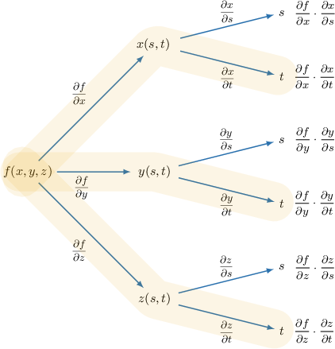
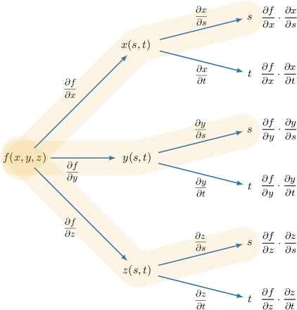

# Original and generated review

Original raw evidence is printed below in full; generated examples are explicitly labeled method-bank variants. Two variants appear for each observed family and two for authored easy. All three levels are covered.

## Original q-94589 (hard)
Let $f(x,y,z)={x}^{2}+2xy-3{z}^{2},$ where $x=st,$ $y=s+3t,$ and $z=2s-t.$ Given that

$$
\frac{∂f}{∂t}=2({s}^{2}t+{s}^{2}+{c}_{1}st+{c}_{2}s+{c}_{3}t),
$$

find the value of ${c}_{1}+{c}_{2}+{c}_{3}.$

Captured field 0: $3$, $6$, $-3$, $-6$, $9$; correct=ABSENT
Captured field 1: $9$, $3$, $6$, $-3$, $-6$; correct=9

The chain rule for a multivariable function $f(x,y,z)$ with two independent variables $s$ and $t,$ where $x=x(s,t),y=y(s,t)$ and $z=z(s,t),$ can be expressed as follows:

$$
\frac{∂f}{∂t}=\frac{∂f}{∂x}\cdot \frac{∂x}{∂t}+\frac{∂f}{∂y}\cdot \frac{∂y}{∂t}+\frac{∂f}{∂z}\cdot \frac{∂z}{∂t}.
$$

First, we find the partial derivatives of $f$ with respect to $x,y$ and $z:$ 

$$
\begin{aligned}\frac{∂f}{∂x}=2x+2y,\,\frac{∂f}{∂y}=2x,\,\frac{∂f}{∂z}=-6z.\end{aligned}
$$

Writing the above results in terms of $s$ and $t,$ we get

$$
\begin{aligned}\frac{∂f}{∂x} & =2(st)+2(s+3t)=2st+2s+6t \\ \frac{∂f}{∂y} & =2st \\ \frac{∂f}{∂z} & =-6(2s-t)=6t-12s\end{aligned}
$$

Next, we take the derivatives of $x,$ $y,$ and $z$ with respect to $t,$ and we get

$$
\begin{aligned}\frac{∂x}{∂t} & =s \\ \frac{∂y}{∂t} & =3 \\ \frac{∂z}{∂t} & =-1.\end{aligned}
$$

Substituting all of our derivatives into the multivariable chain rule, we get

$$
\begin{aligned}\frac{∂f}{∂t} & =(2st+2s+6t)\cdot s+(2st)\cdot 3+(6t-12s)\cdot (-1) \\  & =2{s}^{2}t+2{s}^{2}+6st+6st-6t+12s \\  & =2{s}^{2}t+2{s}^{2}+12st+12s-6t \\  & =2({s}^{2}t+{s}^{2}+6st+6s-3t)\end{aligned}
$$

Finally, ${c}_{1}={c}_{2}=6,{c}_{3}=-3,$ and therefore

$$
{c}_{1}+{c}_{2}+{c}_{3}=6+6-3=9.
$$

### Generated method method-bank q-94589, {'a': 4, 'b': 4}
Let $f(x,y,z)=x^{2} - 4 z^{2} + 8 x y,$ where $x=st,$ $y=s+3t,$ and $z=2s-t.$ Given that

$$
\frac{∂f}{∂t}=8 s^{2} + 2 c_{2} s + 2 c_{3} t + 2 t s^{2} + 2 c_{1} s t,
$$

find the value of ${c}_{1}+{c}_{2}+{c}_{3}.$

- $-28$

- $24$

- $20$

- $-4$

- $28$

The chain rule for a multivariable function $f(x,y,z)$ with two independent variables $s$ and $t,$ where $x=x(s,t),y=y(s,t)$ and $z=z(s,t),$ can be expressed as follows:

$$
\frac{∂f}{∂t}=\frac{∂f}{∂x}\cdot \frac{∂x}{∂t}+\frac{∂f}{∂y}\cdot \frac{∂y}{∂t}+\frac{∂f}{∂z}\cdot \frac{∂z}{∂t}.
$$

First, we find the partial derivatives of $f$ with respect to $x,y$ and $z:$ 

$$
\begin{aligned}\frac{∂f}{∂x}=2 x + 8 y,\,\frac{∂f}{∂y}=8 x,\,\frac{∂f}{∂z}=- 8 z.\end{aligned}
$$

Writing the above results in terms of $s$ and $t,$ we get

$$
\begin{aligned}\frac{∂f}{∂x} & =2 s t + 8 (s + 3 t)=8 s + 24 t + 2 s t \\ \frac{∂f}{∂y} & =8 s t \\ \frac{∂f}{∂z} & =- 8 (- t + 2 s)=- 16 s + 8 t\end{aligned}
$$

Next, we take the derivatives of $x,$ $y,$ and $z$ with respect to $t,$ and we get

$$
\begin{aligned}\frac{∂x}{∂t} & =s \\ \frac{∂y}{∂t} & =3 \\ \frac{∂z}{∂t} & =-1.\end{aligned}
$$

Substituting all of our derivatives into the multivariable chain rule, we get

$$
\begin{aligned}\frac{∂f}{∂t} & =(8 s + 24 t + 2 s t)\cdot (s)+(8 s t)\cdot (3)+(- 16 s + 8 t)\cdot (-1) \\  & =8 s^{2} + 2 t s^{2} + 24 s t + 24 s t - 8 t + 16 s \\  & =- 8 t + 8 s^{2} + 16 s + 2 t s^{2} + 48 s t \\  & =2 (- 4 t + 4 s^{2} + 8 s + t s^{2} + 24 s t)\end{aligned}
$$

Finally, $c_{1}=24, c_{2}=8, c_{3}=-4,$ and therefore

$$
{c}_{1}+{c}_{2}+{c}_{3}=24 + 8 - 4=28.
$$

### Generated method method-bank q-94589, {'a': 2, 'b': 5}
Let $f(x,y,z)=x^{2} - 5 z^{2} + 4 x y,$ where $x=st,$ $y=s+3t,$ and $z=2s-t.$ Given that

$$
\frac{∂f}{∂t}=4 s^{2} + 2 c_{2} s + 2 c_{3} t + 2 t s^{2} + 2 c_{1} s t,
$$

find the value of ${c}_{1}+{c}_{2}+{c}_{3}.$

- $7$

- $12$

- $-17$

- $-5$

- $17$

The chain rule for a multivariable function $f(x,y,z)$ with two independent variables $s$ and $t,$ where $x=x(s,t),y=y(s,t)$ and $z=z(s,t),$ can be expressed as follows:

$$
\frac{∂f}{∂t}=\frac{∂f}{∂x}\cdot \frac{∂x}{∂t}+\frac{∂f}{∂y}\cdot \frac{∂y}{∂t}+\frac{∂f}{∂z}\cdot \frac{∂z}{∂t}.
$$

First, we find the partial derivatives of $f$ with respect to $x,y$ and $z:$ 

$$
\begin{aligned}\frac{∂f}{∂x}=2 x + 4 y,\,\frac{∂f}{∂y}=4 x,\,\frac{∂f}{∂z}=- 10 z.\end{aligned}
$$

Writing the above results in terms of $s$ and $t,$ we get

$$
\begin{aligned}\frac{∂f}{∂x} & =2 s t + 4 (s + 3 t)=4 s + 12 t + 2 s t \\ \frac{∂f}{∂y} & =4 s t \\ \frac{∂f}{∂z} & =- 10 (- t + 2 s)=- 20 s + 10 t\end{aligned}
$$

Next, we take the derivatives of $x,$ $y,$ and $z$ with respect to $t,$ and we get

$$
\begin{aligned}\frac{∂x}{∂t} & =s \\ \frac{∂y}{∂t} & =3 \\ \frac{∂z}{∂t} & =-1.\end{aligned}
$$

Substituting all of our derivatives into the multivariable chain rule, we get

$$
\begin{aligned}\frac{∂f}{∂t} & =(4 s + 12 t + 2 s t)\cdot (s)+(4 s t)\cdot (3)+(- 20 s + 10 t)\cdot (-1) \\  & =4 s^{2} + 2 t s^{2} + 12 s t + 12 s t - 10 t + 20 s \\  & =- 10 t + 4 s^{2} + 20 s + 2 t s^{2} + 24 s t \\  & =2 (- 5 t + 2 s^{2} + 10 s + t s^{2} + 12 s t)\end{aligned}
$$

Finally, $c_{1}=12, c_{2}=10, c_{3}=-5,$ and therefore

$$
{c}_{1}+{c}_{2}+{c}_{3}=12 + 10 - 5=17.
$$

### Generated observed EVIDENCE-ONLY q-94589, {'a': 4, 'b': 4}
Let $f(x,y,z)=x^{2} - 4 z^{2} + 8 x y,$ where $x=st,$ $y=s+3t,$ and $z=2s-t.$ Given that

$$
\frac{∂f}{∂t}=8 s^{2} + 2 c_{2} s + 2 c_{3} t + 2 t s^{2} + 2 c_{1} s t,
$$

find the value of ${c}_{1}+{c}_{2}+{c}_{3}.$

- $13$

- $16$

- $22$

- $28$

- $25$

- $16$

- $25$

- $13$

- $28$

- $22$

The chain rule for a multivariable function $f(x,y,z)$ with two independent variables $s$ and $t,$ where $x=x(s,t),y=y(s,t)$ and $z=z(s,t),$ can be expressed as follows:

$$
\frac{∂f}{∂t}=\frac{∂f}{∂x}\cdot \frac{∂x}{∂t}+\frac{∂f}{∂y}\cdot \frac{∂y}{∂t}+\frac{∂f}{∂z}\cdot \frac{∂z}{∂t}.
$$

First, we find the partial derivatives of $f$ with respect to $x,y$ and $z:$ 

$$
\begin{aligned}\frac{∂f}{∂x}=2 x + 8 y,\,\frac{∂f}{∂y}=8 x,\,\frac{∂f}{∂z}=- 8 z.\end{aligned}
$$

Writing the above results in terms of $s$ and $t,$ we get

$$
\begin{aligned}\frac{∂f}{∂x} & =2 s t + 8 (s + 3 t)=8 s + 24 t + 2 s t \\ \frac{∂f}{∂y} & =8 s t \\ \frac{∂f}{∂z} & =- 8 (- t + 2 s)=- 16 s + 8 t\end{aligned}
$$

Next, we take the derivatives of $x,$ $y,$ and $z$ with respect to $t,$ and we get

$$
\begin{aligned}\frac{∂x}{∂t} & =s \\ \frac{∂y}{∂t} & =3 \\ \frac{∂z}{∂t} & =-1.\end{aligned}
$$

Substituting all of our derivatives into the multivariable chain rule, we get

$$
\begin{aligned}\frac{∂f}{∂t} & =(8 s + 24 t + 2 s t)\cdot (s)+(8 s t)\cdot (3)+(- 16 s + 8 t)\cdot (-1) \\  & =8 s^{2} + 2 t s^{2} + 24 s t + 24 s t - 8 t + 16 s \\  & =- 8 t + 8 s^{2} + 16 s + 2 t s^{2} + 48 s t \\  & =2 (- 4 t + 4 s^{2} + 8 s + t s^{2} + 24 s t)\end{aligned}
$$

Finally, $c_{1}=24, c_{2}=8, c_{3}=-4,$ and therefore

$$
{c}_{1}+{c}_{2}+{c}_{3}=24 + 8 - 4=28.
$$

### Generated observed-repaired EVIDENCE-ONLY q-94589, {'a': 1, 'b': 3}
Let $f(x,y,z)={x}^{2}+2xy-3{z}^{2},$ where $x=st,$ $y=s+3t,$ and $z=2s-t.$ Given that

$$
\frac{∂f}{∂t}=2({s}^{2}t+{s}^{2}+{c}_{1}st+{c}_{2}s+{c}_{3}t),
$$

find the value of ${c}_{1}+{c}_{2}+{c}_{3}.$

- $6$

- $3$

- $9$

- $-6$

- $-3$

The chain rule for a multivariable function $f(x,y,z)$ with two independent variables $s$ and $t,$ where $x=x(s,t),y=y(s,t)$ and $z=z(s,t),$ can be expressed as follows:

$$
\frac{∂f}{∂t}=\frac{∂f}{∂x}\cdot \frac{∂x}{∂t}+\frac{∂f}{∂y}\cdot \frac{∂y}{∂t}+\frac{∂f}{∂z}\cdot \frac{∂z}{∂t}.
$$

First, we find the partial derivatives of $f$ with respect to $x,y$ and $z:$ 

$$
\begin{aligned}\frac{∂f}{∂x}=2x+2y,\,\frac{∂f}{∂y}=2x,\,\frac{∂f}{∂z}=-6z.\end{aligned}
$$

Writing the above results in terms of $s$ and $t,$ we get

$$
\begin{aligned}\frac{∂f}{∂x} & =2(st)+2(s+3t)=2st+2s+6t \\ \frac{∂f}{∂y} & =2st \\ \frac{∂f}{∂z} & =-6(2s-t)=6t-12s\end{aligned}
$$

Next, we take the derivatives of $x,$ $y,$ and $z$ with respect to $t,$ and we get

$$
\begin{aligned}\frac{∂x}{∂t} & =s \\ \frac{∂y}{∂t} & =3 \\ \frac{∂z}{∂t} & =-1.\end{aligned}
$$

Substituting all of our derivatives into the multivariable chain rule, we get

$$
\begin{aligned}\frac{∂f}{∂t} & =(2st+2s+6t)\cdot s+(2st)\cdot 3+(6t-12s)\cdot (-1) \\  & =2{s}^{2}t+2{s}^{2}+6st+6st-6t+12s \\  & =2{s}^{2}t+2{s}^{2}+12st+12s-6t \\  & =2({s}^{2}t+{s}^{2}+6st+6s-3t)\end{aligned}
$$

Finally, ${c}_{1}={c}_{2}=6,{c}_{3}=-3,$ and therefore

$$
{c}_{1}+{c}_{2}+{c}_{3}=6+6-3=9.
$$

## Original q-94814 (moderate)
Let $f(x,y,z)=4x+3y-2z,$ where $x=2{s}^{2}-t,$ $y=s+3{t}^{2}$ and $z=4{s}^{2}+{t}^{2}.$ Calculate $\frac{∂f}{∂s}.$

Captured field 0: $3-8s$, $t+4s-1$, $0$, $2t-3s$, $3$; correct=3

The chain rule for a multivariable function $f(x,y,z)$ with two independent variables $s$ and $t,$ where $x=x(s,t),y=y(s,t)$ and $z=z(s,t),$ can be expressed as follows:

$$
\frac{∂f}{∂s}=\frac{∂f}{∂x}\cdot \frac{∂x}{∂s}+\frac{∂f}{∂y}\cdot \frac{∂y}{∂s}+\frac{∂f}{∂z}\cdot \frac{∂z}{∂s}
$$

First, we find the partial derivatives of $f$ with respect to $x,y$ and $z:$ 

$$
\begin{aligned}\frac{∂f}{∂x}=4,\,\frac{∂f}{∂y}=3,\,\frac{∂f}{∂z}=-2.\end{aligned}
$$

Next, we take the derivatives of $x,$ $y,$ and $z$ with respect to $s,$ and we get

$$
\begin{aligned}\frac{∂x}{∂s} & =4s, \\ \frac{∂y}{∂s} & =1, \\ \frac{∂z}{∂s} & =8s.\end{aligned}
$$

Substituting all of our derivatives into the multivariable chain rule, we get

$$
\begin{aligned}\frac{∂f}{∂s} & =(4)\cdot 4s+(3)\cdot 1+(-2)\cdot 8s \\  & =16s+3-16s \\  & =3.\end{aligned}
$$

### Generated method method-bank q-94814, {'a': 4, 'b': 4}
Let $f(x,y,z)=(-4)\cdot (z)+(3)\cdot (y)+(4)\cdot (x),$ where $x=2{s}^{2}-t,$ $y=s+3{t}^{2}$ and $z=4{s}^{2}+{t}^{2}.$ Calculate $\frac{∂f}{∂s}.$

- $3$

- $3 - 32 s$

- $-4 + 10 t$

- $- 16 s$

- $3 - 16 s$

The chain rule for a multivariable function $f(x,y,z)$ with two independent variables $s$ and $t,$ where $x=x(s,t),y=y(s,t)$ and $z=z(s,t),$ can be expressed as follows:

$$
\frac{∂f}{∂s}=\frac{∂f}{∂x}\cdot \frac{∂x}{∂s}+\frac{∂f}{∂y}\cdot \frac{∂y}{∂s}+\frac{∂f}{∂z}\cdot \frac{∂z}{∂s}
$$

First, we find the partial derivatives of $f$ with respect to $x,y$ and $z:$ 

$$
\begin{aligned}\frac{∂f}{∂x}=4,\,\frac{∂f}{∂y}=3,\,\frac{∂f}{∂z}=-4.\end{aligned}
$$

Next, we take the derivatives of $x,$ $y,$ and $z$ with respect to $s,$ and we get

$$
\begin{aligned}\frac{∂x}{∂s} & =4s, \\ \frac{∂y}{∂s} & =1, \\ \frac{∂z}{∂s} & =8s.\end{aligned}
$$

Substituting all of our derivatives into the multivariable chain rule, we get

$$
\begin{aligned}\frac{∂f}{∂s} & =(4)\cdot (4 s)+(3)\cdot (1)+(-4)\cdot (8 s) \\  & =16 s + 3 - 32 s \\  & =3 - 16 s.\end{aligned}
$$

### Generated method method-bank q-94814, {'a': 2, 'b': 5}
Let $f(x,y,z)=(-5)\cdot (z)+(2)\cdot (x)+(3)\cdot (y),$ where $x=2{s}^{2}-t,$ $y=s+3{t}^{2}$ and $z=4{s}^{2}+{t}^{2}.$ Calculate $\frac{∂f}{∂s}.$

- $-2 + 8 t$

- $3 - 40 s$

- $3 - 24 s$

- $- 32 s$

- $3 - 32 s$

The chain rule for a multivariable function $f(x,y,z)$ with two independent variables $s$ and $t,$ where $x=x(s,t),y=y(s,t)$ and $z=z(s,t),$ can be expressed as follows:

$$
\frac{∂f}{∂s}=\frac{∂f}{∂x}\cdot \frac{∂x}{∂s}+\frac{∂f}{∂y}\cdot \frac{∂y}{∂s}+\frac{∂f}{∂z}\cdot \frac{∂z}{∂s}
$$

First, we find the partial derivatives of $f$ with respect to $x,y$ and $z:$ 

$$
\begin{aligned}\frac{∂f}{∂x}=2,\,\frac{∂f}{∂y}=3,\,\frac{∂f}{∂z}=-5.\end{aligned}
$$

Next, we take the derivatives of $x,$ $y,$ and $z$ with respect to $s,$ and we get

$$
\begin{aligned}\frac{∂x}{∂s} & =4s, \\ \frac{∂y}{∂s} & =1, \\ \frac{∂z}{∂s} & =8s.\end{aligned}
$$

Substituting all of our derivatives into the multivariable chain rule, we get

$$
\begin{aligned}\frac{∂f}{∂s} & =(2)\cdot (4 s)+(3)\cdot (1)+(-5)\cdot (8 s) \\  & =8 s + 3 - 40 s \\  & =3 - 32 s.\end{aligned}
$$

### Generated observed EVIDENCE-ONLY q-94814, {'a': 4, 'b': 4}
Let $f(x,y,z)=(-4)\cdot (z)+(3)\cdot (y)+(4)\cdot (x),$ where $x=2{s}^{2}-t,$ $y=s+3{t}^{2}$ and $z=4{s}^{2}+{t}^{2}.$ Calculate $\frac{∂f}{∂s}.$

- $- 19 s + 2 t$

- $- 16 s$

- $3 - 24 s$

- $3 - 16 s$

- $-1 + t - 12 s$

The chain rule for a multivariable function $f(x,y,z)$ with two independent variables $s$ and $t,$ where $x=x(s,t),y=y(s,t)$ and $z=z(s,t),$ can be expressed as follows:

$$
\frac{∂f}{∂s}=\frac{∂f}{∂x}\cdot \frac{∂x}{∂s}+\frac{∂f}{∂y}\cdot \frac{∂y}{∂s}+\frac{∂f}{∂z}\cdot \frac{∂z}{∂s}
$$

First, we find the partial derivatives of $f$ with respect to $x,y$ and $z:$ 

$$
\begin{aligned}\frac{∂f}{∂x}=4,\,\frac{∂f}{∂y}=3,\,\frac{∂f}{∂z}=-4.\end{aligned}
$$

Next, we take the derivatives of $x,$ $y,$ and $z$ with respect to $s,$ and we get

$$
\begin{aligned}\frac{∂x}{∂s} & =4s, \\ \frac{∂y}{∂s} & =1, \\ \frac{∂z}{∂s} & =8s.\end{aligned}
$$

Substituting all of our derivatives into the multivariable chain rule, we get

$$
\begin{aligned}\frac{∂f}{∂s} & =(4)\cdot (4 s)+(3)\cdot (1)+(-4)\cdot (8 s) \\  & =16 s + 3 - 32 s \\  & =3 - 16 s.\end{aligned}
$$

## Original q-170675 (hard)
Let $f(x,y,z)=\frac{y+z}{x},$ where $x=s+t,$ $y={s}^{2}$ and $z={t}^{2}.$ Given that

$$
\frac{∂f}{∂t}=\frac{{c}_{1}{s}^{2}+{c}_{2}st+{c}_{3}{t}^{2}}{(s+t)^{2}},
$$

find the value of ${c}_{1}+{c}_{2}+{c}_{3}.$

Captured field 0: $-2$, $2$, $1$, $0$, $4$; correct=2

The chain rule for a multivariable function $f(x,y,z)$ with two independent variables $s$ and $t,$ where $x=x(s,t),y=y(s,t)$ and $z=z(s,t),$ can be expressed as follows:

$$
\frac{∂f}{∂t}=\frac{∂f}{∂x}\cdot \frac{∂x}{∂t}+\frac{∂f}{∂y}\cdot \frac{∂y}{∂t}+\frac{∂f}{∂z}\cdot \frac{∂z}{∂t}
$$

First, we find the partial derivatives of $f$ with respect to $x,y$ and $z:$ 

$$
\begin{aligned}\frac{∂f}{∂x}=-\frac{y+z}{{x}^{2}},\,\frac{∂f}{∂y}=\frac{1}{x},\,\frac{∂f}{∂z}=\frac{1}{x}.\end{aligned}
$$

Writing the above results in terms of $s$ and $t,$ we get

$$
\begin{aligned}\frac{∂f}{∂x} & =-\frac{{s}^{2}+{t}^{2}}{(s+t)^{2}}, \\ \frac{∂f}{∂y} & =\frac{1}{s+t}, \\ \frac{∂f}{∂z} & =\frac{1}{s+t}.\end{aligned}
$$

Next, we take the derivatives of $x,$ $y,$ and $z$ with respect to $t,$ and we get

$$
\begin{aligned}\frac{∂x}{∂t} & =1, \\ \frac{∂y}{∂t} & =0, \\ \frac{∂z}{∂t} & =2t.\end{aligned}
$$

Substituting all of our derivatives into the multivariable chain rule, we get

$$
\begin{aligned}\frac{∂f}{∂t} & =-\frac{{s}^{2}+{t}^{2}}{(s+t)^{2}}\cdot (1)+\frac{1}{s+t}\cdot 0+\frac{1}{s+t}\cdot 2t \\  & =\frac{-({s}^{2}+{t}^{2})+2t(s+t)}{(s+t)^{2}} \\  & =\frac{{t}^{2}+2ts-{s}^{2}}{(s+t)^{2}}.\end{aligned}
$$

Finally, ${c}_{1}=-1,$ ${c}_{2}=2$ and ${c}_{3}=1,$ and therefore

$$
{c}_{1}+{c}_{2}+{c}_{3}=-1+2+1=2.
$$

### Generated method method-bank q-170675, {'a': 4, 'b': 4}
Let $f(x,y,z)=\frac{4 y + 4 z}{x},$ where $x=s+t,$ $y={s}^{2}$ and $z={t}^{2}.$ Given that

$$
\frac{∂f}{∂t}=\frac{{c}_{1}{s}^{2}+{c}_{2}st+{c}_{3}{t}^{2}}{(s+t)^{2}},
$$

find the value of ${c}_{1}+{c}_{2}+{c}_{3}.$

- $16$

- $-8$

- $0$

- $-4$

- $8$

The chain rule for a multivariable function $f(x,y,z)$ with two independent variables $s$ and $t,$ where $x=x(s,t),y=y(s,t)$ and $z=z(s,t),$ can be expressed as follows:

$$
\frac{∂f}{∂t}=\frac{∂f}{∂x}\cdot \frac{∂x}{∂t}+\frac{∂f}{∂y}\cdot \frac{∂y}{∂t}+\frac{∂f}{∂z}\cdot \frac{∂z}{∂t}
$$

First, we find the partial derivatives of $f$ with respect to $x,y$ and $z:$ 

$$
\begin{aligned}\frac{∂f}{∂x}=- \frac{4 y + 4 z}{x^{2}},\,\frac{∂f}{∂y}=\frac{4}{x},\,\frac{∂f}{∂z}=\frac{4}{x}.\end{aligned}
$$

Writing the above results in terms of $s$ and $t,$ we get

$$
\begin{aligned}\frac{∂f}{∂x} & =- \frac{4 s^{2} + 4 t^{2}}{(s + t)^{2}}, \\ \frac{∂f}{∂y} & =\frac{4}{s + t}, \\ \frac{∂f}{∂z} & =\frac{4}{s + t}.\end{aligned}
$$

Next, we take the derivatives of $x,$ $y,$ and $z$ with respect to $t,$ and we get

$$
\begin{aligned}\frac{∂x}{∂t} & =1, \\ \frac{∂y}{∂t} & =0, \\ \frac{∂z}{∂t} & =2t.\end{aligned}
$$

Substituting all of our derivatives into the multivariable chain rule, we get

$$
\begin{aligned}\frac{∂f}{∂t} & =(- \frac{4 s^{2}}{s^{2} + t^{2} + 2 s t} - \frac{4 t^{2}}{s^{2} + t^{2} + 2 s t})\cdot (1)+(\frac{4}{s + t})\cdot (0)+(\frac{4}{s + t})\cdot (2 t) \\  & =- \frac{4 s^{2}}{s^{2} + t^{2} + 2 s t} - \frac{4 t^{2}}{s^{2} + t^{2} + 2 s t} + 0 + \frac{8 t}{s + t} \\  & =\frac{4 (t^{2} - s^{2} + 2 s t)}{s^{2} + t^{2} + 2 s t}.\end{aligned}
$$

Finally, $c_{1}=-4, c_{2}=8, c_{3}=4,$ and therefore

$$
{c}_{1}+{c}_{2}+{c}_{3}=-4 + 8 + 4=8.
$$

### Generated method method-bank q-170675, {'a': 2, 'b': 5}
Let $f(x,y,z)=\frac{2 y + 5 z}{x},$ where $x=s+t,$ $y={s}^{2}$ and $z={t}^{2}.$ Given that

$$
\frac{∂f}{∂t}=\frac{{c}_{1}{s}^{2}+{c}_{2}st+{c}_{3}{t}^{2}}{(s+t)^{2}},
$$

find the value of ${c}_{1}+{c}_{2}+{c}_{3}.$

- $3$

- $-13$

- $17$

- $-2$

- $13$

The chain rule for a multivariable function $f(x,y,z)$ with two independent variables $s$ and $t,$ where $x=x(s,t),y=y(s,t)$ and $z=z(s,t),$ can be expressed as follows:

$$
\frac{∂f}{∂t}=\frac{∂f}{∂x}\cdot \frac{∂x}{∂t}+\frac{∂f}{∂y}\cdot \frac{∂y}{∂t}+\frac{∂f}{∂z}\cdot \frac{∂z}{∂t}
$$

First, we find the partial derivatives of $f$ with respect to $x,y$ and $z:$ 

$$
\begin{aligned}\frac{∂f}{∂x}=- \frac{2 y + 5 z}{x^{2}},\,\frac{∂f}{∂y}=\frac{2}{x},\,\frac{∂f}{∂z}=\frac{5}{x}.\end{aligned}
$$

Writing the above results in terms of $s$ and $t,$ we get

$$
\begin{aligned}\frac{∂f}{∂x} & =- \frac{2 s^{2} + 5 t^{2}}{(s + t)^{2}}, \\ \frac{∂f}{∂y} & =\frac{2}{s + t}, \\ \frac{∂f}{∂z} & =\frac{5}{s + t}.\end{aligned}
$$

Next, we take the derivatives of $x,$ $y,$ and $z$ with respect to $t,$ and we get

$$
\begin{aligned}\frac{∂x}{∂t} & =1, \\ \frac{∂y}{∂t} & =0, \\ \frac{∂z}{∂t} & =2t.\end{aligned}
$$

Substituting all of our derivatives into the multivariable chain rule, we get

$$
\begin{aligned}\frac{∂f}{∂t} & =(- \frac{5 t^{2}}{s^{2} + t^{2} + 2 s t} - \frac{2 s^{2}}{s^{2} + t^{2} + 2 s t})\cdot (1)+(\frac{2}{s + t})\cdot (0)+(\frac{5}{s + t})\cdot (2 t) \\  & =- \frac{5 t^{2}}{s^{2} + t^{2} + 2 s t} - \frac{2 s^{2}}{s^{2} + t^{2} + 2 s t} + 0 + \frac{10 t}{s + t} \\  & =\frac{- 2 s^{2} + 5 t^{2} + 10 s t}{s^{2} + t^{2} + 2 s t}.\end{aligned}
$$

Finally, $c_{1}=-2, c_{2}=10, c_{3}=5,$ and therefore

$$
{c}_{1}+{c}_{2}+{c}_{3}=-2 + 10 + 5=13.
$$

### Generated observed EVIDENCE-ONLY q-170675, {'a': 4, 'b': 4}
Let $f(x,y,z)=\frac{4 y + 4 z}{x},$ where $x=s+t,$ $y={s}^{2}$ and $z={t}^{2}.$ Given that

$$
\frac{∂f}{∂t}=\frac{{c}_{1}{s}^{2}+{c}_{2}st+{c}_{3}{t}^{2}}{(s+t)^{2}},
$$

find the value of ${c}_{1}+{c}_{2}+{c}_{3}.$

- $6$

- $7$

- $4$

- $10$

- $8$

The chain rule for a multivariable function $f(x,y,z)$ with two independent variables $s$ and $t,$ where $x=x(s,t),y=y(s,t)$ and $z=z(s,t),$ can be expressed as follows:

$$
\frac{∂f}{∂t}=\frac{∂f}{∂x}\cdot \frac{∂x}{∂t}+\frac{∂f}{∂y}\cdot \frac{∂y}{∂t}+\frac{∂f}{∂z}\cdot \frac{∂z}{∂t}
$$

First, we find the partial derivatives of $f$ with respect to $x,y$ and $z:$ 

$$
\begin{aligned}\frac{∂f}{∂x}=- \frac{4 y + 4 z}{x^{2}},\,\frac{∂f}{∂y}=\frac{4}{x},\,\frac{∂f}{∂z}=\frac{4}{x}.\end{aligned}
$$

Writing the above results in terms of $s$ and $t,$ we get

$$
\begin{aligned}\frac{∂f}{∂x} & =- \frac{4 s^{2} + 4 t^{2}}{(s + t)^{2}}, \\ \frac{∂f}{∂y} & =\frac{4}{s + t}, \\ \frac{∂f}{∂z} & =\frac{4}{s + t}.\end{aligned}
$$

Next, we take the derivatives of $x,$ $y,$ and $z$ with respect to $t,$ and we get

$$
\begin{aligned}\frac{∂x}{∂t} & =1, \\ \frac{∂y}{∂t} & =0, \\ \frac{∂z}{∂t} & =2t.\end{aligned}
$$

Substituting all of our derivatives into the multivariable chain rule, we get

$$
\begin{aligned}\frac{∂f}{∂t} & =(- \frac{4 s^{2}}{s^{2} + t^{2} + 2 s t} - \frac{4 t^{2}}{s^{2} + t^{2} + 2 s t})\cdot (1)+(\frac{4}{s + t})\cdot (0)+(\frac{4}{s + t})\cdot (2 t) \\  & =- \frac{4 s^{2}}{s^{2} + t^{2} + 2 s t} - \frac{4 t^{2}}{s^{2} + t^{2} + 2 s t} + 0 + \frac{8 t}{s + t} \\  & =\frac{4 (t^{2} - s^{2} + 2 s t)}{s^{2} + t^{2} + 2 s t}.\end{aligned}
$$

Finally, $c_{1}=-4, c_{2}=8, c_{3}=4,$ and therefore

$$
{c}_{1}+{c}_{2}+{c}_{3}=-4 + 8 + 4=8.
$$

## Original q-37132 (hard)
Let $f(x,y,z)={x}^{2}y-5yz,$ where $x=st,$ $y={s}^{3}$ and $z=s\operatorname{sin}⁡t.$ Calculate $\frac{∂f}{∂s}.$

Captured field 0: $3{s}^{4}{t}^{2}+10{s}^{3}\operatorname{sin}⁡t$, $2{s}^{2}{t}^{4}-20s\operatorname{sin}⁡t$, $5{s}^{4}t-5{s}^{3}\operatorname{sin}⁡t$, $5{s}^{4}{t}^{2}-20{s}^{3}\operatorname{sin}⁡t$, $5{s}^{2}{t}^{4}-15s\operatorname{sin}⁡t-5\operatorname{sin}⁡t$; correct=5{s}^{4}{t}^{2}-20{s}^{3}\operatorname{sin}⁡t

The chain rule for a multivariable function $f(x,y,z)$ with two independent variables $s$ and $t,$ where $x=x(s,t),y=y(s,t)$ and $z=z(s,t),$ can be expressed as follows:

$$
\frac{∂f}{∂s}=\frac{∂f}{∂x}\cdot \frac{∂x}{∂s}+\frac{∂f}{∂y}\cdot \frac{∂y}{∂s}+\frac{∂f}{∂z}\cdot \frac{∂z}{∂s}
$$

First, we find the partial derivatives of $f$ with respect to $x,y$ and $z:$ 

$$
\begin{aligned}\frac{∂f}{∂x}=2xy,\,\frac{∂f}{∂y}={x}^{2}-5z,\,\frac{∂f}{∂z}=-5y.\end{aligned}
$$

Writing the above results in terms of $s$ and $t,$ we get

$$
\begin{aligned}\frac{∂f}{∂x} & =2(st)({s}^{3})=2{s}^{4}t, \\ \frac{∂f}{∂y} & =(st)^{2}-5(s\operatorname{sin}⁡t)={s}^{2}{t}^{2}-5s\operatorname{sin}⁡t, \\ \frac{∂f}{∂z} & =-5{s}^{3}.\end{aligned}
$$

Next, we take the derivatives of $x,$ $y,$ and $z$ with respect to $s,$ and we get

$$
\begin{aligned}\frac{∂x}{∂s} & =t, \\ \frac{∂y}{∂s} & =3{s}^{2}, \\ \frac{∂z}{∂s} & =\operatorname{sin}⁡t.\end{aligned}
$$

Substituting all of our derivatives into the multivariable chain rule, we get

$$
\begin{aligned}\frac{∂f}{∂s} & =(2{s}^{4}t)\cdot t+({s}^{2}{t}^{2}-5s\operatorname{sin}⁡t)\cdot 3{s}^{2}+(-5{s}^{3})\cdot \operatorname{sin}⁡t \\  & =2{s}^{4}{t}^{2}+3{s}^{4}{t}^{2}-15{s}^{3}\operatorname{sin}⁡t-5{s}^{3}\operatorname{sin}⁡t \\  & =5{s}^{4}{t}^{2}-20{s}^{3}\operatorname{sin}⁡t.\end{aligned}
$$

### Generated method method-bank q-37132, {'a': 5, 'b': 4}
Let $f(x,y,z)=y x^{2} - 4 y z,$ where $x=st,$ $y=s^{5}$ and $z=s\operatorname{sin}⁡t.$ Calculate $\frac{∂f}{∂s}.$

- $s^{5} (- 24 \sin{(t )} + 9 s t^{2})$

- $s^{5} (- 24 \sin{(t )} + 5 s t^{2})$

- $- 4 s^{6} \cos{(t )} + 2 t s^{7}$

- $2 s^{5} (- 2 \sin{(t )} + s t^{2})$

- $s^{5} (- 24 \sin{(t )} + 7 s t^{2})$

The chain rule for a multivariable function $f(x,y,z)$ with two independent variables $s$ and $t,$ where $x=x(s,t),y=y(s,t)$ and $z=z(s,t),$ can be expressed as follows:

$$
\frac{∂f}{∂s}=\frac{∂f}{∂x}\cdot \frac{∂x}{∂s}+\frac{∂f}{∂y}\cdot \frac{∂y}{∂s}+\frac{∂f}{∂z}\cdot \frac{∂z}{∂s}
$$

First, we find the partial derivatives of $f$ with respect to $x,y$ and $z:$ 

$$
\begin{aligned}\frac{∂f}{∂x}=2xy,\,\frac{∂f}{∂y}=x^{2} - 4 z,\,\frac{∂f}{∂z}=- 4 y.\end{aligned}
$$

Writing the above results in terms of $s$ and $t,$ we get

$$
\begin{aligned}\frac{∂f}{∂x} & =2 s t s^{5}=2 t s^{6}, \\ \frac{∂f}{∂y} & =(s t)^{2} - 4 s \sin{(t )}=s^{2} t^{2} - 4 s \sin{(t )}, \\ \frac{∂f}{∂z} & =- 4 s^{5}.\end{aligned}
$$

Next, we take the derivatives of $x,$ $y,$ and $z$ with respect to $s,$ and we get

$$
\begin{aligned}\frac{∂x}{∂s} & =t, \\ \frac{∂y}{∂s} & =5 s^{4}, \\ \frac{∂z}{∂s} & =\operatorname{sin}⁡t.\end{aligned}
$$

Substituting all of our derivatives into the multivariable chain rule, we get

$$
\begin{aligned}\frac{∂f}{∂s} & =(2 t s^{6})\cdot (t)+(s^{2} t^{2} - 4 s \sin{(t )})\cdot (5 s^{4})+(- 4 s^{5})\cdot (\sin{(t )}) \\  & =2 s^{6} t^{2} - 20 s^{5} \sin{(t )} + 5 s^{6} t^{2} - 4 s^{5} \sin{(t )} \\  & =s^{5} (- 24 \sin{(t )} + 7 s t^{2}).\end{aligned}
$$

### Generated method method-bank q-37132, {'a': 3, 'b': 5}
Let $f(x,y,z)={x}^{2}y-5yz,$ where $x=st,$ $y={s}^{3}$ and $z=s\operatorname{sin}⁡t.$ Calculate $\frac{∂f}{∂s}.$

- $- 5 s^{4} \cos{(t )} + 2 t s^{5}$

- $s^{3} (- 20 \sin{(t )} + 3 s t^{2})$

- $s^{3} (- 20 \sin{(t )} + 7 s t^{2})$

- $s^{3} (- 5 \sin{(t )} + 2 s t^{2})$

- $5 s^{3} (- 4 \sin{(t )} + s t^{2})$

The chain rule for a multivariable function $f(x,y,z)$ with two independent variables $s$ and $t,$ where $x=x(s,t),y=y(s,t)$ and $z=z(s,t),$ can be expressed as follows:

$$
\frac{∂f}{∂s}=\frac{∂f}{∂x}\cdot \frac{∂x}{∂s}+\frac{∂f}{∂y}\cdot \frac{∂y}{∂s}+\frac{∂f}{∂z}\cdot \frac{∂z}{∂s}
$$

First, we find the partial derivatives of $f$ with respect to $x,y$ and $z:$ 

$$
\begin{aligned}\frac{∂f}{∂x}=2xy,\,\frac{∂f}{∂y}={x}^{2}-5z,\,\frac{∂f}{∂z}=-5y.\end{aligned}
$$

Writing the above results in terms of $s$ and $t,$ we get

$$
\begin{aligned}\frac{∂f}{∂x} & =2(st)({s}^{3})=2{s}^{4}t, \\ \frac{∂f}{∂y} & =(st)^{2}-5(s\operatorname{sin}⁡t)={s}^{2}{t}^{2}-5s\operatorname{sin}⁡t, \\ \frac{∂f}{∂z} & =-5{s}^{3}.\end{aligned}
$$

Next, we take the derivatives of $x,$ $y,$ and $z$ with respect to $s,$ and we get

$$
\begin{aligned}\frac{∂x}{∂s} & =t, \\ \frac{∂y}{∂s} & =3{s}^{2}, \\ \frac{∂z}{∂s} & =\operatorname{sin}⁡t.\end{aligned}
$$

Substituting all of our derivatives into the multivariable chain rule, we get

$$
\begin{aligned}\frac{∂f}{∂s} & =(2{s}^{4}t)\cdot t+({s}^{2}{t}^{2}-5s\operatorname{sin}⁡t)\cdot 3{s}^{2}+(-5{s}^{3})\cdot \operatorname{sin}⁡t \\  & =2{s}^{4}{t}^{2}+3{s}^{4}{t}^{2}-15{s}^{3}\operatorname{sin}⁡t-5{s}^{3}\operatorname{sin}⁡t \\  & =5{s}^{4}{t}^{2}-20{s}^{3}\operatorname{sin}⁡t.\end{aligned}
$$

### Generated observed EVIDENCE-ONLY q-37132, {'a': 5, 'b': 4}
Let $f(x,y,z)=y x^{2} - 4 y z,$ where $x=st,$ $y=s^{5}$ and $z=s\operatorname{sin}⁡t.$ Calculate $\frac{∂f}{∂s}.$

- $s^{5} (- 24 \sin{(t )} + 7 s t^{2})$

- $s^{3} (15 \sin{(t )} + s^{2} (- 24 \sin{(t )} + 7 s t^{2}) - 5 s t^{2} + 5 s t)$

- $s^{3} (30 \sin{(t )} + s^{2} (- 24 \sin{(t )} + 7 s t^{2}) - 2 s t^{2})$

- $- 5 \sin{(t )} + s^{5} (- 24 \sin{(t )} + 7 s t^{2}) - 15 s \sin{(t )} + 5 s^{2} t^{4} + 5 s^{3} (4 \sin{(t )} - s t^{2})$

- $s (- 20 \sin{(t )} + s^{4} (- 24 \sin{(t )} + 7 s t^{2}) + 2 s t^{4} + 5 s^{2} (4 \sin{(t )} - s t^{2}))$

The chain rule for a multivariable function $f(x,y,z)$ with two independent variables $s$ and $t,$ where $x=x(s,t),y=y(s,t)$ and $z=z(s,t),$ can be expressed as follows:

$$
\frac{∂f}{∂s}=\frac{∂f}{∂x}\cdot \frac{∂x}{∂s}+\frac{∂f}{∂y}\cdot \frac{∂y}{∂s}+\frac{∂f}{∂z}\cdot \frac{∂z}{∂s}
$$

First, we find the partial derivatives of $f$ with respect to $x,y$ and $z:$ 

$$
\begin{aligned}\frac{∂f}{∂x}=2xy,\,\frac{∂f}{∂y}=x^{2} - 4 z,\,\frac{∂f}{∂z}=- 4 y.\end{aligned}
$$

Writing the above results in terms of $s$ and $t,$ we get

$$
\begin{aligned}\frac{∂f}{∂x} & =2 s t s^{5}=2 t s^{6}, \\ \frac{∂f}{∂y} & =(s t)^{2} - 4 s \sin{(t )}=s^{2} t^{2} - 4 s \sin{(t )}, \\ \frac{∂f}{∂z} & =- 4 s^{5}.\end{aligned}
$$

Next, we take the derivatives of $x,$ $y,$ and $z$ with respect to $s,$ and we get

$$
\begin{aligned}\frac{∂x}{∂s} & =t, \\ \frac{∂y}{∂s} & =5 s^{4}, \\ \frac{∂z}{∂s} & =\operatorname{sin}⁡t.\end{aligned}
$$

Substituting all of our derivatives into the multivariable chain rule, we get

$$
\begin{aligned}\frac{∂f}{∂s} & =(2 t s^{6})\cdot (t)+(s^{2} t^{2} - 4 s \sin{(t )})\cdot (5 s^{4})+(- 4 s^{5})\cdot (\sin{(t )}) \\  & =2 s^{6} t^{2} - 20 s^{5} \sin{(t )} + 5 s^{6} t^{2} - 4 s^{5} \sin{(t )} \\  & =s^{5} (- 24 \sin{(t )} + 7 s t^{2}).\end{aligned}
$$

## Original q-94811 (moderate)
Let $f(x,y,z)=3x-2y+z,$ where $x=s+t,$ $y={s}^{2}-{t}^{2}$ and $z=s.$ Calculate $\frac{∂f}{∂t}.$

Captured field 0: $4t+3$, $5t+4s-1$, $8t-s$, $2s-1$, $2t-s-3$; correct=4t+3

The chain rule for a multivariable function $f(x,y,z)$ with two independent variables $s$ and $t,$ where $x=x(s,t),y=y(s,t)$ and $z=z(s,t),$ can be expressed as follows:

$$
\frac{∂f}{∂t}=\frac{∂f}{∂x}\cdot \frac{∂x}{∂t}+\frac{∂f}{∂y}\cdot \frac{∂y}{∂t}+\frac{∂f}{∂z}\cdot \frac{∂z}{∂t}.
$$

First, we find the partial derivatives of $f$ with respect to $x,y$ and $z:$ 

$$
\begin{aligned}\frac{∂f}{∂x}=3,\,\frac{∂f}{∂y}=-2,\,\frac{∂f}{∂z}=1.\end{aligned}
$$

Next, we take the derivatives of $x,$ $y,$ and $z$ with respect to $t,$ and we get

$$
\begin{aligned}\frac{∂x}{∂t} & =1, \\ \frac{∂y}{∂t} & =-2t, \\ \frac{∂z}{∂t} & =0.\end{aligned}
$$

Substituting all of our derivatives into the multivariable chain rule, we get

$$
\begin{aligned}\frac{∂f}{∂t} & =(3)\cdot 1+(-2)\cdot (-2t)+(1)\cdot 0 \\  & =4t+3.\end{aligned}
$$

### Generated method method-bank q-94811, {'a': 4, 'b': 4}
Let $f(x,y,z)=z - 4 y + 4 x,$ where $x=s+t,$ $y={s}^{2}-{t}^{2}$ and $z=s.$ Calculate $\frac{∂f}{∂t}.$

- $8 + 8 t$

- $8 t$

- $5 - 8 s$

- $4$

- $4 + 8 t$

The chain rule for a multivariable function $f(x,y,z)$ with two independent variables $s$ and $t,$ where $x=x(s,t),y=y(s,t)$ and $z=z(s,t),$ can be expressed as follows:

$$
\frac{∂f}{∂t}=\frac{∂f}{∂x}\cdot \frac{∂x}{∂t}+\frac{∂f}{∂y}\cdot \frac{∂y}{∂t}+\frac{∂f}{∂z}\cdot \frac{∂z}{∂t}.
$$

First, we find the partial derivatives of $f$ with respect to $x,y$ and $z:$ 

$$
\begin{aligned}\frac{∂f}{∂x}=4,\,\frac{∂f}{∂y}=-4,\,\frac{∂f}{∂z}=1.\end{aligned}
$$

Next, we take the derivatives of $x,$ $y,$ and $z$ with respect to $t,$ and we get

$$
\begin{aligned}\frac{∂x}{∂t} & =1, \\ \frac{∂y}{∂t} & =-2t, \\ \frac{∂z}{∂t} & =0.\end{aligned}
$$

Substituting all of our derivatives into the multivariable chain rule, we get

$$
\begin{aligned}\frac{∂f}{∂t} & =(4)\cdot (1)+(-4)\cdot (- 2 t)+(1)\cdot (0) \\  & =4 + 8 t.\end{aligned}
$$

### Generated method method-bank q-94811, {'a': 2, 'b': 5}
Let $f(x,y,z)=z - 5 y + 2 x,$ where $x=s+t,$ $y={s}^{2}-{t}^{2}$ and $z=s.$ Calculate $\frac{∂f}{∂t}.$

- $3 - 10 s$

- $10 t$

- $4 + 10 t$

- $2$

- $2 + 10 t$

The chain rule for a multivariable function $f(x,y,z)$ with two independent variables $s$ and $t,$ where $x=x(s,t),y=y(s,t)$ and $z=z(s,t),$ can be expressed as follows:

$$
\frac{∂f}{∂t}=\frac{∂f}{∂x}\cdot \frac{∂x}{∂t}+\frac{∂f}{∂y}\cdot \frac{∂y}{∂t}+\frac{∂f}{∂z}\cdot \frac{∂z}{∂t}.
$$

First, we find the partial derivatives of $f$ with respect to $x,y$ and $z:$ 

$$
\begin{aligned}\frac{∂f}{∂x}=2,\,\frac{∂f}{∂y}=-5,\,\frac{∂f}{∂z}=1.\end{aligned}
$$

Next, we take the derivatives of $x,$ $y,$ and $z$ with respect to $t,$ and we get

$$
\begin{aligned}\frac{∂x}{∂t} & =1, \\ \frac{∂y}{∂t} & =-2t, \\ \frac{∂z}{∂t} & =0.\end{aligned}
$$

Substituting all of our derivatives into the multivariable chain rule, we get

$$
\begin{aligned}\frac{∂f}{∂t} & =(2)\cdot (1)+(-5)\cdot (- 2 t)+(1)\cdot (0) \\  & =2 + 10 t.\end{aligned}
$$

### Generated observed EVIDENCE-ONLY q-94811, {'a': 4, 'b': 4}
Let $f(x,y,z)=z - 4 y + 4 x,$ where $x=s+t,$ $y={s}^{2}-{t}^{2}$ and $z=s.$ Calculate $\frac{∂f}{∂t}.$

- $2 s + 4 t$

- $1 - s + 12 t$

- $4 + 8 t$

- $-2 - s + 6 t$

- $4 s + 9 t$

The chain rule for a multivariable function $f(x,y,z)$ with two independent variables $s$ and $t,$ where $x=x(s,t),y=y(s,t)$ and $z=z(s,t),$ can be expressed as follows:

$$
\frac{∂f}{∂t}=\frac{∂f}{∂x}\cdot \frac{∂x}{∂t}+\frac{∂f}{∂y}\cdot \frac{∂y}{∂t}+\frac{∂f}{∂z}\cdot \frac{∂z}{∂t}.
$$

First, we find the partial derivatives of $f$ with respect to $x,y$ and $z:$ 

$$
\begin{aligned}\frac{∂f}{∂x}=4,\,\frac{∂f}{∂y}=-4,\,\frac{∂f}{∂z}=1.\end{aligned}
$$

Next, we take the derivatives of $x,$ $y,$ and $z$ with respect to $t,$ and we get

$$
\begin{aligned}\frac{∂x}{∂t} & =1, \\ \frac{∂y}{∂t} & =-2t, \\ \frac{∂z}{∂t} & =0.\end{aligned}
$$

Substituting all of our derivatives into the multivariable chain rule, we get

$$
\begin{aligned}\frac{∂f}{∂t} & =(4)\cdot (1)+(-4)\cdot (- 2 t)+(1)\cdot (0) \\  & =4 + 8 t.\end{aligned}
$$

## Original q-94812 (moderate)
Let $f(x,y,z)=xyz,$ where $x=2,$ $y=s{e}^{t}$ and $z=t{e}^{s}.$ Calculate $\frac{∂f}{∂t}.$

Captured field 0: $2s(t+1){e}^{t+s}$, $2t(s+1){e}^{t+s}$, $2(t+s){e}^{t+s}$, $4t(s-1){e}^{t+s}$, $4(t-s){e}^{t+s}$; correct=2s(t+1){e}^{t+s}

The chain rule for a multivariable function $f(x,y,z)$ with two independent variables $s$ and $t,$ where $x=x(s,t),y=y(s,t)$ and $z=z(s,t),$ can be expressed as follows:

$$
\frac{∂f}{∂t}=\frac{∂f}{∂x}\cdot \frac{∂x}{∂t}+\frac{∂f}{∂y}\cdot \frac{∂y}{∂t}+\frac{∂f}{∂z}\cdot \frac{∂z}{∂t}
$$

First, we find the partial derivatives of $f$ with respect to $x,y$ and $z:$ 

$$
\begin{aligned}\frac{∂f}{∂x}=yz,\,\frac{∂f}{∂y}=xz,\,\frac{∂f}{∂z}=xy.\end{aligned}
$$

Writing the above results in terms of $s$ and $t,$ we get

$$
\begin{aligned}\frac{∂f}{∂x} & =ts{e}^{t+s}, \\ \frac{∂f}{∂y} & =2t{e}^{s}, \\ \frac{∂f}{∂z} & =2s{e}^{t}.\end{aligned}
$$

Next, we take the derivatives of $x,$ $y,$ and $z$ with respect to $t,$ and we get

$$
\begin{aligned}\frac{∂x}{∂t} & =0, \\ \frac{∂y}{∂t} & =s{e}^{t}, \\ \frac{∂z}{∂t} & ={e}^{s}.\end{aligned}
$$

Substituting all of our derivatives into the multivariable chain rule, we get

$$
\begin{aligned}\frac{∂f}{∂t} & =(ts{e}^{t+s})\cdot 0+(2t{e}^{s})\cdot s{e}^{t}+(2s{e}^{t})\cdot {e}^{s} \\  & =2ts{e}^{t+s}+2s{e}^{t+s} \\  & =2s(t+1){e}^{t+s}.\end{aligned}
$$

### Generated method method-bank q-94812, {'a': 4, 'b': 4, 'c': 1}
Let $f(x,y,z)=xyz,$ where $x=4,$ $y=s e^{4 t}$ and $z=t{e}^{s}.$ Calculate $\frac{∂f}{∂t}.$

- $4 s (1 + 4 t) e^{s + 4 t}$

- $4 s (1 + 8 t) e^{s + 4 t}$

- $4 s e^{s + 4 t}$

- $4 t e^{s} e^{4 t} + 4 s t e^{s} e^{4 t}$

- $16 s t e^{s + 4 t}$

The chain rule for a multivariable function $f(x,y,z)$ with two independent variables $s$ and $t,$ where $x=x(s,t),y=y(s,t)$ and $z=z(s,t),$ can be expressed as follows:

$$
\frac{∂f}{∂t}=\frac{∂f}{∂x}\cdot \frac{∂x}{∂t}+\frac{∂f}{∂y}\cdot \frac{∂y}{∂t}+\frac{∂f}{∂z}\cdot \frac{∂z}{∂t}
$$

First, we find the partial derivatives of $f$ with respect to $x,y$ and $z:$ 

$$
\begin{aligned}\frac{∂f}{∂x}=yz,\,\frac{∂f}{∂y}=xz,\,\frac{∂f}{∂z}=xy.\end{aligned}
$$

Writing the above results in terms of $s$ and $t,$ we get

$$
\begin{aligned}\frac{∂f}{∂x} & =s e^{4 t} t e^{s}, \\ \frac{∂f}{∂y} & =4 t e^{s}, \\ \frac{∂f}{∂z} & =4 s e^{4 t}.\end{aligned}
$$

Next, we take the derivatives of $x,$ $y,$ and $z$ with respect to $t,$ and we get

$$
\begin{aligned}\frac{∂x}{∂t} & =0, \\ \frac{∂y}{∂t} & =4 s e^{4 t}, \\ \frac{∂z}{∂t} & ={e}^{s}.\end{aligned}
$$

Substituting all of our derivatives into the multivariable chain rule, we get

$$
\begin{aligned}\frac{∂f}{∂t} & =(s t e^{s} e^{4 t})\cdot (0)+(4 t e^{s})\cdot (4 s e^{4 t})+(4 s e^{4 t})\cdot (e^{s}) \\  & =0 + 16 s t e^{s} e^{4 t} + 4 s e^{s} e^{4 t} \\  & =4 s (1 + 4 t) e^{s + 4 t}.\end{aligned}
$$

### Generated method method-bank q-94812, {'a': 2, 'b': 5, 'c': 1}
Let $f(x,y,z)=xyz,$ where $x=2,$ $y=s e^{5 t}$ and $z=t{e}^{s}.$ Calculate $\frac{∂f}{∂t}.$

- $2 t e^{s} e^{5 t} + 2 s t e^{s} e^{5 t}$

- $2 s (1 + 10 t) e^{s + 5 t}$

- $2 s e^{s + 5 t}$

- $2 s (1 + 5 t) e^{s + 5 t}$

- $10 s t e^{s + 5 t}$

The chain rule for a multivariable function $f(x,y,z)$ with two independent variables $s$ and $t,$ where $x=x(s,t),y=y(s,t)$ and $z=z(s,t),$ can be expressed as follows:

$$
\frac{∂f}{∂t}=\frac{∂f}{∂x}\cdot \frac{∂x}{∂t}+\frac{∂f}{∂y}\cdot \frac{∂y}{∂t}+\frac{∂f}{∂z}\cdot \frac{∂z}{∂t}
$$

First, we find the partial derivatives of $f$ with respect to $x,y$ and $z:$ 

$$
\begin{aligned}\frac{∂f}{∂x}=yz,\,\frac{∂f}{∂y}=xz,\,\frac{∂f}{∂z}=xy.\end{aligned}
$$

Writing the above results in terms of $s$ and $t,$ we get

$$
\begin{aligned}\frac{∂f}{∂x} & =s e^{5 t} t e^{s}, \\ \frac{∂f}{∂y} & =2t{e}^{s}, \\ \frac{∂f}{∂z} & =2 s e^{5 t}.\end{aligned}
$$

Next, we take the derivatives of $x,$ $y,$ and $z$ with respect to $t,$ and we get

$$
\begin{aligned}\frac{∂x}{∂t} & =0, \\ \frac{∂y}{∂t} & =5 s e^{5 t}, \\ \frac{∂z}{∂t} & ={e}^{s}.\end{aligned}
$$

Substituting all of our derivatives into the multivariable chain rule, we get

$$
\begin{aligned}\frac{∂f}{∂t} & =(s t e^{s} e^{5 t})\cdot (0)+(2 t e^{s})\cdot (5 s e^{5 t})+(2 s e^{5 t})\cdot (e^{s}) \\  & =0 + 10 s t e^{s} e^{5 t} + 2 s e^{s} e^{5 t} \\  & =2 s (1 + 5 t) e^{s + 5 t}.\end{aligned}
$$

### Generated observed EVIDENCE-ONLY q-94812, {'a': 4, 'b': 4, 'c': 2}
Let $f(x,y,z)=xyz,$ where $x=4,$ $y=s e^{4 t}$ and $z=t e^{2 s}.$ Calculate $\frac{∂f}{∂t}.$

- $- 2 s (1 + t) e^{s + t} + 4 s (1 + 4 t) e^{2 s + 4 t} + 4 t (-1 + s) e^{s + t}$

- $2 (s + t) e^{s + t} - 2 s (1 + t) e^{s + t} + 4 s (1 + 4 t) e^{2 s + 4 t}$

- $4 s (1 + 4 t) e^{2 s + 4 t}$

- $2 (t - s + 2 s e^{s + 3 t} + 8 s t e^{s + 3 t}) e^{s + t}$

- $4 (t - s) e^{s + t} - 2 s (1 + t) e^{s + t} + 4 s (1 + 4 t) e^{2 s + 4 t}$

The chain rule for a multivariable function $f(x,y,z)$ with two independent variables $s$ and $t,$ where $x=x(s,t),y=y(s,t)$ and $z=z(s,t),$ can be expressed as follows:

$$
\frac{∂f}{∂t}=\frac{∂f}{∂x}\cdot \frac{∂x}{∂t}+\frac{∂f}{∂y}\cdot \frac{∂y}{∂t}+\frac{∂f}{∂z}\cdot \frac{∂z}{∂t}
$$

First, we find the partial derivatives of $f$ with respect to $x,y$ and $z:$ 

$$
\begin{aligned}\frac{∂f}{∂x}=yz,\,\frac{∂f}{∂y}=xz,\,\frac{∂f}{∂z}=xy.\end{aligned}
$$

Writing the above results in terms of $s$ and $t,$ we get

$$
\begin{aligned}\frac{∂f}{∂x} & =s e^{4 t} t e^{2 s}, \\ \frac{∂f}{∂y} & =4 t e^{2 s}, \\ \frac{∂f}{∂z} & =4 s e^{4 t}.\end{aligned}
$$

Next, we take the derivatives of $x,$ $y,$ and $z$ with respect to $t,$ and we get

$$
\begin{aligned}\frac{∂x}{∂t} & =0, \\ \frac{∂y}{∂t} & =4 s e^{4 t}, \\ \frac{∂z}{∂t} & =e^{2 s}.\end{aligned}
$$

Substituting all of our derivatives into the multivariable chain rule, we get

$$
\begin{aligned}\frac{∂f}{∂t} & =(s t e^{2 s} e^{4 t})\cdot (0)+(4 t e^{2 s})\cdot (4 s e^{4 t})+(4 s e^{4 t})\cdot (e^{2 s}) \\  & =0 + 16 s t e^{2 s} e^{4 t} + 4 s e^{2 s} e^{4 t} \\  & =4 s (1 + 4 t) e^{2 s + 4 t}.\end{aligned}
$$

## Original q-94813 (moderate)
Let $f(x,y,z)={e}^{x+y+z},$ where $x=s-t,$ $y={t}^{2}$ and $z=s+t.$ Calculate $\frac{∂f}{∂t}.$

Captured field 0: $({t}^{2}-1){e}^{2s+{t}^{2}}$, $2t{e}^{2s+{t}^{2}}$, $(t+2){e}^{2s+{t}^{2}}$, $st{e}^{2s+{t}^{2}}$, $4{t}^{2}{e}^{2s+{t}^{2}}$; correct=2t{e}^{2s+{t}^{2}}

The chain rule for a multivariable function $f(x,y,z)$ with two independent variables $s$ and $t,$ where $x=x(s,t),y=y(s,t)$ and $z=z(s,t),$ can be expressed as follows:

$$
\frac{∂f}{∂t}=\frac{∂f}{∂x}\cdot \frac{∂x}{∂t}+\frac{∂f}{∂y}\cdot \frac{∂y}{∂t}+\frac{∂f}{∂z}\cdot \frac{∂z}{∂t}
$$

First, we find the partial derivatives of $f$ with respect to $x,y$ and $z:$ 

$$
\begin{aligned}\frac{∂f}{∂x}={e}^{x+y+z},\,\frac{∂f}{∂y}={e}^{x+y+z},\,\frac{∂f}{∂z}={e}^{x+y+z}.\end{aligned}
$$

Writing the above results in terms of $s$ and $t,$ we get

$$
\begin{aligned}\frac{∂f}{∂x} & ={e}^{(s-t)+{t}^{2}+(s+t)}={e}^{2s+{t}^{2}}, \\ \frac{∂f}{∂y} & ={e}^{(s-t)+{t}^{2}+(s+t)}={e}^{2s+{t}^{2}}, \\ \frac{∂f}{∂z} & ={e}^{(s-t)+{t}^{2}+(s+t)}={e}^{2s+{t}^{2}}.\end{aligned}
$$

Next, we take the derivatives of $x,$ $y,$ and $z$ with respect to $t,$ and we get

$$
\begin{aligned}\frac{∂x}{∂t} & =-1, \\ \frac{∂y}{∂t} & =2t, \\ \frac{∂z}{∂t} & =1.\end{aligned}
$$

Substituting all of our derivatives into the multivariable chain rule, we get

$$
\begin{aligned}\frac{∂f}{∂t} & =({e}^{2s+{t}^{2}})\cdot (-1)+({e}^{2s+{t}^{2}})\cdot 2t+({e}^{2s+{t}^{2}})\cdot 1 \\  & =-{e}^{2s+{t}^{2}}+2t{e}^{2s+{t}^{2}}+{e}^{2s+{t}^{2}} \\  & =2t{e}^{2s+{t}^{2}}.\end{aligned}
$$

### Generated method method-bank q-94813, {'a': 4, 'b': 4}
Let $f(x,y,z)={e}^{x+y+z},$ where $x=s-t,$ $y=4 t^{2}$ and $z=t + 4 s.$ Calculate $\frac{∂f}{∂t}.$

- $(-1 + 8 t) e^{4 t^{2} + 5 s}$

- $(1 + 8 t) e^{4 t^{2} + 5 s}$

- $5 e^{4 t^{2} + 5 s}$

- $0$

- $8 t e^{4 t^{2} + 5 s}$

The chain rule for a multivariable function $f(x,y,z)$ with two independent variables $s$ and $t,$ where $x=x(s,t),y=y(s,t)$ and $z=z(s,t),$ can be expressed as follows:

$$
\frac{∂f}{∂t}=\frac{∂f}{∂x}\cdot \frac{∂x}{∂t}+\frac{∂f}{∂y}\cdot \frac{∂y}{∂t}+\frac{∂f}{∂z}\cdot \frac{∂z}{∂t}
$$

First, we find the partial derivatives of $f$ with respect to $x,y$ and $z:$ 

$$
\begin{aligned}\frac{∂f}{∂x}={e}^{x+y+z},\,\frac{∂f}{∂y}={e}^{x+y+z},\,\frac{∂f}{∂z}={e}^{x+y+z}.\end{aligned}
$$

Writing the above results in terms of $s$ and $t,$ we get

$$
\begin{aligned}\frac{∂f}{∂x} & =e^{(s - t) + 4 t^{2} + (t + 4 s)}=e^{4 t^{2}} e^{5 s}, \\ \frac{∂f}{∂y} & =e^{(s - t) + 4 t^{2} + (t + 4 s)}=e^{4 t^{2}} e^{5 s}, \\ \frac{∂f}{∂z} & =e^{(s - t) + 4 t^{2} + (t + 4 s)}=e^{4 t^{2}} e^{5 s}.\end{aligned}
$$

Next, we take the derivatives of $x,$ $y,$ and $z$ with respect to $t,$ and we get

$$
\begin{aligned}\frac{∂x}{∂t} & =-1, \\ \frac{∂y}{∂t} & =8 t, \\ \frac{∂z}{∂t} & =1.\end{aligned}
$$

Substituting all of our derivatives into the multivariable chain rule, we get

$$
\begin{aligned}\frac{∂f}{∂t} & =(e^{4 t^{2}} e^{5 s})\cdot (-1)+(e^{4 t^{2}} e^{5 s})\cdot (8 t)+(e^{4 t^{2}} e^{5 s})\cdot (1) \\  & =- e^{4 t^{2}} e^{5 s} + 8 t e^{4 t^{2}} e^{5 s} + e^{4 t^{2}} e^{5 s} \\  & =8 t e^{4 t^{2} + 5 s}.\end{aligned}
$$

### Generated method method-bank q-94813, {'a': 2, 'b': 5}
Let $f(x,y,z)={e}^{x+y+z},$ where $x=s-t,$ $y=2 t^{2}$ and $z=t + 5 s.$ Calculate $\frac{∂f}{∂t}.$

- $6 e^{2 t^{2} + 6 s}$

- $(1 + 4 t) e^{2 t^{2} + 6 s}$

- $(-1 + 4 t) e^{2 t^{2} + 6 s}$

- $0$

- $4 t e^{2 t^{2} + 6 s}$

The chain rule for a multivariable function $f(x,y,z)$ with two independent variables $s$ and $t,$ where $x=x(s,t),y=y(s,t)$ and $z=z(s,t),$ can be expressed as follows:

$$
\frac{∂f}{∂t}=\frac{∂f}{∂x}\cdot \frac{∂x}{∂t}+\frac{∂f}{∂y}\cdot \frac{∂y}{∂t}+\frac{∂f}{∂z}\cdot \frac{∂z}{∂t}
$$

First, we find the partial derivatives of $f$ with respect to $x,y$ and $z:$ 

$$
\begin{aligned}\frac{∂f}{∂x}={e}^{x+y+z},\,\frac{∂f}{∂y}={e}^{x+y+z},\,\frac{∂f}{∂z}={e}^{x+y+z}.\end{aligned}
$$

Writing the above results in terms of $s$ and $t,$ we get

$$
\begin{aligned}\frac{∂f}{∂x} & =e^{(s - t) + 2 t^{2} + (t + 5 s)}=e^{2 t^{2}} e^{6 s}, \\ \frac{∂f}{∂y} & =e^{(s - t) + 2 t^{2} + (t + 5 s)}=e^{2 t^{2}} e^{6 s}, \\ \frac{∂f}{∂z} & =e^{(s - t) + 2 t^{2} + (t + 5 s)}=e^{2 t^{2}} e^{6 s}.\end{aligned}
$$

Next, we take the derivatives of $x,$ $y,$ and $z$ with respect to $t,$ and we get

$$
\begin{aligned}\frac{∂x}{∂t} & =-1, \\ \frac{∂y}{∂t} & =4 t, \\ \frac{∂z}{∂t} & =1.\end{aligned}
$$

Substituting all of our derivatives into the multivariable chain rule, we get

$$
\begin{aligned}\frac{∂f}{∂t} & =(e^{2 t^{2}} e^{6 s})\cdot (-1)+(e^{2 t^{2}} e^{6 s})\cdot (4 t)+(e^{2 t^{2}} e^{6 s})\cdot (1) \\  & =- e^{2 t^{2}} e^{6 s} + 4 t e^{2 t^{2}} e^{6 s} + e^{2 t^{2}} e^{6 s} \\  & =4 t e^{2 t^{2} + 6 s}.\end{aligned}
$$

### Generated observed EVIDENCE-ONLY q-94813, {'a': 4, 'b': 4}
Let $f(x,y,z)={e}^{x+y+z},$ where $x=s-t,$ $y=4 t^{2}$ and $z=t + 4 s.$ Calculate $\frac{∂f}{∂t}.$

- $t (-2 + s + 8 e^{3 s + 3 t^{2}}) e^{t^{2} + 2 s}$

- $(2 - t + 8 t e^{3 s + 3 t^{2}}) e^{t^{2} + 2 s}$

- $(-1 + t^{2} - 2 t + 8 t e^{3 s + 3 t^{2}}) e^{t^{2} + 2 s}$

- $2 t (-1 + 2 t + 4 e^{3 s + 3 t^{2}}) e^{t^{2} + 2 s}$

- $8 t e^{4 t^{2} + 5 s}$

The chain rule for a multivariable function $f(x,y,z)$ with two independent variables $s$ and $t,$ where $x=x(s,t),y=y(s,t)$ and $z=z(s,t),$ can be expressed as follows:

$$
\frac{∂f}{∂t}=\frac{∂f}{∂x}\cdot \frac{∂x}{∂t}+\frac{∂f}{∂y}\cdot \frac{∂y}{∂t}+\frac{∂f}{∂z}\cdot \frac{∂z}{∂t}
$$

First, we find the partial derivatives of $f$ with respect to $x,y$ and $z:$ 

$$
\begin{aligned}\frac{∂f}{∂x}={e}^{x+y+z},\,\frac{∂f}{∂y}={e}^{x+y+z},\,\frac{∂f}{∂z}={e}^{x+y+z}.\end{aligned}
$$

Writing the above results in terms of $s$ and $t,$ we get

$$
\begin{aligned}\frac{∂f}{∂x} & =e^{(s - t) + 4 t^{2} + (t + 4 s)}=e^{4 t^{2}} e^{5 s}, \\ \frac{∂f}{∂y} & =e^{(s - t) + 4 t^{2} + (t + 4 s)}=e^{4 t^{2}} e^{5 s}, \\ \frac{∂f}{∂z} & =e^{(s - t) + 4 t^{2} + (t + 4 s)}=e^{4 t^{2}} e^{5 s}.\end{aligned}
$$

Next, we take the derivatives of $x,$ $y,$ and $z$ with respect to $t,$ and we get

$$
\begin{aligned}\frac{∂x}{∂t} & =-1, \\ \frac{∂y}{∂t} & =8 t, \\ \frac{∂z}{∂t} & =1.\end{aligned}
$$

Substituting all of our derivatives into the multivariable chain rule, we get

$$
\begin{aligned}\frac{∂f}{∂t} & =(e^{4 t^{2}} e^{5 s})\cdot (-1)+(e^{4 t^{2}} e^{5 s})\cdot (8 t)+(e^{4 t^{2}} e^{5 s})\cdot (1) \\  & =- e^{4 t^{2}} e^{5 s} + 8 t e^{4 t^{2}} e^{5 s} + e^{4 t^{2}} e^{5 s} \\  & =8 t e^{4 t^{2} + 5 s}.\end{aligned}
$$

## Original q-94815 (moderate)
Let $f(x,y,z)={x}^{2}+{y}^{2}+{z}^{2},$ where $x=t+2s,$ $y=3t-s$ and $z=st.$ Calculate $\frac{∂f}{∂s}.$

Captured field 0: $s(t+s)^{2}$, $t(5-s)^{2}$, $4(st+s-t)$, $2(5s-t+s{t}^{2})$, $3s-5t-1$; correct=2(5s-t+s{t}^{2})

The chain rule for a multivariable function $f(x,y,z)$ with two independent variables $s$ and $t,$ where $x=x(s,t),y=y(s,t)$ and $z=z(s,t),$ can be expressed as follows:

$$
\frac{∂f}{∂s}=\frac{∂f}{∂x}\cdot \frac{∂x}{∂s}+\frac{∂f}{∂y}\cdot \frac{∂y}{∂s}+\frac{∂f}{∂z}\cdot \frac{∂z}{∂s}
$$

First, we find the partial derivatives of $f$ with respect to $x,y$ and $z:$ 

$$
\begin{aligned}\frac{∂f}{∂x}=2x,\,\frac{∂f}{∂y}=2y,\,\frac{∂f}{∂z}=2z.\end{aligned}
$$

Writing the above results in terms of $s$ and $t,$ we get

$$
\begin{aligned}\frac{∂f}{∂x} & =2(t+2s)=2t+4s, \\ \frac{∂f}{∂y} & =2(3t-s)=6t-2s, \\ \frac{∂f}{∂z} & =2st.\end{aligned}
$$

Next, we take the derivatives of $x,$ $y,$ and $z$ with respect to $s,$ and we get

$$
\begin{aligned}\frac{∂x}{∂s} & =2, \\ \frac{∂y}{∂s} & =-1, \\ \frac{∂z}{∂s} & =t.\end{aligned}
$$

Substituting all of our derivatives into the multivariable chain rule, we get

$$
\begin{aligned}\frac{∂f}{∂s} & =(2t+4s)\cdot 2+(6t-2s)\cdot (-1)+(2st)\cdot t \\  & =4t+8s-6t+2s+2s{t}^{2} \\  & =10s-2t+2s{t}^{2} \\  & =2(5s-t+s{t}^{2}).\end{aligned}
$$

### Generated method method-bank q-94815, {'a': 4, 'b': 4}
Let $f(x,y,z)={x}^{2}+{y}^{2}+{z}^{2},$ where $x=t + 4 s,$ $y=- s + 4 t$ and $z=st.$ Calculate $\frac{∂f}{∂s}.$

- $8 t + 66 s + 2 s t^{2}$

- $- 8 t + 2 s + 2 s t^{2}$

- $34 t + 2 t s^{2}$

- $- 2 s + 8 t + 2 s (17 + t^{2})$

- $2 s (17 + t^{2})$

The chain rule for a multivariable function $f(x,y,z)$ with two independent variables $s$ and $t,$ where $x=x(s,t),y=y(s,t)$ and $z=z(s,t),$ can be expressed as follows:

$$
\frac{∂f}{∂s}=\frac{∂f}{∂x}\cdot \frac{∂x}{∂s}+\frac{∂f}{∂y}\cdot \frac{∂y}{∂s}+\frac{∂f}{∂z}\cdot \frac{∂z}{∂s}
$$

First, we find the partial derivatives of $f$ with respect to $x,y$ and $z:$ 

$$
\begin{aligned}\frac{∂f}{∂x}=2x,\,\frac{∂f}{∂y}=2y,\,\frac{∂f}{∂z}=2z.\end{aligned}
$$

Writing the above results in terms of $s$ and $t,$ we get

$$
\begin{aligned}\frac{∂f}{∂x} & =2 (t + 4 s)=2 t + 8 s, \\ \frac{∂f}{∂y} & =2 (- s + 4 t)=- 2 s + 8 t, \\ \frac{∂f}{∂z} & =2st.\end{aligned}
$$

Next, we take the derivatives of $x,$ $y,$ and $z$ with respect to $s,$ and we get

$$
\begin{aligned}\frac{∂x}{∂s} & =4, \\ \frac{∂y}{∂s} & =-1, \\ \frac{∂z}{∂s} & =t.\end{aligned}
$$

Substituting all of our derivatives into the multivariable chain rule, we get

$$
\begin{aligned}\frac{∂f}{∂s} & =(2 t + 8 s)\cdot (4)+(- 2 s + 8 t)\cdot (-1)+(2 s t)\cdot (t) \\  & =8 t + 32 s - 8 t + 2 s + 2 s t^{2} \\  & =34 s + 2 s t^{2} \\  & =2 s (17 + t^{2}).\end{aligned}
$$

### Generated method method-bank q-94815, {'a': 2, 'b': 5}
Let $f(x,y,z)={x}^{2}+{y}^{2}+{z}^{2},$ where $x=t+2s,$ $y=- s + 5 t$ and $z=st.$ Calculate $\frac{∂f}{∂s}.$

- $- 6 s + 52 t + 2 t s^{2}$

- $- 10 t + 2 s + 2 s t^{2}$

- $- 2 t + 18 s + 2 s t^{2}$

- $4 t + 8 s + 2 s t^{2}$

- $- 6 t + 10 s + 2 s t^{2}$

The chain rule for a multivariable function $f(x,y,z)$ with two independent variables $s$ and $t,$ where $x=x(s,t),y=y(s,t)$ and $z=z(s,t),$ can be expressed as follows:

$$
\frac{∂f}{∂s}=\frac{∂f}{∂x}\cdot \frac{∂x}{∂s}+\frac{∂f}{∂y}\cdot \frac{∂y}{∂s}+\frac{∂f}{∂z}\cdot \frac{∂z}{∂s}
$$

First, we find the partial derivatives of $f$ with respect to $x,y$ and $z:$ 

$$
\begin{aligned}\frac{∂f}{∂x}=2x,\,\frac{∂f}{∂y}=2y,\,\frac{∂f}{∂z}=2z.\end{aligned}
$$

Writing the above results in terms of $s$ and $t,$ we get

$$
\begin{aligned}\frac{∂f}{∂x} & =2(t+2s)=2t+4s, \\ \frac{∂f}{∂y} & =2 (- s + 5 t)=- 2 s + 10 t, \\ \frac{∂f}{∂z} & =2st.\end{aligned}
$$

Next, we take the derivatives of $x,$ $y,$ and $z$ with respect to $s,$ and we get

$$
\begin{aligned}\frac{∂x}{∂s} & =2, \\ \frac{∂y}{∂s} & =-1, \\ \frac{∂z}{∂s} & =t.\end{aligned}
$$

Substituting all of our derivatives into the multivariable chain rule, we get

$$
\begin{aligned}\frac{∂f}{∂s} & =(2 t + 4 s)\cdot (2)+(- 2 s + 10 t)\cdot (-1)+(2 s t)\cdot (t) \\  & =4 t + 8 s - 10 t + 2 s + 2 s t^{2} \\  & =- 6 t + 10 s + 2 s t^{2} \\  & =2 (- 3 t + 5 s + s t^{2}).\end{aligned}
$$

### Generated observed EVIDENCE-ONLY q-94815, {'a': 4, 'b': 4}
Let $f(x,y,z)={x}^{2}+{y}^{2}+{z}^{2},$ where $x=t + 4 s,$ $y=- s + 4 t$ and $z=st.$ Calculate $\frac{∂f}{∂s}.$

- $2 s (17 + t^{2})$

- $- 2 t + 28 s + 4 s t$

- $s^{3} + 2 t + 24 s + s t^{2} + 2 t s^{2}$

- $-1 - 3 t + 27 s$

- $24 s + 27 t + t s^{2} - 10 s t$

The chain rule for a multivariable function $f(x,y,z)$ with two independent variables $s$ and $t,$ where $x=x(s,t),y=y(s,t)$ and $z=z(s,t),$ can be expressed as follows:

$$
\frac{∂f}{∂s}=\frac{∂f}{∂x}\cdot \frac{∂x}{∂s}+\frac{∂f}{∂y}\cdot \frac{∂y}{∂s}+\frac{∂f}{∂z}\cdot \frac{∂z}{∂s}
$$

First, we find the partial derivatives of $f$ with respect to $x,y$ and $z:$ 

$$
\begin{aligned}\frac{∂f}{∂x}=2x,\,\frac{∂f}{∂y}=2y,\,\frac{∂f}{∂z}=2z.\end{aligned}
$$

Writing the above results in terms of $s$ and $t,$ we get

$$
\begin{aligned}\frac{∂f}{∂x} & =2 (t + 4 s)=2 t + 8 s, \\ \frac{∂f}{∂y} & =2 (- s + 4 t)=- 2 s + 8 t, \\ \frac{∂f}{∂z} & =2st.\end{aligned}
$$

Next, we take the derivatives of $x,$ $y,$ and $z$ with respect to $s,$ and we get

$$
\begin{aligned}\frac{∂x}{∂s} & =4, \\ \frac{∂y}{∂s} & =-1, \\ \frac{∂z}{∂s} & =t.\end{aligned}
$$

Substituting all of our derivatives into the multivariable chain rule, we get

$$
\begin{aligned}\frac{∂f}{∂s} & =(2 t + 8 s)\cdot (4)+(- 2 s + 8 t)\cdot (-1)+(2 s t)\cdot (t) \\  & =8 t + 32 s - 8 t + 2 s + 2 s t^{2} \\  & =34 s + 2 s t^{2} \\  & =2 s (17 + t^{2}).\end{aligned}
$$

## Original q-94816 (hard)
Let $f(x,y,z)=\operatorname{ln}⁡x-2{e}^{y}+4z,$ where $x=t{s}^{2},$ $y=\operatorname{ln}⁡({t}^{2}+{s}^{2})$ and $z={s}^{2}.$ Calculate $\frac{∂f}{∂s}.$

Captured field 0: $\frac{st+1}{2}$, $\frac{1+{t}^{2}}{s}$, $\frac{{t}^{2}-{s}^{2}}{s}$, $st({s}^{2}{t}^{2}+1)$, $\frac{2(1+2{s}^{2})}{s}$; correct=\frac{2(1+2{s}^{2})}{s}

The chain rule for a multivariable function $f(x,y,z)$ with two independent variables $s$ and $t,$ where $x=x(s,t),y=y(s,t)$ and $z=z(s,t),$ can be expressed as follows:

$$
\frac{∂f}{∂s}=\frac{∂f}{∂x}\cdot \frac{∂x}{∂s}+\frac{∂f}{∂y}\cdot \frac{∂y}{∂s}+\frac{∂f}{∂z}\cdot \frac{∂z}{∂s}
$$

First, we find the partial derivatives of $f$ with respect to $x,y$ and $z:$ 

$$
\begin{aligned}\frac{∂f}{∂x}=\frac{1}{x},\,\frac{∂f}{∂y}=-2{e}^{y},\,\frac{∂f}{∂z}=4.\end{aligned}
$$

Writing the above results in terms of $s$ and $t,$ we get

$$
\begin{aligned}\frac{∂f}{∂x} & =\frac{1}{t{s}^{2}}, \\ \frac{∂f}{∂y} & =-2{e}^{\operatorname{ln}⁡({t}^{2}+{s}^{2})}=-2({t}^{2}+{s}^{2}), \\ \frac{∂f}{∂z} & =4.\end{aligned}
$$

Next, we take the derivatives of $x,$ $y,$ and $z$ with respect to $s,$ and we get

$$
\begin{aligned}\frac{∂x}{∂s} & =2ts, \\ \frac{∂y}{∂s} & =\frac{2s}{{t}^{2}+{s}^{2}}, \\ \frac{∂z}{∂s} & =2s.\end{aligned}
$$

Substituting all of our derivatives into the multivariable chain rule, we get

$$
\begin{aligned}\frac{∂f}{∂s} & =(\frac{1}{t{s}^{2}})\cdot 2ts+(-2({t}^{2}+{s}^{2}))\cdot (\frac{2s}{{t}^{2}+{s}^{2}})+(4)\cdot 2s \\  & =\frac{2}{s}-4s+8s \\  & =\frac{2}{s}+4s \\  & =\frac{2(1+2{s}^{2})}{s}.\end{aligned}
$$

### Generated method method-bank q-94816, {'a': 4, 'b': 4}
Let $f(x,y,z)=- 4 e^{y} + 4 z + \ln{(x )},$ where $x=t{s}^{2},$ $y=\operatorname{ln}⁡({t}^{2}+{s}^{2})$ and $z={s}^{2}.$ Calculate $\frac{∂f}{∂s}.$

- $\frac{4}{s}$

- $0$

- $\frac{1}{t} - 8 t$

- $\frac{2}{s} + 8 s$

- $\frac{2}{s}$

The chain rule for a multivariable function $f(x,y,z)$ with two independent variables $s$ and $t,$ where $x=x(s,t),y=y(s,t)$ and $z=z(s,t),$ can be expressed as follows:

$$
\frac{∂f}{∂s}=\frac{∂f}{∂x}\cdot \frac{∂x}{∂s}+\frac{∂f}{∂y}\cdot \frac{∂y}{∂s}+\frac{∂f}{∂z}\cdot \frac{∂z}{∂s}
$$

First, we find the partial derivatives of $f$ with respect to $x,y$ and $z:$ 

$$
\begin{aligned}\frac{∂f}{∂x}=\frac{1}{x},\,\frac{∂f}{∂y}=- 4 e^{y},\,\frac{∂f}{∂z}=4.\end{aligned}
$$

Writing the above results in terms of $s$ and $t,$ we get

$$
\begin{aligned}\frac{∂f}{∂x} & =\frac{1}{t{s}^{2}}, \\ \frac{∂f}{∂y} & =- 4 e^{\ln{(s^{2} + t^{2} )}}=- 4 s^{2} - 4 t^{2}, \\ \frac{∂f}{∂z} & =4.\end{aligned}
$$

Next, we take the derivatives of $x,$ $y,$ and $z$ with respect to $s,$ and we get

$$
\begin{aligned}\frac{∂x}{∂s} & =2ts, \\ \frac{∂y}{∂s} & =\frac{2s}{{t}^{2}+{s}^{2}}, \\ \frac{∂z}{∂s} & =2s.\end{aligned}
$$

Substituting all of our derivatives into the multivariable chain rule, we get

$$
\begin{aligned}\frac{∂f}{∂s} & =(\frac{1}{s^{2} t})\cdot (2 s t)+(- 4 s^{2} - 4 t^{2})\cdot (\frac{2 s}{s^{2} + t^{2}})+(4)\cdot (2 s) \\  & =\frac{2}{s} - \frac{8 s^{3}}{s^{2} + t^{2}} - \frac{8 s t^{2}}{s^{2} + t^{2}} + 8 s \\  & =\frac{2}{s} \\  & =\frac{2}{s}.\end{aligned}
$$

### Generated method method-bank q-94816, {'a': 2, 'b': 5}
Let $f(x,y,z)=- 2 e^{y} + 5 z + \ln{(x )},$ where $x=t{s}^{2},$ $y=\operatorname{ln}⁡({t}^{2}+{s}^{2})$ and $z={s}^{2}.$ Calculate $\frac{∂f}{∂s}.$

- $\frac{1}{t} - 4 t$

- $6 s$

- $\frac{4}{s} + 6 s$

- $\frac{2}{s} + 10 s$

- $\frac{2}{s} + 6 s$

The chain rule for a multivariable function $f(x,y,z)$ with two independent variables $s$ and $t,$ where $x=x(s,t),y=y(s,t)$ and $z=z(s,t),$ can be expressed as follows:

$$
\frac{∂f}{∂s}=\frac{∂f}{∂x}\cdot \frac{∂x}{∂s}+\frac{∂f}{∂y}\cdot \frac{∂y}{∂s}+\frac{∂f}{∂z}\cdot \frac{∂z}{∂s}
$$

First, we find the partial derivatives of $f$ with respect to $x,y$ and $z:$ 

$$
\begin{aligned}\frac{∂f}{∂x}=\frac{1}{x},\,\frac{∂f}{∂y}=-2{e}^{y},\,\frac{∂f}{∂z}=5.\end{aligned}
$$

Writing the above results in terms of $s$ and $t,$ we get

$$
\begin{aligned}\frac{∂f}{∂x} & =\frac{1}{t{s}^{2}}, \\ \frac{∂f}{∂y} & =-2{e}^{\operatorname{ln}⁡({t}^{2}+{s}^{2})}=-2({t}^{2}+{s}^{2}), \\ \frac{∂f}{∂z} & =5.\end{aligned}
$$

Next, we take the derivatives of $x,$ $y,$ and $z$ with respect to $s,$ and we get

$$
\begin{aligned}\frac{∂x}{∂s} & =2ts, \\ \frac{∂y}{∂s} & =\frac{2s}{{t}^{2}+{s}^{2}}, \\ \frac{∂z}{∂s} & =2s.\end{aligned}
$$

Substituting all of our derivatives into the multivariable chain rule, we get

$$
\begin{aligned}\frac{∂f}{∂s} & =(\frac{1}{s^{2} t})\cdot (2 s t)+(- 2 s^{2} - 2 t^{2})\cdot (\frac{2 s}{s^{2} + t^{2}})+(5)\cdot (2 s) \\  & =\frac{2}{s} - \frac{4 s^{3}}{s^{2} + t^{2}} - \frac{4 s t^{2}}{s^{2} + t^{2}} + 10 s \\  & =\frac{2}{s} + 6 s \\  & =\frac{2 (1 + 3 s^{2})}{s}.\end{aligned}
$$

### Generated observed EVIDENCE-ONLY q-94816, {'a': 4, 'b': 4}
Let $f(x,y,z)=- 4 e^{y} + 4 z + \ln{(x )},$ where $x=t{s}^{2},$ $y=\operatorname{ln}⁡({t}^{2}+{s}^{2})$ and $z={s}^{2}.$ Calculate $\frac{∂f}{∂s}.$

- $s (-4 + t + s^{2} t^{3})$

- $- 5 s + \frac{t^{2}}{s}$

- $\frac{1}{2} - 4 s + \frac{s t}{2}$

- $\frac{2}{s}$

- $\frac{1 + t^{2} - 4 s^{2}}{s}$

The chain rule for a multivariable function $f(x,y,z)$ with two independent variables $s$ and $t,$ where $x=x(s,t),y=y(s,t)$ and $z=z(s,t),$ can be expressed as follows:

$$
\frac{∂f}{∂s}=\frac{∂f}{∂x}\cdot \frac{∂x}{∂s}+\frac{∂f}{∂y}\cdot \frac{∂y}{∂s}+\frac{∂f}{∂z}\cdot \frac{∂z}{∂s}
$$

First, we find the partial derivatives of $f$ with respect to $x,y$ and $z:$ 

$$
\begin{aligned}\frac{∂f}{∂x}=\frac{1}{x},\,\frac{∂f}{∂y}=- 4 e^{y},\,\frac{∂f}{∂z}=4.\end{aligned}
$$

Writing the above results in terms of $s$ and $t,$ we get

$$
\begin{aligned}\frac{∂f}{∂x} & =\frac{1}{t{s}^{2}}, \\ \frac{∂f}{∂y} & =- 4 e^{\ln{(s^{2} + t^{2} )}}=- 4 s^{2} - 4 t^{2}, \\ \frac{∂f}{∂z} & =4.\end{aligned}
$$

Next, we take the derivatives of $x,$ $y,$ and $z$ with respect to $s,$ and we get

$$
\begin{aligned}\frac{∂x}{∂s} & =2ts, \\ \frac{∂y}{∂s} & =\frac{2s}{{t}^{2}+{s}^{2}}, \\ \frac{∂z}{∂s} & =2s.\end{aligned}
$$

Substituting all of our derivatives into the multivariable chain rule, we get

$$
\begin{aligned}\frac{∂f}{∂s} & =(\frac{1}{s^{2} t})\cdot (2 s t)+(- 4 s^{2} - 4 t^{2})\cdot (\frac{2 s}{s^{2} + t^{2}})+(4)\cdot (2 s) \\  & =\frac{2}{s} - \frac{8 s^{3}}{s^{2} + t^{2}} - \frac{8 s t^{2}}{s^{2} + t^{2}} + 8 s \\  & =\frac{2}{s} \\  & =\frac{2}{s}.\end{aligned}
$$

## Original q-170674 (moderate)
Let $f(x,y,z)=z-x-y,$ where $x={e}^{s}+t,$ $y=s+1$ and $z=1-t-s.$ Calculate $\frac{∂f}{∂s}.$

Captured field 0: ${e}^{s}$, ${e}^{s}-2t$, $-{e}^{s}-2$, ${e}^{s}+2+t$, $-{e}^{s}+t$; correct=-{e}^{s}-2

The chain rule for a multivariable function $f(x,y,z)$ with two independent variables $s$ and $t,$ where $x=x(s,t),y=y(s,t)$ and $z=z(s,t),$ can be expressed as follows:

$$
\frac{∂f}{∂s}=\frac{∂f}{∂x}\cdot \frac{∂x}{∂s}+\frac{∂f}{∂y}\cdot \frac{∂y}{∂s}+\frac{∂f}{∂z}\cdot \frac{∂z}{∂s}
$$

First, we find the partial derivatives of $f$ with respect to $x,y$ and $z:$ 

$$
\begin{aligned}\frac{∂f}{∂x}=-1,\,\frac{∂f}{∂y}=-1,\,\frac{∂f}{∂z}=1.\end{aligned}
$$

Next, we take the derivatives of $x,$ $y,$ and $z$ with respect to $s,$ and we get

$$
\begin{aligned}\frac{∂x}{∂s} & ={e}^{s}, \\ \frac{∂y}{∂s} & =1, \\ \frac{∂z}{∂s} & =-1.\end{aligned}
$$

Substituting all of our derivatives into the multivariable chain rule, we get

$$
\begin{aligned}\frac{∂f}{∂s} & =(-1)\cdot {e}^{s}+(-1)\cdot 1+(1)\cdot (-1) \\  & =-{e}^{s}-2.\end{aligned}
$$

### Generated method method-bank q-170674, {'a': 1, 'b': 3}
Let $f(x,y,z)=z - x - 3 y,$ where $x={e}^{s}+t,$ $y=s+1$ and $z=1-t-s.$ Calculate $\frac{∂f}{∂s}.$

- $-4 - e^{s}$

- $-1 - e^{s}$

- $-4$

- $-2$

- $-4 - 2 e^{s}$

The chain rule for a multivariable function $f(x,y,z)$ with two independent variables $s$ and $t,$ where $x=x(s,t),y=y(s,t)$ and $z=z(s,t),$ can be expressed as follows:

$$
\frac{∂f}{∂s}=\frac{∂f}{∂x}\cdot \frac{∂x}{∂s}+\frac{∂f}{∂y}\cdot \frac{∂y}{∂s}+\frac{∂f}{∂z}\cdot \frac{∂z}{∂s}
$$

First, we find the partial derivatives of $f$ with respect to $x,y$ and $z:$ 

$$
\begin{aligned}\frac{∂f}{∂x}=-1,\,\frac{∂f}{∂y}=-3,\,\frac{∂f}{∂z}=1.\end{aligned}
$$

Next, we take the derivatives of $x,$ $y,$ and $z$ with respect to $s,$ and we get

$$
\begin{aligned}\frac{∂x}{∂s} & ={e}^{s}, \\ \frac{∂y}{∂s} & =1, \\ \frac{∂z}{∂s} & =-1.\end{aligned}
$$

Substituting all of our derivatives into the multivariable chain rule, we get

$$
\begin{aligned}\frac{∂f}{∂s} & =(-1)\cdot (e^{s})+(-3)\cdot (1)+(1)\cdot (-1) \\  & =-4 - e^{s}.\end{aligned}
$$

### Generated method method-bank q-170674, {'a': 2, 'b': 5}
Let $f(x,y,z)=z - 5 y - 2 x,$ where $x={e}^{s}+t,$ $y=s+1$ and $z=1-t-s.$ Calculate $\frac{∂f}{∂s}.$

- $-3$

- $-6$

- $-6 - 4 e^{s}$

- $-1 - 2 e^{s}$

- $-6 - 2 e^{s}$

The chain rule for a multivariable function $f(x,y,z)$ with two independent variables $s$ and $t,$ where $x=x(s,t),y=y(s,t)$ and $z=z(s,t),$ can be expressed as follows:

$$
\frac{∂f}{∂s}=\frac{∂f}{∂x}\cdot \frac{∂x}{∂s}+\frac{∂f}{∂y}\cdot \frac{∂y}{∂s}+\frac{∂f}{∂z}\cdot \frac{∂z}{∂s}
$$

First, we find the partial derivatives of $f$ with respect to $x,y$ and $z:$ 

$$
\begin{aligned}\frac{∂f}{∂x}=-2,\,\frac{∂f}{∂y}=-5,\,\frac{∂f}{∂z}=1.\end{aligned}
$$

Next, we take the derivatives of $x,$ $y,$ and $z$ with respect to $s,$ and we get

$$
\begin{aligned}\frac{∂x}{∂s} & ={e}^{s}, \\ \frac{∂y}{∂s} & =1, \\ \frac{∂z}{∂s} & =-1.\end{aligned}
$$

Substituting all of our derivatives into the multivariable chain rule, we get

$$
\begin{aligned}\frac{∂f}{∂s} & =(-2)\cdot (e^{s})+(-5)\cdot (1)+(1)\cdot (-1) \\  & =-6 - 2 e^{s}.\end{aligned}
$$

### Generated observed EVIDENCE-ONLY q-170674, {'a': 4, 'b': 4}
Let $f(x,y,z)=z - 4 x - 4 y,$ where $x={e}^{s}+t,$ $y=s+1$ and $z=1-t-s.$ Calculate $\frac{∂f}{∂s}.$

- $-1 + t - 2 e^{s}$

- $-5 - 4 e^{s}$

- $-3 - 2 e^{s}$

- $-3 + t - 4 e^{s}$

- $-3 - 2 t - 2 e^{s}$

The chain rule for a multivariable function $f(x,y,z)$ with two independent variables $s$ and $t,$ where $x=x(s,t),y=y(s,t)$ and $z=z(s,t),$ can be expressed as follows:

$$
\frac{∂f}{∂s}=\frac{∂f}{∂x}\cdot \frac{∂x}{∂s}+\frac{∂f}{∂y}\cdot \frac{∂y}{∂s}+\frac{∂f}{∂z}\cdot \frac{∂z}{∂s}
$$

First, we find the partial derivatives of $f$ with respect to $x,y$ and $z:$ 

$$
\begin{aligned}\frac{∂f}{∂x}=-4,\,\frac{∂f}{∂y}=-4,\,\frac{∂f}{∂z}=1.\end{aligned}
$$

Next, we take the derivatives of $x,$ $y,$ and $z$ with respect to $s,$ and we get

$$
\begin{aligned}\frac{∂x}{∂s} & ={e}^{s}, \\ \frac{∂y}{∂s} & =1, \\ \frac{∂z}{∂s} & =-1.\end{aligned}
$$

Substituting all of our derivatives into the multivariable chain rule, we get

$$
\begin{aligned}\frac{∂f}{∂s} & =(-4)\cdot (e^{s})+(-4)\cdot (1)+(1)\cdot (-1) \\  & =-5 - 4 e^{s}.\end{aligned}
$$

## Original q-37208 (hard)
Let $f(x,y,z)=\operatorname{cos}⁡x+{y}^{2}z,$ where $x=3t,$ $y=t-s$ and $z=2st.$ Given that

$$
\frac{∂f}{∂t}=-3\operatorname{sin}⁡3t+{c}_{1}s{t}^{2}+{c}_{2}{s}^{2}t+{c}_{3}{s}^{3},
$$

find the value of ${c}_{1}+{c}_{2}+{c}_{3}.$

Captured field 0: $-5$, $3$, $4$, $0$, $-2$; correct=0

The chain rule for a multivariable function $f(x,y,z)$ with two independent variables $s$ and $t,$ where $x=x(s,t),y=y(s,t)$ and $z=z(s,t),$ can be expressed as follows:

$$
\frac{∂f}{∂t}=\frac{∂f}{∂x}\cdot \frac{∂x}{∂t}+\frac{∂f}{∂y}\cdot \frac{∂y}{∂t}+\frac{∂f}{∂z}\cdot \frac{∂z}{∂t}
$$

First, we find the partial derivatives of $f$ with respect to $x,y$ and $z:$ 

$$
\begin{aligned}\frac{∂f}{∂x}=-\operatorname{sin}⁡x,\,\frac{∂f}{∂y}=2yz,\,\frac{∂f}{∂z}={y}^{2}.\end{aligned}
$$

Writing the above results in terms of $s$ and $t,$ we get

$$
\begin{aligned}\frac{∂f}{∂x} & =-\operatorname{sin}⁡3t, \\ \frac{∂f}{∂y} & =2(t-s)(2st)=4s{t}^{2}-4{s}^{2}t, \\ \frac{∂f}{∂z} & =(t-s)^{2}={t}^{2}-2st+{s}^{2}.\end{aligned}
$$

Next, we take the derivatives of $x,$ $y,$ and $z$ with respect to $t,$ and we get

$$
\begin{aligned}\frac{∂x}{∂t} & =3, \\ \frac{∂y}{∂t} & =1, \\ \frac{∂z}{∂t} & =2s.\end{aligned}
$$

Substituting all of our derivatives into the multivariable chain rule, we get

$$
\begin{aligned}\frac{∂f}{∂t} & =(-\operatorname{sin}⁡3t)\cdot 3+(4s{t}^{2}-4{s}^{2}t)\cdot 1+({t}^{2}-2st+{s}^{2})\cdot 2s \\  & =-3\operatorname{sin}⁡3t+4s{t}^{2}-4{s}^{2}t+2s{t}^{2}-4{s}^{2}t+2{s}^{3} \\  & =-3\operatorname{sin}⁡3t+6s{t}^{2}-8{s}^{2}t+2{s}^{3}.\end{aligned}
$$

Finally, ${c}_{1}=6,$ ${c}_{2}=-8$ and ${c}_{3}=2,$ and therefore

$$
{c}_{1}+{c}_{2}+{c}_{3}=6+(-8)+2=0.
$$

### Generated method method-bank q-37208, {'a': 4, 'b': 3, 'c': 4}
Let $f(x,y,z)=\operatorname{cos}⁡x+{y}^{2}z,$ where $x=3t,$ $y=- 4 s + 4 t$ and $z=3 s t.$ Given that

$$
\frac{∂f}{∂t}=-3\operatorname{sin}⁡3t+{c}_{1}s{t}^{2}+{c}_{2}{s}^{2}t+{c}_{3}{s}^{3},
$$

find the value of ${c}_{1}+{c}_{2}+{c}_{3}.$

- $48$

- $0$

- $-48$

- $144$

- $-192$

The chain rule for a multivariable function $f(x,y,z)$ with two independent variables $s$ and $t,$ where $x=x(s,t),y=y(s,t)$ and $z=z(s,t),$ can be expressed as follows:

$$
\frac{∂f}{∂t}=\frac{∂f}{∂x}\cdot \frac{∂x}{∂t}+\frac{∂f}{∂y}\cdot \frac{∂y}{∂t}+\frac{∂f}{∂z}\cdot \frac{∂z}{∂t}
$$

First, we find the partial derivatives of $f$ with respect to $x,y$ and $z:$ 

$$
\begin{aligned}\frac{∂f}{∂x}=-\operatorname{sin}⁡x,\,\frac{∂f}{∂y}=2yz,\,\frac{∂f}{∂z}={y}^{2}.\end{aligned}
$$

Writing the above results in terms of $s$ and $t,$ we get

$$
\begin{aligned}\frac{∂f}{∂x} & =-\operatorname{sin}⁡3t, \\ \frac{∂f}{∂y} & =2 (- 4 s + 4 t) 3 s t=- 24 t s^{2} + 24 s t^{2}, \\ \frac{∂f}{∂z} & =(- 4 s + 4 t)^{2}=16 s^{2} + 16 t^{2} - 32 s t.\end{aligned}
$$

Next, we take the derivatives of $x,$ $y,$ and $z$ with respect to $t,$ and we get

$$
\begin{aligned}\frac{∂x}{∂t} & =3, \\ \frac{∂y}{∂t} & =4, \\ \frac{∂z}{∂t} & =3 s.\end{aligned}
$$

Substituting all of our derivatives into the multivariable chain rule, we get

$$
\begin{aligned}\frac{∂f}{∂t} & =(- \sin{(3 t )})\cdot (3)+(- 24 t s^{2} + 24 s t^{2})\cdot (4)+(16 s^{2} + 16 t^{2} - 32 s t)\cdot (3 s) \\  & =- 3 \sin{(3 t )} - 96 t s^{2} + 96 s t^{2} + 48 s^{3} - 96 t s^{2} + 48 s t^{2} \\  & =- 3 \sin{(3 t )} + 48 s^{3} - 192 t s^{2} + 144 s t^{2}.\end{aligned}
$$

Finally, $c_{1}=144, c_{2}=-192, c_{3}=48,$ and therefore

$$
{c}_{1}+{c}_{2}+{c}_{3}=144 - 192 + 48=0.
$$

### Generated method method-bank q-37208, {'a': 2, 'b': 5, 'c': 1}
Let $f(x,y,z)=\operatorname{cos}⁡x+{y}^{2}z,$ where $x=3t,$ $y=t - 2 s$ and $z=5 s t.$ Given that

$$
\frac{∂f}{∂t}=-3\operatorname{sin}⁡3t+{c}_{1}s{t}^{2}+{c}_{2}{s}^{2}t+{c}_{3}{s}^{3},
$$

find the value of ${c}_{1}+{c}_{2}+{c}_{3}.$

- $20$

- $-25$

- $15$

- $-5$

- $-40$

The chain rule for a multivariable function $f(x,y,z)$ with two independent variables $s$ and $t,$ where $x=x(s,t),y=y(s,t)$ and $z=z(s,t),$ can be expressed as follows:

$$
\frac{∂f}{∂t}=\frac{∂f}{∂x}\cdot \frac{∂x}{∂t}+\frac{∂f}{∂y}\cdot \frac{∂y}{∂t}+\frac{∂f}{∂z}\cdot \frac{∂z}{∂t}
$$

First, we find the partial derivatives of $f$ with respect to $x,y$ and $z:$ 

$$
\begin{aligned}\frac{∂f}{∂x}=-\operatorname{sin}⁡x,\,\frac{∂f}{∂y}=2yz,\,\frac{∂f}{∂z}={y}^{2}.\end{aligned}
$$

Writing the above results in terms of $s$ and $t,$ we get

$$
\begin{aligned}\frac{∂f}{∂x} & =-\operatorname{sin}⁡3t, \\ \frac{∂f}{∂y} & =2 (t - 2 s) 5 s t=- 20 t s^{2} + 10 s t^{2}, \\ \frac{∂f}{∂z} & =(t - 2 s)^{2}=t^{2} + 4 s^{2} - 4 s t.\end{aligned}
$$

Next, we take the derivatives of $x,$ $y,$ and $z$ with respect to $t,$ and we get

$$
\begin{aligned}\frac{∂x}{∂t} & =3, \\ \frac{∂y}{∂t} & =1, \\ \frac{∂z}{∂t} & =5 s.\end{aligned}
$$

Substituting all of our derivatives into the multivariable chain rule, we get

$$
\begin{aligned}\frac{∂f}{∂t} & =(- \sin{(3 t )})\cdot (3)+(- 20 t s^{2} + 10 s t^{2})\cdot (1)+(t^{2} + 4 s^{2} - 4 s t)\cdot (5 s) \\  & =- 3 \sin{(3 t )} - 20 t s^{2} + 10 s t^{2} + 20 s^{3} - 20 t s^{2} + 5 s t^{2} \\  & =- 3 \sin{(3 t )} + 20 s^{3} - 40 t s^{2} + 15 s t^{2}.\end{aligned}
$$

Finally, $c_{1}=15, c_{2}=-40, c_{3}=20,$ and therefore

$$
{c}_{1}+{c}_{2}+{c}_{3}=15 - 40 + 20=-5.
$$

### Generated observed EVIDENCE-ONLY q-37208, {'a': 4, 'b': 4, 'c': 2}
Let $f(x,y,z)=\operatorname{cos}⁡x+{y}^{2}z,$ where $x=3t,$ $y=- 4 s + 2 t$ and $z=4 s t.$ Given that

$$
\frac{∂f}{∂t}=-3\operatorname{sin}⁡3t+{c}_{1}s{t}^{2}+{c}_{2}{s}^{2}t+{c}_{3}{s}^{3},
$$

find the value of ${c}_{1}+{c}_{2}+{c}_{3}.$

- $-16$

- $-12$

- $-21$

- $-13$

- $-18$

The chain rule for a multivariable function $f(x,y,z)$ with two independent variables $s$ and $t,$ where $x=x(s,t),y=y(s,t)$ and $z=z(s,t),$ can be expressed as follows:

$$
\frac{∂f}{∂t}=\frac{∂f}{∂x}\cdot \frac{∂x}{∂t}+\frac{∂f}{∂y}\cdot \frac{∂y}{∂t}+\frac{∂f}{∂z}\cdot \frac{∂z}{∂t}
$$

First, we find the partial derivatives of $f$ with respect to $x,y$ and $z:$ 

$$
\begin{aligned}\frac{∂f}{∂x}=-\operatorname{sin}⁡x,\,\frac{∂f}{∂y}=2yz,\,\frac{∂f}{∂z}={y}^{2}.\end{aligned}
$$

Writing the above results in terms of $s$ and $t,$ we get

$$
\begin{aligned}\frac{∂f}{∂x} & =-\operatorname{sin}⁡3t, \\ \frac{∂f}{∂y} & =2 (- 4 s + 2 t) 4 s t=- 32 t s^{2} + 16 s t^{2}, \\ \frac{∂f}{∂z} & =(- 4 s + 2 t)^{2}=4 t^{2} + 16 s^{2} - 16 s t.\end{aligned}
$$

Next, we take the derivatives of $x,$ $y,$ and $z$ with respect to $t,$ and we get

$$
\begin{aligned}\frac{∂x}{∂t} & =3, \\ \frac{∂y}{∂t} & =2, \\ \frac{∂z}{∂t} & =4 s.\end{aligned}
$$

Substituting all of our derivatives into the multivariable chain rule, we get

$$
\begin{aligned}\frac{∂f}{∂t} & =(- \sin{(3 t )})\cdot (3)+(- 32 t s^{2} + 16 s t^{2})\cdot (2)+(4 t^{2} + 16 s^{2} - 16 s t)\cdot (4 s) \\  & =- 3 \sin{(3 t )} - 64 t s^{2} + 32 s t^{2} + 64 s^{3} - 64 t s^{2} + 16 s t^{2} \\  & =- 3 \sin{(3 t )} + 64 s^{3} - 128 t s^{2} + 48 s t^{2}.\end{aligned}
$$

Finally, $c_{1}=48, c_{2}=-128, c_{3}=64,$ and therefore

$$
{c}_{1}+{c}_{2}+{c}_{3}=48 - 128 + 64=-16.
$$

## Original q-37206 (hard)
Let $f(x,y,z)=xy+yz+{z}^{2},$ where $x={s}^{2}+{t}^{2},$ $y=\frac{s}{t}$ and $z=s{t}^{2}.$ Given that

$$
\frac{∂f}{∂s}=\frac{3{s}^{2}}{t}+{c}_{1}t+{c}_{2}st+{c}_{3}s{t}^{4},
$$

find the value of ${c}_{1}+{c}_{2}+{c}_{3}.$

Captured field 0: $4$, $-6$, $3$, $5$, $-1$; correct=5

The chain rule for a multivariable function $f(x,y,z)$ with two independent variables $s$ and $t,$ where $x=x(s,t),y=y(s,t)$ and $z=z(s,t),$ can be expressed as follows:

$$
\frac{∂f}{∂s}=\frac{∂f}{∂x}\cdot \frac{∂x}{∂s}+\frac{∂f}{∂y}\cdot \frac{∂y}{∂s}+\frac{∂f}{∂z}\cdot \frac{∂z}{∂s}
$$

First, we find the partial derivatives of $f$ with respect to $x,y$ and $z:$ 

$$
\begin{aligned}\frac{∂f}{∂x}=y,\,\frac{∂f}{∂y}=x+z,\,\frac{∂f}{∂z}=y+2z.\end{aligned}
$$

Writing the above results in terms of $s$ and $t,$ we get

$$
\begin{aligned}\frac{∂f}{∂x} & =\frac{s}{t}, \\ \frac{∂f}{∂y} & ={s}^{2}+{t}^{2}+s{t}^{2}, \\ \frac{∂f}{∂z} & =\frac{s}{t}+2s{t}^{2}.\end{aligned}
$$

Next, we take the derivatives of $x,$ $y,$ and $z$ with respect to $s,$ and we get

$$
\begin{aligned}\frac{∂x}{∂s} & =2s, \\ \frac{∂y}{∂s} & =\frac{1}{t}, \\ \frac{∂z}{∂s} & ={t}^{2}.\end{aligned}
$$

Substituting all of our derivatives into the multivariable chain rule, we get

$$
\begin{aligned}\frac{∂f}{∂s} & =(\frac{s}{t})\cdot 2s+({s}^{2}+{t}^{2}+s{t}^{2})\cdot \frac{1}{t}+(\frac{s}{t}+2s{t}^{2})\cdot {t}^{2} \\  & =\frac{2{s}^{2}}{t}+\frac{{s}^{2}}{t}+t+st+st+2s{t}^{4} \\  & =\frac{3{s}^{2}}{t}+t+2st+2s{t}^{4}.\end{aligned}
$$

Finally, ${c}_{1}=1,$ ${c}_{2}=2$ and ${c}_{3}=2,$ and therefore

$$
{c}_{1}+{c}_{2}+{c}_{3}=1+2+2=5.
$$

### Generated method method-bank q-37206, {'a': 4, 'b': 4}
Let $f(x,y,z)=4 z^{2} + x y + 4 y z,$ where $x={s}^{2}+{t}^{2},$ $y=\frac{s}{t}$ and $z=s{t}^{2}.$ Given that

$$
\frac{∂f}{∂s}=\frac{3{s}^{2}}{t}+{c}_{1}t+{c}_{2}st+{c}_{3}s{t}^{4},
$$

find the value of ${c}_{1}+{c}_{2}+{c}_{3}.$

- $-16$

- $-17$

- $16$

- $1$

- $17$

The chain rule for a multivariable function $f(x,y,z)$ with two independent variables $s$ and $t,$ where $x=x(s,t),y=y(s,t)$ and $z=z(s,t),$ can be expressed as follows:

$$
\frac{∂f}{∂s}=\frac{∂f}{∂x}\cdot \frac{∂x}{∂s}+\frac{∂f}{∂y}\cdot \frac{∂y}{∂s}+\frac{∂f}{∂z}\cdot \frac{∂z}{∂s}
$$

First, we find the partial derivatives of $f$ with respect to $x,y$ and $z:$ 

$$
\begin{aligned}\frac{∂f}{∂x}=y,\,\frac{∂f}{∂y}=x + 4 z,\,\frac{∂f}{∂z}=4 y + 8 z.\end{aligned}
$$

Writing the above results in terms of $s$ and $t,$ we get

$$
\begin{aligned}\frac{∂f}{∂x} & =\frac{s}{t}, \\ \frac{∂f}{∂y} & =(s^{2} + t^{2}) + 4 s t^{2}, \\ \frac{∂f}{∂z} & =4 \frac{s}{t} + 8 s t^{2}.\end{aligned}
$$

Next, we take the derivatives of $x,$ $y,$ and $z$ with respect to $s,$ and we get

$$
\begin{aligned}\frac{∂x}{∂s} & =2s, \\ \frac{∂y}{∂s} & =\frac{1}{t}, \\ \frac{∂z}{∂s} & ={t}^{2}.\end{aligned}
$$

Substituting all of our derivatives into the multivariable chain rule, we get

$$
\begin{aligned}\frac{∂f}{∂s} & =(\frac{s}{t})\cdot (2 s)+(s^{2} + t^{2} + 4 s t^{2})\cdot (\frac{1}{t})+(\frac{4 s}{t} + 8 s t^{2})\cdot (t^{2}) \\  & =\frac{2 s^{2}}{t} + t + \frac{s^{2}}{t} + 4 s t + 4 s t + 8 s t^{4} \\  & =t + \frac{3 s^{2}}{t} + 8 s t + 8 s t^{4}.\end{aligned}
$$

Finally, $c_{1}=1, c_{2}=8, c_{3}=8,$ and therefore

$$
{c}_{1}+{c}_{2}+{c}_{3}=1 + 8 + 8=17.
$$

### Generated method method-bank q-37206, {'a': 2, 'b': 5}
Let $f(x,y,z)=5 z^{2} + x y + 2 y z,$ where $x={s}^{2}+{t}^{2},$ $y=\frac{s}{t}$ and $z=s{t}^{2}.$ Given that

$$
\frac{∂f}{∂s}=\frac{3{s}^{2}}{t}+{c}_{1}t+{c}_{2}st+{c}_{3}s{t}^{4},
$$

find the value of ${c}_{1}+{c}_{2}+{c}_{3}.$

- $14$

- $-15$

- $-14$

- $1$

- $15$

The chain rule for a multivariable function $f(x,y,z)$ with two independent variables $s$ and $t,$ where $x=x(s,t),y=y(s,t)$ and $z=z(s,t),$ can be expressed as follows:

$$
\frac{∂f}{∂s}=\frac{∂f}{∂x}\cdot \frac{∂x}{∂s}+\frac{∂f}{∂y}\cdot \frac{∂y}{∂s}+\frac{∂f}{∂z}\cdot \frac{∂z}{∂s}
$$

First, we find the partial derivatives of $f$ with respect to $x,y$ and $z:$ 

$$
\begin{aligned}\frac{∂f}{∂x}=y,\,\frac{∂f}{∂y}=x + 2 z,\,\frac{∂f}{∂z}=2 y + 10 z.\end{aligned}
$$

Writing the above results in terms of $s$ and $t,$ we get

$$
\begin{aligned}\frac{∂f}{∂x} & =\frac{s}{t}, \\ \frac{∂f}{∂y} & =(s^{2} + t^{2}) + 2 s t^{2}, \\ \frac{∂f}{∂z} & =2 \frac{s}{t} + 10 s t^{2}.\end{aligned}
$$

Next, we take the derivatives of $x,$ $y,$ and $z$ with respect to $s,$ and we get

$$
\begin{aligned}\frac{∂x}{∂s} & =2s, \\ \frac{∂y}{∂s} & =\frac{1}{t}, \\ \frac{∂z}{∂s} & ={t}^{2}.\end{aligned}
$$

Substituting all of our derivatives into the multivariable chain rule, we get

$$
\begin{aligned}\frac{∂f}{∂s} & =(\frac{s}{t})\cdot (2 s)+(s^{2} + t^{2} + 2 s t^{2})\cdot (\frac{1}{t})+(\frac{2 s}{t} + 10 s t^{2})\cdot (t^{2}) \\  & =\frac{2 s^{2}}{t} + t + \frac{s^{2}}{t} + 2 s t + 2 s t + 10 s t^{4} \\  & =t + \frac{3 s^{2}}{t} + 4 s t + 10 s t^{4}.\end{aligned}
$$

Finally, $c_{1}=1, c_{2}=4, c_{3}=10,$ and therefore

$$
{c}_{1}+{c}_{2}+{c}_{3}=1 + 4 + 10=15.
$$

### Generated observed EVIDENCE-ONLY q-37206, {'a': 4, 'b': 4}
Let $f(x,y,z)=4 z^{2} + x y + 4 y z,$ where $x={s}^{2}+{t}^{2},$ $y=\frac{s}{t}$ and $z=s{t}^{2}.$ Given that

$$
\frac{∂f}{∂s}=\frac{3{s}^{2}}{t}+{c}_{1}t+{c}_{2}st+{c}_{3}s{t}^{4},
$$

find the value of ${c}_{1}+{c}_{2}+{c}_{3}.$

- $17$

- $15$

- $16$

- $11$

- $6$

The chain rule for a multivariable function $f(x,y,z)$ with two independent variables $s$ and $t,$ where $x=x(s,t),y=y(s,t)$ and $z=z(s,t),$ can be expressed as follows:

$$
\frac{∂f}{∂s}=\frac{∂f}{∂x}\cdot \frac{∂x}{∂s}+\frac{∂f}{∂y}\cdot \frac{∂y}{∂s}+\frac{∂f}{∂z}\cdot \frac{∂z}{∂s}
$$

First, we find the partial derivatives of $f$ with respect to $x,y$ and $z:$ 

$$
\begin{aligned}\frac{∂f}{∂x}=y,\,\frac{∂f}{∂y}=x + 4 z,\,\frac{∂f}{∂z}=4 y + 8 z.\end{aligned}
$$

Writing the above results in terms of $s$ and $t,$ we get

$$
\begin{aligned}\frac{∂f}{∂x} & =\frac{s}{t}, \\ \frac{∂f}{∂y} & =(s^{2} + t^{2}) + 4 s t^{2}, \\ \frac{∂f}{∂z} & =4 \frac{s}{t} + 8 s t^{2}.\end{aligned}
$$

Next, we take the derivatives of $x,$ $y,$ and $z$ with respect to $s,$ and we get

$$
\begin{aligned}\frac{∂x}{∂s} & =2s, \\ \frac{∂y}{∂s} & =\frac{1}{t}, \\ \frac{∂z}{∂s} & ={t}^{2}.\end{aligned}
$$

Substituting all of our derivatives into the multivariable chain rule, we get

$$
\begin{aligned}\frac{∂f}{∂s} & =(\frac{s}{t})\cdot (2 s)+(s^{2} + t^{2} + 4 s t^{2})\cdot (\frac{1}{t})+(\frac{4 s}{t} + 8 s t^{2})\cdot (t^{2}) \\  & =\frac{2 s^{2}}{t} + t + \frac{s^{2}}{t} + 4 s t + 4 s t + 8 s t^{4} \\  & =t + \frac{3 s^{2}}{t} + 8 s t + 8 s t^{4}.\end{aligned}
$$

Finally, $c_{1}=1, c_{2}=8, c_{3}=8,$ and therefore

$$
{c}_{1}+{c}_{2}+{c}_{3}=1 + 8 + 8=17.
$$

## Authored easy affine variant {'a': 1, 'b': 1, 'c': -3, 'd': -1, 'e': 2, 'h': 1}
Let $f(x,y,z)=x + y - 3 z,$ where $x=t - s$, $y=- t + 2 s$, $z=s + 2 t$. Calculate $\frac{∂f}{∂s}.$

- $-2$

- $-3$

- $-1$

- $-4$

- $-6$

The chain rule for a multivariable function $f(x,y,z)$ with two independent variables $s$ and $t,$ where $x=x(s,t),y=y(s,t)$ and $z=z(s,t),$ can be expressed as follows:

$$
\frac{∂f}{∂s}=\frac{∂f}{∂x}\cdot \frac{∂x}{∂s}+\frac{∂f}{∂y}\cdot \frac{∂y}{∂s}+\frac{∂f}{∂z}\cdot \frac{∂z}{∂s}
$$

First, we find the partial derivatives of $f$ with respect to $x,y$ and $z:$ 

$$
\begin{aligned}\frac{∂f}{∂x}=1,\,\frac{∂f}{∂y}=1,\,\frac{∂f}{∂z}=-3.\end{aligned}
$$

Next, we take the derivatives of $x,$ $y,$ and $z$ with respect to $s,$ and we get

$$
\begin{aligned}\frac{∂x}{∂s} & =-1, \\ \frac{∂y}{∂s} & =2, \\ \frac{∂z}{∂s} & =1.\end{aligned}
$$

Substituting all of our derivatives into the multivariable chain rule, we get

$$
\begin{aligned}\frac{∂f}{∂s} & =(1)\cdot (-1)+(1)\cdot (2)+(-3)\cdot (1) \\  & =-1 + 2 - 3 \\  & =-2.\end{aligned}
$$

## Authored easy affine variant {'a': -2, 'b': 2, 'c': -3, 'd': -1, 'e': -3, 'h': 1}
Let $f(x,y,z)=(-3)\cdot (z)+(-2)\cdot (x)+(2)\cdot (y),$ where $x=t - s$, $y=- t - 3 s$, $z=s + 2 t$. Calculate $\frac{∂f}{∂s}.$

- $-7$

- $-9$

- $-1$

- $-5$

- $-10$

The chain rule for a multivariable function $f(x,y,z)$ with two independent variables $s$ and $t,$ where $x=x(s,t),y=y(s,t)$ and $z=z(s,t),$ can be expressed as follows:

$$
\frac{∂f}{∂s}=\frac{∂f}{∂x}\cdot \frac{∂x}{∂s}+\frac{∂f}{∂y}\cdot \frac{∂y}{∂s}+\frac{∂f}{∂z}\cdot \frac{∂z}{∂s}
$$

First, we find the partial derivatives of $f$ with respect to $x,y$ and $z:$ 

$$
\begin{aligned}\frac{∂f}{∂x}=-2,\,\frac{∂f}{∂y}=2,\,\frac{∂f}{∂z}=-3.\end{aligned}
$$

Next, we take the derivatives of $x,$ $y,$ and $z$ with respect to $s,$ and we get

$$
\begin{aligned}\frac{∂x}{∂s} & =-1, \\ \frac{∂y}{∂s} & =-3, \\ \frac{∂z}{∂s} & =1.\end{aligned}
$$

Substituting all of our derivatives into the multivariable chain rule, we get

$$
\begin{aligned}\frac{∂f}{∂s} & =(-2)\cdot (-1)+(2)\cdot (-3)+(-3)\cdot (1) \\  & =2 - 6 - 3 \\  & =-7.\end{aligned}
$$
