# Rectangular region signs review

Originals retain complete source banks. Generated variants are labeled; authored defaults use truth flips. q-96475 has an inferred marker and authored solution, not source solution fidelity.

## original q-96475

Template `numbered_bilinear`, profile `q-96475`.

Parameters: `{"h": 1, "k": -2, "ox": 1, "oy": 1, "px": 1, "py": 1, "regions": [[1, 1, 1], [-1, 1, 1], [1, -1, 1]]}`.

Consider the differential equation $\frac{dy}{dx} = (x - 1)(y + 2)$ and its slope field. Which of the following statements are true?

1. At every point $(x, y)$ where $x > 1$ and $y > - 2$, the slope of the slope field is positive
2. At every point $(x, y)$ where $x < 1$ and $y > - 2$, the slope of the slope field is positive
3. At every point $(x, y)$ where $x > 1$ and $y < - 2$, the slope of the slope field is positive

- I only **correct**
- I, II, and III
- I and II only
- III only
- I and III only

First, we define $f(x,y)=(x-1)(y+2).$ Then, our differential equation is $\frac{\text{d}y}{\text{d}x}=f(x,y).$ 

Notice that $f(x,y)=0$ when $x=1$ or $y=-2.$ This divides the $xy$-plane into four regions, as shown below.

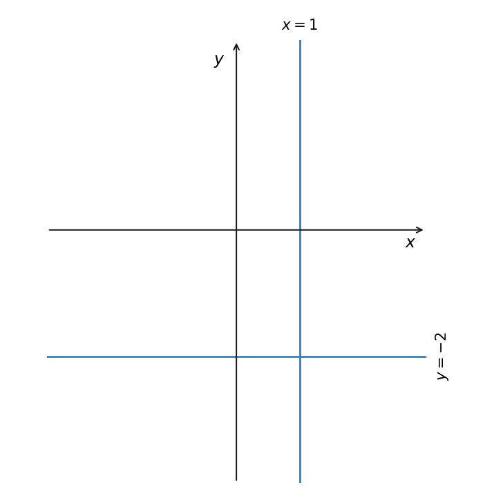

If we compute the sign of $f(x,y)$ in each of those four regions (by considering some test points, for example), we get the following:

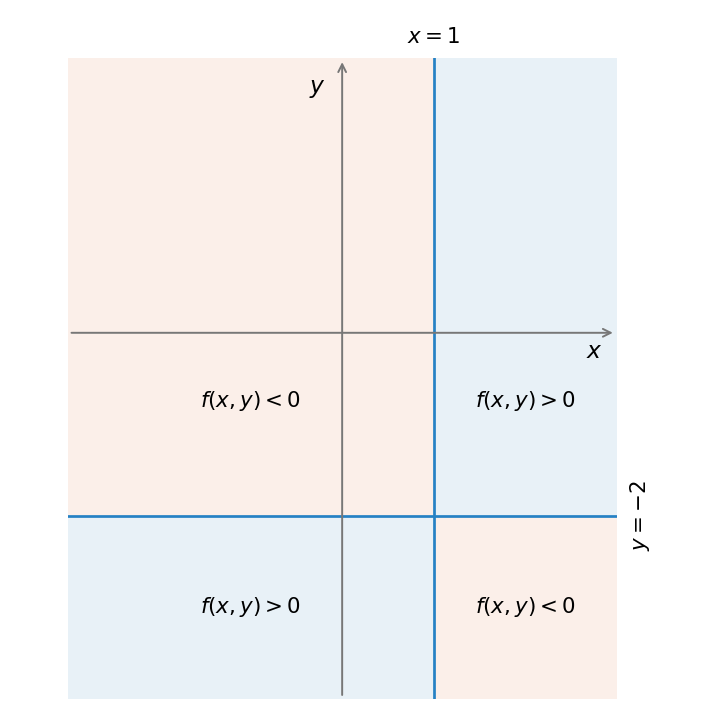

With that in mind, let's check each statement:

- Statement I is true. If $x>1$ and $y>-2,$ then according to our diagram, we have

$$
{\frac{\text{d}y}{\text{d}x}|}_{(x,y)}=f(x,y)>0.
$$

This implies that the slope of the slope field is positive for any point $(x,y)$ in this region.

- Statement II is false. If $x<1$ and $y>-2,$ then according to our diagram, we have

$$
{\frac{\text{d}y}{\text{d}x}|}_{(x,y)}=f(x,y)<0.
$$

This implies that the slope of the slope field is negative for any point $(x,y)$ in this region.

- Statement III is false. If $x>1$ and $y<-2,$ then according to our diagram, we have

$$
{\frac{\text{d}y}{\text{d}x}|}_{(x,y)}=f(x,y)<0.
$$

This implies that the slope of the slope field is negative for any point $(x,y)$ in this region.

## generated observed-bank variant q-96475 1

Template `numbered_bilinear`, profile `q-96475`.

Parameters: `{"h": -1, "k": -2, "ox": 1, "oy": 1, "px": 1, "py": 1, "regions": [[1, 1, 1], [-1, 1, 1], [1, -1, 1]]}`.

Consider the differential equation $\frac{dy}{dx} = (x + 1)(y + 2)$ and its slope field. Which of the following statements are true?

1. At every point $(x, y)$ where $x > - 1$ and $y > - 2$, the slope of the slope field is positive
2. At every point $(x, y)$ where $x < - 1$ and $y > - 2$, the slope of the slope field is positive
3. At every point $(x, y)$ where $x > - 1$ and $y < - 2$, the slope of the slope field is positive

- I and II only
- I, II, and III
- I and III only
- I only **correct**
- III only

First, we define $f(x,y)=(x+1)(y+2).$ Then, our differential equation is $\frac{\text{d}y}{\text{d}x}=f(x,y).$ 

Notice that $f(x,y)=0$ when $x=-1$ or $y=-2.$ This divides the $xy$-plane into four regions, as shown below.

If we compute the sign of $f(x,y)$ in each of those four regions (by considering some test points, for example), we get the following:

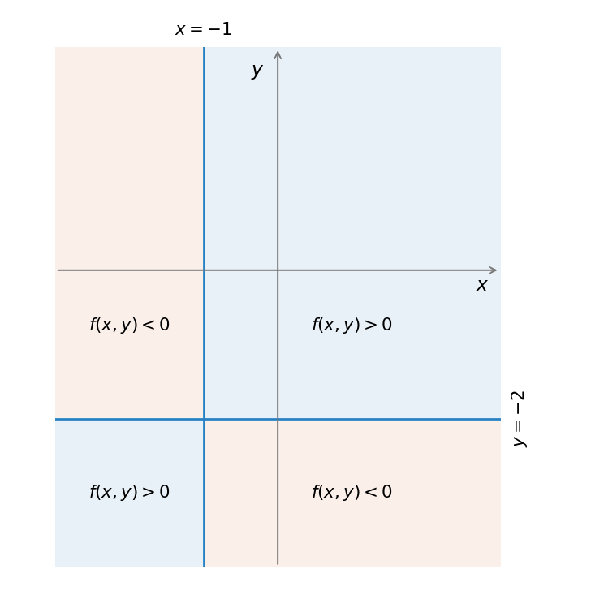

With that in mind, let's check each statement:

- Statement I is true. If $x>-1$ and $y>-2,$ then according to our diagram, we have

$$
{\frac{\text{d}y}{\text{d}x}|}_{(x,y)}=f(x,y)>0.
$$

This implies that the slope of the slope field is positive for any point $(x,y)$ in this region.

- Statement II is false. If $x<-1$ and $y>-2,$ then according to our diagram, we have

$$
{\frac{\text{d}y}{\text{d}x}|}_{(x,y)}=f(x,y)<0.
$$

This implies that the slope of the slope field is negative for any point $(x,y)$ in this region.

- Statement III is false. If $x>-1$ and $y<-2,$ then according to our diagram, we have

$$
{\frac{\text{d}y}{\text{d}x}|}_{(x,y)}=f(x,y)<0.
$$

This implies that the slope of the slope field is negative for any point $(x,y)$ in this region.

## generated observed-bank variant q-96475 2

Template `numbered_bilinear`, profile `q-96475`.

Parameters: `{"h": 1, "k": 2, "ox": 1, "oy": 1, "px": 1, "py": 1, "regions": [[1, 1, 1], [-1, 1, 1], [1, -1, 1]]}`.

Consider the differential equation $\frac{dy}{dx} = (x - 1)(y - 2)$ and its slope field. Which of the following statements are true?

1. At every point $(x, y)$ where $x > 1$ and $y > 2$, the slope of the slope field is positive
2. At every point $(x, y)$ where $x < 1$ and $y > 2$, the slope of the slope field is positive
3. At every point $(x, y)$ where $x > 1$ and $y < 2$, the slope of the slope field is positive

- I, II, and III
- I only **correct**
- I and II only
- III only
- I and III only

First, we define $f(x,y)=(x-1)(y-2).$ Then, our differential equation is $\frac{\text{d}y}{\text{d}x}=f(x,y).$ 

Notice that $f(x,y)=0$ when $x=1$ or $y=2.$ This divides the $xy$-plane into four regions, as shown below.

If we compute the sign of $f(x,y)$ in each of those four regions (by considering some test points, for example), we get the following:

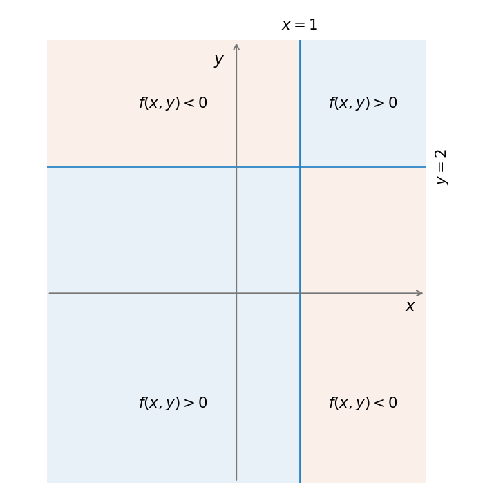

With that in mind, let's check each statement:

- Statement I is true. If $x>1$ and $y>2,$ then according to our diagram, we have

$$
{\frac{\text{d}y}{\text{d}x}|}_{(x,y)}=f(x,y)>0.
$$

This implies that the slope of the slope field is positive for any point $(x,y)$ in this region.

- Statement II is false. If $x<1$ and $y>2,$ then according to our diagram, we have

$$
{\frac{\text{d}y}{\text{d}x}|}_{(x,y)}=f(x,y)<0.
$$

This implies that the slope of the slope field is negative for any point $(x,y)$ in this region.

- Statement III is false. If $x>1$ and $y<2,$ then according to our diagram, we have

$$
{\frac{\text{d}y}{\text{d}x}|}_{(x,y)}=f(x,y)<0.
$$

This implies that the slope of the slope field is negative for any point $(x,y)$ in this region.

## original q-97538

Template `x_squared`, profile `q-97538`.

Parameters: `{"h": -1, "k": 2, "ox": 1, "oy": 1, "px": 2, "py": 1, "regions": [[-1, 1, 1], [-1, -1, -1], [1, -1, -1]]}`.

Consider the differential equation $\frac{\text{d}y}{\text{d}x}=(x+1)^{2}(y-2)$ and its slope field. Which of the following statements are true?

- At every point $(x,y)$ where $x<-1$ and $y>2,$ the slope of the slope field is positive
- At every point $(x,y)$ where $x<-1$ and $y<2,$ the slope of the slope field is negative
- At every point $(x,y)$ where $x>-1$ and $y<2,$ the slope of the slope field is negative

- I and III only
- I, II, and III **correct**
- I only
- III only
- II and III only

First, we define $f(x,y)=(x+1)^{2}(y-2).$ Then, our differential equation is $\frac{\text{d}y}{\text{d}x}=f(x,y).$ 

Notice that $f(x,y)=0$ when $x=-1$ or $y=2.$ This divides the $xy$-plane into four regions, as shown below.

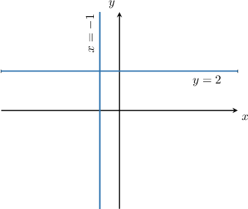

If we compute the sign of $f(x,y)$ in each of those four regions (by considering some test points, for example), we get the following:

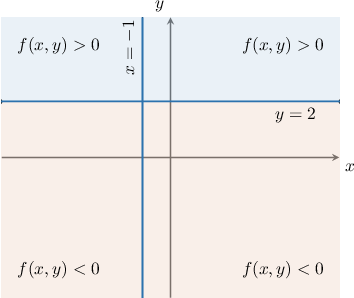

With that in mind, let's check each statement:

- Statement I is true. If $x<-1$ and $y>2,$ then according to our diagram, we have

$$
{\frac{\text{d}y}{\text{d}x}|}_{(x,y)}=f(x,y)>0.
$$

This implies that the slope of the slope field is positive for any point $(x,y)$ in this region.

- Statement II is true. If $x<-1$ and $y<2,$ then according to our diagram, we have

$$
{\frac{\text{d}y}{\text{d}x}|}_{(x,y)}=f(x,y)<0.
$$

This implies that the slope of the slope field is negative for any point $(x,y)$ in this region.

- Statement III is true. If $x>-1$ and $y<2,$ then according to our diagram, we have

$$
{\frac{\text{d}y}{\text{d}x}|}_{(x,y)}=f(x,y)<0.
$$

This implies that the slope of the slope field is negative for any point $(x,y)$ in this region.

## generated observed-bank variant q-97538 1

Template `x_squared`, profile `q-97538`.

Parameters: `{"h": 1, "k": 2, "ox": 1, "oy": 1, "px": 2, "py": 1, "regions": [[-1, 1, 1], [-1, -1, -1], [1, -1, -1]]}`.

Consider the differential equation $\frac{\text{d}y}{\text{d}x}=(x-1)^{2}(y-2)$ and its slope field. Which of the following statements are true?

- At every point $(x,y)$ where $x<1$ and $y>2,$ the slope of the slope field is positive
- At every point $(x,y)$ where $x<1$ and $y<2,$ the slope of the slope field is negative
- At every point $(x,y)$ where $x>1$ and $y<2,$ the slope of the slope field is negative

- I only
- I, II, and III **correct**
- II and III only
- I and III only
- III only

First, we define $f(x,y)=(x-1)^{2}(y-2).$ Then, our differential equation is $\frac{\text{d}y}{\text{d}x}=f(x,y).$ 

Notice that $f(x,y)=0$ when $x=1$ or $y=2.$ This divides the $xy$-plane into four regions, as shown below.

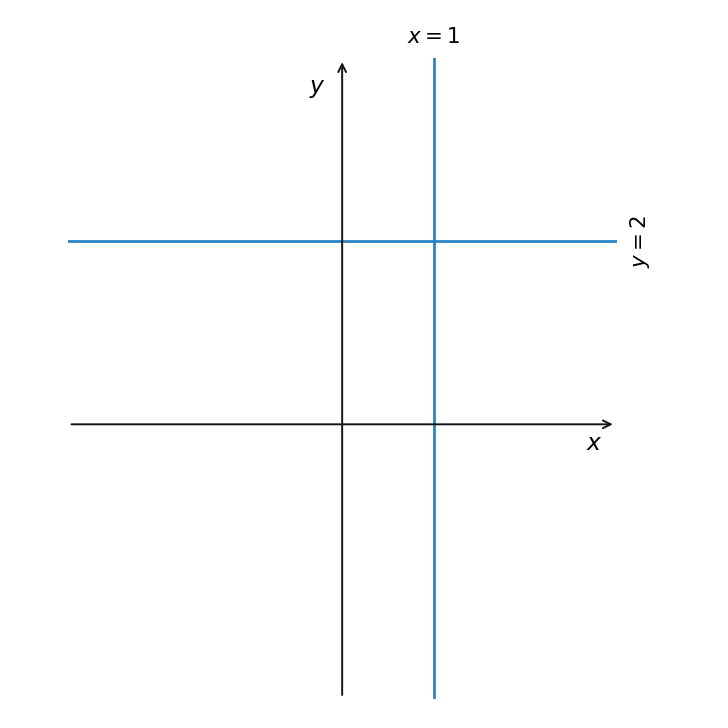

If we compute the sign of $f(x,y)$ in each of those four regions (by considering some test points, for example), we get the following:

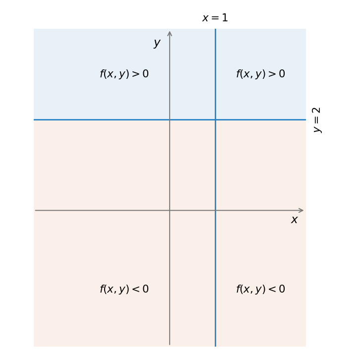

With that in mind, let's check each statement:

- Statement I is true. If $x<1$ and $y>2,$ then according to our diagram, we have

$$
{\frac{\text{d}y}{\text{d}x}|}_{(x,y)}=f(x,y)>0.
$$

This implies that the slope of the slope field is positive for any point $(x,y)$ in this region.

- Statement II is true. If $x<1$ and $y<2,$ then according to our diagram, we have

$$
{\frac{\text{d}y}{\text{d}x}|}_{(x,y)}=f(x,y)<0.
$$

This implies that the slope of the slope field is negative for any point $(x,y)$ in this region.

- Statement III is true. If $x>1$ and $y<2,$ then according to our diagram, we have

$$
{\frac{\text{d}y}{\text{d}x}|}_{(x,y)}=f(x,y)<0.
$$

This implies that the slope of the slope field is negative for any point $(x,y)$ in this region.

## generated observed-bank variant q-97538 2

Template `x_squared`, profile `q-97538`.

Parameters: `{"h": -1, "k": -2, "ox": 1, "oy": -1, "px": 2, "py": 1, "regions": [[-1, 1, -1], [-1, -1, 1], [1, -1, 1]]}`.

Consider the differential equation $\frac{\text{d}y}{\text{d}x}=(x+1)^{2}(-2-y)$ and its slope field. Which of the following statements are true?

- At every point $(x,y)$ where $x<-1$ and $y>-2,$ the slope of the slope field is negative
- At every point $(x,y)$ where $x<-1$ and $y<-2,$ the slope of the slope field is positive
- At every point $(x,y)$ where $x>-1$ and $y<-2,$ the slope of the slope field is positive

- I, II, and III **correct**
- I and III only
- I only
- III only
- II and III only

First, we define $f(x,y)=(x+1)^{2}(-2-y).$ Then, our differential equation is $\frac{\text{d}y}{\text{d}x}=f(x,y).$ 

Notice that $f(x,y)=0$ when $x=-1$ or $y=-2.$ This divides the $xy$-plane into four regions, as shown below.

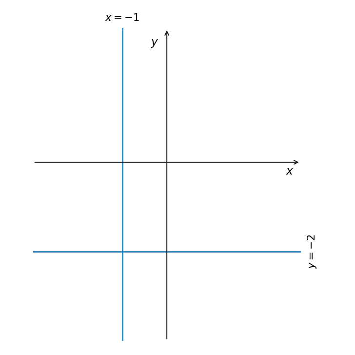

If we compute the sign of $f(x,y)$ in each of those four regions (by considering some test points, for example), we get the following:

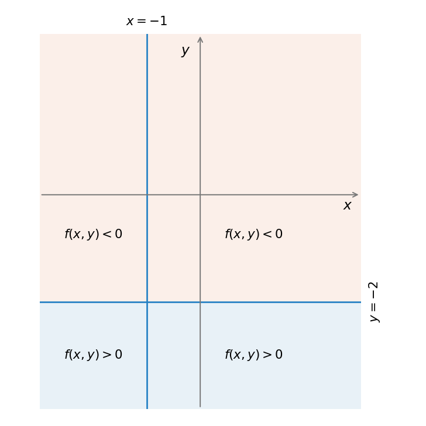

With that in mind, let's check each statement:

- Statement I is true. If $x<-1$ and $y>-2,$ then according to our diagram, we have

$$
{\frac{\text{d}y}{\text{d}x}|}_{(x,y)}=f(x,y)<0.
$$

This implies that the slope of the slope field is negative for any point $(x,y)$ in this region.

- Statement II is true. If $x<-1$ and $y<-2,$ then according to our diagram, we have

$$
{\frac{\text{d}y}{\text{d}x}|}_{(x,y)}=f(x,y)>0.
$$

This implies that the slope of the slope field is positive for any point $(x,y)$ in this region.

- Statement III is true. If $x>-1$ and $y<-2,$ then according to our diagram, we have

$$
{\frac{\text{d}y}{\text{d}x}|}_{(x,y)}=f(x,y)>0.
$$

This implies that the slope of the slope field is positive for any point $(x,y)$ in this region.

## original q-119797

Template `bilinear`, profile `q-119797`.

Parameters: `{"h": 2, "k": -1, "ox": -1, "oy": 1, "px": 1, "py": 1, "regions": [[1, -1, 1], [-1, -1, -1], [-1, 1, 1]]}`.

Consider the differential equation $\frac{\text{d}y}{\text{d}x}=(2-x)(y+1)$ and its slope field. Which of the following statements are true?

- At every point $(x,y)$ where $x>2$ and $y<-1,$ the slope of the slope field is positive
- At every point $(x,y)$ where $x<2$ and $y<-1,$ the slope of the slope field is negative
- At every point $(x,y)$ where $x<2$ and $y>-1,$ the slope of the slope field is positive

- II only
- I, II, and III **correct**
- II and III only
- I only
- I and II only

First, we define $f(x,y)=(2-x)(y+1).$ Then, our differential equation is $\frac{\text{d}y}{\text{d}x}=f(x,y).$ 

Notice that $f(x,y)=0$ when $x=2$ or $y=-1.$ This divides the $xy$-plane into four regions, as shown below.

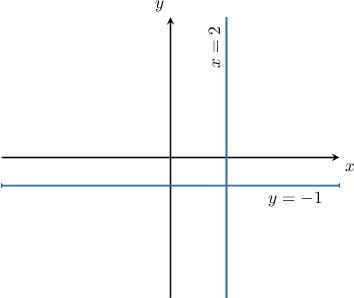

If we compute the sign of $f(x,y)$ in each of those four regions (by considering some test points, for example), we get the following:

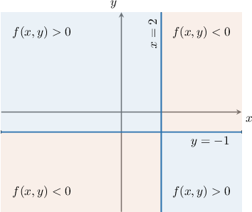

With that in mind, let's check each statement:

- Statement I is true. If $x>2$ and $y<-1,$ then according to our diagram, we have

$$
{\frac{\text{d}y}{\text{d}x}|}_{(x,y)}=f(x,y)>0.
$$

This implies that the slope of the slope field is positive for any point $(x,y)$ in this region.

- Statement II is true. If $x<2$ and $y<-1,$ then according to our diagram, we have

$$
{\frac{\text{d}y}{\text{d}x}|}_{(x,y)}=f(x,y)<0.
$$

This implies that the slope of the slope field is negative for any point $(x,y)$ in this region.

- Statement III is true. If $x<2$ and $y>-1,$ then according to our diagram, we have

$$
{\frac{\text{d}y}{\text{d}x}|}_{(x,y)}=f(x,y)>0.
$$

This implies that the slope of the slope field is positive for any point $(x,y)$ in this region.

Therefore, the correct answer is "I, II, and III."

## generated observed-bank variant q-119797 1

Template `bilinear`, profile `q-119797`.

Parameters: `{"h": -2, "k": -1, "ox": -1, "oy": 1, "px": 1, "py": 1, "regions": [[1, -1, 1], [-1, -1, -1], [-1, 1, 1]]}`.

Consider the differential equation $\frac{\text{d}y}{\text{d}x}=(-2-x)(y+1)$ and its slope field. Which of the following statements are true?

- At every point $(x,y)$ where $x>-2$ and $y<-1,$ the slope of the slope field is positive
- At every point $(x,y)$ where $x<-2$ and $y<-1,$ the slope of the slope field is negative
- At every point $(x,y)$ where $x<-2$ and $y>-1,$ the slope of the slope field is positive

- II and III only
- I, II, and III **correct**
- I and II only
- II only
- I only

First, we define $f(x,y)=(-2-x)(y+1).$ Then, our differential equation is $\frac{\text{d}y}{\text{d}x}=f(x,y).$ 

Notice that $f(x,y)=0$ when $x=-2$ or $y=-1.$ This divides the $xy$-plane into four regions, as shown below.

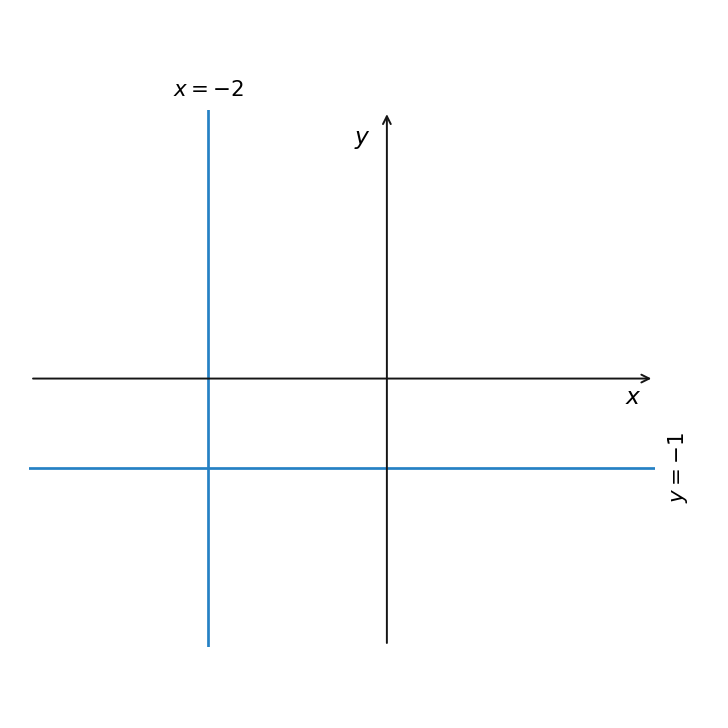

If we compute the sign of $f(x,y)$ in each of those four regions (by considering some test points, for example), we get the following:

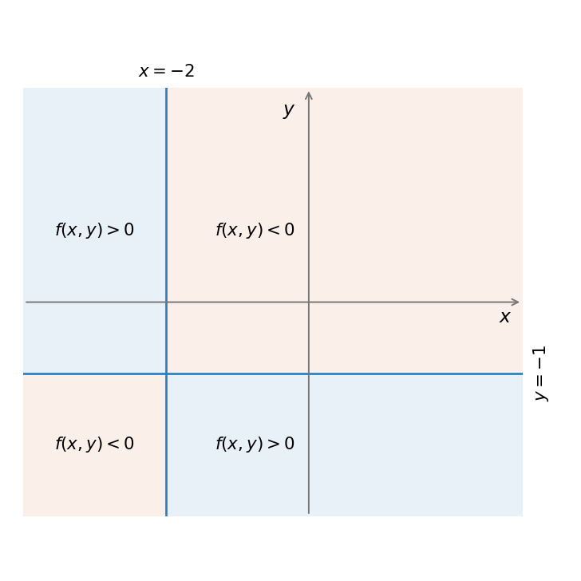

With that in mind, let's check each statement:

- Statement I is true. If $x>-2$ and $y<-1,$ then according to our diagram, we have

$$
{\frac{\text{d}y}{\text{d}x}|}_{(x,y)}=f(x,y)>0.
$$

This implies that the slope of the slope field is positive for any point $(x,y)$ in this region.

- Statement II is true. If $x<-2$ and $y<-1,$ then according to our diagram, we have

$$
{\frac{\text{d}y}{\text{d}x}|}_{(x,y)}=f(x,y)<0.
$$

This implies that the slope of the slope field is negative for any point $(x,y)$ in this region.

- Statement III is true. If $x<-2$ and $y>-1,$ then according to our diagram, we have

$$
{\frac{\text{d}y}{\text{d}x}|}_{(x,y)}=f(x,y)>0.
$$

This implies that the slope of the slope field is positive for any point $(x,y)$ in this region.

Therefore, the correct answer is "I, II, and III."

## generated observed-bank variant q-119797 2

Template `bilinear`, profile `q-119797`.

Parameters: `{"h": 2, "k": 1, "ox": -1, "oy": 1, "px": 1, "py": 1, "regions": [[1, -1, 1], [-1, -1, -1], [-1, 1, 1]]}`.

Consider the differential equation $\frac{\text{d}y}{\text{d}x}=(2-x)(y-1)$ and its slope field. Which of the following statements are true?

- At every point $(x,y)$ where $x>2$ and $y<1,$ the slope of the slope field is positive
- At every point $(x,y)$ where $x<2$ and $y<1,$ the slope of the slope field is negative
- At every point $(x,y)$ where $x<2$ and $y>1,$ the slope of the slope field is positive

- I, II, and III **correct**
- II only
- II and III only
- I only
- I and II only

First, we define $f(x,y)=(2-x)(y-1).$ Then, our differential equation is $\frac{\text{d}y}{\text{d}x}=f(x,y).$ 

Notice that $f(x,y)=0$ when $x=2$ or $y=1.$ This divides the $xy$-plane into four regions, as shown below.

If we compute the sign of $f(x,y)$ in each of those four regions (by considering some test points, for example), we get the following:

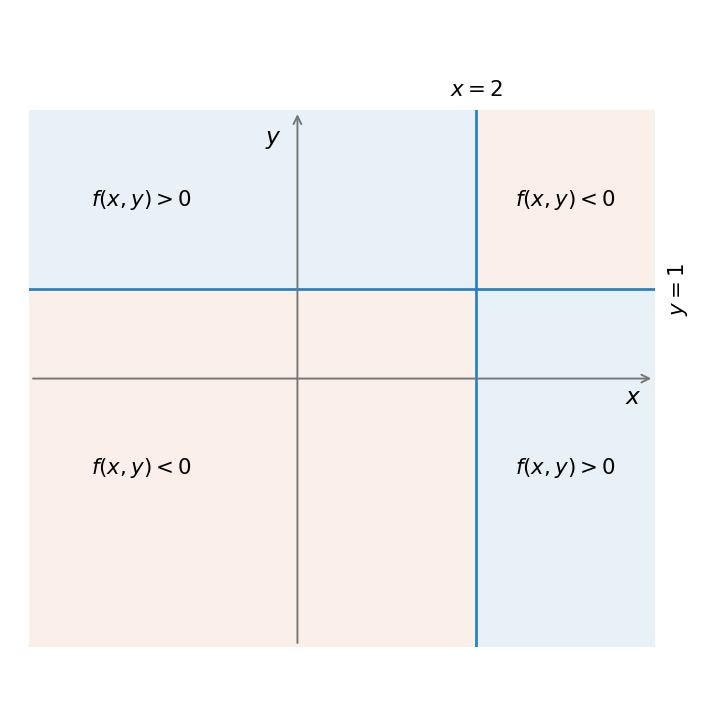

With that in mind, let's check each statement:

- Statement I is true. If $x>2$ and $y<1,$ then according to our diagram, we have

$$
{\frac{\text{d}y}{\text{d}x}|}_{(x,y)}=f(x,y)>0.
$$

This implies that the slope of the slope field is positive for any point $(x,y)$ in this region.

- Statement II is true. If $x<2$ and $y<1,$ then according to our diagram, we have

$$
{\frac{\text{d}y}{\text{d}x}|}_{(x,y)}=f(x,y)<0.
$$

This implies that the slope of the slope field is negative for any point $(x,y)$ in this region.

- Statement III is true. If $x<2$ and $y>1,$ then according to our diagram, we have

$$
{\frac{\text{d}y}{\text{d}x}|}_{(x,y)}=f(x,y)>0.
$$

This implies that the slope of the slope field is positive for any point $(x,y)$ in this region.

Therefore, the correct answer is "I, II, and III."

## original q-119800

Template `bilinear`, profile `q-119800`.

Parameters: `{"h": 1, "k": 2, "ox": -1, "oy": 1, "px": 1, "py": 1, "regions": [[-1, 1, -1], [1, -1, -1], [-1, -1, 1]]}`.

Consider the differential equation $\frac{\text{d}y}{\text{d}x}=(1-x)(y-2)$ and its slope field. Which of the following statements are true?

- At every point $(x,y)$ where $x<1$ and $y>2,$ the slope of the slope field is negative
- At every point $(x,y)$ where $x>1$ and $y<2,$ the slope of the slope field is negative
- At every point $(x,y)$ where $x<1$ and $y<2,$ the slope of the slope field is positive

- II and III only
- III only
- II only
- I and II only
- None of those listed **correct**

First, we define $f(x,y)=(1-x)(y-2).$ Then, our differential equation is $\frac{\text{d}y}{\text{d}x}=f(x,y).$ 

Notice that $f(x,y)=0$ when $x=1$ or $y=2.$ This divides the $xy$-plane into four regions, as shown below.

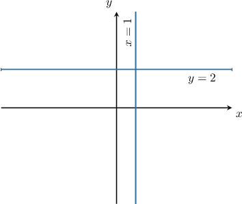

If we compute the sign of $f(x,y)$ in each of those four regions (by considering some test points, for example), we get the following:

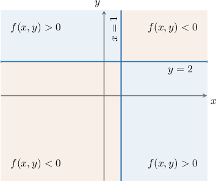

With that in mind, let's check each statement:

- Statement I is false. If $x<1$ and $y>2,$ then according to our diagram, we have

$$
{\frac{\text{d}y}{\text{d}x}|}_{(x,y)}=f(x,y)>0.
$$

This implies that the slope of the slope field is positive for any point $(x,y)$ in this region.

- Statement II is false. If $x>1$ and $y<2,$ then according to our diagram, we have

$$
{\frac{\text{d}y}{\text{d}x}|}_{(x,y)}=f(x,y)>0.
$$

This implies that the slope of the slope field is positive for any point $(x,y)$ in this region.

- Statement III is false. If $x<1$ and $y<2,$ then according to our diagram, we have

$$
{\frac{\text{d}y}{\text{d}x}|}_{(x,y)}=f(x,y)<0.
$$

This implies that the slope of the slope field is negative for any point $(x,y)$ in this region.

Therefore, the correct answer is "None of those listed."

## generated observed-bank variant q-119800 1

Template `bilinear`, profile `q-119800`.

Parameters: `{"h": -1, "k": 2, "ox": -1, "oy": 1, "px": 1, "py": 1, "regions": [[-1, 1, -1], [1, -1, -1], [-1, -1, 1]]}`.

Consider the differential equation $\frac{\text{d}y}{\text{d}x}=(-1-x)(y-2)$ and its slope field. Which of the following statements are true?

- At every point $(x,y)$ where $x<-1$ and $y>2,$ the slope of the slope field is negative
- At every point $(x,y)$ where $x>-1$ and $y<2,$ the slope of the slope field is negative
- At every point $(x,y)$ where $x<-1$ and $y<2,$ the slope of the slope field is positive

- II only
- III only
- None of those listed **correct**
- II and III only
- I and II only

First, we define $f(x,y)=(-1-x)(y-2).$ Then, our differential equation is $\frac{\text{d}y}{\text{d}x}=f(x,y).$ 

Notice that $f(x,y)=0$ when $x=-1$ or $y=2.$ This divides the $xy$-plane into four regions, as shown below.

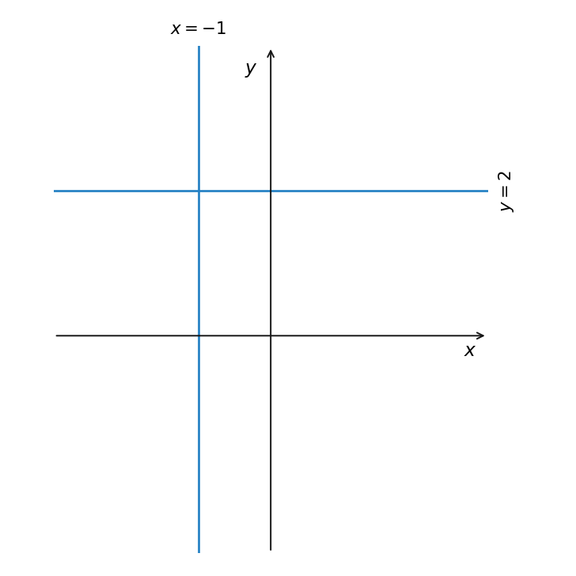

If we compute the sign of $f(x,y)$ in each of those four regions (by considering some test points, for example), we get the following:

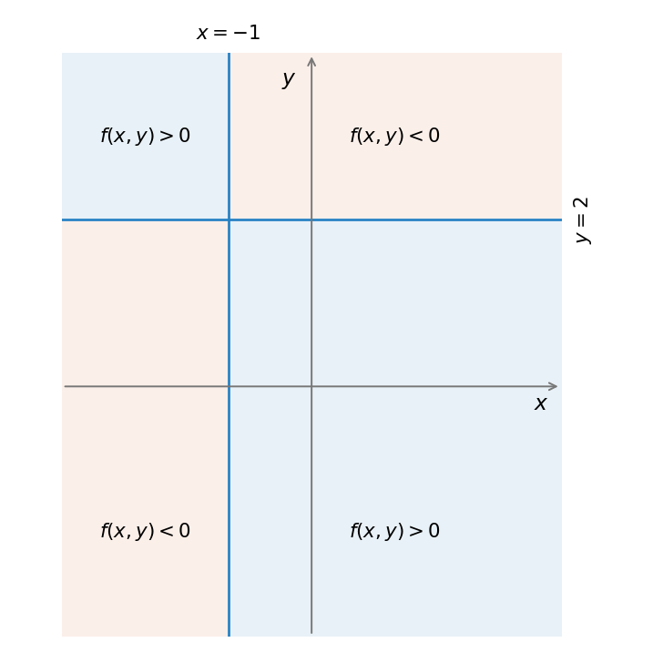

With that in mind, let's check each statement:

- Statement I is false. If $x<-1$ and $y>2,$ then according to our diagram, we have

$$
{\frac{\text{d}y}{\text{d}x}|}_{(x,y)}=f(x,y)>0.
$$

This implies that the slope of the slope field is positive for any point $(x,y)$ in this region.

- Statement II is false. If $x>-1$ and $y<2,$ then according to our diagram, we have

$$
{\frac{\text{d}y}{\text{d}x}|}_{(x,y)}=f(x,y)>0.
$$

This implies that the slope of the slope field is positive for any point $(x,y)$ in this region.

- Statement III is false. If $x<-1$ and $y<2,$ then according to our diagram, we have

$$
{\frac{\text{d}y}{\text{d}x}|}_{(x,y)}=f(x,y)<0.
$$

This implies that the slope of the slope field is negative for any point $(x,y)$ in this region.

Therefore, the correct answer is "None of those listed."

## generated observed-bank variant q-119800 2

Template `bilinear`, profile `q-119800`.

Parameters: `{"h": 1, "k": -2, "ox": -1, "oy": 1, "px": 1, "py": 1, "regions": [[-1, 1, -1], [1, -1, -1], [-1, -1, 1]]}`.

Consider the differential equation $\frac{\text{d}y}{\text{d}x}=(1-x)(y+2)$ and its slope field. Which of the following statements are true?

- At every point $(x,y)$ where $x<1$ and $y>-2,$ the slope of the slope field is negative
- At every point $(x,y)$ where $x>1$ and $y<-2,$ the slope of the slope field is negative
- At every point $(x,y)$ where $x<1$ and $y<-2,$ the slope of the slope field is positive

- III only
- II and III only
- II only
- I and II only
- None of those listed **correct**

First, we define $f(x,y)=(1-x)(y+2).$ Then, our differential equation is $\frac{\text{d}y}{\text{d}x}=f(x,y).$ 

Notice that $f(x,y)=0$ when $x=1$ or $y=-2.$ This divides the $xy$-plane into four regions, as shown below.

If we compute the sign of $f(x,y)$ in each of those four regions (by considering some test points, for example), we get the following:

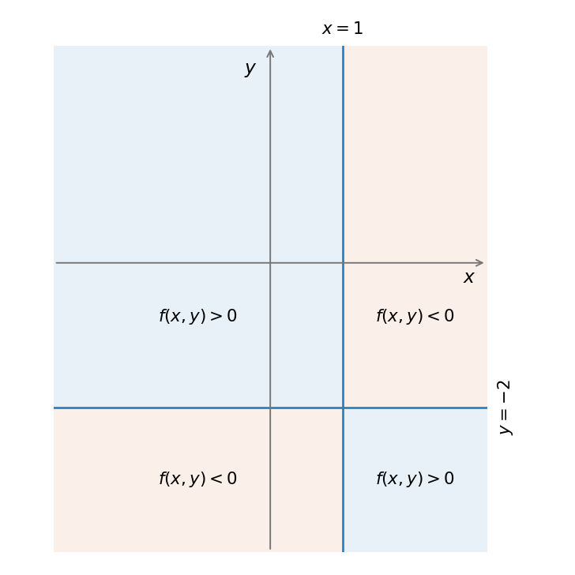

With that in mind, let's check each statement:

- Statement I is false. If $x<1$ and $y>-2,$ then according to our diagram, we have

$$
{\frac{\text{d}y}{\text{d}x}|}_{(x,y)}=f(x,y)>0.
$$

This implies that the slope of the slope field is positive for any point $(x,y)$ in this region.

- Statement II is false. If $x>1$ and $y<-2,$ then according to our diagram, we have

$$
{\frac{\text{d}y}{\text{d}x}|}_{(x,y)}=f(x,y)>0.
$$

This implies that the slope of the slope field is positive for any point $(x,y)$ in this region.

- Statement III is false. If $x<1$ and $y<-2,$ then according to our diagram, we have

$$
{\frac{\text{d}y}{\text{d}x}|}_{(x,y)}=f(x,y)<0.
$$

This implies that the slope of the slope field is negative for any point $(x,y)$ in this region.

Therefore, the correct answer is "None of those listed."

## original q-119816

Template `x_squared`, profile `q-119816`.

Parameters: `{"h": 2, "k": -1, "ox": 1, "oy": 1, "px": 2, "py": 1, "regions": [[-1, 1, -1], [-1, -1, -1], [1, 1, 1]]}`.

Consider the differential equation $\frac{\text{d}y}{\text{d}x}=(x-2)^{2}(y+1)$ and its slope field. Which of the following statements are true?

- At every point $(x,y)$ where $x<2$ and $y>-1,$ the slope of the slope field is negative
- At every point $(x,y)$ where $x<2$ and $y<-1,$ the slope of the slope field is negative
- At every point $(x,y)$ where $x>2$ and $y>-1,$ the slope of the slope field is positive

- I and II only
- I and III only
- I only
- II and III only **correct**
- II only

First, we define $f(x,y)=(x-2)^{2}(y+1).$ Then, our differential equation is $\frac{\text{d}y}{\text{d}x}=f(x,y).$ 

Notice that $f(x,y)=0$ when $x=2$ or $y=-1.$ This divides the $xy$-plane into four regions, as shown below.

If we compute the sign of $f(x,y)$ in each of those four regions (by considering some test points, for example), we get the following:

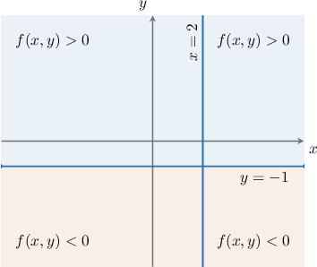

With that in mind, let's check each statement:

- Statement I is false. If $x<2$ and $y>-1,$ then according to our diagram, we have

$$
{\frac{\text{d}y}{\text{d}x}|}_{(x,y)}=f(x,y)>0.
$$

This implies that the slope of the slope field is positive for any point $(x,y)$ in this region.

- Statement II is true. If $x<2$ and $y<-1,$ then according to our diagram, we have

$$
{\frac{\text{d}y}{\text{d}x}|}_{(x,y)}=f(x,y)<0.
$$

This implies that the slope of the slope field is negative for any point $(x,y)$ in this region.

- Statement III is true. If $x>2$ and $y>-1,$ then according to our diagram, we have

$$
{\frac{\text{d}y}{\text{d}x}|}_{(x,y)}=f(x,y)>0.
$$

This implies that the slope of the slope field is positive for any point $(x,y)$ in this region.

Therefore, the correct answer is "II and III only."

## generated observed-bank variant q-119816 1

Template `x_squared`, profile `q-119816`.

Parameters: `{"h": -2, "k": -1, "ox": 1, "oy": 1, "px": 2, "py": 1, "regions": [[-1, 1, -1], [-1, -1, -1], [1, 1, 1]]}`.

Consider the differential equation $\frac{\text{d}y}{\text{d}x}=(x+2)^{2}(y+1)$ and its slope field. Which of the following statements are true?

- At every point $(x,y)$ where $x<-2$ and $y>-1,$ the slope of the slope field is negative
- At every point $(x,y)$ where $x<-2$ and $y<-1,$ the slope of the slope field is negative
- At every point $(x,y)$ where $x>-2$ and $y>-1,$ the slope of the slope field is positive

- I only
- I and III only
- II only
- I and II only
- II and III only **correct**

First, we define $f(x,y)=(x+2)^{2}(y+1).$ Then, our differential equation is $\frac{\text{d}y}{\text{d}x}=f(x,y).$ 

Notice that $f(x,y)=0$ when $x=-2$ or $y=-1.$ This divides the $xy$-plane into four regions, as shown below.

If we compute the sign of $f(x,y)$ in each of those four regions (by considering some test points, for example), we get the following:

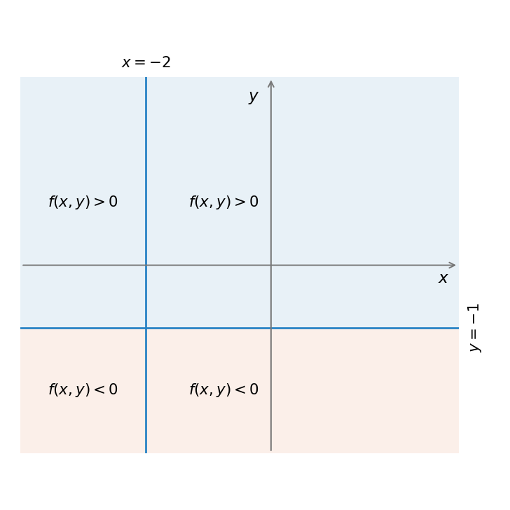

With that in mind, let's check each statement:

- Statement I is false. If $x<-2$ and $y>-1,$ then according to our diagram, we have

$$
{\frac{\text{d}y}{\text{d}x}|}_{(x,y)}=f(x,y)>0.
$$

This implies that the slope of the slope field is positive for any point $(x,y)$ in this region.

- Statement II is true. If $x<-2$ and $y<-1,$ then according to our diagram, we have

$$
{\frac{\text{d}y}{\text{d}x}|}_{(x,y)}=f(x,y)<0.
$$

This implies that the slope of the slope field is negative for any point $(x,y)$ in this region.

- Statement III is true. If $x>-2$ and $y>-1,$ then according to our diagram, we have

$$
{\frac{\text{d}y}{\text{d}x}|}_{(x,y)}=f(x,y)>0.
$$

This implies that the slope of the slope field is positive for any point $(x,y)$ in this region.

Therefore, the correct answer is "II and III only."

## generated observed-bank variant q-119816 2

Template `x_squared`, profile `q-119816`.

Parameters: `{"h": 2, "k": 1, "ox": 1, "oy": -1, "px": 2, "py": 1, "regions": [[-1, 1, 1], [-1, -1, 1], [1, 1, -1]]}`.

Consider the differential equation $\frac{\text{d}y}{\text{d}x}=(x-2)^{2}(1-y)$ and its slope field. Which of the following statements are true?

- At every point $(x,y)$ where $x<2$ and $y>1,$ the slope of the slope field is positive
- At every point $(x,y)$ where $x<2$ and $y<1,$ the slope of the slope field is positive
- At every point $(x,y)$ where $x>2$ and $y>1,$ the slope of the slope field is negative

- I and III only
- I and II only
- I only
- II and III only **correct**
- II only

First, we define $f(x,y)=(x-2)^{2}(1-y).$ Then, our differential equation is $\frac{\text{d}y}{\text{d}x}=f(x,y).$ 

Notice that $f(x,y)=0$ when $x=2$ or $y=1.$ This divides the $xy$-plane into four regions, as shown below.

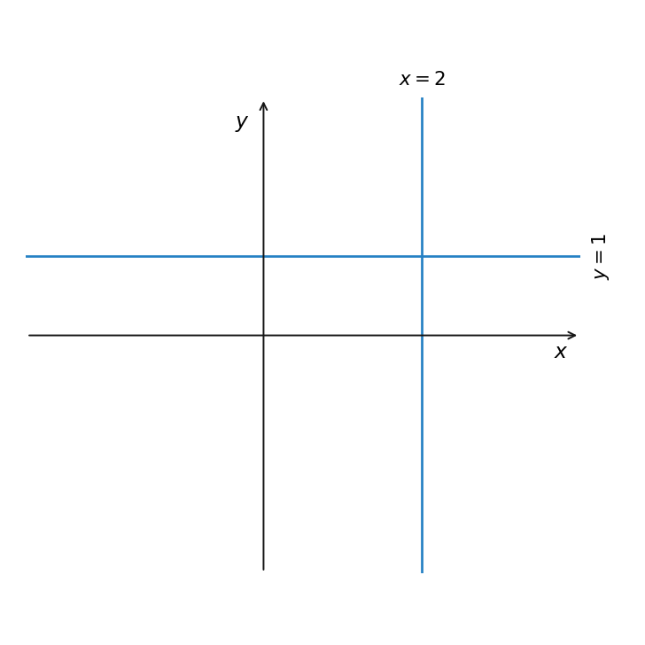

If we compute the sign of $f(x,y)$ in each of those four regions (by considering some test points, for example), we get the following:

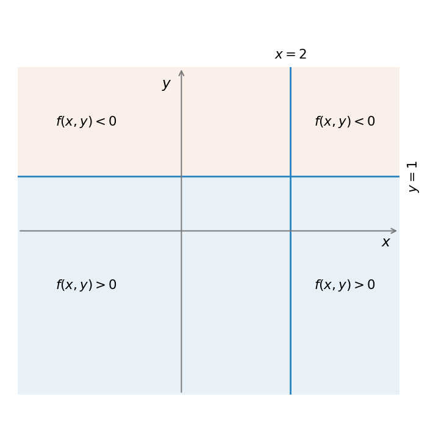

With that in mind, let's check each statement:

- Statement I is false. If $x<2$ and $y>1,$ then according to our diagram, we have

$$
{\frac{\text{d}y}{\text{d}x}|}_{(x,y)}=f(x,y)<0.
$$

This implies that the slope of the slope field is negative for any point $(x,y)$ in this region.

- Statement II is true. If $x<2$ and $y<1,$ then according to our diagram, we have

$$
{\frac{\text{d}y}{\text{d}x}|}_{(x,y)}=f(x,y)>0.
$$

This implies that the slope of the slope field is positive for any point $(x,y)$ in this region.

- Statement III is true. If $x>2$ and $y>1,$ then according to our diagram, we have

$$
{\frac{\text{d}y}{\text{d}x}|}_{(x,y)}=f(x,y)<0.
$$

This implies that the slope of the slope field is negative for any point $(x,y)$ in this region.

Therefore, the correct answer is "II and III only."

## original q-97495

Template `bilinear`, profile `q-97495`.

Parameters: `{"h": -2, "k": -2, "ox": 1, "oy": 1, "px": 1, "py": 1, "regions": [[1, 1, 1], [-1, 1, 1], [-1, -1, 1]]}`.

Consider the differential equation $\frac{\text{d}y}{\text{d}x}=(x+2)(y+2)$ and its slope field. Which of the following statements are true?

- At every point $(x,y)$ where $x>-2$ and $y>-2,$ the slope of the slope field is positive
- At every point $(x,y)$ where $x<-2$ and $y>-2,$ the slope of the slope field is positive
- At every point $(x,y)$ where $x<-2$ and $y<-2,$ the slope of the slope field is positive

- I only
- II and III only
- I and II only
- I and III only **correct**
- II only

First, we define $f(x,y)=(x+2)(y+2).$ Then, our differential equation is $\frac{\text{d}y}{\text{d}x}=f(x,y).$ 

Notice that $f(x,y)=0$ when $x=-2$ or $y=-2.$ This divides the $xy$-plane into four regions, as shown below.

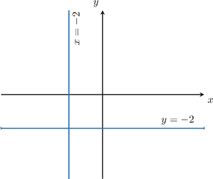

If we compute the sign of $f(x,y)$ in each of those four regions (by considering some test points, for example), we get the following:

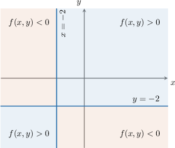

With that in mind, let's check each statement:

- Statement I is true. If $x>-2$ and $y>-2,$ then according to our diagram, we have

$$
{\frac{\text{d}y}{\text{d}x}|}_{(x,y)}=f(x,y)>0.
$$

This implies that the slope of the slope field is positive for any point $(x,y)$ in this region.

- Statement II is false. If $x<-2$ and $y>-2,$ then according to our diagram, we have

$$
{\frac{\text{d}y}{\text{d}x}|}_{(x,y)}=f(x,y)<0.
$$

This implies that the slope of the slope field is negative for any point $(x,y)$ in this region.

- Statement III is true. If $x<-2$ and $y<-2,$ then according to our diagram, we have

$$
{\frac{\text{d}y}{\text{d}x}|}_{(x,y)}=f(x,y)>0.
$$

This implies that the slope of the slope field is positive for any point $(x,y)$ in this region.

## generated observed-bank variant q-97495 1

Template `bilinear`, profile `q-97495`.

Parameters: `{"h": 2, "k": -2, "ox": 1, "oy": 1, "px": 1, "py": 1, "regions": [[1, 1, 1], [-1, 1, 1], [-1, -1, 1]]}`.

Consider the differential equation $\frac{\text{d}y}{\text{d}x}=(x-2)(y+2)$ and its slope field. Which of the following statements are true?

- At every point $(x,y)$ where $x>2$ and $y>-2,$ the slope of the slope field is positive
- At every point $(x,y)$ where $x<2$ and $y>-2,$ the slope of the slope field is positive
- At every point $(x,y)$ where $x<2$ and $y<-2,$ the slope of the slope field is positive

- I and II only
- II and III only
- II only
- I only
- I and III only **correct**

First, we define $f(x,y)=(x-2)(y+2).$ Then, our differential equation is $\frac{\text{d}y}{\text{d}x}=f(x,y).$ 

Notice that $f(x,y)=0$ when $x=2$ or $y=-2.$ This divides the $xy$-plane into four regions, as shown below.

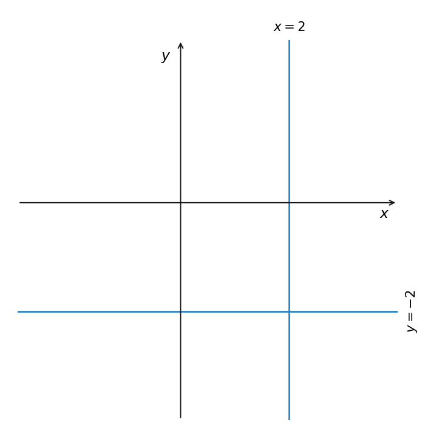

If we compute the sign of $f(x,y)$ in each of those four regions (by considering some test points, for example), we get the following:

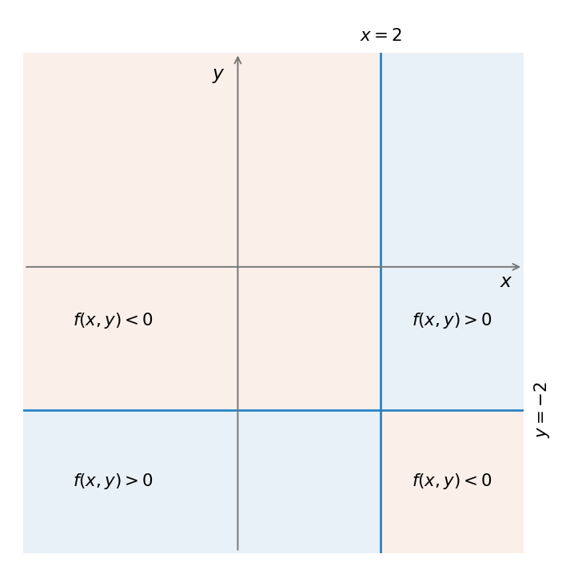

With that in mind, let's check each statement:

- Statement I is true. If $x>2$ and $y>-2,$ then according to our diagram, we have

$$
{\frac{\text{d}y}{\text{d}x}|}_{(x,y)}=f(x,y)>0.
$$

This implies that the slope of the slope field is positive for any point $(x,y)$ in this region.

- Statement II is false. If $x<2$ and $y>-2,$ then according to our diagram, we have

$$
{\frac{\text{d}y}{\text{d}x}|}_{(x,y)}=f(x,y)<0.
$$

This implies that the slope of the slope field is negative for any point $(x,y)$ in this region.

- Statement III is true. If $x<2$ and $y<-2,$ then according to our diagram, we have

$$
{\frac{\text{d}y}{\text{d}x}|}_{(x,y)}=f(x,y)>0.
$$

This implies that the slope of the slope field is positive for any point $(x,y)$ in this region.

## generated observed-bank variant q-97495 2

Template `bilinear`, profile `q-97495`.

Parameters: `{"h": -2, "k": 2, "ox": 1, "oy": 1, "px": 1, "py": 1, "regions": [[1, 1, 1], [-1, 1, 1], [-1, -1, 1]]}`.

Consider the differential equation $\frac{\text{d}y}{\text{d}x}=(x+2)(y-2)$ and its slope field. Which of the following statements are true?

- At every point $(x,y)$ where $x>-2$ and $y>2,$ the slope of the slope field is positive
- At every point $(x,y)$ where $x<-2$ and $y>2,$ the slope of the slope field is positive
- At every point $(x,y)$ where $x<-2$ and $y<2,$ the slope of the slope field is positive

- II and III only
- I only
- I and II only
- I and III only **correct**
- II only

First, we define $f(x,y)=(x+2)(y-2).$ Then, our differential equation is $\frac{\text{d}y}{\text{d}x}=f(x,y).$ 

Notice that $f(x,y)=0$ when $x=-2$ or $y=2.$ This divides the $xy$-plane into four regions, as shown below.

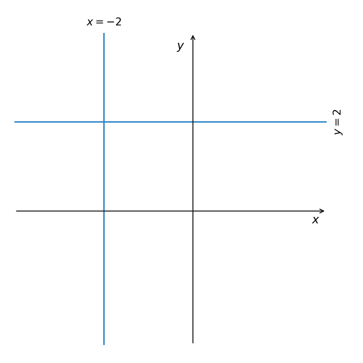

If we compute the sign of $f(x,y)$ in each of those four regions (by considering some test points, for example), we get the following:

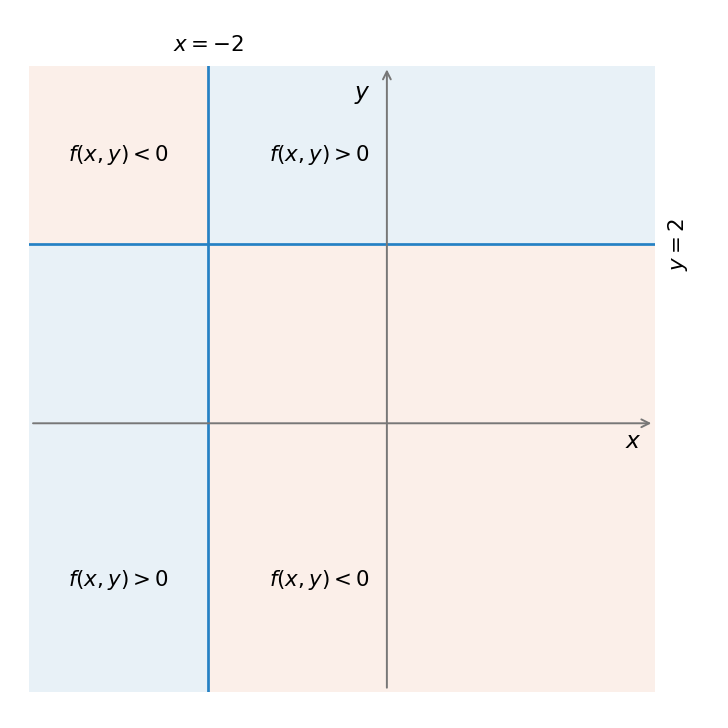

With that in mind, let's check each statement:

- Statement I is true. If $x>-2$ and $y>2,$ then according to our diagram, we have

$$
{\frac{\text{d}y}{\text{d}x}|}_{(x,y)}=f(x,y)>0.
$$

This implies that the slope of the slope field is positive for any point $(x,y)$ in this region.

- Statement II is false. If $x<-2$ and $y>2,$ then according to our diagram, we have

$$
{\frac{\text{d}y}{\text{d}x}|}_{(x,y)}=f(x,y)<0.
$$

This implies that the slope of the slope field is negative for any point $(x,y)$ in this region.

- Statement III is true. If $x<-2$ and $y<2,$ then according to our diagram, we have

$$
{\frac{\text{d}y}{\text{d}x}|}_{(x,y)}=f(x,y)>0.
$$

This implies that the slope of the slope field is positive for any point $(x,y)$ in this region.

## original q-97534

Template `y_squared`, profile `q-97534`.

Parameters: `{"h": 1, "k": 1, "ox": 1, "oy": 1, "px": 1, "py": 2, "regions": [[-1, -1, 1], [1, -1, -1], [1, 1, 1]]}`.

Consider the differential equation $\frac{\text{d}y}{\text{d}x}=(x-1)(y-1)^{2}$ and its slope field. Which of the following statements are true?

- At every point $(x,y)$ where $x<1$ and $y<1,$ the slope of the slope field is positive
- At every point $(x,y)$ where $x>1$ and $y<1,$ the slope of the slope field is negative
- At every point $(x,y)$ where $x>1$ and $y>1,$ the slope of the slope field is positive

- I only
- None of those listed
- III only **correct**
- I and II only
- II only

First, we define $f(x,y)=(x-1)(y-1)^{2}.$ Then, our differential equation is $\frac{\text{d}y}{\text{d}x}=f(x,y).$ 

Notice that $f(x,y)=0$ when $x=1$ or $y=1.$ This divides the $xy$-plane into four regions, as shown below.

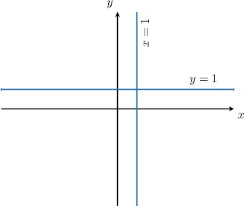

If we compute the sign of $f(x,y)$ in each of those four regions (by considering some test points, for example), we get the following:

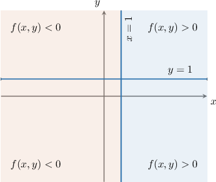

With that in mind, let's check each statement:

- Statement I is false. If $x<1$ and $y<1,$ then according to our diagram, we have

$$
{\frac{\text{d}y}{\text{d}x}|}_{(x,y)}=f(x,y)<0.
$$

This implies that the slope of the slope field is negative for any point $(x,y)$ in this region.

- Statement II is false. If $x>1$ and $y<1,$ then according to our diagram, we have

$$
{\frac{\text{d}y}{\text{d}x}|}_{(x,y)}=f(x,y)>0.
$$

This implies that the slope of the slope field is positive for any point $(x,y)$ in this region.

- Statement III is true. If $x>1$ and $y>1,$ then according to our diagram, we have

$$
{\frac{\text{d}y}{\text{d}x}|}_{(x,y)}=f(x,y)>0.
$$

This implies that the slope of the slope field is positive for any point $(x,y)$ in this region.

## generated observed-bank variant q-97534 1

Template `y_squared`, profile `q-97534`.

Parameters: `{"h": -1, "k": 1, "ox": 1, "oy": 1, "px": 1, "py": 2, "regions": [[-1, -1, 1], [1, -1, -1], [1, 1, 1]]}`.

Consider the differential equation $\frac{\text{d}y}{\text{d}x}=(x+1)(y-1)^{2}$ and its slope field. Which of the following statements are true?

- At every point $(x,y)$ where $x<-1$ and $y<1,$ the slope of the slope field is positive
- At every point $(x,y)$ where $x>-1$ and $y<1,$ the slope of the slope field is negative
- At every point $(x,y)$ where $x>-1$ and $y>1,$ the slope of the slope field is positive

- III only **correct**
- None of those listed
- II only
- I only
- I and II only

First, we define $f(x,y)=(x+1)(y-1)^{2}.$ Then, our differential equation is $\frac{\text{d}y}{\text{d}x}=f(x,y).$ 

Notice that $f(x,y)=0$ when $x=-1$ or $y=1.$ This divides the $xy$-plane into four regions, as shown below.

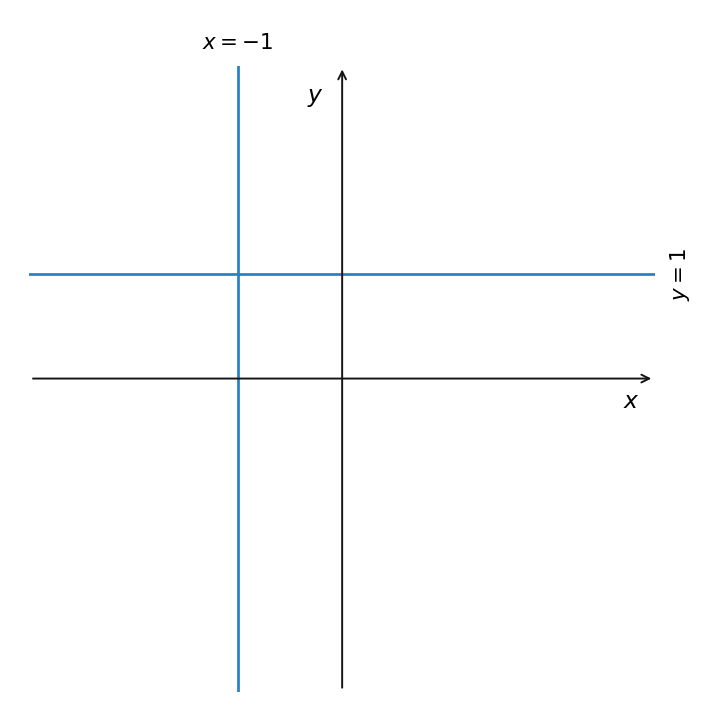

If we compute the sign of $f(x,y)$ in each of those four regions (by considering some test points, for example), we get the following:

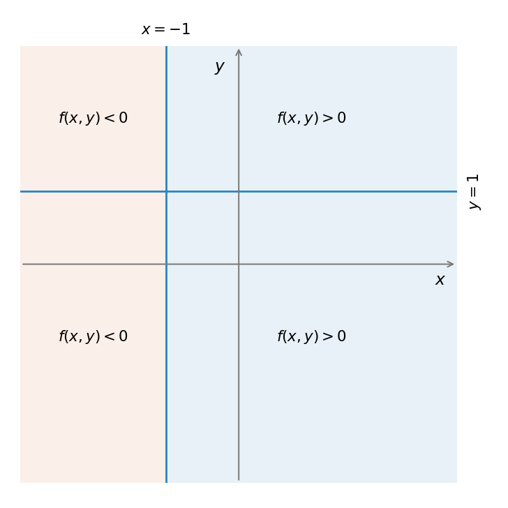

With that in mind, let's check each statement:

- Statement I is false. If $x<-1$ and $y<1,$ then according to our diagram, we have

$$
{\frac{\text{d}y}{\text{d}x}|}_{(x,y)}=f(x,y)<0.
$$

This implies that the slope of the slope field is negative for any point $(x,y)$ in this region.

- Statement II is false. If $x>-1$ and $y<1,$ then according to our diagram, we have

$$
{\frac{\text{d}y}{\text{d}x}|}_{(x,y)}=f(x,y)>0.
$$

This implies that the slope of the slope field is positive for any point $(x,y)$ in this region.

- Statement III is true. If $x>-1$ and $y>1,$ then according to our diagram, we have

$$
{\frac{\text{d}y}{\text{d}x}|}_{(x,y)}=f(x,y)>0.
$$

This implies that the slope of the slope field is positive for any point $(x,y)$ in this region.

## generated observed-bank variant q-97534 2

Template `y_squared`, profile `q-97534`.

Parameters: `{"h": 1, "k": -1, "ox": -1, "oy": 1, "px": 1, "py": 2, "regions": [[-1, -1, -1], [1, -1, 1], [1, 1, -1]]}`.

Consider the differential equation $\frac{\text{d}y}{\text{d}x}=(1-x)(y+1)^{2}$ and its slope field. Which of the following statements are true?

- At every point $(x,y)$ where $x<1$ and $y<-1,$ the slope of the slope field is negative
- At every point $(x,y)$ where $x>1$ and $y<-1,$ the slope of the slope field is positive
- At every point $(x,y)$ where $x>1$ and $y>-1,$ the slope of the slope field is negative

- None of those listed
- I only
- III only **correct**
- I and II only
- II only

First, we define $f(x,y)=(1-x)(y+1)^{2}.$ Then, our differential equation is $\frac{\text{d}y}{\text{d}x}=f(x,y).$ 

Notice that $f(x,y)=0$ when $x=1$ or $y=-1.$ This divides the $xy$-plane into four regions, as shown below.

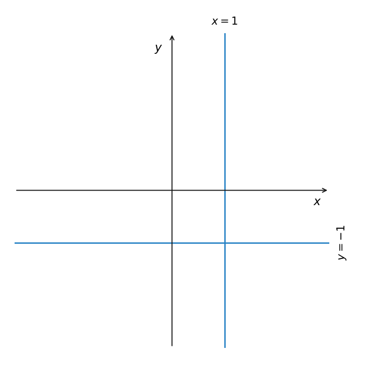

If we compute the sign of $f(x,y)$ in each of those four regions (by considering some test points, for example), we get the following:

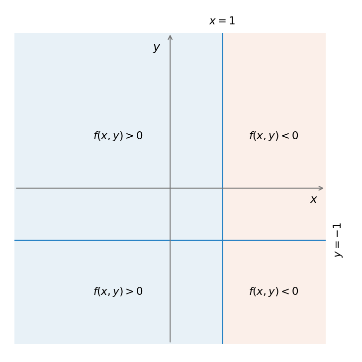

With that in mind, let's check each statement:

- Statement I is false. If $x<1$ and $y<-1,$ then according to our diagram, we have

$$
{\frac{\text{d}y}{\text{d}x}|}_{(x,y)}=f(x,y)>0.
$$

This implies that the slope of the slope field is positive for any point $(x,y)$ in this region.

- Statement II is false. If $x>1$ and $y<-1,$ then according to our diagram, we have

$$
{\frac{\text{d}y}{\text{d}x}|}_{(x,y)}=f(x,y)<0.
$$

This implies that the slope of the slope field is negative for any point $(x,y)$ in this region.

- Statement III is true. If $x>1$ and $y>-1,$ then according to our diagram, we have

$$
{\frac{\text{d}y}{\text{d}x}|}_{(x,y)}=f(x,y)<0.
$$

This implies that the slope of the slope field is negative for any point $(x,y)$ in this region.

## authored easy seed 13

Template `easy_bilinear`, profile `authored_truth_flips`.

Parameters: `{"h": 1, "k": -1, "ox": 1, "oy": 1, "px": 1, "py": 1, "regions": [[-1, 1, -1], [1, -1, -1], [-1, -1, -1]]}`.

Consider the differential equation $\frac{\text{d}y}{\text{d}x}=(x-1)(y+1)$ and its slope field. Which of the following statements are true?

- At every point $(x,y)$ where $x<1$ and $y>-1,$ the slope of the slope field is negative
- At every point $(x,y)$ where $x>1$ and $y<-1,$ the slope of the slope field is negative
- At every point $(x,y)$ where $x<1$ and $y<-1,$ the slope of the slope field is negative

- III only
- I, II, and III
- I only
- II only
- I and II only **correct**

First, we define $f(x,y)=(x-1)(y+1).$ Then, our differential equation is $\frac{\text{d}y}{\text{d}x}=f(x,y).$ 

Notice that $f(x,y)=0$ when $x=1$ or $y=-1.$ This divides the $xy$-plane into four regions, as shown below.

If we compute the sign of $f(x,y)$ in each of those four regions (by considering some test points, for example), we get the following:

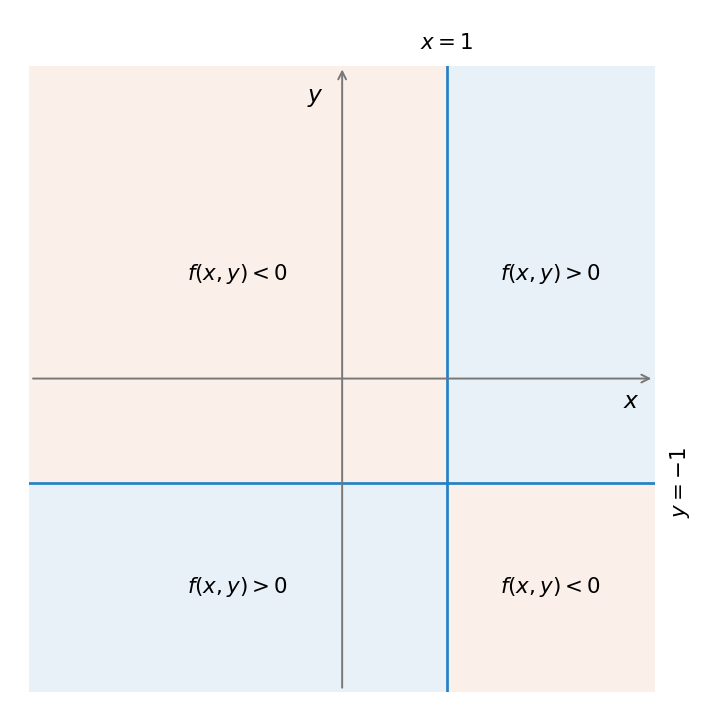

With that in mind, let's check each statement:

- Statement I is true. If $x<1$ and $y>-1,$ then according to our diagram, we have

$$
{\frac{\text{d}y}{\text{d}x}|}_{(x,y)}=f(x,y)<0.
$$

This implies that the slope of the slope field is negative for any point $(x,y)$ in this region.

- Statement II is true. If $x>1$ and $y<-1,$ then according to our diagram, we have

$$
{\frac{\text{d}y}{\text{d}x}|}_{(x,y)}=f(x,y)<0.
$$

This implies that the slope of the slope field is negative for any point $(x,y)$ in this region.

- Statement III is false. If $x<1$ and $y<-1,$ then according to our diagram, we have

$$
{\frac{\text{d}y}{\text{d}x}|}_{(x,y)}=f(x,y)>0.
$$

This implies that the slope of the slope field is positive for any point $(x,y)$ in this region.

Therefore, the correct answer is "I and II only."

## authored easy seed 14

Template `easy_bilinear`, profile `authored_truth_flips`.

Parameters: `{"h": -1, "k": 1, "ox": 1, "oy": 1, "px": 1, "py": 1, "regions": [[1, -1, 1], [-1, 1, 1], [-1, -1, 1]]}`.

Consider the differential equation $\frac{\text{d}y}{\text{d}x}=(x+1)(y-1)$ and its slope field. Which of the following statements are true?

- At every point $(x,y)$ where $x>-1$ and $y<1,$ the slope of the slope field is positive
- At every point $(x,y)$ where $x<-1$ and $y>1,$ the slope of the slope field is positive
- At every point $(x,y)$ where $x<-1$ and $y<1,$ the slope of the slope field is positive

- II and III only
- I and III only
- III only **correct**
- I and II only
- None of those listed

First, we define $f(x,y)=(x+1)(y-1).$ Then, our differential equation is $\frac{\text{d}y}{\text{d}x}=f(x,y).$ 

Notice that $f(x,y)=0$ when $x=-1$ or $y=1.$ This divides the $xy$-plane into four regions, as shown below.

If we compute the sign of $f(x,y)$ in each of those four regions (by considering some test points, for example), we get the following:

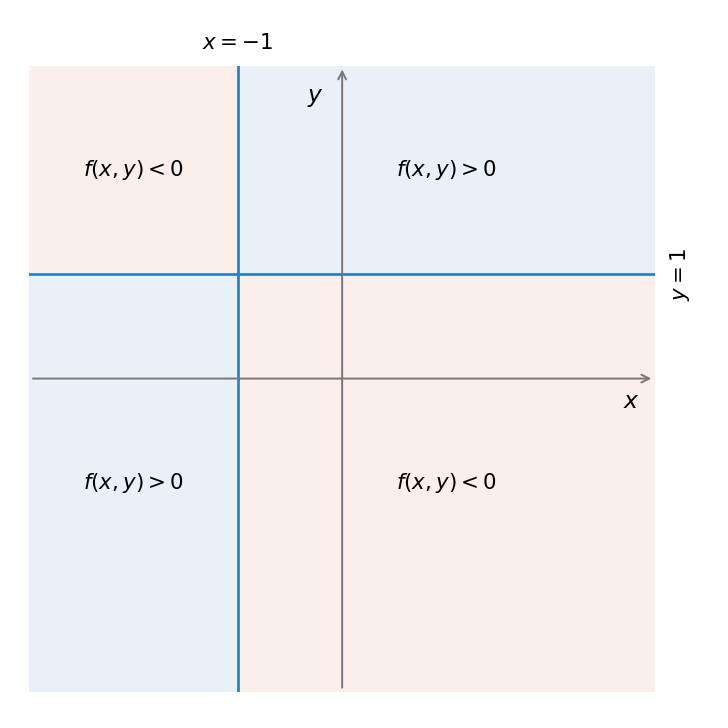

With that in mind, let's check each statement:

- Statement I is false. If $x>-1$ and $y<1,$ then according to our diagram, we have

$$
{\frac{\text{d}y}{\text{d}x}|}_{(x,y)}=f(x,y)<0.
$$

This implies that the slope of the slope field is negative for any point $(x,y)$ in this region.

- Statement II is false. If $x<-1$ and $y>1,$ then according to our diagram, we have

$$
{\frac{\text{d}y}{\text{d}x}|}_{(x,y)}=f(x,y)<0.
$$

This implies that the slope of the slope field is negative for any point $(x,y)$ in this region.

- Statement III is true. If $x<-1$ and $y<1,$ then according to our diagram, we have

$$
{\frac{\text{d}y}{\text{d}x}|}_{(x,y)}=f(x,y)>0.
$$

This implies that the slope of the slope field is positive for any point $(x,y)$ in this region.

Therefore, the correct answer is "III only."

## authored moderate seed 13

Template `bilinear`, profile `authored_truth_flips`.

Parameters: `{"h": -1, "k": 3, "ox": -1, "oy": -1, "px": 1, "py": 1, "regions": [[-1, 1, -1], [-1, -1, -1], [1, -1, -1]]}`.

Consider the differential equation $\frac{\text{d}y}{\text{d}x}=(-1-x)(3-y)$ and its slope field. Which of the following statements are true?

- At every point $(x,y)$ where $x<-1$ and $y>3,$ the slope of the slope field is negative
- At every point $(x,y)$ where $x<-1$ and $y<3,$ the slope of the slope field is negative
- At every point $(x,y)$ where $x>-1$ and $y<3,$ the slope of the slope field is negative

- II only
- I only
- III only
- I and III only **correct**
- I, II, and III

First, we define $f(x,y)=(-1-x)(3-y).$ Then, our differential equation is $\frac{\text{d}y}{\text{d}x}=f(x,y).$ 

Notice that $f(x,y)=0$ when $x=-1$ or $y=3.$ This divides the $xy$-plane into four regions, as shown below.

If we compute the sign of $f(x,y)$ in each of those four regions (by considering some test points, for example), we get the following:

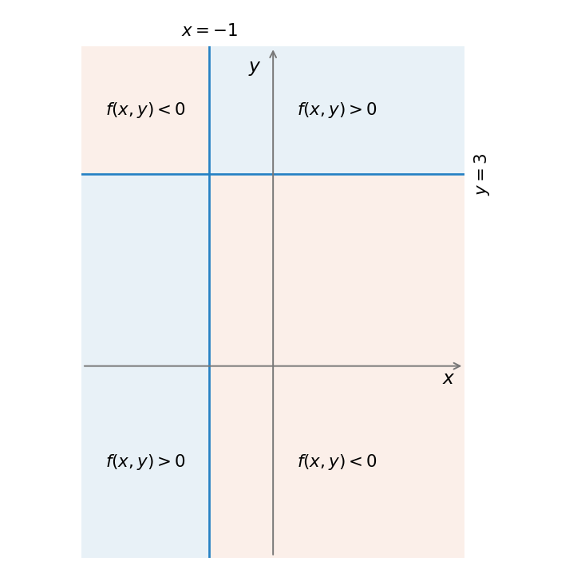

With that in mind, let's check each statement:

- Statement I is true. If $x<-1$ and $y>3,$ then according to our diagram, we have

$$
{\frac{\text{d}y}{\text{d}x}|}_{(x,y)}=f(x,y)<0.
$$

This implies that the slope of the slope field is negative for any point $(x,y)$ in this region.

- Statement II is false. If $x<-1$ and $y<3,$ then according to our diagram, we have

$$
{\frac{\text{d}y}{\text{d}x}|}_{(x,y)}=f(x,y)>0.
$$

This implies that the slope of the slope field is positive for any point $(x,y)$ in this region.

- Statement III is true. If $x>-1$ and $y<3,$ then according to our diagram, we have

$$
{\frac{\text{d}y}{\text{d}x}|}_{(x,y)}=f(x,y)<0.
$$

This implies that the slope of the slope field is negative for any point $(x,y)$ in this region.

Therefore, the correct answer is "I and III only."

## authored moderate seed 14

Template `bilinear`, profile `authored_truth_flips`.

Parameters: `{"h": 2, "k": 3, "ox": -1, "oy": 1, "px": 1, "py": 1, "regions": [[1, -1, 1], [-1, 1, 1], [-1, -1, 1]]}`.

Consider the differential equation $\frac{\text{d}y}{\text{d}x}=(2-x)(y-3)$ and its slope field. Which of the following statements are true?

- At every point $(x,y)$ where $x>2$ and $y<3,$ the slope of the slope field is positive
- At every point $(x,y)$ where $x<2$ and $y>3,$ the slope of the slope field is positive
- At every point $(x,y)$ where $x<2$ and $y<3,$ the slope of the slope field is positive

- I only
- II only
- I and II only **correct**
- III only
- I, II, and III

First, we define $f(x,y)=(2-x)(y-3).$ Then, our differential equation is $\frac{\text{d}y}{\text{d}x}=f(x,y).$ 

Notice that $f(x,y)=0$ when $x=2$ or $y=3.$ This divides the $xy$-plane into four regions, as shown below.

If we compute the sign of $f(x,y)$ in each of those four regions (by considering some test points, for example), we get the following:

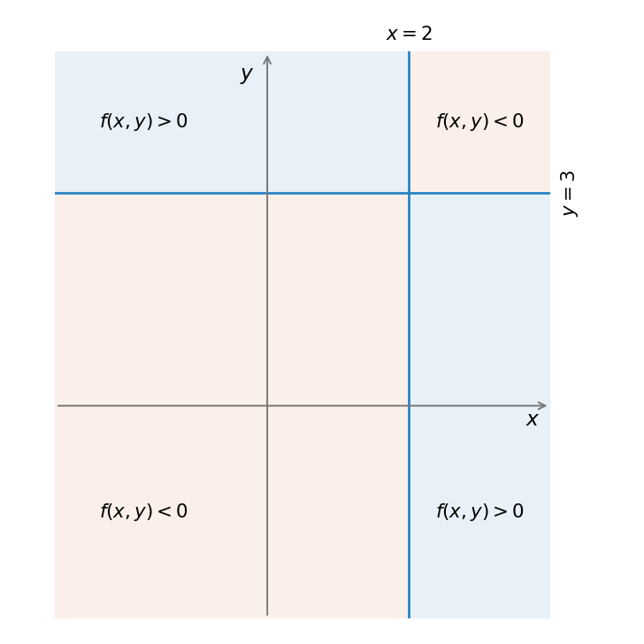

With that in mind, let's check each statement:

- Statement I is true. If $x>2$ and $y<3,$ then according to our diagram, we have

$$
{\frac{\text{d}y}{\text{d}x}|}_{(x,y)}=f(x,y)>0.
$$

This implies that the slope of the slope field is positive for any point $(x,y)$ in this region.

- Statement II is true. If $x<2$ and $y>3,$ then according to our diagram, we have

$$
{\frac{\text{d}y}{\text{d}x}|}_{(x,y)}=f(x,y)>0.
$$

This implies that the slope of the slope field is positive for any point $(x,y)$ in this region.

- Statement III is false. If $x<2$ and $y<3,$ then according to our diagram, we have

$$
{\frac{\text{d}y}{\text{d}x}|}_{(x,y)}=f(x,y)<0.
$$

This implies that the slope of the slope field is negative for any point $(x,y)$ in this region.

Therefore, the correct answer is "I and II only."

## authored hard seed 13

Template `y_squared`, profile `authored_truth_flips`.

Parameters: `{"h": -1, "k": 3, "ox": -1, "oy": 1, "px": 1, "py": 2, "regions": [[-1, 1, -1], [1, -1, -1], [-1, -1, -1]]}`.

Consider the differential equation $\frac{\text{d}y}{\text{d}x}=(-1-x)(y-3)^{2}$ and its slope field. Which of the following statements are true?

- At every point $(x,y)$ where $x<-1$ and $y>3,$ the slope of the slope field is negative
- At every point $(x,y)$ where $x>-1$ and $y<3,$ the slope of the slope field is negative
- At every point $(x,y)$ where $x<-1$ and $y<3,$ the slope of the slope field is negative

- I and III only
- II and III only
- None of those listed
- I and II only
- II only **correct**

First, we define $f(x,y)=(-1-x)(y-3)^{2}.$ Then, our differential equation is $\frac{\text{d}y}{\text{d}x}=f(x,y).$ 

Notice that $f(x,y)=0$ when $x=-1$ or $y=3.$ This divides the $xy$-plane into four regions, as shown below.

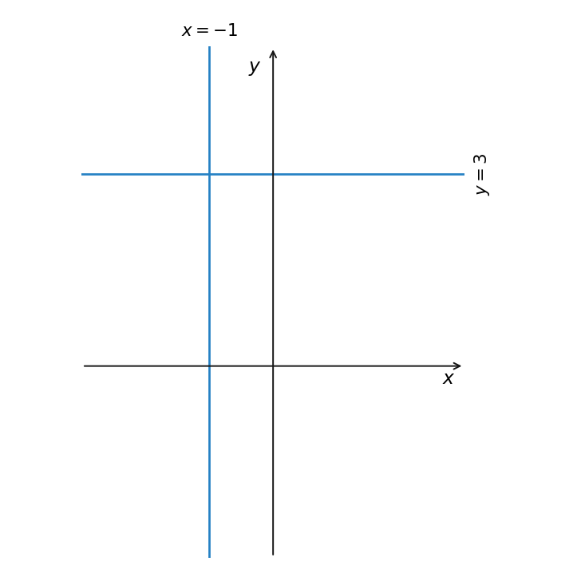

If we compute the sign of $f(x,y)$ in each of those four regions (by considering some test points, for example), we get the following:

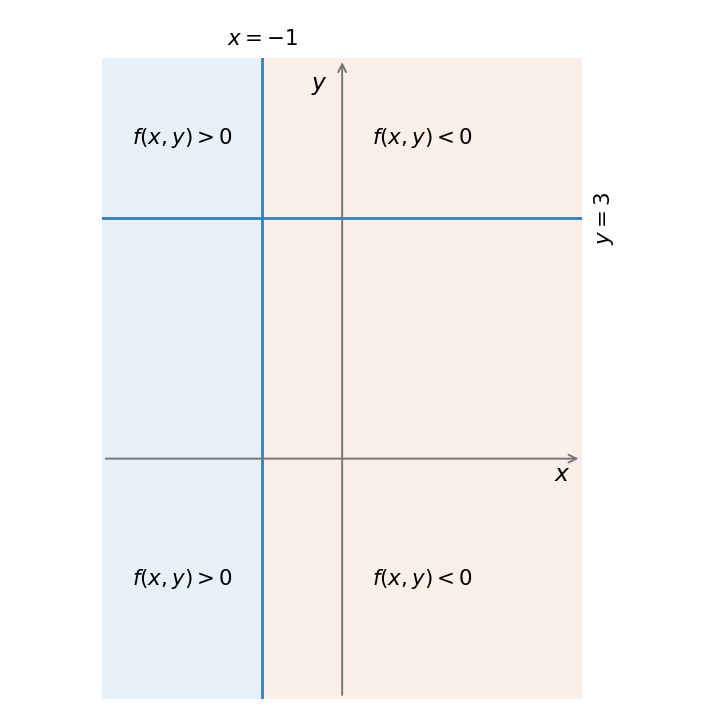

With that in mind, let's check each statement:

- Statement I is false. If $x<-1$ and $y>3,$ then according to our diagram, we have

$$
{\frac{\text{d}y}{\text{d}x}|}_{(x,y)}=f(x,y)>0.
$$

This implies that the slope of the slope field is positive for any point $(x,y)$ in this region.

- Statement II is true. If $x>-1$ and $y<3,$ then according to our diagram, we have

$$
{\frac{\text{d}y}{\text{d}x}|}_{(x,y)}=f(x,y)<0.
$$

This implies that the slope of the slope field is negative for any point $(x,y)$ in this region.

- Statement III is false. If $x<-1$ and $y<3,$ then according to our diagram, we have

$$
{\frac{\text{d}y}{\text{d}x}|}_{(x,y)}=f(x,y)>0.
$$

This implies that the slope of the slope field is positive for any point $(x,y)$ in this region.

Therefore, the correct answer is "II only."

## authored hard seed 14

Template `x_squared`, profile `authored_truth_flips`.

Parameters: `{"h": 2, "k": 3, "ox": 1, "oy": -1, "px": 2, "py": 1, "regions": [[1, -1, 1], [1, 1, -1], [-1, 1, 1]]}`.

Consider the differential equation $\frac{\text{d}y}{\text{d}x}=(x-2)^{2}(3-y)$ and its slope field. Which of the following statements are true?

- At every point $(x,y)$ where $x>2$ and $y<3,$ the slope of the slope field is positive
- At every point $(x,y)$ where $x>2$ and $y>3,$ the slope of the slope field is negative
- At every point $(x,y)$ where $x<2$ and $y>3,$ the slope of the slope field is positive

- I and II only **correct**
- II only
- III only
- I, II, and III
- I only

First, we define $f(x,y)=(x-2)^{2}(3-y).$ Then, our differential equation is $\frac{\text{d}y}{\text{d}x}=f(x,y).$ 

Notice that $f(x,y)=0$ when $x=2$ or $y=3.$ This divides the $xy$-plane into four regions, as shown below.

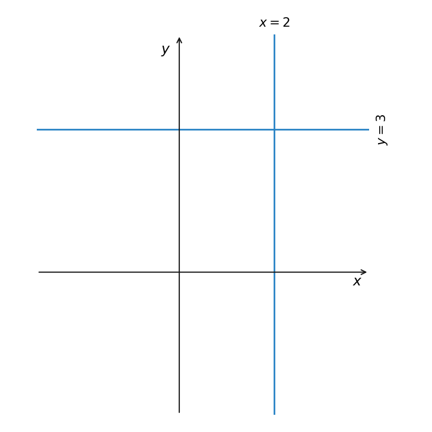

If we compute the sign of $f(x,y)$ in each of those four regions (by considering some test points, for example), we get the following:

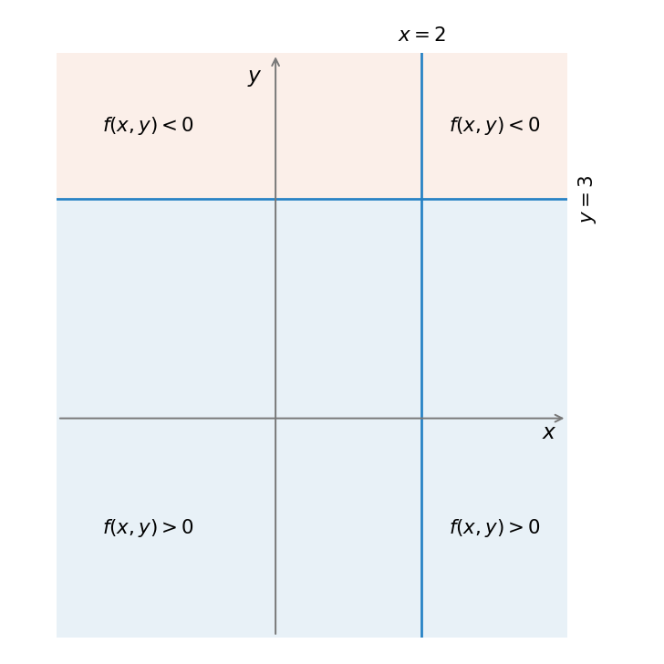

With that in mind, let's check each statement:

- Statement I is true. If $x>2$ and $y<3,$ then according to our diagram, we have

$$
{\frac{\text{d}y}{\text{d}x}|}_{(x,y)}=f(x,y)>0.
$$

This implies that the slope of the slope field is positive for any point $(x,y)$ in this region.

- Statement II is true. If $x>2$ and $y>3,$ then according to our diagram, we have

$$
{\frac{\text{d}y}{\text{d}x}|}_{(x,y)}=f(x,y)<0.
$$

This implies that the slope of the slope field is negative for any point $(x,y)$ in this region.

- Statement III is false. If $x<2$ and $y>3,$ then according to our diagram, we have

$$
{\frac{\text{d}y}{\text{d}x}|}_{(x,y)}=f(x,y)<0.
$$

This implies that the slope of the slope field is negative for any point $(x,y)$ in this region.

Therefore, the correct answer is "I and II only."

## authored boundary easy_bilinear -1

Template `easy_bilinear`, profile `authored_truth_flips`.

Parameters: `{"h": -1, "k": 1, "ox": 1, "oy": 1, "px": 1, "py": 1, "regions": [[-1, -1, 1], [-1, 1, -1], [1, 1, 1]]}`.

Consider the differential equation $\frac{\text{d}y}{\text{d}x}=(x+1)(y-1)$ and its slope field. Which of the following statements are true?

- At every point $(x,y)$ where $x<-1$ and $y<1,$ the slope of the slope field is positive
- At every point $(x,y)$ where $x<-1$ and $y>1,$ the slope of the slope field is negative
- At every point $(x,y)$ where $x>-1$ and $y>1,$ the slope of the slope field is positive

- I and II only
- I and III only
- I, II, and III **correct**
- None of those listed
- II and III only

First, we define $f(x,y)=(x+1)(y-1).$ Then, our differential equation is $\frac{\text{d}y}{\text{d}x}=f(x,y).$ 

Notice that $f(x,y)=0$ when $x=-1$ or $y=1.$ This divides the $xy$-plane into four regions, as shown below.

If we compute the sign of $f(x,y)$ in each of those four regions (by considering some test points, for example), we get the following:

With that in mind, let's check each statement:

- Statement I is true. If $x<-1$ and $y<1,$ then according to our diagram, we have

$$
{\frac{\text{d}y}{\text{d}x}|}_{(x,y)}=f(x,y)>0.
$$

This implies that the slope of the slope field is positive for any point $(x,y)$ in this region.

- Statement II is true. If $x<-1$ and $y>1,$ then according to our diagram, we have

$$
{\frac{\text{d}y}{\text{d}x}|}_{(x,y)}=f(x,y)<0.
$$

This implies that the slope of the slope field is negative for any point $(x,y)$ in this region.

- Statement III is true. If $x>-1$ and $y>1,$ then according to our diagram, we have

$$
{\frac{\text{d}y}{\text{d}x}|}_{(x,y)}=f(x,y)>0.
$$

This implies that the slope of the slope field is positive for any point $(x,y)$ in this region.

Therefore, the correct answer is "I, II, and III."

## authored boundary easy_bilinear 1

Template `easy_bilinear`, profile `authored_truth_flips`.

Parameters: `{"h": -1, "k": 1, "ox": 1, "oy": 1, "px": 1, "py": 1, "regions": [[-1, -1, 1], [-1, 1, -1], [1, 1, 1]]}`.

Consider the differential equation $\frac{\text{d}y}{\text{d}x}=(x+1)(y-1)$ and its slope field. Which of the following statements are true?

- At every point $(x,y)$ where $x<-1$ and $y<1,$ the slope of the slope field is positive
- At every point $(x,y)$ where $x<-1$ and $y>1,$ the slope of the slope field is negative
- At every point $(x,y)$ where $x>-1$ and $y>1,$ the slope of the slope field is positive

- I and II only
- I and III only
- I, II, and III **correct**
- None of those listed
- II and III only

First, we define $f(x,y)=(x+1)(y-1).$ Then, our differential equation is $\frac{\text{d}y}{\text{d}x}=f(x,y).$ 

Notice that $f(x,y)=0$ when $x=-1$ or $y=1.$ This divides the $xy$-plane into four regions, as shown below.

If we compute the sign of $f(x,y)$ in each of those four regions (by considering some test points, for example), we get the following:

With that in mind, let's check each statement:

- Statement I is true. If $x<-1$ and $y<1,$ then according to our diagram, we have

$$
{\frac{\text{d}y}{\text{d}x}|}_{(x,y)}=f(x,y)>0.
$$

This implies that the slope of the slope field is positive for any point $(x,y)$ in this region.

- Statement II is true. If $x<-1$ and $y>1,$ then according to our diagram, we have

$$
{\frac{\text{d}y}{\text{d}x}|}_{(x,y)}=f(x,y)<0.
$$

This implies that the slope of the slope field is negative for any point $(x,y)$ in this region.

- Statement III is true. If $x>-1$ and $y>1,$ then according to our diagram, we have

$$
{\frac{\text{d}y}{\text{d}x}|}_{(x,y)}=f(x,y)>0.
$$

This implies that the slope of the slope field is positive for any point $(x,y)$ in this region.

Therefore, the correct answer is "I, II, and III."

## authored boundary bilinear -1

Template `bilinear`, profile `authored_truth_flips`.

Parameters: `{"h": -3, "k": 3, "ox": -1, "oy": 1, "px": 1, "py": 1, "regions": [[-1, -1, 1], [-1, 1, -1], [1, 1, 1]]}`.

Consider the differential equation $\frac{\text{d}y}{\text{d}x}=(-3-x)(y-3)$ and its slope field. Which of the following statements are true?

- At every point $(x,y)$ where $x<-3$ and $y<3,$ the slope of the slope field is positive
- At every point $(x,y)$ where $x<-3$ and $y>3,$ the slope of the slope field is negative
- At every point $(x,y)$ where $x>-3$ and $y>3,$ the slope of the slope field is positive

- III only
- II only
- None of those listed **correct**
- I, II, and III
- I only

First, we define $f(x,y)=(-3-x)(y-3).$ Then, our differential equation is $\frac{\text{d}y}{\text{d}x}=f(x,y).$ 

Notice that $f(x,y)=0$ when $x=-3$ or $y=3.$ This divides the $xy$-plane into four regions, as shown below.

If we compute the sign of $f(x,y)$ in each of those four regions (by considering some test points, for example), we get the following:

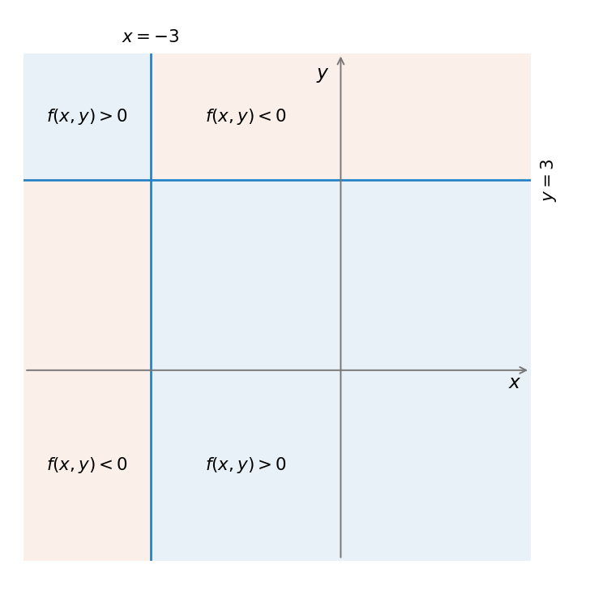

With that in mind, let's check each statement:

- Statement I is false. If $x<-3$ and $y<3,$ then according to our diagram, we have

$$
{\frac{\text{d}y}{\text{d}x}|}_{(x,y)}=f(x,y)<0.
$$

This implies that the slope of the slope field is negative for any point $(x,y)$ in this region.

- Statement II is false. If $x<-3$ and $y>3,$ then according to our diagram, we have

$$
{\frac{\text{d}y}{\text{d}x}|}_{(x,y)}=f(x,y)>0.
$$

This implies that the slope of the slope field is positive for any point $(x,y)$ in this region.

- Statement III is false. If $x>-3$ and $y>3,$ then according to our diagram, we have

$$
{\frac{\text{d}y}{\text{d}x}|}_{(x,y)}=f(x,y)<0.
$$

This implies that the slope of the slope field is negative for any point $(x,y)$ in this region.

Therefore, the correct answer is "None of those listed."

## authored boundary bilinear 1

Template `bilinear`, profile `authored_truth_flips`.

Parameters: `{"h": -3, "k": 3, "ox": 1, "oy": 1, "px": 1, "py": 1, "regions": [[-1, -1, 1], [-1, 1, -1], [1, 1, 1]]}`.

Consider the differential equation $\frac{\text{d}y}{\text{d}x}=(x+3)(y-3)$ and its slope field. Which of the following statements are true?

- At every point $(x,y)$ where $x<-3$ and $y<3,$ the slope of the slope field is positive
- At every point $(x,y)$ where $x<-3$ and $y>3,$ the slope of the slope field is negative
- At every point $(x,y)$ where $x>-3$ and $y>3,$ the slope of the slope field is positive

- I and II only
- I and III only
- I, II, and III **correct**
- None of those listed
- II and III only

First, we define $f(x,y)=(x+3)(y-3).$ Then, our differential equation is $\frac{\text{d}y}{\text{d}x}=f(x,y).$ 

Notice that $f(x,y)=0$ when $x=-3$ or $y=3.$ This divides the $xy$-plane into four regions, as shown below.

If we compute the sign of $f(x,y)$ in each of those four regions (by considering some test points, for example), we get the following:

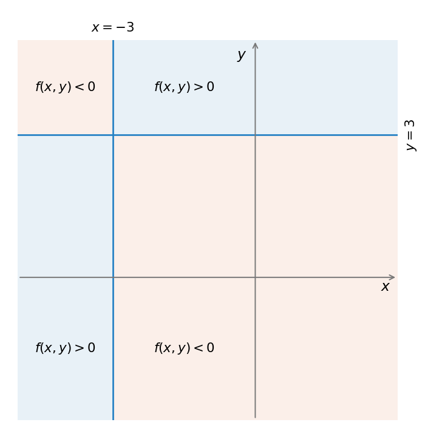

With that in mind, let's check each statement:

- Statement I is true. If $x<-3$ and $y<3,$ then according to our diagram, we have

$$
{\frac{\text{d}y}{\text{d}x}|}_{(x,y)}=f(x,y)>0.
$$

This implies that the slope of the slope field is positive for any point $(x,y)$ in this region.

- Statement II is true. If $x<-3$ and $y>3,$ then according to our diagram, we have

$$
{\frac{\text{d}y}{\text{d}x}|}_{(x,y)}=f(x,y)<0.
$$

This implies that the slope of the slope field is negative for any point $(x,y)$ in this region.

- Statement III is true. If $x>-3$ and $y>3,$ then according to our diagram, we have

$$
{\frac{\text{d}y}{\text{d}x}|}_{(x,y)}=f(x,y)>0.
$$

This implies that the slope of the slope field is positive for any point $(x,y)$ in this region.

Therefore, the correct answer is "I, II, and III."

## authored boundary x_squared -1

Template `x_squared`, profile `authored_truth_flips`.

Parameters: `{"h": -3, "k": 3, "ox": 1, "oy": -1, "px": 2, "py": 1, "regions": [[-1, -1, 1], [-1, 1, -1], [1, 1, 1]]}`.

Consider the differential equation $\frac{\text{d}y}{\text{d}x}=(x+3)^{2}(3-y)$ and its slope field. Which of the following statements are true?

- At every point $(x,y)$ where $x<-3$ and $y<3,$ the slope of the slope field is positive
- At every point $(x,y)$ where $x<-3$ and $y>3,$ the slope of the slope field is negative
- At every point $(x,y)$ where $x>-3$ and $y>3,$ the slope of the slope field is positive

- I, II, and III
- I only
- I and II only **correct**
- III only
- II only

First, we define $f(x,y)=(x+3)^{2}(3-y).$ Then, our differential equation is $\frac{\text{d}y}{\text{d}x}=f(x,y).$ 

Notice that $f(x,y)=0$ when $x=-3$ or $y=3.$ This divides the $xy$-plane into four regions, as shown below.

If we compute the sign of $f(x,y)$ in each of those four regions (by considering some test points, for example), we get the following:

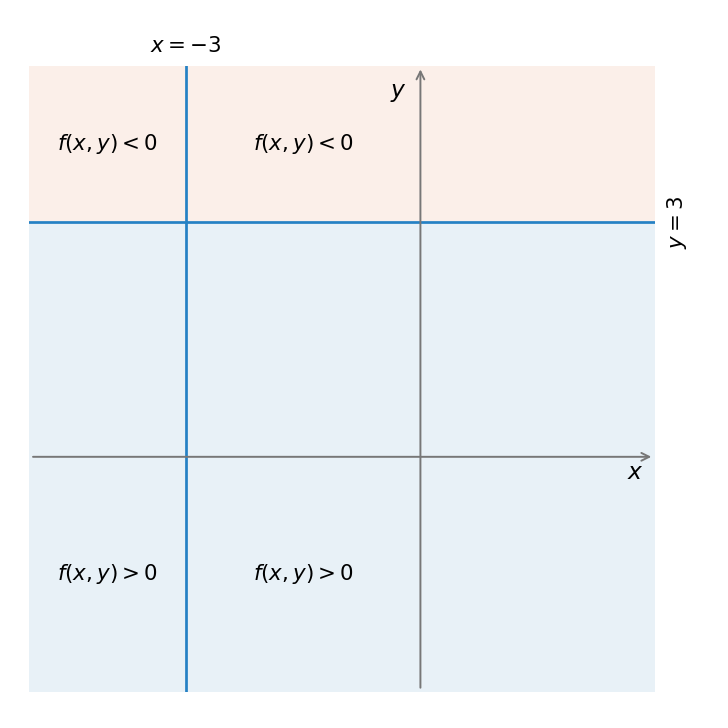

With that in mind, let's check each statement:

- Statement I is true. If $x<-3$ and $y<3,$ then according to our diagram, we have

$$
{\frac{\text{d}y}{\text{d}x}|}_{(x,y)}=f(x,y)>0.
$$

This implies that the slope of the slope field is positive for any point $(x,y)$ in this region.

- Statement II is true. If $x<-3$ and $y>3,$ then according to our diagram, we have

$$
{\frac{\text{d}y}{\text{d}x}|}_{(x,y)}=f(x,y)<0.
$$

This implies that the slope of the slope field is negative for any point $(x,y)$ in this region.

- Statement III is false. If $x>-3$ and $y>3,$ then according to our diagram, we have

$$
{\frac{\text{d}y}{\text{d}x}|}_{(x,y)}=f(x,y)<0.
$$

This implies that the slope of the slope field is negative for any point $(x,y)$ in this region.

Therefore, the correct answer is "I and II only."

## authored boundary x_squared 1

Template `x_squared`, profile `authored_truth_flips`.

Parameters: `{"h": -3, "k": 3, "ox": 1, "oy": 1, "px": 2, "py": 1, "regions": [[-1, -1, 1], [-1, 1, -1], [1, 1, 1]]}`.

Consider the differential equation $\frac{\text{d}y}{\text{d}x}=(x+3)^{2}(y-3)$ and its slope field. Which of the following statements are true?

- At every point $(x,y)$ where $x<-3$ and $y<3,$ the slope of the slope field is positive
- At every point $(x,y)$ where $x<-3$ and $y>3,$ the slope of the slope field is negative
- At every point $(x,y)$ where $x>-3$ and $y>3,$ the slope of the slope field is positive

- None of those listed
- II and III only
- III only **correct**
- I and II only
- I and III only

First, we define $f(x,y)=(x+3)^{2}(y-3).$ Then, our differential equation is $\frac{\text{d}y}{\text{d}x}=f(x,y).$ 

Notice that $f(x,y)=0$ when $x=-3$ or $y=3.$ This divides the $xy$-plane into four regions, as shown below.

If we compute the sign of $f(x,y)$ in each of those four regions (by considering some test points, for example), we get the following:

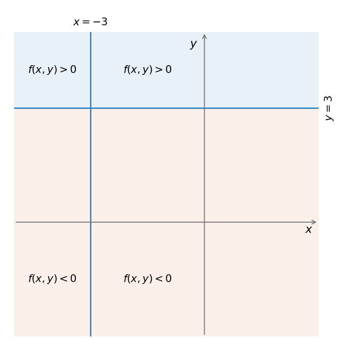

With that in mind, let's check each statement:

- Statement I is false. If $x<-3$ and $y<3,$ then according to our diagram, we have

$$
{\frac{\text{d}y}{\text{d}x}|}_{(x,y)}=f(x,y)<0.
$$

This implies that the slope of the slope field is negative for any point $(x,y)$ in this region.

- Statement II is false. If $x<-3$ and $y>3,$ then according to our diagram, we have

$$
{\frac{\text{d}y}{\text{d}x}|}_{(x,y)}=f(x,y)>0.
$$

This implies that the slope of the slope field is positive for any point $(x,y)$ in this region.

- Statement III is true. If $x>-3$ and $y>3,$ then according to our diagram, we have

$$
{\frac{\text{d}y}{\text{d}x}|}_{(x,y)}=f(x,y)>0.
$$

This implies that the slope of the slope field is positive for any point $(x,y)$ in this region.

Therefore, the correct answer is "III only."

## authored boundary y_squared -1

Template `y_squared`, profile `authored_truth_flips`.

Parameters: `{"h": -3, "k": 3, "ox": -1, "oy": 1, "px": 1, "py": 2, "regions": [[-1, -1, 1], [-1, 1, -1], [1, 1, 1]]}`.

Consider the differential equation $\frac{\text{d}y}{\text{d}x}=(-3-x)(y-3)^{2}$ and its slope field. Which of the following statements are true?

- At every point $(x,y)$ where $x<-3$ and $y<3,$ the slope of the slope field is positive
- At every point $(x,y)$ where $x<-3$ and $y>3,$ the slope of the slope field is negative
- At every point $(x,y)$ where $x>-3$ and $y>3,$ the slope of the slope field is positive

- I and III only
- I and II only
- I only **correct**
- II and III only
- None of those listed

First, we define $f(x,y)=(-3-x)(y-3)^{2}.$ Then, our differential equation is $\frac{\text{d}y}{\text{d}x}=f(x,y).$ 

Notice that $f(x,y)=0$ when $x=-3$ or $y=3.$ This divides the $xy$-plane into four regions, as shown below.

If we compute the sign of $f(x,y)$ in each of those four regions (by considering some test points, for example), we get the following:

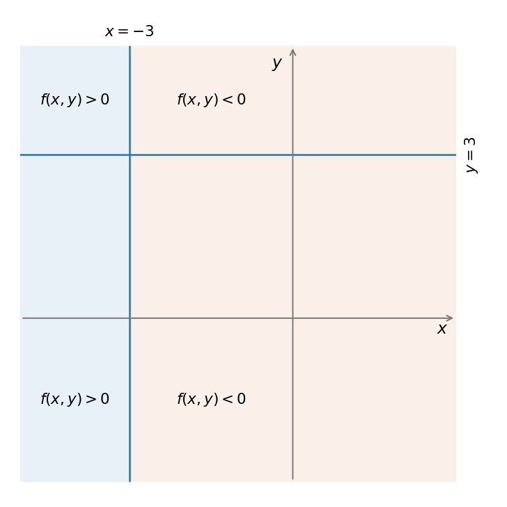

With that in mind, let's check each statement:

- Statement I is true. If $x<-3$ and $y<3,$ then according to our diagram, we have

$$
{\frac{\text{d}y}{\text{d}x}|}_{(x,y)}=f(x,y)>0.
$$

This implies that the slope of the slope field is positive for any point $(x,y)$ in this region.

- Statement II is false. If $x<-3$ and $y>3,$ then according to our diagram, we have

$$
{\frac{\text{d}y}{\text{d}x}|}_{(x,y)}=f(x,y)>0.
$$

This implies that the slope of the slope field is positive for any point $(x,y)$ in this region.

- Statement III is false. If $x>-3$ and $y>3,$ then according to our diagram, we have

$$
{\frac{\text{d}y}{\text{d}x}|}_{(x,y)}=f(x,y)<0.
$$

This implies that the slope of the slope field is negative for any point $(x,y)$ in this region.

Therefore, the correct answer is "I only."

## authored boundary y_squared 1

Template `y_squared`, profile `authored_truth_flips`.

Parameters: `{"h": -3, "k": 3, "ox": 1, "oy": 1, "px": 1, "py": 2, "regions": [[-1, -1, 1], [-1, 1, -1], [1, 1, 1]]}`.

Consider the differential equation $\frac{\text{d}y}{\text{d}x}=(x+3)(y-3)^{2}$ and its slope field. Which of the following statements are true?

- At every point $(x,y)$ where $x<-3$ and $y<3,$ the slope of the slope field is positive
- At every point $(x,y)$ where $x<-3$ and $y>3,$ the slope of the slope field is negative
- At every point $(x,y)$ where $x>-3$ and $y>3,$ the slope of the slope field is positive

- II only
- III only
- II and III only **correct**
- I only
- I, II, and III

First, we define $f(x,y)=(x+3)(y-3)^{2}.$ Then, our differential equation is $\frac{\text{d}y}{\text{d}x}=f(x,y).$ 

Notice that $f(x,y)=0$ when $x=-3$ or $y=3.$ This divides the $xy$-plane into four regions, as shown below.

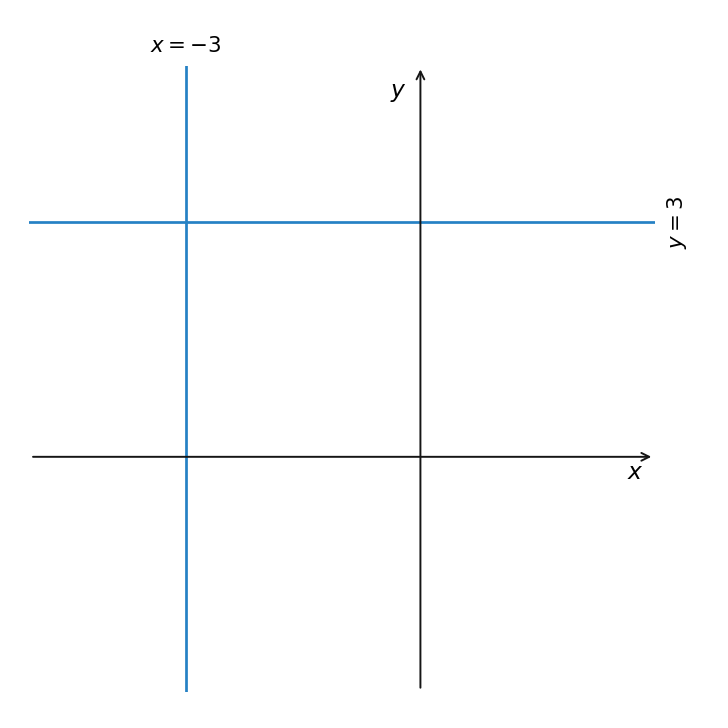

If we compute the sign of $f(x,y)$ in each of those four regions (by considering some test points, for example), we get the following:

With that in mind, let's check each statement:

- Statement I is false. If $x<-3$ and $y<3,$ then according to our diagram, we have

$$
{\frac{\text{d}y}{\text{d}x}|}_{(x,y)}=f(x,y)<0.
$$

This implies that the slope of the slope field is negative for any point $(x,y)$ in this region.

- Statement II is true. If $x<-3$ and $y>3,$ then according to our diagram, we have

$$
{\frac{\text{d}y}{\text{d}x}|}_{(x,y)}=f(x,y)<0.
$$

This implies that the slope of the slope field is negative for any point $(x,y)$ in this region.

- Statement III is true. If $x>-3$ and $y>3,$ then according to our diagram, we have

$$
{\frac{\text{d}y}{\text{d}x}|}_{(x,y)}=f(x,y)>0.
$$

This implies that the slope of the slope field is positive for any point $(x,y)$ in this region.

Therefore, the correct answer is "II and III only."

