# Original and generated review

Sources: math basis1356. Raw observed records remain evidence-only.

## q-108544 — observed moderate

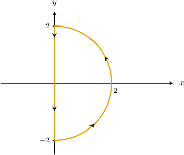

Consider the path $C$ shown above. Which of the following is equivalent to the line integral 

$$
{∮}_{C}(3y-{e}^{\operatorname{cos}⁡x})\,dx+(7x+\sqrt{y+5})\,dy\,?
$$

Field selection

${\int }_{-\pi /2}^{\pi /2}\operatorname{cos}⁡\theta {\int }_{0}^{2}2r\,dr\,d\theta $

${\int }_{-\pi /2}^{\pi /2}\,{\int }_{0}^{2}4r\,dr\,d\theta $ (keyed correct)

${\int }_{0}^{\pi }\,{\int }_{0}^{2}4r\,dr\,d\theta $

${\int }_{0}^{\pi }\,{\int }_{0}^{2}({r}^{3}-{e}^{\operatorname{cos}⁡\theta })r\,dr\,d\theta $

${\int }_{-\pi /2}^{\pi /2}\,{\int }_{0}^{2}({r}^{3}-{e}^{\operatorname{cos}⁡\theta })\,dr\,d\theta $

Green's theorem states that

$$
{∮}_{C}P\,dx+Q\,dy={∬}_{D}(\frac{∂Q}{∂x}-\frac{∂P}{∂y})\,\text{d}A.
$$

In our case, the region $D$ and its boundary $C$ satisfy the conditions of Green's theorem:

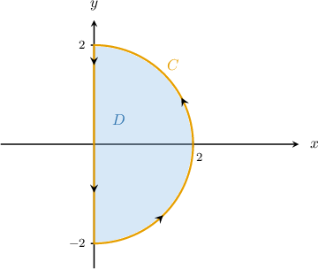

Since $P(x,y)=3y-{e}^{\operatorname{cos}⁡x}$ and $Q(x,y)=7x+\sqrt{y+5},$ we obtain

$$
\begin{aligned}\frac{∂P}{∂y}=3,\,\frac{∂Q}{∂x}=7.\end{aligned}
$$

Applying Green's theorem, we get

$$
\begin{aligned}{∮}_{C}(3y-{e}^{\operatorname{cos}⁡x})\,dx+(7x+\sqrt{y+5})\,dy & ={∬}_{D}(\frac{∂Q}{∂x}-\frac{∂P}{∂y})\text{d}A \\  & ={∬}_{D}(7-3)\,\text{d}A \\  & ={∬}_{D}4\,\text{d}A.\end{aligned}
$$

Now, notice that the region $D$ can be represented in polar coordinates as

$$
Δ={(r,\theta )\,:\,0\le r\le 2,\,-\frac{\pi }{2}\le \theta \le \frac{\pi }{2}}.
$$

The change of variables formula for plane polar coordinates states that

$$
{∬}_{D}f(x,y)\text{ }dA={∬}_{Δ}\text{ }f(r\operatorname{cos}⁡\theta ,r\operatorname{sin}⁡\theta )\,r\text{ }drd\theta .
$$

Therefore, we can write our double integral as 

$$
\begin{aligned}{∬}_{D}4\,\text{d}A & ={∬}_{Δ}4\,r\,\text{d}r\text{d}\theta  \\  & ={\int }_{-\pi /2}^{\pi /2}\,{\int }_{0}^{2}4r\,dr\,d\theta .\end{aligned}
$$

### Generated variation — evidence-only historical bank observed

Consider the path $C$ shown above. Which of the following is equivalent to the line integral 

$$
2\left({∮}_{C}(3y-{e}^{\operatorname{cos}⁡x})\,dx+(7x+\sqrt{y+5})\,dy\,?\right)
$$

Field selection

$2\left({\int }_{0}^{\pi }\,{\int }_{0}^{2}({r}^{3}-{e}^{\operatorname{cos}⁡\theta })r\,dr\,d\theta \right)$

$2\left({\int }_{-\pi /2}^{\pi /2}\,{\int }_{0}^{2}4r\,dr\,d\theta \right)$

$2\left({\int }_{-\pi /2}^{\pi /2}\,{\int }_{0}^{2}({r}^{3}-{e}^{\operatorname{cos}⁡\theta })\,dr\,d\theta \right)$

$2\left({\int }_{-\pi /2}^{\pi /2}\operatorname{cos}⁡\theta {\int }_{0}^{2}2r\,dr\,d\theta \right)$

$2\left({\int }_{0}^{\pi }\,{\int }_{0}^{2}4r\,dr\,d\theta \right)$

Green's theorem states that

$$
{∮}_{C}P\,dx+Q\,dy={∬}_{D}(\frac{∂Q}{∂x}-\frac{∂P}{∂y})\,\text{d}A.
$$

In our case, the region $D$ and its boundary $C$ satisfy the conditions of Green's theorem:

Since $P(x,y)=2\left(3y-{e}^{\operatorname{cos}⁡x}\right)$ and $Q(x,y)=2\left(7x+\sqrt{y+5}\right),$ we obtain

$$
\begin{aligned}\frac{∂P}{∂y}=2\left(3\right),\,\frac{∂Q}{∂x}=2\left(7\right).\end{aligned}
$$

Applying Green's theorem, we get

$$
\begin{aligned}2\left({∮}_{C}(3y-{e}^{\operatorname{cos}⁡x})\,dx+(7x+\sqrt{y+5})\,dy\right) & ={∬}_{D}(\frac{∂Q}{∂x}-\frac{∂P}{∂y})\text{d}A \\  & =2\left({∬}_{D}(7-3)\,\text{d}A\right) \\  & =2\left({∬}_{D}4\,\text{d}A.\right)\end{aligned}
$$

Now, notice that the region $D$ can be represented in polar coordinates as

$$
Δ={(r,\theta )\,:\,0\le r\le 2,\,-\frac{\pi }{2}\le \theta \le \frac{\pi }{2}}.
$$

The change of variables formula for plane polar coordinates states that

$$
{∬}_{D}f(x,y)\text{ }dA={∬}_{Δ}\text{ }f(r\operatorname{cos}⁡\theta ,r\operatorname{sin}⁡\theta )\,r\text{ }drd\theta .
$$

Therefore, we can write our double integral as 

$$
\begin{aligned}2\left({∬}_{D}4\,\text{d}A\right) & =2\left({∬}_{Δ}4\,r\,\text{d}r\text{d}\theta \right) \\  & =2\left({\int }_{-\pi /2}^{\pi /2}\,{\int }_{0}^{2}4r\,dr\,d\theta .\right)\end{aligned}
$$

### Generated variation — normal practice authored_constant

Consider the path $C$ shown above. Which of the following is equivalent to the line integral 

$$
2\left({∮}_{C}(3y-{e}^{\operatorname{cos}⁡x})\,dx+(7x+\sqrt{y+5})\,dy\,?\right)
$$

Field selection

$\int_{- \frac{\pi}{2}}^{\frac{\pi}{2}}\int_{0}^{4}8 r\,dr\,d\theta$

$\int_{- \frac{\pi}{2}}^{\frac{\pi}{2}}\int_{0}^{4}20 r\,dr\,d\theta$

$\int_{- \frac{\pi}{2}}^{\frac{\pi}{2}}\int_{0}^{4}- 6 r\,dr\,d\theta$

$\int_{- \frac{\pi}{2}}^{\frac{\pi}{2}}\int_{0}^{4}14 r\,dr\,d\theta$

$\int_{- \frac{\pi}{2}}^{\frac{\pi}{2}}\int_{0}^{4}- 8 r\,dr\,d\theta$

Green's theorem states that

$$
{∮}_{C}P\,dx+Q\,dy={∬}_{D}(\frac{∂Q}{∂x}-\frac{∂P}{∂y})\,\text{d}A.
$$

In our case, the region $D$ and its boundary $C$ satisfy the conditions of Green's theorem:

Since $P(x,y)=2\left(3y-{e}^{\operatorname{cos}⁡x}\right)$ and $Q(x,y)=2\left(7x+\sqrt{y+5}\right),$ we obtain

$$
\begin{aligned}\frac{∂P}{∂y}=2\left(3\right),\,\frac{∂Q}{∂x}=2\left(7\right).\end{aligned}
$$

Applying Green's theorem, we get

$$
\begin{aligned}2\left({∮}_{C}(3y-{e}^{\operatorname{cos}⁡x})\,dx+(7x+\sqrt{y+5})\,dy\right) & ={∬}_{D}(\frac{∂Q}{∂x}-\frac{∂P}{∂y})\text{d}A \\  & =2\left({∬}_{D}(7-3)\,\text{d}A\right) \\  & =2\left({∬}_{D}4\,\text{d}A.\right)\end{aligned}
$$

Now, notice that the region $D$ can be represented in polar coordinates as

$$
Δ={(r,\theta )\,:\,0\le r\le 4,\,-\frac{\pi }{2}\le \theta \le \frac{\pi }{2}}.
$$

The change of variables formula for plane polar coordinates states that

$$
{∬}_{D}f(x,y)\text{ }dA={∬}_{Δ}\text{ }f(r\operatorname{cos}⁡\theta ,r\operatorname{sin}⁡\theta )\,r\text{ }drd\theta .
$$

Therefore, we can write our double integral as 

$$
\begin{aligned}2\left({∬}_{D}4\,\text{d}A\right) & =2\left({∬}_{Δ}4\,r\,\text{d}r\text{d}\theta \right) \\  & =2\left({\int }_{-\pi /2}^{\pi /2}\,{\int }_{0}^{4}4r\,dr\,d\theta .\right)\end{aligned}
$$

### Generated variation — normal practice authored_constant

Consider the path $C$ shown above. Which of the following is equivalent to the line integral 

$$
5\left({∮}_{C}(3y-{e}^{\operatorname{cos}⁡x})\,dx+(7x+\sqrt{y+5})\,dy\,?\right)
$$

Field selection

$\int_{- \frac{\pi}{2}}^{\frac{\pi}{2}}\int_{0}^{1}- 20 r\,dr\,d\theta$

$\int_{- \frac{\pi}{2}}^{\frac{\pi}{2}}\int_{0}^{1}35 r\,dr\,d\theta$

$\int_{- \frac{\pi}{2}}^{\frac{\pi}{2}}\int_{0}^{1}- 15 r\,dr\,d\theta$

$\int_{- \frac{\pi}{2}}^{\frac{\pi}{2}}\int_{0}^{1}20 r\,dr\,d\theta$

$\int_{- \frac{\pi}{2}}^{\frac{\pi}{2}}\int_{0}^{1}50 r\,dr\,d\theta$

Green's theorem states that

$$
{∮}_{C}P\,dx+Q\,dy={∬}_{D}(\frac{∂Q}{∂x}-\frac{∂P}{∂y})\,\text{d}A.
$$

In our case, the region $D$ and its boundary $C$ satisfy the conditions of Green's theorem:

Since $P(x,y)=5\left(3y-{e}^{\operatorname{cos}⁡x}\right)$ and $Q(x,y)=5\left(7x+\sqrt{y+5}\right),$ we obtain

$$
\begin{aligned}\frac{∂P}{∂y}=5\left(3\right),\,\frac{∂Q}{∂x}=5\left(7\right).\end{aligned}
$$

Applying Green's theorem, we get

$$
\begin{aligned}5\left({∮}_{C}(3y-{e}^{\operatorname{cos}⁡x})\,dx+(7x+\sqrt{y+5})\,dy\right) & ={∬}_{D}(\frac{∂Q}{∂x}-\frac{∂P}{∂y})\text{d}A \\  & =5\left({∬}_{D}(7-3)\,\text{d}A\right) \\  & =5\left({∬}_{D}4\,\text{d}A.\right)\end{aligned}
$$

Now, notice that the region $D$ can be represented in polar coordinates as

$$
Δ={(r,\theta )\,:\,0\le r\le 1,\,-\frac{\pi }{2}\le \theta \le \frac{\pi }{2}}.
$$

The change of variables formula for plane polar coordinates states that

$$
{∬}_{D}f(x,y)\text{ }dA={∬}_{Δ}\text{ }f(r\operatorname{cos}⁡\theta ,r\operatorname{sin}⁡\theta )\,r\text{ }drd\theta .
$$

Therefore, we can write our double integral as 

$$
\begin{aligned}5\left({∬}_{D}4\,\text{d}A\right) & =5\left({∬}_{Δ}4\,r\,\text{d}r\text{d}\theta \right) \\  & =5\left({\int }_{-\pi /2}^{\pi /2}\,{\int }_{0}^{1}4r\,dr\,d\theta .\right)\end{aligned}
$$

## q-125719 — observed moderate

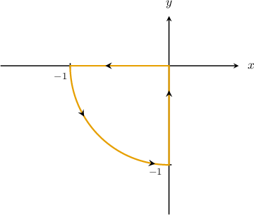

Consider the path $C$ shown above. Given that $F(x,y)=⟨{x}^{2}\operatorname{cos}⁡x+{y}^{3},\,y{e}^{y+1}+x⟩,$ which of the following is equivalent to ${∮}_{C}F\cdot dr\,?$

Field selection

${\int }_{\pi }^{3\pi /2}\,{\int }_{0}^{1}(1-3{r}^{2}{sin}^{2}⁡\theta )r\,dr\,d\theta $ (keyed correct)

${\int }_{\pi }^{2\pi }\,{\int }_{0}^{1}(1-3{r}^{2}{sin}^{2}⁡\theta )\,dr\,d\theta $

${\int }_{\pi }^{2\pi }\,{\int }_{0}^{1}(r-{sin}^{2}⁡\theta )r\,dr\,d\theta $

${\int }_{\pi }^{3\pi /2}\,{\int }_{0}^{1}({r}^{2}-3\operatorname{sin}⁡\theta )\,dr\,d\theta $

${\int }_{\pi }^{3\pi /2}\,{\int }_{0}^{1}({r}^{2}-3\operatorname{sin}⁡\theta )r\,dr\,d\theta $

First, notice that we can rewrite our integral as 

$$
{∮}_{C}F\cdot dr={∮}_{C}({x}^{2}\operatorname{cos}⁡x+{y}^{3})\,dx+(y{e}^{y+1}+x)\,dy.
$$

Green's theorem states that

$$
{∮}_{C}P\,dx+Q\,dy={∬}_{D}(\frac{∂Q}{∂x}-\frac{∂P}{∂y})\,\text{d}A.
$$

In our case, the region $D$ and its boundary $C$ satisfy the conditions of Green's theorem:

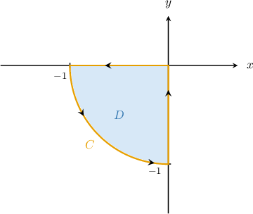

Since $P(x,y)={x}^{2}\operatorname{cos}⁡x+{y}^{3}$ and $Q(x,y)=y{e}^{y+1}+x,$ we obtain

$$
\begin{aligned}\frac{∂P}{∂y}=3{y}^{2},\,\frac{∂Q}{∂x}=1.\end{aligned}
$$

Applying Green's theorem, we get

$$
\begin{aligned}{∮}_{C}({x}^{2}\operatorname{cos}⁡x+{y}^{3})\,dx-(y{e}^{y+1}+x)\,dy & ={∬}_{D}(\frac{∂Q}{∂x}-\frac{∂P}{∂y})\text{d}A \\  & ={∬}_{D}(1-3{y}^{2})\,\text{d}A.\end{aligned}
$$

Now, notice that the region $D$ can be represented in polar coordinates as

$$
Δ={(r,\theta )\,:\,0\le r\le 1,\,\pi \le \theta \le \frac{3\pi }{2}}.
$$

The change of variables formula for plane polar coordinates states that

$$
{∬}_{D}f(x,y)\text{ }dA={∬}_{Δ}\text{ }f(r\operatorname{cos}⁡\theta ,r\operatorname{sin}⁡\theta )\,r\text{ }drd\theta .
$$

Therefore, we can write our double integral as 

$$
\begin{aligned}{∬}_{D}(1-3{y}^{2})\,\text{d}A & ={∬}_{Δ}(1-3\cdot {r}^{2}{sin}^{2}⁡\theta )\,r\,\text{d}r\text{d}\theta  \\  & ={\int }_{\pi }^{3\pi /2}\,{\int }_{0}^{1}(1-3{r}^{2}{sin}^{2}⁡\theta )r\,dr\,d\theta .\end{aligned}
$$

### Generated variation — evidence-only historical bank observed

Consider the path $C$ shown above. Given that $F(x,y)=⟨2\left({x}^{2}\operatorname{cos}⁡x+{y}^{3}\right),\,2\left(y{e}^{y+1}+x\right)⟩,$ which of the following is equivalent to ${∮}_{C}F\cdot dr\,?$

Field selection

$2\left({\int }_{\pi }^{3\pi /2}\,{\int }_{0}^{1}({r}^{2}-3\operatorname{sin}⁡\theta )\,dr\,d\theta \right)$

$2\left({\int }_{\pi }^{2\pi }\,{\int }_{0}^{1}(1-3{r}^{2}{sin}^{2}⁡\theta )\,dr\,d\theta \right)$

$2\left({\int }_{\pi }^{3\pi /2}\,{\int }_{0}^{1}({r}^{2}-3\operatorname{sin}⁡\theta )r\,dr\,d\theta \right)$

$2\left({\int }_{\pi }^{3\pi /2}\,{\int }_{0}^{1}(1-3{r}^{2}{sin}^{2}⁡\theta )r\,dr\,d\theta \right)$

$2\left({\int }_{\pi }^{2\pi }\,{\int }_{0}^{1}(r-{sin}^{2}⁡\theta )r\,dr\,d\theta \right)$

First, notice that we can rewrite our integral as 

$$
{∮}_{C}F\cdot dr=2\left({∮}_{C}({x}^{2}\operatorname{cos}⁡x+{y}^{3})\,dx+(y{e}^{y+1}+x)\,dy.\right)
$$

Green's theorem states that

$$
{∮}_{C}P\,dx+Q\,dy={∬}_{D}(\frac{∂Q}{∂x}-\frac{∂P}{∂y})\,\text{d}A.
$$

In our case, the region $D$ and its boundary $C$ satisfy the conditions of Green's theorem:

Since $P(x,y)=2\left({x}^{2}\operatorname{cos}⁡x+{y}^{3}\right)$ and $Q(x,y)=2\left(y{e}^{y+1}+x\right),$ we obtain

$$
\begin{aligned}\frac{∂P}{∂y}=2\left(3{y}^{2}\right),\,\frac{∂Q}{∂x}=2\left(1\right).\end{aligned}
$$

Applying Green's theorem, we get

$$
\begin{aligned}2\left({∮}_{C}({x}^{2}\operatorname{cos}⁡x+{y}^{3})\,dx-(y{e}^{y+1}+x)\,dy\right) & ={∬}_{D}(\frac{∂Q}{∂x}-\frac{∂P}{∂y})\text{d}A \\  & =2\left({∬}_{D}(1-3{y}^{2})\,\text{d}A.\right)\end{aligned}
$$

Now, notice that the region $D$ can be represented in polar coordinates as

$$
Δ={(r,\theta )\,:\,0\le r\le 1,\,\pi \le \theta \le \frac{3\pi }{2}}.
$$

The change of variables formula for plane polar coordinates states that

$$
{∬}_{D}f(x,y)\text{ }dA={∬}_{Δ}\text{ }f(r\operatorname{cos}⁡\theta ,r\operatorname{sin}⁡\theta )\,r\text{ }drd\theta .
$$

Therefore, we can write our double integral as 

$$
\begin{aligned}2\left({∬}_{D}(1-3{y}^{2})\,\text{d}A\right) & =2\left({∬}_{Δ}(1-3\cdot {r}^{2}{sin}^{2}⁡\theta )\,r\,\text{d}r\text{d}\theta \right) \\  & =2\left({\int }_{\pi }^{3\pi /2}\,{\int }_{0}^{1}(1-3{r}^{2}{sin}^{2}⁡\theta )r\,dr\,d\theta .\right)\end{aligned}
$$

### Generated variation — normal practice authored_method

Consider the path $C$ shown above. Given that $F(x,y)=⟨2\left({x}^{2}\operatorname{cos}⁡x+{y}^{3}\right),\,2\left(y{e}^{y+1}+x\right)⟩,$ which of the following is equivalent to ${∮}_{C}F\cdot dr\,?$

Field selection

$\int_{\pi}^{\frac{3 \pi}{2}}\int_{0}^{7}r \left(- 6 r^{2} \sin^{2}{\left(\theta \right)} + 2\right)\,dr\,d\theta$

$\int_{\pi}^{\frac{3 \pi}{2}}\int_{0}^{8}r \left(- 6 r^{2} \sin^{2}{\left(\theta \right)} + 2\right)\,dr\,d\theta$

$\int_{\pi}^{\frac{3 \pi}{2}}\int_{0}^{7}- 6 r^{2} \sin^{2}{\left(\theta \right)} + 2\,dr\,d\theta$

$\int_{\pi}^{\frac{3 \pi}{2}}\int_{0}^{7}r \left(6 r^{2} \sin^{2}{\left(\theta \right)} + 2\right)\,dr\,d\theta$

$\int_{\pi}^{\frac{3 \pi}{2}}\int_{0}^{7}- r \left(- 6 r^{2} \sin^{2}{\left(\theta \right)} + 2\right)\,dr\,d\theta$

First, notice that we can rewrite our integral as 

$$
{∮}_{C}F\cdot dr=2\left({∮}_{C}({x}^{2}\operatorname{cos}⁡x+{y}^{3})\,dx+(y{e}^{y+1}+x)\,dy.\right)
$$

Green's theorem states that

$$
{∮}_{C}P\,dx+Q\,dy={∬}_{D}(\frac{∂Q}{∂x}-\frac{∂P}{∂y})\,\text{d}A.
$$

In our case, the region $D$ and its boundary $C$ satisfy the conditions of Green's theorem:

Since $P(x,y)=2\left({x}^{2}\operatorname{cos}⁡x+{y}^{3}\right)$ and $Q(x,y)=2\left(y{e}^{y+1}+x\right),$ we obtain

$$
\begin{aligned}\frac{∂P}{∂y}=2\left(3{y}^{2}\right),\,\frac{∂Q}{∂x}=2\left(1\right).\end{aligned}
$$

Applying Green's theorem, we get

$$
\begin{aligned}2\left({∮}_{C}({x}^{2}\operatorname{cos}⁡x+{y}^{3})\,dx+(y{e}^{y+1}+x)\,dy\right) & ={∬}_{D}(\frac{∂Q}{∂x}-\frac{∂P}{∂y})\text{d}A \\  & =2\left({∬}_{D}(1-3{y}^{2})\,\text{d}A.\right)\end{aligned}
$$

Now, notice that the region $D$ can be represented in polar coordinates as

$$
Δ={(r,\theta )\,:\,0\le r\le 7,\,\pi \le \theta \le \frac{3\pi }{2}}.
$$

The change of variables formula for plane polar coordinates states that

$$
{∬}_{D}f(x,y)\text{ }dA={∬}_{Δ}\text{ }f(r\operatorname{cos}⁡\theta ,r\operatorname{sin}⁡\theta )\,r\text{ }drd\theta .
$$

Therefore, we can write our double integral as 

$$
\begin{aligned}2\left({∬}_{D}(1-3{y}^{2})\,\text{d}A\right) & =2\left({∬}_{Δ}(1-3\cdot {r}^{2}{sin}^{2}⁡\theta )\,r\,\text{d}r\text{d}\theta \right) \\  & =2\left({\int }_{\pi }^{3\pi /2}\,{\int }_{0}^{7}(1-3{r}^{2}{sin}^{2}⁡\theta )r\,dr\,d\theta .\right)\end{aligned}
$$

### Generated variation — normal practice authored_method

Consider the path $C$ shown above. Given that $F(x,y)=⟨5\left({x}^{2}\operatorname{cos}⁡x+{y}^{3}\right),\,5\left(y{e}^{y+1}+x\right)⟩,$ which of the following is equivalent to ${∮}_{C}F\cdot dr\,?$

Field selection

$\int_{\pi}^{\frac{3 \pi}{2}}\int_{0}^{2}- r \left(- 15 r^{2} \sin^{2}{\left(\theta \right)} + 5\right)\,dr\,d\theta$

$\int_{\pi}^{\frac{3 \pi}{2}}\int_{0}^{2}r \left(15 r^{2} \sin^{2}{\left(\theta \right)} + 5\right)\,dr\,d\theta$

$\int_{\pi}^{\frac{3 \pi}{2}}\int_{0}^{2}- 15 r^{2} \sin^{2}{\left(\theta \right)} + 5\,dr\,d\theta$

$\int_{\pi}^{\frac{3 \pi}{2}}\int_{0}^{2}r \left(- 15 r^{2} \sin^{2}{\left(\theta \right)} + 5\right)\,dr\,d\theta$

$\int_{\pi}^{\frac{3 \pi}{2}}\int_{0}^{3}r \left(- 15 r^{2} \sin^{2}{\left(\theta \right)} + 5\right)\,dr\,d\theta$

First, notice that we can rewrite our integral as 

$$
{∮}_{C}F\cdot dr=5\left({∮}_{C}({x}^{2}\operatorname{cos}⁡x+{y}^{3})\,dx+(y{e}^{y+1}+x)\,dy.\right)
$$

Green's theorem states that

$$
{∮}_{C}P\,dx+Q\,dy={∬}_{D}(\frac{∂Q}{∂x}-\frac{∂P}{∂y})\,\text{d}A.
$$

In our case, the region $D$ and its boundary $C$ satisfy the conditions of Green's theorem:

Since $P(x,y)=5\left({x}^{2}\operatorname{cos}⁡x+{y}^{3}\right)$ and $Q(x,y)=5\left(y{e}^{y+1}+x\right),$ we obtain

$$
\begin{aligned}\frac{∂P}{∂y}=5\left(3{y}^{2}\right),\,\frac{∂Q}{∂x}=5\left(1\right).\end{aligned}
$$

Applying Green's theorem, we get

$$
\begin{aligned}5\left({∮}_{C}({x}^{2}\operatorname{cos}⁡x+{y}^{3})\,dx+(y{e}^{y+1}+x)\,dy\right) & ={∬}_{D}(\frac{∂Q}{∂x}-\frac{∂P}{∂y})\text{d}A \\  & =5\left({∬}_{D}(1-3{y}^{2})\,\text{d}A.\right)\end{aligned}
$$

Now, notice that the region $D$ can be represented in polar coordinates as

$$
Δ={(r,\theta )\,:\,0\le r\le 2,\,\pi \le \theta \le \frac{3\pi }{2}}.
$$

The change of variables formula for plane polar coordinates states that

$$
{∬}_{D}f(x,y)\text{ }dA={∬}_{Δ}\text{ }f(r\operatorname{cos}⁡\theta ,r\operatorname{sin}⁡\theta )\,r\text{ }drd\theta .
$$

Therefore, we can write our double integral as 

$$
\begin{aligned}5\left({∬}_{D}(1-3{y}^{2})\,\text{d}A\right) & =5\left({∬}_{Δ}(1-3\cdot {r}^{2}{sin}^{2}⁡\theta )\,r\,\text{d}r\text{d}\theta \right) \\  & =5\left({\int }_{\pi }^{3\pi /2}\,{\int }_{0}^{2}(1-3{r}^{2}{sin}^{2}⁡\theta )r\,dr\,d\theta .\right)\end{aligned}
$$

## q-126687 — observed moderate

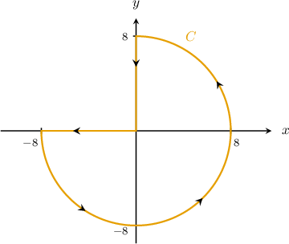

Consider the path $C$ shown above. Which of the following is equivalent to the line integral 

$$
{∮}_{C}(2-xy+2{y}^{2})\,dx+({x}^{2}+xy)\,dy\,?
$$

Field selection

${\int }_{-\pi }^{\pi /2}\,{\int }_{0}^{8}r(\operatorname{cos}⁡\theta -2\operatorname{sin}⁡\theta )\,dr\,d\theta $

${\int }_{-\pi /2}^{\pi }\,{\int }_{0}^{8}3{r}^{2}\operatorname{cos}⁡\theta \,dr\,d\theta $

${\int }_{-\pi }^{\pi /2}\,{\int }_{0}^{8}3{r}^{2}(\operatorname{cos}⁡\theta -\operatorname{sin}⁡\theta )\,dr\,d\theta $ (keyed correct)

${\int }_{-\pi }^{\pi /2}\,{\int }_{0}^{8}2{r}^{2}\operatorname{sin}⁡\theta \,dr\,d\theta $

${\int }_{-\pi /2}^{\pi }\,{\int }_{0}^{8}r(3\operatorname{cos}⁡\theta -\operatorname{sin}⁡\theta )\,dr\,d\theta $

Green's theorem states that

$$
{∮}_{C}P\,dx+Q\,dy={∬}_{D}(\frac{∂Q}{∂x}-\frac{∂P}{∂y})\,\text{d}A.
$$

In our case, the region $D$ and its boundary $C$ satisfy the conditions of Green's theorem:

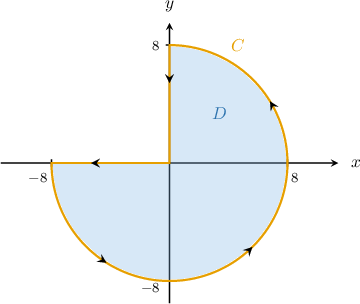

Since $P(x,y)=2-xy+2{y}^{2}$ and $Q(x,y)={x}^{2}+xy,$ we obtain

$$
\begin{aligned}\frac{∂P}{∂y}=-x+4y,\,\frac{∂Q}{∂x}=2x+y.\end{aligned}
$$

Applying Green's theorem, we get

$$
\begin{aligned}{∮}_{C}(2-xy+2{y}^{2})\,dx+({x}^{2}+xy)\,dy & ={∬}_{D}(\frac{∂Q}{∂x}-\frac{∂P}{∂y})\text{d}A \\  & ={∬}_{D}(2x+y-(-x+4y))\,\text{d}A \\  & ={∬}_{D}(3x-3y)\,\text{d}A.\end{aligned}
$$

Now, notice that the region $D$ can be represented in polar coordinates as

$$
Δ={(r,\theta )\,:\,0\le r\le 8,\,-\pi \le \theta \le \frac{\pi }{2}}.
$$

The change of variables formula for plane polar coordinates states that

$$
{∬}_{D}f(x,y)\text{ }dA={∬}_{Δ}\text{ }f(r\operatorname{cos}⁡\theta ,r\operatorname{sin}⁡\theta )\,r\text{ }drd\theta .
$$

Therefore, we can write our double integral as  

$$
\begin{aligned}{∬}_{D}(3x-3y)\,\text{d}A & ={∬}_{Δ}(3r\operatorname{cos}⁡\theta -3r\operatorname{sin}⁡\theta )\,r\,\text{d}r\text{d}\theta  \\  & ={\int }_{-\pi }^{\pi /2}\,{\int }_{0}^{8}3{r}^{2}(\operatorname{cos}⁡\theta -\operatorname{sin}⁡\theta )\,dr\,d\theta .\end{aligned}
$$

### Generated variation — evidence-only historical bank observed

Consider the path $C$ shown above. Which of the following is equivalent to the line integral 

$$
2\left({∮}_{C}(2-xy+2{y}^{2})\,dx+({x}^{2}+xy)\,dy\,?\right)
$$

Field selection

$2\left({\int }_{-\pi }^{\pi /2}\,{\int }_{0}^{8}2{r}^{2}\operatorname{sin}⁡\theta \,dr\,d\theta \right)$

$2\left({\int }_{-\pi /2}^{\pi }\,{\int }_{0}^{8}3{r}^{2}\operatorname{cos}⁡\theta \,dr\,d\theta \right)$

$2\left({\int }_{-\pi /2}^{\pi }\,{\int }_{0}^{8}r(3\operatorname{cos}⁡\theta -\operatorname{sin}⁡\theta )\,dr\,d\theta \right)$

$2\left({\int }_{-\pi }^{\pi /2}\,{\int }_{0}^{8}r(\operatorname{cos}⁡\theta -2\operatorname{sin}⁡\theta )\,dr\,d\theta \right)$

$2\left({\int }_{-\pi }^{\pi /2}\,{\int }_{0}^{8}3{r}^{2}(\operatorname{cos}⁡\theta -\operatorname{sin}⁡\theta )\,dr\,d\theta \right)$

Green's theorem states that

$$
{∮}_{C}P\,dx+Q\,dy={∬}_{D}(\frac{∂Q}{∂x}-\frac{∂P}{∂y})\,\text{d}A.
$$

In our case, the region $D$ and its boundary $C$ satisfy the conditions of Green's theorem:

Since $P(x,y)=2\left(2-xy+2{y}^{2}\right)$ and $Q(x,y)=2\left({x}^{2}+xy\right),$ we obtain

$$
\begin{aligned}\frac{∂P}{∂y}=2\left(-x+4y\right),\,\frac{∂Q}{∂x}=2\left(2x+y\right).\end{aligned}
$$

Applying Green's theorem, we get

$$
\begin{aligned}2\left({∮}_{C}(2-xy+2{y}^{2})\,dx+({x}^{2}+xy)\,dy\right) & ={∬}_{D}(\frac{∂Q}{∂x}-\frac{∂P}{∂y})\text{d}A \\  & =2\left({∬}_{D}(2x+y-(-x+4y))\,\text{d}A\right) \\  & =2\left({∬}_{D}(3x-3y)\,\text{d}A.\right)\end{aligned}
$$

Now, notice that the region $D$ can be represented in polar coordinates as

$$
Δ={(r,\theta )\,:\,0\le r\le 8,\,-\pi \le \theta \le \frac{\pi }{2}}.
$$

The change of variables formula for plane polar coordinates states that

$$
{∬}_{D}f(x,y)\text{ }dA={∬}_{Δ}\text{ }f(r\operatorname{cos}⁡\theta ,r\operatorname{sin}⁡\theta )\,r\text{ }drd\theta .
$$

Therefore, we can write our double integral as  

$$
\begin{aligned}2\left({∬}_{D}(3x-3y)\,\text{d}A\right) & =2\left({∬}_{Δ}(3r\operatorname{cos}⁡\theta -3r\operatorname{sin}⁡\theta )\,r\,\text{d}r\text{d}\theta \right) \\  & =2\left({\int }_{-\pi }^{\pi /2}\,{\int }_{0}^{8}3{r}^{2}(\operatorname{cos}⁡\theta -\operatorname{sin}⁡\theta )\,dr\,d\theta .\right)\end{aligned}
$$

### Generated variation — normal practice authored_method

Consider the path $C$ shown above. Which of the following is equivalent to the line integral 

$$
2\left({∮}_{C}(2-xy+2{y}^{2})\,dx+({x}^{2}+xy)\,dy\,?\right)
$$

Field selection

$\int_{- \pi}^{\frac{\pi}{2}}\int_{0}^{7}6 \sqrt{2} r^{2} \cos{\left(\theta + \frac{\pi}{4} \right)}\,dr\,d\theta$

$\int_{- \pi}^{\frac{\pi}{2}}\int_{0}^{8}6 \sqrt{2} r^{2} \cos{\left(\theta + \frac{\pi}{4} \right)}\,dr\,d\theta$

$\int_{- \pi}^{\frac{\pi}{2}}\int_{0}^{7}6 \sqrt{2} r \cos{\left(\theta + \frac{\pi}{4} \right)}\,dr\,d\theta$

$\int_{- \pi}^{\frac{\pi}{2}}\int_{0}^{7}2 r^{2} \left(5 \sin{\left(\theta \right)} + \cos{\left(\theta \right)}\right)\,dr\,d\theta$

$\int_{- \pi}^{\frac{\pi}{2}}\int_{0}^{7}- 6 \sqrt{2} r^{2} \cos{\left(\theta + \frac{\pi}{4} \right)}\,dr\,d\theta$

Green's theorem states that

$$
{∮}_{C}P\,dx+Q\,dy={∬}_{D}(\frac{∂Q}{∂x}-\frac{∂P}{∂y})\,\text{d}A.
$$

In our case, the region $D$ and its boundary $C$ satisfy the conditions of Green's theorem:

Since $P(x,y)=2\left(2-xy+2{y}^{2}\right)$ and $Q(x,y)=2\left({x}^{2}+xy\right),$ we obtain

$$
\begin{aligned}\frac{∂P}{∂y}=2\left(-x+4y\right),\,\frac{∂Q}{∂x}=2\left(2x+y\right).\end{aligned}
$$

Applying Green's theorem, we get

$$
\begin{aligned}2\left({∮}_{C}(2-xy+2{y}^{2})\,dx+({x}^{2}+xy)\,dy\right) & ={∬}_{D}(\frac{∂Q}{∂x}-\frac{∂P}{∂y})\text{d}A \\  & =2\left({∬}_{D}(2x+y-(-x+4y))\,\text{d}A\right) \\  & =2\left({∬}_{D}(3x-3y)\,\text{d}A.\right)\end{aligned}
$$

Now, notice that the region $D$ can be represented in polar coordinates as

$$
Δ={(r,\theta )\,:\,0\le r\le 7,\,-\pi \le \theta \le \frac{\pi }{2}}.
$$

The change of variables formula for plane polar coordinates states that

$$
{∬}_{D}f(x,y)\text{ }dA={∬}_{Δ}\text{ }f(r\operatorname{cos}⁡\theta ,r\operatorname{sin}⁡\theta )\,r\text{ }drd\theta .
$$

Therefore, we can write our double integral as  

$$
\begin{aligned}2\left({∬}_{D}(3x-3y)\,\text{d}A\right) & =2\left({∬}_{Δ}(3r\operatorname{cos}⁡\theta -3r\operatorname{sin}⁡\theta )\,r\,\text{d}r\text{d}\theta \right) \\  & =2\left({\int }_{-\pi }^{\pi /2}\,{\int }_{0}^{7}3{r}^{2}(\operatorname{cos}⁡\theta -\operatorname{sin}⁡\theta )\,dr\,d\theta .\right)\end{aligned}
$$

### Generated variation — normal practice authored_method

Consider the path $C$ shown above. Which of the following is equivalent to the line integral 

$$
5\left({∮}_{C}(2-xy+2{y}^{2})\,dx+({x}^{2}+xy)\,dy\,?\right)
$$

Field selection

$\int_{- \pi}^{\frac{\pi}{2}}\int_{0}^{2}- 15 \sqrt{2} r^{2} \cos{\left(\theta + \frac{\pi}{4} \right)}\,dr\,d\theta$

$\int_{- \pi}^{\frac{\pi}{2}}\int_{0}^{2}5 r^{2} \left(5 \sin{\left(\theta \right)} + \cos{\left(\theta \right)}\right)\,dr\,d\theta$

$\int_{- \pi}^{\frac{\pi}{2}}\int_{0}^{2}15 \sqrt{2} r \cos{\left(\theta + \frac{\pi}{4} \right)}\,dr\,d\theta$

$\int_{- \pi}^{\frac{\pi}{2}}\int_{0}^{2}15 \sqrt{2} r^{2} \cos{\left(\theta + \frac{\pi}{4} \right)}\,dr\,d\theta$

$\int_{- \pi}^{\frac{\pi}{2}}\int_{0}^{3}15 \sqrt{2} r^{2} \cos{\left(\theta + \frac{\pi}{4} \right)}\,dr\,d\theta$

Green's theorem states that

$$
{∮}_{C}P\,dx+Q\,dy={∬}_{D}(\frac{∂Q}{∂x}-\frac{∂P}{∂y})\,\text{d}A.
$$

In our case, the region $D$ and its boundary $C$ satisfy the conditions of Green's theorem:

Since $P(x,y)=5\left(2-xy+2{y}^{2}\right)$ and $Q(x,y)=5\left({x}^{2}+xy\right),$ we obtain

$$
\begin{aligned}\frac{∂P}{∂y}=5\left(-x+4y\right),\,\frac{∂Q}{∂x}=5\left(2x+y\right).\end{aligned}
$$

Applying Green's theorem, we get

$$
\begin{aligned}5\left({∮}_{C}(2-xy+2{y}^{2})\,dx+({x}^{2}+xy)\,dy\right) & ={∬}_{D}(\frac{∂Q}{∂x}-\frac{∂P}{∂y})\text{d}A \\  & =5\left({∬}_{D}(2x+y-(-x+4y))\,\text{d}A\right) \\  & =5\left({∬}_{D}(3x-3y)\,\text{d}A.\right)\end{aligned}
$$

Now, notice that the region $D$ can be represented in polar coordinates as

$$
Δ={(r,\theta )\,:\,0\le r\le 2,\,-\pi \le \theta \le \frac{\pi }{2}}.
$$

The change of variables formula for plane polar coordinates states that

$$
{∬}_{D}f(x,y)\text{ }dA={∬}_{Δ}\text{ }f(r\operatorname{cos}⁡\theta ,r\operatorname{sin}⁡\theta )\,r\text{ }drd\theta .
$$

Therefore, we can write our double integral as  

$$
\begin{aligned}5\left({∬}_{D}(3x-3y)\,\text{d}A\right) & =5\left({∬}_{Δ}(3r\operatorname{cos}⁡\theta -3r\operatorname{sin}⁡\theta )\,r\,\text{d}r\text{d}\theta \right) \\  & =5\left({\int }_{-\pi }^{\pi /2}\,{\int }_{0}^{2}3{r}^{2}(\operatorname{cos}⁡\theta -\operatorname{sin}⁡\theta )\,dr\,d\theta .\right)\end{aligned}
$$

## q-126710 — observed moderate

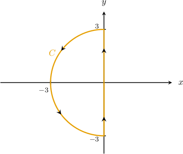

Consider the path $C$ shown above. Given that $F(x,y)=⟨y(x+1),\,x(y+1)⟩,$ which of the following is equivalent to ${∮}_{C}F\cdot dr\,?$

Field selection

${\int }_{\pi /2}^{3\pi /2}\,{\int }_{0}^{3}r(\operatorname{cos}⁡\theta -\operatorname{sin}⁡\theta )\,dr\,d\theta $

${\int }_{\pi /2}^{3\pi /2}\,{\int }_{0}^{3}{r}^{2}(\operatorname{cos}⁡\theta -\operatorname{sin}⁡\theta )\,dr\,d\theta $

${\int }_{-\pi /2}^{\pi /2}\,{\int }_{0}^{3}r(\operatorname{sin}⁡\theta -\operatorname{cos}⁡\theta )\,dr\,d\theta $

${\int }_{\pi /2}^{3\pi /2}\,{\int }_{0}^{3}{r}^{2}(\operatorname{sin}⁡\theta -\operatorname{cos}⁡\theta )\,dr\,d\theta $ (keyed correct)

${\int }_{0}^{\pi /2}\,{\int }_{0}^{3}{r}^{2}(\operatorname{sin}⁡\theta -\operatorname{cos}⁡\theta )\,dr\,d\theta $

First, notice that we can rewrite our integral as 

$$
{∮}_{C}F\cdot dr={∮}_{C}y(x+1)\,dx+x(y+1)\,dy.
$$

Green's theorem states that

$$
{∮}_{C}P\,dx+Q\,dy={∬}_{D}(\frac{∂Q}{∂x}-\frac{∂P}{∂y})\,\text{d}A.
$$

In our case, the region $D$ and its boundary $C$ satisfy the conditions of Green's theorem:

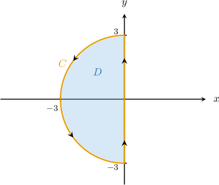

Since $P(x,y)=y(x+1)$ and $Q(x,y)=x(y+1),$ we obtain

$$
\begin{aligned}\frac{∂P}{∂y}=x+1,\,\frac{∂Q}{∂x}=y+1.\end{aligned}
$$

Applying Green's theorem, we get

$$
\begin{aligned}{∮}_{C}y(x+1)\,dx+x(y+1)\,dy & ={∬}_{D}(\frac{∂Q}{∂x}-\frac{∂P}{∂y})\text{d}A \\  & ={∬}_{D}(y+1-(x+1))\,\text{d}A \\  & ={∬}_{D}(y-x)\,\text{d}A.\end{aligned}
$$

Now, notice that the region $D$ can be represented in polar coordinates as

$$
Δ={(r,\theta )\,:\,0\le r\le 3,\,\frac{\pi }{2}\le \theta \le \frac{3\pi }{2}}.
$$

The change of variables formula for plane polar coordinates states that  

$$
{∬}_{D}f(x,y)\text{ }dA={∬}_{Δ}\text{ }f(r\operatorname{cos}⁡\theta ,r\operatorname{sin}⁡\theta )\,r\text{ }drd\theta .
$$

Therefore, we can write our double integral as 

$$
\begin{aligned}{∬}_{D}(y-x)\,\text{d}A & ={∬}_{Δ}(r\operatorname{sin}⁡\theta -r\operatorname{cos}⁡\theta )\,r\,\text{d}r\text{d}\theta  \\  & ={\int }_{\pi /2}^{3\pi /2}\,{\int }_{0}^{3}{r}^{2}(\operatorname{sin}⁡\theta -\operatorname{cos}⁡\theta )\,dr\,d\theta .\end{aligned}
$$

### Generated variation — evidence-only historical bank observed

Consider the path $C$ shown above. Given that $F(x,y)=⟨2\left(y(x+1)\right),\,2\left(x(y+1)\right)⟩,$ which of the following is equivalent to ${∮}_{C}F\cdot dr\,?$

Field selection

$2\left({\int }_{\pi /2}^{3\pi /2}\,{\int }_{0}^{3}{r}^{2}(\operatorname{sin}⁡\theta -\operatorname{cos}⁡\theta )\,dr\,d\theta \right)$

$2\left({\int }_{\pi /2}^{3\pi /2}\,{\int }_{0}^{3}{r}^{2}(\operatorname{cos}⁡\theta -\operatorname{sin}⁡\theta )\,dr\,d\theta \right)$

$2\left({\int }_{0}^{\pi /2}\,{\int }_{0}^{3}{r}^{2}(\operatorname{sin}⁡\theta -\operatorname{cos}⁡\theta )\,dr\,d\theta \right)$

$2\left({\int }_{\pi /2}^{3\pi /2}\,{\int }_{0}^{3}r(\operatorname{cos}⁡\theta -\operatorname{sin}⁡\theta )\,dr\,d\theta \right)$

$2\left({\int }_{-\pi /2}^{\pi /2}\,{\int }_{0}^{3}r(\operatorname{sin}⁡\theta -\operatorname{cos}⁡\theta )\,dr\,d\theta \right)$

First, notice that we can rewrite our integral as 

$$
{∮}_{C}F\cdot dr=2\left({∮}_{C}y(x+1)\,dx+x(y+1)\,dy.\right)
$$

Green's theorem states that

$$
{∮}_{C}P\,dx+Q\,dy={∬}_{D}(\frac{∂Q}{∂x}-\frac{∂P}{∂y})\,\text{d}A.
$$

In our case, the region $D$ and its boundary $C$ satisfy the conditions of Green's theorem:

Since $P(x,y)=2\left(y(x+1)\right)$ and $Q(x,y)=2\left(x(y+1)\right),$ we obtain

$$
\begin{aligned}\frac{∂P}{∂y}=2\left(x+1\right),\,\frac{∂Q}{∂x}=2\left(y+1\right).\end{aligned}
$$

Applying Green's theorem, we get

$$
\begin{aligned}2\left({∮}_{C}y(x+1)\,dx+x(y+1)\,dy\right) & ={∬}_{D}(\frac{∂Q}{∂x}-\frac{∂P}{∂y})\text{d}A \\  & =2\left({∬}_{D}(y+1-(x+1))\,\text{d}A\right) \\  & =2\left({∬}_{D}(y-x)\,\text{d}A.\right)\end{aligned}
$$

Now, notice that the region $D$ can be represented in polar coordinates as

$$
Δ={(r,\theta )\,:\,0\le r\le 3,\,\frac{\pi }{2}\le \theta \le \frac{3\pi }{2}}.
$$

The change of variables formula for plane polar coordinates states that  

$$
{∬}_{D}f(x,y)\text{ }dA={∬}_{Δ}\text{ }f(r\operatorname{cos}⁡\theta ,r\operatorname{sin}⁡\theta )\,r\text{ }drd\theta .
$$

Therefore, we can write our double integral as 

$$
\begin{aligned}2\left({∬}_{D}(y-x)\,\text{d}A\right) & =2\left({∬}_{Δ}(r\operatorname{sin}⁡\theta -r\operatorname{cos}⁡\theta )\,r\,\text{d}r\text{d}\theta \right) \\  & =2\left({\int }_{\pi /2}^{3\pi /2}\,{\int }_{0}^{3}{r}^{2}(\operatorname{sin}⁡\theta -\operatorname{cos}⁡\theta )\,dr\,d\theta .\right)\end{aligned}
$$

### Generated variation — normal practice authored_method

Consider the path $C$ shown above. Given that $F(x,y)=⟨2\left(y(x+1)\right),\,2\left(x(y+1)\right)⟩,$ which of the following is equivalent to ${∮}_{C}F\cdot dr\,?$

Field selection

$\int_{\frac{\pi}{2}}^{\frac{3 \pi}{2}}\int_{0}^{7}- 2 \sqrt{2} r^{2} \cos{\left(\theta + \frac{\pi}{4} \right)}\,dr\,d\theta$

$\int_{\frac{\pi}{2}}^{\frac{3 \pi}{2}}\int_{0}^{8}- 2 \sqrt{2} r^{2} \cos{\left(\theta + \frac{\pi}{4} \right)}\,dr\,d\theta$

$\int_{\frac{\pi}{2}}^{\frac{3 \pi}{2}}\int_{0}^{7}- 2 \sqrt{2} r \cos{\left(\theta + \frac{\pi}{4} \right)}\,dr\,d\theta$

$\int_{\frac{\pi}{2}}^{\frac{3 \pi}{2}}\int_{0}^{7}r \left(2 \sqrt{2} r \sin{\left(\theta + \frac{\pi}{4} \right)} + 4\right)\,dr\,d\theta$

$\int_{\frac{\pi}{2}}^{\frac{3 \pi}{2}}\int_{0}^{7}2 \sqrt{2} r^{2} \cos{\left(\theta + \frac{\pi}{4} \right)}\,dr\,d\theta$

First, notice that we can rewrite our integral as 

$$
{∮}_{C}F\cdot dr=2\left({∮}_{C}y(x+1)\,dx+x(y+1)\,dy.\right)
$$

Green's theorem states that

$$
{∮}_{C}P\,dx+Q\,dy={∬}_{D}(\frac{∂Q}{∂x}-\frac{∂P}{∂y})\,\text{d}A.
$$

In our case, the region $D$ and its boundary $C$ satisfy the conditions of Green's theorem:

Since $P(x,y)=2\left(y(x+1)\right)$ and $Q(x,y)=2\left(x(y+1)\right),$ we obtain

$$
\begin{aligned}\frac{∂P}{∂y}=2\left(x+1\right),\,\frac{∂Q}{∂x}=2\left(y+1\right).\end{aligned}
$$

Applying Green's theorem, we get

$$
\begin{aligned}2\left({∮}_{C}y(x+1)\,dx+x(y+1)\,dy\right) & ={∬}_{D}(\frac{∂Q}{∂x}-\frac{∂P}{∂y})\text{d}A \\  & =2\left({∬}_{D}(y+1-(x+1))\,\text{d}A\right) \\  & =2\left({∬}_{D}(y-x)\,\text{d}A.\right)\end{aligned}
$$

Now, notice that the region $D$ can be represented in polar coordinates as

$$
Δ={(r,\theta )\,:\,0\le r\le 7,\,\frac{\pi }{2}\le \theta \le \frac{3\pi }{2}}.
$$

The change of variables formula for plane polar coordinates states that  

$$
{∬}_{D}f(x,y)\text{ }dA={∬}_{Δ}\text{ }f(r\operatorname{cos}⁡\theta ,r\operatorname{sin}⁡\theta )\,r\text{ }drd\theta .
$$

Therefore, we can write our double integral as 

$$
\begin{aligned}2\left({∬}_{D}(y-x)\,\text{d}A\right) & =2\left({∬}_{Δ}(r\operatorname{sin}⁡\theta -r\operatorname{cos}⁡\theta )\,r\,\text{d}r\text{d}\theta \right) \\  & =2\left({\int }_{\pi /2}^{3\pi /2}\,{\int }_{0}^{7}{r}^{2}(\operatorname{sin}⁡\theta -\operatorname{cos}⁡\theta )\,dr\,d\theta .\right)\end{aligned}
$$

### Generated variation — normal practice authored_method

Consider the path $C$ shown above. Given that $F(x,y)=⟨5\left(y(x+1)\right),\,5\left(x(y+1)\right)⟩,$ which of the following is equivalent to ${∮}_{C}F\cdot dr\,?$

Field selection

$\int_{\frac{\pi}{2}}^{\frac{3 \pi}{2}}\int_{0}^{2}5 \sqrt{2} r^{2} \cos{\left(\theta + \frac{\pi}{4} \right)}\,dr\,d\theta$

$\int_{\frac{\pi}{2}}^{\frac{3 \pi}{2}}\int_{0}^{2}r \left(5 \sqrt{2} r \sin{\left(\theta + \frac{\pi}{4} \right)} + 10\right)\,dr\,d\theta$

$\int_{\frac{\pi}{2}}^{\frac{3 \pi}{2}}\int_{0}^{2}- 5 \sqrt{2} r \cos{\left(\theta + \frac{\pi}{4} \right)}\,dr\,d\theta$

$\int_{\frac{\pi}{2}}^{\frac{3 \pi}{2}}\int_{0}^{2}- 5 \sqrt{2} r^{2} \cos{\left(\theta + \frac{\pi}{4} \right)}\,dr\,d\theta$

$\int_{\frac{\pi}{2}}^{\frac{3 \pi}{2}}\int_{0}^{3}- 5 \sqrt{2} r^{2} \cos{\left(\theta + \frac{\pi}{4} \right)}\,dr\,d\theta$

First, notice that we can rewrite our integral as 

$$
{∮}_{C}F\cdot dr=5\left({∮}_{C}y(x+1)\,dx+x(y+1)\,dy.\right)
$$

Green's theorem states that

$$
{∮}_{C}P\,dx+Q\,dy={∬}_{D}(\frac{∂Q}{∂x}-\frac{∂P}{∂y})\,\text{d}A.
$$

In our case, the region $D$ and its boundary $C$ satisfy the conditions of Green's theorem:

Since $P(x,y)=5\left(y(x+1)\right)$ and $Q(x,y)=5\left(x(y+1)\right),$ we obtain

$$
\begin{aligned}\frac{∂P}{∂y}=5\left(x+1\right),\,\frac{∂Q}{∂x}=5\left(y+1\right).\end{aligned}
$$

Applying Green's theorem, we get

$$
\begin{aligned}5\left({∮}_{C}y(x+1)\,dx+x(y+1)\,dy\right) & ={∬}_{D}(\frac{∂Q}{∂x}-\frac{∂P}{∂y})\text{d}A \\  & =5\left({∬}_{D}(y+1-(x+1))\,\text{d}A\right) \\  & =5\left({∬}_{D}(y-x)\,\text{d}A.\right)\end{aligned}
$$

Now, notice that the region $D$ can be represented in polar coordinates as

$$
Δ={(r,\theta )\,:\,0\le r\le 2,\,\frac{\pi }{2}\le \theta \le \frac{3\pi }{2}}.
$$

The change of variables formula for plane polar coordinates states that  

$$
{∬}_{D}f(x,y)\text{ }dA={∬}_{Δ}\text{ }f(r\operatorname{cos}⁡\theta ,r\operatorname{sin}⁡\theta )\,r\text{ }drd\theta .
$$

Therefore, we can write our double integral as 

$$
\begin{aligned}5\left({∬}_{D}(y-x)\,\text{d}A\right) & =5\left({∬}_{Δ}(r\operatorname{sin}⁡\theta -r\operatorname{cos}⁡\theta )\,r\,\text{d}r\text{d}\theta \right) \\  & =5\left({\int }_{\pi /2}^{3\pi /2}\,{\int }_{0}^{2}{r}^{2}(\operatorname{sin}⁡\theta -\operatorname{cos}⁡\theta )\,dr\,d\theta .\right)\end{aligned}
$$

## q-126711 — observed moderate

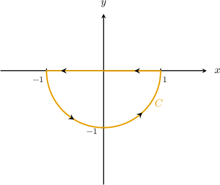

Consider the path $C$ shown above. Given that $F(x,y)=⟨{y}^{2}+{x}^{2},\,xy+y{e}^{y}⟩,$ which of the following is equivalent to ${∮}_{C}F\cdot dr\,?$

Field selection

${\int }_{0}^{\pi /2}\,{\int }_{0}^{1}-r\operatorname{cos}⁡\theta \,dr\,d\theta $

${\int }_{-\pi }^{0}\,{\int }_{0}^{1}r\operatorname{sin}⁡\theta \,dr\,d\theta $

${\int }_{0}^{\pi /2}\,{\int }_{0}^{1}{r}^{2}\operatorname{sin}⁡\theta \,dr\,d\theta $

${\int }_{-\pi }^{0}\,{\int }_{0}^{1}-{r}^{2}\operatorname{sin}⁡\theta \,dr\,d\theta $ (keyed correct)

${\int }_{-\pi }^{0}\,{\int }_{0}^{1}-{r}^{2}\operatorname{cos}⁡\theta \,dr\,d\theta $

First, notice that we can rewrite our integral as 

$$
{∮}_{C}F\cdot dr={∮}_{C}({y}^{2}+{x}^{2})\,dx+(xy+y{e}^{y})\,dy.
$$

Green's theorem states that

$$
{∮}_{C}P\,dx+Q\,dy={∬}_{D}(\frac{∂Q}{∂x}-\frac{∂P}{∂y})\,\text{d}A.
$$

In our case, the region $D$ and its boundary $C$ satisfy the conditions of Green's theorem:

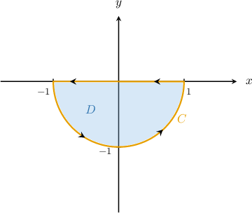

Since $P(x,y)={y}^{2}+{x}^{2}$ and $Q(x,y)=xy+y{e}^{y},$ we obtain

$$
\begin{aligned}\frac{∂P}{∂y}=2y,\,\frac{∂Q}{∂x}=y.\end{aligned}
$$

Applying Green's theorem, we get

$$
\begin{aligned}{∮}_{C}({y}^{2}+{x}^{2})\,dx+(xy+y{e}^{y})\,dy & ={∬}_{D}(\frac{∂Q}{∂x}-\frac{∂P}{∂y})\text{d}A \\  & ={∬}_{D}(y-2y)\,\text{d}A \\  & ={∬}_{D}-y\,\text{d}A.\end{aligned}
$$

Now, notice that the region $D$ can be represented in polar coordinates as

$$
Δ={(r,\theta )\,:\,0\le r\le 1,\,-\pi \le \theta \le 0}.
$$

The change of variables formula for plane polar coordinates states that 

$$
{∬}_{D}f(x,y)\text{ }dA={∬}_{Δ}\text{ }f(r\operatorname{cos}⁡\theta ,r\operatorname{sin}⁡\theta )\,r\text{ }drd\theta .
$$

Therefore, we can write our double integral as 

$$
\begin{aligned}{∬}_{D}-y\,\text{d}A & ={∬}_{Δ}-r\operatorname{sin}⁡\theta \,r\,\text{d}r\text{d}\theta  \\  & ={\int }_{-\pi }^{0}\,{\int }_{0}^{1}-{r}^{2}\operatorname{sin}⁡\theta \,dr\,d\theta .\end{aligned}
$$

### Generated variation — evidence-only historical bank observed

Consider the path $C$ shown above. Given that $F(x,y)=⟨2\left({y}^{2}+{x}^{2}\right),\,2\left(xy+y{e}^{y}\right)⟩,$ which of the following is equivalent to ${∮}_{C}F\cdot dr\,?$

Field selection

$2\left({\int }_{-\pi }^{0}\,{\int }_{0}^{1}-{r}^{2}\operatorname{sin}⁡\theta \,dr\,d\theta \right)$

$2\left({\int }_{-\pi }^{0}\,{\int }_{0}^{1}r\operatorname{sin}⁡\theta \,dr\,d\theta \right)$

$2\left({\int }_{-\pi }^{0}\,{\int }_{0}^{1}-{r}^{2}\operatorname{cos}⁡\theta \,dr\,d\theta \right)$

$2\left({\int }_{0}^{\pi /2}\,{\int }_{0}^{1}-r\operatorname{cos}⁡\theta \,dr\,d\theta \right)$

$2\left({\int }_{0}^{\pi /2}\,{\int }_{0}^{1}{r}^{2}\operatorname{sin}⁡\theta \,dr\,d\theta \right)$

First, notice that we can rewrite our integral as 

$$
{∮}_{C}F\cdot dr=2\left({∮}_{C}({y}^{2}+{x}^{2})\,dx+(xy+y{e}^{y})\,dy.\right)
$$

Green's theorem states that

$$
{∮}_{C}P\,dx+Q\,dy={∬}_{D}(\frac{∂Q}{∂x}-\frac{∂P}{∂y})\,\text{d}A.
$$

In our case, the region $D$ and its boundary $C$ satisfy the conditions of Green's theorem:

Since $P(x,y)=2\left({y}^{2}+{x}^{2}\right)$ and $Q(x,y)=2\left(xy+y{e}^{y}\right),$ we obtain

$$
\begin{aligned}\frac{∂P}{∂y}=2\left(2y\right),\,\frac{∂Q}{∂x}=2\left(y\right).\end{aligned}
$$

Applying Green's theorem, we get

$$
\begin{aligned}2\left({∮}_{C}({y}^{2}+{x}^{2})\,dx+(xy+y{e}^{y})\,dy\right) & ={∬}_{D}(\frac{∂Q}{∂x}-\frac{∂P}{∂y})\text{d}A \\  & =2\left({∬}_{D}(y-2y)\,\text{d}A\right) \\  & =2\left({∬}_{D}-y\,\text{d}A.\right)\end{aligned}
$$

Now, notice that the region $D$ can be represented in polar coordinates as

$$
Δ={(r,\theta )\,:\,0\le r\le 1,\,-\pi \le \theta \le 0}.
$$

The change of variables formula for plane polar coordinates states that 

$$
{∬}_{D}f(x,y)\text{ }dA={∬}_{Δ}\text{ }f(r\operatorname{cos}⁡\theta ,r\operatorname{sin}⁡\theta )\,r\text{ }drd\theta .
$$

Therefore, we can write our double integral as 

$$
\begin{aligned}2\left({∬}_{D}-y\,\text{d}A\right) & =2\left({∬}_{Δ}-r\operatorname{sin}⁡\theta \,r\,\text{d}r\text{d}\theta \right) \\  & =2\left({\int }_{-\pi }^{0}\,{\int }_{0}^{1}-{r}^{2}\operatorname{sin}⁡\theta \,dr\,d\theta .\right)\end{aligned}
$$

### Generated variation — normal practice authored_method

Consider the path $C$ shown above. Given that $F(x,y)=⟨2\left({y}^{2}+{x}^{2}\right),\,2\left(xy+y{e}^{y}\right)⟩,$ which of the following is equivalent to ${∮}_{C}F\cdot dr\,?$

Field selection

$\int_{- \pi}^{0}\int_{0}^{7}- 2 r^{2} \sin{\left(\theta \right)}\,dr\,d\theta$

$\int_{- \pi}^{0}\int_{0}^{8}- 2 r^{2} \sin{\left(\theta \right)}\,dr\,d\theta$

$\int_{- \pi}^{0}\int_{0}^{7}- 2 r \sin{\left(\theta \right)}\,dr\,d\theta$

$\int_{- \pi}^{0}\int_{0}^{7}6 r^{2} \sin{\left(\theta \right)}\,dr\,d\theta$

$\int_{- \pi}^{0}\int_{0}^{7}2 r^{2} \sin{\left(\theta \right)}\,dr\,d\theta$

First, notice that we can rewrite our integral as 

$$
{∮}_{C}F\cdot dr=2\left({∮}_{C}({y}^{2}+{x}^{2})\,dx+(xy+y{e}^{y})\,dy.\right)
$$

Green's theorem states that

$$
{∮}_{C}P\,dx+Q\,dy={∬}_{D}(\frac{∂Q}{∂x}-\frac{∂P}{∂y})\,\text{d}A.
$$

In our case, the region $D$ and its boundary $C$ satisfy the conditions of Green's theorem:

Since $P(x,y)=2\left({y}^{2}+{x}^{2}\right)$ and $Q(x,y)=2\left(xy+y{e}^{y}\right),$ we obtain

$$
\begin{aligned}\frac{∂P}{∂y}=2\left(2y\right),\,\frac{∂Q}{∂x}=2\left(y\right).\end{aligned}
$$

Applying Green's theorem, we get

$$
\begin{aligned}2\left({∮}_{C}({y}^{2}+{x}^{2})\,dx+(xy+y{e}^{y})\,dy\right) & ={∬}_{D}(\frac{∂Q}{∂x}-\frac{∂P}{∂y})\text{d}A \\  & =2\left({∬}_{D}(y-2y)\,\text{d}A\right) \\  & =2\left({∬}_{D}-y\,\text{d}A.\right)\end{aligned}
$$

Now, notice that the region $D$ can be represented in polar coordinates as

$$
Δ={(r,\theta )\,:\,0\le r\le 7,\,-\pi \le \theta \le 0}.
$$

The change of variables formula for plane polar coordinates states that 

$$
{∬}_{D}f(x,y)\text{ }dA={∬}_{Δ}\text{ }f(r\operatorname{cos}⁡\theta ,r\operatorname{sin}⁡\theta )\,r\text{ }drd\theta .
$$

Therefore, we can write our double integral as 

$$
\begin{aligned}2\left({∬}_{D}-y\,\text{d}A\right) & =2\left({∬}_{Δ}-r\operatorname{sin}⁡\theta \,r\,\text{d}r\text{d}\theta \right) \\  & =2\left({\int }_{-\pi }^{0}\,{\int }_{0}^{7}-{r}^{2}\operatorname{sin}⁡\theta \,dr\,d\theta .\right)\end{aligned}
$$

### Generated variation — normal practice authored_method

Consider the path $C$ shown above. Given that $F(x,y)=⟨5\left({y}^{2}+{x}^{2}\right),\,5\left(xy+y{e}^{y}\right)⟩,$ which of the following is equivalent to ${∮}_{C}F\cdot dr\,?$

Field selection

$\int_{- \pi}^{0}\int_{0}^{2}5 r^{2} \sin{\left(\theta \right)}\,dr\,d\theta$

$\int_{- \pi}^{0}\int_{0}^{2}15 r^{2} \sin{\left(\theta \right)}\,dr\,d\theta$

$\int_{- \pi}^{0}\int_{0}^{2}- 5 r \sin{\left(\theta \right)}\,dr\,d\theta$

$\int_{- \pi}^{0}\int_{0}^{2}- 5 r^{2} \sin{\left(\theta \right)}\,dr\,d\theta$

$\int_{- \pi}^{0}\int_{0}^{3}- 5 r^{2} \sin{\left(\theta \right)}\,dr\,d\theta$

First, notice that we can rewrite our integral as 

$$
{∮}_{C}F\cdot dr=5\left({∮}_{C}({y}^{2}+{x}^{2})\,dx+(xy+y{e}^{y})\,dy.\right)
$$

Green's theorem states that

$$
{∮}_{C}P\,dx+Q\,dy={∬}_{D}(\frac{∂Q}{∂x}-\frac{∂P}{∂y})\,\text{d}A.
$$

In our case, the region $D$ and its boundary $C$ satisfy the conditions of Green's theorem:

Since $P(x,y)=5\left({y}^{2}+{x}^{2}\right)$ and $Q(x,y)=5\left(xy+y{e}^{y}\right),$ we obtain

$$
\begin{aligned}\frac{∂P}{∂y}=5\left(2y\right),\,\frac{∂Q}{∂x}=5\left(y\right).\end{aligned}
$$

Applying Green's theorem, we get

$$
\begin{aligned}5\left({∮}_{C}({y}^{2}+{x}^{2})\,dx+(xy+y{e}^{y})\,dy\right) & ={∬}_{D}(\frac{∂Q}{∂x}-\frac{∂P}{∂y})\text{d}A \\  & =5\left({∬}_{D}(y-2y)\,\text{d}A\right) \\  & =5\left({∬}_{D}-y\,\text{d}A.\right)\end{aligned}
$$

Now, notice that the region $D$ can be represented in polar coordinates as

$$
Δ={(r,\theta )\,:\,0\le r\le 2,\,-\pi \le \theta \le 0}.
$$

The change of variables formula for plane polar coordinates states that 

$$
{∬}_{D}f(x,y)\text{ }dA={∬}_{Δ}\text{ }f(r\operatorname{cos}⁡\theta ,r\operatorname{sin}⁡\theta )\,r\text{ }drd\theta .
$$

Therefore, we can write our double integral as 

$$
\begin{aligned}5\left({∬}_{D}-y\,\text{d}A\right) & =5\left({∬}_{Δ}-r\operatorname{sin}⁡\theta \,r\,\text{d}r\text{d}\theta \right) \\  & =5\left({\int }_{-\pi }^{0}\,{\int }_{0}^{2}-{r}^{2}\operatorname{sin}⁡\theta \,dr\,d\theta .\right)\end{aligned}
$$

## q-126514 — observed moderate

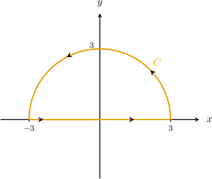

Consider the path $C$ shown above. Which of the following is equivalent to the line integral 

$$
{∮}_{C}(\operatorname{sin}⁡(\operatorname{cos}⁡x)-{x}^{2}y)\,dx+(x{y}^{2}-\frac{1}{y+1})\,dy\,?
$$

Field selection

${\int }_{0}^{\pi }\,{\int }_{0}^{3}r\,dr\,d\theta $

${\int }_{0}^{\pi }\,{\int }_{0}^{3}{r}^{3}\,dr\,d\theta $ (keyed correct)

${\int }_{-\pi /2}^{\pi /2}\,{\int }_{0}^{3}{r}^{3}\,dr\,d\theta $

${\int }_{-\pi /2}^{\pi /2}\,{\int }_{0}^{3}r\,dr\,d\theta $

${\int }_{0}^{\pi }\,{\int }_{0}^{2}(r+\operatorname{sin}⁡(\operatorname{cos}⁡\theta ))\,dr\,d\theta $

Green's theorem states that

$$
{∮}_{C}P\,dx+Q\,dy={∬}_{D}(\frac{∂Q}{∂x}-\frac{∂P}{∂y})\,\text{d}A.
$$

In our case, the region $D$ and its boundary $C$ satisfy the conditions of Green's theorem:

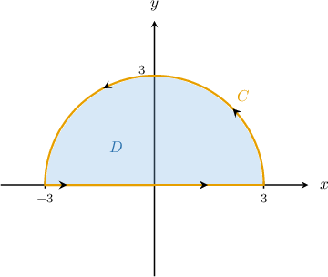

Since $P(x,y)=\operatorname{sin}⁡(\operatorname{cos}⁡x)-{x}^{2}y$ and $Q(x,y)=x{y}^{2}-\frac{1}{y+1},$ we obtain

$$
\begin{aligned}\frac{∂P}{∂y}=-{x}^{2},\,\frac{∂Q}{∂x}={y}^{2}.\end{aligned}
$$

Applying Green's theorem, we get

$$
\begin{aligned}{∮}_{C}(\operatorname{sin}⁡(\operatorname{cos}⁡x)-{x}^{2}y)\,dx+(x{y}^{2}-\frac{1}{y+1})\,dy & ={∬}_{D}(\frac{∂Q}{∂x}-\frac{∂P}{∂y})\text{d}A \\  & ={∬}_{D}({y}^{2}-(-{x}^{2}))\,\text{d}A \\  & ={∬}_{D}({x}^{2}+{y}^{2})\,\text{d}A.\end{aligned}
$$

Now, notice that the region $D$ can be represented in polar coordinates as

$$
Δ={(r,\theta )\,:\,0\le r\le 3,\,0\le \theta \le \pi }.
$$

The change of variables formula for plane polar coordinates states that 

$$
{∬}_{D}f(x,y)\text{ }dA={∬}_{Δ}\text{ }f(r\operatorname{cos}⁡\theta ,r\operatorname{sin}⁡\theta )\,r\text{ }drd\theta .
$$

Therefore, we can write our double integral as 

$$
\begin{aligned}{∬}_{D}({x}^{2}+{y}^{2})\,\text{d}A & ={∬}_{Δ}({r}^{2}{cos}^{2}⁡\theta +{r}^{2}{sin}^{2}⁡\theta )\,r\,\text{d}r\text{d}\theta  \\  & ={\int }_{0}^{\pi }\,{\int }_{0}^{3}{r}^{3}\,dr\,d\theta .\end{aligned}
$$

### Generated variation — evidence-only historical bank observed

Consider the path $C$ shown above. Which of the following is equivalent to the line integral 

$$
2\left({∮}_{C}(\operatorname{sin}⁡(\operatorname{cos}⁡x)-{x}^{2}y)\,dx+(x{y}^{2}-\frac{1}{y+1})\,dy\,?\right)
$$

Field selection

$2\left({\int }_{-\pi /2}^{\pi /2}\,{\int }_{0}^{3}r\,dr\,d\theta \right)$

$2\left({\int }_{0}^{\pi }\,{\int }_{0}^{3}{r}^{3}\,dr\,d\theta \right)$

$2\left({\int }_{0}^{\pi }\,{\int }_{0}^{2}(r+\operatorname{sin}⁡(\operatorname{cos}⁡\theta ))\,dr\,d\theta \right)$

$2\left({\int }_{0}^{\pi }\,{\int }_{0}^{3}r\,dr\,d\theta \right)$

$2\left({\int }_{-\pi /2}^{\pi /2}\,{\int }_{0}^{3}{r}^{3}\,dr\,d\theta \right)$

Green's theorem states that

$$
{∮}_{C}P\,dx+Q\,dy={∬}_{D}(\frac{∂Q}{∂x}-\frac{∂P}{∂y})\,\text{d}A.
$$

In our case, the region $D$ and its boundary $C$ satisfy the conditions of Green's theorem:

Since $P(x,y)=2\left(\operatorname{sin}⁡(\operatorname{cos}⁡x)-{x}^{2}y\right)$ and $Q(x,y)=2\left(x{y}^{2}-\frac{1}{y+1}\right),$ we obtain

$$
\begin{aligned}\frac{∂P}{∂y}=2\left(-{x}^{2}\right),\,\frac{∂Q}{∂x}=2\left({y}^{2}\right).\end{aligned}
$$

Applying Green's theorem, we get

$$
\begin{aligned}2\left({∮}_{C}(\operatorname{sin}⁡(\operatorname{cos}⁡x)-{x}^{2}y)\,dx+(x{y}^{2}-\frac{1}{y+1})\,dy\right) & ={∬}_{D}(\frac{∂Q}{∂x}-\frac{∂P}{∂y})\text{d}A \\  & =2\left({∬}_{D}({y}^{2}-(-{x}^{2}))\,\text{d}A\right) \\  & =2\left({∬}_{D}({x}^{2}+{y}^{2})\,\text{d}A.\right)\end{aligned}
$$

Now, notice that the region $D$ can be represented in polar coordinates as

$$
Δ={(r,\theta )\,:\,0\le r\le 3,\,0\le \theta \le \pi }.
$$

The change of variables formula for plane polar coordinates states that 

$$
{∬}_{D}f(x,y)\text{ }dA={∬}_{Δ}\text{ }f(r\operatorname{cos}⁡\theta ,r\operatorname{sin}⁡\theta )\,r\text{ }drd\theta .
$$

Therefore, we can write our double integral as 

$$
\begin{aligned}2\left({∬}_{D}({x}^{2}+{y}^{2})\,\text{d}A\right) & =2\left({∬}_{Δ}({r}^{2}{cos}^{2}⁡\theta +{r}^{2}{sin}^{2}⁡\theta )\,r\,\text{d}r\text{d}\theta \right) \\  & =2\left({\int }_{0}^{\pi }\,{\int }_{0}^{3}{r}^{3}\,dr\,d\theta .\right)\end{aligned}
$$

### Generated variation — normal practice authored_method

Consider the path $C$ shown above. Which of the following is equivalent to the line integral 

$$
2\left({∮}_{C}(\operatorname{sin}⁡(\operatorname{cos}⁡x)-{x}^{2}y)\,dx+(x{y}^{2}-\frac{1}{y+1})\,dy\,?\right)
$$

Field selection

$\int_{0}^{\pi}\int_{0}^{7}2 r^{3}\,dr\,d\theta$

$\int_{0}^{\pi}\int_{0}^{8}2 r^{3}\,dr\,d\theta$

$\int_{0}^{\pi}\int_{0}^{7}2 r^{2}\,dr\,d\theta$

$\int_{0}^{\pi}\int_{0}^{7}- 2 r^{3} \cos{\left(2 \theta \right)}\,dr\,d\theta$

$\int_{0}^{\pi}\int_{0}^{7}- 2 r^{3}\,dr\,d\theta$

Green's theorem states that

$$
{∮}_{C}P\,dx+Q\,dy={∬}_{D}(\frac{∂Q}{∂x}-\frac{∂P}{∂y})\,\text{d}A.
$$

In our case, the region $D$ and its boundary $C$ satisfy the conditions of Green's theorem:

Since $P(x,y)=2\left(\operatorname{sin}⁡(\operatorname{cos}⁡x)-{x}^{2}y\right)$ and $Q(x,y)=2\left(x{y}^{2}-\frac{1}{y+1}\right),$ we obtain

$$
\begin{aligned}\frac{∂P}{∂y}=2\left(-{x}^{2}\right),\,\frac{∂Q}{∂x}=2\left({y}^{2}\right).\end{aligned}
$$

Applying Green's theorem, we get

$$
\begin{aligned}2\left({∮}_{C}(\operatorname{sin}⁡(\operatorname{cos}⁡x)-{x}^{2}y)\,dx+(x{y}^{2}-\frac{1}{y+1})\,dy\right) & ={∬}_{D}(\frac{∂Q}{∂x}-\frac{∂P}{∂y})\text{d}A \\  & =2\left({∬}_{D}({y}^{2}-(-{x}^{2}))\,\text{d}A\right) \\  & =2\left({∬}_{D}({x}^{2}+{y}^{2})\,\text{d}A.\right)\end{aligned}
$$

Now, notice that the region $D$ can be represented in polar coordinates as

$$
Δ={(r,\theta )\,:\,0\le r\le 7,\,0\le \theta \le \pi }.
$$

The change of variables formula for plane polar coordinates states that 

$$
{∬}_{D}f(x,y)\text{ }dA={∬}_{Δ}\text{ }f(r\operatorname{cos}⁡\theta ,r\operatorname{sin}⁡\theta )\,r\text{ }drd\theta .
$$

Therefore, we can write our double integral as 

$$
\begin{aligned}2\left({∬}_{D}({x}^{2}+{y}^{2})\,\text{d}A\right) & =2\left({∬}_{Δ}({r}^{2}{cos}^{2}⁡\theta +{r}^{2}{sin}^{2}⁡\theta )\,r\,\text{d}r\text{d}\theta \right) \\  & =2\left({\int }_{0}^{\pi }\,{\int }_{0}^{7}{r}^{3}\,dr\,d\theta .\right)\end{aligned}
$$

### Generated variation — normal practice authored_method

Consider the path $C$ shown above. Which of the following is equivalent to the line integral 

$$
5\left({∮}_{C}(\operatorname{sin}⁡(\operatorname{cos}⁡x)-{x}^{2}y)\,dx+(x{y}^{2}-\frac{1}{y+1})\,dy\,?\right)
$$

Field selection

$\int_{0}^{\pi}\int_{0}^{2}- 5 r^{3}\,dr\,d\theta$

$\int_{0}^{\pi}\int_{0}^{2}- 5 r^{3} \cos{\left(2 \theta \right)}\,dr\,d\theta$

$\int_{0}^{\pi}\int_{0}^{2}5 r^{2}\,dr\,d\theta$

$\int_{0}^{\pi}\int_{0}^{2}5 r^{3}\,dr\,d\theta$

$\int_{0}^{\pi}\int_{0}^{3}5 r^{3}\,dr\,d\theta$

Green's theorem states that

$$
{∮}_{C}P\,dx+Q\,dy={∬}_{D}(\frac{∂Q}{∂x}-\frac{∂P}{∂y})\,\text{d}A.
$$

In our case, the region $D$ and its boundary $C$ satisfy the conditions of Green's theorem:

Since $P(x,y)=5\left(\operatorname{sin}⁡(\operatorname{cos}⁡x)-{x}^{2}y\right)$ and $Q(x,y)=5\left(x{y}^{2}-\frac{1}{y+1}\right),$ we obtain

$$
\begin{aligned}\frac{∂P}{∂y}=5\left(-{x}^{2}\right),\,\frac{∂Q}{∂x}=5\left({y}^{2}\right).\end{aligned}
$$

Applying Green's theorem, we get

$$
\begin{aligned}5\left({∮}_{C}(\operatorname{sin}⁡(\operatorname{cos}⁡x)-{x}^{2}y)\,dx+(x{y}^{2}-\frac{1}{y+1})\,dy\right) & ={∬}_{D}(\frac{∂Q}{∂x}-\frac{∂P}{∂y})\text{d}A \\  & =5\left({∬}_{D}({y}^{2}-(-{x}^{2}))\,\text{d}A\right) \\  & =5\left({∬}_{D}({x}^{2}+{y}^{2})\,\text{d}A.\right)\end{aligned}
$$

Now, notice that the region $D$ can be represented in polar coordinates as

$$
Δ={(r,\theta )\,:\,0\le r\le 2,\,0\le \theta \le \pi }.
$$

The change of variables formula for plane polar coordinates states that 

$$
{∬}_{D}f(x,y)\text{ }dA={∬}_{Δ}\text{ }f(r\operatorname{cos}⁡\theta ,r\operatorname{sin}⁡\theta )\,r\text{ }drd\theta .
$$

Therefore, we can write our double integral as 

$$
\begin{aligned}5\left({∬}_{D}({x}^{2}+{y}^{2})\,\text{d}A\right) & =5\left({∬}_{Δ}({r}^{2}{cos}^{2}⁡\theta +{r}^{2}{sin}^{2}⁡\theta )\,r\,\text{d}r\text{d}\theta \right) \\  & =5\left({\int }_{0}^{\pi }\,{\int }_{0}^{2}{r}^{3}\,dr\,d\theta .\right)\end{aligned}
$$

## q-126686 — observed moderate

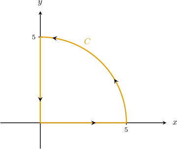

Consider the path $C$ shown above. Which of the following is equivalent to the line integral 

$$
{∮}_{C}(x{y}^{2}-y\operatorname{cos}⁡x)\,dx+(2{x}^{2}y-\operatorname{sin}⁡x)\,dy\,?
$$

Field selection

${\int }_{0}^{\pi /2}\,{\int }_{0}^{5}{r}^{3}\operatorname{cos}⁡\theta \,dr\,d\theta $

${\int }_{0}^{\pi /2}\,{\int }_{0}^{5}{r}^{2}\operatorname{sin}⁡\theta \,dr\,d\theta $

${\int }_{0}^{\pi }\,{\int }_{0}^{5}{r}^{3}\operatorname{sin}⁡(2\theta )\,dr\,d\theta $

${\int }_{\pi /2}^{\pi }\,{\int }_{0}^{5}{r}^{2}\operatorname{sin}⁡\theta \,dr\,d\theta $

${\int }_{0}^{\pi /2}\,{\int }_{0}^{5}{r}^{3}\operatorname{sin}⁡(2\theta )\,dr\,d\theta $ (keyed correct)

Green's theorem states that

$$
{∮}_{C}P\,dx+Q\,dy={∬}_{D}(\frac{∂Q}{∂x}-\frac{∂P}{∂y})\,\text{d}A.
$$

In our case, the region $D$ and its boundary $C$ satisfy the conditions of Green's theorem:

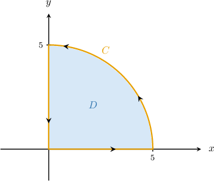

Since $P(x,y)=x{y}^{2}-y\operatorname{cos}⁡x$ and $Q(x,y)=2{x}^{2}y-\operatorname{sin}⁡x,$ we obtain

$$
\begin{aligned}\frac{∂P}{∂y}=2xy-\operatorname{cos}⁡x,\,\frac{∂Q}{∂x}=4xy-\operatorname{cos}⁡x.\end{aligned}
$$

Applying Green's theorem, we get

$$
\begin{aligned}{∮}_{C}(x{y}^{2}-y\operatorname{cos}⁡x)\,dx+(2{x}^{2}y-\operatorname{sin}⁡x)\,dy & ={∬}_{D}(\frac{∂Q}{∂x}-\frac{∂P}{∂y})\text{d}A \\  & ={∬}_{D}(4xy-\operatorname{cos}⁡x-(2xy-\operatorname{cos}⁡x))\,\text{d}A \\  & ={∬}_{D}2xy\,\text{d}A.\end{aligned}
$$

Now, notice that the region $D$ can be represented in polar coordinates as

$$
Δ={(r,\theta )\,:\,0\le r\le 5,\,0\le \theta \le \frac{\pi }{2}}.
$$

 

The change of variables formula for plane polar coordinates states that

$$
{∬}_{D}f(x,y)\text{ }dA={∬}_{Δ}\text{ }f(r\operatorname{cos}⁡\theta ,r\operatorname{sin}⁡\theta )\,r\text{ }drd\theta .
$$

Therefore, we can write our double integral as 

$$
\begin{aligned}{∬}_{D}2xy\,\text{d}A & ={∬}_{Δ}2(r\operatorname{cos}⁡\theta )(r\operatorname{sin}⁡\theta )\,r\,\text{d}r\text{d}\theta  \\  & ={\int }_{0}^{\pi /2}\,{\int }_{0}^{5}2{r}^{3}\operatorname{sin}⁡\theta \operatorname{cos}⁡\theta \,dr\,d\theta  \\  & ={\int }_{0}^{\pi /2}\,{\int }_{0}^{5}{r}^{3}\operatorname{sin}⁡(2\theta )\,dr\,d\theta .\end{aligned}
$$

### Generated variation — evidence-only historical bank observed

Consider the path $C$ shown above. Which of the following is equivalent to the line integral 

$$
2\left({∮}_{C}(x{y}^{2}-y\operatorname{cos}⁡x)\,dx+(2{x}^{2}y-\operatorname{sin}⁡x)\,dy\,?\right)
$$

Field selection

$2\left({\int }_{\pi /2}^{\pi }\,{\int }_{0}^{5}{r}^{2}\operatorname{sin}⁡\theta \,dr\,d\theta \right)$

$2\left({\int }_{0}^{\pi /2}\,{\int }_{0}^{5}{r}^{2}\operatorname{sin}⁡\theta \,dr\,d\theta \right)$

$2\left({\int }_{0}^{\pi /2}\,{\int }_{0}^{5}{r}^{3}\operatorname{sin}⁡(2\theta )\,dr\,d\theta \right)$

$2\left({\int }_{0}^{\pi /2}\,{\int }_{0}^{5}{r}^{3}\operatorname{cos}⁡\theta \,dr\,d\theta \right)$

$2\left({\int }_{0}^{\pi }\,{\int }_{0}^{5}{r}^{3}\operatorname{sin}⁡(2\theta )\,dr\,d\theta \right)$

Green's theorem states that

$$
{∮}_{C}P\,dx+Q\,dy={∬}_{D}(\frac{∂Q}{∂x}-\frac{∂P}{∂y})\,\text{d}A.
$$

In our case, the region $D$ and its boundary $C$ satisfy the conditions of Green's theorem:

Since $P(x,y)=2\left(x{y}^{2}-y\operatorname{cos}⁡x\right)$ and $Q(x,y)=2\left(2{x}^{2}y-\operatorname{sin}⁡x\right),$ we obtain

$$
\begin{aligned}\frac{∂P}{∂y}=2\left(2xy-\operatorname{cos}⁡x\right),\,\frac{∂Q}{∂x}=2\left(4xy-\operatorname{cos}⁡x\right).\end{aligned}
$$

Applying Green's theorem, we get

$$
\begin{aligned}2\left({∮}_{C}(x{y}^{2}-y\operatorname{cos}⁡x)\,dx+(2{x}^{2}y-\operatorname{sin}⁡x)\,dy\right) & ={∬}_{D}(\frac{∂Q}{∂x}-\frac{∂P}{∂y})\text{d}A \\  & =2\left({∬}_{D}(4xy-\operatorname{cos}⁡x-(2xy-\operatorname{cos}⁡x))\,\text{d}A\right) \\  & =2\left({∬}_{D}2xy\,\text{d}A.\right)\end{aligned}
$$

Now, notice that the region $D$ can be represented in polar coordinates as

$$
Δ={(r,\theta )\,:\,0\le r\le 5,\,0\le \theta \le \frac{\pi }{2}}.
$$

 

The change of variables formula for plane polar coordinates states that

$$
{∬}_{D}f(x,y)\text{ }dA={∬}_{Δ}\text{ }f(r\operatorname{cos}⁡\theta ,r\operatorname{sin}⁡\theta )\,r\text{ }drd\theta .
$$

Therefore, we can write our double integral as 

$$
\begin{aligned}2\left({∬}_{D}2xy\,\text{d}A\right) & =2\left({∬}_{Δ}2(r\operatorname{cos}⁡\theta )(r\operatorname{sin}⁡\theta )\,r\,\text{d}r\text{d}\theta \right) \\  & =2\left({\int }_{0}^{\pi /2}\,{\int }_{0}^{5}2{r}^{3}\operatorname{sin}⁡\theta \operatorname{cos}⁡\theta \,dr\,d\theta \right) \\  & =2\left({\int }_{0}^{\pi /2}\,{\int }_{0}^{5}{r}^{3}\operatorname{sin}⁡(2\theta )\,dr\,d\theta .\right)\end{aligned}
$$

### Generated variation — normal practice authored_method

Consider the path $C$ shown above. Which of the following is equivalent to the line integral 

$$
2\left({∮}_{C}(x{y}^{2}-y\operatorname{cos}⁡x)\,dx+(2{x}^{2}y-\operatorname{sin}⁡x)\,dy\,?\right)
$$

Field selection

$\int_{0}^{\frac{\pi}{2}}\int_{0}^{7}2 r^{3} \sin{\left(2 \theta \right)}\,dr\,d\theta$

$\int_{0}^{\frac{\pi}{2}}\int_{0}^{8}2 r^{3} \sin{\left(2 \theta \right)}\,dr\,d\theta$

$\int_{0}^{\frac{\pi}{2}}\int_{0}^{7}2 r^{2} \sin{\left(2 \theta \right)}\,dr\,d\theta$

$\int_{0}^{\frac{\pi}{2}}\int_{0}^{7}r \left(6 r^{2} \sin{\left(2 \theta \right)} - 4 \cos{\left(r \cos{\left(\theta \right)} \right)}\right)\,dr\,d\theta$

$\int_{0}^{\frac{\pi}{2}}\int_{0}^{7}- 2 r^{3} \sin{\left(2 \theta \right)}\,dr\,d\theta$

Green's theorem states that

$$
{∮}_{C}P\,dx+Q\,dy={∬}_{D}(\frac{∂Q}{∂x}-\frac{∂P}{∂y})\,\text{d}A.
$$

In our case, the region $D$ and its boundary $C$ satisfy the conditions of Green's theorem:

Since $P(x,y)=2\left(x{y}^{2}-y\operatorname{cos}⁡x\right)$ and $Q(x,y)=2\left(2{x}^{2}y-\operatorname{sin}⁡x\right),$ we obtain

$$
\begin{aligned}\frac{∂P}{∂y}=2\left(2xy-\operatorname{cos}⁡x\right),\,\frac{∂Q}{∂x}=2\left(4xy-\operatorname{cos}⁡x\right).\end{aligned}
$$

Applying Green's theorem, we get

$$
\begin{aligned}2\left({∮}_{C}(x{y}^{2}-y\operatorname{cos}⁡x)\,dx+(2{x}^{2}y-\operatorname{sin}⁡x)\,dy\right) & ={∬}_{D}(\frac{∂Q}{∂x}-\frac{∂P}{∂y})\text{d}A \\  & =2\left({∬}_{D}(4xy-\operatorname{cos}⁡x-(2xy-\operatorname{cos}⁡x))\,\text{d}A\right) \\  & =2\left({∬}_{D}2xy\,\text{d}A.\right)\end{aligned}
$$

Now, notice that the region $D$ can be represented in polar coordinates as

$$
Δ={(r,\theta )\,:\,0\le r\le 7,\,0\le \theta \le \frac{\pi }{2}}.
$$

 

The change of variables formula for plane polar coordinates states that

$$
{∬}_{D}f(x,y)\text{ }dA={∬}_{Δ}\text{ }f(r\operatorname{cos}⁡\theta ,r\operatorname{sin}⁡\theta )\,r\text{ }drd\theta .
$$

Therefore, we can write our double integral as 

$$
\begin{aligned}2\left({∬}_{D}2xy\,\text{d}A\right) & =2\left({∬}_{Δ}2(r\operatorname{cos}⁡\theta )(r\operatorname{sin}⁡\theta )\,r\,\text{d}r\text{d}\theta \right) \\  & =2\left({\int }_{0}^{\pi /2}\,{\int }_{0}^{7}2{r}^{3}\operatorname{sin}⁡\theta \operatorname{cos}⁡\theta \,dr\,d\theta \right) \\  & =2\left({\int }_{0}^{\pi /2}\,{\int }_{0}^{7}{r}^{3}\operatorname{sin}⁡(2\theta )\,dr\,d\theta .\right)\end{aligned}
$$

### Generated variation — normal practice authored_method

Consider the path $C$ shown above. Which of the following is equivalent to the line integral 

$$
5\left({∮}_{C}(x{y}^{2}-y\operatorname{cos}⁡x)\,dx+(2{x}^{2}y-\operatorname{sin}⁡x)\,dy\,?\right)
$$

Field selection

$\int_{0}^{\frac{\pi}{2}}\int_{0}^{2}- 5 r^{3} \sin{\left(2 \theta \right)}\,dr\,d\theta$

$\int_{0}^{\frac{\pi}{2}}\int_{0}^{2}r \left(15 r^{2} \sin{\left(2 \theta \right)} - 10 \cos{\left(r \cos{\left(\theta \right)} \right)}\right)\,dr\,d\theta$

$\int_{0}^{\frac{\pi}{2}}\int_{0}^{2}5 r^{2} \sin{\left(2 \theta \right)}\,dr\,d\theta$

$\int_{0}^{\frac{\pi}{2}}\int_{0}^{2}5 r^{3} \sin{\left(2 \theta \right)}\,dr\,d\theta$

$\int_{0}^{\frac{\pi}{2}}\int_{0}^{3}5 r^{3} \sin{\left(2 \theta \right)}\,dr\,d\theta$

Green's theorem states that

$$
{∮}_{C}P\,dx+Q\,dy={∬}_{D}(\frac{∂Q}{∂x}-\frac{∂P}{∂y})\,\text{d}A.
$$

In our case, the region $D$ and its boundary $C$ satisfy the conditions of Green's theorem:

Since $P(x,y)=5\left(x{y}^{2}-y\operatorname{cos}⁡x\right)$ and $Q(x,y)=5\left(2{x}^{2}y-\operatorname{sin}⁡x\right),$ we obtain

$$
\begin{aligned}\frac{∂P}{∂y}=5\left(2xy-\operatorname{cos}⁡x\right),\,\frac{∂Q}{∂x}=5\left(4xy-\operatorname{cos}⁡x\right).\end{aligned}
$$

Applying Green's theorem, we get

$$
\begin{aligned}5\left({∮}_{C}(x{y}^{2}-y\operatorname{cos}⁡x)\,dx+(2{x}^{2}y-\operatorname{sin}⁡x)\,dy\right) & ={∬}_{D}(\frac{∂Q}{∂x}-\frac{∂P}{∂y})\text{d}A \\  & =5\left({∬}_{D}(4xy-\operatorname{cos}⁡x-(2xy-\operatorname{cos}⁡x))\,\text{d}A\right) \\  & =5\left({∬}_{D}2xy\,\text{d}A.\right)\end{aligned}
$$

Now, notice that the region $D$ can be represented in polar coordinates as

$$
Δ={(r,\theta )\,:\,0\le r\le 2,\,0\le \theta \le \frac{\pi }{2}}.
$$

 

The change of variables formula for plane polar coordinates states that

$$
{∬}_{D}f(x,y)\text{ }dA={∬}_{Δ}\text{ }f(r\operatorname{cos}⁡\theta ,r\operatorname{sin}⁡\theta )\,r\text{ }drd\theta .
$$

Therefore, we can write our double integral as 

$$
\begin{aligned}5\left({∬}_{D}2xy\,\text{d}A\right) & =5\left({∬}_{Δ}2(r\operatorname{cos}⁡\theta )(r\operatorname{sin}⁡\theta )\,r\,\text{d}r\text{d}\theta \right) \\  & =5\left({\int }_{0}^{\pi /2}\,{\int }_{0}^{2}2{r}^{3}\operatorname{sin}⁡\theta \operatorname{cos}⁡\theta \,dr\,d\theta \right) \\  & =5\left({\int }_{0}^{\pi /2}\,{\int }_{0}^{2}{r}^{3}\operatorname{sin}⁡(2\theta )\,dr\,d\theta .\right)\end{aligned}
$$

## q-126709 — observed moderate

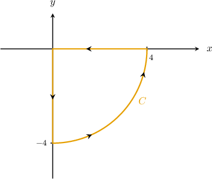

Consider the path $C$ shown above. Given that $F(x,y)=⟨{e}^{x/4}+x{y}^{2},\,{e}^{\operatorname{sin}⁡y}+2x⟩,$ which of the following is equivalent to ${∮}_{C}F\cdot dr\,?$

Field selection

${\int }_{0}^{3\pi /2}\,{\int }_{0}^{4}(2r-{r}^{2}\operatorname{sin}⁡\theta )\,dr\,d\theta $

${\int }_{-\pi /2}^{0}\,{\int }_{0}^{4}(2r{e}^{\operatorname{sin}⁡\theta }-{r}^{2}\operatorname{sin}⁡\theta )\,dr\,d\theta $

${\int }_{0}^{3\pi /2}\,{\int }_{0}^{4}(r{e}^{\operatorname{sin}⁡\theta }-{r}^{3}\operatorname{sin}⁡(2\theta ))\,dr\,d\theta $

${\int }_{-\pi /2}^{0}\,{\int }_{0}^{4}(2r-{r}^{3}\operatorname{sin}⁡(2\theta ))\,dr\,d\theta $ (keyed correct)

${\int }_{-\pi /2}^{0}\,{\int }_{0}^{4}(2r-{r}^{2}\operatorname{sin}⁡(2\theta ))\,dr\,d\theta $

First, notice that we can rewrite our integral as 

$$
{∮}_{C}F\cdot dr={∮}_{C}({e}^{x/4}+x{y}^{2})\,dx+({e}^{\operatorname{sin}⁡y}+2x)\,dy.
$$

Green's theorem states that

$$
{∮}_{C}P\,dx+Q\,dy={∬}_{D}(\frac{∂Q}{∂x}-\frac{∂P}{∂y})\,\text{d}A.
$$

In our case, the region $D$ and its boundary $C$ satisfy the conditions of Green's theorem:

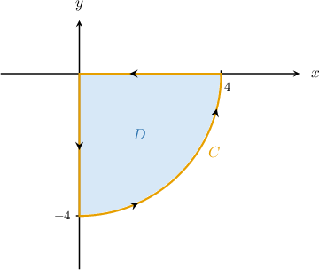

Since $P(x,y)={e}^{x/4}+x{y}^{2}$ and $Q(x,y)={e}^{\operatorname{sin}⁡y}+2x,$ we obtain

$$
\begin{aligned}\frac{∂P}{∂y}=2xy,\,\frac{∂Q}{∂x}=2.\end{aligned}
$$

Applying Green's theorem, we get

$$
\begin{aligned}{∮}_{C}({e}^{x/4}+x{y}^{2})\,dx+({e}^{\operatorname{sin}⁡y}+2x)\,dy & ={∬}_{D}(\frac{∂Q}{∂x}-\frac{∂P}{∂y})\text{d}A \\  & ={∬}_{D}(2-2xy)\,\text{d}A.\end{aligned}
$$

Now, notice that the region $D$ can be represented in polar coordinates as

$$
Δ={(r,\theta )\,:\,0\le r\le 4,\,-\frac{\pi }{2}\le \theta \le 0}.
$$

The change of variables formula for plane polar coordinates states that 

$$
{∬}_{D}f(x,y)\text{ }dA={∬}_{Δ}\text{ }f(r\operatorname{cos}⁡\theta ,r\operatorname{sin}⁡\theta )\,r\text{ }drd\theta .
$$

Therefore, we can write our double integral as 

$$
\begin{aligned}{∬}_{D}(2-2xy)\,\text{d}A & ={∬}_{Δ}(2-2\cdot r\operatorname{cos}⁡\theta \cdot r\operatorname{sin}⁡\theta )\,r\,\text{d}r\text{d}\theta  \\  & ={\int }_{-\pi /2}^{0}\,{\int }_{0}^{4}(2r-{r}^{3}\operatorname{sin}⁡(2\theta ))\,dr\,d\theta .\end{aligned}
$$

### Generated variation — evidence-only historical bank observed

Consider the path $C$ shown above. Given that $F(x,y)=⟨2\left({e}^{x/4}+x{y}^{2}\right),\,2\left({e}^{\operatorname{sin}⁡y}+2x\right)⟩,$ which of the following is equivalent to ${∮}_{C}F\cdot dr\,?$

Field selection

$2\left({\int }_{-\pi /2}^{0}\,{\int }_{0}^{4}(2r-{r}^{3}\operatorname{sin}⁡(2\theta ))\,dr\,d\theta \right)$

$2\left({\int }_{-\pi /2}^{0}\,{\int }_{0}^{4}(2r{e}^{\operatorname{sin}⁡\theta }-{r}^{2}\operatorname{sin}⁡\theta )\,dr\,d\theta \right)$

$2\left({\int }_{-\pi /2}^{0}\,{\int }_{0}^{4}(2r-{r}^{2}\operatorname{sin}⁡(2\theta ))\,dr\,d\theta \right)$

$2\left({\int }_{0}^{3\pi /2}\,{\int }_{0}^{4}(2r-{r}^{2}\operatorname{sin}⁡\theta )\,dr\,d\theta \right)$

$2\left({\int }_{0}^{3\pi /2}\,{\int }_{0}^{4}(r{e}^{\operatorname{sin}⁡\theta }-{r}^{3}\operatorname{sin}⁡(2\theta ))\,dr\,d\theta \right)$

First, notice that we can rewrite our integral as 

$$
{∮}_{C}F\cdot dr=2\left({∮}_{C}({e}^{x/4}+x{y}^{2})\,dx+({e}^{\operatorname{sin}⁡y}+2x)\,dy.\right)
$$

Green's theorem states that

$$
{∮}_{C}P\,dx+Q\,dy={∬}_{D}(\frac{∂Q}{∂x}-\frac{∂P}{∂y})\,\text{d}A.
$$

In our case, the region $D$ and its boundary $C$ satisfy the conditions of Green's theorem:

Since $P(x,y)=2\left({e}^{x/4}+x{y}^{2}\right)$ and $Q(x,y)=2\left({e}^{\operatorname{sin}⁡y}+2x\right),$ we obtain

$$
\begin{aligned}\frac{∂P}{∂y}=2\left(2xy\right),\,\frac{∂Q}{∂x}=2\left(2\right).\end{aligned}
$$

Applying Green's theorem, we get

$$
\begin{aligned}2\left({∮}_{C}({e}^{x/4}+x{y}^{2})\,dx+({e}^{\operatorname{sin}⁡y}+2x)\,dy\right) & ={∬}_{D}(\frac{∂Q}{∂x}-\frac{∂P}{∂y})\text{d}A \\  & =2\left({∬}_{D}(2-2xy)\,\text{d}A.\right)\end{aligned}
$$

Now, notice that the region $D$ can be represented in polar coordinates as

$$
Δ={(r,\theta )\,:\,0\le r\le 4,\,-\frac{\pi }{2}\le \theta \le 0}.
$$

The change of variables formula for plane polar coordinates states that 

$$
{∬}_{D}f(x,y)\text{ }dA={∬}_{Δ}\text{ }f(r\operatorname{cos}⁡\theta ,r\operatorname{sin}⁡\theta )\,r\text{ }drd\theta .
$$

Therefore, we can write our double integral as 

$$
\begin{aligned}2\left({∬}_{D}(2-2xy)\,\text{d}A\right) & =2\left({∬}_{Δ}(2-2\cdot r\operatorname{cos}⁡\theta \cdot r\operatorname{sin}⁡\theta )\,r\,\text{d}r\text{d}\theta \right) \\  & =2\left({\int }_{-\pi /2}^{0}\,{\int }_{0}^{4}(2r-{r}^{3}\operatorname{sin}⁡(2\theta ))\,dr\,d\theta .\right)\end{aligned}
$$

### Generated variation — normal practice authored_method

Consider the path $C$ shown above. Given that $F(x,y)=⟨2\left({e}^{x/4}+x{y}^{2}\right),\,2\left({e}^{\operatorname{sin}⁡y}+2x\right)⟩,$ which of the following is equivalent to ${∮}_{C}F\cdot dr\,?$

Field selection

$\int_{- \frac{\pi}{2}}^{0}\int_{0}^{7}r \left(- 2 r^{2} \sin{\left(2 \theta \right)} + 4\right)\,dr\,d\theta$

$\int_{- \frac{\pi}{2}}^{0}\int_{0}^{8}r \left(- 2 r^{2} \sin{\left(2 \theta \right)} + 4\right)\,dr\,d\theta$

$\int_{- \frac{\pi}{2}}^{0}\int_{0}^{7}- 2 r^{2} \sin{\left(2 \theta \right)} + 4\,dr\,d\theta$

$\int_{- \frac{\pi}{2}}^{0}\int_{0}^{7}r \left(2 r^{2} \sin{\left(2 \theta \right)} + 4\right)\,dr\,d\theta$

$\int_{- \frac{\pi}{2}}^{0}\int_{0}^{7}- r \left(- 2 r^{2} \sin{\left(2 \theta \right)} + 4\right)\,dr\,d\theta$

First, notice that we can rewrite our integral as 

$$
{∮}_{C}F\cdot dr=2\left({∮}_{C}({e}^{x/4}+x{y}^{2})\,dx+({e}^{\operatorname{sin}⁡y}+2x)\,dy.\right)
$$

Green's theorem states that

$$
{∮}_{C}P\,dx+Q\,dy={∬}_{D}(\frac{∂Q}{∂x}-\frac{∂P}{∂y})\,\text{d}A.
$$

In our case, the region $D$ and its boundary $C$ satisfy the conditions of Green's theorem:

Since $P(x,y)=2\left({e}^{x/4}+x{y}^{2}\right)$ and $Q(x,y)=2\left({e}^{\operatorname{sin}⁡y}+2x\right),$ we obtain

$$
\begin{aligned}\frac{∂P}{∂y}=2\left(2xy\right),\,\frac{∂Q}{∂x}=2\left(2\right).\end{aligned}
$$

Applying Green's theorem, we get

$$
\begin{aligned}2\left({∮}_{C}({e}^{x/4}+x{y}^{2})\,dx+({e}^{\operatorname{sin}⁡y}+2x)\,dy\right) & ={∬}_{D}(\frac{∂Q}{∂x}-\frac{∂P}{∂y})\text{d}A \\  & =2\left({∬}_{D}(2-2xy)\,\text{d}A.\right)\end{aligned}
$$

Now, notice that the region $D$ can be represented in polar coordinates as

$$
Δ={(r,\theta )\,:\,0\le r\le 7,\,-\frac{\pi }{2}\le \theta \le 0}.
$$

The change of variables formula for plane polar coordinates states that 

$$
{∬}_{D}f(x,y)\text{ }dA={∬}_{Δ}\text{ }f(r\operatorname{cos}⁡\theta ,r\operatorname{sin}⁡\theta )\,r\text{ }drd\theta .
$$

Therefore, we can write our double integral as 

$$
\begin{aligned}2\left({∬}_{D}(2-2xy)\,\text{d}A\right) & =2\left({∬}_{Δ}(2-2\cdot r\operatorname{cos}⁡\theta \cdot r\operatorname{sin}⁡\theta )\,r\,\text{d}r\text{d}\theta \right) \\  & =2\left({\int }_{-\pi /2}^{0}\,{\int }_{0}^{7}(2r-{r}^{3}\operatorname{sin}⁡(2\theta ))\,dr\,d\theta .\right)\end{aligned}
$$

### Generated variation — normal practice authored_method

Consider the path $C$ shown above. Given that $F(x,y)=⟨5\left({e}^{x/4}+x{y}^{2}\right),\,5\left({e}^{\operatorname{sin}⁡y}+2x\right)⟩,$ which of the following is equivalent to ${∮}_{C}F\cdot dr\,?$

Field selection

$\int_{- \frac{\pi}{2}}^{0}\int_{0}^{2}- r \left(- 5 r^{2} \sin{\left(2 \theta \right)} + 10\right)\,dr\,d\theta$

$\int_{- \frac{\pi}{2}}^{0}\int_{0}^{2}r \left(5 r^{2} \sin{\left(2 \theta \right)} + 10\right)\,dr\,d\theta$

$\int_{- \frac{\pi}{2}}^{0}\int_{0}^{2}- 5 r^{2} \sin{\left(2 \theta \right)} + 10\,dr\,d\theta$

$\int_{- \frac{\pi}{2}}^{0}\int_{0}^{2}r \left(- 5 r^{2} \sin{\left(2 \theta \right)} + 10\right)\,dr\,d\theta$

$\int_{- \frac{\pi}{2}}^{0}\int_{0}^{3}r \left(- 5 r^{2} \sin{\left(2 \theta \right)} + 10\right)\,dr\,d\theta$

First, notice that we can rewrite our integral as 

$$
{∮}_{C}F\cdot dr=5\left({∮}_{C}({e}^{x/4}+x{y}^{2})\,dx+({e}^{\operatorname{sin}⁡y}+2x)\,dy.\right)
$$

Green's theorem states that

$$
{∮}_{C}P\,dx+Q\,dy={∬}_{D}(\frac{∂Q}{∂x}-\frac{∂P}{∂y})\,\text{d}A.
$$

In our case, the region $D$ and its boundary $C$ satisfy the conditions of Green's theorem:

Since $P(x,y)=5\left({e}^{x/4}+x{y}^{2}\right)$ and $Q(x,y)=5\left({e}^{\operatorname{sin}⁡y}+2x\right),$ we obtain

$$
\begin{aligned}\frac{∂P}{∂y}=5\left(2xy\right),\,\frac{∂Q}{∂x}=5\left(2\right).\end{aligned}
$$

Applying Green's theorem, we get

$$
\begin{aligned}5\left({∮}_{C}({e}^{x/4}+x{y}^{2})\,dx+({e}^{\operatorname{sin}⁡y}+2x)\,dy\right) & ={∬}_{D}(\frac{∂Q}{∂x}-\frac{∂P}{∂y})\text{d}A \\  & =5\left({∬}_{D}(2-2xy)\,\text{d}A.\right)\end{aligned}
$$

Now, notice that the region $D$ can be represented in polar coordinates as

$$
Δ={(r,\theta )\,:\,0\le r\le 2,\,-\frac{\pi }{2}\le \theta \le 0}.
$$

The change of variables formula for plane polar coordinates states that 

$$
{∬}_{D}f(x,y)\text{ }dA={∬}_{Δ}\text{ }f(r\operatorname{cos}⁡\theta ,r\operatorname{sin}⁡\theta )\,r\text{ }drd\theta .
$$

Therefore, we can write our double integral as 

$$
\begin{aligned}5\left({∬}_{D}(2-2xy)\,\text{d}A\right) & =5\left({∬}_{Δ}(2-2\cdot r\operatorname{cos}⁡\theta \cdot r\operatorname{sin}⁡\theta )\,r\,\text{d}r\text{d}\theta \right) \\  & =5\left({\int }_{-\pi /2}^{0}\,{\int }_{0}^{2}(2r-{r}^{3}\operatorname{sin}⁡(2\theta ))\,dr\,d\theta .\right)\end{aligned}
$$

## q-126708 — observed moderate

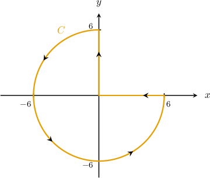

Consider the path $C$ shown above. Given that $F(x,y)=⟨x+y,\,-xy⟩,$ which of the following is equivalent to ${∮}_{C}F\cdot dr\,?$

Field selection

${\int }_{\pi /2}^{2\pi }\,{\int }_{0}^{6}(-2{r}^{2}\operatorname{sin}⁡\theta -1)\,dr\,d\theta $

${\int }_{\pi /2}^{2\pi }\,{\int }_{0}^{6}(-{r}^{2}\operatorname{sin}⁡\theta -r)\,dr\,d\theta $ (keyed correct)

${\int }_{0}^{\pi /2}\,{\int }_{0}^{6}({r}^{3}\operatorname{sin}⁡\theta -r)\,dr\,d\theta $

${\int }_{\pi /2}^{2\pi }\,{\int }_{0}^{6}(-{r}^{2}\operatorname{sin}⁡\theta -1)\,dr\,d\theta $

${\int }_{0}^{\pi /2}\,{\int }_{0}^{6}(-2{r}^{2}\operatorname{sin}⁡\theta -r)\,dr\,d\theta $

First, notice that we can rewrite our integral as 

$$
{∮}_{C}F\cdot dr={∮}_{C}(x+y)\,dx+(-xy)\,dy.
$$

Green's theorem states that

$$
{∮}_{C}P\,dx+Q\,dy={∬}_{D}(\frac{∂Q}{∂x}-\frac{∂P}{∂y})\,\text{d}A.
$$

In our case, the region $D$ and its boundary $C$ satisfy the conditions of Green's theorem:

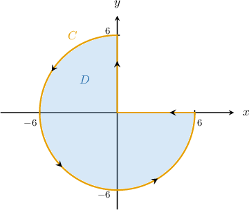

Since $P(x,y)=x+y$ and $Q(x,y)=-xy,$ we obtain

$$
\begin{aligned}\frac{∂P}{∂y}=1,\,\frac{∂Q}{∂x}=-y.\end{aligned}
$$

Applying Green's theorem, we get

$$
\begin{aligned}{∮}_{C}(x+y)\,dx+(-xy)\,dy & ={∬}_{D}(\frac{∂Q}{∂x}-\frac{∂P}{∂y})\text{d}A \\  & ={∬}_{D}(-y-1)\,\text{d}A \\  & ={∬}_{D}(-y-1)\,\text{d}A.\end{aligned}
$$

Now, notice that the region $D$ can be represented in polar coordinates as

$$
Δ={(r,\theta )\,:\,0\le r\le 6,\,\frac{\pi }{2}\le \theta \le 2\pi }.
$$

 

The change of variables formula for plane polar coordinates states that

$$
{∬}_{D}f(x,y)\text{ }dA={∬}_{Δ}\text{ }f(r\operatorname{cos}⁡\theta ,r\operatorname{sin}⁡\theta )\,r\text{ }drd\theta .
$$

Therefore, we can write our double integral as 

$$
\begin{aligned}{∬}_{D}(-y-1)\,\text{d}A & ={∬}_{Δ}(-r\operatorname{sin}⁡\theta -1)\,r\,\text{d}r\text{d}\theta  \\  & ={\int }_{\pi /2}^{2\pi }\,{\int }_{0}^{6}(-{r}^{2}\operatorname{sin}⁡\theta -r)\,dr\,d\theta .\end{aligned}
$$

### Generated variation — evidence-only historical bank observed

Consider the path $C$ shown above. Given that $F(x,y)=⟨2\left(x+y\right),\,2\left(-xy\right)⟩,$ which of the following is equivalent to ${∮}_{C}F\cdot dr\,?$

Field selection

$2\left({\int }_{\pi /2}^{2\pi }\,{\int }_{0}^{6}(-{r}^{2}\operatorname{sin}⁡\theta -1)\,dr\,d\theta \right)$

$2\left({\int }_{\pi /2}^{2\pi }\,{\int }_{0}^{6}(-{r}^{2}\operatorname{sin}⁡\theta -r)\,dr\,d\theta \right)$

$2\left({\int }_{0}^{\pi /2}\,{\int }_{0}^{6}(-2{r}^{2}\operatorname{sin}⁡\theta -r)\,dr\,d\theta \right)$

$2\left({\int }_{\pi /2}^{2\pi }\,{\int }_{0}^{6}(-2{r}^{2}\operatorname{sin}⁡\theta -1)\,dr\,d\theta \right)$

$2\left({\int }_{0}^{\pi /2}\,{\int }_{0}^{6}({r}^{3}\operatorname{sin}⁡\theta -r)\,dr\,d\theta \right)$

First, notice that we can rewrite our integral as 

$$
{∮}_{C}F\cdot dr=2\left({∮}_{C}(x+y)\,dx+(-xy)\,dy.\right)
$$

Green's theorem states that

$$
{∮}_{C}P\,dx+Q\,dy={∬}_{D}(\frac{∂Q}{∂x}-\frac{∂P}{∂y})\,\text{d}A.
$$

In our case, the region $D$ and its boundary $C$ satisfy the conditions of Green's theorem:

Since $P(x,y)=2\left(x+y\right)$ and $Q(x,y)=2\left(-xy\right),$ we obtain

$$
\begin{aligned}\frac{∂P}{∂y}=2\left(1\right),\,\frac{∂Q}{∂x}=2\left(-y\right).\end{aligned}
$$

Applying Green's theorem, we get

$$
\begin{aligned}2\left({∮}_{C}(x+y)\,dx+(-xy)\,dy\right) & ={∬}_{D}(\frac{∂Q}{∂x}-\frac{∂P}{∂y})\text{d}A \\  & =2\left({∬}_{D}(-y-1)\,\text{d}A\right) \\  & =2\left({∬}_{D}(-y-1)\,\text{d}A.\right)\end{aligned}
$$

Now, notice that the region $D$ can be represented in polar coordinates as

$$
Δ={(r,\theta )\,:\,0\le r\le 6,\,\frac{\pi }{2}\le \theta \le 2\pi }.
$$

 

The change of variables formula for plane polar coordinates states that

$$
{∬}_{D}f(x,y)\text{ }dA={∬}_{Δ}\text{ }f(r\operatorname{cos}⁡\theta ,r\operatorname{sin}⁡\theta )\,r\text{ }drd\theta .
$$

Therefore, we can write our double integral as 

$$
\begin{aligned}2\left({∬}_{D}(-y-1)\,\text{d}A\right) & =2\left({∬}_{Δ}(-r\operatorname{sin}⁡\theta -1)\,r\,\text{d}r\text{d}\theta \right) \\  & =2\left({\int }_{\pi /2}^{2\pi }\,{\int }_{0}^{6}(-{r}^{2}\operatorname{sin}⁡\theta -r)\,dr\,d\theta .\right)\end{aligned}
$$

### Generated variation — normal practice authored_method

Consider the path $C$ shown above. Given that $F(x,y)=⟨2\left(x+y\right),\,2\left(-xy\right)⟩,$ which of the following is equivalent to ${∮}_{C}F\cdot dr\,?$

Field selection

$\int_{\frac{\pi}{2}}^{2 \pi}\int_{0}^{7}r \left(- 2 r \sin{\left(\theta \right)} - 2\right)\,dr\,d\theta$

$\int_{\frac{\pi}{2}}^{2 \pi}\int_{0}^{8}r \left(- 2 r \sin{\left(\theta \right)} - 2\right)\,dr\,d\theta$

$\int_{\frac{\pi}{2}}^{2 \pi}\int_{0}^{7}- 2 r \sin{\left(\theta \right)} - 2\,dr\,d\theta$

$\int_{\frac{\pi}{2}}^{2 \pi}\int_{0}^{7}r \left(- 2 r \sin{\left(\theta \right)} + 2\right)\,dr\,d\theta$

$\int_{\frac{\pi}{2}}^{2 \pi}\int_{0}^{7}- r \left(- 2 r \sin{\left(\theta \right)} - 2\right)\,dr\,d\theta$

First, notice that we can rewrite our integral as 

$$
{∮}_{C}F\cdot dr=2\left({∮}_{C}(x+y)\,dx+(-xy)\,dy.\right)
$$

Green's theorem states that

$$
{∮}_{C}P\,dx+Q\,dy={∬}_{D}(\frac{∂Q}{∂x}-\frac{∂P}{∂y})\,\text{d}A.
$$

In our case, the region $D$ and its boundary $C$ satisfy the conditions of Green's theorem:

Since $P(x,y)=2\left(x+y\right)$ and $Q(x,y)=2\left(-xy\right),$ we obtain

$$
\begin{aligned}\frac{∂P}{∂y}=2\left(1\right),\,\frac{∂Q}{∂x}=2\left(-y\right).\end{aligned}
$$

Applying Green's theorem, we get

$$
\begin{aligned}2\left({∮}_{C}(x+y)\,dx+(-xy)\,dy\right) & ={∬}_{D}(\frac{∂Q}{∂x}-\frac{∂P}{∂y})\text{d}A \\  & =2\left({∬}_{D}(-y-1)\,\text{d}A\right) \\  & =2\left({∬}_{D}(-y-1)\,\text{d}A.\right)\end{aligned}
$$

Now, notice that the region $D$ can be represented in polar coordinates as

$$
Δ={(r,\theta )\,:\,0\le r\le 7,\,\frac{\pi }{2}\le \theta \le 2\pi }.
$$

 

The change of variables formula for plane polar coordinates states that

$$
{∬}_{D}f(x,y)\text{ }dA={∬}_{Δ}\text{ }f(r\operatorname{cos}⁡\theta ,r\operatorname{sin}⁡\theta )\,r\text{ }drd\theta .
$$

Therefore, we can write our double integral as 

$$
\begin{aligned}2\left({∬}_{D}(-y-1)\,\text{d}A\right) & =2\left({∬}_{Δ}(-r\operatorname{sin}⁡\theta -1)\,r\,\text{d}r\text{d}\theta \right) \\  & =2\left({\int }_{\pi /2}^{2\pi }\,{\int }_{0}^{7}(-{r}^{2}\operatorname{sin}⁡\theta -r)\,dr\,d\theta .\right)\end{aligned}
$$

### Generated variation — normal practice authored_method

Consider the path $C$ shown above. Given that $F(x,y)=⟨5\left(x+y\right),\,5\left(-xy\right)⟩,$ which of the following is equivalent to ${∮}_{C}F\cdot dr\,?$

Field selection

$\int_{\frac{\pi}{2}}^{2 \pi}\int_{0}^{2}- r \left(- 5 r \sin{\left(\theta \right)} - 5\right)\,dr\,d\theta$

$\int_{\frac{\pi}{2}}^{2 \pi}\int_{0}^{2}r \left(- 5 r \sin{\left(\theta \right)} + 5\right)\,dr\,d\theta$

$\int_{\frac{\pi}{2}}^{2 \pi}\int_{0}^{2}- 5 r \sin{\left(\theta \right)} - 5\,dr\,d\theta$

$\int_{\frac{\pi}{2}}^{2 \pi}\int_{0}^{2}r \left(- 5 r \sin{\left(\theta \right)} - 5\right)\,dr\,d\theta$

$\int_{\frac{\pi}{2}}^{2 \pi}\int_{0}^{3}r \left(- 5 r \sin{\left(\theta \right)} - 5\right)\,dr\,d\theta$

First, notice that we can rewrite our integral as 

$$
{∮}_{C}F\cdot dr=5\left({∮}_{C}(x+y)\,dx+(-xy)\,dy.\right)
$$

Green's theorem states that

$$
{∮}_{C}P\,dx+Q\,dy={∬}_{D}(\frac{∂Q}{∂x}-\frac{∂P}{∂y})\,\text{d}A.
$$

In our case, the region $D$ and its boundary $C$ satisfy the conditions of Green's theorem:

Since $P(x,y)=5\left(x+y\right)$ and $Q(x,y)=5\left(-xy\right),$ we obtain

$$
\begin{aligned}\frac{∂P}{∂y}=5\left(1\right),\,\frac{∂Q}{∂x}=5\left(-y\right).\end{aligned}
$$

Applying Green's theorem, we get

$$
\begin{aligned}5\left({∮}_{C}(x+y)\,dx+(-xy)\,dy\right) & ={∬}_{D}(\frac{∂Q}{∂x}-\frac{∂P}{∂y})\text{d}A \\  & =5\left({∬}_{D}(-y-1)\,\text{d}A\right) \\  & =5\left({∬}_{D}(-y-1)\,\text{d}A.\right)\end{aligned}
$$

Now, notice that the region $D$ can be represented in polar coordinates as

$$
Δ={(r,\theta )\,:\,0\le r\le 2,\,\frac{\pi }{2}\le \theta \le 2\pi }.
$$

 

The change of variables formula for plane polar coordinates states that

$$
{∬}_{D}f(x,y)\text{ }dA={∬}_{Δ}\text{ }f(r\operatorname{cos}⁡\theta ,r\operatorname{sin}⁡\theta )\,r\text{ }drd\theta .
$$

Therefore, we can write our double integral as 

$$
\begin{aligned}5\left({∬}_{D}(-y-1)\,\text{d}A\right) & =5\left({∬}_{Δ}(-r\operatorname{sin}⁡\theta -1)\,r\,\text{d}r\text{d}\theta \right) \\  & =5\left({\int }_{\pi /2}^{2\pi }\,{\int }_{0}^{2}(-{r}^{2}\operatorname{sin}⁡\theta -r)\,dr\,d\theta .\right)\end{aligned}
$$

## q-126516 — observed moderate

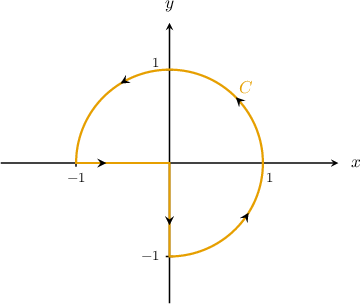

Consider the path $C$ shown above. Which of the following is equivalent to the line integral 

$$
{∮}_{C}({y}^{3}-x)\,dx+({x}^{3}+{e}^{1/y})\,dy\,?
$$

Field selection

${\int }_{-\pi /2}^{\pi }\,{\int }_{0}^{1}2{r}^{2}\operatorname{cos}⁡\theta \,dr\,d\theta $

${\int }_{\pi /2}^{2\pi }\,{\int }_{0}^{1}2{r}^{2}\operatorname{cos}⁡(\theta )\,dr\,d\theta $

${\int }_{\pi /2}^{2\pi }\,{\int }_{0}^{1}2{r}^{2}\operatorname{sin}⁡\theta \,dr\,d\theta $

${\int }_{-\pi /2}^{\pi }\,{\int }_{0}^{1}3{r}^{3}\operatorname{sin}⁡(2\theta )\,dr\,d\theta $

${\int }_{-\pi /2}^{\pi }\,{\int }_{0}^{1}3{r}^{3}\operatorname{cos}⁡(2\theta )\,dr\,d\theta $ (keyed correct)

Green's theorem states that

$$
{∮}_{C}P\,dx+Q\,dy={∬}_{D}(\frac{∂Q}{∂x}-\frac{∂P}{∂y})\,\text{d}A.
$$

In our case, the region $D$ and its boundary $C$ satisfy the conditions of Green's theorem:

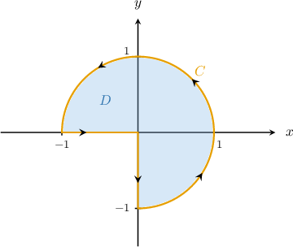

Since $P(x,y)={y}^{3}-x$ and $Q(x,y)={x}^{3}+{e}^{1/y},$ we obtain

$$
\begin{aligned}\frac{∂P}{∂y}=3{y}^{2},\,\frac{∂Q}{∂x}=3{x}^{2}.\end{aligned}
$$

Applying Green's theorem, we get

$$
\begin{aligned}{∮}_{C}({y}^{3}-x)\,dx+({x}^{3}+{e}^{1/y})\,dy & ={∬}_{D}(\frac{∂Q}{∂x}-\frac{∂P}{∂y})\text{d}A \\  & ={∬}_{D}(3{x}^{2}-3{y}^{2})\,\text{d}A \\  & ={∬}_{D}3({x}^{2}-{y}^{2})\,\text{d}A.\end{aligned}
$$

Now, notice that the region $D$ can be represented in polar coordinates as

$$
Δ={(r,\theta )\,:\,0\le r\le 1,\,-\frac{\pi }{2}\le \theta \le \pi }.
$$

The change of variables formula for plane polar coordinates states that 

$$
{∬}_{D}f(x,y)\text{ }dA={∬}_{Δ}\text{ }f(r\operatorname{cos}⁡\theta ,r\operatorname{sin}⁡\theta )\,r\text{ }drd\theta .
$$

Therefore, we can write our double integral as 

$$
\begin{aligned}{∬}_{D}3({x}^{2}-{y}^{2})\,\text{d}A & ={∬}_{Δ}3({r}^{2}{cos}^{2}⁡\theta -{r}^{2}{sin}^{2}⁡\theta )\,r\,\text{d}r\text{d}\theta  \\  & ={\int }_{-\pi /2}^{\pi }\,{\int }_{0}^{1}3{r}^{3}\operatorname{cos}⁡(2\theta )\,dr\,d\theta .\end{aligned}
$$

### Generated variation — evidence-only historical bank observed

Consider the path $C$ shown above. Which of the following is equivalent to the line integral 

$$
2\left({∮}_{C}({y}^{3}-x)\,dx+({x}^{3}+{e}^{1/y})\,dy\,?\right)
$$

Field selection

$2\left({\int }_{-\pi /2}^{\pi }\,{\int }_{0}^{1}3{r}^{3}\operatorname{sin}⁡(2\theta )\,dr\,d\theta \right)$

$2\left({\int }_{\pi /2}^{2\pi }\,{\int }_{0}^{1}2{r}^{2}\operatorname{cos}⁡(\theta )\,dr\,d\theta \right)$

$2\left({\int }_{-\pi /2}^{\pi }\,{\int }_{0}^{1}3{r}^{3}\operatorname{cos}⁡(2\theta )\,dr\,d\theta \right)$

$2\left({\int }_{-\pi /2}^{\pi }\,{\int }_{0}^{1}2{r}^{2}\operatorname{cos}⁡\theta \,dr\,d\theta \right)$

$2\left({\int }_{\pi /2}^{2\pi }\,{\int }_{0}^{1}2{r}^{2}\operatorname{sin}⁡\theta \,dr\,d\theta \right)$

Green's theorem states that

$$
{∮}_{C}P\,dx+Q\,dy={∬}_{D}(\frac{∂Q}{∂x}-\frac{∂P}{∂y})\,\text{d}A.
$$

In our case, the region $D$ and its boundary $C$ satisfy the conditions of Green's theorem:

Since $P(x,y)=2\left({y}^{3}-x\right)$ and $Q(x,y)=2\left({x}^{3}+{e}^{1/y}\right),$ we obtain

$$
\begin{aligned}\frac{∂P}{∂y}=2\left(3{y}^{2}\right),\,\frac{∂Q}{∂x}=2\left(3{x}^{2}\right).\end{aligned}
$$

Applying Green's theorem, we get

$$
\begin{aligned}2\left({∮}_{C}({y}^{3}-x)\,dx+({x}^{3}+{e}^{1/y})\,dy\right) & ={∬}_{D}(\frac{∂Q}{∂x}-\frac{∂P}{∂y})\text{d}A \\  & =2\left({∬}_{D}(3{x}^{2}-3{y}^{2})\,\text{d}A\right) \\  & =2\left({∬}_{D}3({x}^{2}-{y}^{2})\,\text{d}A.\right)\end{aligned}
$$

Now, notice that the region $D$ can be represented in polar coordinates as

$$
Δ={(r,\theta )\,:\,0\le r\le 1,\,-\frac{\pi }{2}\le \theta \le \pi }.
$$

The change of variables formula for plane polar coordinates states that 

$$
{∬}_{D}f(x,y)\text{ }dA={∬}_{Δ}\text{ }f(r\operatorname{cos}⁡\theta ,r\operatorname{sin}⁡\theta )\,r\text{ }drd\theta .
$$

Therefore, we can write our double integral as 

$$
\begin{aligned}2\left({∬}_{D}3({x}^{2}-{y}^{2})\,\text{d}A\right) & =2\left({∬}_{Δ}3({r}^{2}{cos}^{2}⁡\theta -{r}^{2}{sin}^{2}⁡\theta )\,r\,\text{d}r\text{d}\theta \right) \\  & =2\left({\int }_{-\pi /2}^{\pi }\,{\int }_{0}^{1}3{r}^{3}\operatorname{cos}⁡(2\theta )\,dr\,d\theta .\right)\end{aligned}
$$

### Generated variation — normal practice authored_zero

Consider the path $C$ shown above. Which of the following is equivalent to the line integral 

$$
2\left({∮}_{C}({y}^{3}-x)\,dx+({x}^{3}+{e}^{y})\,dy\,?\right)
$$

Field selection

$\int_{- \frac{\pi}{2}}^{\pi}\int_{0}^{7}6 r^{3} \cos{\left(2 \theta \right)}\,dr\,d\theta$

$\int_{- \frac{\pi}{2}}^{\pi}\int_{0}^{7}6 r^{2} \sin^{2}{\left(\theta \right)} + 6 r^{2} \cos^{2}{\left(\theta \right)}\,dr\,d\theta$

$\int_{- \frac{\pi}{2}}^{\pi}\int_{0}^{7}- 6 r^{3} \sin^{2}{\left(\theta \right)}\,dr\,d\theta$

$\int_{- \frac{\pi}{2}}^{\pi}\int_{0}^{7}6 r^{3} \sin^{2}{\left(\theta \right)} + 6 r^{3} \cos^{2}{\left(\theta \right)}\,dr\,d\theta$

$\int_{- \frac{\pi}{2}}^{\pi}\int_{0}^{7}6 r^{3} \cos^{2}{\left(\theta \right)}\,dr\,d\theta$

Green's theorem states that

$$
{∮}_{C}P\,dx+Q\,dy={∬}_{D}(\frac{∂Q}{∂x}-\frac{∂P}{∂y})\,\text{d}A.
$$

In our case, the region $D$ and its boundary $C$ satisfy the conditions of Green's theorem:

Since $P(x,y)=2\left({y}^{3}-x\right)$ and $Q(x,y)=2\left({x}^{3}+{e}^{y}\right),$ we obtain

$$
\begin{aligned}\frac{∂P}{∂y}=2\left(3{y}^{2}\right),\,\frac{∂Q}{∂x}=2\left(3{x}^{2}\right).\end{aligned}
$$

Applying Green's theorem, we get

$$
\begin{aligned}2\left({∮}_{C}({y}^{3}-x)\,dx+({x}^{3}+{e}^{y})\,dy\right) & ={∬}_{D}(\frac{∂Q}{∂x}-\frac{∂P}{∂y})\text{d}A \\  & =2\left({∬}_{D}(3{x}^{2}-3{y}^{2})\,\text{d}A\right) \\  & =2\left({∬}_{D}3({x}^{2}-{y}^{2})\,\text{d}A.\right)\end{aligned}
$$

Now, notice that the region $D$ can be represented in polar coordinates as

$$
Δ={(r,\theta )\,:\,0\le r\le 7,\,-\frac{\pi }{2}\le \theta \le \pi }.
$$

The change of variables formula for plane polar coordinates states that 

$$
{∬}_{D}f(x,y)\text{ }dA={∬}_{Δ}\text{ }f(r\operatorname{cos}⁡\theta ,r\operatorname{sin}⁡\theta )\,r\text{ }drd\theta .
$$

Therefore, we can write our double integral as 

$$
\begin{aligned}2\left({∬}_{D}3({x}^{2}-{y}^{2})\,\text{d}A\right) & =2\left({∬}_{Δ}3({r}^{2}{cos}^{2}⁡\theta -{r}^{2}{sin}^{2}⁡\theta )\,r\,\text{d}r\text{d}\theta \right) \\  & =2\left({\int }_{-\pi /2}^{\pi }\,{\int }_{0}^{7}3{r}^{3}\operatorname{cos}⁡(2\theta )\,dr\,d\theta .\right)\end{aligned}
$$

### Generated variation — normal practice authored_zero

Consider the path $C$ shown above. Which of the following is equivalent to the line integral 

$$
5\left({∮}_{C}({y}^{3}-x)\,dx+({x}^{3}+{e}^{y})\,dy\,?\right)
$$

Field selection

$\int_{- \frac{\pi}{2}}^{\pi}\int_{0}^{2}15 r^{3} \cos^{2}{\left(\theta \right)}\,dr\,d\theta$

$\int_{- \frac{\pi}{2}}^{\pi}\int_{0}^{2}15 r^{3} \sin^{2}{\left(\theta \right)} + 15 r^{3} \cos^{2}{\left(\theta \right)}\,dr\,d\theta$

$\int_{- \frac{\pi}{2}}^{\pi}\int_{0}^{2}- 15 r^{3} \sin^{2}{\left(\theta \right)}\,dr\,d\theta$

$\int_{- \frac{\pi}{2}}^{\pi}\int_{0}^{2}15 r^{3} \cos{\left(2 \theta \right)}\,dr\,d\theta$

$\int_{- \frac{\pi}{2}}^{\pi}\int_{0}^{2}15 r^{2} \sin^{2}{\left(\theta \right)} + 15 r^{2} \cos^{2}{\left(\theta \right)}\,dr\,d\theta$

Green's theorem states that

$$
{∮}_{C}P\,dx+Q\,dy={∬}_{D}(\frac{∂Q}{∂x}-\frac{∂P}{∂y})\,\text{d}A.
$$

In our case, the region $D$ and its boundary $C$ satisfy the conditions of Green's theorem:

Since $P(x,y)=5\left({y}^{3}-x\right)$ and $Q(x,y)=5\left({x}^{3}+{e}^{y}\right),$ we obtain

$$
\begin{aligned}\frac{∂P}{∂y}=5\left(3{y}^{2}\right),\,\frac{∂Q}{∂x}=5\left(3{x}^{2}\right).\end{aligned}
$$

Applying Green's theorem, we get

$$
\begin{aligned}5\left({∮}_{C}({y}^{3}-x)\,dx+({x}^{3}+{e}^{y})\,dy\right) & ={∬}_{D}(\frac{∂Q}{∂x}-\frac{∂P}{∂y})\text{d}A \\  & =5\left({∬}_{D}(3{x}^{2}-3{y}^{2})\,\text{d}A\right) \\  & =5\left({∬}_{D}3({x}^{2}-{y}^{2})\,\text{d}A.\right)\end{aligned}
$$

Now, notice that the region $D$ can be represented in polar coordinates as

$$
Δ={(r,\theta )\,:\,0\le r\le 2,\,-\frac{\pi }{2}\le \theta \le \pi }.
$$

The change of variables formula for plane polar coordinates states that 

$$
{∬}_{D}f(x,y)\text{ }dA={∬}_{Δ}\text{ }f(r\operatorname{cos}⁡\theta ,r\operatorname{sin}⁡\theta )\,r\text{ }drd\theta .
$$

Therefore, we can write our double integral as 

$$
\begin{aligned}5\left({∬}_{D}3({x}^{2}-{y}^{2})\,\text{d}A\right) & =5\left({∬}_{Δ}3({r}^{2}{cos}^{2}⁡\theta -{r}^{2}{sin}^{2}⁡\theta )\,r\,\text{d}r\text{d}\theta \right) \\  & =5\left({\int }_{-\pi /2}^{\pi }\,{\int }_{0}^{2}3{r}^{3}\operatorname{cos}⁡(2\theta )\,dr\,d\theta .\right)\end{aligned}
$$

## q-169204 — observed moderate

Write down the double integral from the previous part in polar coordinates.

                            
                                    
                                        
                                            

                                                

                                        
                                        
                                        

                                    
                                
                                    
                                        
                                        ${∬}_{D}-6xy\,\text{d}A\,={\int }_{\pi /2}^{a}\,{\int }_{0}^{b}$

                                    
                                
                                    
                            
                                        {{field-1}}                
                                    
                                
                                    
                                        
                                        
$\,\text{d}r\,\text{d}\theta ,$

                                    
                                
                                    
                                        
                                                

                                                

                                        
                                        
                                        

                                    
                                
                                    
                                        
                                        where $a\,=$

                                    
                                
                                    
                            
                                        {{field-2}}                
                                    
                                
                                    
                                        
                                        
and $b\,=$

                                    
                                
                                    
                            
                                        {{field-3}}                
                                    
                                
                                    
                                        
                                        .

Field field-1

$-3{r}^{3}\operatorname{sin}(2\theta )$ (keyed correct)

Field field-3

$2$ (keyed correct)

Field field-2

$2\pi $ (keyed correct)

Notice that the region $D$ can be represented in polar coordinates as

$$
Δ={(r,\theta )\,:\,0\le r\le 2,\,\frac{\pi }{2}\le \theta \le 2\pi }.
$$

The change of variables formula for plane polar coordinates states that 

$$
{∬}_{D}f(x,y)\text{ }dA={∬}_{Δ}\text{ }f(r\operatorname{cos}⁡\theta ,r\operatorname{sin}⁡\theta )\,r\text{ }drd\theta .
$$

Therefore, we can write our double integral as 

$$
\begin{aligned}{∬}_{D}-6xy\,\text{d}A & ={∬}_{Δ}-6(r\operatorname{cos}⁡\theta )(r\operatorname{sin}⁡\theta )\,r\,\text{d}r\text{d}\theta  \\  & ={∬}_{Δ}-3{r}^{3}(2\operatorname{cos}⁡\theta \operatorname{sin}⁡\theta )\,\text{d}r\text{d}\theta  \\  & ={\int }_{\pi /2}^{2\pi }\,{\int }_{0}^{2}-3{r}^{3}\operatorname{sin}⁡(2\theta )\,dr\,d\theta .\end{aligned}
$$

### Generated variation — evidence-only historical bank observed

Write down the double integral from the previous part in polar coordinates.

                            
                                    
                                        
                                            

                                                

                                        
                                        
                                        

                                    
                                
                                    
                                        
                                        ${∬}_{D}2\left(-6xy\right)\,\text{d}A\,={\int }_{\pi /2}^{a}\,{\int }_{0}^{b}$

                                    
                                
                                    
                            
                                        {{field-1}}                
                                    
                                
                                    
                                        
                                        
$\,\text{d}r\,\text{d}\theta ,$

                                    
                                
                                    
                                        
                                                

                                                

                                        
                                        
                                        

                                    
                                
                                    
                                        
                                        where $a\,=$

                                    
                                
                                    
                            
                                        {{field-2}}                
                                    
                                
                                    
                                        
                                        
and $b\,=$

                                    
                                
                                    
                            
                                        {{field-3}}                
                                    
                                
                                    
                                        
                                        .

Field field-1

$2\left(-3{r}^{3}\operatorname{sin}(2\theta )\right)$

Field field-3

$2$

Field field-2

$2\pi $

Notice that the region $D$ can be represented in polar coordinates as

$$
Δ={(r,\theta )\,:\,0\le r\le 2,\,\frac{\pi }{2}\le \theta \le 2\pi }.
$$

The change of variables formula for plane polar coordinates states that 

$$
{∬}_{D}f(x,y)\text{ }dA={∬}_{Δ}\text{ }f(r\operatorname{cos}⁡\theta ,r\operatorname{sin}⁡\theta )\,r\text{ }drd\theta .
$$

Therefore, we can write our double integral as 

$$
\begin{aligned}2\left({∬}_{D}-6xy\,\text{d}A\right) & =2\left({∬}_{Δ}-6(r\operatorname{cos}⁡\theta )(r\operatorname{sin}⁡\theta )\,r\,\text{d}r\text{d}\theta \right) \\  & =2\left({∬}_{Δ}-3{r}^{3}(2\operatorname{cos}⁡\theta \operatorname{sin}⁡\theta )\,\text{d}r\text{d}\theta \right) \\  & =2\left({\int }_{\pi /2}^{2\pi }\,{\int }_{0}^{2}-3{r}^{3}\operatorname{sin}⁡(2\theta )\,dr\,d\theta .\right)\end{aligned}
$$

### Generated variation — normal practice authored_context

The region $D$ is bounded by the positively oriented path $C$ shown above. Write the double integral below in polar coordinates.

${∬}_{D}2\left(-6xy\right)\,\text{d}A\,={\int }_{\pi /2}^{a}\,{\int }_{0}^{b}$ {{field-1}} $\,\text{d}r\,\text{d}\theta,$

where $a=$ {{field-2}} and $b=$ {{field-3}}.

Field field-1

$2\left(-3{r}^{3}\operatorname{sin}(2\theta )\right)$

Field field-3

$7$

Field field-2

$2\pi $

Notice that the region $D$ can be represented in polar coordinates as

$$
Δ={(r,\theta )\,:\,0\le r\le 7,\,\frac{\pi }{2}\le \theta \le 2\pi }.
$$

The change of variables formula for plane polar coordinates states that 

$$
{∬}_{D}f(x,y)\text{ }dA={∬}_{Δ}\text{ }f(r\operatorname{cos}⁡\theta ,r\operatorname{sin}⁡\theta )\,r\text{ }drd\theta .
$$

Therefore, we can write our double integral as 

$$
\begin{aligned}2\left({∬}_{D}-6xy\,\text{d}A\right) & =2\left({∬}_{Δ}-6(r\operatorname{cos}⁡\theta )(r\operatorname{sin}⁡\theta )\,r\,\text{d}r\text{d}\theta \right) \\  & =2\left({∬}_{Δ}-3{r}^{3}(2\operatorname{cos}⁡\theta \operatorname{sin}⁡\theta )\,\text{d}r\text{d}\theta \right) \\  & =2\left({\int }_{\pi /2}^{2\pi }\,{\int }_{0}^{7}-3{r}^{3}\operatorname{sin}⁡(2\theta )\,dr\,d\theta .\right)\end{aligned}
$$

### Generated variation — normal practice authored_context

The region $D$ is bounded by the positively oriented path $C$ shown above. Write the double integral below in polar coordinates.

${∬}_{D}5\left(-6xy\right)\,\text{d}A\,={\int }_{\pi /2}^{a}\,{\int }_{0}^{b}$ {{field-1}} $\,\text{d}r\,\text{d}\theta,$

where $a=$ {{field-2}} and $b=$ {{field-3}}.

Field field-1

$5\left(-3{r}^{3}\operatorname{sin}(2\theta )\right)$

Field field-3

$2$

Field field-2

$2\pi $

Notice that the region $D$ can be represented in polar coordinates as

$$
Δ={(r,\theta )\,:\,0\le r\le 2,\,\frac{\pi }{2}\le \theta \le 2\pi }.
$$

The change of variables formula for plane polar coordinates states that 

$$
{∬}_{D}f(x,y)\text{ }dA={∬}_{Δ}\text{ }f(r\operatorname{cos}⁡\theta ,r\operatorname{sin}⁡\theta )\,r\text{ }drd\theta .
$$

Therefore, we can write our double integral as 

$$
\begin{aligned}5\left({∬}_{D}-6xy\,\text{d}A\right) & =5\left({∬}_{Δ}-6(r\operatorname{cos}⁡\theta )(r\operatorname{sin}⁡\theta )\,r\,\text{d}r\text{d}\theta \right) \\  & =5\left({∬}_{Δ}-3{r}^{3}(2\operatorname{cos}⁡\theta \operatorname{sin}⁡\theta )\,\text{d}r\text{d}\theta \right) \\  & =5\left({\int }_{\pi /2}^{2\pi }\,{\int }_{0}^{2}-3{r}^{3}\operatorname{sin}⁡(2\theta )\,dr\,d\theta .\right)\end{aligned}
$$

## Authored easy

Consider the path $C$ shown above. Which of the following is equivalent to the line integral

$$
\oint_C(4 y + \sin{\left(x \right)})\,dx+(2 x + \cos{\left(y \right)})\,dy\,?
$$

The cross partials are $\partial P/\partial y=4$ and $\partial Q/\partial x=2$.

Field selection

$\int_{0}^{\frac{\pi}{2}}\int_{0}^{4}- 2 r\,dr\,d\theta$

$\int_{0}^{\frac{\pi}{2}}\int_{0}^{5}- 2 r\,dr\,d\theta$

$\int_{0}^{\frac{\pi}{2}}\int_{0}^{4}-2\,dr\,d\theta$

$\int_{0}^{\frac{\pi}{2}}\int_{0}^{4}6 r\,dr\,d\theta$

$\int_{0}^{\frac{\pi}{2}}\int_{0}^{4}2 r\,dr\,d\theta$

Green's theorem states that

$$
\oint_C P\,dx+Q\,dy=\iint_D\left(\frac{\partial Q}{\partial x}-\frac{\partial P}{\partial y}\right)\,dA.
$$

In our case, the region $D$ and its boundary $C$ satisfy the conditions of Green's theorem:

Since $P(x,y)=4 y + \sin{\left(x \right)}$ and $Q(x,y)=2 x + \cos{\left(y \right)},$ we obtain

$$
\frac{\partial P}{\partial y}=4,\qquad\frac{\partial Q}{\partial x}=2.
$$

Applying Green's theorem, we get

$$
\begin{aligned}\oint_C(4 y + \sin{\left(x \right)})\,dx+(2 x + \cos{\left(y \right)})\,dy&=\iint_D(\frac{\partial Q}{\partial x}-\frac{\partial P}{\partial y})\,dA\\&=\iint_D\left(2-\left(4\right)\right)\,dA\\&=\iint_D\left(-2\right)\,dA.\end{aligned}
$$

Now, notice that the region $D$ can be represented in polar coordinates as

$$
\Delta=\{(r,\theta):0\le r\le 4,\ 0\le\theta\le \frac{\pi}{2}\}.
$$

The change of variables formula for plane polar coordinates states that

$$
\iint_D f(x,y)\,dA=\iint_\Delta f(r\cos\theta,r\sin\theta)\,r\,dr\,d\theta.
$$

Therefore, we can write our double integral as

$$
\begin{aligned}\iint_D\left(-2\right)\,dA&=\iint_\Delta\left(-2\right)r\,dr\,d\theta\\&=\int_{0}^{\frac{\pi}{2}}\int_{0}^{4}- 2 r\,dr\,d\theta.\end{aligned}
$$

## Authored easy

Consider the path $C$ shown above. Which of the following is equivalent to the line integral

$$
\oint_C(4 y + \sin{\left(x \right)})\,dx+(x + \cos{\left(y \right)})\,dy\,?
$$

The cross partials are $\partial P/\partial y=4$ and $\partial Q/\partial x=1$.

Field selection

$\int_{0}^{\frac{\pi}{2}}\int_{0}^{4}3 r\,dr\,d\theta$

$\int_{0}^{\frac{\pi}{2}}\int_{0}^{4}5 r\,dr\,d\theta$

$\int_{0}^{\frac{\pi}{2}}\int_{0}^{4}-3\,dr\,d\theta$

$\int_{0}^{\frac{\pi}{2}}\int_{0}^{4}- 3 r\,dr\,d\theta$

$\int_{0}^{\frac{\pi}{2}}\int_{0}^{5}- 3 r\,dr\,d\theta$

Green's theorem states that

$$
\oint_C P\,dx+Q\,dy=\iint_D\left(\frac{\partial Q}{\partial x}-\frac{\partial P}{\partial y}\right)\,dA.
$$

In our case, the region $D$ and its boundary $C$ satisfy the conditions of Green's theorem:

Since $P(x,y)=4 y + \sin{\left(x \right)}$ and $Q(x,y)=x + \cos{\left(y \right)},$ we obtain

$$
\frac{\partial P}{\partial y}=4,\qquad\frac{\partial Q}{\partial x}=1.
$$

Applying Green's theorem, we get

$$
\begin{aligned}\oint_C(4 y + \sin{\left(x \right)})\,dx+(x + \cos{\left(y \right)})\,dy&=\iint_D(\frac{\partial Q}{\partial x}-\frac{\partial P}{\partial y})\,dA\\&=\iint_D\left(1-\left(4\right)\right)\,dA\\&=\iint_D\left(-3\right)\,dA.\end{aligned}
$$

Now, notice that the region $D$ can be represented in polar coordinates as

$$
\Delta=\{(r,\theta):0\le r\le 4,\ 0\le\theta\le \frac{\pi}{2}\}.
$$

The change of variables formula for plane polar coordinates states that

$$
\iint_D f(x,y)\,dA=\iint_\Delta f(r\cos\theta,r\sin\theta)\,r\,dr\,d\theta.
$$

Therefore, we can write our double integral as

$$
\begin{aligned}\iint_D\left(-3\right)\,dA&=\iint_\Delta\left(-3\right)r\,dr\,d\theta\\&=\int_{0}^{\frac{\pi}{2}}\int_{0}^{4}- 3 r\,dr\,d\theta.\end{aligned}
$$

## Authored hard

Consider the path $C$ shown above. Which of the following is equivalent to the line integral

$$
\oint_C(x y^{2} + 4 y^{3} - y \cos{\left(x \right)})\,dx+(4 x^{3} + 2 x^{2} y + 3 x y - \sin{\left(x \right)})\,dy\,?
$$

Field selection

$\int_{0}^{\frac{\pi}{2}}\int_{0}^{3}r^{2} \left(r \sin{\left(2 \theta \right)} + 12 r \cos{\left(2 \theta \right)} + 3 \sin{\left(\theta \right)}\right)\,dr\,d\theta$

$\int_{0}^{\frac{\pi}{2}}\int_{0}^{4}r^{2} \left(r \sin{\left(2 \theta \right)} + 12 r \cos{\left(2 \theta \right)} + 3 \sin{\left(\theta \right)}\right)\,dr\,d\theta$

$\int_{0}^{\frac{\pi}{2}}\int_{0}^{3}r^{2} \sin{\left(2 \theta \right)} + 12 r^{2} \cos{\left(2 \theta \right)} + 3 r \sin{\left(\theta \right)}\,dr\,d\theta$

$\int_{0}^{\frac{\pi}{2}}\int_{0}^{3}r \left(3 r^{2} \sin{\left(2 \theta \right)} + 12 r^{2} + 3 r \sin{\left(\theta \right)} - 2 \cos{\left(r \cos{\left(\theta \right)} \right)}\right)\,dr\,d\theta$

$\int_{0}^{\frac{\pi}{2}}\int_{0}^{3}- r^{2} \left(r \sin{\left(2 \theta \right)} + 12 r \cos{\left(2 \theta \right)} + 3 \sin{\left(\theta \right)}\right)\,dr\,d\theta$

Green's theorem states that

$$
\oint_C P\,dx+Q\,dy=\iint_D\left(\frac{\partial Q}{\partial x}-\frac{\partial P}{\partial y}\right)\,dA.
$$

In our case, the region $D$ and its boundary $C$ satisfy the conditions of Green's theorem:

Since $P(x,y)=x y^{2} + 4 y^{3} - y \cos{\left(x \right)}$ and $Q(x,y)=4 x^{3} + 2 x^{2} y + 3 x y - \sin{\left(x \right)},$ we obtain

$$
\frac{\partial P}{\partial y}=2 x y + 12 y^{2} - \cos{\left(x \right)},\qquad\frac{\partial Q}{\partial x}=12 x^{2} + 4 x y + 3 y - \cos{\left(x \right)}.
$$

Applying Green's theorem, we get

$$
\begin{aligned}\oint_C(x y^{2} + 4 y^{3} - y \cos{\left(x \right)})\,dx+(4 x^{3} + 2 x^{2} y + 3 x y - \sin{\left(x \right)})\,dy&=\iint_D(\frac{\partial Q}{\partial x}-\frac{\partial P}{\partial y})\,dA\\&=\iint_D\left(12 x^{2} + 4 x y + 3 y - \cos{\left(x \right)}-\left(2 x y + 12 y^{2} - \cos{\left(x \right)}\right)\right)\,dA\\&=\iint_D\left(12 x^{2} + 2 x y - 12 y^{2} + 3 y\right)\,dA.\end{aligned}
$$

Now, notice that the region $D$ can be represented in polar coordinates as

$$
\Delta=\{(r,\theta):0\le r\le 3,\ 0\le\theta\le \frac{\pi}{2}\}.
$$

The change of variables formula for plane polar coordinates states that

$$
\iint_D f(x,y)\,dA=\iint_\Delta f(r\cos\theta,r\sin\theta)\,r\,dr\,d\theta.
$$

Therefore, we can write our double integral as

$$
\begin{aligned}\iint_D\left(12 x^{2} + 2 x y - 12 y^{2} + 3 y\right)\,dA&=\iint_\Delta\left(- 12 r^{2} \sin^{2}{\left(\theta \right)} + 2 r^{2} \sin{\left(\theta \right)} \cos{\left(\theta \right)} + 12 r^{2} \cos^{2}{\left(\theta \right)} + 3 r \sin{\left(\theta \right)}\right)r\,dr\,d\theta\\&=\int_{0}^{\frac{\pi}{2}}\int_{0}^{3}r^{2} \left(r \sin{\left(2 \theta \right)} + 12 r \cos{\left(2 \theta \right)} + 3 \sin{\left(\theta \right)}\right)\,dr\,d\theta.\end{aligned}
$$

## Authored hard

Consider the path $C$ shown above. Which of the following is equivalent to the line integral

$$
\oint_C(x y^{2} + y^{3} - y \cos{\left(x \right)})\,dx+(x^{3} + 2 x^{2} y + 3 x y - \sin{\left(x \right)})\,dy\,?
$$

Field selection

$\int_{0}^{\frac{\pi}{2}}\int_{0}^{6}- r^{2} \left(r \sin{\left(2 \theta \right)} + 3 r \cos{\left(2 \theta \right)} + 3 \sin{\left(\theta \right)}\right)\,dr\,d\theta$

$\int_{0}^{\frac{\pi}{2}}\int_{0}^{6}r \left(3 r^{2} \sin{\left(2 \theta \right)} + 3 r^{2} + 3 r \sin{\left(\theta \right)} - 2 \cos{\left(r \cos{\left(\theta \right)} \right)}\right)\,dr\,d\theta$

$\int_{0}^{\frac{\pi}{2}}\int_{0}^{6}r^{2} \sin{\left(2 \theta \right)} + 3 r^{2} \cos{\left(2 \theta \right)} + 3 r \sin{\left(\theta \right)}\,dr\,d\theta$

$\int_{0}^{\frac{\pi}{2}}\int_{0}^{6}r^{2} \left(r \sin{\left(2 \theta \right)} + 3 r \cos{\left(2 \theta \right)} + 3 \sin{\left(\theta \right)}\right)\,dr\,d\theta$

$\int_{0}^{\frac{\pi}{2}}\int_{0}^{7}r^{2} \left(r \sin{\left(2 \theta \right)} + 3 r \cos{\left(2 \theta \right)} + 3 \sin{\left(\theta \right)}\right)\,dr\,d\theta$

Green's theorem states that

$$
\oint_C P\,dx+Q\,dy=\iint_D\left(\frac{\partial Q}{\partial x}-\frac{\partial P}{\partial y}\right)\,dA.
$$

In our case, the region $D$ and its boundary $C$ satisfy the conditions of Green's theorem:

Since $P(x,y)=x y^{2} + y^{3} - y \cos{\left(x \right)}$ and $Q(x,y)=x^{3} + 2 x^{2} y + 3 x y - \sin{\left(x \right)},$ we obtain

$$
\frac{\partial P}{\partial y}=2 x y + 3 y^{2} - \cos{\left(x \right)},\qquad\frac{\partial Q}{\partial x}=3 x^{2} + 4 x y + 3 y - \cos{\left(x \right)}.
$$

Applying Green's theorem, we get

$$
\begin{aligned}\oint_C(x y^{2} + y^{3} - y \cos{\left(x \right)})\,dx+(x^{3} + 2 x^{2} y + 3 x y - \sin{\left(x \right)})\,dy&=\iint_D(\frac{\partial Q}{\partial x}-\frac{\partial P}{\partial y})\,dA\\&=\iint_D\left(3 x^{2} + 4 x y + 3 y - \cos{\left(x \right)}-\left(2 x y + 3 y^{2} - \cos{\left(x \right)}\right)\right)\,dA\\&=\iint_D\left(3 x^{2} + 2 x y - 3 y^{2} + 3 y\right)\,dA.\end{aligned}
$$

Now, notice that the region $D$ can be represented in polar coordinates as

$$
\Delta=\{(r,\theta):0\le r\le 6,\ 0\le\theta\le \frac{\pi}{2}\}.
$$

The change of variables formula for plane polar coordinates states that

$$
\iint_D f(x,y)\,dA=\iint_\Delta f(r\cos\theta,r\sin\theta)\,r\,dr\,d\theta.
$$

Therefore, we can write our double integral as

$$
\begin{aligned}\iint_D\left(3 x^{2} + 2 x y - 3 y^{2} + 3 y\right)\,dA&=\iint_\Delta\left(- 3 r^{2} \sin^{2}{\left(\theta \right)} + 2 r^{2} \sin{\left(\theta \right)} \cos{\left(\theta \right)} + 3 r^{2} \cos^{2}{\left(\theta \right)} + 3 r \sin{\left(\theta \right)}\right)r\,dr\,d\theta\\&=\int_{0}^{\frac{\pi}{2}}\int_{0}^{6}r^{2} \left(r \sin{\left(2 \theta \right)} + 3 r \cos{\left(2 \theta \right)} + 3 \sin{\left(\theta \right)}\right)\,dr\,d\theta.\end{aligned}
$$

