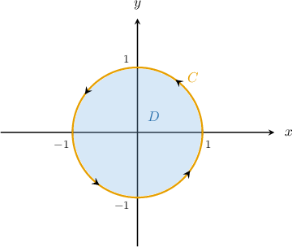
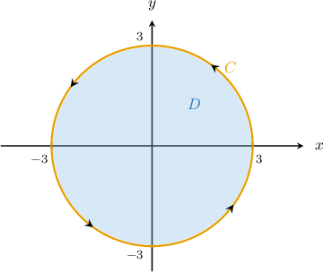
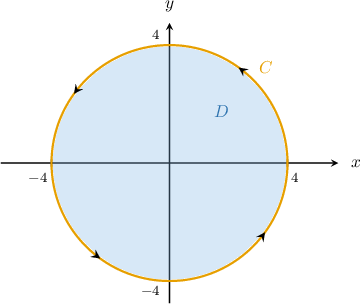
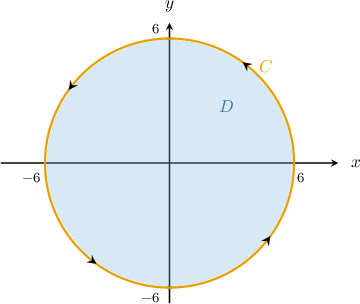
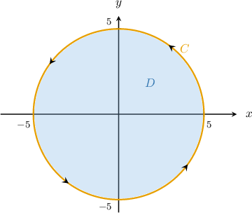
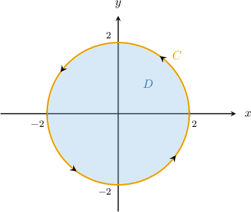

# Original source records and labeled generated variants

## Original q-41469 — y2

Given that 

$$
{∮}_{C}{y}^{2}\,dx+x\,dy={\int }_{0}^{2\pi }\,{\int }_{0}^{1}\boxed{}\,\text{d}r\,\text{d}\theta ,
$$

where $C$ is the circle ${x}^{2}+{y}^{2}=1$ oriented counterclockwise, what is the missing part of the equation?

Original bank: $r-2{r}^{2}\operatorname{sin}⁡\theta $, $r-{r}^{2}\operatorname{cos}⁡\theta $, $r-{r}^{2}\operatorname{sin}⁡\theta $, $1-2r\operatorname{sin}⁡\theta $, ${r}^{2}\operatorname{sin}⁡\theta -r\operatorname{cos}⁡\theta $

Green's theorem states that

$$
{∮}_{C}P\,dx+Q\,dy={∬}_{D}(\frac{∂Q}{∂x}-\frac{∂P}{∂y})\,\text{d}A.
$$

In our case, the region $D$ and its boundary $C$ satisfy the conditions of Green's theorem:

Since $P(x,y)={y}^{2}$ and $Q(x,y)=x,$ we obtain

$$
\begin{aligned}\frac{∂P}{∂y}=2y,\,\frac{∂Q}{∂x}=1.\end{aligned}
$$

Applying Green's theorem, we get

$$
\begin{aligned}{∮}_{C}{y}^{2}\,dx+x\,dy & ={∬}_{D}(\frac{∂Q}{∂x}-\frac{∂P}{∂y})\text{d}A \\  & ={∬}_{D}(1-2y)\,\text{d}A.\end{aligned}
$$

Now, notice that the region $D$ can be represented in polar coordinates as

$$
Δ={(r,\theta )\,:\,0\le r\le 1,\,0\le \theta \le 2\pi }.
$$

The change of variables formula for plane polar coordinates states that

$$
{∬}_{D}f(x,y)\text{ }dA={∬}_{Δ}\text{ }f(r\operatorname{cos}⁡\theta ,r\operatorname{sin}⁡\theta )\,r\text{ }drd\theta .
$$

Therefore, we can write our double integral as 

$$
\begin{aligned}{∬}_{D}(1-2y)\,\text{d}A & ={∬}_{Δ}(1-2\cdot r\operatorname{sin}⁡\theta )\,r\,\text{d}r\text{d}\theta  \\  & ={\int }_{0}^{2\pi }\,{\int }_{0}^{1}r-2{r}^{2}\operatorname{sin}⁡\theta \,\text{d}r\,\text{d}\theta .\end{aligned}
$$

### Generated variant — {'a': 6, 'b': 1, 'radius': 5}

Given that 

$$
{∮}_{C}6{y}^{2}\,dx+x\,dy={\int }_{0}^{2\pi }\,{\int }_{0}^{5}\boxed{}\,\text{d}r\,\text{d}\theta ,
$$

where $C$ is the circle ${x}^{2}+{y}^{2}=25$ oriented counterclockwise, what is the missing part of the equation? Use $x=r\cos\theta$, $y=r\sin\theta$, and simplify the integrand pointwise before integration.

- $6 r^{2} \sin{(\theta )} - r \cos{(\theta )}$
- $- 6 r^{2} \sin{(\theta )} + r$
- $- 12 r \sin{(\theta )} + 1$
- $- 6 r^{2} \cos{(\theta )} + r$
- $- 12 r^{2} \sin{(\theta )} + r$

Green's theorem states that

$$
{∮}_{C}P\,dx+Q\,dy={∬}_{D}(\frac{∂Q}{∂x}-\frac{∂P}{∂y})\,\text{d}A.
$$

In our case, the region $D$ and its boundary $C$ satisfy the conditions of Green's theorem:

Since $P(x,y)=6{y}^{2}$ and $Q(x,y)=x,$ we obtain

$$
\begin{aligned}\frac{∂P}{∂y}=12y,\,\frac{∂Q}{∂x}=1.\end{aligned}
$$

Applying Green's theorem, we get

$$
\begin{aligned}{∮}_{C}6{y}^{2}\,dx+x\,dy & ={∬}_{D}(\frac{∂Q}{∂x}-\frac{∂P}{∂y})\text{d}A \\  & ={∬}_{D}(1-12y)\,\text{d}A.\end{aligned}
$$

Now, notice that the region $D$ can be represented in polar coordinates as

$$
Δ=\{(r,\theta )\,:\,0\le r\le 5,\,0\le \theta \le 2\pi \}.
$$

The change of variables formula for plane polar coordinates states that

$$
{∬}_{D}f(x,y)\text{ }dA={∬}_{Δ}\text{ }f(r\operatorname{cos}⁡\theta ,r\operatorname{sin}⁡\theta )\,r\text{ }drd\theta .
$$

Therefore, we can write our double integral as 

$$
\begin{aligned}{∬}_{D}(1-12y)\,\text{d}A & ={∬}_{Δ}(1-12\cdot r\operatorname{sin}⁡\theta )\,r\,\text{d}r\text{d}\theta  \\  & ={\int }_{0}^{2\pi }\,{\int }_{0}^{5}r-12{r}^{2}\operatorname{sin}⁡\theta \,\text{d}r\,\text{d}\theta .\end{aligned}
$$

### Generated variant — {'a': 1, 'b': 3, 'radius': 6}

Given that 

$$
{∮}_{C}{y}^{2}\,dx+3x\,dy={\int }_{0}^{2\pi }\,{\int }_{0}^{6}\boxed{}\,\text{d}r\,\text{d}\theta ,
$$

where $C$ is the circle ${x}^{2}+{y}^{2}=36$ oriented counterclockwise, what is the missing part of the equation? Use $x=r\cos\theta$, $y=r\sin\theta$, and simplify the integrand pointwise before integration.

- $- r^{2} \sin{(\theta )} + 3 r$
- $- 2 r^{2} \sin{(\theta )} + 3 r$
- $r^{2} \sin{(\theta )} - 3 r \cos{(\theta )}$
- $- 2 r \sin{(\theta )} + 3$
- $- r^{2} \cos{(\theta )} + 3 r$

Green's theorem states that

$$
{∮}_{C}P\,dx+Q\,dy={∬}_{D}(\frac{∂Q}{∂x}-\frac{∂P}{∂y})\,\text{d}A.
$$

In our case, the region $D$ and its boundary $C$ satisfy the conditions of Green's theorem:

Since $P(x,y)={y}^{2}$ and $Q(x,y)=3x,$ we obtain

$$
\begin{aligned}\frac{∂P}{∂y}=2y,\,\frac{∂Q}{∂x}=3.\end{aligned}
$$

Applying Green's theorem, we get

$$
\begin{aligned}{∮}_{C}{y}^{2}\,dx+3x\,dy & ={∬}_{D}(\frac{∂Q}{∂x}-\frac{∂P}{∂y})\text{d}A \\  & ={∬}_{D}(3-2y)\,\text{d}A.\end{aligned}
$$

Now, notice that the region $D$ can be represented in polar coordinates as

$$
Δ=\{(r,\theta )\,:\,0\le r\le 6,\,0\le \theta \le 2\pi \}.
$$

The change of variables formula for plane polar coordinates states that

$$
{∬}_{D}f(x,y)\text{ }dA={∬}_{Δ}\text{ }f(r\operatorname{cos}⁡\theta ,r\operatorname{sin}⁡\theta )\,r\text{ }drd\theta .
$$

Therefore, we can write our double integral as 

$$
\begin{aligned}{∬}_{D}(3-2y)\,\text{d}A & ={∬}_{Δ}(3-2\cdot r\operatorname{sin}⁡\theta )\,r\,\text{d}r\text{d}\theta  \\  & ={\int }_{0}^{2\pi }\,{\int }_{0}^{6}3r-2{r}^{2}\operatorname{sin}⁡\theta \,\text{d}r\,\text{d}\theta .\end{aligned}
$$

## Original q-126526 — xy

Given that 

$$
{∮}_{C}xy\,dx+(x+1)\,dy={\int }_{0}^{2\pi }\,{\int }_{0}^{3}\boxed{}\,\text{d}r\,\text{d}\theta ,
$$

where $C$ is the circle ${x}^{2}+{y}^{2}=9$ oriented counterclockwise, what is the missing part of the equation?

Original bank: $1-r\operatorname{cos}⁡\theta $, $1-r\operatorname{sin}⁡\theta $, $r-{r}^{2}\operatorname{sin}⁡\theta $, $r-{r}^{2}\operatorname{cos}⁡\theta $, $r-\frac{{r}^{2}\operatorname{sin}⁡(2\theta )}{2}$

Green's theorem states that 

$$
{∮}_{C}P\,dx+Q\,dy={∬}_{D}(\frac{∂Q}{∂x}-\frac{∂P}{∂y})\,\text{d}A.
$$

In our case, the region $D$ and its boundary $C$ satisfy the conditions of Green's theorem:

Since $P(x,y)=xy$ and $Q(x,y)=x+1,$ we obtain

$$
\begin{aligned}\frac{∂P}{∂y}=x,\,\frac{∂Q}{∂x}=1.\end{aligned}
$$

Applying Green's theorem, we get

$$
\begin{aligned}{∮}_{C}xy\,dx+(x+1)\,dy & ={∬}_{D}(\frac{∂Q}{∂x}-\frac{∂P}{∂y})\text{d}A \\  & ={∬}_{D}(1-x)\,\text{d}A.\end{aligned}
$$

Now, notice that the region $D$ can be represented in polar coordinates as

$$
Δ={(r,\theta )\,:\,0\le r\le 3,\,0\le \theta \le 2\pi }.
$$

The change of variables formula for plane polar coordinates states that 

$$
{∬}_{D}f(x,y)\text{ }dA={∬}_{Δ}\text{ }f(r\operatorname{cos}⁡\theta ,r\operatorname{sin}⁡\theta )\,r\text{ }drd\theta .
$$

Therefore, we can write our double integral as 

$$
\begin{aligned}{∬}_{D}(1-x)\,\text{d}A & ={∬}_{Δ}(1-r\operatorname{cos}⁡\theta )\,r\,\text{d}r\text{d}\theta  \\  & ={\int }_{0}^{2\pi }\,{\int }_{0}^{3}r-{r}^{2}\operatorname{cos}⁡\theta \,\text{d}r\,\text{d}\theta .\end{aligned}
$$

### Generated variant — {'a': 6, 'b': 1, 'radius': 5}

Given that 

$$
{∮}_{C}6xy\,dx+(x+1)\,dy={\int }_{0}^{2\pi }\,{\int }_{0}^{5}\boxed{}\,\text{d}r\,\text{d}\theta ,
$$

where $C$ is the circle ${x}^{2}+{y}^{2}=25$ oriented counterclockwise, what is the missing part of the equation? Use $x=r\cos\theta$, $y=r\sin\theta$, and simplify the integrand pointwise before integration.

- $- 3 r^{2} \sin{(2 \theta )} + r$
- $- 6 r^{2} \sin{(\theta )} + r$
- $r (- 6 r \cos{(\theta )} + 1)$
- $- 6 r \sin{(\theta )} + 1$
- $- 6 r \cos{(\theta )} + 1$

Green's theorem states that 

$$
{∮}_{C}P\,dx+Q\,dy={∬}_{D}(\frac{∂Q}{∂x}-\frac{∂P}{∂y})\,\text{d}A.
$$

In our case, the region $D$ and its boundary $C$ satisfy the conditions of Green's theorem:

Since $P(x,y)=6xy$ and $Q(x,y)=x+1,$ we obtain

$$
\begin{aligned}\frac{∂P}{∂y}=6x,\,\frac{∂Q}{∂x}=1.\end{aligned}
$$

Applying Green's theorem, we get

$$
\begin{aligned}{∮}_{C}6xy\,dx+(x+1)\,dy & ={∬}_{D}(\frac{∂Q}{∂x}-\frac{∂P}{∂y})\text{d}A \\  & ={∬}_{D}(1-6x)\,\text{d}A.\end{aligned}
$$

Now, notice that the region $D$ can be represented in polar coordinates as

$$
Δ=\{(r,\theta )\,:\,0\le r\le 5,\,0\le \theta \le 2\pi \}.
$$

The change of variables formula for plane polar coordinates states that 

$$
{∬}_{D}f(x,y)\text{ }dA={∬}_{Δ}\text{ }f(r\operatorname{cos}⁡\theta ,r\operatorname{sin}⁡\theta )\,r\text{ }drd\theta .
$$

Therefore, we can write our double integral as 

$$
\begin{aligned}{∬}_{D}(1-6x)\,\text{d}A & ={∬}_{Δ}(1-6r\operatorname{cos}⁡\theta )\,r\,\text{d}r\text{d}\theta  \\  & ={\int }_{0}^{2\pi }\,{\int }_{0}^{5}r-6{r}^{2}\operatorname{cos}⁡\theta \,\text{d}r\,\text{d}\theta .\end{aligned}
$$

### Generated variant — {'a': 1, 'b': 3, 'radius': 6}

Given that 

$$
{∮}_{C}xy\,dx+(3x+1)\,dy={\int }_{0}^{2\pi }\,{\int }_{0}^{6}\boxed{}\,\text{d}r\,\text{d}\theta ,
$$

where $C$ is the circle ${x}^{2}+{y}^{2}=36$ oriented counterclockwise, what is the missing part of the equation? Use $x=r\cos\theta$, $y=r\sin\theta$, and simplify the integrand pointwise before integration.

- $- r^{2} \sin{(\theta )} + 3 r$
- $- r \cos{(\theta )} + 3$
- $- \frac{r^{2} \sin{(2 \theta )}}{2} + 3 r$
- $r (- r \cos{(\theta )} + 3)$
- $- r \sin{(\theta )} + 3$

Green's theorem states that 

$$
{∮}_{C}P\,dx+Q\,dy={∬}_{D}(\frac{∂Q}{∂x}-\frac{∂P}{∂y})\,\text{d}A.
$$

In our case, the region $D$ and its boundary $C$ satisfy the conditions of Green's theorem:

Since $P(x,y)=xy$ and $Q(x,y)=3x+1,$ we obtain

$$
\begin{aligned}\frac{∂P}{∂y}=x,\,\frac{∂Q}{∂x}=3.\end{aligned}
$$

Applying Green's theorem, we get

$$
\begin{aligned}{∮}_{C}xy\,dx+(3x+1)\,dy & ={∬}_{D}(\frac{∂Q}{∂x}-\frac{∂P}{∂y})\text{d}A \\  & ={∬}_{D}(3-x)\,\text{d}A.\end{aligned}
$$

Now, notice that the region $D$ can be represented in polar coordinates as

$$
Δ=\{(r,\theta )\,:\,0\le r\le 6,\,0\le \theta \le 2\pi \}.
$$

The change of variables formula for plane polar coordinates states that 

$$
{∬}_{D}f(x,y)\text{ }dA={∬}_{Δ}\text{ }f(r\operatorname{cos}⁡\theta ,r\operatorname{sin}⁡\theta )\,r\text{ }drd\theta .
$$

Therefore, we can write our double integral as 

$$
\begin{aligned}{∬}_{D}(3-x)\,\text{d}A & ={∬}_{Δ}(3-r\operatorname{cos}⁡\theta )\,r\,\text{d}r\text{d}\theta  \\  & ={\int }_{0}^{2\pi }\,{\int }_{0}^{6}3r-{r}^{2}\operatorname{cos}⁡\theta \,\text{d}r\,\text{d}\theta .\end{aligned}
$$

## Original q-126542 — negx2

Given that 

$$
{∮}_{C}y\,dx-{x}^{2}\,dy={\int }_{0}^{2\pi }\,{\int }_{0}^{4}\boxed{}\,\text{d}r\,\text{d}\theta ,
$$

where $C$ is the circle ${x}^{2}+{y}^{2}=16$ oriented counterclockwise, what is the missing part of the equation?

Original bank: $-2{r}^{2}\operatorname{cos}⁡\theta $, $-2r\operatorname{cos}⁡\theta -1$, $-2{r}^{2}\operatorname{cos}⁡\theta -r$, $-2r\operatorname{sin}⁡\theta -1$, $-2{r}^{2}\operatorname{sin}⁡\theta -r$

Green's theorem states that 

$$
{∮}_{C}P\,dx+Q\,dy={∬}_{D}(\frac{∂Q}{∂x}-\frac{∂P}{∂y})\,\text{d}A.
$$

In our case, the region $D$ and its boundary $C$ satisfy the conditions of Green's theorem:

Since $P(x,y)=y$ and $Q(x,y)=-{x}^{2},$ we obtain

$$
\begin{aligned}\frac{∂P}{∂y}=1,\,\frac{∂Q}{∂x}=-2x.\end{aligned}
$$

Applying Green's theorem, we get

$$
\begin{aligned}{∮}_{C}y\,dx-{x}^{2}\,dy & ={∬}_{D}(\frac{∂Q}{∂x}-\frac{∂P}{∂y})\text{d}A \\  & ={∬}_{D}(-2x-1)\,\text{d}A.\end{aligned}
$$

Now, notice that the region $D$ can be represented in polar coordinates as

$$
Δ={(r,\theta )\,:\,0\le r\le 4,\,0\le \theta \le 2\pi }.
$$

The change of variables formula for plane polar coordinates states that 

$$
{∬}_{D}f(x,y)\text{ }dA={∬}_{Δ}\text{ }f(r\operatorname{cos}⁡\theta ,r\operatorname{sin}⁡\theta )\,r\text{ }drd\theta .
$$

Therefore, we can write our double integral as 

$$
\begin{aligned}{∬}_{D}(-2x-1)\,\text{d}A & ={∬}_{Δ}(-2\cdot r\operatorname{cos}⁡\theta -1)\,r\,\text{d}r\text{d}\theta  \\  & ={\int }_{0}^{2\pi }\,{\int }_{0}^{4}-2{r}^{2}\operatorname{cos}⁡\theta -r\,\text{d}r\,\text{d}\theta .\end{aligned}
$$

### Generated variant — {'a': 6, 'b': 1, 'radius': 5}

Given that 

$$
{∮}_{C}6y\,dx-{x}^{2}\,dy={\int }_{0}^{2\pi }\,{\int }_{0}^{5}\boxed{}\,\text{d}r\,\text{d}\theta ,
$$

where $C$ is the circle ${x}^{2}+{y}^{2}=25$ oriented counterclockwise, what is the missing part of the equation? Use $x=r\cos\theta$, $y=r\sin\theta$, and simplify the integrand pointwise before integration.

- $- 2 r^{2} \sin{(\theta )} - 6 r$
- $r (- 2 r \cos{(\theta )} - 6)$
- $- 2 r \sin{(\theta )} - 6$
- $- 2 r \cos{(\theta )} - 6$
- $- 2 r^{2} \cos{(\theta )}$

Green's theorem states that 

$$
{∮}_{C}P\,dx+Q\,dy={∬}_{D}(\frac{∂Q}{∂x}-\frac{∂P}{∂y})\,\text{d}A.
$$

In our case, the region $D$ and its boundary $C$ satisfy the conditions of Green's theorem:

Since $P(x,y)=6y$ and $Q(x,y)=-{x}^{2},$ we obtain

$$
\begin{aligned}\frac{∂P}{∂y}=6,\,\frac{∂Q}{∂x}=-2x.\end{aligned}
$$

Applying Green's theorem, we get

$$
\begin{aligned}{∮}_{C}6y\,dx-{x}^{2}\,dy & ={∬}_{D}(\frac{∂Q}{∂x}-\frac{∂P}{∂y})\text{d}A \\  & ={∬}_{D}(-2x-6)\,\text{d}A.\end{aligned}
$$

Now, notice that the region $D$ can be represented in polar coordinates as

$$
Δ=\{(r,\theta )\,:\,0\le r\le 5,\,0\le \theta \le 2\pi \}.
$$

The change of variables formula for plane polar coordinates states that 

$$
{∬}_{D}f(x,y)\text{ }dA={∬}_{Δ}\text{ }f(r\operatorname{cos}⁡\theta ,r\operatorname{sin}⁡\theta )\,r\text{ }drd\theta .
$$

Therefore, we can write our double integral as 

$$
\begin{aligned}{∬}_{D}(-2x-6)\,\text{d}A & ={∬}_{Δ}(-2\cdot r\operatorname{cos}⁡\theta -6)\,r\,\text{d}r\text{d}\theta  \\  & ={\int }_{0}^{2\pi }\,{\int }_{0}^{5}-2{r}^{2}\operatorname{cos}⁡\theta -6r\,\text{d}r\,\text{d}\theta .\end{aligned}
$$

### Generated variant — {'a': 1, 'b': 3, 'radius': 6}

Given that 

$$
{∮}_{C}y\,dx-3{x}^{2}\,dy={\int }_{0}^{2\pi }\,{\int }_{0}^{6}\boxed{}\,\text{d}r\,\text{d}\theta ,
$$

where $C$ is the circle ${x}^{2}+{y}^{2}=36$ oriented counterclockwise, what is the missing part of the equation? Use $x=r\cos\theta$, $y=r\sin\theta$, and simplify the integrand pointwise before integration.

- $- r (6 r \cos{(\theta )} + 1)$
- $- 6 r^{2} \cos{(\theta )}$
- $- 6 r^{2} \sin{(\theta )} - r$
- $- 6 r \sin{(\theta )} - 1$
- $- 6 r \cos{(\theta )} - 1$

Green's theorem states that 

$$
{∮}_{C}P\,dx+Q\,dy={∬}_{D}(\frac{∂Q}{∂x}-\frac{∂P}{∂y})\,\text{d}A.
$$

In our case, the region $D$ and its boundary $C$ satisfy the conditions of Green's theorem:

Since $P(x,y)=y$ and $Q(x,y)=-3{x}^{2},$ we obtain

$$
\begin{aligned}\frac{∂P}{∂y}=1,\,\frac{∂Q}{∂x}=-6x.\end{aligned}
$$

Applying Green's theorem, we get

$$
\begin{aligned}{∮}_{C}y\,dx-3{x}^{2}\,dy & ={∬}_{D}(\frac{∂Q}{∂x}-\frac{∂P}{∂y})\text{d}A \\  & ={∬}_{D}(-6x-1)\,\text{d}A.\end{aligned}
$$

Now, notice that the region $D$ can be represented in polar coordinates as

$$
Δ=\{(r,\theta )\,:\,0\le r\le 6,\,0\le \theta \le 2\pi \}.
$$

The change of variables formula for plane polar coordinates states that 

$$
{∬}_{D}f(x,y)\text{ }dA={∬}_{Δ}\text{ }f(r\operatorname{cos}⁡\theta ,r\operatorname{sin}⁡\theta )\,r\text{ }drd\theta .
$$

Therefore, we can write our double integral as 

$$
\begin{aligned}{∬}_{D}(-6x-1)\,\text{d}A & ={∬}_{Δ}(-6\cdot r\operatorname{cos}⁡\theta -1)\,r\,\text{d}r\text{d}\theta  \\  & ={\int }_{0}^{2\pi }\,{\int }_{0}^{6}-6{r}^{2}\operatorname{cos}⁡\theta -r\,\text{d}r\,\text{d}\theta .\end{aligned}
$$

## Original q-126539 — cross

Given that 

$$
{∮}_{C}x{y}^{2}\,dx+2{x}^{2}y\,dy={\int }_{0}^{2\pi }\,{\int }_{0}^{6}\boxed{}\,\text{d}r\,\text{d}\theta ,
$$

where $C$ is the circle ${x}^{2}+{y}^{2}=36$ oriented counterclockwise, what expression belongs in the blank after applying Green's theorem and changing to polar coordinates $x=r\cos\theta$, $y=r\sin\theta$, with the integrand simplified pointwise before integration?

Original bank: $r-{r}^{3}\operatorname{sin}⁡(2\theta )$, $1-{r}^{2}\operatorname{sin}⁡(2\theta )$, ${r}^{2}\operatorname{sin}⁡(2\theta )$, $1-{r}^{3}\operatorname{sin}⁡(2\theta )$, ${r}^{3}\operatorname{sin}⁡(2\theta )$

Green's theorem states that 

$$
{∮}_{C}P\,dx+Q\,dy={∬}_{D}(\frac{∂Q}{∂x}-\frac{∂P}{∂y})\,\text{d}A.
$$

In our case, the region $D$ and its boundary $C$ satisfy the conditions of Green's theorem:

Since $P(x,y)=x{y}^{2}$ and $Q(x,y)=2{x}^{2}y,$ we obtain

$$
\begin{aligned}\frac{∂P}{∂y}=2xy,\,\frac{∂Q}{∂x}=4xy.\end{aligned}
$$

Applying Green's theorem, we get

$$
\begin{aligned}{∮}_{C}x{y}^{2}\,dx+2{x}^{2}y\,dy & ={∬}_{D}(\frac{∂Q}{∂x}-\frac{∂P}{∂y})\text{d}A \\  & ={∬}_{D}(4xy-2xy)\,\text{d}A \\  & ={∬}_{D}2xy\,\text{d}A.\end{aligned}
$$

Now, notice that the region $D$ can be represented in polar coordinates as

$$
Δ={(r,\theta )\,:\,0\le r\le 6,\,0\le \theta \le 2\pi }.
$$

The change of variables formula for plane polar coordinates states that 

$$
{∬}_{D}f(x,y)\text{ }dA={∬}_{Δ}\text{ }f(r\operatorname{cos}⁡\theta ,r\operatorname{sin}⁡\theta )\,r\text{ }drd\theta .
$$

Therefore, we can write our double integral as 

$$
\begin{aligned}{∬}_{D}2xy\,\text{d}A & ={∬}_{Δ}2\cdot r\operatorname{cos}⁡\theta \cdot r\operatorname{sin}⁡\theta \,r\,\text{d}r\text{d}\theta  \\  & ={∬}_{Δ}2{r}^{3}\operatorname{cos}⁡\theta \operatorname{sin}⁡\theta \,\text{d}r\text{d}\theta  \\  & ={\int }_{0}^{2\pi }\,{\int }_{0}^{6}{r}^{3}\operatorname{sin}⁡(2\theta )\,\text{d}r\,\text{d}\theta .\end{aligned}
$$

### Generated variant — {'a': 1, 'b': 5, 'radius': 2}

Given that 

$$
{∮}_{C}x{y}^{2}\,dx+5{x}^{2}y\,dy={\int }_{0}^{2\pi }\,{\int }_{0}^{2}\boxed{}\,\text{d}r\,\text{d}\theta ,
$$

where $C$ is the circle ${x}^{2}+{y}^{2}=4$ oriented counterclockwise, what expression belongs in the blank after applying Green's theorem and changing to polar coordinates $x=r\cos\theta$, $y=r\sin\theta$, with the integrand simplified pointwise before integration?

- $- 4 r^{3} \sin{(2 \theta )} + r$
- $- 4 r^{2} \sin{(2 \theta )} + 1$
- $4 r^{3} \sin{(2 \theta )}$
- $4 r^{2} \sin{(2 \theta )}$
- $- 4 r^{3} \sin{(2 \theta )} + 1$

Green's theorem states that 

$$
{∮}_{C}P\,dx+Q\,dy={∬}_{D}(\frac{∂Q}{∂x}-\frac{∂P}{∂y})\,\text{d}A.
$$

In our case, the region $D$ and its boundary $C$ satisfy the conditions of Green's theorem:

Since $P(x,y)=x{y}^{2}$ and $Q(x,y)=5{x}^{2}y,$ we obtain

$$
\begin{aligned}\frac{∂P}{∂y}=2xy,\,\frac{∂Q}{∂x}=10xy.\end{aligned}
$$

Applying Green's theorem, we get

$$
\begin{aligned}{∮}_{C}x{y}^{2}\,dx+5{x}^{2}y\,dy & ={∬}_{D}(\frac{∂Q}{∂x}-\frac{∂P}{∂y})\text{d}A \\  & ={∬}_{D}(10xy-2xy)\,\text{d}A \\  & ={∬}_{D}8xy\,\text{d}A.\end{aligned}
$$

Now, notice that the region $D$ can be represented in polar coordinates as

$$
Δ=\{(r,\theta )\,:\,0\le r\le 2,\,0\le \theta \le 2\pi \}.
$$

The change of variables formula for plane polar coordinates states that 

$$
{∬}_{D}f(x,y)\text{ }dA={∬}_{Δ}\text{ }f(r\operatorname{cos}⁡\theta ,r\operatorname{sin}⁡\theta )\,r\text{ }drd\theta .
$$

Therefore, we can write our double integral as 

$$
\begin{aligned}{∬}_{D}8xy\,\text{d}A & ={∬}_{Δ}8\cdot r\operatorname{cos}⁡\theta \cdot r\operatorname{sin}⁡\theta \,r\,\text{d}r\text{d}\theta  \\  & ={∬}_{Δ}8{r}^{3}\operatorname{cos}⁡\theta \operatorname{sin}⁡\theta \,\text{d}r\text{d}\theta  \\  & ={\int }_{0}^{2\pi }\,{\int }_{0}^{2}4{r}^{3}\operatorname{sin}⁡(2\theta )\,\text{d}r\,\text{d}\theta .\end{aligned}
$$

### Generated variant — {'a': 1, 'b': 3, 'radius': 6}

Given that 

$$
{∮}_{C}x{y}^{2}\,dx+3{x}^{2}y\,dy={\int }_{0}^{2\pi }\,{\int }_{0}^{6}\boxed{}\,\text{d}r\,\text{d}\theta ,
$$

where $C$ is the circle ${x}^{2}+{y}^{2}=36$ oriented counterclockwise, what expression belongs in the blank after applying Green's theorem and changing to polar coordinates $x=r\cos\theta$, $y=r\sin\theta$, with the integrand simplified pointwise before integration?

- $2 r^{2} \sin{(2 \theta )}$
- $- 2 r^{3} \sin{(2 \theta )} + r$
- $2 r^{3} \sin{(2 \theta )}$
- $- 2 r^{3} \sin{(2 \theta )} + 1$
- $- 2 r^{2} \sin{(2 \theta )} + 1$

Green's theorem states that 

$$
{∮}_{C}P\,dx+Q\,dy={∬}_{D}(\frac{∂Q}{∂x}-\frac{∂P}{∂y})\,\text{d}A.
$$

In our case, the region $D$ and its boundary $C$ satisfy the conditions of Green's theorem:

Since $P(x,y)=x{y}^{2}$ and $Q(x,y)=3{x}^{2}y,$ we obtain

$$
\begin{aligned}\frac{∂P}{∂y}=2xy,\,\frac{∂Q}{∂x}=6xy.\end{aligned}
$$

Applying Green's theorem, we get

$$
\begin{aligned}{∮}_{C}x{y}^{2}\,dx+3{x}^{2}y\,dy & ={∬}_{D}(\frac{∂Q}{∂x}-\frac{∂P}{∂y})\text{d}A \\  & ={∬}_{D}(6xy-2xy)\,\text{d}A \\  & ={∬}_{D}4xy\,\text{d}A.\end{aligned}
$$

Now, notice that the region $D$ can be represented in polar coordinates as

$$
Δ=\{(r,\theta )\,:\,0\le r\le 6,\,0\le \theta \le 2\pi \}.
$$

The change of variables formula for plane polar coordinates states that 

$$
{∬}_{D}f(x,y)\text{ }dA={∬}_{Δ}\text{ }f(r\operatorname{cos}⁡\theta ,r\operatorname{sin}⁡\theta )\,r\text{ }drd\theta .
$$

Therefore, we can write our double integral as 

$$
\begin{aligned}{∬}_{D}4xy\,\text{d}A & ={∬}_{Δ}4\cdot r\operatorname{cos}⁡\theta \cdot r\operatorname{sin}⁡\theta \,r\,\text{d}r\text{d}\theta  \\  & ={∬}_{Δ}4{r}^{3}\operatorname{cos}⁡\theta \operatorname{sin}⁡\theta \,\text{d}r\text{d}\theta  \\  & ={\int }_{0}^{2\pi }\,{\int }_{0}^{6}2{r}^{3}\operatorname{sin}⁡(2\theta )\,\text{d}r\,\text{d}\theta .\end{aligned}
$$

## Original q-126567 — cubic

Given that

$$
{∮}_{C}F\cdot dr={\int }_{0}^{2\pi }\,{\int }_{0}^{5}\boxed{}\,\text{d}r\,\text{d}\theta ,
$$

where $F(x,y)=⟨{y}^{3}+{e}^{x},\,\sqrt[3]{{y}^{2}+10}-{x}^{3}⟩$ and $C$ is the circle ${x}^{2}+{y}^{2}=25$ oriented counterclockwise, what is the missing part of the equation?

Original bank: $-3r$, $-3{r}^{3}\operatorname{cos}⁡(2\theta )$, $-3{r}^{3}$, $-3{r}^{2}$, $-3{r}^{2}\operatorname{cos}⁡(2\theta )$

First, notice that we can rewrite our integral as 

$$
{∮}_{C}F\cdot dr={∮}_{C}({y}^{3}+{e}^{x})\,dx+(\sqrt[3]{{y}^{2}+10}-{x}^{3})\,dy.
$$

Green's theorem states that

$$
{∮}_{C}P\,dx+Q\,dy={∬}_{D}(\frac{∂Q}{∂x}-\frac{∂P}{∂y})\,\text{d}A.
$$

In our case, the region $D$ and its boundary $C$ satisfy the conditions of Green's theorem:

Since $P(x,y)={y}^{3}+{e}^{x}$ and $Q(x,y)=\sqrt[3]{{y}^{2}+10}-{x}^{3},$ we obtain

$$
\begin{aligned}\frac{∂P}{∂y}=3{y}^{2},\,\frac{∂Q}{∂x}=-3{x}^{2}.\end{aligned}
$$

Applying Green's theorem, we get

$$
\begin{aligned}{∮}_{C}({y}^{3}+{e}^{x})\,dx+(\sqrt[3]{{y}^{2}+10}-{x}^{3})\,dy & ={∬}_{D}(\frac{∂Q}{∂x}-\frac{∂P}{∂y})\text{d}A \\  & ={∬}_{D}(-3{x}^{2}-3{y}^{2})\,\text{d}A.\end{aligned}
$$

Now, notice that the region $D$ can be represented in polar coordinates as

$$
Δ={(r,\theta )\,:\,0\le r\le 5,\,0\le \theta \le 2\pi }.
$$

The change of variables formula for plane polar coordinates states that 

$$
{∬}_{D}f(x,y)\text{ }dA={∬}_{Δ}\text{ }f(r\operatorname{cos}⁡\theta ,r\operatorname{sin}⁡\theta )\,r\text{ }drd\theta .
$$

Therefore, we can write our double integral as 

$$
\begin{aligned}{∬}_{D}(-3{x}^{2}-3{y}^{2})\,\text{d}A & ={∬}_{Δ}(-3\cdot (r\operatorname{cos}⁡\theta )^{2}-3\cdot (r\operatorname{sin}⁡\theta )^{2})\,r\,\text{d}r\text{d}\theta  \\  & ={∬}_{Δ}(-3{r}^{2}{cos}^{2}⁡\theta -3{r}^{2}{sin}^{2}⁡\theta )\,r\,\text{d}r\text{d}\theta  \\  & ={∬}_{Δ}-3{r}^{3}({cos}^{2}⁡\theta +{sin}^{2}⁡\theta )\,\text{d}r\text{d}\theta  \\  & ={\int }_{0}^{2\pi }\,{\int }_{0}^{5}-3{r}^{3}\,\text{d}r\,\text{d}\theta .\end{aligned}
$$

### Generated variant — {'a': 6, 'b': 6, 'radius': 5}

Given that

$$
{∮}_{C}F\cdot dr={\int }_{0}^{2\pi }\,{\int }_{0}^{5}\boxed{}\,\text{d}r\,\text{d}\theta ,
$$

where $F(x,y)=⟨6{y}^{3}+{e}^{x},\,\sqrt[3]{{y}^{2}+10}-6{x}^{3}⟩$ and $C$ is the circle ${x}^{2}+{y}^{2}=25$ oriented counterclockwise, what is the missing part of the equation? Use $x=r\cos\theta$, $y=r\sin\theta$, and simplify the integrand pointwise before integration.

- $- 18 r^{2} \cos{(2 \theta )}$
- $- 18 r^{3}$
- $- 18 r^{2}$
- $- 18 r^{3} \cos{(2 \theta )}$
- $- 18 r$

First, notice that we can rewrite our integral as 

$$
{∮}_{C}F\cdot dr={∮}_{C}(6{y}^{3}+{e}^{x})\,dx+(\sqrt[3]{{y}^{2}+10}-6{x}^{3})\,dy.
$$

Green's theorem states that

$$
{∮}_{C}P\,dx+Q\,dy={∬}_{D}(\frac{∂Q}{∂x}-\frac{∂P}{∂y})\,\text{d}A.
$$

In our case, the region $D$ and its boundary $C$ satisfy the conditions of Green's theorem:

Since $P(x,y)=6{y}^{3}+{e}^{x}$ and $Q(x,y)=\sqrt[3]{{y}^{2}+10}-6{x}^{3},$ we obtain

$$
\begin{aligned}\frac{∂P}{∂y}=18{y}^{2},\,\frac{∂Q}{∂x}=-18{x}^{2}.\end{aligned}
$$

Applying Green's theorem, we get

$$
\begin{aligned}{∮}_{C}(6{y}^{3}+{e}^{x})\,dx+(\sqrt[3]{{y}^{2}+10}-6{x}^{3})\,dy & ={∬}_{D}(\frac{∂Q}{∂x}-\frac{∂P}{∂y})\text{d}A \\  & ={∬}_{D}(-18{x}^{2}-18{y}^{2})\,\text{d}A.\end{aligned}
$$

Now, notice that the region $D$ can be represented in polar coordinates as

$$
Δ=\{(r,\theta )\,:\,0\le r\le 5,\,0\le \theta \le 2\pi \}.
$$

The change of variables formula for plane polar coordinates states that 

$$
{∬}_{D}f(x,y)\text{ }dA={∬}_{Δ}\text{ }f(r\operatorname{cos}⁡\theta ,r\operatorname{sin}⁡\theta )\,r\text{ }drd\theta .
$$

Therefore, we can write our double integral as 

$$
\begin{aligned}{∬}_{D}(-18{x}^{2}-18{y}^{2})\,\text{d}A & ={∬}_{Δ}(-18\cdot (r\operatorname{cos}⁡\theta )^{2}-18\cdot (r\operatorname{sin}⁡\theta )^{2})\,r\,\text{d}r\text{d}\theta  \\  & ={∬}_{Δ}(-18{r}^{2}{cos}^{2}⁡\theta -18{r}^{2}{sin}^{2}⁡\theta )\,r\,\text{d}r\text{d}\theta  \\  & ={∬}_{Δ}-18{r}^{3}({cos}^{2}⁡\theta +{sin}^{2}⁡\theta )\,\text{d}r\text{d}\theta  \\  & ={\int }_{0}^{2\pi }\,{\int }_{0}^{5}-18{r}^{3}\,\text{d}r\,\text{d}\theta .\end{aligned}
$$

### Generated variant — {'a': 1, 'b': 1, 'radius': 6}

Given that

$$
{∮}_{C}F\cdot dr={\int }_{0}^{2\pi }\,{\int }_{0}^{6}\boxed{}\,\text{d}r\,\text{d}\theta ,
$$

where $F(x,y)=⟨{y}^{3}+{e}^{x},\,\sqrt[3]{{y}^{2}+10}-{x}^{3}⟩$ and $C$ is the circle ${x}^{2}+{y}^{2}=36$ oriented counterclockwise, what is the missing part of the equation? Use $x=r\cos\theta$, $y=r\sin\theta$, and simplify the integrand pointwise before integration.

- $- 3 r^{3}$
- $- 3 r$
- $- 3 r^{2} \cos{(2 \theta )}$
- $- 3 r^{2}$
- $- 3 r^{3} \cos{(2 \theta )}$

First, notice that we can rewrite our integral as 

$$
{∮}_{C}F\cdot dr={∮}_{C}({y}^{3}+{e}^{x})\,dx+(\sqrt[3]{{y}^{2}+10}-{x}^{3})\,dy.
$$

Green's theorem states that

$$
{∮}_{C}P\,dx+Q\,dy={∬}_{D}(\frac{∂Q}{∂x}-\frac{∂P}{∂y})\,\text{d}A.
$$

In our case, the region $D$ and its boundary $C$ satisfy the conditions of Green's theorem:

Since $P(x,y)={y}^{3}+{e}^{x}$ and $Q(x,y)=\sqrt[3]{{y}^{2}+10}-{x}^{3},$ we obtain

$$
\begin{aligned}\frac{∂P}{∂y}=3{y}^{2},\,\frac{∂Q}{∂x}=-3{x}^{2}.\end{aligned}
$$

Applying Green's theorem, we get

$$
\begin{aligned}{∮}_{C}({y}^{3}+{e}^{x})\,dx+(\sqrt[3]{{y}^{2}+10}-{x}^{3})\,dy & ={∬}_{D}(\frac{∂Q}{∂x}-\frac{∂P}{∂y})\text{d}A \\  & ={∬}_{D}(-3{x}^{2}-3{y}^{2})\,\text{d}A.\end{aligned}
$$

Now, notice that the region $D$ can be represented in polar coordinates as

$$
Δ=\{(r,\theta )\,:\,0\le r\le 6,\,0\le \theta \le 2\pi \}.
$$

The change of variables formula for plane polar coordinates states that 

$$
{∬}_{D}f(x,y)\text{ }dA={∬}_{Δ}\text{ }f(r\operatorname{cos}⁡\theta ,r\operatorname{sin}⁡\theta )\,r\text{ }drd\theta .
$$

Therefore, we can write our double integral as 

$$
\begin{aligned}{∬}_{D}(-3{x}^{2}-3{y}^{2})\,\text{d}A & ={∬}_{Δ}(-3\cdot (r\operatorname{cos}⁡\theta )^{2}-3\cdot (r\operatorname{sin}⁡\theta )^{2})\,r\,\text{d}r\text{d}\theta  \\  & ={∬}_{Δ}(-3{r}^{2}{cos}^{2}⁡\theta -3{r}^{2}{sin}^{2}⁡\theta )\,r\,\text{d}r\text{d}\theta  \\  & ={∬}_{Δ}-3{r}^{3}({cos}^{2}⁡\theta +{sin}^{2}⁡\theta )\,\text{d}r\text{d}\theta  \\  & ={\int }_{0}^{2\pi }\,{\int }_{0}^{6}-3{r}^{3}\,\text{d}r\,\text{d}\theta .\end{aligned}
$$

## Original q-126564 — xy_extra

Given that

$$
{∮}_{C}F\cdot dr={\int }_{0}^{2\pi }\,{\int }_{0}^{2}\boxed{}\,\text{d}r\,\text{d}\theta ,
$$

where $F(x,y)=⟨xy-\sqrt[3]{x+5},\,x+2y⟩$ and $C$ is the circle ${x}^{2}+{y}^{2}=4$ oriented counterclockwise, what expression belongs in the blank after applying Green's theorem and changing to polar coordinates $x=r\cos\theta$, $y=r\sin\theta$, with the integrand simplified pointwise before integration?

Original bank: $1-r\operatorname{sin}⁡\theta $, $r-{r}^{2}\operatorname{sin}⁡\theta $, $2r\operatorname{sin}⁡\theta -{r}^{2}\operatorname{cos}⁡\theta $, $1-r\operatorname{cos}⁡\theta $, $r-{r}^{2}\operatorname{cos}⁡\theta $

First, notice that we can rewrite our integral as 

$$
{∮}_{C}F\cdot dr={∮}_{C}(xy-\sqrt[3]{x+5})\,dx+(x+2y)\,dy.
$$

Green's theorem states that

$$
{∮}_{C}P\,dx+Q\,dy={∬}_{D}(\frac{∂Q}{∂x}-\frac{∂P}{∂y})\,\text{d}A.
$$

In our case, the region $D$ and its boundary $C$ satisfy the conditions of Green's theorem:

Since $P(x,y)=xy-\sqrt[3]{x+5}$ and $Q(x,y)=x+2y,$ we obtain

$$
\begin{aligned}\frac{∂P}{∂y}=x,\,\frac{∂Q}{∂x}=1.\end{aligned}
$$

Applying Green's theorem, we get

$$
\begin{aligned}{∮}_{C}(xy-\sqrt[3]{x+5})\,dx+(x+2y)\,dy & ={∬}_{D}(\frac{∂Q}{∂x}-\frac{∂P}{∂y})\text{d}A \\  & ={∬}_{D}(1-x)\,\text{d}A.\end{aligned}
$$

Now, notice that the region $D$ can be represented in polar coordinates as

$$
Δ={(r,\theta )\,:\,0\le r\le 2,\,0\le \theta \le 2\pi }.
$$

The change of variables formula for plane polar coordinates states that 

$$
{∬}_{D}f(x,y)\text{ }dA={∬}_{Δ}\text{ }f(r\operatorname{cos}⁡\theta ,r\operatorname{sin}⁡\theta )\,r\text{ }drd\theta .
$$

Therefore, we can write our double integral as 

$$
\begin{aligned}{∬}_{D}(1-x)\,\text{d}A & ={∬}_{Δ}(1-r\operatorname{cos}⁡\theta )\,r\,\text{d}r\text{d}\theta  \\  & ={\int }_{0}^{2\pi }\,{\int }_{0}^{2}r-{r}^{2}\operatorname{cos}⁡\theta \,\text{d}r\,\text{d}\theta .\end{aligned}
$$

### Generated variant — {'a': 6, 'b': 1, 'radius': 1}

Given that

$$
{∮}_{C}F\cdot dr={\int }_{0}^{2\pi }\,{\int }_{0}^{1}\boxed{}\,\text{d}r\,\text{d}\theta ,
$$

where $F(x,y)=⟨6xy-\sqrt[3]{x+5},\,x+2y⟩$ and $C$ is the circle ${x}^{2}+{y}^{2}=1$ oriented counterclockwise, what expression belongs in the blank after applying Green's theorem and changing to polar coordinates $x=r\cos\theta$, $y=r\sin\theta$, with the integrand simplified pointwise before integration?

- $- 6 r \sin{(\theta )} + 1$
- $- 6 r^{2} \cos{(\theta )} + 2 r \sin{(\theta )}$
- $- 6 r \cos{(\theta )} + 1$
- $- 6 r^{2} \sin{(\theta )} + r$
- $r (- 6 r \cos{(\theta )} + 1)$

First, notice that we can rewrite our integral as 

$$
{∮}_{C}F\cdot dr={∮}_{C}(6xy-\sqrt[3]{x+5})\,dx+(x+2y)\,dy.
$$

Green's theorem states that

$$
{∮}_{C}P\,dx+Q\,dy={∬}_{D}(\frac{∂Q}{∂x}-\frac{∂P}{∂y})\,\text{d}A.
$$

In our case, the region $D$ and its boundary $C$ satisfy the conditions of Green's theorem:

Since $P(x,y)=6xy-\sqrt[3]{x+5}$ and $Q(x,y)=x+2y,$ we obtain

$$
\begin{aligned}\frac{∂P}{∂y}=6x,\,\frac{∂Q}{∂x}=1.\end{aligned}
$$

Applying Green's theorem, we get

$$
\begin{aligned}{∮}_{C}(6xy-\sqrt[3]{x+5})\,dx+(x+2y)\,dy & ={∬}_{D}(\frac{∂Q}{∂x}-\frac{∂P}{∂y})\text{d}A \\  & ={∬}_{D}(1-6x)\,\text{d}A.\end{aligned}
$$

Now, notice that the region $D$ can be represented in polar coordinates as

$$
Δ=\{(r,\theta )\,:\,0\le r\le 1,\,0\le \theta \le 2\pi \}.
$$

The change of variables formula for plane polar coordinates states that 

$$
{∬}_{D}f(x,y)\text{ }dA={∬}_{Δ}\text{ }f(r\operatorname{cos}⁡\theta ,r\operatorname{sin}⁡\theta )\,r\text{ }drd\theta .
$$

Therefore, we can write our double integral as 

$$
\begin{aligned}{∬}_{D}(1-6x)\,\text{d}A & ={∬}_{Δ}(1-6r\operatorname{cos}⁡\theta )\,r\,\text{d}r\text{d}\theta  \\  & ={\int }_{0}^{2\pi }\,{\int }_{0}^{1}r-6{r}^{2}\operatorname{cos}⁡\theta \,\text{d}r\,\text{d}\theta .\end{aligned}
$$

### Generated variant — {'a': 1, 'b': 3, 'radius': 2}

Given that

$$
{∮}_{C}F\cdot dr={\int }_{0}^{2\pi }\,{\int }_{0}^{2}\boxed{}\,\text{d}r\,\text{d}\theta ,
$$

where $F(x,y)=⟨xy-\sqrt[3]{x+5},\,3x+2y⟩$ and $C$ is the circle ${x}^{2}+{y}^{2}=4$ oriented counterclockwise, what expression belongs in the blank after applying Green's theorem and changing to polar coordinates $x=r\cos\theta$, $y=r\sin\theta$, with the integrand simplified pointwise before integration?

- $- r^{2} \sin{(\theta )} + 3 r$
- $- r \sin{(\theta )} + 3$
- $r (- r \cos{(\theta )} + 3)$
- $- r^{2} \cos{(\theta )} + 2 r \sin{(\theta )}$
- $- r \cos{(\theta )} + 3$

First, notice that we can rewrite our integral as 

$$
{∮}_{C}F\cdot dr={∮}_{C}(xy-\sqrt[3]{x+5})\,dx+(3x+2y)\,dy.
$$

Green's theorem states that

$$
{∮}_{C}P\,dx+Q\,dy={∬}_{D}(\frac{∂Q}{∂x}-\frac{∂P}{∂y})\,\text{d}A.
$$

In our case, the region $D$ and its boundary $C$ satisfy the conditions of Green's theorem:

Since $P(x,y)=xy-\sqrt[3]{x+5}$ and $Q(x,y)=3x+2y,$ we obtain

$$
\begin{aligned}\frac{∂P}{∂y}=x,\,\frac{∂Q}{∂x}=3.\end{aligned}
$$

Applying Green's theorem, we get

$$
\begin{aligned}{∮}_{C}(xy-\sqrt[3]{x+5})\,dx+(3x+2y)\,dy & ={∬}_{D}(\frac{∂Q}{∂x}-\frac{∂P}{∂y})\text{d}A \\  & ={∬}_{D}(3-x)\,\text{d}A.\end{aligned}
$$

Now, notice that the region $D$ can be represented in polar coordinates as

$$
Δ=\{(r,\theta )\,:\,0\le r\le 2,\,0\le \theta \le 2\pi \}.
$$

The change of variables formula for plane polar coordinates states that 

$$
{∬}_{D}f(x,y)\text{ }dA={∬}_{Δ}\text{ }f(r\operatorname{cos}⁡\theta ,r\operatorname{sin}⁡\theta )\,r\text{ }drd\theta .
$$

Therefore, we can write our double integral as 

$$
\begin{aligned}{∬}_{D}(3-x)\,\text{d}A & ={∬}_{Δ}(3-r\operatorname{cos}⁡\theta )\,r\,\text{d}r\text{d}\theta  \\  & ={\int }_{0}^{2\pi }\,{\int }_{0}^{2}3r-{r}^{2}\operatorname{cos}⁡\theta \,\text{d}r\,\text{d}\theta .\end{aligned}
$$

## Original q-126569 — offset

Given that

$$
{∮}_{C}F\cdot dr={\int }_{0}^{2\pi }\,{\int }_{0}^{4}\boxed{}\,\text{d}r\,\text{d}\theta ,
$$

where $F(x,y)=⟨y(x-1),\,x(y-1)⟩$ and $C$ is the circle ${x}^{2}+{y}^{2}=16$ oriented counterclockwise, what is the missing part of the equation?

Original bank: $r(\operatorname{sin}⁡\theta -\operatorname{cos}⁡\theta )$, ${r}^{2}\operatorname{cos}⁡(2\theta )$, ${r}^{2}(\operatorname{sin}⁡\theta -\operatorname{cos}⁡\theta )$, ${r}^{2}$, $r\operatorname{cos}⁡(2\theta )$

First, notice that we can rewrite our integral as 

$$
{∮}_{C}F\cdot dr={∮}_{C}y(x-1)\,dx+x(y-1)\,dy.
$$

Green's theorem states that

$$
{∮}_{C}P\,dx+Q\,dy={∬}_{D}(\frac{∂Q}{∂x}-\frac{∂P}{∂y})\,\text{d}A.
$$

In our case, the region $D$ and its boundary $C$ satisfy the conditions of Green's theorem:

Since $P(x,y)=y(x-1)$ and $Q(x,y)=x(y-1),$ we obtain

$$
\begin{aligned}\frac{∂P}{∂y}=x-1,\,\frac{∂Q}{∂x}=y-1.\end{aligned}
$$

Applying Green's theorem, we get

$$
\begin{aligned}{∮}_{C}y(x-1)\,dx+x(y-1)\,dy & ={∬}_{D}(\frac{∂Q}{∂x}-\frac{∂P}{∂y})\text{d}A \\  & ={∬}_{D}((y-1)-(x-1))\,\text{d}A \\  & ={∬}_{D}(y-x)\,\text{d}A.\end{aligned}
$$

Now, notice that the region $D$ can be represented in polar coordinates as

$$
Δ={(r,\theta )\,:\,0\le r\le 4,\,0\le \theta \le 2\pi }.
$$

The change of variables formula for plane polar coordinates states that 

$$
{∬}_{D}f(x,y)\text{ }dA={∬}_{Δ}\text{ }f(r\operatorname{cos}⁡\theta ,r\operatorname{sin}⁡\theta )\,r\text{ }drd\theta .
$$

Therefore, we can write our double integral as 

$$
\begin{aligned}{∬}_{D}(y-x)\,\text{d}A & ={∬}_{Δ}(r\operatorname{sin}⁡\theta -r\operatorname{cos}⁡\theta )\,r\,\text{d}r\text{d}\theta  \\  & ={\int }_{0}^{2\pi }\,{\int }_{0}^{4}{r}^{2}(\operatorname{sin}⁡\theta -\operatorname{cos}⁡\theta )\,\text{d}r\,\text{d}\theta .\end{aligned}
$$

### Generated variant — {'a': 6, 'b': 6, 'radius': 5, 'h': 1}

Given that

$$
{∮}_{C}F\cdot dr={\int }_{0}^{2\pi }\,{\int }_{0}^{5}\boxed{}\,\text{d}r\,\text{d}\theta ,
$$

where $F(x,y)=⟨6y(x-1),\,6x(y-1)⟩$ and $C$ is the circle ${x}^{2}+{y}^{2}=25$ oriented counterclockwise, what is the missing part of the equation? Use $x=r\cos\theta$, $y=r\sin\theta$, and simplify the integrand pointwise before integration.

- $6 r (\sin{(\theta )} - \cos{(\theta )})$
- $6 r^{2} (\sin{(\theta )} - \cos{(\theta )})$
- $6 r^{2}$
- $6 r^{2} \cos{(2 \theta )}$
- $6 r \cos{(2 \theta )}$

First, notice that we can rewrite our integral as 

$$
{∮}_{C}F\cdot dr={∮}_{C}y(x-1)\,dx+x(y-1)\,dy.
$$

Green's theorem states that

$$
{∮}_{C}P\,dx+Q\,dy={∬}_{D}(\frac{∂Q}{∂x}-\frac{∂P}{∂y})\,\text{d}A.
$$

In our case, the region $D$ and its boundary $C$ satisfy the conditions of Green's theorem:

Since $P(x,y)=6y(x-1)$ and $Q(x,y)=6x(y-1),$ we obtain

$$
\begin{aligned}\frac{∂P}{∂y}=6(x-1),\,\frac{∂Q}{∂x}=6(y-1).\end{aligned}
$$

Applying Green's theorem, we get

$$
\begin{aligned}{∮}_{C}y(x-1)\,dx+x(y-1)\,dy & ={∬}_{D}(\frac{∂Q}{∂x}-\frac{∂P}{∂y})\text{d}A \\  & ={∬}_{D}((6(y-1))-(6(x-1)))\,\text{d}A \\  & ={∬}_{D}(6(y-x))\,\text{d}A.\end{aligned}
$$

Now, notice that the region $D$ can be represented in polar coordinates as

$$
Δ=\{(r,\theta )\,:\,0\le r\le 5,\,0\le \theta \le 2\pi \}.
$$

The change of variables formula for plane polar coordinates states that 

$$
{∬}_{D}f(x,y)\text{ }dA={∬}_{Δ}\text{ }f(r\operatorname{cos}⁡\theta ,r\operatorname{sin}⁡\theta )\,r\text{ }drd\theta .
$$

Therefore, we can write our double integral as 

$$
\begin{aligned}{∬}_{D}(6(y-x))\,\text{d}A & ={∬}_{Δ}(6(r\operatorname{sin}⁡\theta -r\operatorname{cos}⁡\theta ))\,r\,\text{d}r\text{d}\theta  \\  & ={\int }_{0}^{2\pi }\,{\int }_{0}^{5}6{r}^{2}(\operatorname{sin}⁡\theta -\operatorname{cos}⁡\theta )\,\text{d}r\,\text{d}\theta .\end{aligned}
$$

### Generated variant — {'a': 1, 'b': 1, 'radius': 6, 'h': 2}

Given that

$$
{∮}_{C}F\cdot dr={\int }_{0}^{2\pi }\,{\int }_{0}^{6}\boxed{}\,\text{d}r\,\text{d}\theta ,
$$

where $F(x,y)=⟨y(x-2),\,x(y-2)⟩$ and $C$ is the circle ${x}^{2}+{y}^{2}=36$ oriented counterclockwise, what is the missing part of the equation? Use $x=r\cos\theta$, $y=r\sin\theta$, and simplify the integrand pointwise before integration.

- $r^{2} \cos{(2 \theta )}$
- $r (\sin{(\theta )} - \cos{(\theta )})$
- $r \cos{(2 \theta )}$
- $r^{2} (\sin{(\theta )} - \cos{(\theta )})$
- $r^{2}$

First, notice that we can rewrite our integral as 

$$
{∮}_{C}F\cdot dr={∮}_{C}y(x-1)\,dx+x(y-1)\,dy.
$$

Green's theorem states that

$$
{∮}_{C}P\,dx+Q\,dy={∬}_{D}(\frac{∂Q}{∂x}-\frac{∂P}{∂y})\,\text{d}A.
$$

In our case, the region $D$ and its boundary $C$ satisfy the conditions of Green's theorem:

Since $P(x,y)=y(x-2)$ and $Q(x,y)=x(y-2),$ we obtain

$$
\begin{aligned}\frac{∂P}{∂y}=x-2,\,\frac{∂Q}{∂x}=y-2.\end{aligned}
$$

Applying Green's theorem, we get

$$
\begin{aligned}{∮}_{C}y(x-1)\,dx+x(y-1)\,dy & ={∬}_{D}(\frac{∂Q}{∂x}-\frac{∂P}{∂y})\text{d}A \\  & ={∬}_{D}((y-2)-(x-2))\,\text{d}A \\  & ={∬}_{D}(y-x)\,\text{d}A.\end{aligned}
$$

Now, notice that the region $D$ can be represented in polar coordinates as

$$
Δ=\{(r,\theta )\,:\,0\le r\le 6,\,0\le \theta \le 2\pi \}.
$$

The change of variables formula for plane polar coordinates states that 

$$
{∬}_{D}f(x,y)\text{ }dA={∬}_{Δ}\text{ }f(r\operatorname{cos}⁡\theta ,r\operatorname{sin}⁡\theta )\,r\text{ }drd\theta .
$$

Therefore, we can write our double integral as 

$$
\begin{aligned}{∬}_{D}(y-x)\,\text{d}A & ={∬}_{Δ}(r\operatorname{sin}⁡\theta -r\operatorname{cos}⁡\theta )\,r\,\text{d}r\text{d}\theta  \\  & ={\int }_{0}^{2\pi }\,{\int }_{0}^{6}{r}^{2}(\operatorname{sin}⁡\theta -\operatorname{cos}⁡\theta )\,\text{d}r\,\text{d}\theta .\end{aligned}
$$

## Original q-125716 — unrated_cross

Given that
$∮_(C)F \cdot dr = \displaystyle \int_{0}^{2π}\displaystyle \int_{0}^{3}AAAAAAAAdrdθ$,
where $F(x, y) = ⟨xy^{2}, x + e^{\cos y}⟩$ and $C$ is the circle $x^{2} + y^{2} = 9$ oriented counterclockwise, what is the missing part of the equation?

Original bank: $r - r^{3}\sin 2θ$, $e^{\cos θ} - \sin^{2} θ$, $r - r^{2}\sin θ$, $r + r^{2}\sin θ$, $re^{\cos θ} - r\sin^{2} θ$

[Original worked solution absent; correct designation and difficulty absent.]

### Generated variant — {'a': 6, 'b': 1, 'radius': 5}

Given that
$∮_(C)F \cdot dr = \displaystyle \int_{0}^{2π}\displaystyle \int_{0}^{5}\boxed{}drdθ$,
where $F(x, y) = ⟨6xy^{2}, x + e^{\cos y}⟩$ and $C$ is the circle $x^{2} + y^{2} = 25$ oriented counterclockwise, what is the missing part of the equation? Use $x=r\cos\theta$, $y=r\sin\theta$, and simplify the integrand pointwise before integration.

- $- 6 r^{3} \sin{(2 \theta )}$
- $r (6 r^{2} \sin{(2 \theta )} + 1)$
- $r$
- $- 6 r^{2} \sin{(2 \theta )} + 1$
- $r (- 6 r^{2} \sin{(2 \theta )} + 1)$

First, notice that we can rewrite our integral as $\oint_C F\cdot dr=\oint_C(6 x y^{2})\,dx+(x + e^{\cos{(y )}})\,dy$.

Green's theorem states that $\oint_C P\,dx+Q\,dy=\iint_D(\frac{\partial Q}{\partial x}-\frac{\partial P}{\partial y})\,dA$.

In our case, the region $D$ and its boundary $C$ satisfy the conditions of Green's theorem:

Since $P(x,y)=6 x y^{2}$ and $Q(x,y)=x + e^{\cos{(y )}}$, we obtain $\frac{\partial P}{\partial y}=12 x y$, $\frac{\partial Q}{\partial x}=1$.

Applying Green's theorem, we get $\oint_C F\cdot dr=\iint_D(1-(12 x y))\,dA=\iint_D(- 12 x y + 1)\,dA$.

Now, notice that the region $D$ can be represented in polar coordinates as $\Delta=\{(r,\theta):0\le r\le 5,0\le\theta\le2\pi\}$.

The change of variables formula for plane polar coordinates states that $\iint_D f(x,y)\,dA=\iint_\Delta f(r\cos\theta,r\sin\theta)r\,dr\,d\theta$.

Therefore, we can write our double integral as $\iint_D(- 12 x y + 1)\,dA=\iint_\Delta(- 12 r^{2} \sin{(\theta )} \cos{(\theta )} + 1)r\,dr\,d\theta=\int_0^{2\pi}\int_0^{5}r (- 6 r^{2} \sin{(2 \theta )} + 1)\,dr\,d\theta$.

### Generated variant — {'a': 1, 'b': 3, 'radius': 6}

Given that
$∮_(C)F \cdot dr = \displaystyle \int_{0}^{2π}\displaystyle \int_{0}^{6}\boxed{}drdθ$,
where $F(x, y) = ⟨xy^{2}, 3x + e^{\cos y}⟩$ and $C$ is the circle $x^{2} + y^{2} = 36$ oriented counterclockwise, what is the missing part of the equation? Use $x=r\cos\theta$, $y=r\sin\theta$, and simplify the integrand pointwise before integration.

- $r (r^{2} \sin{(2 \theta )} + 3)$
- $r (- r^{2} \sin{(2 \theta )} + 3)$
- $- r^{3} \sin{(2 \theta )}$
- $3 r$
- $- r^{2} \sin{(2 \theta )} + 3$

First, notice that we can rewrite our integral as $\oint_C F\cdot dr=\oint_C(x y^{2})\,dx+(3 x + e^{\cos{(y )}})\,dy$.

Green's theorem states that $\oint_C P\,dx+Q\,dy=\iint_D(\frac{\partial Q}{\partial x}-\frac{\partial P}{\partial y})\,dA$.

In our case, the region $D$ and its boundary $C$ satisfy the conditions of Green's theorem:

Since $P(x,y)=x y^{2}$ and $Q(x,y)=3 x + e^{\cos{(y )}}$, we obtain $\frac{\partial P}{\partial y}=2 x y$, $\frac{\partial Q}{\partial x}=3$.

Applying Green's theorem, we get $\oint_C F\cdot dr=\iint_D(3-(2 x y))\,dA=\iint_D(- 2 x y + 3)\,dA$.

Now, notice that the region $D$ can be represented in polar coordinates as $\Delta=\{(r,\theta):0\le r\le 6,0\le\theta\le2\pi\}$.

The change of variables formula for plane polar coordinates states that $\iint_D f(x,y)\,dA=\iint_\Delta f(r\cos\theta,r\sin\theta)r\,dr\,d\theta$.

Therefore, we can write our double integral as $\iint_D(- 2 x y + 3)\,dA=\iint_\Delta(- 2 r^{2} \sin{(\theta )} \cos{(\theta )} + 3)r\,dr\,d\theta=\int_0^{2\pi}\int_0^{6}r (- r^{2} \sin{(2 \theta )} + 3)\,dr\,d\theta$.

## Authored missing hard level — {'a': 5, 'b': 1, 'radius': 5}

Given that ${∮}_C F\cdot dr=\int_0^{2\pi}\int_0^{5}\boxed{}\,dr\,d\theta$, where $F(x,y)=⟨5{y}^{3}+{e}^{x},\,\sqrt[3]{{y}^{2}+10}-{x}^{3}⟩$ and $C$ is the circle $x^2+y^2=25$ oriented counterclockwise, what expression belongs in the blank after applying Green’s theorem and changing to polar coordinates, simplified pointwise before integration?

- $3 r^{3} (4 \cos^{2}{(\theta )} - 5)$
- $3 r^{3} (6 \sin^{2}{(\theta )} - 1)$
- $- 15 r^{3} \sin^{2}{(\theta )}$
- $- 3 r^{3} \cos^{2}{(\theta )}$
- $3 r^{2} (4 \cos^{2}{(\theta )} - 5)$

First, notice that we can rewrite our integral as

$$
{∮}_{C}F\cdot dr={∮}_{C}(5{y}^{3}+{e}^{x})\,dx+(\sqrt[3]{{y}^{2}+10}-{x}^{3})\,dy.
$$

Green's theorem states that

$$
{∮}_{C}P\,dx+Q\,dy={∬}_{D}(\frac{∂Q}{∂x}-\frac{∂P}{∂y})\,\text{d}A.
$$

In our case, the region $D$ and its boundary $C$ satisfy the conditions of Green's theorem:

Since $P(x,y)=5{y}^{3}+{e}^{x}$ and $Q(x,y)=\sqrt[3]{{y}^{2}+10}-{x}^{3},$ we obtain

$$
\begin{aligned}\frac{∂P}{∂y}=15{y}^{2},\,\frac{∂Q}{∂x}=-3{x}^{2}.\end{aligned}
$$

Applying Green's theorem, we get

$$
\begin{aligned}{∮}_{C}(5{y}^{3}+{e}^{x})\,dx+(\sqrt[3]{{y}^{2}+10}-{x}^{3})\,dy & ={∬}_{D}(\frac{∂Q}{∂x}-\frac{∂P}{∂y})\text{d}A \\ & ={∬}_{D}(-3{x}^{2}-15{y}^{2})\,\text{d}A.\end{aligned}
$$

Now, notice that the region $D$ can be represented in polar coordinates as

$$
Δ=\{(r,\theta )\,:\,0\le r\le 5,\,0\le \theta \le 2\pi \}.
$$

The change of variables formula for plane polar coordinates states that

$$
{∬}_{D}f(x,y)\,dA={∬}_{Δ}f(r\cos\theta,r\sin\theta)\,r\,drd\theta.
$$

Therefore, we can write our double integral as

$$
\begin{aligned}{∬}_{D}(-3{x}^{2}-15{y}^{2})\,\text{d}A & ={∬}_{Δ}(-3\cdot (r\operatorname{cos}⁡\theta )^{2}-15\cdot (r\operatorname{sin}⁡\theta )^{2})\,r\,\text{d}r\text{d}\theta \\ & ={∬}_{Δ}(-3{r}^{2}{cos}^{2}⁡\theta -15{r}^{2}{sin}^{2}⁡\theta )\,r\,\text{d}r\text{d}\theta \\ & ={∬}_{Δ}(-3{r}^{3}{cos}^{2}⁡\theta -15{r}^{3}{sin}^{2}⁡\theta )\,\text{d}r\text{d}\theta \\ & ={\int }_{0}^{2\pi }\,{\int }_{0}^{5}-3{r}^{3}{cos}^{2}⁡\theta -15{r}^{3}{sin}^{2}⁡\theta \,\text{d}r\,\text{d}\theta .\end{aligned}
$$

## Authored missing hard level — {'a': 3, 'b': 6, 'radius': 2}

Given that ${∮}_C F\cdot dr=\int_0^{2\pi}\int_0^{2}\boxed{}\,dr\,d\theta$, where $F(x,y)=⟨3{y}^{3}+{e}^{x},\,\sqrt[3]{{y}^{2}+10}-6{x}^{3}⟩$ and $C$ is the circle $x^2+y^2=4$ oriented counterclockwise, what expression belongs in the blank after applying Green’s theorem and changing to polar coordinates, simplified pointwise before integration?

- $9 r^{2} (\sin^{2}{(\theta )} - 2)$
- $9 r^{3} (\sin^{2}{(\theta )} - 2)$
- $- 9 r^{3} \sin^{2}{(\theta )}$
- $9 r^{3} (3 \sin^{2}{(\theta )} - 2)$
- $- 18 r^{3} \cos^{2}{(\theta )}$

First, notice that we can rewrite our integral as

$$
{∮}_{C}F\cdot dr={∮}_{C}(3{y}^{3}+{e}^{x})\,dx+(\sqrt[3]{{y}^{2}+10}-6{x}^{3})\,dy.
$$

Green's theorem states that

$$
{∮}_{C}P\,dx+Q\,dy={∬}_{D}(\frac{∂Q}{∂x}-\frac{∂P}{∂y})\,\text{d}A.
$$

In our case, the region $D$ and its boundary $C$ satisfy the conditions of Green's theorem:

Since $P(x,y)=3{y}^{3}+{e}^{x}$ and $Q(x,y)=\sqrt[3]{{y}^{2}+10}-6{x}^{3},$ we obtain

$$
\begin{aligned}\frac{∂P}{∂y}=9{y}^{2},\,\frac{∂Q}{∂x}=-18{x}^{2}.\end{aligned}
$$

Applying Green's theorem, we get

$$
\begin{aligned}{∮}_{C}(3{y}^{3}+{e}^{x})\,dx+(\sqrt[3]{{y}^{2}+10}-6{x}^{3})\,dy & ={∬}_{D}(\frac{∂Q}{∂x}-\frac{∂P}{∂y})\text{d}A \\ & ={∬}_{D}(-18{x}^{2}-9{y}^{2})\,\text{d}A.\end{aligned}
$$

Now, notice that the region $D$ can be represented in polar coordinates as

$$
Δ=\{(r,\theta )\,:\,0\le r\le 2,\,0\le \theta \le 2\pi \}.
$$

The change of variables formula for plane polar coordinates states that

$$
{∬}_{D}f(x,y)\,dA={∬}_{Δ}f(r\cos\theta,r\sin\theta)\,r\,drd\theta.
$$

Therefore, we can write our double integral as

$$
\begin{aligned}{∬}_{D}(-18{x}^{2}-9{y}^{2})\,\text{d}A & ={∬}_{Δ}(-18\cdot (r\operatorname{cos}⁡\theta )^{2}-9\cdot (r\operatorname{sin}⁡\theta )^{2})\,r\,\text{d}r\text{d}\theta \\ & ={∬}_{Δ}(-18{r}^{2}{cos}^{2}⁡\theta -9{r}^{2}{sin}^{2}⁡\theta )\,r\,\text{d}r\text{d}\theta \\ & ={∬}_{Δ}(-18{r}^{3}{cos}^{2}⁡\theta -9{r}^{3}{sin}^{2}⁡\theta )\,\text{d}r\text{d}\theta \\ & ={\int }_{0}^{2\pi }\,{\int }_{0}^{2}-18{r}^{3}{cos}^{2}⁡\theta -9{r}^{3}{sin}^{2}⁡\theta \,\text{d}r\,\text{d}\theta .\end{aligned}
$$

