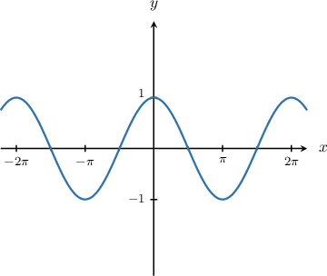

# Cosine evenness review

All source sections show immutable originals and parameterized replay. Normal variants are labeled authored bank extensions.

## Original q-136545

If $cos⁡a=-\frac{1}{3},$ then $cos⁡(-a)=$

Source choices: $\frac{2}{3}$, $0$, $-\frac{2}{3}$, $\frac{1}{3}$, $-\frac{1}{3}$

First, let's recall the graph of $y=cos⁡x.$

Notice that our graph is symmetric about the $y$-axis. If we reflect the graph over the $y$-axis, we get the same picture. This means that $cos⁡x$ is an *even* function, and we have

$$
cos⁡(-x)=cos⁡x.
$$

Therefore,

$$
\begin{aligned}cos⁡(-a) & =cos⁡a \\  & =-\frac{1}{3}.\end{aligned}
$$

### Parameterized original-profile replay

If $cos⁡a=-\frac{1}{3},$ then $cos⁡(-a)=$

A. $-\frac{2}{3}$
B. $0$
C. $\frac{2}{3}$
D. $-\frac{1}{3}$
E. $\frac{1}{3}$

First, let's recall the graph of $y=cos⁡x.$

Notice that our graph is symmetric about the $y$-axis. If we reflect the graph over the $y$-axis, we get the same picture. This means that $cos⁡x$ is an *even* function, and we have

$$
cos⁡(-x)=cos⁡x.
$$

Therefore,

$$
\begin{aligned}cos⁡(-a) & =cos⁡a \\  & =-\frac{1}{3}.\end{aligned}
$$

### Generated changed-parameter variant of the same observed bank

If $cos⁡x=-\frac{8}{11},$ then $cos⁡(-x)=$

A. $-\frac{8}{11}$
B. $\frac{8}{11}$
C. $\frac{16}{11}$
D. $0$
E. $-\frac{16}{11}$

First, let's recall the graph of $y=cos⁡x.$

Notice that our graph is symmetric about the $y$-axis. If we reflect the graph over the $y$-axis, we get the same picture. This means that $cos⁡x$ is an *even* function, and we have

$$
cos⁡(-x)=cos⁡x.
$$

Therefore,

$$
\begin{aligned}cos⁡(-x) & =cos⁡x \\  & =-\frac{8}{11}.\end{aligned}
$$

## Original q-136634

If $\cos x =-\frac{11}{24}$, then $\cos (-x + 16π) =$

Source choices: $\frac{11}{24} + 8π$, $-\frac{11}{24}$, $-\frac{13}{24}$, $-\frac{11}{24} + 8π$, $\frac{11}{24}$

**No captured key, difficulty or worked solution.**

### Parameterized original-profile replay

If $\cos x =-\frac{11}{24}$, then $\cos (-x + 16π) =$

A. $-\frac{13}{24}$
B. $-\frac{11}{24}$
C. $\frac{11}{24}+8\pi$
D. $\frac{11}{24}$
E. $-\frac{11}{24}+8\pi$

[Captured source has no worked solution or designated key.]

### Generated changed-parameter variant of the same observed bank

If $\cos x =-\frac{8}{19}$, then $\cos (-x - 8π) =$

A. $-\frac{11}{19}$
B. $\frac{8}{19}-4\pi$
C. $-4\pi-\frac{8}{19}$
D. $\frac{8}{19}$
E. $-\frac{8}{19}$

First, let's recall the graph of $y=cos⁡x.$

From the graph, we note the following:

- The period of $cos⁡x$ is $2\pi .$

- Our graph is symmetric about the $y$-axis. This means that $cos⁡x$ is an *even* function, and we have

$$
cos⁡(-x)=cos⁡x.
$$

Let's now evaluate our expression:

- Firstly, using the periodicity of $cos⁡x,$ we have

$$
\begin{aligned}cos⁡(-x-8\pi ) & =cos⁡(-x-2\pi \cdot 4) \\  & =cos⁡(-x).\end{aligned}
$$

- Secondly, using the evenness of $cos⁡x,$ we have

$$
\begin{aligned}cos⁡(-x) & =cos⁡x \\  & =-\frac{8}{19}.\end{aligned}
$$

Therefore, $cos⁡(-x-8\pi )=-\frac{8}{19}.$

## Original q-136629

If $cos⁡x=-\frac{3}{10},$ then $cos⁡(-x)=$

Source choices: $\frac{7}{10}$, $-\frac{7}{10}$, $\frac{3}{10}$, $-\frac{3}{10}$, $\frac{\sqrt{91}}{10}$

First, let's recall the graph of $y=cos⁡x.$

Notice that our graph is symmetric about the $y$-axis. If we reflect the graph over the $y$-axis, we get the same picture. This means that $cos⁡x$ is an *even* function, and we have

$$
cos⁡(-x)=cos⁡x.
$$

Therefore,

$$
\begin{aligned}cos⁡(-x) & =cos⁡x \\  & =-\frac{3}{10}.\end{aligned}
$$

### Parameterized original-profile replay

If $cos⁡x=-\frac{3}{10},$ then $cos⁡(-x)=$

A. $\frac{3}{10}$
B. $-\frac{7}{10}$
C. $\frac{7}{10}$
D. $\frac{\sqrt{91}}{10}$
E. $-\frac{3}{10}$

First, let's recall the graph of $y=cos⁡x.$

Notice that our graph is symmetric about the $y$-axis. If we reflect the graph over the $y$-axis, we get the same picture. This means that $cos⁡x$ is an *even* function, and we have

$$
cos⁡(-x)=cos⁡x.
$$

Therefore,

$$
\begin{aligned}cos⁡(-x) & =cos⁡x \\  & =-\frac{3}{10}.\end{aligned}
$$

### Generated changed-parameter variant of the same observed bank

If $cos⁡x=-\frac{8}{11},$ then $cos⁡(-x)=$

A. $\frac{\sqrt{57}}{11}$
B. $-\frac{8}{11}$
C. $\frac{3}{11}$
D. $-\frac{3}{11}$
E. $\frac{8}{11}$

First, let's recall the graph of $y=cos⁡x.$

Notice that our graph is symmetric about the $y$-axis. If we reflect the graph over the $y$-axis, we get the same picture. This means that $cos⁡x$ is an *even* function, and we have

$$
cos⁡(-x)=cos⁡x.
$$

Therefore,

$$
\begin{aligned}cos⁡(-x) & =cos⁡x \\  & =-\frac{8}{11}.\end{aligned}
$$

## Original q-158047

If $cos⁡a=-\frac{\sqrt{2}}{3},$ then $cos⁡(-a)=$

Source choices: $-\frac{\sqrt{2}}{3}$, $-\frac{\sqrt{7}}{3}$, $-\frac{1}{6}$, $\frac{\sqrt{7}}{3}$, $\frac{\sqrt{2}}{3}$

First, let's recall the graph of $y=cos⁡x.$

Notice that our graph is symmetric about the $y$-axis. If we reflect the graph over the $y$-axis, we get the same picture. This means that $cos⁡x$ is an *even* function, and we have

$$
cos⁡(-x)=cos⁡x.
$$

Therefore,

$$
\begin{aligned}cos⁡(-a) & =cos⁡a \\  & =-\frac{\sqrt{2}}{3}.\end{aligned}
$$

### Parameterized original-profile replay

If $cos⁡a=-\frac{\sqrt{2}}{3},$ then $cos⁡(-a)=$

A. $-\frac{1}{6}$
B. $-\frac{\sqrt{7}}{3}$
C. $-\frac{\sqrt{2}}{3}$
D. $\frac{\sqrt{2}}{3}$
E. $\frac{\sqrt{7}}{3}$

First, let's recall the graph of $y=cos⁡x.$

Notice that our graph is symmetric about the $y$-axis. If we reflect the graph over the $y$-axis, we get the same picture. This means that $cos⁡x$ is an *even* function, and we have

$$
cos⁡(-x)=cos⁡x.
$$

Therefore,

$$
\begin{aligned}cos⁡(-a) & =cos⁡a \\  & =-\frac{\sqrt{2}}{3}.\end{aligned}
$$

### Generated changed-parameter variant of the same observed bank

If $cos⁡x=-\frac{\sqrt{7}}{4},$ then $cos⁡(-x)=$

A. $\frac{\sqrt{7}}{4}$
B. $\frac{3}{4}$
C. $-\frac{\sqrt{7}}{4}$
D. $-\frac{3}{4}$
E. $-\frac{1}{8}$

First, let's recall the graph of $y=cos⁡x.$

Notice that our graph is symmetric about the $y$-axis. If we reflect the graph over the $y$-axis, we get the same picture. This means that $cos⁡x$ is an *even* function, and we have

$$
cos⁡(-x)=cos⁡x.
$$

Therefore,

$$
\begin{aligned}cos⁡(-x) & =cos⁡x \\  & =-\frac{\sqrt{7}}{4}.\end{aligned}
$$

## Original q-158052

If $cos⁡x=-1,$ then $cos⁡(-x+24\pi )=$

Source choices: $-1+12\pi $, $0$, $-\frac{1}{12}$, $-1$, $1$

First, let's recall the graph of $y=cos⁡x.$

From the graph, we note the following:

- The period of $cos⁡x$ is $2\pi .$

- Our graph is symmetric about the $y$-axis. This means that $cos⁡x$ is an *even* function, and we have

$$
cos⁡(-x)=cos⁡x.
$$

Let's now evaluate our expression:

- Firstly, using the periodicity of $cos⁡x,$ we have

$$
\begin{aligned}cos⁡(-x+24\pi ) & =cos⁡(-x+2\pi \cdot 12) \\  & =cos⁡(-x).\end{aligned}
$$

- Secondly, using the evenness of $cos⁡x,$ we have

$$
\begin{aligned}cos⁡(-x) & =cos⁡x \\  & =-1.\end{aligned}
$$

Therefore, $cos⁡(-x+24\pi )=-1.$

### Parameterized original-profile replay

If $cos⁡x=-1,$ then $cos⁡(-x+24\pi )=$

A. $-\frac{1}{12}$
B. $0$
C. $-1+12\pi$
D. $1$
E. $-1$

First, let's recall the graph of $y=cos⁡x.$

From the graph, we note the following:

- The period of $cos⁡x$ is $2\pi .$

- Our graph is symmetric about the $y$-axis. This means that $cos⁡x$ is an *even* function, and we have

$$
cos⁡(-x)=cos⁡x.
$$

Let's now evaluate our expression:

- Firstly, using the periodicity of $cos⁡x,$ we have

$$
\begin{aligned}cos⁡(-x+24\pi ) & =cos⁡(-x+2\pi \cdot 12) \\  & =cos⁡(-x).\end{aligned}
$$

- Secondly, using the evenness of $cos⁡x,$ we have

$$
\begin{aligned}cos⁡(-x) & =cos⁡x \\  & =-1.\end{aligned}
$$

Therefore, $cos⁡(-x+24\pi )=-1.$

### Generated changed-parameter variant of the same observed bank

If $cos⁡x=-\frac{8}{19},$ then $cos⁡(-x-8\pi )=$

A. $\frac{2}{19}$
B. $-4\pi-\frac{8}{19}$
C. $-\frac{8}{19}$
D. $\frac{8}{19}$
E. $0$

First, let's recall the graph of $y=cos⁡x.$

From the graph, we note the following:

- The period of $cos⁡x$ is $2\pi .$

- Our graph is symmetric about the $y$-axis. This means that $cos⁡x$ is an *even* function, and we have

$$
cos⁡(-x)=cos⁡x.
$$

Let's now evaluate our expression:

- Firstly, using the periodicity of $cos⁡x,$ we have

$$
\begin{aligned}cos⁡(-x-8\pi ) & =cos⁡(-x-2\pi \cdot 4) \\  & =cos⁡(-x).\end{aligned}
$$

- Secondly, using the evenness of $cos⁡x,$ we have

$$
\begin{aligned}cos⁡(-x) & =cos⁡x \\  & =-\frac{8}{19}.\end{aligned}
$$

Therefore, $cos⁡(-x-8\pi )=-\frac{8}{19}.$

## Original q-158059

If $cos⁡x=0,$ then $\pi cos⁡(-x+18\pi )-\frac{1}{2}=$

Source choices: $1$, $\pi -\frac{1}{2}$, $0$, $2\pi $, $-\frac{1}{2}$

First, let's recall the graph of $y=cos⁡x.$

From the graph, we note the following:

- The period of $cos⁡x$ is $2\pi .$

- Our graph is symmetric over the $y$-axis. This means that $cos⁡x$ is an *even* function, and we have

$$
cos⁡(-x)=cos⁡x.
$$

Let's now evaluate our expression:

- Firstly, using the periodicity of $cos⁡x,$ we have

$$
\begin{aligned}cos⁡(-x+18\pi ) & =cos⁡(-x+2\pi \cdot 9) \\  & =cos⁡(-x).\end{aligned}
$$

- Secondly, using the evenness of $cos⁡x,$ we have

$$
\begin{aligned}cos⁡(-x) & =cos⁡x \\  & =0.\end{aligned}
$$

Therefore,

$$
\begin{aligned}\pi cos⁡(-x+18\pi )-\frac{1}{2} & =\pi \cdot 0-\frac{1}{2} \\  & =0-\frac{1}{2} \\  & =-\frac{1}{2}.\end{aligned}
$$

### Parameterized original-profile replay

If $cos⁡x=0,$ then $\pi cos⁡(-x+18\pi )-\frac{1}{2}=$

A. $0$
B. $-\frac{1}{2}+\pi$
C. $1$
D. $-\frac{1}{2}$
E. $2\pi$

First, let's recall the graph of $y=cos⁡x.$

From the graph, we note the following:

- The period of $cos⁡x$ is $2\pi .$

- Our graph is symmetric over the $y$-axis. This means that $cos⁡x$ is an *even* function, and we have

$$
cos⁡(-x)=cos⁡x.
$$

Let's now evaluate our expression:

- Firstly, using the periodicity of $cos⁡x,$ we have

$$
\begin{aligned}cos⁡(-x+18\pi ) & =cos⁡(-x+2\pi \cdot 9) \\  & =cos⁡(-x).\end{aligned}
$$

- Secondly, using the evenness of $cos⁡x,$ we have

$$
\begin{aligned}cos⁡(-x) & =cos⁡x \\  & =0.\end{aligned}
$$

Therefore,

$$
\begin{aligned}\pi cos⁡(-x+18\pi )-\frac{1}{2} & =\pi \cdot 0-\frac{1}{2} \\  & =0-\frac{1}{2} \\  & =-\frac{1}{2}.\end{aligned}
$$

### Generated changed-parameter variant of the same observed bank

If $cos⁡x=-\frac{\sqrt{7}}{4},$ then $4cos⁡(-x-8\pi )-\frac{3}{2}=$

A. $\frac{5}{2}$
B. $-\sqrt{7}-\frac{3}{2}$
C. $8$
D. $1$
E. $-\frac{\sqrt{7}}{4}$

First, let's recall the graph of $y=cos⁡x.$

From the graph, we note the following:

- The period of $cos⁡x$ is $2\pi .$

- Our graph is symmetric over the $y$-axis. This means that $cos⁡x$ is an *even* function, and we have

$$
cos⁡(-x)=cos⁡x.
$$

Let's now evaluate our expression:

- Firstly, using the periodicity of $cos⁡x,$ we have

$$
\begin{aligned}cos⁡(-x-8\pi ) & =cos⁡(-x-2\pi \cdot 4) \\  & =cos⁡(-x).\end{aligned}
$$

- Secondly, using the evenness of $cos⁡x,$ we have

$$
\begin{aligned}cos⁡(-x) & =cos⁡x \\  & =-\frac{\sqrt{7}}{4}.\end{aligned}
$$

Therefore,

$$
\begin{aligned}4cos⁡(-x-8\pi )-\frac{3}{2} & =4 \cdot (-\frac{\sqrt{7}}{4})-\frac{3}{2} \\  & =-\sqrt{7}-\frac{3}{2} \\  & =-\sqrt{7}-\frac{3}{2}.\end{aligned}
$$

## Authored default bank: easy, seed 8

If $cos⁡t=-\frac{5}{12},$ then $cos⁡(-t)=$

A. $-\frac{5}{6}$
B. $\frac{119}{144}$
C. $-\frac{5}{12}$
D. $\frac{5}{12}$
E. $\frac{\sqrt{119}}{12}$

First, let's recall the graph of $y=cos⁡x.$

Notice that our graph is symmetric about the $y$-axis. If we reflect the graph over the $y$-axis, we get the same picture. This means that $cos⁡x$ is an *even* function, and we have

$$
cos⁡(-x)=cos⁡x.
$$

Therefore,

$$
\begin{aligned}cos⁡(-t) & =cos⁡t \\  & =-\frac{5}{12}.\end{aligned}
$$

## Authored default bank: easy, seed 9

If $cos⁡t=\frac{1}{12},$ then $cos⁡(-t)=$

A. $\frac{\sqrt{143}}{12}$
B. $\frac{1}{6}$
C. $\frac{1}{12}$
D. $-\frac{1}{12}$
E. $\frac{143}{144}$

First, let's recall the graph of $y=cos⁡x.$

Notice that our graph is symmetric about the $y$-axis. If we reflect the graph over the $y$-axis, we get the same picture. This means that $cos⁡x$ is an *even* function, and we have

$$
cos⁡(-x)=cos⁡x.
$$

Therefore,

$$
\begin{aligned}cos⁡(-t) & =cos⁡t \\  & =\frac{1}{12}.\end{aligned}
$$

## Authored default bank: moderate, seed 8

If $cos⁡t=-\frac{4}{15},$ then $cos⁡(-t+10\pi )=$

A. $-\frac{2}{75}$
B. $-\frac{4}{15}$
C. $-\frac{4}{15}+10\pi$
D. $\frac{209}{225}$
E. $\frac{4}{15}$

First, let's recall the graph of $y=cos⁡x.$

From the graph, we note the following:

- The period of $cos⁡x$ is $2\pi .$

- Our graph is symmetric about the $y$-axis. This means that $cos⁡x$ is an *even* function, and we have

$$
cos⁡(-x)=cos⁡x.
$$

Let's now evaluate our expression:

- Firstly, using the periodicity of $cos⁡x,$ we have

$$
\begin{aligned}cos⁡(-t+10\pi ) & =cos⁡(-t+2\pi \cdot 5) \\  & =cos⁡(-t).\end{aligned}
$$

- Secondly, using the evenness of $cos⁡x,$ we have

$$
\begin{aligned}cos⁡(-t) & =cos⁡t \\  & =-\frac{4}{15}.\end{aligned}
$$

Therefore, $cos⁡(-t+10\pi )=-\frac{4}{15}.$

## Authored default bank: moderate, seed 9

If $cos⁡t=\frac{13}{15},$ then $cos⁡(-t-6\pi )=$

A. $-\frac{13}{90}$
B. $\frac{13}{15}$
C. $\frac{13}{15}-6\pi$
D. $\frac{56}{225}$
E. $-\frac{13}{15}$

First, let's recall the graph of $y=cos⁡x.$

From the graph, we note the following:

- The period of $cos⁡x$ is $2\pi .$

- Our graph is symmetric about the $y$-axis. This means that $cos⁡x$ is an *even* function, and we have

$$
cos⁡(-x)=cos⁡x.
$$

Let's now evaluate our expression:

- Firstly, using the periodicity of $cos⁡x,$ we have

$$
\begin{aligned}cos⁡(-t-6\pi ) & =cos⁡(-t-2\pi \cdot 3) \\  & =cos⁡(-t).\end{aligned}
$$

- Secondly, using the evenness of $cos⁡x,$ we have

$$
\begin{aligned}cos⁡(-t) & =cos⁡t \\  & =\frac{13}{15}.\end{aligned}
$$

Therefore, $cos⁡(-t-6\pi )=\frac{13}{15}.$

## Authored default bank: hard, seed 8

If $cos⁡t=-\frac{8}{9},$ then $4cos⁡(-t+10\pi )-\frac{3}{2}=$

A. $\frac{37}{18}$
B. $-\frac{37}{18}$
C. $-\frac{43}{18}$
D. $\frac{5}{2}$
E. $-\frac{91}{18}$

First, let's recall the graph of $y=cos⁡x.$

From the graph, we note the following:

- The period of $cos⁡x$ is $2\pi .$

- Our graph is symmetric over the $y$-axis. This means that $cos⁡x$ is an *even* function, and we have

$$
cos⁡(-x)=cos⁡x.
$$

Let's now evaluate our expression:

- Firstly, using the periodicity of $cos⁡x,$ we have

$$
\begin{aligned}cos⁡(-t+10\pi ) & =cos⁡(-t+2\pi \cdot 5) \\  & =cos⁡(-t).\end{aligned}
$$

- Secondly, using the evenness of $cos⁡x,$ we have

$$
\begin{aligned}cos⁡(-t) & =cos⁡t \\  & =-\frac{8}{9}.\end{aligned}
$$

Therefore,

$$
\begin{aligned}4cos⁡(-t+10\pi )-\frac{3}{2} & =4 \cdot (-\frac{8}{9})-\frac{3}{2} \\  & =-\frac{32}{9}-\frac{3}{2} \\  & =-\frac{91}{18}.\end{aligned}
$$

## Authored default bank: hard, seed 9

If $cos⁡t=\frac{3}{7},$ then $4cos⁡(-t-6\pi )+3=$

A. $7$
B. $\frac{9}{7}$
C. $\frac{24}{7}$
D. $-\frac{9}{7}$
E. $\frac{33}{7}$

First, let's recall the graph of $y=cos⁡x.$

From the graph, we note the following:

- The period of $cos⁡x$ is $2\pi .$

- Our graph is symmetric over the $y$-axis. This means that $cos⁡x$ is an *even* function, and we have

$$
cos⁡(-x)=cos⁡x.
$$

Let's now evaluate our expression:

- Firstly, using the periodicity of $cos⁡x,$ we have

$$
\begin{aligned}cos⁡(-t-6\pi ) & =cos⁡(-t-2\pi \cdot 3) \\  & =cos⁡(-t).\end{aligned}
$$

- Secondly, using the evenness of $cos⁡x,$ we have

$$
\begin{aligned}cos⁡(-t) & =cos⁡t \\  & =\frac{3}{7}.\end{aligned}
$$

Therefore,

$$
\begin{aligned}4cos⁡(-t-6\pi )+3 & =4 \cdot \frac{3}{7}+3 \\  & =\frac{12}{7}+3 \\  & =\frac{33}{7}.\end{aligned}
$$

