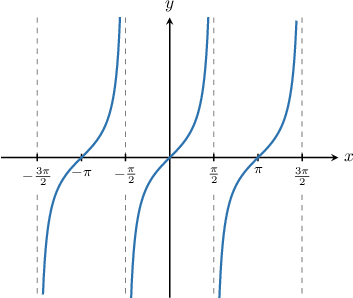

# Source and generated review

Every original appears with its exact prompt, complete bank and full solution (where present). Generated examples are labeled by family/profile and authored status. Evidence-only profiles retain raw historical patterns. Moderate is an authored level assignment. Local image links below point to the exact copied source raster; API records retain the original image reference.

## Original 17592186176347 / q-136548

Observed difficulty: :question.difficulty/easy

If $tan⁡a=-2,$ then $tan⁡(-a)=$

Choices:

- $2$ (source correct)

- $-2$

- $-\frac{1}{2}$

- $0$

- $\frac{1}{2}$

First, let's recall the graph of $y=tan⁡x.$

Our graph has rotational symmetry of order $2$ about the origin. If we rotate the graph ${180}^{∘}$ around the origin, we get the same picture. This means that $tan⁡x$ is an *odd* function, and we have

$$
tan⁡(-x)=-tan⁡x.
$$

Therefore, 

$$
\begin{aligned}tan⁡(-a) & =-tan⁡a \\  & =-(-2) \\  & =2.\end{aligned}
$$

### Generated changed-parameter variant 1 — direct_integer/reciprocal_zero

Metadata: **eligible generated family**; parameters `{"v": "-3", "variable": "a"}`

If $tan⁡a=-3,$ then $tan⁡(-a)=$

- $\frac{1}{3}$
- $3$
- $-3$
- $0$
- $-\frac{1}{3}$

First, let's recall the graph of $y=tan⁡x.$

Our graph has rotational symmetry of order $2$ about the origin. If we rotate the graph ${180}^{∘}$ around the origin, we get the same picture. This means that $tan⁡x$ is an *odd* function, and we have

$$
tan⁡(-x)=-tan⁡x.
$$

Therefore, 

$$
\begin{aligned}tan⁡(-a) & =-tan⁡a \\  & =-(-3) \\  & =3.\end{aligned}
$$

### Generated changed-parameter variant 2 — direct_integer/reciprocal_zero

Metadata: **eligible generated family**; parameters `{"v": "-3", "variable": "a"}`

If $tan⁡a=-3,$ then $tan⁡(-a)=$

- $\frac{1}{3}$
- $-\frac{1}{3}$
- $3$
- $-3$
- $0$

First, let's recall the graph of $y=tan⁡x.$

Our graph has rotational symmetry of order $2$ about the origin. If we rotate the graph ${180}^{∘}$ around the origin, we get the same picture. This means that $tan⁡x$ is an *odd* function, and we have

$$
tan⁡(-x)=-tan⁡x.
$$

Therefore, 

$$
\begin{aligned}tan⁡(-a) & =-tan⁡a \\  & =-(-3) \\  & =3.\end{aligned}
$$

## Original 17592186176348 / q-136549

Observed difficulty: absent

If $\tan x = \frac{1}{2}$, then $\tan (-x + 12π) =$

Choices:

- $-\frac{1}{2} + 12π$

- $\frac{1}{2} + 12π$

- $-\frac{1}{2}$

- $0$

- $\frac{1}{2}$

**Source worked solution and correct designation absent.**

### Generated changed-parameter variant 1 — shifted/raw_unrated

Metadata: **evidence-only; not eligible for learner defaults**; parameters `{"n": -11, "v": "6/7", "variable": "x"}`

If $\tan x = \frac{6}{7}$, then $\tan (-x - 11π) =$

- $-\frac{6}{7}$
- $\frac{6}{7} - 11π$
- $0$
- $-\frac{6}{7} - 11π$
- $\frac{6}{7}$

[Raw source has no worked solution.]

### Generated changed-parameter variant 2 — shifted/raw_unrated

Metadata: **evidence-only; not eligible for learner defaults**; parameters `{"n": 4, "v": "1/8", "variable": "x"}`

If $\tan x = \frac{1}{8}$, then $\tan (-x + 4π) =$

- $\frac{1}{8}$
- $\frac{1}{8} + 4π$
- $-\frac{1}{8}$
- $-\frac{1}{8} + 4π$
- $0$

[Raw source has no worked solution.]

## Original 17592186269132 / q-136639

Observed difficulty: :question.difficulty/easy

If $tan⁡a=\frac{4}{5},$ then $tan⁡(-a)=$

Choices:

- $\frac{4}{5}$

- $\frac{5}{4}$

- $-\frac{4}{5}$ (source correct)

- $-\frac{5}{4}$

- $-\frac{1}{5}$

First, let's recall the graph of $y=tan⁡x.$

Our graph has rotational symmetry of order $2$ about the origin. If we rotate the graph ${180}^{∘}$ around the origin, we get the same picture. This means that $tan⁡x$ is an *odd* function, and we have

$$
tan⁡(-x)=-tan⁡x.
$$

Therefore, 

$$
\begin{aligned}tan⁡(-a) & =-tan⁡a \\  & =-\frac{4}{5}.\end{aligned}
$$

### Generated changed-parameter variant 1 — direct_fraction/numerator_omission

Metadata: **eligible generated family**; parameters `{"v": "-7/8", "variable": "a"}`

If $tan⁡a=-\frac{7}{8},$ then $tan⁡(-a)=$

- $\frac{7}{8}$
- $-\frac{1}{8}$
- $\frac{8}{7}$
- $-\frac{7}{8}$
- $-\frac{8}{7}$

First, let's recall the graph of $y=tan⁡x.$

Our graph has rotational symmetry of order $2$ about the origin. If we rotate the graph ${180}^{∘}$ around the origin, we get the same picture. This means that $tan⁡x$ is an *odd* function, and we have

$$
tan⁡(-x)=-tan⁡x.
$$

Therefore, 

$$
\begin{aligned}tan⁡(-a) & =-tan⁡a \\  & =-(-\frac{7}{8}) \\  & =\frac{7}{8}.\end{aligned}
$$

### Generated changed-parameter variant 2 — direct_fraction/numerator_omission

Metadata: **eligible generated family**; parameters `{"v": "8/9", "variable": "a"}`

If $tan⁡a=\frac{8}{9},$ then $tan⁡(-a)=$

- $-\frac{9}{8}$
- $\frac{8}{9}$
- $-\frac{8}{9}$
- $\frac{9}{8}$
- $-\frac{1}{9}$

First, let's recall the graph of $y=tan⁡x.$

Our graph has rotational symmetry of order $2$ about the origin. If we rotate the graph ${180}^{∘}$ around the origin, we get the same picture. This means that $tan⁡x$ is an *odd* function, and we have

$$
tan⁡(-x)=-tan⁡x.
$$

Therefore, 

$$
\begin{aligned}tan⁡(-a) & =-tan⁡a \\  & =-\frac{8}{9}.\end{aligned}
$$

## Original 17592186275424 / q-158038

Observed difficulty: :question.difficulty/easy

If $tan⁡x=3,$ then $tan⁡(-x)=$

Choices:

- $3$

- $-\frac{1}{3}$

- $-3$ (source correct)

- $\frac{1}{3}$

- $-\sqrt{3}$

First, let's recall the graph of $y=tan⁡x.$

Our graph has rotational symmetry of order $2$ about the origin. If we rotate the graph ${180}^{∘}$ around the origin, we get the same picture. This means that $tan⁡x$ is an *odd* function, and we have

$$
tan⁡(-x)=-tan⁡x.
$$

Therefore, 

$$
\begin{aligned}tan⁡(-x) & =-tan⁡x \\  & =-3.\end{aligned}
$$

### Generated changed-parameter variant 1 — direct_positive/radical_observed

Metadata: **evidence-only; not eligible for learner defaults**; parameters `{"v": "8", "variable": "x"}`

If $tan⁡x=8,$ then $tan⁡(-x)=$

- $-2 \sqrt{2}$
- $8$
- $-\frac{1}{8}$
- $\frac{1}{8}$
- $-8$

First, let's recall the graph of $y=tan⁡x.$

Our graph has rotational symmetry of order $2$ about the origin. If we rotate the graph ${180}^{∘}$ around the origin, we get the same picture. This means that $tan⁡x$ is an *odd* function, and we have

$$
tan⁡(-x)=-tan⁡x.
$$

Therefore, 

$$
\begin{aligned}tan⁡(-x) & =-tan⁡x \\  & =-8.\end{aligned}
$$

### Generated changed-parameter variant 2 — direct_positive/radical_observed

Metadata: **evidence-only; not eligible for learner defaults**; parameters `{"v": "8", "variable": "x"}`

If $tan⁡x=8,$ then $tan⁡(-x)=$

- $-2 \sqrt{2}$
- $-8$
- $8$
- $-\frac{1}{8}$
- $\frac{1}{8}$

First, let's recall the graph of $y=tan⁡x.$

Our graph has rotational symmetry of order $2$ about the origin. If we rotate the graph ${180}^{∘}$ around the origin, we get the same picture. This means that $tan⁡x$ is an *odd* function, and we have

$$
tan⁡(-x)=-tan⁡x.
$$

Therefore, 

$$
\begin{aligned}tan⁡(-x) & =-tan⁡x \\  & =-8.\end{aligned}
$$

## Original 17592186275425 / q-158041

Observed difficulty: :question.difficulty/hard

If $tan⁡x=-4,$ then $\frac{1}{2}tan⁡(-x+3\pi )+3=$

Choices:

- $5$ (source correct)

- $0$

- $1$

- $-1$

- $3$

First, let's recall the graph of $y=tan⁡x.$

From the graph, we note the following:

- The period of $tan⁡x$ is $\pi .$

- Our graph has rotational symmetry of order $2$ about the origin. This means that $tan⁡x$ is an *odd* function, and we have

$$
tan⁡(-x)=-tan⁡x.
$$

Let's now evaluate our expression:

- Firstly, using the periodicity of $tan⁡x,$ we have

$$
\begin{aligned}tan⁡(-x+3\pi ) & =tan⁡(-x).\end{aligned}
$$

- Secondly, using the oddness of $tan⁡x,$ we have

$$
\begin{aligned}tan⁡(-x) & =-tan⁡x \\  & =-(-4) \\  & =4.\end{aligned}
$$

Therefore,

$$
\begin{aligned}\frac{1}{2}tan⁡(-x+3\pi )+3 & =\frac{1}{2}\cdot 4+3 \\  & =\frac{4}{2}+3 \\  & =2+3 \\  & =5.\end{aligned}
$$

### Generated changed-parameter variant 1 — affine_integer/integer_observed

Metadata: **eligible generated family**; parameters `{"b": "3", "c": "5/7", "n": 12, "v": "-7", "variable": "x"}`

If $tan⁡x=-7,$ then $\frac{5}{7}tan⁡(-x+12\pi )+3=$

- $-2$
- $0$
- $8$
- $2$
- $3$

First, let's recall the graph of $y=tan⁡x.$

From the graph, we note the following:

- The period of $tan⁡x$ is $\pi .$

- Our graph has rotational symmetry of order $2$ about the origin. This means that $tan⁡x$ is an *odd* function, and we have

$$
tan⁡(-x)=-tan⁡x.
$$

Let's now evaluate our expression:

- Firstly, using the periodicity of $tan⁡x,$ we have

$$
\begin{aligned}tan⁡(-x+12\pi ) & =tan⁡(-x).\end{aligned}
$$

- Secondly, using the oddness of $tan⁡x,$ we have

$$
\begin{aligned}tan⁡(-x) & =-tan⁡x \\  & =-(-7) \\  & =7.\end{aligned}
$$

Therefore,

$$
\begin{aligned}\frac{5}{7}tan⁡(-x+12\pi )+3 & =\frac{5}{7}\cdot 7+3 \\  & =\frac{35}{7}+3 \\  & =5+3 \\  & =8.\end{aligned}
$$

### Generated changed-parameter variant 2 — affine_integer/integer_observed

Metadata: **eligible generated family**; parameters `{"b": "3", "c": "1/8", "n": -11, "v": "-8", "variable": "x"}`

If $tan⁡x=-8,$ then $\frac{1}{8}tan⁡(-x-11\pi )+3=$

- $2$
- $0$
- $4$
- $3$
- $-2$

First, let's recall the graph of $y=tan⁡x.$

From the graph, we note the following:

- The period of $tan⁡x$ is $\pi .$

- Our graph has rotational symmetry of order $2$ about the origin. This means that $tan⁡x$ is an *odd* function, and we have

$$
tan⁡(-x)=-tan⁡x.
$$

Let's now evaluate our expression:

- Firstly, using the periodicity of $tan⁡x,$ we have

$$
\begin{aligned}tan⁡(-x-11\pi ) & =tan⁡(-x).\end{aligned}
$$

- Secondly, using the oddness of $tan⁡x,$ we have

$$
\begin{aligned}tan⁡(-x) & =-tan⁡x \\  & =-(-8) \\  & =8.\end{aligned}
$$

Therefore,

$$
\begin{aligned}\frac{1}{8}tan⁡(-x-11\pi )+3 & =\frac{1}{8}\cdot 8+3 \\  & =\frac{8}{8}+3 \\  & =1+3 \\  & =4.\end{aligned}
$$

## Original 17592186275427 / q-158046

Observed difficulty: :question.difficulty/hard

If $tan⁡x=-2,$ then $\frac{3}{5}tan⁡(-x-7\pi )+\frac{4}{5}=$

Choices:

- $2$ (source correct)

- $\frac{2}{5}$

- $\pi +\frac{2}{5}$

- $-1$

- $-\frac{2}{5}$

First, let's recall the graph of $y=tan⁡x.$

From the graph, we note the following:

- The period of $tan⁡x$ is $\pi .$

- Our graph has rotational symmetry of order $2$ about the origin. This means that $tan⁡x$ is an *odd* function, and we have

$$
tan⁡(-x)=-tan⁡x.
$$

Let's now evaluate our expression:

- Firstly, using the periodicity of $tan⁡x,$ we have

$$
\begin{aligned}tan⁡(-x-7\pi ) & =tan⁡(-x).\end{aligned}
$$

- Secondly, using the oddness of $tan⁡x,$ we have

$$
\begin{aligned}tan⁡(-x) & =-tan⁡x \\  & =-(-2) \\  & =2.\end{aligned}
$$

Therefore,

$$
\begin{aligned}\frac{3}{5}tan⁡(-x-7\pi )+\frac{4}{5} & =\frac{3}{5}\cdot 2+\frac{4}{5} \\  & =\frac{6}{5}+\frac{4}{5} \\  & =\frac{10}{5} \\  & =2.\end{aligned}
$$

### Generated changed-parameter variant 1 — affine_fraction/fraction_observed

Metadata: **evidence-only; not eligible for learner defaults**; parameters `{"b": "2/3", "c": "2/3", "n": 7, "v": "-2", "variable": "x"}`

If $tan⁡x=-2,$ then $\frac{2}{3}tan⁡(-x+7\pi )+\frac{2}{3}=$

- $\frac{2}{3}$
- $-1$
- $\pi +\frac{2}{3}$
- $2$
- $-\frac{2}{3}$

First, let's recall the graph of $y=tan⁡x.$

From the graph, we note the following:

- The period of $tan⁡x$ is $\pi .$

- Our graph has rotational symmetry of order $2$ about the origin. This means that $tan⁡x$ is an *odd* function, and we have

$$
tan⁡(-x)=-tan⁡x.
$$

Let's now evaluate our expression:

- Firstly, using the periodicity of $tan⁡x,$ we have

$$
\begin{aligned}tan⁡(-x+7\pi ) & =tan⁡(-x).\end{aligned}
$$

- Secondly, using the oddness of $tan⁡x,$ we have

$$
\begin{aligned}tan⁡(-x) & =-tan⁡x \\  & =-(-2) \\  & =2.\end{aligned}
$$

Therefore,

$$
\begin{aligned}\frac{2}{3}tan⁡(-x+7\pi )+\frac{2}{3} & =\frac{2}{3}\cdot 2+\frac{2}{3} \\  & =\frac{4}{3}+\frac{2}{3} \\  & =\frac{6}{3} \\  & =2.\end{aligned}
$$

### Generated changed-parameter variant 2 — affine_fraction/fraction_observed

Metadata: **evidence-only; not eligible for learner defaults**; parameters `{"b": "4/5", "c": "2/5", "n": 8, "v": "-3", "variable": "x"}`

If $tan⁡x=-3,$ then $\frac{2}{5}tan⁡(-x+8\pi )+\frac{4}{5}=$

- $-\frac{2}{5}$
- $-1$
- $\frac{2}{5}$
- $\pi +\frac{2}{5}$
- $2$

First, let's recall the graph of $y=tan⁡x.$

From the graph, we note the following:

- The period of $tan⁡x$ is $\pi .$

- Our graph has rotational symmetry of order $2$ about the origin. This means that $tan⁡x$ is an *odd* function, and we have

$$
tan⁡(-x)=-tan⁡x.
$$

Let's now evaluate our expression:

- Firstly, using the periodicity of $tan⁡x,$ we have

$$
\begin{aligned}tan⁡(-x+8\pi ) & =tan⁡(-x).\end{aligned}
$$

- Secondly, using the oddness of $tan⁡x,$ we have

$$
\begin{aligned}tan⁡(-x) & =-tan⁡x \\  & =-(-3) \\  & =3.\end{aligned}
$$

Therefore,

$$
\begin{aligned}\frac{2}{5}tan⁡(-x+8\pi )+\frac{4}{5} & =\frac{2}{5}\cdot 3+\frac{4}{5} \\  & =\frac{6}{5}+\frac{4}{5} \\  & =\frac{10}{5} \\  & =2.\end{aligned}
$$

## Normal defaults and authored completions

These examples cover every source-shaped template under its default eligible bank, including completed moderate and authored hard banks.

### easy / direct_integer / reciprocal_zero — generated 71

Observed solution structure; parameterized whole eligible bank.

If $tan⁡a=-8,$ then $tan⁡(-a)=$

- $-8$
- $\frac{1}{8}$
- $0$
- $8$
- $-\frac{1}{8}$

First, let's recall the graph of $y=tan⁡x.$

Our graph has rotational symmetry of order $2$ about the origin. If we rotate the graph ${180}^{∘}$ around the origin, we get the same picture. This means that $tan⁡x$ is an *odd* function, and we have

$$
tan⁡(-x)=-tan⁡x.
$$

Therefore, 

$$
\begin{aligned}tan⁡(-a) & =-tan⁡a \\  & =-(-8) \\  & =8.\end{aligned}
$$

### easy / direct_integer / reciprocal_zero — generated 72

Observed solution structure; parameterized whole eligible bank.

If $tan⁡a=-9,$ then $tan⁡(-a)=$

- $9$
- $0$
- $\frac{1}{9}$
- $-9$
- $-\frac{1}{9}$

First, let's recall the graph of $y=tan⁡x.$

Our graph has rotational symmetry of order $2$ about the origin. If we rotate the graph ${180}^{∘}$ around the origin, we get the same picture. This means that $tan⁡x$ is an *odd* function, and we have

$$
tan⁡(-x)=-tan⁡x.
$$

Therefore, 

$$
\begin{aligned}tan⁡(-a) & =-tan⁡a \\  & =-(-9) \\  & =9.\end{aligned}
$$

### easy / direct_fraction / numerator_omission — generated 71

Observed solution structure; parameterized whole eligible bank.

If $tan⁡a=-\frac{7}{8},$ then $tan⁡(-a)=$

- $-\frac{1}{8}$
- $\frac{8}{7}$
- $-\frac{7}{8}$
- $\frac{7}{8}$
- $-\frac{8}{7}$

First, let's recall the graph of $y=tan⁡x.$

Our graph has rotational symmetry of order $2$ about the origin. If we rotate the graph ${180}^{∘}$ around the origin, we get the same picture. This means that $tan⁡x$ is an *odd* function, and we have

$$
tan⁡(-x)=-tan⁡x.
$$

Therefore, 

$$
\begin{aligned}tan⁡(-a) & =-tan⁡a \\  & =-(-\frac{7}{8}) \\  & =\frac{7}{8}.\end{aligned}
$$

### easy / direct_fraction / numerator_omission — generated 72

Observed solution structure; parameterized whole eligible bank.

If $tan⁡a=-\frac{3}{4},$ then $tan⁡(-a)=$

- $-\frac{4}{3}$
- $\frac{3}{4}$
- $-\frac{1}{4}$
- $\frac{4}{3}$
- $-\frac{3}{4}$

First, let's recall the graph of $y=tan⁡x.$

Our graph has rotational symmetry of order $2$ about the origin. If we rotate the graph ${180}^{∘}$ around the origin, we get the same picture. This means that $tan⁡x$ is an *odd* function, and we have

$$
tan⁡(-x)=-tan⁡x.
$$

Therefore, 

$$
\begin{aligned}tan⁡(-a) & =-tan⁡a \\  & =-(-\frac{3}{4}) \\  & =\frac{3}{4}.\end{aligned}
$$

### easy / direct_positive / reciprocal_zero — generated 71

Observed solution structure; parameterized whole eligible bank.

If $tan⁡x=3,$ then $tan⁡(-x)=$

- $3$
- $-\frac{1}{3}$
- $0$
- $-3$
- $\frac{1}{3}$

First, let's recall the graph of $y=tan⁡x.$

Our graph has rotational symmetry of order $2$ about the origin. If we rotate the graph ${180}^{∘}$ around the origin, we get the same picture. This means that $tan⁡x$ is an *odd* function, and we have

$$
tan⁡(-x)=-tan⁡x.
$$

Therefore, 

$$
\begin{aligned}tan⁡(-x) & =-tan⁡x \\  & =-3.\end{aligned}
$$

### easy / direct_positive / reciprocal_zero — generated 72

Observed solution structure; parameterized whole eligible bank.

If $tan⁡x=2,$ then $tan⁡(-x)=$

- $-2$
- $0$
- $-\frac{1}{2}$
- $2$
- $\frac{1}{2}$

First, let's recall the graph of $y=tan⁡x.$

Our graph has rotational symmetry of order $2$ about the origin. If we rotate the graph ${180}^{∘}$ around the origin, we get the same picture. This means that $tan⁡x$ is an *odd* function, and we have

$$
tan⁡(-x)=-tan⁡x.
$$

Therefore, 

$$
\begin{aligned}tan⁡(-x) & =-tan⁡x \\  & =-2.\end{aligned}
$$

### moderate / shifted / output_shift — generated 71

Authored moderate completion and level assignment.

If $\tan x = -\frac{5}{7}$, then $\tan (-x + 10π) =$

- $\frac{5}{7}$
- $-\frac{5}{7}$
- $\frac{5}{7} + 10π$
- $0$
- $-\frac{5}{7} + 10π$

First, let's recall the graph of $y=tan⁡x.$

From the graph, we note the following:

- The period of $tan⁡x$ is $\pi .$

- Our graph has rotational symmetry of order $2$ about the origin. This means that $tan⁡x$ is an *odd* function, and we have

$$
tan⁡(-x)=-tan⁡x.
$$

Let's now evaluate our expression:

- Firstly, using the periodicity of $tan⁡x,$ we have

$$
\begin{aligned}tan⁡(-x+10\pi ) & =tan⁡(-x).\end{aligned}
$$

- Secondly, using the oddness of $tan⁡x,$ we have

$$
\begin{aligned}tan⁡(-x) & =-tan⁡x \\  & =-(-\frac{5}{7}) \\  & =\frac{5}{7}.\end{aligned}
$$

Therefore, $\tan (-x + 10π)=\frac{5}{7}.$

### moderate / shifted / output_shift — generated 72

Authored moderate completion and level assignment.

If $\tan x = \frac{2}{5}$, then $\tan (-x - π) =$

- $\frac{2}{5} - 1π$
- $-\frac{2}{5} - 1π$
- $\frac{2}{5}$
- $0$
- $-\frac{2}{5}$

First, let's recall the graph of $y=tan⁡x.$

From the graph, we note the following:

- The period of $tan⁡x$ is $\pi .$

- Our graph has rotational symmetry of order $2$ about the origin. This means that $tan⁡x$ is an *odd* function, and we have

$$
tan⁡(-x)=-tan⁡x.
$$

Let's now evaluate our expression:

- Firstly, using the periodicity of $tan⁡x,$ we have

$$
\begin{aligned}tan⁡(-x-\pi ) & =tan⁡(-x).\end{aligned}
$$

- Secondly, using the oddness of $tan⁡x,$ we have

$$
\begin{aligned}tan⁡(-x) & =-tan⁡x \\  & =-\frac{2}{5}.\end{aligned}
$$

Therefore, $\tan (-x - π)=-\frac{2}{5}.$

### hard / affine_integer / affine_operations — generated 71

Observed solution structure; authored method-derived whole bank.

If $tan⁡x=-7,$ then $\frac{3}{7}tan⁡(-x-11\pi )+2=$

- $3$
- $-1$
- $5$
- $9$
- $1$

First, let's recall the graph of $y=tan⁡x.$

From the graph, we note the following:

- The period of $tan⁡x$ is $\pi .$

- Our graph has rotational symmetry of order $2$ about the origin. This means that $tan⁡x$ is an *odd* function, and we have

$$
tan⁡(-x)=-tan⁡x.
$$

Let's now evaluate our expression:

- Firstly, using the periodicity of $tan⁡x,$ we have

$$
\begin{aligned}tan⁡(-x-11\pi ) & =tan⁡(-x).\end{aligned}
$$

- Secondly, using the oddness of $tan⁡x,$ we have

$$
\begin{aligned}tan⁡(-x) & =-tan⁡x \\  & =-(-7) \\  & =7.\end{aligned}
$$

Therefore,

$$
\begin{aligned}\frac{3}{7}tan⁡(-x-11\pi )+2 & =\frac{3}{7}\cdot 7+2 \\  & =\frac{21}{7}+2 \\  & =3+2 \\  & =5.\end{aligned}
$$

### hard / affine_integer / affine_operations — generated 72

Observed solution structure; authored method-derived whole bank.

If $tan⁡x=-7,$ then $\frac{6}{7}tan⁡(-x+5\pi )+4=$

- $10$
- $2$
- $-2$
- $11$
- $6$

First, let's recall the graph of $y=tan⁡x.$

From the graph, we note the following:

- The period of $tan⁡x$ is $\pi .$

- Our graph has rotational symmetry of order $2$ about the origin. This means that $tan⁡x$ is an *odd* function, and we have

$$
tan⁡(-x)=-tan⁡x.
$$

Let's now evaluate our expression:

- Firstly, using the periodicity of $tan⁡x,$ we have

$$
\begin{aligned}tan⁡(-x+5\pi ) & =tan⁡(-x).\end{aligned}
$$

- Secondly, using the oddness of $tan⁡x,$ we have

$$
\begin{aligned}tan⁡(-x) & =-tan⁡x \\  & =-(-7) \\  & =7.\end{aligned}
$$

Therefore,

$$
\begin{aligned}\frac{6}{7}tan⁡(-x+5\pi )+4 & =\frac{6}{7}\cdot 7+4 \\  & =\frac{42}{7}+4 \\  & =6+4 \\  & =10.\end{aligned}
$$

### hard / affine_fraction / affine_operations — generated 71

Observed solution structure; authored method-derived whole bank.

If $tan⁡x=-7,$ then $\frac{1}{4}tan⁡(-x+7\pi )+\frac{3}{4}=$

- $\frac{5}{2}$
- $\frac{31}{4}$
- $-1$
- $1$
- $\frac{7}{4}$

First, let's recall the graph of $y=tan⁡x.$

From the graph, we note the following:

- The period of $tan⁡x$ is $\pi .$

- Our graph has rotational symmetry of order $2$ about the origin. This means that $tan⁡x$ is an *odd* function, and we have

$$
tan⁡(-x)=-tan⁡x.
$$

Let's now evaluate our expression:

- Firstly, using the periodicity of $tan⁡x,$ we have

$$
\begin{aligned}tan⁡(-x+7\pi ) & =tan⁡(-x).\end{aligned}
$$

- Secondly, using the oddness of $tan⁡x,$ we have

$$
\begin{aligned}tan⁡(-x) & =-tan⁡x \\  & =-(-7) \\  & =7.\end{aligned}
$$

Therefore,

$$
\begin{aligned}\frac{1}{4}tan⁡(-x+7\pi )+\frac{3}{4} & =\frac{1}{4}\cdot 7+\frac{3}{4} \\  & =\frac{7}{4}+\frac{3}{4} \\  & =\frac{10}{4} \\  & =\frac{5}{2}.\end{aligned}
$$

### hard / affine_fraction / affine_operations — generated 72

Observed solution structure; authored method-derived whole bank.

If $tan⁡x=-8,$ then $\frac{5}{6}tan⁡(-x-8\pi )+\frac{5}{6}=$

- $-\frac{35}{6}$
- $\frac{35}{6}$
- $\frac{20}{3}$
- $\frac{53}{6}$
- $\frac{15}{2}$

First, let's recall the graph of $y=tan⁡x.$

From the graph, we note the following:

- The period of $tan⁡x$ is $\pi .$

- Our graph has rotational symmetry of order $2$ about the origin. This means that $tan⁡x$ is an *odd* function, and we have

$$
tan⁡(-x)=-tan⁡x.
$$

Let's now evaluate our expression:

- Firstly, using the periodicity of $tan⁡x,$ we have

$$
\begin{aligned}tan⁡(-x-8\pi ) & =tan⁡(-x).\end{aligned}
$$

- Secondly, using the oddness of $tan⁡x,$ we have

$$
\begin{aligned}tan⁡(-x) & =-tan⁡x \\  & =-(-8) \\  & =8.\end{aligned}
$$

Therefore,

$$
\begin{aligned}\frac{5}{6}tan⁡(-x-8\pi )+\frac{5}{6} & =\frac{5}{6}\cdot 8+\frac{5}{6} \\  & =\frac{40}{6}+\frac{5}{6} \\  & =\frac{45}{6} \\  & =\frac{15}{2}.\end{aligned}
$$

## Known limitations

Raw q-136549 omits difficulty, worked solution and correct ref; it cannot run through a keyed native grading fixture. A completed record with identical prompt and bank is separately graded after independent derivation of -1/2. Negative square-root and fractional opaque scalar distractors preserve complete banks in evidence profiles without claims about historical author intent. See validation.json for exact denominators and finite base/shift task counts.
