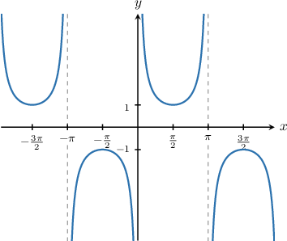

# Cosecant oddness review

Original raw evidence retains missing attributes. Generated evidence profiles are not eligible for learning. Normal variants retain source-shaped solutions with authored method banks.

## Original q-136605

If $\csc x =-6$, then $\csc (-x + 10π) =$

- $-6$
- $-6 + 10π$
- $6 + 10π$
- $6$
- $0$

[Raw capture has no worked solution.]

## Original q-136614

If $\csc x = 7$, then $\csc (-x) =$

- $-7$
- $0$
- $7$
- $-\frac{1}{7}$
- $\frac{1}{7}$

[Raw capture has no worked solution.]

## Original q-136554

If $\operatorname{csc}⁡a=-3,$ then $\operatorname{csc}⁡(-a)=$

- $3$
- $0$
- $-3$
- $\frac{1}{3}$
- $-\frac{1}{3}$

First, let's recall the graph of $y=\operatorname{csc}⁡x.$

Our graph has rotational symmetry of order $2$ about the origin. If we rotate the graph ${180}^{∘}$ around the origin, we get the same picture. This means that $\operatorname{csc}⁡x$ is an *odd* function, and we have

$$
\operatorname{csc}⁡(-x)=-\operatorname{csc}⁡x.
$$

Therefore,

$$
\begin{aligned}\operatorname{csc}⁡(-a) & =-\operatorname{csc}⁡a \\  & =-(-3) \\  & =3.\end{aligned}
$$

## Original q-158065

If $\operatorname{csc}⁡a=\frac{11}{4},$ then $\operatorname{csc}⁡(-a)=$

- $-\frac{7}{4}$
- $\frac{4}{11}$
- $\frac{7}{4}$
- $\frac{11}{4}$
- $-\frac{11}{4}$

First, let's recall the graph of $y=\operatorname{csc}⁡x.$

Our graph has rotational symmetry of order $2$ about the origin. If we rotate the graph ${180}^{∘}$ around the origin, we get the same picture. This means that $\operatorname{csc}⁡x$ is an *odd* function, and we have

$$
\operatorname{csc}⁡(-x)=-\operatorname{csc}⁡x.
$$

Therefore,

$$
\begin{aligned}\operatorname{csc}⁡(-a) & =-\operatorname{csc}⁡a \\  & =-\frac{11}{4}.\end{aligned}
$$

## Original q-158066

If $\operatorname{csc}⁡a=\sqrt{5},$ then $\operatorname{csc}⁡(-a)=$

- $1$
- $\sqrt{5}$
- $-\sqrt{5}$
- $5$
- $-5$

First, let's recall the graph of $y=\operatorname{csc}⁡x.$

Our graph has rotational symmetry of order $2$ about the origin. If we rotate the graph ${180}^{∘}$ around the origin, we get the same picture. This means that $\operatorname{csc}⁡x$ is an *odd* function, and we have

$$
\operatorname{csc}⁡(-x)=-\operatorname{csc}⁡x.
$$

Therefore,

$$
\begin{aligned}\operatorname{csc}⁡(-a) & =-\operatorname{csc}⁡a \\  & =-\sqrt{5}.\end{aligned}
$$

## Original q-158069

If $\operatorname{csc}⁡x=-4,$ then $3\operatorname{csc}⁡(-x-18\pi )-7=$

- $2$
- $-15$
- $9$
- $-19$
- $5$

First, let's recall the graph of $y=\operatorname{csc}⁡x.$

From the graph, we note the following:

- The period of $\operatorname{csc}⁡x$ is $2\pi .$

- Our graph has rotational symmetry of order $2$ about the origin. This means that $\operatorname{csc}⁡x$ is an *odd* function, and we have

$$
\operatorname{csc}⁡(-x)=-\operatorname{csc}⁡x.
$$

Let's now evaluate our expression:

- Firstly, using the periodicity of $\operatorname{csc}⁡x,$ we have

$$
\begin{aligned}\operatorname{csc}⁡(-x-18\pi ) & =\operatorname{csc}⁡(-x-2\pi \cdot 9) \\  & =\operatorname{csc}⁡(-x).\end{aligned}
$$

- Secondly, using the oddness of $\operatorname{csc}⁡x,$ we have

$$
\begin{aligned}\operatorname{csc}⁡(-x) & =-\operatorname{csc}⁡x \\  & =-(-4) \\  & =4.\end{aligned}
$$

Therefore, 

$$
\begin{aligned}3\operatorname{csc}⁡(-x-18\pi )-7 & =3(4)-7 \\  & =12-7 \\  & =5.\end{aligned}
$$

## Original q-158071

If $\operatorname{csc}⁡x=\frac{7}{6},$ then $4\operatorname{csc}⁡(-x+6\pi )+1=$

- $\frac{17}{3}$
- $\frac{1}{6}$
- $-\frac{11}{3}$
- $-\frac{5}{6}$
- $-\frac{5}{2}$

First, let's recall the graph of $y=\operatorname{csc}⁡x.$

From the graph, we note the following:

- The period of $\operatorname{csc}⁡x$ is $2\pi .$

- Our graph has rotational symmetry of order $2$ about the origin. This means that $\operatorname{csc}⁡x$ is an *odd* function, and we have

$$
\operatorname{csc}⁡(-x)=-\operatorname{csc}⁡x.
$$

Let's now evaluate our expression:

- Firstly, using the periodicity of $\operatorname{csc}⁡x,$ we have

$$
\begin{aligned}\operatorname{csc}⁡(-x+6\pi ) & =\operatorname{csc}⁡(-x+2\pi \cdot 3) \\  & =\operatorname{csc}⁡(-x).\end{aligned}
$$

- Secondly, using the oddness of $\operatorname{csc}⁡x,$ we have

$$
\begin{aligned}\operatorname{csc}⁡(-x) & =-\operatorname{csc}⁡x \\  & =-\frac{7}{6}.\end{aligned}
$$

Therefore, 

$$
\begin{aligned}4\operatorname{csc}⁡(-x+6\pi )+1 & =4(-\frac{7}{6})+1 \\  & =-\frac{14}{3}+1 \\  & =-\frac{11}{3}.\end{aligned}
$$

## Generated 1 — legacy_shift / raw_q-136605 (evidence only)

If $\csc x =-\sqrt{10}$, then $\csc (-x - 24π) =$

- $-24π -\sqrt{10}$
- $-24π + \sqrt{10}$
- $0$
- $\sqrt{10}$
- $-\sqrt{10}$

[Raw capture has no worked solution.]

## Generated 2 — legacy_shift / period_output (normal)

If $\csc x =-\sqrt{10}$, then $\csc (-x - 24π) =$

- $-24 \pi -\sqrt{10}$
- $-24 \pi + \sqrt{10}$
- $0$
- $\sqrt{10}$
- $-\sqrt{10}$

First, let's recall the graph of $y=\operatorname{csc}⁡x.$

From the graph, we note the following:

- The period of $\operatorname{csc}⁡x$ is $2\pi .$

- Our graph has rotational symmetry of order $2$ about the origin. This means that $\operatorname{csc}⁡x$ is an *odd* function, and we have

$$
\operatorname{csc}⁡(-x)=-\operatorname{csc}⁡x.
$$

Let's now evaluate our expression:

- Firstly, using the periodicity of $\operatorname{csc}⁡x,$ we have

$$
\begin{aligned}\operatorname{csc}⁡(-x-24\pi ) & =\operatorname{csc}⁡(-x-2\pi \cdot 12) \\  & =\operatorname{csc}⁡(-x).\end{aligned}
$$

- Secondly, using the oddness of $\operatorname{csc}⁡x,$ we have

$$
\begin{aligned}\operatorname{csc}⁡(-x) & =-\operatorname{csc}⁡x \\  & =-(-\sqrt{10}) \\  & =\sqrt{10}.\end{aligned}
$$

Therefore, $\operatorname{csc}⁡(-x-24\pi ) = \sqrt{10}.$

## Generated 3 — legacy_shift / raw_q-136605 (evidence only)

If $\csc x =-\frac{7}{6}$, then $\csc (-x - 6π) =$

- $0$
- $-\frac{7}{6}$
- $\frac{7}{6} -6π$
- $-6π -\frac{7}{6}$
- $\frac{7}{6}$

[Raw capture has no worked solution.]

## Generated 4 — legacy_shift / period_output (normal)

If $\csc x =-\frac{7}{6}$, then $\csc (-x - 6π) =$

- $0$
- $-\frac{7}{6}$
- $\frac{7}{6} -6 \pi$
- $-6 \pi -\frac{7}{6}$
- $\frac{7}{6}$

First, let's recall the graph of $y=\operatorname{csc}⁡x.$

From the graph, we note the following:

- The period of $\operatorname{csc}⁡x$ is $2\pi .$

- Our graph has rotational symmetry of order $2$ about the origin. This means that $\operatorname{csc}⁡x$ is an *odd* function, and we have

$$
\operatorname{csc}⁡(-x)=-\operatorname{csc}⁡x.
$$

Let's now evaluate our expression:

- Firstly, using the periodicity of $\operatorname{csc}⁡x,$ we have

$$
\begin{aligned}\operatorname{csc}⁡(-x-6\pi ) & =\operatorname{csc}⁡(-x-2\pi \cdot 3) \\  & =\operatorname{csc}⁡(-x).\end{aligned}
$$

- Secondly, using the oddness of $\operatorname{csc}⁡x,$ we have

$$
\begin{aligned}\operatorname{csc}⁡(-x) & =-\operatorname{csc}⁡x \\  & =-(-\frac{7}{6}) \\  & =\frac{7}{6}.\end{aligned}
$$

Therefore, $\operatorname{csc}⁡(-x-6\pi ) = \frac{7}{6}.$

## Generated 5 — legacy_simple / raw_q-136614 (evidence only)

If $\csc a = -\sqrt{10}$, then $\csc (-a) =$

- $\frac{\sqrt{10}}{10}$
- $0$
- $-\frac{\sqrt{10}}{10}$
- $\sqrt{10}$
- $-\sqrt{10}$

[Raw capture has no worked solution.]

## Generated 6 — legacy_simple / sign_reciprocal (normal)

If $\csc a = -\sqrt{10}$, then $\csc (-a) =$

- $\frac{\sqrt{10}}{10}$
- $0$
- $-\frac{\sqrt{10}}{10}$
- $\sqrt{10}$
- $-\sqrt{10}$

First, let's recall the graph of $y=\operatorname{csc}⁡x.$

Our graph has rotational symmetry of order $2$ about the origin. If we rotate the graph ${180}^{∘}$ around the origin, we get the same picture. This means that $\operatorname{csc}⁡x$ is an *odd* function, and we have

$$
\operatorname{csc}⁡(-x)=-\operatorname{csc}⁡x.
$$

Therefore,

$$
\begin{aligned}\operatorname{csc}⁡(-a) & =-\operatorname{csc}⁡a \\  & =-(-\sqrt{10}) \\  & =\sqrt{10}.\end{aligned}
$$

## Generated 7 — legacy_simple / raw_q-136614 (evidence only)

If $\csc a = -\frac{7}{6}$, then $\csc (-a) =$

- $-\frac{6}{7}$
- $\frac{6}{7}$
- $-\frac{7}{6}$
- $0$
- $\frac{7}{6}$

[Raw capture has no worked solution.]

## Generated 8 — legacy_simple / sign_reciprocal (normal)

If $\csc a = -\frac{7}{6}$, then $\csc (-a) =$

- $-\frac{6}{7}$
- $\frac{6}{7}$
- $-\frac{7}{6}$
- $0$
- $\frac{7}{6}$

First, let's recall the graph of $y=\operatorname{csc}⁡x.$

Our graph has rotational symmetry of order $2$ about the origin. If we rotate the graph ${180}^{∘}$ around the origin, we get the same picture. This means that $\operatorname{csc}⁡x$ is an *odd* function, and we have

$$
\operatorname{csc}⁡(-x)=-\operatorname{csc}⁡x.
$$

Therefore,

$$
\begin{aligned}\operatorname{csc}⁡(-a) & =-\operatorname{csc}⁡a \\  & =-(-\frac{7}{6}) \\  & =\frac{7}{6}.\end{aligned}
$$

## Generated 9 — easy_integer / raw_q-136554 (evidence only)

If $\operatorname{csc}⁡a=11,$ then $\operatorname{csc}⁡(-a)=$

- $\frac{1}{11}$
- $-11$
- $-\frac{1}{11}$
- $11$
- $0$

First, let's recall the graph of $y=\operatorname{csc}⁡x.$

Our graph has rotational symmetry of order $2$ about the origin. If we rotate the graph ${180}^{∘}$ around the origin, we get the same picture. This means that $\operatorname{csc}⁡x$ is an *odd* function, and we have

$$
\operatorname{csc}⁡(-x)=-\operatorname{csc}⁡x.
$$

Therefore,

$$
\begin{aligned}\operatorname{csc}⁡(-a) & =-\operatorname{csc}⁡a \\  & =-11.\end{aligned}
$$

## Generated 10 — easy_integer / sign_reciprocal (normal)

If $\operatorname{csc}⁡a=11,$ then $\operatorname{csc}⁡(-a)=$

- $\frac{1}{11}$
- $-11$
- $-\frac{1}{11}$
- $11$
- $0$

First, let's recall the graph of $y=\operatorname{csc}⁡x.$

Our graph has rotational symmetry of order $2$ about the origin. If we rotate the graph ${180}^{∘}$ around the origin, we get the same picture. This means that $\operatorname{csc}⁡x$ is an *odd* function, and we have

$$
\operatorname{csc}⁡(-x)=-\operatorname{csc}⁡x.
$$

Therefore,

$$
\begin{aligned}\operatorname{csc}⁡(-a) & =-\operatorname{csc}⁡a \\  & =-11.\end{aligned}
$$

## Generated 11 — easy_integer / raw_q-136554 (evidence only)

If $\operatorname{csc}⁡a=-8,$ then $\operatorname{csc}⁡(-a)=$

- $8$
- $-\frac{1}{8}$
- $0$
- $-8$
- $\frac{1}{8}$

First, let's recall the graph of $y=\operatorname{csc}⁡x.$

Our graph has rotational symmetry of order $2$ about the origin. If we rotate the graph ${180}^{∘}$ around the origin, we get the same picture. This means that $\operatorname{csc}⁡x$ is an *odd* function, and we have

$$
\operatorname{csc}⁡(-x)=-\operatorname{csc}⁡x.
$$

Therefore,

$$
\begin{aligned}\operatorname{csc}⁡(-a) & =-\operatorname{csc}⁡a \\  & =-(-8) \\  & =8.\end{aligned}
$$

## Generated 12 — easy_integer / sign_reciprocal (normal)

If $\operatorname{csc}⁡a=-8,$ then $\operatorname{csc}⁡(-a)=$

- $8$
- $-\frac{1}{8}$
- $0$
- $-8$
- $\frac{1}{8}$

First, let's recall the graph of $y=\operatorname{csc}⁡x.$

Our graph has rotational symmetry of order $2$ about the origin. If we rotate the graph ${180}^{∘}$ around the origin, we get the same picture. This means that $\operatorname{csc}⁡x$ is an *odd* function, and we have

$$
\operatorname{csc}⁡(-x)=-\operatorname{csc}⁡x.
$$

Therefore,

$$
\begin{aligned}\operatorname{csc}⁡(-a) & =-\operatorname{csc}⁡a \\  & =-(-8) \\  & =8.\end{aligned}
$$

## Generated 13 — easy_rational / raw_q-158065 (evidence only)

If $\operatorname{csc}⁡a=\frac{4}{3},$ then $\operatorname{csc}⁡(-a)=$

- $\frac{3}{4}$
- $\frac{1}{3}$
- $-\frac{4}{3}$
- $-\frac{1}{3}$
- $\frac{4}{3}$

First, let's recall the graph of $y=\operatorname{csc}⁡x.$

Our graph has rotational symmetry of order $2$ about the origin. If we rotate the graph ${180}^{∘}$ around the origin, we get the same picture. This means that $\operatorname{csc}⁡x$ is an *odd* function, and we have

$$
\operatorname{csc}⁡(-x)=-\operatorname{csc}⁡x.
$$

Therefore,

$$
\begin{aligned}\operatorname{csc}⁡(-a) & =-\operatorname{csc}⁡a \\  & =-\frac{4}{3}.\end{aligned}
$$

## Generated 14 — easy_rational / sign_reciprocal (normal)

If $\operatorname{csc}⁡a=\frac{4}{3},$ then $\operatorname{csc}⁡(-a)=$

- $0$
- $\frac{4}{3}$
- $\frac{3}{4}$
- $-\frac{4}{3}$
- $-\frac{3}{4}$

First, let's recall the graph of $y=\operatorname{csc}⁡x.$

Our graph has rotational symmetry of order $2$ about the origin. If we rotate the graph ${180}^{∘}$ around the origin, we get the same picture. This means that $\operatorname{csc}⁡x$ is an *odd* function, and we have

$$
\operatorname{csc}⁡(-x)=-\operatorname{csc}⁡x.
$$

Therefore,

$$
\begin{aligned}\operatorname{csc}⁡(-a) & =-\operatorname{csc}⁡a \\  & =-\frac{4}{3}.\end{aligned}
$$

## Generated 15 — easy_rational / raw_q-158065 (evidence only)

If $\operatorname{csc}⁡a=\frac{7}{6},$ then $\operatorname{csc}⁡(-a)=$

- $-\frac{7}{6}$
- $-\frac{1}{6}$
- $\frac{1}{6}$
- $\frac{6}{7}$
- $\frac{7}{6}$

First, let's recall the graph of $y=\operatorname{csc}⁡x.$

Our graph has rotational symmetry of order $2$ about the origin. If we rotate the graph ${180}^{∘}$ around the origin, we get the same picture. This means that $\operatorname{csc}⁡x$ is an *odd* function, and we have

$$
\operatorname{csc}⁡(-x)=-\operatorname{csc}⁡x.
$$

Therefore,

$$
\begin{aligned}\operatorname{csc}⁡(-a) & =-\operatorname{csc}⁡a \\  & =-\frac{7}{6}.\end{aligned}
$$

## Generated 16 — easy_rational / sign_reciprocal (normal)

If $\operatorname{csc}⁡a=\frac{7}{6},$ then $\operatorname{csc}⁡(-a)=$

- $\frac{6}{7}$
- $-\frac{7}{6}$
- $\frac{7}{6}$
- $0$
- $-\frac{6}{7}$

First, let's recall the graph of $y=\operatorname{csc}⁡x.$

Our graph has rotational symmetry of order $2$ about the origin. If we rotate the graph ${180}^{∘}$ around the origin, we get the same picture. This means that $\operatorname{csc}⁡x$ is an *odd* function, and we have

$$
\operatorname{csc}⁡(-x)=-\operatorname{csc}⁡x.
$$

Therefore,

$$
\begin{aligned}\operatorname{csc}⁡(-a) & =-\operatorname{csc}⁡a \\  & =-\frac{7}{6}.\end{aligned}
$$

## Generated 17 — easy_radical / raw_q-158066 (evidence only)

If $\operatorname{csc}⁡a=-\sqrt{10},$ then $\operatorname{csc}⁡(-a)=$

- $10$
- $-\sqrt{10}$
- $-10$
- $1$
- $\sqrt{10}$

First, let's recall the graph of $y=\operatorname{csc}⁡x.$

Our graph has rotational symmetry of order $2$ about the origin. If we rotate the graph ${180}^{∘}$ around the origin, we get the same picture. This means that $\operatorname{csc}⁡x$ is an *odd* function, and we have

$$
\operatorname{csc}⁡(-x)=-\operatorname{csc}⁡x.
$$

Therefore,

$$
\begin{aligned}\operatorname{csc}⁡(-a) & =-\operatorname{csc}⁡a \\  & =-(-\sqrt{10}) \\  & =\sqrt{10}.\end{aligned}
$$

## Generated 18 — easy_radical / radical_square (normal)

If $\operatorname{csc}⁡a=-\sqrt{10},$ then $\operatorname{csc}⁡(-a)=$

- $10$
- $-\sqrt{10}$
- $-10$
- $1$
- $\sqrt{10}$

First, let's recall the graph of $y=\operatorname{csc}⁡x.$

Our graph has rotational symmetry of order $2$ about the origin. If we rotate the graph ${180}^{∘}$ around the origin, we get the same picture. This means that $\operatorname{csc}⁡x$ is an *odd* function, and we have

$$
\operatorname{csc}⁡(-x)=-\operatorname{csc}⁡x.
$$

Therefore,

$$
\begin{aligned}\operatorname{csc}⁡(-a) & =-\operatorname{csc}⁡a \\  & =-(-\sqrt{10}) \\  & =\sqrt{10}.\end{aligned}
$$

## Generated 19 — easy_radical / raw_q-158066 (evidence only)

If $\operatorname{csc}⁡a=-\sqrt{11},$ then $\operatorname{csc}⁡(-a)=$

- $1$
- $-11$
- $-\sqrt{11}$
- $\sqrt{11}$
- $11$

First, let's recall the graph of $y=\operatorname{csc}⁡x.$

Our graph has rotational symmetry of order $2$ about the origin. If we rotate the graph ${180}^{∘}$ around the origin, we get the same picture. This means that $\operatorname{csc}⁡x$ is an *odd* function, and we have

$$
\operatorname{csc}⁡(-x)=-\operatorname{csc}⁡x.
$$

Therefore,

$$
\begin{aligned}\operatorname{csc}⁡(-a) & =-\operatorname{csc}⁡a \\  & =-(-\sqrt{11}) \\  & =\sqrt{11}.\end{aligned}
$$

## Generated 20 — easy_radical / radical_square (normal)

If $\operatorname{csc}⁡a=-\sqrt{11},$ then $\operatorname{csc}⁡(-a)=$

- $1$
- $-11$
- $-\sqrt{11}$
- $\sqrt{11}$
- $11$

First, let's recall the graph of $y=\operatorname{csc}⁡x.$

Our graph has rotational symmetry of order $2$ about the origin. If we rotate the graph ${180}^{∘}$ around the origin, we get the same picture. This means that $\operatorname{csc}⁡x$ is an *odd* function, and we have

$$
\operatorname{csc}⁡(-x)=-\operatorname{csc}⁡x.
$$

Therefore,

$$
\begin{aligned}\operatorname{csc}⁡(-a) & =-\operatorname{csc}⁡a \\  & =-(-\sqrt{11}) \\  & =\sqrt{11}.\end{aligned}
$$

## Generated 21 — hard_integer / raw_q-158069 (evidence only)

If $\operatorname{csc}⁡x=11,$ then $3\operatorname{csc}⁡(-x+24\pi )-9=$

- $126$
- $-\frac{378}{5}$
- $-42$
- $\frac{798}{5}$
- $-\frac{84}{5}$

First, let's recall the graph of $y=\operatorname{csc}⁡x.$

From the graph, we note the following:

- The period of $\operatorname{csc}⁡x$ is $2\pi .$

- Our graph has rotational symmetry of order $2$ about the origin. This means that $\operatorname{csc}⁡x$ is an *odd* function, and we have

$$
\operatorname{csc}⁡(-x)=-\operatorname{csc}⁡x.
$$

Let's now evaluate our expression:

- Firstly, using the periodicity of $\operatorname{csc}⁡x,$ we have

$$
\begin{aligned}\operatorname{csc}⁡(-x+24\pi ) & =\operatorname{csc}⁡(-x+2\pi \cdot 12) \\  & =\operatorname{csc}⁡(-x).\end{aligned}
$$

- Secondly, using the oddness of $\operatorname{csc}⁡x,$ we have

$$
\begin{aligned}\operatorname{csc}⁡(-x) & =-\operatorname{csc}⁡x \\  & =-11.\end{aligned}
$$

Therefore, 

$$
\begin{aligned}3\operatorname{csc}⁡(-x+24\pi )-9 & =3(-11)-9 \\  & =-33-9 \\  & =-42.\end{aligned}
$$

## Generated 22 — hard_integer / outer_operations (normal)

If $\operatorname{csc}⁡x=11,$ then $3\operatorname{csc}⁡(-x+24\pi )-9=$

- $24$
- $-42$
- $-20$
- $-\frac{102}{11}$
- $-24$

First, let's recall the graph of $y=\operatorname{csc}⁡x.$

From the graph, we note the following:

- The period of $\operatorname{csc}⁡x$ is $2\pi .$

- Our graph has rotational symmetry of order $2$ about the origin. This means that $\operatorname{csc}⁡x$ is an *odd* function, and we have

$$
\operatorname{csc}⁡(-x)=-\operatorname{csc}⁡x.
$$

Let's now evaluate our expression:

- Firstly, using the periodicity of $\operatorname{csc}⁡x,$ we have

$$
\begin{aligned}\operatorname{csc}⁡(-x+24\pi ) & =\operatorname{csc}⁡(-x+2\pi \cdot 12) \\  & =\operatorname{csc}⁡(-x).\end{aligned}
$$

- Secondly, using the oddness of $\operatorname{csc}⁡x,$ we have

$$
\begin{aligned}\operatorname{csc}⁡(-x) & =-\operatorname{csc}⁡x \\  & =-11.\end{aligned}
$$

Therefore, 

$$
\begin{aligned}3\operatorname{csc}⁡(-x+24\pi )-9 & =3(-11)-9 \\  & =-33-9 \\  & =-42.\end{aligned}
$$

## Generated 23 — hard_integer / raw_q-158069 (evidence only)

If $\operatorname{csc}⁡x=-8,$ then $6\operatorname{csc}⁡(-x+22\pi )-8=$

- $40$
- $-152$
- $72$
- $-120$
- $16$

First, let's recall the graph of $y=\operatorname{csc}⁡x.$

From the graph, we note the following:

- The period of $\operatorname{csc}⁡x$ is $2\pi .$

- Our graph has rotational symmetry of order $2$ about the origin. This means that $\operatorname{csc}⁡x$ is an *odd* function, and we have

$$
\operatorname{csc}⁡(-x)=-\operatorname{csc}⁡x.
$$

Let's now evaluate our expression:

- Firstly, using the periodicity of $\operatorname{csc}⁡x,$ we have

$$
\begin{aligned}\operatorname{csc}⁡(-x+22\pi ) & =\operatorname{csc}⁡(-x+2\pi \cdot 11) \\  & =\operatorname{csc}⁡(-x).\end{aligned}
$$

- Secondly, using the oddness of $\operatorname{csc}⁡x,$ we have

$$
\begin{aligned}\operatorname{csc}⁡(-x) & =-\operatorname{csc}⁡x \\  & =-(-8) \\  & =8.\end{aligned}
$$

Therefore, 

$$
\begin{aligned}6\operatorname{csc}⁡(-x+22\pi )-8 & =6(8)-8 \\  & =48-8 \\  & =40.\end{aligned}
$$

## Generated 24 — hard_integer / outer_operations (normal)

If $\operatorname{csc}⁡x=-8,$ then $6\operatorname{csc}⁡(-x+22\pi )-8=$

- $0$
- $-\frac{29}{4}$
- $40$
- $-56$
- $56$

First, let's recall the graph of $y=\operatorname{csc}⁡x.$

From the graph, we note the following:

- The period of $\operatorname{csc}⁡x$ is $2\pi .$

- Our graph has rotational symmetry of order $2$ about the origin. This means that $\operatorname{csc}⁡x$ is an *odd* function, and we have

$$
\operatorname{csc}⁡(-x)=-\operatorname{csc}⁡x.
$$

Let's now evaluate our expression:

- Firstly, using the periodicity of $\operatorname{csc}⁡x,$ we have

$$
\begin{aligned}\operatorname{csc}⁡(-x+22\pi ) & =\operatorname{csc}⁡(-x+2\pi \cdot 11) \\  & =\operatorname{csc}⁡(-x).\end{aligned}
$$

- Secondly, using the oddness of $\operatorname{csc}⁡x,$ we have

$$
\begin{aligned}\operatorname{csc}⁡(-x) & =-\operatorname{csc}⁡x \\  & =-(-8) \\  & =8.\end{aligned}
$$

Therefore, 

$$
\begin{aligned}6\operatorname{csc}⁡(-x+22\pi )-8 & =6(8)-8 \\  & =48-8 \\  & =40.\end{aligned}
$$

## Generated 25 — hard_rational / raw_q-158071 (evidence only)

If $\operatorname{csc}⁡x=\frac{4}{3},$ then $6\operatorname{csc}⁡(-x+18\pi )+2=$

- $-6$
- $\frac{102}{11}$
- $-\frac{45}{11}$
- $\frac{3}{11}$
- $-\frac{15}{11}$

First, let's recall the graph of $y=\operatorname{csc}⁡x.$

From the graph, we note the following:

- The period of $\operatorname{csc}⁡x$ is $2\pi .$

- Our graph has rotational symmetry of order $2$ about the origin. This means that $\operatorname{csc}⁡x$ is an *odd* function, and we have

$$
\operatorname{csc}⁡(-x)=-\operatorname{csc}⁡x.
$$

Let's now evaluate our expression:

- Firstly, using the periodicity of $\operatorname{csc}⁡x,$ we have

$$
\begin{aligned}\operatorname{csc}⁡(-x+18\pi ) & =\operatorname{csc}⁡(-x+2\pi \cdot 9) \\  & =\operatorname{csc}⁡(-x).\end{aligned}
$$

- Secondly, using the oddness of $\operatorname{csc}⁡x,$ we have

$$
\begin{aligned}\operatorname{csc}⁡(-x) & =-\operatorname{csc}⁡x \\  & =-\frac{4}{3}.\end{aligned}
$$

Therefore, 

$$
\begin{aligned}6\operatorname{csc}⁡(-x+18\pi )+2 & =6(-\frac{4}{3})+2 \\  & =-8+2 \\  & =-6.\end{aligned}
$$

## Generated 26 — hard_rational / outer_operations (normal)

If $\operatorname{csc}⁡x=\frac{4}{3},$ then $6\operatorname{csc}⁡(-x+18\pi )+2=$

- $-6$
- $-10$
- $\frac{2}{3}$
- $10$
- $-\frac{5}{2}$

First, let's recall the graph of $y=\operatorname{csc}⁡x.$

From the graph, we note the following:

- The period of $\operatorname{csc}⁡x$ is $2\pi .$

- Our graph has rotational symmetry of order $2$ about the origin. This means that $\operatorname{csc}⁡x$ is an *odd* function, and we have

$$
\operatorname{csc}⁡(-x)=-\operatorname{csc}⁡x.
$$

Let's now evaluate our expression:

- Firstly, using the periodicity of $\operatorname{csc}⁡x,$ we have

$$
\begin{aligned}\operatorname{csc}⁡(-x+18\pi ) & =\operatorname{csc}⁡(-x+2\pi \cdot 9) \\  & =\operatorname{csc}⁡(-x).\end{aligned}
$$

- Secondly, using the oddness of $\operatorname{csc}⁡x,$ we have

$$
\begin{aligned}\operatorname{csc}⁡(-x) & =-\operatorname{csc}⁡x \\  & =-\frac{4}{3}.\end{aligned}
$$

Therefore, 

$$
\begin{aligned}6\operatorname{csc}⁡(-x+18\pi )+2 & =6(-\frac{4}{3})+2 \\  & =-8+2 \\  & =-6.\end{aligned}
$$

## Generated 27 — hard_rational / raw_q-158071 (evidence only)

If $\operatorname{csc}⁡x=\frac{7}{6},$ then $3\operatorname{csc}⁡(-x+12\pi )-5=$

- $-\frac{255}{44}$
- $\frac{17}{44}$
- $-\frac{85}{44}$
- $\frac{289}{22}$
- $-\frac{17}{2}$

First, let's recall the graph of $y=\operatorname{csc}⁡x.$

From the graph, we note the following:

- The period of $\operatorname{csc}⁡x$ is $2\pi .$

- Our graph has rotational symmetry of order $2$ about the origin. This means that $\operatorname{csc}⁡x$ is an *odd* function, and we have

$$
\operatorname{csc}⁡(-x)=-\operatorname{csc}⁡x.
$$

Let's now evaluate our expression:

- Firstly, using the periodicity of $\operatorname{csc}⁡x,$ we have

$$
\begin{aligned}\operatorname{csc}⁡(-x+12\pi ) & =\operatorname{csc}⁡(-x+2\pi \cdot 6) \\  & =\operatorname{csc}⁡(-x).\end{aligned}
$$

- Secondly, using the oddness of $\operatorname{csc}⁡x,$ we have

$$
\begin{aligned}\operatorname{csc}⁡(-x) & =-\operatorname{csc}⁡x \\  & =-\frac{7}{6}.\end{aligned}
$$

Therefore, 

$$
\begin{aligned}3\operatorname{csc}⁡(-x+12\pi )-5 & =3(-\frac{7}{6})-5 \\  & =-\frac{7}{2}-5 \\  & =-\frac{17}{2}.\end{aligned}
$$

## Generated 28 — hard_rational / outer_operations (normal)

If $\operatorname{csc}⁡x=\frac{7}{6},$ then $3\operatorname{csc}⁡(-x+12\pi )-5=$

- $-\frac{37}{6}$
- $-\frac{3}{2}$
- $-\frac{53}{7}$
- $\frac{3}{2}$
- $-\frac{17}{2}$

First, let's recall the graph of $y=\operatorname{csc}⁡x.$

From the graph, we note the following:

- The period of $\operatorname{csc}⁡x$ is $2\pi .$

- Our graph has rotational symmetry of order $2$ about the origin. This means that $\operatorname{csc}⁡x$ is an *odd* function, and we have

$$
\operatorname{csc}⁡(-x)=-\operatorname{csc}⁡x.
$$

Let's now evaluate our expression:

- Firstly, using the periodicity of $\operatorname{csc}⁡x,$ we have

$$
\begin{aligned}\operatorname{csc}⁡(-x+12\pi ) & =\operatorname{csc}⁡(-x+2\pi \cdot 6) \\  & =\operatorname{csc}⁡(-x).\end{aligned}
$$

- Secondly, using the oddness of $\operatorname{csc}⁡x,$ we have

$$
\begin{aligned}\operatorname{csc}⁡(-x) & =-\operatorname{csc}⁡x \\  & =-\frac{7}{6}.\end{aligned}
$$

Therefore, 

$$
\begin{aligned}3\operatorname{csc}⁡(-x+12\pi )-5 & =3(-\frac{7}{6})-5 \\  & =-\frac{7}{2}-5 \\  & =-\frac{17}{2}.\end{aligned}
$$

## Generated 29 — easy_rational / sign_reciprocal (normal)

If $\operatorname{csc}⁡a=\frac{6}{5},$ then $\operatorname{csc}⁡(-a)=$

- $\frac{6}{5}$
- $-\frac{6}{5}$
- $0$
- $\frac{5}{6}$
- $-\frac{5}{6}$

First, let's recall the graph of $y=\operatorname{csc}⁡x.$

Our graph has rotational symmetry of order $2$ about the origin. If we rotate the graph ${180}^{∘}$ around the origin, we get the same picture. This means that $\operatorname{csc}⁡x$ is an *odd* function, and we have

$$
\operatorname{csc}⁡(-x)=-\operatorname{csc}⁡x.
$$

Therefore,

$$
\begin{aligned}\operatorname{csc}⁡(-a) & =-\operatorname{csc}⁡a \\  & =-\frac{6}{5}.\end{aligned}
$$

## Generated 30 — easy_integer / sign_reciprocal (normal)

If $\operatorname{csc}⁡a=-11,$ then $\operatorname{csc}⁡(-a)=$

- $-\frac{1}{11}$
- $\frac{1}{11}$
- $0$
- $-11$
- $11$

First, let's recall the graph of $y=\operatorname{csc}⁡x.$

Our graph has rotational symmetry of order $2$ about the origin. If we rotate the graph ${180}^{∘}$ around the origin, we get the same picture. This means that $\operatorname{csc}⁡x$ is an *odd* function, and we have

$$
\operatorname{csc}⁡(-x)=-\operatorname{csc}⁡x.
$$

Therefore,

$$
\begin{aligned}\operatorname{csc}⁡(-a) & =-\operatorname{csc}⁡a \\  & =-(-11) \\  & =11.\end{aligned}
$$

## Generated 31 — easy_integer / sign_reciprocal (normal)

If $\operatorname{csc}⁡a=-3,$ then $\operatorname{csc}⁡(-a)=$

- $-3$
- $-\frac{1}{3}$
- $\frac{1}{3}$
- $0$
- $3$

First, let's recall the graph of $y=\operatorname{csc}⁡x.$

Our graph has rotational symmetry of order $2$ about the origin. If we rotate the graph ${180}^{∘}$ around the origin, we get the same picture. This means that $\operatorname{csc}⁡x$ is an *odd* function, and we have

$$
\operatorname{csc}⁡(-x)=-\operatorname{csc}⁡x.
$$

Therefore,

$$
\begin{aligned}\operatorname{csc}⁡(-a) & =-\operatorname{csc}⁡a \\  & =-(-3) \\  & =3.\end{aligned}
$$

## Generated 32 — easy_integer / sign_reciprocal (normal)

If $\operatorname{csc}⁡a=-11,$ then $\operatorname{csc}⁡(-a)=$

- $0$
- $-11$
- $\frac{1}{11}$
- $-\frac{1}{11}$
- $11$

First, let's recall the graph of $y=\operatorname{csc}⁡x.$

Our graph has rotational symmetry of order $2$ about the origin. If we rotate the graph ${180}^{∘}$ around the origin, we get the same picture. This means that $\operatorname{csc}⁡x$ is an *odd* function, and we have

$$
\operatorname{csc}⁡(-x)=-\operatorname{csc}⁡x.
$$

Therefore,

$$
\begin{aligned}\operatorname{csc}⁡(-a) & =-\operatorname{csc}⁡a \\  & =-(-11) \\  & =11.\end{aligned}
$$

## Generated 33 — moderate_periodic / period_output (normal)

If $\operatorname{csc}⁡x=\frac{7}{2},$ then $\operatorname{csc}⁡(-x+2\pi )=$

- $-\frac{7}{2}$
- $-\frac{7}{2} + 2 \pi$
- $\frac{7}{2} + 2 \pi$
- $0$
- $\frac{7}{2}$

First, let's recall the graph of $y=\operatorname{csc}⁡x.$

From the graph, we note the following:

- The period of $\operatorname{csc}⁡x$ is $2\pi .$

- Our graph has rotational symmetry of order $2$ about the origin. This means that $\operatorname{csc}⁡x$ is an *odd* function, and we have

$$
\operatorname{csc}⁡(-x)=-\operatorname{csc}⁡x.
$$

Let's now evaluate our expression:

- Firstly, using the periodicity of $\operatorname{csc}⁡x,$ we have

$$
\begin{aligned}\operatorname{csc}⁡(-x+2\pi ) & =\operatorname{csc}⁡(-x+2\pi \cdot 1) \\  & =\operatorname{csc}⁡(-x).\end{aligned}
$$

- Secondly, using the oddness of $\operatorname{csc}⁡x,$ we have

$$
\begin{aligned}\operatorname{csc}⁡(-x) & =-\operatorname{csc}⁡x \\  & =-\frac{7}{2}.\end{aligned}
$$

Therefore, $\operatorname{csc}⁡(-x+2\pi ) = -\frac{7}{2}.$

## Generated 34 — moderate_periodic / period_output (normal)

If $\operatorname{csc}⁡x=\sqrt{3},$ then $\operatorname{csc}⁡(-x-18\pi )=$

- $-18 \pi -\sqrt{3}$
- $\sqrt{3}$
- $-18 \pi + \sqrt{3}$
- $-\sqrt{3}$
- $0$

First, let's recall the graph of $y=\operatorname{csc}⁡x.$

From the graph, we note the following:

- The period of $\operatorname{csc}⁡x$ is $2\pi .$

- Our graph has rotational symmetry of order $2$ about the origin. This means that $\operatorname{csc}⁡x$ is an *odd* function, and we have

$$
\operatorname{csc}⁡(-x)=-\operatorname{csc}⁡x.
$$

Let's now evaluate our expression:

- Firstly, using the periodicity of $\operatorname{csc}⁡x,$ we have

$$
\begin{aligned}\operatorname{csc}⁡(-x-18\pi ) & =\operatorname{csc}⁡(-x-2\pi \cdot 9) \\  & =\operatorname{csc}⁡(-x).\end{aligned}
$$

- Secondly, using the oddness of $\operatorname{csc}⁡x,$ we have

$$
\begin{aligned}\operatorname{csc}⁡(-x) & =-\operatorname{csc}⁡x \\  & =-\sqrt{3}.\end{aligned}
$$

Therefore, $\operatorname{csc}⁡(-x-18\pi ) = -\sqrt{3}.$

## Generated 35 — moderate_periodic / period_output (normal)

If $\operatorname{csc}⁡x=3,$ then $\operatorname{csc}⁡(-x-14\pi )=$

- $3 -14 \pi$
- $-14 \pi -3$
- $0$
- $-3$
- $3$

First, let's recall the graph of $y=\operatorname{csc}⁡x.$

From the graph, we note the following:

- The period of $\operatorname{csc}⁡x$ is $2\pi .$

- Our graph has rotational symmetry of order $2$ about the origin. This means that $\operatorname{csc}⁡x$ is an *odd* function, and we have

$$
\operatorname{csc}⁡(-x)=-\operatorname{csc}⁡x.
$$

Let's now evaluate our expression:

- Firstly, using the periodicity of $\operatorname{csc}⁡x,$ we have

$$
\begin{aligned}\operatorname{csc}⁡(-x-14\pi ) & =\operatorname{csc}⁡(-x-2\pi \cdot 7) \\  & =\operatorname{csc}⁡(-x).\end{aligned}
$$

- Secondly, using the oddness of $\operatorname{csc}⁡x,$ we have

$$
\begin{aligned}\operatorname{csc}⁡(-x) & =-\operatorname{csc}⁡x \\  & =-3.\end{aligned}
$$

Therefore, $\operatorname{csc}⁡(-x-14\pi ) = -3.$

## Generated 36 — moderate_periodic / period_output (normal)

If $\operatorname{csc}⁡x=\sqrt{5},$ then $\operatorname{csc}⁡(-x+16\pi )=$

- $\sqrt{5} + 16 \pi$
- $-\sqrt{5}$
- $\sqrt{5}$
- $-\sqrt{5} + 16 \pi$
- $0$

First, let's recall the graph of $y=\operatorname{csc}⁡x.$

From the graph, we note the following:

- The period of $\operatorname{csc}⁡x$ is $2\pi .$

- Our graph has rotational symmetry of order $2$ about the origin. This means that $\operatorname{csc}⁡x$ is an *odd* function, and we have

$$
\operatorname{csc}⁡(-x)=-\operatorname{csc}⁡x.
$$

Let's now evaluate our expression:

- Firstly, using the periodicity of $\operatorname{csc}⁡x,$ we have

$$
\begin{aligned}\operatorname{csc}⁡(-x+16\pi ) & =\operatorname{csc}⁡(-x+2\pi \cdot 8) \\  & =\operatorname{csc}⁡(-x).\end{aligned}
$$

- Secondly, using the oddness of $\operatorname{csc}⁡x,$ we have

$$
\begin{aligned}\operatorname{csc}⁡(-x) & =-\operatorname{csc}⁡x \\  & =-\sqrt{5}.\end{aligned}
$$

Therefore, $\operatorname{csc}⁡(-x+16\pi ) = -\sqrt{5}.$

## Generated 37 — hard_rational / outer_operations (normal)

If $\operatorname{csc}⁡x=\frac{6}{5},$ then $5\operatorname{csc}⁡(-x+10\pi )+4=$

- $-\frac{1}{6}$
- $-2$
- $10$
- $\frac{14}{5}$
- $-10$

First, let's recall the graph of $y=\operatorname{csc}⁡x.$

From the graph, we note the following:

- The period of $\operatorname{csc}⁡x$ is $2\pi .$

- Our graph has rotational symmetry of order $2$ about the origin. This means that $\operatorname{csc}⁡x$ is an *odd* function, and we have

$$
\operatorname{csc}⁡(-x)=-\operatorname{csc}⁡x.
$$

Let's now evaluate our expression:

- Firstly, using the periodicity of $\operatorname{csc}⁡x,$ we have

$$
\begin{aligned}\operatorname{csc}⁡(-x+10\pi ) & =\operatorname{csc}⁡(-x+2\pi \cdot 5) \\  & =\operatorname{csc}⁡(-x).\end{aligned}
$$

- Secondly, using the oddness of $\operatorname{csc}⁡x,$ we have

$$
\begin{aligned}\operatorname{csc}⁡(-x) & =-\operatorname{csc}⁡x \\  & =-\frac{6}{5}.\end{aligned}
$$

Therefore, 

$$
\begin{aligned}5\operatorname{csc}⁡(-x+10\pi )+4 & =5(-\frac{6}{5})+4 \\  & =-6+4 \\  & =-2.\end{aligned}
$$

## Generated 38 — hard_integer / outer_operations (normal)

If $\operatorname{csc}⁡x=-11,$ then $2\operatorname{csc}⁡(-x-8\pi )+7=$

- $29$
- $-15$
- $15$
- $\frac{79}{11}$
- $18$

First, let's recall the graph of $y=\operatorname{csc}⁡x.$

From the graph, we note the following:

- The period of $\operatorname{csc}⁡x$ is $2\pi .$

- Our graph has rotational symmetry of order $2$ about the origin. This means that $\operatorname{csc}⁡x$ is an *odd* function, and we have

$$
\operatorname{csc}⁡(-x)=-\operatorname{csc}⁡x.
$$

Let's now evaluate our expression:

- Firstly, using the periodicity of $\operatorname{csc}⁡x,$ we have

$$
\begin{aligned}\operatorname{csc}⁡(-x-8\pi ) & =\operatorname{csc}⁡(-x-2\pi \cdot 4) \\  & =\operatorname{csc}⁡(-x).\end{aligned}
$$

- Secondly, using the oddness of $\operatorname{csc}⁡x,$ we have

$$
\begin{aligned}\operatorname{csc}⁡(-x) & =-\operatorname{csc}⁡x \\  & =-(-11) \\  & =11.\end{aligned}
$$

Therefore, 

$$
\begin{aligned}2\operatorname{csc}⁡(-x-8\pi )+7 & =2(11)+7 \\  & =22+7 \\  & =29.\end{aligned}
$$

## Generated 39 — hard_integer / outer_operations (normal)

If $\operatorname{csc}⁡x=-3,$ then $3\operatorname{csc}⁡(-x-2\pi )+1=$

- $4$
- $10$
- $2$
- $-8$
- $8$

First, let's recall the graph of $y=\operatorname{csc}⁡x.$

From the graph, we note the following:

- The period of $\operatorname{csc}⁡x$ is $2\pi .$

- Our graph has rotational symmetry of order $2$ about the origin. This means that $\operatorname{csc}⁡x$ is an *odd* function, and we have

$$
\operatorname{csc}⁡(-x)=-\operatorname{csc}⁡x.
$$

Let's now evaluate our expression:

- Firstly, using the periodicity of $\operatorname{csc}⁡x,$ we have

$$
\begin{aligned}\operatorname{csc}⁡(-x-2\pi ) & =\operatorname{csc}⁡(-x-2\pi \cdot 1) \\  & =\operatorname{csc}⁡(-x).\end{aligned}
$$

- Secondly, using the oddness of $\operatorname{csc}⁡x,$ we have

$$
\begin{aligned}\operatorname{csc}⁡(-x) & =-\operatorname{csc}⁡x \\  & =-(-3) \\  & =3.\end{aligned}
$$

Therefore, 

$$
\begin{aligned}3\operatorname{csc}⁡(-x-2\pi )+1 & =3(3)+1 \\  & =9+1 \\  & =10.\end{aligned}
$$

## Generated 40 — hard_integer / outer_operations (normal)

If $\operatorname{csc}⁡x=-11,$ then $6\operatorname{csc}⁡(-x-2\pi )+7=$

- $-59$
- $18$
- $59$
- $73$
- $\frac{83}{11}$

First, let's recall the graph of $y=\operatorname{csc}⁡x.$

From the graph, we note the following:

- The period of $\operatorname{csc}⁡x$ is $2\pi .$

- Our graph has rotational symmetry of order $2$ about the origin. This means that $\operatorname{csc}⁡x$ is an *odd* function, and we have

$$
\operatorname{csc}⁡(-x)=-\operatorname{csc}⁡x.
$$

Let's now evaluate our expression:

- Firstly, using the periodicity of $\operatorname{csc}⁡x,$ we have

$$
\begin{aligned}\operatorname{csc}⁡(-x-2\pi ) & =\operatorname{csc}⁡(-x-2\pi \cdot 1) \\  & =\operatorname{csc}⁡(-x).\end{aligned}
$$

- Secondly, using the oddness of $\operatorname{csc}⁡x,$ we have

$$
\begin{aligned}\operatorname{csc}⁡(-x) & =-\operatorname{csc}⁡x \\  & =-(-11) \\  & =11.\end{aligned}
$$

Therefore, 

$$
\begin{aligned}6\operatorname{csc}⁡(-x-2\pi )+7 & =6(11)+7 \\  & =66+7 \\  & =73.\end{aligned}
$$