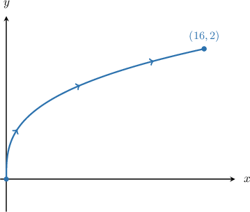
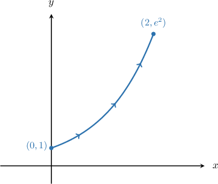
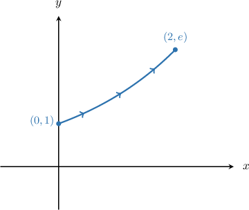
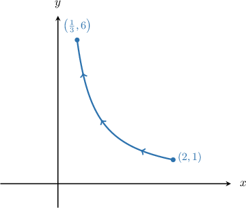

# Review — originals and generated variants

Historical profiles are evidence only. Normal authored banks use method operations. Correct choices are marked for author review.

# Original q-122139

## Original source — Unrated
Consider the line integral

$\displaystyle \int_(C)32xyds =-\frac{1}{4}\displaystyle \int_{-8}^{4}AAAAAdt$
where $C$ is the arc of the parabola $y^{2} =-16x$ traversed from the point $(-4,-8)$ to the point $(-1, 4)$. Which of the following is the missing expression under the integral on the right?

*Hint: Use the parameter $y = t$.*

- **A.** $t^{3}\sqrt{t^{2} + 16}$
- **B.** $t^{3}\sqrt{t^{2} + 1}$
- **C.** $t^{3}\sqrt{t^{2} + 64}$
- **D.** $t^{2}\sqrt{t^{2} + 64}$
- **E.** $t^{2}\sqrt{t^{2} + 16}$
**Original correct designation: absent.**

**Worked solution**

*(No source worked solution.)*

# Generated historical bank — parabola_missing — {'density_scale': 2}

## Generated — historical evidence — Moderate
Consider the line integral

$\displaystyle \int_{C}2\left(32xy\right)ds =-\frac{1}{4}\displaystyle \int_{-8}^{4}\boxed{\phantom{t}}dt$
where $C$ is the arc of the parabola $y^{2} =-16x$ traversed from the point $(-4,-8)$ to the point $(-1, 4)$. Which of the following is the missing expression under the integral on the right?

*Hint: Use the parameter $y = t$.*

- **A (correct).** $2\left(t^{3}\sqrt{t^{2} + 64}\right)$
- **B.** $2\left(t^{3}\sqrt{t^{2} + 1}\right)$
- **C.** $2\left(t^{3}\sqrt{t^{2} + 16}\right)$
- **D.** $2\left(t^{2}\sqrt{t^{2} + 16}\right)$
- **E.** $2\left(t^{2}\sqrt{t^{2} + 64}\right)$

**Worked solution**

*(No source worked solution.)*

# Generated historical bank — parabola_missing — {'density_scale': 4}

## Generated — historical evidence — Moderate
Consider the line integral

$\displaystyle \int_{C}4\left(32xy\right)ds =-\frac{1}{4}\displaystyle \int_{-8}^{4}\boxed{\phantom{t}}dt$
where $C$ is the arc of the parabola $y^{2} =-16x$ traversed from the point $(-4,-8)$ to the point $(-1, 4)$. Which of the following is the missing expression under the integral on the right?

*Hint: Use the parameter $y = t$.*

- **A (correct).** $4\left(t^{3}\sqrt{t^{2} + 64}\right)$
- **B.** $4\left(t^{3}\sqrt{t^{2} + 1}\right)$
- **C.** $4\left(t^{3}\sqrt{t^{2} + 16}\right)$
- **D.** $4\left(t^{2}\sqrt{t^{2} + 16}\right)$
- **E.** $4\left(t^{2}\sqrt{t^{2} + 64}\right)$

**Worked solution**

*(No source worked solution.)*

# Original q-122446

## Original source — Unrated

Which of the following is equivalent to the integral $\displaystyle \int_(C)xy^{2}ds$, where $C$ is the section of the curve $x = 2y^{3}$ traversed between the points $(0, 0)$ and $(16, 2)$, as shown above?

*Hint: Use the parameter $y = t$.*

- **A.** $2\displaystyle \int_{0}^{2}\sqrt{36t^{4} + 1}dt$
- **B.** $2\displaystyle \int_{0}^{2}t^{5}\sqrt{36t^{4} + 1}dt$
- **C.** $2\displaystyle \int_{0}^{16}\sqrt{36t^{4} + 1}dt$
- **D.** $\displaystyle \int_{0}^{2}t^{5}\sqrt{t^{4} + 1}dt$
- **E.** $2\displaystyle \int_{0}^{16}t^{5}\sqrt{36t^{4} + 1}dt$
**Original correct designation: absent.**

**Worked solution**

*(No source worked solution.)*

# Generated historical bank — cubic_integral — {'density_scale': 2}

## Generated — historical evidence — Moderate

Which of the following is equivalent to the integral $\displaystyle \int_{C}2\left(xy^{2}\right)ds$, where $C$ is the section of the curve $x = 2y^{3}$ traversed between the points $(0, 0)$ and $(16, 2)$, as shown above?

*Hint: Use the parameter $y = t$.*

- **A.** $2\left(2\displaystyle \int_{0}^{16}\sqrt{36t^{4} + 1}dt\right)$
- **B (correct).** $2\left(2\displaystyle \int_{0}^{2}t^{5}\sqrt{36t^{4} + 1}dt\right)$
- **C.** $2\left(2\displaystyle \int_{0}^{2}\sqrt{36t^{4} + 1}dt\right)$
- **D.** $2\left(2\displaystyle \int_{0}^{16}t^{5}\sqrt{36t^{4} + 1}dt\right)$
- **E.** $2\left(\displaystyle \int_{0}^{2}t^{5}\sqrt{t^{4} + 1}dt\right)$

**Worked solution**

*(No source worked solution.)*

# Generated historical bank — cubic_integral — {'density_scale': 4}

## Generated — historical evidence — Moderate

Which of the following is equivalent to the integral $\displaystyle \int_{C}4\left(xy^{2}\right)ds$, where $C$ is the section of the curve $x = 2y^{3}$ traversed between the points $(0, 0)$ and $(16, 2)$, as shown above?

*Hint: Use the parameter $y = t$.*

- **A.** $4\left(2\displaystyle \int_{0}^{16}\sqrt{36t^{4} + 1}dt\right)$
- **B (correct).** $4\left(2\displaystyle \int_{0}^{2}t^{5}\sqrt{36t^{4} + 1}dt\right)$
- **C.** $4\left(2\displaystyle \int_{0}^{2}\sqrt{36t^{4} + 1}dt\right)$
- **D.** $4\left(2\displaystyle \int_{0}^{16}t^{5}\sqrt{36t^{4} + 1}dt\right)$
- **E.** $4\left(\displaystyle \int_{0}^{2}t^{5}\sqrt{t^{4} + 1}dt\right)$

**Worked solution**

*(No source worked solution.)*

# Original q-122530

## Original source — Easy
Consider the line integral

$$
{\int }_{C}9{x}^{2}y\,\text{d}s=\frac{\sqrt{10}}{3}{\int }_{0}^{9}\boxed{}\,\text{d}t
$$

where $C$ is the segment of the line $3x=y$ traversed from the point $(0,0)$ to the point $(3,9).$ Which of the following is the missing expression under the integral on the right?

*Hint: Use the parameter $y=t.$*

- **A.** $1-{t}^{3}$
- **B (correct).** ${t}^{3}$
- **C.** ${t}^{3}+3$
- **D.** $3{t}^{2}-1$
- **E.** ${t}^{2}+1$

**Worked solution**

Notice that the given curve can be expressed in the form $x=x(y),$ as follows:

$$
3x=y\,⟹\,x=\frac{y}{3}
$$

Therefore, by setting $y=t,$ we have 

$$
x=x(t)=\frac{t}{3}.
$$

 

This gives the following parametrization of the curve:

$$
r(t)=⟨\frac{t}{3},\,t⟩,\,0\le t\le 9
$$

Note that the domain $0\le t\le 9$ is defined by the $y$-coordinates of the end-points on the path.

Computing ${r}^{′}(t)$ and $‖{r}^{′}(t)‖,$ we get the following: 

$$
\begin{aligned}{r}^{′}(t) & =\frac{\text{d}x}{\text{d}t}\,i+\frac{\text{d}y}{\text{d}t}\,j \\  & =\frac{\text{d}}{\text{d}t}(\frac{t}{3})i+\frac{\text{d}}{\text{d}t}(t)j \\  & =\frac{1}{3}\,i+j \\ ‖{r}^{′}(t)‖ & =\sqrt{{(\frac{\text{d}x}{\text{d}t})}^{2}+{(\frac{\text{d}y}{\text{d}t})}^{2}} \\  & =\sqrt{{(\frac{1}{3})}^{2}+{1}^{2}} \\  & =\sqrt{\frac{1}{9}+1} \\  & =\sqrt{\frac{10}{9}} \\  & =\frac{\sqrt{10}}{3}\end{aligned}
$$

 

Now, if  $f(x,y)=9{x}^{2}y,$ then we obtain 

$$
\begin{aligned}f(r(t)) & =9{(\frac{t}{3})}^{2}(t) \\  & =9(\frac{{t}^{2}}{9})(t) \\  & ={t}^{3}.\end{aligned}
$$

Therefore, we can write the integral as 

$$
\begin{aligned}{\int }_{C}9{x}^{2}y\,\text{d}s & ={\int }_{0}^{9}f(r(t))\,‖{r}^{′}(t)‖\,\text{d}t \\  & ={\int }_{0}^{9}{t}^{3}\cdot \frac{\sqrt{10}}{3}\,\text{d}t \\  & =\frac{\sqrt{10}}{3}{\int }_{0}^{9}{t}^{3}\,\text{d}t.\end{aligned}
$$

# Generated historical bank — line_monomial — {'density_scale': 2}

## Generated — historical evidence — Easy
Consider the line integral

$$
{\int }_{C}2\left(9{x}^{2}y\right)\,\text{d}s=\frac{\sqrt{10}}{3}{\int }_{0}^{9}\boxed{}\,\text{d}t
$$

where $C$ is the segment of the line $3x=y$ traversed from the point $(0,0)$ to the point $(3,9).$ Which of the following is the missing expression under the integral on the right?

*Hint: Use the parameter $y=t.$*

- **A.** $2\left({t}^{3}+3\right)$
- **B (correct).** $2\left({t}^{3}\right)$
- **C.** $2\left(1-{t}^{3}\right)$
- **D.** $2\left({t}^{2}+1\right)$
- **E.** $2\left(3{t}^{2}-1\right)$

**Worked solution**

Notice that the given curve can be expressed in the form $x=x(y),$ as follows:

$$
3x=y\,⟹\,x=\frac{y}{3}
$$

Therefore, by setting $y=t,$ we have 

$$
x=x(t)=\frac{t}{3}.
$$

 

This gives the following parametrization of the curve:

$$
r(t)=⟨\frac{t}{3},\,t⟩,\,0\le t\le 9
$$

Note that the domain $0\le t\le 9$ is defined by the $y$-coordinates of the end-points on the path.

Computing ${r}^{′}(t)$ and $‖{r}^{′}(t)‖,$ we get the following: 

$$
\begin{aligned}{r}^{′}(t) & =\frac{\text{d}x}{\text{d}t}\,i+\frac{\text{d}y}{\text{d}t}\,j \\  & =\frac{\text{d}}{\text{d}t}(\frac{t}{3})i+\frac{\text{d}}{\text{d}t}(t)j \\  & =\frac{1}{3}\,i+j \\ ‖{r}^{′}(t)‖ & =\sqrt{{(\frac{\text{d}x}{\text{d}t})}^{2}+{(\frac{\text{d}y}{\text{d}t})}^{2}} \\  & =\sqrt{{(\frac{1}{3})}^{2}+{1}^{2}} \\  & =\sqrt{\frac{1}{9}+1} \\  & =\sqrt{\frac{10}{9}} \\  & =\frac{\sqrt{10}}{3}\end{aligned}
$$

 

Now, if  $f(x,y)=2\left(9{x}^{2}y\right),$ then we obtain 

$$
\begin{aligned}f(r(t)) & = 2\left(9{(\frac{t}{3})}^{2}(t)\right) \\  & = 2\left(9(\frac{{t}^{2}}{9})(t)\right) \\  & = 2\left({t}^{3}\right).\end{aligned}
$$

Therefore, we can write the integral as 

$$
\begin{aligned}{\int }_{C}2\left(9{x}^{2}y\right)\,\text{d}s & ={\int }_{0}^{9}f(r(t))\,‖{r}^{′}(t)‖\,\text{d}t \\  & =2\cdot {\int }_{0}^{9}{t}^{3}\cdot \frac{\sqrt{10}}{3}\,\text{d}t \\  & =2\cdot \frac{\sqrt{10}}{3}{\int }_{0}^{9}{t}^{3}\,\text{d}t.\end{aligned}
$$

# Generated historical bank — line_monomial — {'density_scale': 4}

## Generated — historical evidence — Easy
Consider the line integral

$$
{\int }_{C}4\left(9{x}^{2}y\right)\,\text{d}s=\frac{\sqrt{10}}{3}{\int }_{0}^{9}\boxed{}\,\text{d}t
$$

where $C$ is the segment of the line $3x=y$ traversed from the point $(0,0)$ to the point $(3,9).$ Which of the following is the missing expression under the integral on the right?

*Hint: Use the parameter $y=t.$*

- **A.** $4\left({t}^{3}+3\right)$
- **B (correct).** $4\left({t}^{3}\right)$
- **C.** $4\left(1-{t}^{3}\right)$
- **D.** $4\left({t}^{2}+1\right)$
- **E.** $4\left(3{t}^{2}-1\right)$

**Worked solution**

Notice that the given curve can be expressed in the form $x=x(y),$ as follows:

$$
3x=y\,⟹\,x=\frac{y}{3}
$$

Therefore, by setting $y=t,$ we have 

$$
x=x(t)=\frac{t}{3}.
$$

 

This gives the following parametrization of the curve:

$$
r(t)=⟨\frac{t}{3},\,t⟩,\,0\le t\le 9
$$

Note that the domain $0\le t\le 9$ is defined by the $y$-coordinates of the end-points on the path.

Computing ${r}^{′}(t)$ and $‖{r}^{′}(t)‖,$ we get the following: 

$$
\begin{aligned}{r}^{′}(t) & =\frac{\text{d}x}{\text{d}t}\,i+\frac{\text{d}y}{\text{d}t}\,j \\  & =\frac{\text{d}}{\text{d}t}(\frac{t}{3})i+\frac{\text{d}}{\text{d}t}(t)j \\  & =\frac{1}{3}\,i+j \\ ‖{r}^{′}(t)‖ & =\sqrt{{(\frac{\text{d}x}{\text{d}t})}^{2}+{(\frac{\text{d}y}{\text{d}t})}^{2}} \\  & =\sqrt{{(\frac{1}{3})}^{2}+{1}^{2}} \\  & =\sqrt{\frac{1}{9}+1} \\  & =\sqrt{\frac{10}{9}} \\  & =\frac{\sqrt{10}}{3}\end{aligned}
$$

 

Now, if  $f(x,y)=4\left(9{x}^{2}y\right),$ then we obtain 

$$
\begin{aligned}f(r(t)) & = 4\left(9{(\frac{t}{3})}^{2}(t)\right) \\  & = 4\left(9(\frac{{t}^{2}}{9})(t)\right) \\  & = 4\left({t}^{3}\right).\end{aligned}
$$

Therefore, we can write the integral as 

$$
\begin{aligned}{\int }_{C}4\left(9{x}^{2}y\right)\,\text{d}s & ={\int }_{0}^{9}f(r(t))\,‖{r}^{′}(t)‖\,\text{d}t \\  & =4\cdot {\int }_{0}^{9}{t}^{3}\cdot \frac{\sqrt{10}}{3}\,\text{d}t \\  & =4\cdot \frac{\sqrt{10}}{3}{\int }_{0}^{9}{t}^{3}\,\text{d}t.\end{aligned}
$$

# Original q-122534

## Original source — Moderate

Which of the following is equivalent to the integral ${\int }_{C}{e}^{x}{y}^{2}\,\text{d}s,$ where $C$ is the section of the curve $x=\operatorname{ln}⁡y$ traversed between the points $(0,1)$ and $(2,{e}^{2}),$ as shown above?

*Hint: Use the parameter $y=t.$*

- **A (correct).** ${\int }_{1}^{{e}^{2}}{t}^{2}\sqrt{1+{t}^{2}}\,\text{d}t$
- **B.** ${\int }_{e}^{2e}{t}^{2}\sqrt{1+{t}^{2}}\,\text{d}t$
- **C.** ${\int }_{e}^{2e}t\sqrt{1+{t}^{4}}\,\text{d}t$
- **D.** ${\int }_{1}^{{e}^{2}}{t}^{3}\sqrt{1+{t}^{2}}\,\text{d}t$
- **E.** ${\int }_{1}^{{e}^{2}}t\sqrt{1+{t}^{4}}\,\text{d}t$

**Worked solution**

Notice that the given curve is of the form $x=x(y).$ Therefore, by setting $y=t,$ we have 

$$
x=x(t)=\operatorname{ln}⁡t.
$$

 

This gives the following parametrization of the curve:

$$
r(t)=⟨\operatorname{ln}⁡t,\,t⟩,\,1\le t\le {e}^{2}
$$

Note that the domain $1\le t\le {e}^{2}$ is defined by the $y$-coordinates of the end-points on the path.

Computing ${r}^{′}(t)$ and $‖{r}^{′}(t)‖,$ we get the following: 

$$
\begin{aligned}{r}^{′}(t) & =\frac{\text{d}x}{\text{d}t}\,i+\frac{\text{d}y}{\text{d}t}\,j \\  & =\frac{\text{d}}{\text{d}t}(\operatorname{ln}⁡t)i+\frac{\text{d}}{\text{d}t}(t)j \\  & =\frac{1}{t}\,i+j \\ ‖{r}^{′}(t)‖ & =\sqrt{{(\frac{\text{d}x}{\text{d}t})}^{2}+{(\frac{\text{d}y}{\text{d}t})}^{2}} \\  & =\sqrt{{(\frac{1}{t})}^{2}+{1}^{2}} \\  & =\sqrt{\frac{1}{{t}^{2}}+1} \\  & =\sqrt{\frac{1+{t}^{2}}{{t}^{2}}} \\  & =\frac{\sqrt{1+{t}^{2}}}{|t|} \\  & =\frac{\sqrt{1+{t}^{2}}}{t}\end{aligned}
$$

 

Now, if  $f(x,y)={e}^{x}{y}^{2},$ then we obtain 

$$
\begin{aligned}f(r(t)) & =({e}^{\operatorname{ln}⁡t}){t}^{2} \\  & =(t){t}^{2} \\  & ={t}^{3}.\end{aligned}
$$

Therefore, we can write the integral as 

$$
\begin{aligned}{\int }_{C}{e}^{x}{y}^{2}\,\text{d}s & ={\int }_{1}^{{e}^{2}}f(r(t))\,‖{r}^{′}(t)‖\,\text{d}t \\  & ={\int }_{1}^{{e}^{2}}{t}^{3}\cdot \frac{\sqrt{1+{t}^{2}}}{t}\,\text{d}t \\  & ={\int }_{1}^{{e}^{2}}{t}^{2}\sqrt{1+{t}^{2}}\,\text{d}t.\end{aligned}
$$

# Generated historical bank — log_integral — {'density_scale': 2}

## Generated — historical evidence — Moderate

Which of the following is equivalent to the integral ${\int }_{C}2\left({e}^{x}{y}^{2}\right)\,\text{d}s,$ where $C$ is the section of the curve $x=\operatorname{ln}⁡y$ traversed between the points $(0,1)$ and $(2,{e}^{2}),$ as shown above?

*Hint: Use the parameter $y=t.$*

- **A.** $2\left({\int }_{e}^{2e}t\sqrt{1+{t}^{4}}\,\text{d}t\right)$
- **B.** $2\left({\int }_{e}^{2e}{t}^{2}\sqrt{1+{t}^{2}}\,\text{d}t\right)$
- **C (correct).** $2\left({\int }_{1}^{{e}^{2}}{t}^{2}\sqrt{1+{t}^{2}}\,\text{d}t\right)$
- **D.** $2\left({\int }_{1}^{{e}^{2}}t\sqrt{1+{t}^{4}}\,\text{d}t\right)$
- **E.** $2\left({\int }_{1}^{{e}^{2}}{t}^{3}\sqrt{1+{t}^{2}}\,\text{d}t\right)$

**Worked solution**

Notice that the given curve is of the form $x=x(y).$ Therefore, by setting $y=t,$ we have 

$$
x=x(t)=\operatorname{ln}⁡t.
$$

 

This gives the following parametrization of the curve:

$$
r(t)=⟨\operatorname{ln}⁡t,\,t⟩,\,1\le t\le {e}^{2}
$$

Note that the domain $1\le t\le {e}^{2}$ is defined by the $y$-coordinates of the end-points on the path.

Computing ${r}^{′}(t)$ and $‖{r}^{′}(t)‖,$ we get the following: 

$$
\begin{aligned}{r}^{′}(t) & =\frac{\text{d}x}{\text{d}t}\,i+\frac{\text{d}y}{\text{d}t}\,j \\  & =\frac{\text{d}}{\text{d}t}(\operatorname{ln}⁡t)i+\frac{\text{d}}{\text{d}t}(t)j \\  & =\frac{1}{t}\,i+j \\ ‖{r}^{′}(t)‖ & =\sqrt{{(\frac{\text{d}x}{\text{d}t})}^{2}+{(\frac{\text{d}y}{\text{d}t})}^{2}} \\  & =\sqrt{{(\frac{1}{t})}^{2}+{1}^{2}} \\  & =\sqrt{\frac{1}{{t}^{2}}+1} \\  & =\sqrt{\frac{1+{t}^{2}}{{t}^{2}}} \\  & =\frac{\sqrt{1+{t}^{2}}}{|t|} \\  & =\frac{\sqrt{1+{t}^{2}}}{t}\end{aligned}
$$

 

Now, if  $f(x,y)=2\left({e}^{x}{y}^{2}\right),$ then we obtain 

$$
\begin{aligned}f(r(t)) & = 2\left(({e}^{\operatorname{ln}⁡t}){t}^{2}\right) \\  & = 2\left((t){t}^{2}\right) \\  & = 2\left({t}^{3}\right).\end{aligned}
$$

Therefore, we can write the integral as 

$$
\begin{aligned}{\int }_{C}2\left({e}^{x}{y}^{2}\right)\,\text{d}s & ={\int }_{1}^{{e}^{2}}f(r(t))\,‖{r}^{′}(t)‖\,\text{d}t \\  & =2\cdot {\int }_{1}^{{e}^{2}}{t}^{3}\cdot \frac{\sqrt{1+{t}^{2}}}{t}\,\text{d}t \\  & =2\cdot {\int }_{1}^{{e}^{2}}{t}^{2}\sqrt{1+{t}^{2}}\,\text{d}t.\end{aligned}
$$

# Generated historical bank — log_integral — {'density_scale': 4}

## Generated — historical evidence — Moderate

Which of the following is equivalent to the integral ${\int }_{C}4\left({e}^{x}{y}^{2}\right)\,\text{d}s,$ where $C$ is the section of the curve $x=\operatorname{ln}⁡y$ traversed between the points $(0,1)$ and $(2,{e}^{2}),$ as shown above?

*Hint: Use the parameter $y=t.$*

- **A.** $4\left({\int }_{e}^{2e}t\sqrt{1+{t}^{4}}\,\text{d}t\right)$
- **B.** $4\left({\int }_{e}^{2e}{t}^{2}\sqrt{1+{t}^{2}}\,\text{d}t\right)$
- **C (correct).** $4\left({\int }_{1}^{{e}^{2}}{t}^{2}\sqrt{1+{t}^{2}}\,\text{d}t\right)$
- **D.** $4\left({\int }_{1}^{{e}^{2}}t\sqrt{1+{t}^{4}}\,\text{d}t\right)$
- **E.** $4\left({\int }_{1}^{{e}^{2}}{t}^{3}\sqrt{1+{t}^{2}}\,\text{d}t\right)$

**Worked solution**

Notice that the given curve is of the form $x=x(y).$ Therefore, by setting $y=t,$ we have 

$$
x=x(t)=\operatorname{ln}⁡t.
$$

 

This gives the following parametrization of the curve:

$$
r(t)=⟨\operatorname{ln}⁡t,\,t⟩,\,1\le t\le {e}^{2}
$$

Note that the domain $1\le t\le {e}^{2}$ is defined by the $y$-coordinates of the end-points on the path.

Computing ${r}^{′}(t)$ and $‖{r}^{′}(t)‖,$ we get the following: 

$$
\begin{aligned}{r}^{′}(t) & =\frac{\text{d}x}{\text{d}t}\,i+\frac{\text{d}y}{\text{d}t}\,j \\  & =\frac{\text{d}}{\text{d}t}(\operatorname{ln}⁡t)i+\frac{\text{d}}{\text{d}t}(t)j \\  & =\frac{1}{t}\,i+j \\ ‖{r}^{′}(t)‖ & =\sqrt{{(\frac{\text{d}x}{\text{d}t})}^{2}+{(\frac{\text{d}y}{\text{d}t})}^{2}} \\  & =\sqrt{{(\frac{1}{t})}^{2}+{1}^{2}} \\  & =\sqrt{\frac{1}{{t}^{2}}+1} \\  & =\sqrt{\frac{1+{t}^{2}}{{t}^{2}}} \\  & =\frac{\sqrt{1+{t}^{2}}}{|t|} \\  & =\frac{\sqrt{1+{t}^{2}}}{t}\end{aligned}
$$

 

Now, if  $f(x,y)=4\left({e}^{x}{y}^{2}\right),$ then we obtain 

$$
\begin{aligned}f(r(t)) & = 4\left(({e}^{\operatorname{ln}⁡t}){t}^{2}\right) \\  & = 4\left((t){t}^{2}\right) \\  & = 4\left({t}^{3}\right).\end{aligned}
$$

Therefore, we can write the integral as 

$$
\begin{aligned}{\int }_{C}4\left({e}^{x}{y}^{2}\right)\,\text{d}s & ={\int }_{1}^{{e}^{2}}f(r(t))\,‖{r}^{′}(t)‖\,\text{d}t \\  & =4\cdot {\int }_{1}^{{e}^{2}}{t}^{3}\cdot \frac{\sqrt{1+{t}^{2}}}{t}\,\text{d}t \\  & =4\cdot {\int }_{1}^{{e}^{2}}{t}^{2}\sqrt{1+{t}^{2}}\,\text{d}t.\end{aligned}
$$

# Original q-149714

## Original source — Moderate

Which of the following is equivalent to the integral ${\int }_{C}4y{e}^{2x}\,\text{d}s,$ where $C$ is the section of the curve $\frac{x}{2}=\operatorname{ln}⁡y$ traversed between the points $(0,1)$ and $(2,e),$ as shown above?

*Hint: Use the parameter $y=t.$*

- **A.** $4{\int }_{1}^{e}{t}^{2}\sqrt{4{t}^{2}+1}\,\text{d}t$
- **B.** $2{\int }_{1}^{e}{t}^{2}\sqrt{{t}^{2}+4}\,\text{d}t$
- **C.** $2{\int }_{1}^{e}{t}^{4}\sqrt{4{t}^{2}+1}\,\text{d}t$
- **D.** ${\int }_{1}^{e}{t}^{3}\sqrt{{t}^{2}+4}\,\text{d}t$
- **E (correct).** $4{\int }_{1}^{e}{t}^{4}\sqrt{{t}^{2}+4}\,\text{d}t$

**Worked solution**

Notice that the given curve can be expressed in the form $x=x(y),$ as follows:

$$
\frac{x}{2}=\operatorname{ln}⁡y\,⟹\,x=2\operatorname{ln}⁡y
$$

Therefore, by setting $y=t,$ we have 

$$
x=x(t)=2\operatorname{ln}⁡t.
$$

 

This gives the following parametrization of the curve:

$$
r(t)=⟨2\operatorname{ln}⁡t,\,t⟩,\,1\le t\le e
$$

Note that the domain $1\le t\le e$ is defined by the $y$-coordinates of the end-points on the path.

Computing ${r}^{′}(t)$ and $‖{r}^{′}(t)‖,$ we get the following: 

$$
\begin{aligned}{r}^{′}(t) & =\frac{\text{d}x}{\text{d}t}\,i+\frac{\text{d}y}{\text{d}t}\,j \\  & =\frac{\text{d}}{\text{d}t}(2\operatorname{ln}⁡t)i+\frac{\text{d}}{\text{d}t}(t)j \\  & =\frac{2}{t}\,i+j \\ ‖{r}^{′}(t)‖ & =\sqrt{{(\frac{\text{d}x}{\text{d}t})}^{2}+{(\frac{\text{d}y}{\text{d}t})}^{2}} \\  & =\sqrt{{(\frac{2}{t})}^{2}+{1}^{2}} \\  & =\sqrt{\frac{4}{{t}^{2}}+1} \\  & =\frac{1}{t}\sqrt{{t}^{2}+4}\end{aligned}
$$

 

Now, if  $f(x,y)=4y{e}^{2x}$, then we obtain 

$$
\begin{aligned}f(r(t)) & =4y{e}^{2x} \\  & =4t{e}^{4\operatorname{ln}⁡t} \\  & =4t({t}^{4}) \\  & =4{t}^{5}.\end{aligned}
$$

Therefore, we can write the integral as 

$$
\begin{aligned}{\int }_{C}4y{e}^{2x}\,\text{d}s & ={\int }_{1}^{e}f(r(t))\,‖{r}^{′}(t)‖\,\text{d}t \\  & ={\int }_{1}^{e}(4{t}^{5})\cdot \frac{1}{t}\sqrt{{t}^{2}+4}\cdot \text{d}t \\  & =4{\int }_{1}^{e}{t}^{4}\sqrt{{t}^{2}+4}\,\text{d}t.\end{aligned}
$$

# Generated historical bank — scaled_log_integral — {'density_scale': 2}

## Generated — historical evidence — Moderate

Which of the following is equivalent to the integral ${\int }_{C}2\left(4y{e}^{2x}\right)\,\text{d}s,$ where $C$ is the section of the curve $\frac{x}{2}=\operatorname{ln}⁡y$ traversed between the points $(0,1)$ and $(2,e),$ as shown above?

*Hint: Use the parameter $y=t.$*

- **A.** $2\left(2{\int }_{1}^{e}{t}^{4}\sqrt{4{t}^{2}+1}\,\text{d}t\right)$
- **B.** $2\left(2{\int }_{1}^{e}{t}^{2}\sqrt{{t}^{2}+4}\,\text{d}t\right)$
- **C.** $2\left(4{\int }_{1}^{e}{t}^{2}\sqrt{4{t}^{2}+1}\,\text{d}t\right)$
- **D (correct).** $2\left(4{\int }_{1}^{e}{t}^{4}\sqrt{{t}^{2}+4}\,\text{d}t\right)$
- **E.** $2\left({\int }_{1}^{e}{t}^{3}\sqrt{{t}^{2}+4}\,\text{d}t\right)$

**Worked solution**

Notice that the given curve can be expressed in the form $x=x(y),$ as follows:

$$
\frac{x}{2}=\operatorname{ln}⁡y\,⟹\,x=2\operatorname{ln}⁡y
$$

Therefore, by setting $y=t,$ we have 

$$
x=x(t)=2\operatorname{ln}⁡t.
$$

 

This gives the following parametrization of the curve:

$$
r(t)=⟨2\operatorname{ln}⁡t,\,t⟩,\,1\le t\le e
$$

Note that the domain $1\le t\le e$ is defined by the $y$-coordinates of the end-points on the path.

Computing ${r}^{′}(t)$ and $‖{r}^{′}(t)‖,$ we get the following: 

$$
\begin{aligned}{r}^{′}(t) & =\frac{\text{d}x}{\text{d}t}\,i+\frac{\text{d}y}{\text{d}t}\,j \\  & =\frac{\text{d}}{\text{d}t}(2\operatorname{ln}⁡t)i+\frac{\text{d}}{\text{d}t}(t)j \\  & =\frac{2}{t}\,i+j \\ ‖{r}^{′}(t)‖ & =\sqrt{{(\frac{\text{d}x}{\text{d}t})}^{2}+{(\frac{\text{d}y}{\text{d}t})}^{2}} \\  & =\sqrt{{(\frac{2}{t})}^{2}+{1}^{2}} \\  & =\sqrt{\frac{4}{{t}^{2}}+1} \\  & =\frac{1}{t}\sqrt{{t}^{2}+4}\end{aligned}
$$

 

Now, if  $f(x,y)=2\left(4y{e}^{2x}\right)$, then we obtain 

$$
\begin{aligned}f(r(t)) & = 2\left(4y{e}^{2x}\right) \\  & = 2\left(4t{e}^{4\operatorname{ln}⁡t}\right) \\  & = 2\left(4t({t}^{4})\right) \\  & = 2\left(4{t}^{5}\right).\end{aligned}
$$

Therefore, we can write the integral as 

$$
\begin{aligned}{\int }_{C}2\left(4y{e}^{2x}\right)\,\text{d}s & ={\int }_{1}^{e}f(r(t))\,‖{r}^{′}(t)‖\,\text{d}t \\  & =2\cdot {\int }_{1}^{e}(4{t}^{5})\cdot \frac{1}{t}\sqrt{{t}^{2}+4}\cdot \text{d}t \\  & =2\cdot 4{\int }_{1}^{e}{t}^{4}\sqrt{{t}^{2}+4}\,\text{d}t.\end{aligned}
$$

# Generated historical bank — scaled_log_integral — {'density_scale': 4}

## Generated — historical evidence — Moderate

Which of the following is equivalent to the integral ${\int }_{C}4\left(4y{e}^{2x}\right)\,\text{d}s,$ where $C$ is the section of the curve $\frac{x}{2}=\operatorname{ln}⁡y$ traversed between the points $(0,1)$ and $(2,e),$ as shown above?

*Hint: Use the parameter $y=t.$*

- **A.** $4\left(2{\int }_{1}^{e}{t}^{4}\sqrt{4{t}^{2}+1}\,\text{d}t\right)$
- **B.** $4\left(2{\int }_{1}^{e}{t}^{2}\sqrt{{t}^{2}+4}\,\text{d}t\right)$
- **C.** $4\left(4{\int }_{1}^{e}{t}^{2}\sqrt{4{t}^{2}+1}\,\text{d}t\right)$
- **D (correct).** $4\left(4{\int }_{1}^{e}{t}^{4}\sqrt{{t}^{2}+4}\,\text{d}t\right)$
- **E.** $4\left({\int }_{1}^{e}{t}^{3}\sqrt{{t}^{2}+4}\,\text{d}t\right)$

**Worked solution**

Notice that the given curve can be expressed in the form $x=x(y),$ as follows:

$$
\frac{x}{2}=\operatorname{ln}⁡y\,⟹\,x=2\operatorname{ln}⁡y
$$

Therefore, by setting $y=t,$ we have 

$$
x=x(t)=2\operatorname{ln}⁡t.
$$

 

This gives the following parametrization of the curve:

$$
r(t)=⟨2\operatorname{ln}⁡t,\,t⟩,\,1\le t\le e
$$

Note that the domain $1\le t\le e$ is defined by the $y$-coordinates of the end-points on the path.

Computing ${r}^{′}(t)$ and $‖{r}^{′}(t)‖,$ we get the following: 

$$
\begin{aligned}{r}^{′}(t) & =\frac{\text{d}x}{\text{d}t}\,i+\frac{\text{d}y}{\text{d}t}\,j \\  & =\frac{\text{d}}{\text{d}t}(2\operatorname{ln}⁡t)i+\frac{\text{d}}{\text{d}t}(t)j \\  & =\frac{2}{t}\,i+j \\ ‖{r}^{′}(t)‖ & =\sqrt{{(\frac{\text{d}x}{\text{d}t})}^{2}+{(\frac{\text{d}y}{\text{d}t})}^{2}} \\  & =\sqrt{{(\frac{2}{t})}^{2}+{1}^{2}} \\  & =\sqrt{\frac{4}{{t}^{2}}+1} \\  & =\frac{1}{t}\sqrt{{t}^{2}+4}\end{aligned}
$$

 

Now, if  $f(x,y)=4\left(4y{e}^{2x}\right)$, then we obtain 

$$
\begin{aligned}f(r(t)) & = 4\left(4y{e}^{2x}\right) \\  & = 4\left(4t{e}^{4\operatorname{ln}⁡t}\right) \\  & = 4\left(4t({t}^{4})\right) \\  & = 4\left(4{t}^{5}\right).\end{aligned}
$$

Therefore, we can write the integral as 

$$
\begin{aligned}{\int }_{C}4\left(4y{e}^{2x}\right)\,\text{d}s & ={\int }_{1}^{e}f(r(t))\,‖{r}^{′}(t)‖\,\text{d}t \\  & =4\cdot {\int }_{1}^{e}(4{t}^{5})\cdot \frac{1}{t}\sqrt{{t}^{2}+4}\cdot \text{d}t \\  & =4\cdot 4{\int }_{1}^{e}{t}^{4}\sqrt{{t}^{2}+4}\,\text{d}t.\end{aligned}
$$

# Original q-122542

## Original source — Moderate

Which of the following is equivalent to the integral ${\int }_{C}4x{y}^{2}\,\text{d}s,$ where $C$ is the section of the curve $x=\frac{2}{y}$ traversed between the points $(2,1)$ and $(\frac{1}{3},6),$ as shown above?

*Hint: Use the parameter $y=t.$*

- **A.** ${\int }_{1/3}^{2}\frac{\sqrt{{t}^{4}+8}}{t}\,\text{d}t$
- **B.** $4{\int }_{1}^{6}\frac{\sqrt{{t}^{4}+1}}{t}\,\text{d}t$
- **C.** $8{\int }_{1/3}^{2}\frac{\sqrt{{t}^{4}+4}}{t}\,\text{d}t$
- **D (correct).** $8{\int }_{1}^{6}\frac{\sqrt{{t}^{4}+4}}{t}\,\text{d}t$
- **E.** ${\int }_{1}^{6}\frac{\sqrt{{t}^{4}+8}}{t}\,\text{d}t$

**Worked solution**

Notice that the given curve is of the form $x=x(y).$ Therefore, by setting $y=t,$ we have 

$$
x=x(t)=\frac{2}{t}.
$$

 

This gives the following parametrization of the curve:

$$
r(t)=⟨\frac{2}{t},\,t⟩,\,1\le t\le 6
$$

Note that the domain $1\le t\le 6$ is defined by the $y$-coordinates of the end-points on the path.

Computing ${r}^{′}(t)$ and $‖{r}^{′}(t)‖,$ we get the following: 

$$
\begin{aligned}{r}^{′}(t) & =\frac{\text{d}x}{\text{d}t}\,i+\frac{\text{d}y}{\text{d}t}\,j \\  & =\frac{\text{d}}{\text{d}t}(\frac{2}{t})i+\frac{\text{d}}{\text{d}t}(t)j \\  & =-\frac{2}{{t}^{2}}\,i+j \\ ‖{r}^{′}(t)‖ & =\sqrt{{(\frac{\text{d}x}{\text{d}t})}^{2}+{(\frac{\text{d}y}{\text{d}t})}^{2}} \\  & =\sqrt{{(-\frac{2}{{t}^{2}})}^{2}+{1}^{2}} \\  & =\sqrt{\frac{4}{{t}^{4}}+1} \\  & =\sqrt{\frac{4+{t}^{4}}{{t}^{4}}} \\  & =\frac{\sqrt{{t}^{4}+4}}{{t}^{2}}\end{aligned}
$$

 

Now, if  $f(x,y)=4x{y}^{2},$ then we obtain 

$$
\begin{aligned}f(r(t)) & =4(\frac{2}{t})(t)^{2} \\  & =8t.\end{aligned}
$$

Therefore, we can write the integral as 

$$
\begin{aligned}{\int }_{C}4x{y}^{2}\,\text{d}s & ={\int }_{1}^{6}f(r(t))\,‖{r}^{′}(t)‖\,\text{d}t \\  & ={\int }_{1}^{6}8t\cdot \frac{\sqrt{{t}^{4}+4}}{{t}^{2}}\,\text{d}t \\  & =8{\int }_{1}^{6}\frac{\sqrt{{t}^{4}+4}}{t}\,\text{d}t.\end{aligned}
$$

# Generated historical bank — reciprocal_integral — {'density_scale': 2}

## Generated — historical evidence — Moderate

Which of the following is equivalent to the integral ${\int }_{C}2\left(4x{y}^{2}\right)\,\text{d}s,$ where $C$ is the section of the curve $x=\frac{2}{y}$ traversed between the points $(2,1)$ and $(\frac{1}{3},6),$ as shown above?

*Hint: Use the parameter $y=t.$*

- **A.** $2\left(8{\int }_{1/3}^{2}\frac{\sqrt{{t}^{4}+4}}{t}\,\text{d}t\right)$
- **B.** $2\left(4{\int }_{1}^{6}\frac{\sqrt{{t}^{4}+1}}{t}\,\text{d}t\right)$
- **C.** $2\left({\int }_{1/3}^{2}\frac{\sqrt{{t}^{4}+8}}{t}\,\text{d}t\right)$
- **D.** $2\left({\int }_{1}^{6}\frac{\sqrt{{t}^{4}+8}}{t}\,\text{d}t\right)$
- **E (correct).** $2\left(8{\int }_{1}^{6}\frac{\sqrt{{t}^{4}+4}}{t}\,\text{d}t\right)$

**Worked solution**

Notice that the given curve is of the form $x=x(y).$ Therefore, by setting $y=t,$ we have 

$$
x=x(t)=\frac{2}{t}.
$$

 

This gives the following parametrization of the curve:

$$
r(t)=⟨\frac{2}{t},\,t⟩,\,1\le t\le 6
$$

Note that the domain $1\le t\le 6$ is defined by the $y$-coordinates of the end-points on the path.

Computing ${r}^{′}(t)$ and $‖{r}^{′}(t)‖,$ we get the following: 

$$
\begin{aligned}{r}^{′}(t) & =\frac{\text{d}x}{\text{d}t}\,i+\frac{\text{d}y}{\text{d}t}\,j \\  & =\frac{\text{d}}{\text{d}t}(\frac{2}{t})i+\frac{\text{d}}{\text{d}t}(t)j \\  & =-\frac{2}{{t}^{2}}\,i+j \\ ‖{r}^{′}(t)‖ & =\sqrt{{(\frac{\text{d}x}{\text{d}t})}^{2}+{(\frac{\text{d}y}{\text{d}t})}^{2}} \\  & =\sqrt{{(-\frac{2}{{t}^{2}})}^{2}+{1}^{2}} \\  & =\sqrt{\frac{4}{{t}^{4}}+1} \\  & =\sqrt{\frac{4+{t}^{4}}{{t}^{4}}} \\  & =\frac{\sqrt{{t}^{4}+4}}{{t}^{2}}\end{aligned}
$$

 

Now, if  $f(x,y)=2\left(4x{y}^{2}\right),$ then we obtain 

$$
\begin{aligned}f(r(t)) & = 2\left(4(\frac{2}{t})(t)^{2}\right) \\  & = 2\left(8t\right).\end{aligned}
$$

Therefore, we can write the integral as 

$$
\begin{aligned}{\int }_{C}2\left(4x{y}^{2}\right)\,\text{d}s & ={\int }_{1}^{6}f(r(t))\,‖{r}^{′}(t)‖\,\text{d}t \\  & =2\cdot {\int }_{1}^{6}8t\cdot \frac{\sqrt{{t}^{4}+4}}{{t}^{2}}\,\text{d}t \\  & =2\cdot 8{\int }_{1}^{6}\frac{\sqrt{{t}^{4}+4}}{t}\,\text{d}t.\end{aligned}
$$

# Generated historical bank — reciprocal_integral — {'density_scale': 4}

## Generated — historical evidence — Moderate

Which of the following is equivalent to the integral ${\int }_{C}4\left(4x{y}^{2}\right)\,\text{d}s,$ where $C$ is the section of the curve $x=\frac{2}{y}$ traversed between the points $(2,1)$ and $(\frac{1}{3},6),$ as shown above?

*Hint: Use the parameter $y=t.$*

- **A.** $4\left(8{\int }_{1/3}^{2}\frac{\sqrt{{t}^{4}+4}}{t}\,\text{d}t\right)$
- **B.** $4\left(4{\int }_{1}^{6}\frac{\sqrt{{t}^{4}+1}}{t}\,\text{d}t\right)$
- **C.** $4\left({\int }_{1/3}^{2}\frac{\sqrt{{t}^{4}+8}}{t}\,\text{d}t\right)$
- **D.** $4\left({\int }_{1}^{6}\frac{\sqrt{{t}^{4}+8}}{t}\,\text{d}t\right)$
- **E (correct).** $4\left(8{\int }_{1}^{6}\frac{\sqrt{{t}^{4}+4}}{t}\,\text{d}t\right)$

**Worked solution**

Notice that the given curve is of the form $x=x(y).$ Therefore, by setting $y=t,$ we have 

$$
x=x(t)=\frac{2}{t}.
$$

 

This gives the following parametrization of the curve:

$$
r(t)=⟨\frac{2}{t},\,t⟩,\,1\le t\le 6
$$

Note that the domain $1\le t\le 6$ is defined by the $y$-coordinates of the end-points on the path.

Computing ${r}^{′}(t)$ and $‖{r}^{′}(t)‖,$ we get the following: 

$$
\begin{aligned}{r}^{′}(t) & =\frac{\text{d}x}{\text{d}t}\,i+\frac{\text{d}y}{\text{d}t}\,j \\  & =\frac{\text{d}}{\text{d}t}(\frac{2}{t})i+\frac{\text{d}}{\text{d}t}(t)j \\  & =-\frac{2}{{t}^{2}}\,i+j \\ ‖{r}^{′}(t)‖ & =\sqrt{{(\frac{\text{d}x}{\text{d}t})}^{2}+{(\frac{\text{d}y}{\text{d}t})}^{2}} \\  & =\sqrt{{(-\frac{2}{{t}^{2}})}^{2}+{1}^{2}} \\  & =\sqrt{\frac{4}{{t}^{4}}+1} \\  & =\sqrt{\frac{4+{t}^{4}}{{t}^{4}}} \\  & =\frac{\sqrt{{t}^{4}+4}}{{t}^{2}}\end{aligned}
$$

 

Now, if  $f(x,y)=4\left(4x{y}^{2}\right),$ then we obtain 

$$
\begin{aligned}f(r(t)) & = 4\left(4(\frac{2}{t})(t)^{2}\right) \\  & = 4\left(8t\right).\end{aligned}
$$

Therefore, we can write the integral as 

$$
\begin{aligned}{\int }_{C}4\left(4x{y}^{2}\right)\,\text{d}s & ={\int }_{1}^{6}f(r(t))\,‖{r}^{′}(t)‖\,\text{d}t \\  & =4\cdot {\int }_{1}^{6}8t\cdot \frac{\sqrt{{t}^{4}+4}}{{t}^{2}}\,\text{d}t \\  & =4\cdot 8{\int }_{1}^{6}\frac{\sqrt{{t}^{4}+4}}{t}\,\text{d}t.\end{aligned}
$$

# Original q-122527

## Original source — Easy
Consider the line integral

$$
{\int }_{C}(2x-3y)\,\text{d}s=\sqrt{10}{\int }_{0}^{2}\boxed{}\,\text{d}t
$$

where $C$ is the segment of the line $\frac{x}{2}=1-\frac{3y}{2}$ traversed from the point $(2,0)$ to the point $(-4,2).$ Which of the following is the missing expression under the integral on the right?

*Hint: Use the parameter $y=t.$*

- **A (correct).** $4-9t$
- **B.** $2t+5$
- **C.** $2-5t$
- **D.** $4t-1$
- **E.** $1-3t$

**Worked solution**

Notice that the given curve can be expressed in the form $x=x(y),$ as follows:

$$
\frac{x}{2}=1-\frac{3y}{2}\,⟹\,x=2-3y
$$

Therefore, by setting $y=t,$ we have 

$$
x=x(t)=2-3t.
$$

 

This gives the following parametrization of the curve:

$$
r(t)=⟨2-3t,\,t⟩,\,0\le t\le 2
$$

Note that the domain $0\le t\le 2$ is defined by the $y$-coordinates of the end-points on the path.

Computing ${r}^{′}(t)$ and $‖{r}^{′}(t)‖,$ we get the following: 

$$
\begin{aligned}{r}^{′}(t) & =\frac{\text{d}x}{\text{d}t}\,i+\frac{\text{d}y}{\text{d}t}\,j \\  & =\frac{\text{d}}{\text{d}t}(2-3t)i+\frac{\text{d}}{\text{d}t}(t)j \\  & =-3\,i+j \\ ‖{r}^{′}(t)‖ & =\sqrt{{(\frac{\text{d}x}{\text{d}t})}^{2}+{(\frac{\text{d}y}{\text{d}t})}^{2}} \\  & =\sqrt{{(-3)}^{2}+{1}^{2}} \\  & =\sqrt{9+1} \\  & =\sqrt{10}\end{aligned}
$$

 

Now, if  $f(x,y)=2x-3y,$ then we obtain 

$$
\begin{aligned}f(r(t)) & =2(2-3t)-3t \\  & =4-9t.\end{aligned}
$$

Therefore, we can write the integral as 

$$
\begin{aligned}{\int }_{C}(2x-3y)\,\text{d}s & ={\int }_{0}^{2}f(r(t))\,‖{r}^{′}(t)‖\,\text{d}t \\  & ={\int }_{0}^{2}(4-9t)\cdot \sqrt{10}\,\text{d}t \\  & =\sqrt{10}{\int }_{0}^{2}(4-9t)\,\text{d}t.\end{aligned}
$$

# Generated historical bank — line_affine — {'density_scale': 2}

## Generated — historical evidence — Easy
Consider the line integral

$$
{\int }_{C}(2\left(2x-3y\right))\,\text{d}s=\sqrt{10}{\int }_{0}^{2}\boxed{}\,\text{d}t
$$

where $C$ is the segment of the line $\frac{x}{2}=1-\frac{3y}{2}$ traversed from the point $(2,0)$ to the point $(-4,2).$ Which of the following is the missing expression under the integral on the right?

*Hint: Use the parameter $y=t.$*

- **A.** $2\left(2-5t\right)$
- **B.** $2\left(2t+5\right)$
- **C (correct).** $2\left(4-9t\right)$
- **D.** $2\left(1-3t\right)$
- **E.** $2\left(4t-1\right)$

**Worked solution**

Notice that the given curve can be expressed in the form $x=x(y),$ as follows:

$$
\frac{x}{2}=1-\frac{3y}{2}\,⟹\,x=2-3y
$$

Therefore, by setting $y=t,$ we have 

$$
x=x(t)=2-3t.
$$

 

This gives the following parametrization of the curve:

$$
r(t)=⟨2-3t,\,t⟩,\,0\le t\le 2
$$

Note that the domain $0\le t\le 2$ is defined by the $y$-coordinates of the end-points on the path.

Computing ${r}^{′}(t)$ and $‖{r}^{′}(t)‖,$ we get the following: 

$$
\begin{aligned}{r}^{′}(t) & =\frac{\text{d}x}{\text{d}t}\,i+\frac{\text{d}y}{\text{d}t}\,j \\  & =\frac{\text{d}}{\text{d}t}(2-3t)i+\frac{\text{d}}{\text{d}t}(t)j \\  & =-3\,i+j \\ ‖{r}^{′}(t)‖ & =\sqrt{{(\frac{\text{d}x}{\text{d}t})}^{2}+{(\frac{\text{d}y}{\text{d}t})}^{2}} \\  & =\sqrt{{(-3)}^{2}+{1}^{2}} \\  & =\sqrt{9+1} \\  & =\sqrt{10}\end{aligned}
$$

 

Now, if  $f(x,y)=2\left(2x-3y\right),$ then we obtain 

$$
\begin{aligned}f(r(t)) & = 2\left(2(2-3t)-3t\right) \\  & = 2\left(4-9t\right).\end{aligned}
$$

Therefore, we can write the integral as 

$$
\begin{aligned}{\int }_{C}(2\left(2x-3y\right))\,\text{d}s & ={\int }_{0}^{2}f(r(t))\,‖{r}^{′}(t)‖\,\text{d}t \\  & =2\cdot {\int }_{0}^{2}(4-9t)\cdot \sqrt{10}\,\text{d}t \\  & =2\cdot \sqrt{10}{\int }_{0}^{2}(4-9t)\,\text{d}t.\end{aligned}
$$

# Generated historical bank — line_affine — {'density_scale': 4}

## Generated — historical evidence — Easy
Consider the line integral

$$
{\int }_{C}(4\left(2x-3y\right))\,\text{d}s=\sqrt{10}{\int }_{0}^{2}\boxed{}\,\text{d}t
$$

where $C$ is the segment of the line $\frac{x}{2}=1-\frac{3y}{2}$ traversed from the point $(2,0)$ to the point $(-4,2).$ Which of the following is the missing expression under the integral on the right?

*Hint: Use the parameter $y=t.$*

- **A.** $4\left(2-5t\right)$
- **B.** $4\left(2t+5\right)$
- **C (correct).** $4\left(4-9t\right)$
- **D.** $4\left(1-3t\right)$
- **E.** $4\left(4t-1\right)$

**Worked solution**

Notice that the given curve can be expressed in the form $x=x(y),$ as follows:

$$
\frac{x}{2}=1-\frac{3y}{2}\,⟹\,x=2-3y
$$

Therefore, by setting $y=t,$ we have 

$$
x=x(t)=2-3t.
$$

 

This gives the following parametrization of the curve:

$$
r(t)=⟨2-3t,\,t⟩,\,0\le t\le 2
$$

Note that the domain $0\le t\le 2$ is defined by the $y$-coordinates of the end-points on the path.

Computing ${r}^{′}(t)$ and $‖{r}^{′}(t)‖,$ we get the following: 

$$
\begin{aligned}{r}^{′}(t) & =\frac{\text{d}x}{\text{d}t}\,i+\frac{\text{d}y}{\text{d}t}\,j \\  & =\frac{\text{d}}{\text{d}t}(2-3t)i+\frac{\text{d}}{\text{d}t}(t)j \\  & =-3\,i+j \\ ‖{r}^{′}(t)‖ & =\sqrt{{(\frac{\text{d}x}{\text{d}t})}^{2}+{(\frac{\text{d}y}{\text{d}t})}^{2}} \\  & =\sqrt{{(-3)}^{2}+{1}^{2}} \\  & =\sqrt{9+1} \\  & =\sqrt{10}\end{aligned}
$$

 

Now, if  $f(x,y)=4\left(2x-3y\right),$ then we obtain 

$$
\begin{aligned}f(r(t)) & = 4\left(2(2-3t)-3t\right) \\  & = 4\left(4-9t\right).\end{aligned}
$$

Therefore, we can write the integral as 

$$
\begin{aligned}{\int }_{C}(4\left(2x-3y\right))\,\text{d}s & ={\int }_{0}^{2}f(r(t))\,‖{r}^{′}(t)‖\,\text{d}t \\  & =4\cdot {\int }_{0}^{2}(4-9t)\cdot \sqrt{10}\,\text{d}t \\  & =4\cdot \sqrt{10}{\int }_{0}^{2}(4-9t)\,\text{d}t.\end{aligned}
$$

# Generated normal bank — authored_line_monomial — {'m': 5, 'k': 1, 'v': 2, 'lo': 1, 'hi': 8}

## Generated — authored normal — Easy
Consider the line integral

$$
\int_C 25 x^{2} y^{2}\,\mathrm{d}s=\frac{\sqrt{26}}{5}\int_{1}^{8}\boxed{}\,\mathrm{d}t
$$

where $C$ is the segment of the line $5x=y$ traversed between the points $(\frac{1}{5},1)$ and $(\frac{8}{5},8)$. Which of the following is the missing expression under the integral on the right?

*Hint: Use the parameter $y=t.$*

- **A.** $\frac{t^{4}}{25}$
- **B (correct).** $t^{4}$
- **C.** $5 t^{4}$
- **D.** $625 t^{4}$
- **E.** $t^{2}$

**Worked solution**

Notice that the given curve can be expressed in the form $x=x(y),$ as follows:

$$
5x=y\,\Longrightarrow\,x=\frac{y}{5}
$$

Therefore, by setting $y=t,$ we have 

$$
x=x(t)=\frac{t}{5}.
$$

 

This gives the following parametrization of the curve:

$$
r(t)=\langle\frac{t}{5},\,t\rangle,\quad 1\le t\le 8
$$

Note that the domain $1\le t\le 8$ is defined by the $y$-coordinates of the end-points on the path.

Computing ${r}^{′}(t)$ and $‖{r}^{′}(t)‖,$ we get the following: 

$$
\begin{aligned}r^{\prime}(t)&=\frac{\mathrm{d}x}{\mathrm{d}t}i+\frac{\mathrm{d}y}{\mathrm{d}t}j \\ &=\frac{\mathrm{d}}{\mathrm{d}t}(\frac{t}{5})i+\frac{\mathrm{d}}{\mathrm{d}t}(t)j \\ &=(\frac{1}{5})i+j \\ \|r^{\prime}(t)\|&=\sqrt{(\frac{\mathrm{d}x}{\mathrm{d}t})^2+(\frac{\mathrm{d}y}{\mathrm{d}t})^2} \\ &=\sqrt{(\frac{1}{5})^2+1^2} \\ &=\sqrt{\frac{1}{25}+1} \\ &=\sqrt{\frac{26}{25}} \\ &=\frac{\sqrt{26}}{5}\end{aligned}
$$

 

Now, if  $f(x,y)=25 x^{2} y^{2},$ then we obtain 

$$
\begin{aligned}f(r(t))&=25\left(\frac{t}{5}\right)^2t^{2} \\ &=25\left(\frac{t^2}{25}\right)t^{2} \\ &=t^{4}.\end{aligned}
$$

Therefore, we can write the integral as 

$$
\begin{aligned}\int_C 25 x^{2} y^{2}\,\mathrm{d}s&=\int_{1}^{8}f(r(t))\|r^{\prime}(t)\|\,\mathrm{d}t \\ &=\int_{1}^{8}(t^{4})\cdot \frac{\sqrt{26}}{5}\,\mathrm{d}t \\ &=\frac{\sqrt{26}}{5}\int_{1}^{8}t^{4}\,\mathrm{d}t.\end{aligned}
$$

# Generated normal bank — authored_line — {'a': 3, 'b': -1, 'k': 1, 'u': 2, 'v': 1, 'lo': 1, 'hi': 4, 'n': 1}

## Generated — authored normal — Easy
Consider the line integral

$$
\int_C x^{2} y\,\mathrm{d}s=\sqrt{10}\int_{1}^{4}\boxed{}\,\mathrm{d}t
$$

where $C$ is the segment of the line $x=3 y - 1$ traversed between the points $(2,1)$ and $(11,4)$. Which of the following is the missing expression under the integral on the right?

*Hint: Use the parameter $y=t.$*

- **A.** $t^{2} \left(3 t - 1\right)$
- **B.** $\left(3 t - 1\right)^{2}$
- **C.** $9 t^{3}$
- **D (correct).** $t \left(3 t - 1\right)^{2}$
- **E.** $t \left(- 3 t - 1\right)^{2}$

**Worked solution**

Notice that the given curve is of the form $x=x(y).$ Therefore, by setting $y=t,$ we have 

$$
x=x(t)=3 t - 1.
$$

This gives the following parametrization of the curve:

$$
r(t)=\langle 3 t - 1,\,t\rangle,\quad 1\le t\le 4
$$

Note that the domain $1\le t\le 4$ is defined by the $y$-coordinates of the end-points on the path.

Computing ${r}^{′}(t)$ and $‖{r}^{′}(t)‖,$ we get the following: 

$$
\begin{aligned}r^{\prime}(t)&=\frac{\mathrm{d}x}{\mathrm{d}t}i+\frac{\mathrm{d}y}{\mathrm{d}t}j \\ &=\frac{\mathrm{d}}{\mathrm{d}t}(3 t - 1)i+\frac{\mathrm{d}}{\mathrm{d}t}(t)j \\ &=(3)i+j \\ \|r^{\prime}(t)\|&=\sqrt{(\frac{\mathrm{d}x}{\mathrm{d}t})^2+(\frac{\mathrm{d}y}{\mathrm{d}t})^2} \\ &=\sqrt{(3)^2+1^2} \\ &=\sqrt{10}\end{aligned}
$$

Now, if $f(x,y)=x^{2} y,$ then we obtain

$$
\begin{aligned}f(r(t))&=1\left(3 t - 1\right)^{2}t^{1} \\ &=t \left(3 t - 1\right)^{2}\end{aligned}
$$

Therefore, we can write the integral as

$$
\begin{aligned}\int_C x^{2} y\,\mathrm{d}s&=\int_{1}^{4}f(r(t))\|r^{\prime}(t)\|\,\mathrm{d}t \\ &=\int_{1}^{4}(t \left(3 t - 1\right)^{2})\cdot \sqrt{10}\,\mathrm{d}t \\ &=\sqrt{10}\int_{1}^{4}t \left(3 t - 1\right)^{2}\,\mathrm{d}t.\end{aligned}
$$

# Generated normal bank — authored_reciprocal — {'a': 3, 'k': 2, 'v': 3, 'lo': 2, 'hi': 6}

## Generated — authored normal — Moderate
Which of the following is equivalent to the integral $\int_C 2 x y^{3}\,\mathrm{d}s$

where $C$ is the section of the curve $x=\frac{3}{y}$ traversed between the points $(\frac{3}{2},2)$ and $(\frac{1}{2},6)$.

*Hint: Use the parameter $y=t.$*

- **A.** $\int_{\frac{1}{2}}^{\frac{3}{2}}6 \sqrt{t^{4} + 9}\,\mathrm{d}t$
- **B (correct).** $\int_{2}^{6}6 \sqrt{t^{4} + 9}\,\mathrm{d}t$
- **C.** $\int_{2}^{6}2 \sqrt{t^{4} + 9}\,\mathrm{d}t$
- **D.** $\int_{2}^{6}6 t^{2} \sqrt{t^{4} + 9}\,\mathrm{d}t$
- **E.** $\int_{2}^{6}3 \sqrt{t^{4} + 9}\,\mathrm{d}t$

**Worked solution**

Notice that the given curve is of the form $x=x(y).$ Therefore, by setting $y=t,$ we have 

$$
x=x(t)=\frac{3}{t}.
$$

 

This gives the following parametrization of the curve:

$$
r(t)=\langle \frac{3}{t},\,t\rangle,\quad 2\le t\le 6
$$

Note that the domain $2\le t\le 6$ is defined by the $y$-coordinates of the end-points on the path.

Computing ${r}^{′}(t)$ and $‖{r}^{′}(t)‖,$ we get the following: 

$$
\begin{aligned}r^{\prime}(t)&=\frac{\mathrm{d}x}{\mathrm{d}t}i+\frac{\mathrm{d}y}{\mathrm{d}t}j \\ &=\frac{\mathrm{d}}{\mathrm{d}t}(\frac{3}{t})i+\frac{\mathrm{d}}{\mathrm{d}t}(t)j \\ &=(- \frac{3}{t^{2}})i+j \\ \|r^{\prime}(t)\|&=\sqrt{(\frac{\mathrm{d}x}{\mathrm{d}t})^2+(\frac{\mathrm{d}y}{\mathrm{d}t})^2} \\ &=\sqrt{(- \frac{3}{t^{2}})^2+1^2} \\ &=\sqrt{\frac{9}{t^4}+1} \\ &=\sqrt{\frac{t^{4} + 9}{t^4}} \\ &=\frac{\sqrt{t^{4} + 9}}{t^2}\end{aligned}
$$

 

Now, if  $f(x,y)=2 x y^{3},$ then we obtain 

$$
\begin{aligned}f(r(t))&=2\left(\frac{3}{t}\right)t^{3} \\ &=6 t^{2}.\end{aligned}
$$

Therefore, we can write the integral as 

$$
\begin{aligned}\int_C 2 x y^{3}\,\mathrm{d}s&=\int_{2}^{6}f(r(t))\|r^{\prime}(t)\|\,\mathrm{d}t \\ &=\int_{2}^{6}(6 t^{2})\cdot \sqrt{1 + \frac{9}{t^{4}}}\,\mathrm{d}t \\ &=\int_{2}^{6}6 \sqrt{t^{4} + 9}\,\mathrm{d}t.\end{aligned}
$$

# Generated normal bank — authored_log — {'a': 1, 'k': 3, 'c': 1, 'v': 2, 'lo': 1, 'hi': 3}

## Generated — authored normal — Moderate
Which of the following is equivalent to the integral $\int_C 3 y^{2} e^{x}\,\mathrm{d}s$

where $C$ is the section of the curve $x=\ln{\left(y \right)}$ traversed between the points $(1,e)$ and $(3,e^{3})$.

*Hint: Use the parameter $y=t.$*

- **A.** $\int_{e}^{e^{3}}3 t^{3} \sqrt{t^{2} + 1}\,\mathrm{d}t$
- **B.** $\int_{1}^{3}3 t^{2} \sqrt{t^{2} + 1}\,\mathrm{d}t$
- **C (correct).** $\int_{e}^{e^{3}}3 t^{2} \sqrt{t^{2} + 1}\,\mathrm{d}t$
- **D.** $\int_{e}^{e^{3}}3 t \sqrt{t^{2} + 1}\,\mathrm{d}t$
- **E.** $\int_{e}^{e^{3}}3 \sqrt{2} t^{3}\,\mathrm{d}t$

**Worked solution**

Notice that the given curve is of the form $x=x(y).$ Therefore, by setting $y=t,$ we have 

$$
x=x(t)=\ln{\left(t \right)}.
$$

 

This gives the following parametrization of the curve:

$$
r(t)=\langle \ln{\left(t \right)},\,t\rangle,\quad e\le t\le e^{3}
$$

Note that the domain $e\le t\le e^{3}$ is defined by the $y$-coordinates of the end-points on the path.

Computing ${r}^{′}(t)$ and $‖{r}^{′}(t)‖,$ we get the following: 

$$
\begin{aligned}r^{\prime}(t)&=\frac{\mathrm{d}x}{\mathrm{d}t}i+\frac{\mathrm{d}y}{\mathrm{d}t}j \\ &=\frac{\mathrm{d}}{\mathrm{d}t}(\ln{\left(t \right)})i+\frac{\mathrm{d}}{\mathrm{d}t}(t)j \\ &=(\frac{1}{t})i+j \\ \|r^{\prime}(t)\|&=\sqrt{(\frac{\mathrm{d}x}{\mathrm{d}t})^2+(\frac{\mathrm{d}y}{\mathrm{d}t})^2} \\ &=\sqrt{(\frac{1}{t})^2+1^2} \\ &=\sqrt{\frac{1}{t^2}+1} \\ &=\sqrt{\frac{t^{2} + 1}{t^2}} \\ &=\frac{\sqrt{t^{2} + 1}}{|t|} \\ &=\frac{\sqrt{t^{2} + 1}}{t}\end{aligned}
$$

 

Now, if  $f(x,y)=3 y^{2} e^{x},$ then we obtain 

$$
\begin{aligned}f(r(t))&=3\left(e^{1\ln t}\right)t^{2} \\ &=3\left(t^{1}\right)t^{2} \\ &=3 t^{3}.\end{aligned}
$$

Therefore, we can write the integral as 

$$
\begin{aligned}\int_C 3 y^{2} e^{x}\,\mathrm{d}s&=\int_{e}^{e^{3}}f(r(t))\|r^{\prime}(t)\|\,\mathrm{d}t \\ &=\int_{e}^{e^{3}}(3 t^{3})\cdot \sqrt{1 + \frac{1}{t^{2}}}\,\mathrm{d}t \\ &=\int_{e}^{e^{3}}3 t^{2} \sqrt{t^{2} + 1}\,\mathrm{d}t.\end{aligned}
$$

# Generated normal bank — authored_shifted_power — {'a': 3, 'b': -4, 'k': 3, 'u': 2, 'v': 3, 'lo': 1, 'hi': 4, 'n': 3}

## Generated — authored normal — Hard
Which of the following is equivalent to the integral $\int_C 3 x^{2} y^{3}\,\mathrm{d}s$

where $C$ is the section of the curve $x=3 y^{3} - 4$ traversed between the points $(-1,1)$ and $(188,4)$.

*Hint: Use the parameter $y=t.$*

- **A.** $\int_{1}^{4}3 \left(3 t^{3} - 4\right)^{2} \sqrt{81 t^{4} + 1}\,\mathrm{d}t$
- **B (correct).** $\int_{1}^{4}3 t^{3} \left(3 t^{3} - 4\right)^{2} \sqrt{81 t^{4} + 1}\,\mathrm{d}t$
- **C.** $\int_{1}^{4}3 t^{3} \left(3 t^{3} - 4\right)^{2} \sqrt{9 t^{4} + 1}\,\mathrm{d}t$
- **D.** $\int_{1}^{4}t^{3} \left(9 t^{3} - 12\right) \sqrt{81 t^{4} + 1}\,\mathrm{d}t$
- **E.** $\int_{1}^{4}3 t^{3} \left(3 t^{3} - 4\right)^{2}\,\mathrm{d}t$

**Worked solution**

Notice that the given curve is of the form $x=x(y).$ Therefore, by setting $y=t,$ we have 

$$
x=x(t)=3 t^{3} - 4.
$$

This gives the following parametrization of the curve:

$$
r(t)=\langle 3 t^{3} - 4,\,t\rangle,\quad 1\le t\le 4
$$

Note that the domain $1\le t\le 4$ is defined by the $y$-coordinates of the end-points on the path.

Computing ${r}^{′}(t)$ and $‖{r}^{′}(t)‖,$ we get the following: 

$$
\begin{aligned}r^{\prime}(t)&=\frac{\mathrm{d}x}{\mathrm{d}t}i+\frac{\mathrm{d}y}{\mathrm{d}t}j \\ &=\frac{\mathrm{d}}{\mathrm{d}t}(3 t^{3} - 4)i+\frac{\mathrm{d}}{\mathrm{d}t}(t)j \\ &=(9 t^{2})i+j \\ \|r^{\prime}(t)\|&=\sqrt{(\frac{\mathrm{d}x}{\mathrm{d}t})^2+(\frac{\mathrm{d}y}{\mathrm{d}t})^2} \\ &=\sqrt{(9 t^{2})^2+1^2} \\ &=\sqrt{81 t^{4} + 1}\end{aligned}
$$

Now, if $f(x,y)=3 x^{2} y^{3},$ then we obtain

$$
\begin{aligned}f(r(t))&=3\left(3 t^{3} - 4\right)^{2}t^{3} \\ &=3 t^{3} \left(3 t^{3} - 4\right)^{2}\end{aligned}
$$

Therefore, we can write the integral as

$$
\begin{aligned}\int_C 3 x^{2} y^{3}\,\mathrm{d}s&=\int_{1}^{4}f(r(t))\|r^{\prime}(t)\|\,\mathrm{d}t \\ &=\int_{1}^{4}(3 t^{3} \left(3 t^{3} - 4\right)^{2})\cdot \sqrt{81 t^{4} + 1}\,\mathrm{d}t \\ &=\int_{1}^{4}3 t^{3} \left(3 t^{3} - 4\right)^{2} \sqrt{81 t^{4} + 1}\,\mathrm{d}t.\end{aligned}
$$

# Generated normal bank — authored_shifted_power — {'a': -3, 'b': 1, 'k': 1, 'u': 2, 'v': 2, 'lo': 1, 'hi': 4, 'n': 3}

## Generated — authored normal — Hard
Which of the following is equivalent to the integral $\int_C x^{2} y^{2}\,\mathrm{d}s$

where $C$ is the section of the curve $x=1 - 3 y^{3}$ traversed between the points $(-2,1)$ and $(-191,4)$.

*Hint: Use the parameter $y=t.$*

- **A.** $\int_{1}^{4}t^{2} \left(1 - 3 t^{3}\right) \sqrt{81 t^{4} + 1}\,\mathrm{d}t$
- **B.** $\int_{1}^{4}t^{2} \left(1 - 3 t^{3}\right)^{2}\,\mathrm{d}t$
- **C.** $\int_{1}^{4}t^{2} \left(1 - 3 t^{3}\right)^{2} \sqrt{9 t^{4} + 1}\,\mathrm{d}t$
- **D (correct).** $\int_{1}^{4}t^{2} \left(1 - 3 t^{3}\right)^{2} \sqrt{81 t^{4} + 1}\,\mathrm{d}t$
- **E.** $\int_{1}^{4}\left(1 - 3 t^{3}\right)^{2} \sqrt{81 t^{4} + 1}\,\mathrm{d}t$

**Worked solution**

Notice that the given curve is of the form $x=x(y).$ Therefore, by setting $y=t,$ we have 

$$
x=x(t)=1 - 3 t^{3}.
$$

This gives the following parametrization of the curve:

$$
r(t)=\langle 1 - 3 t^{3},\,t\rangle,\quad 1\le t\le 4
$$

Note that the domain $1\le t\le 4$ is defined by the $y$-coordinates of the end-points on the path.

Computing ${r}^{′}(t)$ and $‖{r}^{′}(t)‖,$ we get the following: 

$$
\begin{aligned}r^{\prime}(t)&=\frac{\mathrm{d}x}{\mathrm{d}t}i+\frac{\mathrm{d}y}{\mathrm{d}t}j \\ &=\frac{\mathrm{d}}{\mathrm{d}t}(1 - 3 t^{3})i+\frac{\mathrm{d}}{\mathrm{d}t}(t)j \\ &=(- 9 t^{2})i+j \\ \|r^{\prime}(t)\|&=\sqrt{(\frac{\mathrm{d}x}{\mathrm{d}t})^2+(\frac{\mathrm{d}y}{\mathrm{d}t})^2} \\ &=\sqrt{(- 9 t^{2})^2+1^2} \\ &=\sqrt{81 t^{4} + 1}\end{aligned}
$$

Now, if $f(x,y)=x^{2} y^{2},$ then we obtain

$$
\begin{aligned}f(r(t))&=1\left(1 - 3 t^{3}\right)^{2}t^{2} \\ &=t^{2} \left(1 - 3 t^{3}\right)^{2}\end{aligned}
$$

Therefore, we can write the integral as

$$
\begin{aligned}\int_C x^{2} y^{2}\,\mathrm{d}s&=\int_{1}^{4}f(r(t))\|r^{\prime}(t)\|\,\mathrm{d}t \\ &=\int_{1}^{4}(t^{2} \left(1 - 3 t^{3}\right)^{2})\cdot \sqrt{81 t^{4} + 1}\,\mathrm{d}t \\ &=\int_{1}^{4}t^{2} \left(1 - 3 t^{3}\right)^{2} \sqrt{81 t^{4} + 1}\,\mathrm{d}t.\end{aligned}
$$

# Generated normal bank — authored_line_monomial — {'m': 3, 'k': 1, 'v': 1, 'lo': 0, 'hi': 9}

## Generated — authored normal — Easy
Consider the line integral

$$
\int_C 9 x^{2} y\,\mathrm{d}s=\frac{\sqrt{10}}{3}\int_{0}^{9}\boxed{}\,\mathrm{d}t
$$

where $C$ is the segment of the line $3x=y$ traversed between the points $(0,0)$ and $(3,9)$. Which of the following is the missing expression under the integral on the right?

*Hint: Use the parameter $y=t.$*

- **A.** $t^{2}$
- **B.** $3 t^{3}$
- **C (correct).** $t^{3}$
- **D.** $\frac{t^{3}}{3}$
- **E.** $81 t^{3}$

**Worked solution**

Notice that the given curve can be expressed in the form $x=x(y),$ as follows:

$$
3x=y\,\Longrightarrow\,x=\frac{y}{3}
$$

Therefore, by setting $y=t,$ we have 

$$
x=x(t)=\frac{t}{3}.
$$

 

This gives the following parametrization of the curve:

$$
r(t)=\langle\frac{t}{3},\,t\rangle,\quad 0\le t\le 9
$$

Note that the domain $0\le t\le 9$ is defined by the $y$-coordinates of the end-points on the path.

Computing ${r}^{′}(t)$ and $‖{r}^{′}(t)‖,$ we get the following: 

$$
\begin{aligned}r^{\prime}(t)&=\frac{\mathrm{d}x}{\mathrm{d}t}i+\frac{\mathrm{d}y}{\mathrm{d}t}j \\ &=\frac{\mathrm{d}}{\mathrm{d}t}(\frac{t}{3})i+\frac{\mathrm{d}}{\mathrm{d}t}(t)j \\ &=(\frac{1}{3})i+j \\ \|r^{\prime}(t)\|&=\sqrt{(\frac{\mathrm{d}x}{\mathrm{d}t})^2+(\frac{\mathrm{d}y}{\mathrm{d}t})^2} \\ &=\sqrt{(\frac{1}{3})^2+1^2} \\ &=\sqrt{\frac{1}{9}+1} \\ &=\sqrt{\frac{10}{9}} \\ &=\frac{\sqrt{10}}{3}\end{aligned}
$$

 

Now, if  $f(x,y)=9 x^{2} y,$ then we obtain 

$$
\begin{aligned}f(r(t))&=9\left(\frac{t}{3}\right)^2t^{1} \\ &=9\left(\frac{t^2}{9}\right)t^{1} \\ &=t^{3}.\end{aligned}
$$

Therefore, we can write the integral as 

$$
\begin{aligned}\int_C 9 x^{2} y\,\mathrm{d}s&=\int_{0}^{9}f(r(t))\|r^{\prime}(t)\|\,\mathrm{d}t \\ &=\int_{0}^{9}(t^{3})\cdot \frac{\sqrt{10}}{3}\,\mathrm{d}t \\ &=\frac{\sqrt{10}}{3}\int_{0}^{9}t^{3}\,\mathrm{d}t.\end{aligned}
$$

# Generated normal bank — authored_affine — {'a': -3, 'b': 2, 'p': 2, 'q': -3, 'lo': 0, 'hi': 2}

## Generated — authored normal — Easy
Consider the line integral

$$
\int_C 2 x - 3 y\,\mathrm{d}s=\sqrt{10}\int_{0}^{2}\boxed{}\,\mathrm{d}t
$$

where $C$ is the segment of the line $\frac{x}{2}=1 - \frac{3 y}{2}$ traversed between the points $(2,0)$ and $(-4,2)$. Which of the following is the missing expression under the integral on the right?

*Hint: Use the parameter $y=t.$*

- **A.** $- 9 t$
- **B.** $4 - 6 t$
- **C (correct).** $4 - 9 t$
- **D.** $11 t - 6$
- **E.** $4 - 3 t$

**Worked solution**

Notice that the given curve can be expressed in the form $x=x(y),$ as follows:

$$
\frac{x}{2}=1 - \frac{3 y}{2}\,\Longrightarrow\,x=2 - 3 y
$$

Therefore, by setting $y=t,$ we have 

$$
x=x(t)=2 - 3 t.
$$

 

This gives the following parametrization of the curve:

$$
r(t)=\langle 2 - 3 t,\,t\rangle,\quad 0\le t\le 2
$$

Note that the domain $0\le t\le 2$ is defined by the $y$-coordinates of the end-points on the path.

Computing ${r}^{′}(t)$ and $‖{r}^{′}(t)‖,$ we get the following: 

$$
\begin{aligned}r^{\prime}(t)&=\frac{\mathrm{d}x}{\mathrm{d}t}i+\frac{\mathrm{d}y}{\mathrm{d}t}j \\ &=\frac{\mathrm{d}}{\mathrm{d}t}(2 - 3 t)i+\frac{\mathrm{d}}{\mathrm{d}t}(t)j \\ &=(-3)i+j \\ \|r^{\prime}(t)\|&=\sqrt{(\frac{\mathrm{d}x}{\mathrm{d}t})^2+(\frac{\mathrm{d}y}{\mathrm{d}t})^2} \\ &=\sqrt{(-3)^2+1^2} \\ &=\sqrt{9+1} \\ &=\sqrt{10}\end{aligned}
$$

 

Now, if  $f(x,y)=2 x - 3 y,$ then we obtain 

$$
\begin{aligned}f(r(t))&=2\left(2 - 3 t\right)-3t \\ &=4 - 9 t.\end{aligned}
$$

Therefore, we can write the integral as 

$$
\begin{aligned}\int_C 2 x - 3 y\,\mathrm{d}s&=\int_{0}^{2}f(r(t))\|r^{\prime}(t)\|\,\mathrm{d}t \\ &=\int_{0}^{2}(4 - 9 t)\cdot \sqrt{10}\,\mathrm{d}t \\ &=\sqrt{10}\int_{0}^{2}(4 - 9 t)\,\mathrm{d}t.\end{aligned}
$$

# Generated normal bank — authored_log — {'a': 1, 'k': 1, 'c': 1, 'v': 2, 'lo': 0, 'hi': 2}

## Generated — authored normal — Moderate
Which of the following is equivalent to the integral $\int_C y^{2} e^{x}\,\mathrm{d}s$

where $C$ is the section of the curve $x=\ln{\left(y \right)}$ traversed between the points $(0,1)$ and $(2,e^{2})$.

*Hint: Use the parameter $y=t.$*

- **A.** $\int_{1}^{e^{2}}t^{3} \sqrt{t^{2} + 1}\,\mathrm{d}t$
- **B.** $\int_{1}^{e^{2}}t \sqrt{t^{2} + 1}\,\mathrm{d}t$
- **C (correct).** $\int_{1}^{e^{2}}t^{2} \sqrt{t^{2} + 1}\,\mathrm{d}t$
- **D.** $\int_{0}^{2}t^{2} \sqrt{t^{2} + 1}\,\mathrm{d}t$
- **E.** $\int_{1}^{e^{2}}\sqrt{2} t^{3}\,\mathrm{d}t$

**Worked solution**

Notice that the given curve is of the form $x=x(y).$ Therefore, by setting $y=t,$ we have 

$$
x=x(t)=\ln{\left(t \right)}.
$$

 

This gives the following parametrization of the curve:

$$
r(t)=\langle \ln{\left(t \right)},\,t\rangle,\quad 1\le t\le e^{2}
$$

Note that the domain $1\le t\le e^{2}$ is defined by the $y$-coordinates of the end-points on the path.

Computing ${r}^{′}(t)$ and $‖{r}^{′}(t)‖,$ we get the following: 

$$
\begin{aligned}r^{\prime}(t)&=\frac{\mathrm{d}x}{\mathrm{d}t}i+\frac{\mathrm{d}y}{\mathrm{d}t}j \\ &=\frac{\mathrm{d}}{\mathrm{d}t}(\ln{\left(t \right)})i+\frac{\mathrm{d}}{\mathrm{d}t}(t)j \\ &=(\frac{1}{t})i+j \\ \|r^{\prime}(t)\|&=\sqrt{(\frac{\mathrm{d}x}{\mathrm{d}t})^2+(\frac{\mathrm{d}y}{\mathrm{d}t})^2} \\ &=\sqrt{(\frac{1}{t})^2+1^2} \\ &=\sqrt{\frac{1}{t^2}+1} \\ &=\sqrt{\frac{t^{2} + 1}{t^2}} \\ &=\frac{\sqrt{t^{2} + 1}}{|t|} \\ &=\frac{\sqrt{t^{2} + 1}}{t}\end{aligned}
$$

 

Now, if  $f(x,y)=y^{2} e^{x},$ then we obtain 

$$
\begin{aligned}f(r(t))&=1\left(e^{1\ln t}\right)t^{2} \\ &=1\left(t^{1}\right)t^{2} \\ &=t^{3}.\end{aligned}
$$

Therefore, we can write the integral as 

$$
\begin{aligned}\int_C y^{2} e^{x}\,\mathrm{d}s&=\int_{1}^{e^{2}}f(r(t))\|r^{\prime}(t)\|\,\mathrm{d}t \\ &=\int_{1}^{e^{2}}(t^{3})\cdot \sqrt{1 + \frac{1}{t^{2}}}\,\mathrm{d}t \\ &=\int_{1}^{e^{2}}t^{2} \sqrt{t^{2} + 1}\,\mathrm{d}t.\end{aligned}
$$

# Generated normal bank — authored_scaled_log — {'a': 2, 'k': 4, 'c': 2, 'v': 1, 'lo': 0, 'hi': 1}

## Generated — authored normal — Moderate
Which of the following is equivalent to the integral $\int_C 4 y e^{2 x}\,\mathrm{d}s$

where $C$ is the section of the curve $\frac{x}{2}=\ln y$ traversed between the points $(0,1)$ and $(2,e)$.

*Hint: Use the parameter $y=t.$*

- **A.** $\int_{1}^{e}4 t^{5} \sqrt{t^{2} + 4}\,\mathrm{d}t$
- **B.** $\int_{1}^{e}4 \sqrt{t^{2} + 4}\,\mathrm{d}t$
- **C (correct).** $\int_{1}^{e}4 t^{4} \sqrt{t^{2} + 4}\,\mathrm{d}t$
- **D.** $\int_{0}^{2}4 t^{4} \sqrt{t^{2} + 4}\,\mathrm{d}t$
- **E.** $\int_{1}^{e}4 \sqrt{5} t^{5}\,\mathrm{d}t$

**Worked solution**

Notice that the given curve can be expressed in the form $x=x(y),$ as follows:

$$
\frac{x}{2}=\ln y\,\Longrightarrow\,x=2 \ln{\left(y \right)}
$$

Therefore, by setting $y=t,$ we have 

$$
x=x(t)=2 \ln{\left(t \right)}.
$$

 

This gives the following parametrization of the curve:

$$
r(t)=\langle 2 \ln{\left(t \right)},\,t\rangle,\quad 1\le t\le e
$$

Note that the domain $1\le t\le e$ is defined by the $y$-coordinates of the end-points on the path.

Computing ${r}^{′}(t)$ and $‖{r}^{′}(t)‖,$ we get the following: 

$$
\begin{aligned}r^{\prime}(t)&=\frac{\mathrm{d}x}{\mathrm{d}t}i+\frac{\mathrm{d}y}{\mathrm{d}t}j \\ &=\frac{\mathrm{d}}{\mathrm{d}t}(2 \ln{\left(t \right)})i+\frac{\mathrm{d}}{\mathrm{d}t}(t)j \\ &=(\frac{2}{t})i+j \\ \|r^{\prime}(t)\|&=\sqrt{(\frac{\mathrm{d}x}{\mathrm{d}t})^2+(\frac{\mathrm{d}y}{\mathrm{d}t})^2} \\ &=\sqrt{(\frac{2}{t})^2+1^2} \\ &=\sqrt{\frac{4}{t^2}+1} \\ &=\frac{1}{t}\sqrt{t^{2} + 4}\end{aligned}
$$

 

Now, if  $f(x,y)=4 y e^{2 x}$, then we obtain 

$$
\begin{aligned}f(r(t))&=4 y e^{2 x} \\ &=4\cdot t^{1}e^{4\ln t} \\ &=4\cdot t^{1}\left(t^{4}\right) \\ &=4 t^{5}.\end{aligned}
$$

Therefore, we can write the integral as 

$$
\begin{aligned}\int_C 4 y e^{2 x}\,\mathrm{d}s&=\int_{1}^{e}f(r(t))\|r^{\prime}(t)\|\,\mathrm{d}t \\ &=\int_{1}^{e}(4 t^{5})\cdot \sqrt{1 + \frac{4}{t^{2}}}\,\mathrm{d}t \\ &=\int_{1}^{e}4 t^{4} \sqrt{t^{2} + 4}\,\mathrm{d}t.\end{aligned}
$$

# Generated normal bank — authored_reciprocal — {'a': 2, 'k': 4, 'v': 2, 'lo': 1, 'hi': 6}

## Generated — authored normal — Moderate
Which of the following is equivalent to the integral $\int_C 4 x y^{2}\,\mathrm{d}s$

where $C$ is the section of the curve $x=\frac{2}{y}$ traversed between the points $(2,1)$ and $(\frac{1}{3},6)$.

*Hint: Use the parameter $y=t.$*

- **A.** $\int_{1}^{6}\frac{2 \sqrt{t^{4} + 4}}{t}\,\mathrm{d}t$
- **B.** $\int_{1}^{6}\frac{4 \sqrt{t^{4} + 4}}{t}\,\mathrm{d}t$
- **C (correct).** $\int_{1}^{6}\frac{8 \sqrt{t^{4} + 4}}{t}\,\mathrm{d}t$
- **D.** $\int_{\frac{1}{3}}^{2}\frac{8 \sqrt{t^{4} + 4}}{t}\,\mathrm{d}t$
- **E.** $\int_{1}^{6}8 t \sqrt{t^{4} + 4}\,\mathrm{d}t$

**Worked solution**

Notice that the given curve is of the form $x=x(y).$ Therefore, by setting $y=t,$ we have 

$$
x=x(t)=\frac{2}{t}.
$$

 

This gives the following parametrization of the curve:

$$
r(t)=\langle \frac{2}{t},\,t\rangle,\quad 1\le t\le 6
$$

Note that the domain $1\le t\le 6$ is defined by the $y$-coordinates of the end-points on the path.

Computing ${r}^{′}(t)$ and $‖{r}^{′}(t)‖,$ we get the following: 

$$
\begin{aligned}r^{\prime}(t)&=\frac{\mathrm{d}x}{\mathrm{d}t}i+\frac{\mathrm{d}y}{\mathrm{d}t}j \\ &=\frac{\mathrm{d}}{\mathrm{d}t}(\frac{2}{t})i+\frac{\mathrm{d}}{\mathrm{d}t}(t)j \\ &=(- \frac{2}{t^{2}})i+j \\ \|r^{\prime}(t)\|&=\sqrt{(\frac{\mathrm{d}x}{\mathrm{d}t})^2+(\frac{\mathrm{d}y}{\mathrm{d}t})^2} \\ &=\sqrt{(- \frac{2}{t^{2}})^2+1^2} \\ &=\sqrt{\frac{4}{t^4}+1} \\ &=\sqrt{\frac{t^{4} + 4}{t^4}} \\ &=\frac{\sqrt{t^{4} + 4}}{t^2}\end{aligned}
$$

 

Now, if  $f(x,y)=4 x y^{2},$ then we obtain 

$$
\begin{aligned}f(r(t))&=4\left(\frac{2}{t}\right)t^{2} \\ &=8 t.\end{aligned}
$$

Therefore, we can write the integral as 

$$
\begin{aligned}\int_C 4 x y^{2}\,\mathrm{d}s&=\int_{1}^{6}f(r(t))\|r^{\prime}(t)\|\,\mathrm{d}t \\ &=\int_{1}^{6}(8 t)\cdot \sqrt{1 + \frac{4}{t^{4}}}\,\mathrm{d}t \\ &=\int_{1}^{6}\frac{8 \sqrt{t^{4} + 4}}{t}\,\mathrm{d}t.\end{aligned}
$$

# Generated normal bank — authored_line — {'a': -2, 'b': 3, 'k': 4, 'u': 1, 'v': 3, 'lo': 1, 'hi': 5, 'n': 1}

## Generated — authored normal — Easy
Consider the line integral

$$
\int_C 4 x y^{3}\,\mathrm{d}s=\sqrt{5}\int_{1}^{5}\boxed{}\,\mathrm{d}t
$$

where $C$ is the segment of the line $x=3 - 2 y$ traversed between the points $(1,1)$ and $(-7,5)$. Which of the following is the missing expression under the integral on the right?

*Hint: Use the parameter $y=t.$*

- **A.** $12 - 8 t$
- **B (correct).** $4 t^{3} \left(3 - 2 t\right)$
- **C.** $t^{3} \left(8 t + 12\right)$
- **D.** $4 t \left(3 - 2 t\right)^{3}$
- **E.** $- 8 t^{4}$

**Worked solution**

Notice that the given curve is of the form $x=x(y).$ Therefore, by setting $y=t,$ we have 

$$
x=x(t)=3 - 2 t.
$$

This gives the following parametrization of the curve:

$$
r(t)=\langle 3 - 2 t,\,t\rangle,\quad 1\le t\le 5
$$

Note that the domain $1\le t\le 5$ is defined by the $y$-coordinates of the end-points on the path.

Computing ${r}^{′}(t)$ and $‖{r}^{′}(t)‖,$ we get the following: 

$$
\begin{aligned}r^{\prime}(t)&=\frac{\mathrm{d}x}{\mathrm{d}t}i+\frac{\mathrm{d}y}{\mathrm{d}t}j \\ &=\frac{\mathrm{d}}{\mathrm{d}t}(3 - 2 t)i+\frac{\mathrm{d}}{\mathrm{d}t}(t)j \\ &=(-2)i+j \\ \|r^{\prime}(t)\|&=\sqrt{(\frac{\mathrm{d}x}{\mathrm{d}t})^2+(\frac{\mathrm{d}y}{\mathrm{d}t})^2} \\ &=\sqrt{(-2)^2+1^2} \\ &=\sqrt{5}\end{aligned}
$$

Now, if $f(x,y)=4 x y^{3},$ then we obtain

$$
\begin{aligned}f(r(t))&=4\left(3 - 2 t\right)^{1}t^{3} \\ &=4 t^{3} \left(3 - 2 t\right)\end{aligned}
$$

Therefore, we can write the integral as

$$
\begin{aligned}\int_C 4 x y^{3}\,\mathrm{d}s&=\int_{1}^{5}f(r(t))\|r^{\prime}(t)\|\,\mathrm{d}t \\ &=\int_{1}^{5}(4 t^{3} \left(3 - 2 t\right))\cdot \sqrt{5}\,\mathrm{d}t \\ &=\sqrt{5}\int_{1}^{5}4 t^{3} \left(3 - 2 t\right)\,\mathrm{d}t.\end{aligned}
$$

# Generated normal bank — authored_line — {'a': -1, 'b': 4, 'k': 3, 'u': 2, 'v': 1, 'lo': 2, 'hi': 5, 'n': 1}

## Generated — authored normal — Easy
Consider the line integral

$$
\int_C 3 x^{2} y\,\mathrm{d}s=\sqrt{2}\int_{2}^{5}\boxed{}\,\mathrm{d}t
$$

where $C$ is the segment of the line $x=4 - y$ traversed between the points $(2,2)$ and $(-1,5)$. Which of the following is the missing expression under the integral on the right?

*Hint: Use the parameter $y=t.$*

- **A (correct).** $3 t \left(4 - t\right)^{2}$
- **B.** $3 t^{3}$
- **C.** $t^{2} \left(12 - 3 t\right)$
- **D.** $3 t \left(t + 4\right)^{2}$
- **E.** $3 \left(4 - t\right)^{2}$

**Worked solution**

Notice that the given curve is of the form $x=x(y).$ Therefore, by setting $y=t,$ we have 

$$
x=x(t)=4 - t.
$$

This gives the following parametrization of the curve:

$$
r(t)=\langle 4 - t,\,t\rangle,\quad 2\le t\le 5
$$

Note that the domain $2\le t\le 5$ is defined by the $y$-coordinates of the end-points on the path.

Computing ${r}^{′}(t)$ and $‖{r}^{′}(t)‖,$ we get the following: 

$$
\begin{aligned}r^{\prime}(t)&=\frac{\mathrm{d}x}{\mathrm{d}t}i+\frac{\mathrm{d}y}{\mathrm{d}t}j \\ &=\frac{\mathrm{d}}{\mathrm{d}t}(4 - t)i+\frac{\mathrm{d}}{\mathrm{d}t}(t)j \\ &=(-1)i+j \\ \|r^{\prime}(t)\|&=\sqrt{(\frac{\mathrm{d}x}{\mathrm{d}t})^2+(\frac{\mathrm{d}y}{\mathrm{d}t})^2} \\ &=\sqrt{(-1)^2+1^2} \\ &=\sqrt{2}\end{aligned}
$$

Now, if $f(x,y)=3 x^{2} y,$ then we obtain

$$
\begin{aligned}f(r(t))&=3\left(4 - t\right)^{2}t^{1} \\ &=3 t \left(4 - t\right)^{2}\end{aligned}
$$

Therefore, we can write the integral as

$$
\begin{aligned}\int_C 3 x^{2} y\,\mathrm{d}s&=\int_{2}^{5}f(r(t))\|r^{\prime}(t)\|\,\mathrm{d}t \\ &=\int_{2}^{5}(3 t \left(4 - t\right)^{2})\cdot \sqrt{2}\,\mathrm{d}t \\ &=\sqrt{2}\int_{2}^{5}3 t \left(4 - t\right)^{2}\,\mathrm{d}t.\end{aligned}
$$

# Generated normal bank — authored_power — {'a': -2, 'b': 0, 'k': 4, 'u': 2, 'v': 1, 'lo': 2, 'hi': 4, 'n': 3}

## Generated — authored normal — Moderate
Which of the following is equivalent to the integral $\int_C 4 x^{2} y\,\mathrm{d}s$

where $C$ is the section of the curve $x=- 2 y^{3}$ traversed between the points $(-16,2)$ and $(-128,4)$.

*Hint: Use the parameter $y=t.$*

- **A.** $\int_{2}^{4}16 t^{6} \sqrt{36 t^{4} + 1}\,\mathrm{d}t$
- **B.** $\int_{2}^{4}16 t^{7} \sqrt{4 t^{4} + 1}\,\mathrm{d}t$
- **C.** $\int_{2}^{4}- 8 t^{4} \sqrt{36 t^{4} + 1}\,\mathrm{d}t$
- **D (correct).** $\int_{2}^{4}16 t^{7} \sqrt{36 t^{4} + 1}\,\mathrm{d}t$
- **E.** $\int_{2}^{4}16 t^{7}\,\mathrm{d}t$

**Worked solution**

Notice that the given curve is of the form $x=x(y).$ Therefore, by setting $y=t,$ we have 

$$
x=x(t)=- 2 t^{3}.
$$

This gives the following parametrization of the curve:

$$
r(t)=\langle - 2 t^{3},\,t\rangle,\quad 2\le t\le 4
$$

Note that the domain $2\le t\le 4$ is defined by the $y$-coordinates of the end-points on the path.

Computing ${r}^{′}(t)$ and $‖{r}^{′}(t)‖,$ we get the following: 

$$
\begin{aligned}r^{\prime}(t)&=\frac{\mathrm{d}x}{\mathrm{d}t}i+\frac{\mathrm{d}y}{\mathrm{d}t}j \\ &=\frac{\mathrm{d}}{\mathrm{d}t}(- 2 t^{3})i+\frac{\mathrm{d}}{\mathrm{d}t}(t)j \\ &=(- 6 t^{2})i+j \\ \|r^{\prime}(t)\|&=\sqrt{(\frac{\mathrm{d}x}{\mathrm{d}t})^2+(\frac{\mathrm{d}y}{\mathrm{d}t})^2} \\ &=\sqrt{(- 6 t^{2})^2+1^2} \\ &=\sqrt{36 t^{4} + 1}\end{aligned}
$$

Now, if $f(x,y)=4 x^{2} y,$ then we obtain

$$
\begin{aligned}f(r(t))&=4\left(- 2 t^{3}\right)^{2}t^{1} \\ &=16 t^{7}\end{aligned}
$$

Therefore, we can write the integral as

$$
\begin{aligned}\int_C 4 x^{2} y\,\mathrm{d}s&=\int_{2}^{4}f(r(t))\|r^{\prime}(t)\|\,\mathrm{d}t \\ &=\int_{2}^{4}(16 t^{7})\cdot \sqrt{36 t^{4} + 1}\,\mathrm{d}t \\ &=\int_{2}^{4}16 t^{7} \sqrt{36 t^{4} + 1}\,\mathrm{d}t.\end{aligned}
$$

# Generated normal bank — authored_power — {'a': -1, 'b': 0, 'k': 5, 'u': 2, 'v': 2, 'lo': 0, 'hi': 5, 'n': 2}

## Generated — authored normal — Moderate
Which of the following is equivalent to the integral $\int_C 5 x^{2} y^{2}\,\mathrm{d}s$

where $C$ is the section of the curve $x=- y^{2}$ traversed between the points $(0,0)$ and $(-25,5)$.

*Hint: Use the parameter $y=t.$*

- **A (correct).** $\int_{0}^{5}5 t^{6} \sqrt{4 t^{2} + 1}\,\mathrm{d}t$
- **B.** $\int_{0}^{5}- 5 t^{4} \sqrt{4 t^{2} + 1}\,\mathrm{d}t$
- **C.** $\int_{0}^{5}5 t^{6}\,\mathrm{d}t$
- **D.** $\int_{0}^{5}5 t^{4} \sqrt{4 t^{2} + 1}\,\mathrm{d}t$
- **E.** $\int_{0}^{5}5 t^{6} \sqrt{t^{2} + 1}\,\mathrm{d}t$

**Worked solution**

Notice that the given curve is of the form $x=x(y).$ Therefore, by setting $y=t,$ we have 

$$
x=x(t)=- t^{2}.
$$

This gives the following parametrization of the curve:

$$
r(t)=\langle - t^{2},\,t\rangle,\quad 0\le t\le 5
$$

Note that the domain $0\le t\le 5$ is defined by the $y$-coordinates of the end-points on the path.

Computing ${r}^{′}(t)$ and $‖{r}^{′}(t)‖,$ we get the following: 

$$
\begin{aligned}r^{\prime}(t)&=\frac{\mathrm{d}x}{\mathrm{d}t}i+\frac{\mathrm{d}y}{\mathrm{d}t}j \\ &=\frac{\mathrm{d}}{\mathrm{d}t}(- t^{2})i+\frac{\mathrm{d}}{\mathrm{d}t}(t)j \\ &=(- 2 t)i+j \\ \|r^{\prime}(t)\|&=\sqrt{(\frac{\mathrm{d}x}{\mathrm{d}t})^2+(\frac{\mathrm{d}y}{\mathrm{d}t})^2} \\ &=\sqrt{(- 2 t)^2+1^2} \\ &=\sqrt{4 t^{2} + 1}\end{aligned}
$$

Now, if $f(x,y)=5 x^{2} y^{2},$ then we obtain

$$
\begin{aligned}f(r(t))&=5\left(- t^{2}\right)^{2}t^{2} \\ &=5 t^{6}\end{aligned}
$$

Therefore, we can write the integral as

$$
\begin{aligned}\int_C 5 x^{2} y^{2}\,\mathrm{d}s&=\int_{0}^{5}f(r(t))\|r^{\prime}(t)\|\,\mathrm{d}t \\ &=\int_{0}^{5}(5 t^{6})\cdot \sqrt{4 t^{2} + 1}\,\mathrm{d}t \\ &=\int_{0}^{5}5 t^{6} \sqrt{4 t^{2} + 1}\,\mathrm{d}t.\end{aligned}
$$

# Generated normal bank — authored_shifted_power — {'a': -2, 'b': 4, 'k': 4, 'u': 2, 'v': 1, 'lo': 2, 'hi': 4, 'n': 3}

## Generated — authored normal — Hard
Which of the following is equivalent to the integral $\int_C 4 x^{2} y\,\mathrm{d}s$

where $C$ is the section of the curve $x=4 - 2 y^{3}$ traversed between the points $(-12,2)$ and $(-124,4)$.

*Hint: Use the parameter $y=t.$*

- **A.** $\int_{2}^{4}4 \left(4 - 2 t^{3}\right)^{2} \sqrt{36 t^{4} + 1}\,\mathrm{d}t$
- **B.** $\int_{2}^{4}4 t \left(4 - 2 t^{3}\right)^{2} \sqrt{4 t^{4} + 1}\,\mathrm{d}t$
- **C.** $\int_{2}^{4}t \left(16 - 8 t^{3}\right) \sqrt{36 t^{4} + 1}\,\mathrm{d}t$
- **D (correct).** $\int_{2}^{4}4 t \left(4 - 2 t^{3}\right)^{2} \sqrt{36 t^{4} + 1}\,\mathrm{d}t$
- **E.** $\int_{2}^{4}4 t \left(4 - 2 t^{3}\right)^{2}\,\mathrm{d}t$

**Worked solution**

Notice that the given curve is of the form $x=x(y).$ Therefore, by setting $y=t,$ we have 

$$
x=x(t)=4 - 2 t^{3}.
$$

This gives the following parametrization of the curve:

$$
r(t)=\langle 4 - 2 t^{3},\,t\rangle,\quad 2\le t\le 4
$$

Note that the domain $2\le t\le 4$ is defined by the $y$-coordinates of the end-points on the path.

Computing ${r}^{′}(t)$ and $‖{r}^{′}(t)‖,$ we get the following: 

$$
\begin{aligned}r^{\prime}(t)&=\frac{\mathrm{d}x}{\mathrm{d}t}i+\frac{\mathrm{d}y}{\mathrm{d}t}j \\ &=\frac{\mathrm{d}}{\mathrm{d}t}(4 - 2 t^{3})i+\frac{\mathrm{d}}{\mathrm{d}t}(t)j \\ &=(- 6 t^{2})i+j \\ \|r^{\prime}(t)\|&=\sqrt{(\frac{\mathrm{d}x}{\mathrm{d}t})^2+(\frac{\mathrm{d}y}{\mathrm{d}t})^2} \\ &=\sqrt{(- 6 t^{2})^2+1^2} \\ &=\sqrt{36 t^{4} + 1}\end{aligned}
$$

Now, if $f(x,y)=4 x^{2} y,$ then we obtain

$$
\begin{aligned}f(r(t))&=4\left(4 - 2 t^{3}\right)^{2}t^{1} \\ &=4 t \left(4 - 2 t^{3}\right)^{2}\end{aligned}
$$

Therefore, we can write the integral as

$$
\begin{aligned}\int_C 4 x^{2} y\,\mathrm{d}s&=\int_{2}^{4}f(r(t))\|r^{\prime}(t)\|\,\mathrm{d}t \\ &=\int_{2}^{4}(4 t \left(4 - 2 t^{3}\right)^{2})\cdot \sqrt{36 t^{4} + 1}\,\mathrm{d}t \\ &=\int_{2}^{4}4 t \left(4 - 2 t^{3}\right)^{2} \sqrt{36 t^{4} + 1}\,\mathrm{d}t.\end{aligned}
$$

# Generated normal bank — authored_shifted_power — {'a': -1, 'b': 2, 'k': 4, 'u': 2, 'v': 1, 'lo': 2, 'hi': 5, 'n': 2}

## Generated — authored normal — Hard
Which of the following is equivalent to the integral $\int_C 4 x^{2} y\,\mathrm{d}s$

where $C$ is the section of the curve $x=2 - y^{2}$ traversed between the points $(-2,2)$ and $(-23,5)$.

*Hint: Use the parameter $y=t.$*

- **A (correct).** $\int_{2}^{5}4 t \left(2 - t^{2}\right)^{2} \sqrt{4 t^{2} + 1}\,\mathrm{d}t$
- **B.** $\int_{2}^{5}t \left(8 - 4 t^{2}\right) \sqrt{4 t^{2} + 1}\,\mathrm{d}t$
- **C.** $\int_{2}^{5}4 t \left(2 - t^{2}\right)^{2}\,\mathrm{d}t$
- **D.** $\int_{2}^{5}4 \left(2 - t^{2}\right)^{2} \sqrt{4 t^{2} + 1}\,\mathrm{d}t$
- **E.** $\int_{2}^{5}4 t \left(2 - t^{2}\right)^{2} \sqrt{t^{2} + 1}\,\mathrm{d}t$

**Worked solution**

Notice that the given curve is of the form $x=x(y).$ Therefore, by setting $y=t,$ we have 

$$
x=x(t)=2 - t^{2}.
$$

This gives the following parametrization of the curve:

$$
r(t)=\langle 2 - t^{2},\,t\rangle,\quad 2\le t\le 5
$$

Note that the domain $2\le t\le 5$ is defined by the $y$-coordinates of the end-points on the path.

Computing ${r}^{′}(t)$ and $‖{r}^{′}(t)‖,$ we get the following: 

$$
\begin{aligned}r^{\prime}(t)&=\frac{\mathrm{d}x}{\mathrm{d}t}i+\frac{\mathrm{d}y}{\mathrm{d}t}j \\ &=\frac{\mathrm{d}}{\mathrm{d}t}(2 - t^{2})i+\frac{\mathrm{d}}{\mathrm{d}t}(t)j \\ &=(- 2 t)i+j \\ \|r^{\prime}(t)\|&=\sqrt{(\frac{\mathrm{d}x}{\mathrm{d}t})^2+(\frac{\mathrm{d}y}{\mathrm{d}t})^2} \\ &=\sqrt{(- 2 t)^2+1^2} \\ &=\sqrt{4 t^{2} + 1}\end{aligned}
$$

Now, if $f(x,y)=4 x^{2} y,$ then we obtain

$$
\begin{aligned}f(r(t))&=4\left(2 - t^{2}\right)^{2}t^{1} \\ &=4 t \left(2 - t^{2}\right)^{2}\end{aligned}
$$

Therefore, we can write the integral as

$$
\begin{aligned}\int_C 4 x^{2} y\,\mathrm{d}s&=\int_{2}^{5}f(r(t))\|r^{\prime}(t)\|\,\mathrm{d}t \\ &=\int_{2}^{5}(4 t \left(2 - t^{2}\right)^{2})\cdot \sqrt{4 t^{2} + 1}\,\mathrm{d}t \\ &=\int_{2}^{5}4 t \left(2 - t^{2}\right)^{2} \sqrt{4 t^{2} + 1}\,\mathrm{d}t.\end{aligned}
$$

# Generated normal bank — authored_line_monomial — {'m': 3, 'k': 4, 'v': 2, 'lo': 0, 'hi': 8}

## Generated — authored normal — Easy
Consider the line integral

$$
\int_C 36 x^{2} y^{2}\,\mathrm{d}s=\frac{\sqrt{10}}{3}\int_{0}^{8}\boxed{}\,\mathrm{d}t
$$

where $C$ is the segment of the line $3x=y$ traversed between the points $(0,0)$ and $(\frac{8}{3},8)$. Which of the following is the missing expression under the integral on the right?

*Hint: Use the parameter $y=t.$*

- **A.** $12 t^{4}$
- **B (correct).** $4 t^{4}$
- **C.** $\frac{4 t^{4}}{9}$
- **D.** $324 t^{4}$
- **E.** $4 t^{2}$

**Worked solution**

Notice that the given curve can be expressed in the form $x=x(y),$ as follows:

$$
3x=y\,\Longrightarrow\,x=\frac{y}{3}
$$

Therefore, by setting $y=t,$ we have 

$$
x=x(t)=\frac{t}{3}.
$$

 

This gives the following parametrization of the curve:

$$
r(t)=\langle\frac{t}{3},\,t\rangle,\quad 0\le t\le 8
$$

Note that the domain $0\le t\le 8$ is defined by the $y$-coordinates of the end-points on the path.

Computing ${r}^{′}(t)$ and $‖{r}^{′}(t)‖,$ we get the following: 

$$
\begin{aligned}r^{\prime}(t)&=\frac{\mathrm{d}x}{\mathrm{d}t}i+\frac{\mathrm{d}y}{\mathrm{d}t}j \\ &=\frac{\mathrm{d}}{\mathrm{d}t}(\frac{t}{3})i+\frac{\mathrm{d}}{\mathrm{d}t}(t)j \\ &=(\frac{1}{3})i+j \\ \|r^{\prime}(t)\|&=\sqrt{(\frac{\mathrm{d}x}{\mathrm{d}t})^2+(\frac{\mathrm{d}y}{\mathrm{d}t})^2} \\ &=\sqrt{(\frac{1}{3})^2+1^2} \\ &=\sqrt{\frac{1}{9}+1} \\ &=\sqrt{\frac{10}{9}} \\ &=\frac{\sqrt{10}}{3}\end{aligned}
$$

 

Now, if  $f(x,y)=36 x^{2} y^{2},$ then we obtain 

$$
\begin{aligned}f(r(t))&=36\left(\frac{t}{3}\right)^2t^{2} \\ &=36\left(\frac{t^2}{9}\right)t^{2} \\ &=4 t^{4}.\end{aligned}
$$

Therefore, we can write the integral as 

$$
\begin{aligned}\int_C 36 x^{2} y^{2}\,\mathrm{d}s&=\int_{0}^{8}f(r(t))\|r^{\prime}(t)\|\,\mathrm{d}t \\ &=\int_{0}^{8}(4 t^{4})\cdot \frac{\sqrt{10}}{3}\,\mathrm{d}t \\ &=\frac{\sqrt{10}}{3}\int_{0}^{8}4 t^{4}\,\mathrm{d}t.\end{aligned}
$$

# Generated normal bank — authored_line_monomial — {'m': 3, 'k': 3, 'v': 2, 'lo': 0, 'hi': 5}

## Generated — authored normal — Easy
Consider the line integral

$$
\int_C 27 x^{2} y^{2}\,\mathrm{d}s=\frac{\sqrt{10}}{3}\int_{0}^{5}\boxed{}\,\mathrm{d}t
$$

where $C$ is the segment of the line $3x=y$ traversed between the points $(0,0)$ and $(\frac{5}{3},5)$. Which of the following is the missing expression under the integral on the right?

*Hint: Use the parameter $y=t.$*

- **A (correct).** $3 t^{4}$
- **B.** $3 t^{2}$
- **C.** $243 t^{4}$
- **D.** $9 t^{4}$
- **E.** $\frac{t^{4}}{3}$

**Worked solution**

Notice that the given curve can be expressed in the form $x=x(y),$ as follows:

$$
3x=y\,\Longrightarrow\,x=\frac{y}{3}
$$

Therefore, by setting $y=t,$ we have 

$$
x=x(t)=\frac{t}{3}.
$$

 

This gives the following parametrization of the curve:

$$
r(t)=\langle\frac{t}{3},\,t\rangle,\quad 0\le t\le 5
$$

Note that the domain $0\le t\le 5$ is defined by the $y$-coordinates of the end-points on the path.

Computing ${r}^{′}(t)$ and $‖{r}^{′}(t)‖,$ we get the following: 

$$
\begin{aligned}r^{\prime}(t)&=\frac{\mathrm{d}x}{\mathrm{d}t}i+\frac{\mathrm{d}y}{\mathrm{d}t}j \\ &=\frac{\mathrm{d}}{\mathrm{d}t}(\frac{t}{3})i+\frac{\mathrm{d}}{\mathrm{d}t}(t)j \\ &=(\frac{1}{3})i+j \\ \|r^{\prime}(t)\|&=\sqrt{(\frac{\mathrm{d}x}{\mathrm{d}t})^2+(\frac{\mathrm{d}y}{\mathrm{d}t})^2} \\ &=\sqrt{(\frac{1}{3})^2+1^2} \\ &=\sqrt{\frac{1}{9}+1} \\ &=\sqrt{\frac{10}{9}} \\ &=\frac{\sqrt{10}}{3}\end{aligned}
$$

 

Now, if  $f(x,y)=27 x^{2} y^{2},$ then we obtain 

$$
\begin{aligned}f(r(t))&=27\left(\frac{t}{3}\right)^2t^{2} \\ &=27\left(\frac{t^2}{9}\right)t^{2} \\ &=3 t^{4}.\end{aligned}
$$

Therefore, we can write the integral as 

$$
\begin{aligned}\int_C 27 x^{2} y^{2}\,\mathrm{d}s&=\int_{0}^{5}f(r(t))\|r^{\prime}(t)\|\,\mathrm{d}t \\ &=\int_{0}^{5}(3 t^{4})\cdot \frac{\sqrt{10}}{3}\,\mathrm{d}t \\ &=\frac{\sqrt{10}}{3}\int_{0}^{5}3 t^{4}\,\mathrm{d}t.\end{aligned}
$$

# Generated normal bank — authored_affine — {'a': -2, 'b': 4, 'p': 4, 'q': -2, 'lo': 1, 'hi': 4}

## Generated — authored normal — Easy
Consider the line integral

$$
\int_C 4 x - 2 y\,\mathrm{d}s=\sqrt{5}\int_{1}^{4}\boxed{}\,\mathrm{d}t
$$

where $C$ is the segment of the line $\frac{x}{4}=1 - \frac{y}{2}$ traversed between the points $(2,1)$ and $(-4,4)$. Which of the following is the missing expression under the integral on the right?

*Hint: Use the parameter $y=t.$*

- **A.** $16 - 8 t$
- **B.** $8 t - 8$
- **C.** $- 10 t$
- **D (correct).** $16 - 10 t$
- **E.** $16 - 6 t$

**Worked solution**

Notice that the given curve can be expressed in the form $x=x(y),$ as follows:

$$
\frac{x}{4}=1 - \frac{y}{2}\,\Longrightarrow\,x=4 - 2 y
$$

Therefore, by setting $y=t,$ we have 

$$
x=x(t)=4 - 2 t.
$$

 

This gives the following parametrization of the curve:

$$
r(t)=\langle 4 - 2 t,\,t\rangle,\quad 1\le t\le 4
$$

Note that the domain $1\le t\le 4$ is defined by the $y$-coordinates of the end-points on the path.

Computing ${r}^{′}(t)$ and $‖{r}^{′}(t)‖,$ we get the following: 

$$
\begin{aligned}r^{\prime}(t)&=\frac{\mathrm{d}x}{\mathrm{d}t}i+\frac{\mathrm{d}y}{\mathrm{d}t}j \\ &=\frac{\mathrm{d}}{\mathrm{d}t}(4 - 2 t)i+\frac{\mathrm{d}}{\mathrm{d}t}(t)j \\ &=(-2)i+j \\ \|r^{\prime}(t)\|&=\sqrt{(\frac{\mathrm{d}x}{\mathrm{d}t})^2+(\frac{\mathrm{d}y}{\mathrm{d}t})^2} \\ &=\sqrt{(-2)^2+1^2} \\ &=\sqrt{4+1} \\ &=\sqrt{5}\end{aligned}
$$

 

Now, if  $f(x,y)=4 x - 2 y,$ then we obtain 

$$
\begin{aligned}f(r(t))&=4\left(4 - 2 t\right)-2t \\ &=16 - 10 t.\end{aligned}
$$

Therefore, we can write the integral as 

$$
\begin{aligned}\int_C 4 x - 2 y\,\mathrm{d}s&=\int_{1}^{4}f(r(t))\|r^{\prime}(t)\|\,\mathrm{d}t \\ &=\int_{1}^{4}(16 - 10 t)\cdot \sqrt{5}\,\mathrm{d}t \\ &=\sqrt{5}\int_{1}^{4}(16 - 10 t)\,\mathrm{d}t.\end{aligned}
$$

# Generated normal bank — authored_affine — {'a': -1, 'b': 3, 'p': 4, 'q': -4, 'lo': 0, 'hi': 3}

## Generated — authored normal — Easy
Consider the line integral

$$
\int_C 4 x - 4 y\,\mathrm{d}s=\sqrt{2}\int_{0}^{3}\boxed{}\,\mathrm{d}t
$$

where $C$ is the segment of the line $\frac{x}{3}=1 - \frac{y}{3}$ traversed between the points $(3,0)$ and $(0,3)$. Which of the following is the missing expression under the integral on the right?

*Hint: Use the parameter $y=t.$*

- **A.** $12 - 4 t$
- **B (correct).** $12 - 8 t$
- **C.** $8 t - 12$
- **D.** $12$
- **E.** $- 8 t$

**Worked solution**

Notice that the given curve can be expressed in the form $x=x(y),$ as follows:

$$
\frac{x}{3}=1 - \frac{y}{3}\,\Longrightarrow\,x=3 - y
$$

Therefore, by setting $y=t,$ we have 

$$
x=x(t)=3 - t.
$$

 

This gives the following parametrization of the curve:

$$
r(t)=\langle 3 - t,\,t\rangle,\quad 0\le t\le 3
$$

Note that the domain $0\le t\le 3$ is defined by the $y$-coordinates of the end-points on the path.

Computing ${r}^{′}(t)$ and $‖{r}^{′}(t)‖,$ we get the following: 

$$
\begin{aligned}r^{\prime}(t)&=\frac{\mathrm{d}x}{\mathrm{d}t}i+\frac{\mathrm{d}y}{\mathrm{d}t}j \\ &=\frac{\mathrm{d}}{\mathrm{d}t}(3 - t)i+\frac{\mathrm{d}}{\mathrm{d}t}(t)j \\ &=(-1)i+j \\ \|r^{\prime}(t)\|&=\sqrt{(\frac{\mathrm{d}x}{\mathrm{d}t})^2+(\frac{\mathrm{d}y}{\mathrm{d}t})^2} \\ &=\sqrt{(-1)^2+1^2} \\ &=\sqrt{1+1} \\ &=\sqrt{2}\end{aligned}
$$

 

Now, if  $f(x,y)=4 x - 4 y,$ then we obtain 

$$
\begin{aligned}f(r(t))&=4\left(3 - t\right)-4t \\ &=12 - 8 t.\end{aligned}
$$

Therefore, we can write the integral as 

$$
\begin{aligned}\int_C 4 x - 4 y\,\mathrm{d}s&=\int_{0}^{3}f(r(t))\|r^{\prime}(t)\|\,\mathrm{d}t \\ &=\int_{0}^{3}(12 - 8 t)\cdot \sqrt{2}\,\mathrm{d}t \\ &=\sqrt{2}\int_{0}^{3}(12 - 8 t)\,\mathrm{d}t.\end{aligned}
$$

# Generated normal bank — authored_log — {'a': 2, 'k': 4, 'c': 2, 'v': 1, 'lo': 1, 'hi': 3}

## Generated — authored normal — Moderate
Which of the following is equivalent to the integral $\int_C 4 y e^{2 x}\,\mathrm{d}s$

where $C$ is the section of the curve $x=2 \ln{\left(y \right)}$ traversed between the points $(2,e)$ and $(6,e^{3})$.

*Hint: Use the parameter $y=t.$*

- **A.** $\int_{e}^{e^{3}}4 \sqrt{t^{2} + 4}\,\mathrm{d}t$
- **B.** $\int_{2}^{6}4 t^{4} \sqrt{t^{2} + 4}\,\mathrm{d}t$
- **C.** $\int_{e}^{e^{3}}4 t^{5} \sqrt{t^{2} + 4}\,\mathrm{d}t$
- **D (correct).** $\int_{e}^{e^{3}}4 t^{4} \sqrt{t^{2} + 4}\,\mathrm{d}t$
- **E.** $\int_{e}^{e^{3}}4 \sqrt{5} t^{5}\,\mathrm{d}t$

**Worked solution**

Notice that the given curve is of the form $x=x(y).$ Therefore, by setting $y=t,$ we have 

$$
x=x(t)=2 \ln{\left(t \right)}.
$$

 

This gives the following parametrization of the curve:

$$
r(t)=\langle 2 \ln{\left(t \right)},\,t\rangle,\quad e\le t\le e^{3}
$$

Note that the domain $e\le t\le e^{3}$ is defined by the $y$-coordinates of the end-points on the path.

Computing ${r}^{′}(t)$ and $‖{r}^{′}(t)‖,$ we get the following: 

$$
\begin{aligned}r^{\prime}(t)&=\frac{\mathrm{d}x}{\mathrm{d}t}i+\frac{\mathrm{d}y}{\mathrm{d}t}j \\ &=\frac{\mathrm{d}}{\mathrm{d}t}(2 \ln{\left(t \right)})i+\frac{\mathrm{d}}{\mathrm{d}t}(t)j \\ &=(\frac{2}{t})i+j \\ \|r^{\prime}(t)\|&=\sqrt{(\frac{\mathrm{d}x}{\mathrm{d}t})^2+(\frac{\mathrm{d}y}{\mathrm{d}t})^2} \\ &=\sqrt{(\frac{2}{t})^2+1^2} \\ &=\sqrt{\frac{4}{t^2}+1} \\ &=\sqrt{\frac{t^{2} + 4}{t^2}} \\ &=\frac{\sqrt{t^{2} + 4}}{|t|} \\ &=\frac{\sqrt{t^{2} + 4}}{t}\end{aligned}
$$

 

Now, if  $f(x,y)=4 y e^{2 x},$ then we obtain 

$$
\begin{aligned}f(r(t))&=4\left(e^{4\ln t}\right)t^{1} \\ &=4\left(t^{4}\right)t^{1} \\ &=4 t^{5}.\end{aligned}
$$

Therefore, we can write the integral as 

$$
\begin{aligned}\int_C 4 y e^{2 x}\,\mathrm{d}s&=\int_{e}^{e^{3}}f(r(t))\|r^{\prime}(t)\|\,\mathrm{d}t \\ &=\int_{e}^{e^{3}}(4 t^{5})\cdot \sqrt{1 + \frac{4}{t^{2}}}\,\mathrm{d}t \\ &=\int_{e}^{e^{3}}4 t^{4} \sqrt{t^{2} + 4}\,\mathrm{d}t.\end{aligned}
$$

# Generated normal bank — authored_log — {'a': 2, 'k': 5, 'c': 2, 'v': 2, 'lo': 0, 'hi': 2}

## Generated — authored normal — Moderate
Which of the following is equivalent to the integral $\int_C 5 y^{2} e^{2 x}\,\mathrm{d}s$

where $C$ is the section of the curve $x=2 \ln{\left(y \right)}$ traversed between the points $(0,1)$ and $(4,e^{2})$.

*Hint: Use the parameter $y=t.$*

- **A (correct).** $\int_{1}^{e^{2}}5 t^{5} \sqrt{t^{2} + 4}\,\mathrm{d}t$
- **B.** $\int_{1}^{e^{2}}5 t^{6} \sqrt{t^{2} + 4}\,\mathrm{d}t$
- **C.** $\int_{1}^{e^{2}}5 \sqrt{5} t^{6}\,\mathrm{d}t$
- **D.** $\int_{1}^{e^{2}}5 t \sqrt{t^{2} + 4}\,\mathrm{d}t$
- **E.** $\int_{0}^{4}5 t^{5} \sqrt{t^{2} + 4}\,\mathrm{d}t$

**Worked solution**

Notice that the given curve is of the form $x=x(y).$ Therefore, by setting $y=t,$ we have 

$$
x=x(t)=2 \ln{\left(t \right)}.
$$

 

This gives the following parametrization of the curve:

$$
r(t)=\langle 2 \ln{\left(t \right)},\,t\rangle,\quad 1\le t\le e^{2}
$$

Note that the domain $1\le t\le e^{2}$ is defined by the $y$-coordinates of the end-points on the path.

Computing ${r}^{′}(t)$ and $‖{r}^{′}(t)‖,$ we get the following: 

$$
\begin{aligned}r^{\prime}(t)&=\frac{\mathrm{d}x}{\mathrm{d}t}i+\frac{\mathrm{d}y}{\mathrm{d}t}j \\ &=\frac{\mathrm{d}}{\mathrm{d}t}(2 \ln{\left(t \right)})i+\frac{\mathrm{d}}{\mathrm{d}t}(t)j \\ &=(\frac{2}{t})i+j \\ \|r^{\prime}(t)\|&=\sqrt{(\frac{\mathrm{d}x}{\mathrm{d}t})^2+(\frac{\mathrm{d}y}{\mathrm{d}t})^2} \\ &=\sqrt{(\frac{2}{t})^2+1^2} \\ &=\sqrt{\frac{4}{t^2}+1} \\ &=\sqrt{\frac{t^{2} + 4}{t^2}} \\ &=\frac{\sqrt{t^{2} + 4}}{|t|} \\ &=\frac{\sqrt{t^{2} + 4}}{t}\end{aligned}
$$

 

Now, if  $f(x,y)=5 y^{2} e^{2 x},$ then we obtain 

$$
\begin{aligned}f(r(t))&=5\left(e^{4\ln t}\right)t^{2} \\ &=5\left(t^{4}\right)t^{2} \\ &=5 t^{6}.\end{aligned}
$$

Therefore, we can write the integral as 

$$
\begin{aligned}\int_C 5 y^{2} e^{2 x}\,\mathrm{d}s&=\int_{1}^{e^{2}}f(r(t))\|r^{\prime}(t)\|\,\mathrm{d}t \\ &=\int_{1}^{e^{2}}(5 t^{6})\cdot \sqrt{1 + \frac{4}{t^{2}}}\,\mathrm{d}t \\ &=\int_{1}^{e^{2}}5 t^{5} \sqrt{t^{2} + 4}\,\mathrm{d}t.\end{aligned}
$$

# Generated normal bank — authored_scaled_log — {'a': 2, 'k': 4, 'c': 2, 'v': 1, 'lo': 1, 'hi': 3}

## Generated — authored normal — Moderate
Which of the following is equivalent to the integral $\int_C 4 y e^{2 x}\,\mathrm{d}s$

where $C$ is the section of the curve $\frac{x}{2}=\ln y$ traversed between the points $(2,e)$ and $(6,e^{3})$.

*Hint: Use the parameter $y=t.$*

- **A.** $\int_{e}^{e^{3}}4 \sqrt{t^{2} + 4}\,\mathrm{d}t$
- **B (correct).** $\int_{e}^{e^{3}}4 t^{4} \sqrt{t^{2} + 4}\,\mathrm{d}t$
- **C.** $\int_{2}^{6}4 t^{4} \sqrt{t^{2} + 4}\,\mathrm{d}t$
- **D.** $\int_{e}^{e^{3}}4 \sqrt{5} t^{5}\,\mathrm{d}t$
- **E.** $\int_{e}^{e^{3}}4 t^{5} \sqrt{t^{2} + 4}\,\mathrm{d}t$

**Worked solution**

Notice that the given curve can be expressed in the form $x=x(y),$ as follows:

$$
\frac{x}{2}=\ln y\,\Longrightarrow\,x=2 \ln{\left(y \right)}
$$

Therefore, by setting $y=t,$ we have 

$$
x=x(t)=2 \ln{\left(t \right)}.
$$

 

This gives the following parametrization of the curve:

$$
r(t)=\langle 2 \ln{\left(t \right)},\,t\rangle,\quad e\le t\le e^{3}
$$

Note that the domain $e\le t\le e^{3}$ is defined by the $y$-coordinates of the end-points on the path.

Computing ${r}^{′}(t)$ and $‖{r}^{′}(t)‖,$ we get the following: 

$$
\begin{aligned}r^{\prime}(t)&=\frac{\mathrm{d}x}{\mathrm{d}t}i+\frac{\mathrm{d}y}{\mathrm{d}t}j \\ &=\frac{\mathrm{d}}{\mathrm{d}t}(2 \ln{\left(t \right)})i+\frac{\mathrm{d}}{\mathrm{d}t}(t)j \\ &=(\frac{2}{t})i+j \\ \|r^{\prime}(t)\|&=\sqrt{(\frac{\mathrm{d}x}{\mathrm{d}t})^2+(\frac{\mathrm{d}y}{\mathrm{d}t})^2} \\ &=\sqrt{(\frac{2}{t})^2+1^2} \\ &=\sqrt{\frac{4}{t^2}+1} \\ &=\frac{1}{t}\sqrt{t^{2} + 4}\end{aligned}
$$

 

Now, if  $f(x,y)=4 y e^{2 x}$, then we obtain 

$$
\begin{aligned}f(r(t))&=4 y e^{2 x} \\ &=4\cdot t^{1}e^{4\ln t} \\ &=4\cdot t^{1}\left(t^{4}\right) \\ &=4 t^{5}.\end{aligned}
$$

Therefore, we can write the integral as 

$$
\begin{aligned}\int_C 4 y e^{2 x}\,\mathrm{d}s&=\int_{e}^{e^{3}}f(r(t))\|r^{\prime}(t)\|\,\mathrm{d}t \\ &=\int_{e}^{e^{3}}(4 t^{5})\cdot \sqrt{1 + \frac{4}{t^{2}}}\,\mathrm{d}t \\ &=\int_{e}^{e^{3}}4 t^{4} \sqrt{t^{2} + 4}\,\mathrm{d}t.\end{aligned}
$$

# Generated normal bank — authored_scaled_log — {'a': 4, 'k': 2, 'c': 1, 'v': 2, 'lo': 1, 'hi': 3}

## Generated — authored normal — Moderate
Which of the following is equivalent to the integral $\int_C 2 y^{2} e^{x}\,\mathrm{d}s$

where $C$ is the section of the curve $\frac{x}{4}=\ln y$ traversed between the points $(4,e)$ and $(12,e^{3})$.

*Hint: Use the parameter $y=t.$*

- **A.** $\int_{e}^{e^{3}}2 \sqrt{17} t^{6}\,\mathrm{d}t$
- **B (correct).** $\int_{e}^{e^{3}}2 t^{5} \sqrt{t^{2} + 16}\,\mathrm{d}t$
- **C.** $\int_{4}^{12}2 t^{5} \sqrt{t^{2} + 16}\,\mathrm{d}t$
- **D.** $\int_{e}^{e^{3}}2 t^{6} \sqrt{t^{2} + 16}\,\mathrm{d}t$
- **E.** $\int_{e}^{e^{3}}2 t \sqrt{t^{2} + 16}\,\mathrm{d}t$

**Worked solution**

Notice that the given curve can be expressed in the form $x=x(y),$ as follows:

$$
\frac{x}{4}=\ln y\,\Longrightarrow\,x=4 \ln{\left(y \right)}
$$

Therefore, by setting $y=t,$ we have 

$$
x=x(t)=4 \ln{\left(t \right)}.
$$

 

This gives the following parametrization of the curve:

$$
r(t)=\langle 4 \ln{\left(t \right)},\,t\rangle,\quad e\le t\le e^{3}
$$

Note that the domain $e\le t\le e^{3}$ is defined by the $y$-coordinates of the end-points on the path.

Computing ${r}^{′}(t)$ and $‖{r}^{′}(t)‖,$ we get the following: 

$$
\begin{aligned}r^{\prime}(t)&=\frac{\mathrm{d}x}{\mathrm{d}t}i+\frac{\mathrm{d}y}{\mathrm{d}t}j \\ &=\frac{\mathrm{d}}{\mathrm{d}t}(4 \ln{\left(t \right)})i+\frac{\mathrm{d}}{\mathrm{d}t}(t)j \\ &=(\frac{4}{t})i+j \\ \|r^{\prime}(t)\|&=\sqrt{(\frac{\mathrm{d}x}{\mathrm{d}t})^2+(\frac{\mathrm{d}y}{\mathrm{d}t})^2} \\ &=\sqrt{(\frac{4}{t})^2+1^2} \\ &=\sqrt{\frac{16}{t^2}+1} \\ &=\frac{1}{t}\sqrt{t^{2} + 16}\end{aligned}
$$

 

Now, if  $f(x,y)=2 y^{2} e^{x}$, then we obtain 

$$
\begin{aligned}f(r(t))&=2 y^{2} e^{x} \\ &=2\cdot t^{2}e^{4\ln t} \\ &=2\cdot t^{2}\left(t^{4}\right) \\ &=2 t^{6}.\end{aligned}
$$

Therefore, we can write the integral as 

$$
\begin{aligned}\int_C 2 y^{2} e^{x}\,\mathrm{d}s&=\int_{e}^{e^{3}}f(r(t))\|r^{\prime}(t)\|\,\mathrm{d}t \\ &=\int_{e}^{e^{3}}(2 t^{6})\cdot \sqrt{1 + \frac{16}{t^{2}}}\,\mathrm{d}t \\ &=\int_{e}^{e^{3}}2 t^{5} \sqrt{t^{2} + 16}\,\mathrm{d}t.\end{aligned}
$$

# Generated normal bank — authored_reciprocal — {'a': 2, 'k': 5, 'v': 3, 'lo': 1, 'hi': 6}

## Generated — authored normal — Moderate
Which of the following is equivalent to the integral $\int_C 5 x y^{3}\,\mathrm{d}s$

where $C$ is the section of the curve $x=\frac{2}{y}$ traversed between the points $(2,1)$ and $(\frac{1}{3},6)$.

*Hint: Use the parameter $y=t.$*

- **A.** $\int_{1}^{6}5 \sqrt{t^{4} + 4}\,\mathrm{d}t$
- **B (correct).** $\int_{1}^{6}10 \sqrt{t^{4} + 4}\,\mathrm{d}t$
- **C.** $\int_{\frac{1}{3}}^{2}10 \sqrt{t^{4} + 4}\,\mathrm{d}t$
- **D.** $\int_{1}^{6}10 t^{2} \sqrt{t^{4} + 4}\,\mathrm{d}t$
- **E.** $\int_{1}^{6}2 \sqrt{t^{4} + 4}\,\mathrm{d}t$

**Worked solution**

Notice that the given curve is of the form $x=x(y).$ Therefore, by setting $y=t,$ we have 

$$
x=x(t)=\frac{2}{t}.
$$

 

This gives the following parametrization of the curve:

$$
r(t)=\langle \frac{2}{t},\,t\rangle,\quad 1\le t\le 6
$$

Note that the domain $1\le t\le 6$ is defined by the $y$-coordinates of the end-points on the path.

Computing ${r}^{′}(t)$ and $‖{r}^{′}(t)‖,$ we get the following: 

$$
\begin{aligned}r^{\prime}(t)&=\frac{\mathrm{d}x}{\mathrm{d}t}i+\frac{\mathrm{d}y}{\mathrm{d}t}j \\ &=\frac{\mathrm{d}}{\mathrm{d}t}(\frac{2}{t})i+\frac{\mathrm{d}}{\mathrm{d}t}(t)j \\ &=(- \frac{2}{t^{2}})i+j \\ \|r^{\prime}(t)\|&=\sqrt{(\frac{\mathrm{d}x}{\mathrm{d}t})^2+(\frac{\mathrm{d}y}{\mathrm{d}t})^2} \\ &=\sqrt{(- \frac{2}{t^{2}})^2+1^2} \\ &=\sqrt{\frac{4}{t^4}+1} \\ &=\sqrt{\frac{t^{4} + 4}{t^4}} \\ &=\frac{\sqrt{t^{4} + 4}}{t^2}\end{aligned}
$$

 

Now, if  $f(x,y)=5 x y^{3},$ then we obtain 

$$
\begin{aligned}f(r(t))&=5\left(\frac{2}{t}\right)t^{3} \\ &=10 t^{2}.\end{aligned}
$$

Therefore, we can write the integral as 

$$
\begin{aligned}\int_C 5 x y^{3}\,\mathrm{d}s&=\int_{1}^{6}f(r(t))\|r^{\prime}(t)\|\,\mathrm{d}t \\ &=\int_{1}^{6}(10 t^{2})\cdot \sqrt{1 + \frac{4}{t^{4}}}\,\mathrm{d}t \\ &=\int_{1}^{6}10 \sqrt{t^{4} + 4}\,\mathrm{d}t.\end{aligned}
$$

# Generated normal bank — authored_reciprocal — {'a': 4, 'k': 3, 'v': 3, 'lo': 2, 'hi': 3}

## Generated — authored normal — Moderate
Which of the following is equivalent to the integral $\int_C 3 x y^{3}\,\mathrm{d}s$

where $C$ is the section of the curve $x=\frac{4}{y}$ traversed between the points $(2,2)$ and $(\frac{4}{3},3)$.

*Hint: Use the parameter $y=t.$*

- **A.** $\int_{2}^{3}12 t^{2} \sqrt{t^{4} + 16}\,\mathrm{d}t$
- **B (correct).** $\int_{2}^{3}12 \sqrt{t^{4} + 16}\,\mathrm{d}t$
- **C.** $\int_{2}^{3}4 \sqrt{t^{4} + 16}\,\mathrm{d}t$
- **D.** $\int_{2}^{3}3 \sqrt{t^{4} + 16}\,\mathrm{d}t$
- **E.** $\int_{\frac{4}{3}}^{2}12 \sqrt{t^{4} + 16}\,\mathrm{d}t$

**Worked solution**

Notice that the given curve is of the form $x=x(y).$ Therefore, by setting $y=t,$ we have 

$$
x=x(t)=\frac{4}{t}.
$$

 

This gives the following parametrization of the curve:

$$
r(t)=\langle \frac{4}{t},\,t\rangle,\quad 2\le t\le 3
$$

Note that the domain $2\le t\le 3$ is defined by the $y$-coordinates of the end-points on the path.

Computing ${r}^{′}(t)$ and $‖{r}^{′}(t)‖,$ we get the following: 

$$
\begin{aligned}r^{\prime}(t)&=\frac{\mathrm{d}x}{\mathrm{d}t}i+\frac{\mathrm{d}y}{\mathrm{d}t}j \\ &=\frac{\mathrm{d}}{\mathrm{d}t}(\frac{4}{t})i+\frac{\mathrm{d}}{\mathrm{d}t}(t)j \\ &=(- \frac{4}{t^{2}})i+j \\ \|r^{\prime}(t)\|&=\sqrt{(\frac{\mathrm{d}x}{\mathrm{d}t})^2+(\frac{\mathrm{d}y}{\mathrm{d}t})^2} \\ &=\sqrt{(- \frac{4}{t^{2}})^2+1^2} \\ &=\sqrt{\frac{16}{t^4}+1} \\ &=\sqrt{\frac{t^{4} + 16}{t^4}} \\ &=\frac{\sqrt{t^{4} + 16}}{t^2}\end{aligned}
$$

 

Now, if  $f(x,y)=3 x y^{3},$ then we obtain 

$$
\begin{aligned}f(r(t))&=3\left(\frac{4}{t}\right)t^{3} \\ &=12 t^{2}.\end{aligned}
$$

Therefore, we can write the integral as 

$$
\begin{aligned}\int_C 3 x y^{3}\,\mathrm{d}s&=\int_{2}^{3}f(r(t))\|r^{\prime}(t)\|\,\mathrm{d}t \\ &=\int_{2}^{3}(12 t^{2})\cdot \sqrt{1 + \frac{16}{t^{4}}}\,\mathrm{d}t \\ &=\int_{2}^{3}12 \sqrt{t^{4} + 16}\,\mathrm{d}t.\end{aligned}
$$
