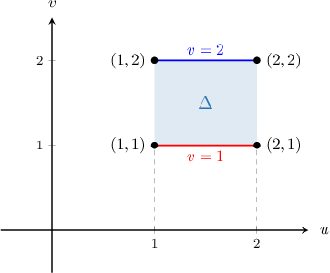
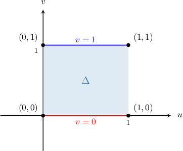
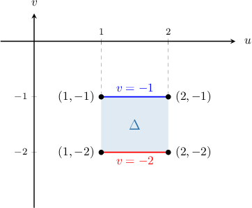
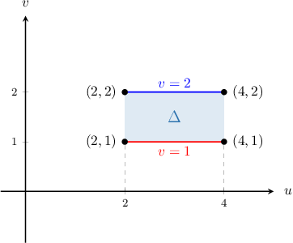
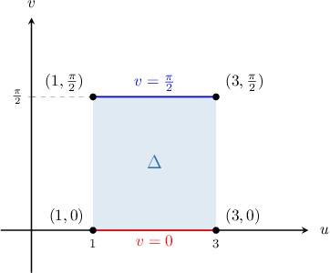

# Inferred-from-integrand source and generated review

Frozen math basis1356. Raw sources are evidence-only, opaque banks. Normal banks are authored method-derived complete profiles.

## Original raw q-160433

Use a change of variables to evaluate the double integral 

$$
{∬}_{D}\frac{(x+y)^{2}}{2x+y}\,dxdy,
$$

where $D$ is the quadrilateral region with vertices $(0,1),$ $(1,0),$ $(-1,3),$ and $(0,2).$

1. $\frac{1}{3}\ln (2)$
2. $\frac{1}{9}\ln (2)$
3. $\frac{7}{3}\ln (2)$
4. $\frac{2}{3}\ln (2)$
5. $2\ln (2)$
1. $2\operatorname{ln}⁡(2)$
2. $\frac{1}{3}\operatorname{ln}⁡(2)$
3. $\frac{7}{3}\operatorname{ln}⁡(2)$
4. $\frac{1}{9}\operatorname{ln}⁡(2)$
5. $\frac{2}{3}\operatorname{ln}⁡(2)$

Let's define a transformation $T$ as follows:

$$
T:[\begin{aligned}u \\ v\end{aligned}]⟶[\begin{aligned}x(u,v) \\ y(u,v)\end{aligned}]
$$

This transformation maps some region $Δ$ in the $uv$-plane to our region $D$ in the $xy$-plane.

To compute the required integral, we can use the change of variables formula

$$
{∬}_{D}f(x,y)\text{ }dxdy={∬}_{Δ}\text{ }f(x(u,v),y(u,v))\,|\frac{∂(x,y)}{∂(u,v)}|\text{ }dudv
$$

where $\frac{∂(x,y)}{∂(u,v)}$ is the Jacobian determinant corresponding to $T.$

To compute the required integral, we proceed as follows:

**Step 1**: Find a suitable change of variables.

The integrand

$$
f(x,y)=\frac{(x+y)^{2}}{2x+y}
$$

suggests that we use the change of variables 

$$
u=x+y,\,v=2x+y.
$$

This change of variables gives us the *inverse* function ${T}^{-1},$ that is

$$
{T}^{-1}:[\begin{aligned}x \\ y\end{aligned}]\to [\begin{aligned}u(x,y) \\ v(x,y)\end{aligned}].
$$

**Step 2**: Find $Δ,$ which is the image of $D$ under the action of ${T}^{-1}.$ 

The vertices of our domain $Δ$ in the $uv$-plane are as follows:

$$
\begin{aligned}{T}^{-1}(0,1) & =(0+1,2(0)+1) \\  & =(1,1) \\ {T}^{-1}(1,0) & =(1+0,2(1)+0) \\  & =(1,2) \\ {T}^{-1}(-1,3) & =(-1+3,2(-1)+3) \\  & =(2,1) \\ {T}^{-1}(0,2) & =(0+2,2(0)+2) \\  & =(2,2)\end{aligned}
$$

Therefore, our domain in the $uv$-plane is the following rectangle:

$$
Δ={(u,v)\,:\,1\le u\le 2,\,1\le v\le 2}
$$

**Step 3**: Compute the Jacobian determinant corresponding to ${T}^{-1}:$

The Jacobian determinant corresponding to ${T}^{-1}$ is

$$
\begin{aligned}\frac{∂(u,v)}{∂(x,y)} & =|\begin{aligned}\frac{∂u}{∂x} & \frac{∂u}{∂y} \\ \frac{∂v}{∂x} & \frac{∂v}{∂y}\end{aligned}| \\  & =|\begin{aligned}1 & 1 \\ 2 & \text{ }\text{ }1\end{aligned}| \\  & =-1.\end{aligned}
$$

**Step 4**: Compute the Jacobian determinant corresponding to $T:$

$$
\frac{∂(x,y)}{∂(u,v)}={(\frac{∂(u,v)}{∂(x,y)})}^{-1}=-1
$$

Note that $\frac{∂(x,y)}{∂(u,v)}\ne 0$ everywhere inside $Δ.$ In other words, $T$ has no critical points inside $Δ.$

**Step 5**: Perform the change of variables, and evaluate the integral:

Performing the change of variables, we obtain

$$
\begin{aligned}{∬}_{D}\frac{(x+y)^{2}}{2x+y}\,\text{d}x\text{d}y & ={∬}_{Δ}\frac{{u}^{2}}{v}\,|\frac{∂(x,y)}{∂(u,v)}|\,\text{d}u\text{d}v \\  & ={∬}_{Δ}\frac{{u}^{2}}{v}\,|-1|\,\text{d}u\text{d}v \\  & ={∬}_{Δ}\frac{{u}^{2}}{v}\,\text{d}u\text{d}v \\  & ={\int }_{1}^{2}{\int }_{1}^{2}\frac{{u}^{2}}{v}\,\text{d}u\,\text{d}v \\  & ={\int }_{1}^{2}{u}^{2}\,\text{d}u{\int }_{1}^{2}\frac{1}{v}\,\text{d}v \\  & {[\frac{1}{3}{u}^{3}]}_{1}^{2}\cdot {[\operatorname{ln}⁡v]}_{1}^{2} \\  & =\frac{7}{3}\cdot \operatorname{ln}⁡2 \\  & =\frac{7}{3}\operatorname{ln}⁡2.\end{aligned}
$$

## Original raw q-160896

Use a change of variables to evaluate the double integral

$∬_(D)(2x - 1)(x + y)^{2}dxdy$,

where $D$ is the quadrilateral region with vertices $(1, 0)$, $(2,-1)$, $(2, 2)$, and $(1, 3)$.

1. $64$
2. $84$
3. $42$
4. $21$
5. $11$

[Raw source has no worked solution.]

## Original raw q-160901

Use a change of variables to evaluate the double integral 

$$
{∬}_{D}x\operatorname{sin}⁡(\pi (x+y))\,dxdy,
$$

where $D$ is the quadrilateral region with vertices $(0,0),$ $(1,-1),$ $(1,0),$ and $(0,1).$

1. $\frac{3}{2\pi }$
2. $\pi $
3. $2$
4. $\frac{1}{\pi }$
5. $1$

Let's define a transformation $T$ as follows:

$$
T:[\begin{aligned}u \\ v\end{aligned}]⟶[\begin{aligned}x(u,v) \\ y(u,v)\end{aligned}]
$$

This transformation maps some region $Δ$ in the $uv$-plane to our region $D$ in the $xy$-plane.

To compute the required integral, we can use the change of variables formula

$$
{∬}_{D}f(x,y)\text{ }dxdy={∬}_{Δ}\text{ }f(x(u,v),y(u,v))\,|\frac{∂(x,y)}{∂(u,v)}|\text{ }dudv
$$

where $\frac{∂(x,y)}{∂(u,v)}$ is the Jacobian determinant corresponding to $T.$

To compute the required integral, we proceed as follows:

**Step 1**: Find a suitable change of variables.

The integrand

$$
f(x,y)=x\operatorname{sin}⁡(\pi (x+y))
$$

suggests that we use the change of variables 

$$
u=x,\,v=x+y.
$$

This change of variables gives us the *inverse* function ${T}^{-1},$ that is

$$
{T}^{-1}:[\begin{aligned}x \\ y\end{aligned}]\to [\begin{aligned}u(x,y) \\ v(x,y)\end{aligned}].
$$

**Step 2**: Find $Δ,$ which is the image of $D$ under the action of ${T}^{-1}.$ 

The vertices of our domain $Δ$ in the $uv$-plane are as follows:

$$
\begin{aligned}{T}^{-1}(0,0) & =(0,0+0) \\  & =(0,0) \\ {T}^{-1}(1,-1) & =(1,1+(-1)) \\  & =(1,0) \\ {T}^{-1}(1,0) & =(1,1+0) \\  & =(1,1) \\ {T}^{-1}(0,1) & =(0,0+1) \\  & =(0,1)\end{aligned}
$$

Therefore, our domain in the $uv$-plane is the following rectangle:

$$
Δ={(u,v)\,:\,0\le u\le 1,\,0\le v\le 1}
$$

**Step 3**: Compute the Jacobian determinant corresponding to ${T}^{-1}:$

The Jacobian determinant corresponding to ${T}^{-1}$ is

$$
\begin{aligned}\frac{∂(u,v)}{∂(x,y)} & =|\begin{aligned}\frac{∂u}{∂x} & \frac{∂u}{∂y} \\ \frac{∂v}{∂x} & \frac{∂v}{∂y}\end{aligned}| \\  & =|\begin{aligned}1 & 0 \\ 1 & 1\end{aligned}| \\  & =1.\end{aligned}
$$

**Step 4**: Compute the Jacobian determinant corresponding to $T:$

$$
\frac{∂(x,y)}{∂(u,v)}={(\frac{∂(u,v)}{∂(x,y)})}^{-1}=1
$$

Note that $\frac{∂(x,y)}{∂(u,v)}\ne 0$ everywhere inside $Δ.$ In other words, $T$ has no critical points inside $Δ.$

**Step 5**: Perform the change of variables, and evaluate the integral:

Performing the change of variables, we obtain

$$
\begin{aligned}{∬}_{D}x\operatorname{sin}⁡(\pi (x+y))\,\text{d}x\text{d}y & ={∬}_{Δ}u\operatorname{sin}⁡(\pi v)\,|\frac{∂(x,y)}{∂(u,v)}|\,\text{d}u\text{d}v \\  & ={∬}_{Δ}u\operatorname{sin}⁡(\pi v)\,|1|\,\text{d}u\text{d}v \\  & ={\int }_{0}^{1}{\int }_{0}^{1}u\operatorname{sin}⁡(\pi v)\,\text{d}u\,\text{d}v \\  & ={\int }_{0}^{1}\operatorname{sin}⁡(\pi v)\,\text{d}v{\int }_{0}^{1}u\,\text{d}u \\  & ={[-\frac{\operatorname{cos}⁡(\pi v)}{\pi }]}_{0}^{1}\cdot {[\frac{1}{2}{u}^{2}]}_{0}^{1}\,\text{d}v \\  & =\frac{2}{\pi }\cdot \frac{1}{2} \\  & =\frac{1}{\pi }.\end{aligned}
$$

## Original raw q-160904

Use a change of variables to evaluate the double integral 

$$
{∬}_{D}(\frac{x}{2}+y){e}^{x+3y}\,dxdy,
$$

where $D$ is the quadrilateral region with vertices $(8,-3),$  $(10,-4),$ $(16,-6),$ and $(14,-5).$

1. $\frac{2e-1}{{e}^{2}}$
2. $\frac{1}{{e}^{2}}$
3. $\frac{3(e-1)}{{e}^{2}}$
4. $\frac{1}{e}$
5. $e(1-e)$

Let's define a transformation $T$ as follows:

$$
T:[\begin{aligned}u \\ v\end{aligned}]⟶[\begin{aligned}x(u,v) \\ y(u,v)\end{aligned}]
$$

This transformation maps some region $Δ$ in the $uv$-plane to our region $D$ in the $xy$-plane.

To compute the required integral, we can use the change of variables formula

$$
{∬}_{D}f(x,y)\text{ }dxdy={∬}_{Δ}\text{ }f(x(u,v),y(u,v))\,|\frac{∂(x,y)}{∂(u,v)}|\text{ }dudv
$$

where $\frac{∂(x,y)}{∂(u,v)}$ is the Jacobian determinant corresponding to $T.$

To compute the required integral, we proceed as follows:

**Step 1**: Find a suitable change of variables.

The integrand

$$
f(x,y)=(\frac{x}{2}+y){e}^{x+3y}
$$

suggests that we use the change of variables 

$$
u=\frac{x}{2}+y\,v=x+3y.
$$

This change of variables gives us the *inverse* function ${T}^{-1},$ that is

$$
{T}^{-1}:[\begin{aligned}x \\ y\end{aligned}]\to [\begin{aligned}u(x,y) \\ v(x,y)\end{aligned}].
$$

**Step 2**: Find $Δ,$ which is the image of $D$ under the action of ${T}^{-1}.$ 

The vertices of our domain $Δ$ in the $uv$-plane are as follows:

$$
\begin{aligned}{T}^{-1}(8,-3) & =(\frac{8}{2}+(-3),8+3(-3)) \\  & =(1,-1) \\ {T}^{-1}(10,-4) & =(\frac{10}{2}+(-4),10+3(-4)) \\  & =(1,-2) \\ {T}^{-1}(16,-6) & =(\frac{16}{2}+(-6),16+3(-6)) \\  & =(2,-2) \\ {T}^{-1}(14,-5) & =(\frac{14}{2}+(-5),14+3(-5)) \\  & =(2,-1)\end{aligned}
$$

Therefore, our domain in the $uv$-plane is the following rectangle:

$$
Δ={(u,v)\,:\,1\le u\le 2,\,-2\le v\le -1}
$$

**Step 3**: Compute the Jacobian determinant corresponding to ${T}^{-1}:$

The Jacobian determinant corresponding to ${T}^{-1}$ is

$$
\begin{aligned}\frac{∂(u,v)}{∂(x,y)} & =|\begin{aligned}\frac{∂u}{∂x} & \frac{∂u}{∂y} \\ \frac{∂v}{∂x} & \frac{∂v}{∂y}\end{aligned}| \\  & =|\begin{aligned}\frac{1}{2} & 1 \\ 1 & 3\end{aligned}| \\  & =\frac{1}{2}.\end{aligned}
$$

**Step 4**: Compute the Jacobian determinant corresponding to $T:$

$$
\frac{∂(x,y)}{∂(u,v)}={(\frac{∂(u,v)}{∂(x,y)})}^{-1}=2
$$

Note that $\frac{∂(x,y)}{∂(u,v)}\ne 0$ everywhere inside $Δ.$ In other words, $T$ has no critical points inside $Δ.$

**Step 5**: Perform the change of variables, and evaluate the integral:

Performing the change of variables, we obtain

$$
\begin{aligned}{∬}_{D}(\frac{x}{2}+y){e}^{x+3y}\,\text{d}x\text{d}y & ={∬}_{Δ}u{e}^{v}\,|\frac{∂(x,y)}{∂(u,v)}|\,\text{d}u\text{d}v \\  & ={∬}_{Δ}u{e}^{v}\,|2|\,\text{d}u\text{d}v \\  & =2{\int }_{-2}^{-1}{\int }_{1}^{2}u{e}^{v}\,\text{d}u\,\text{d}v \\  & =2{\int }_{-2}^{-1}{e}^{v}\,\text{d}v{\int }_{1}^{2}u\,\text{d}u \\  & =2\cdot [{e}^{v}]_{-2}^{-1}\cdot {[\frac{1}{2}{u}^{2}]}_{1}^{2}\,\text{d}v \\  & =2\cdot (\frac{1}{e}-\frac{1}{{e}^{2}})\cdot \frac{3}{2} \\  & =\frac{3(e-1)}{{e}^{2}}.\end{aligned}
$$

## Original raw q-160933

Use a change of variables to evaluate the double integral 

$$
{∬}_{D}(2x-y){e}^{(2x-y)^{2}}\,dxdy,
$$

where $D$ is the quadrilateral region with vertices $(2,3),$ $(4,7),$ $(4,6),$ and $(2,2).$

1. ${e}^{4}-2{e}^{2}+3$
2. ${e}^{3}-{e}^{2}$
3. ${e}^{4}-e$
4. ${e}^{3}-2e+1$
5. $4{e}^{2}$

Let's define a transformation $T$ as follows:

$$
T:[\begin{aligned}u \\ v\end{aligned}]⟶[\begin{aligned}x(u,v) \\ y(u,v)\end{aligned}]
$$

This transformation maps some region $Δ$ in the $uv$-plane to our region $D$ in the $xy$-plane.

To compute the required integral, we can use the change of variables formula

$$
{∬}_{D}f(x,y)\text{ }dxdy={∬}_{Δ}\text{ }f(x(u,v),y(u,v))\,|\frac{∂(x,y)}{∂(u,v)}|\text{ }dudv
$$

where $\frac{∂(x,y)}{∂(u,v)}$ is the Jacobian determinant corresponding to $T.$

To compute the required integral, we proceed as follows:

**Step 1**: Find a suitable change of variables.

The integrand

$$
f(x,y)=(2x-y){e}^{(2x-y)^{2}}
$$

suggests that we use the change of variables 

$$
u=x,\,v=2x-y.
$$

This change of variables gives us the *inverse* function ${T}^{-1},$ that is

$$
{T}^{-1}:[\begin{aligned}x \\ y\end{aligned}]\to [\begin{aligned}u(x,y) \\ v(x,y)\end{aligned}].
$$

**Step 2**: Find $Δ,$ which is the image of $D$ under the action of ${T}^{-1}.$ 

The vertices of our domain $Δ$ in the $uv$-plane are as follows:

$$
\begin{aligned}{T}^{-1}(2,3) & =(2,2(2)-3) \\  & =(2,1) \\ {T}^{-1}(4,7) & =(4,2(4)-7) \\  & =(4,1) \\ {T}^{-1}(4,6) & =(4,2(4)-6) \\  & =(4,2) \\ {T}^{-1}(2,2) & =(2,2(2)-2) \\  & =(2,2)\end{aligned}
$$

Therefore, our domain in the $uv$-plane is the following rectangle:

$$
Δ={(u,v)\,:\,2\le u\le 4,\,1\le v\le 2}
$$

**Step 3**: Compute the Jacobian determinant corresponding to ${T}^{-1}:$

The Jacobian determinant corresponding to ${T}^{-1}$ is

$$
\begin{aligned}\frac{∂(u,v)}{∂(x,y)} & =|\begin{aligned}\frac{∂u}{∂x} & \frac{∂u}{∂y} \\ \frac{∂v}{∂x} & \frac{∂v}{∂y}\end{aligned}| \\  & =|\begin{aligned}1 & 0 \\ 2 & -1\end{aligned}| \\  & =-1.\end{aligned}
$$

**Step 4**: Compute the Jacobian determinant corresponding to $T:$

$$
\frac{∂(x,y)}{∂(u,v)}={(\frac{∂(u,v)}{∂(x,y)})}^{-1}=-1
$$

Note that $\frac{∂(x,y)}{∂(u,v)}\ne 0$ everywhere inside $Δ.$ In other words, $T$ has no critical points inside $Δ.$

**Step 5**: Perform the change of variables, and evaluate the integral:

Performing the change of variables, we obtain

$$
\begin{aligned}{∬}_{D}(2x-y){e}^{(2x-y)^{2}}\,\text{d}x\text{d}y & ={∬}_{Δ}v{e}^{{v}^{2}}\,|\frac{∂(x,y)}{∂(u,v)}|\,\text{d}u\text{d}v \\  & ={∬}_{Δ}v{e}^{{v}^{2}}\,|-1|\,\text{d}u\text{d}v \\  & ={\int }_{1}^{2}{\int }_{2}^{4}v{e}^{{v}^{2}}\,\text{d}u\,\text{d}v \\  & ={\int }_{1}^{2}v{e}^{{v}^{2}}\,\text{d}v{\int }_{2}^{4}\,\text{d}u \\  & ={[\frac{1}{2}{e}^{{v}^{2}}]}_{1}^{2}\cdot {[u]}_{2}^{4} \\  & =\frac{1}{2}({e}^{4}-e)\cdot 2 \\  & ={e}^{4}-e.\end{aligned}
$$

## Original raw q-160935

Use a change of variables to evaluate the double integral 

$$
{∬}_{D}({x}^{2}-{y}^{2})\operatorname{cos}⁡((x+y)^{2})\,dxdy,
$$

where $D$ is the quadrilateral region with vertices $(\frac{1}{2},-\frac{1}{2}),$ $(\frac{3}{2},-\frac{3}{2}),$ $(\frac{\pi +6}{4},\frac{\pi -6}{4}),$ and $(\frac{\pi +2}{4},\frac{\pi -2}{4}).$

1. $1$
2. $\operatorname{sin}⁡(\frac{{\pi }^{2}}{4})$
3. $\operatorname{sin}⁡(\frac{\pi }{\sqrt{2}})$
4. $\frac{\sqrt{2}}{2}$
5. $2\operatorname{sin}⁡(\frac{{\pi }^{2}}{2})$

Let's define a transformation $T$ as follows:

$$
T:[\begin{aligned}u \\ v\end{aligned}]⟶[\begin{aligned}x(u,v) \\ y(u,v)\end{aligned}]
$$

This transformation maps some region $Δ$ in the $uv$-plane to our region $D$ in the $xy$-plane.

To compute the required integral, we can use the change of variables formula

$$
{∬}_{D}f(x,y)\text{ }dxdy={∬}_{Δ}\text{ }f(x(u,v),y(u,v))\,|\frac{∂(x,y)}{∂(u,v)}|\text{ }dudv
$$

where $\frac{∂(x,y)}{∂(u,v)}$ is the Jacobian determinant corresponding to $T.$

To compute the required integral, we proceed as follows:

**Step 1**: Find a suitable change of variables.

The integrand

$$
f(x,y)=({x}^{2}-{y}^{2})\operatorname{cos}⁡((x+y)^{2})=(x-y)(x+y)\operatorname{cos}⁡((x+y)^{2})
$$

suggests that we use the change of variables 

$$
u=x-y,\,v=x+y.
$$

This change of variables gives us the *inverse* function ${T}^{-1},$ that is

$$
{T}^{-1}:[\begin{aligned}x \\ y\end{aligned}]\to [\begin{aligned}u(x,y) \\ v(x,y)\end{aligned}].
$$

**Step 2**: Find $Δ,$ which is the image of $D$ under the action of ${T}^{-1}.$ 

The vertices of our domain $Δ$ in the $uv$-plane are as follows:

$$
\begin{aligned}{T}^{-1}(\frac{1}{2},-\frac{1}{2}) & =(\frac{1}{2}-(-\frac{1}{2}),\frac{1}{2}+(-\frac{1}{2})) \\  & =(1,0) \\ {T}^{-1}(\frac{3}{2},-\frac{3}{2}) & =(\frac{3}{2}-(-\frac{3}{2}),\frac{3}{2}+(-\frac{3}{2})) \\  & =(3,0) \\ {T}^{-1}(\frac{\pi +6}{4},\frac{\pi -6}{4}) & =(\frac{\pi +6}{4}-\frac{\pi -6}{4},\frac{\pi +6}{4}+\frac{\pi -6}{4}) \\  & =(3,\frac{\pi }{2}) \\ {T}^{-1}(\frac{\pi +2}{4},\frac{\pi -2}{4}) & =(\frac{\pi +2}{4}-\frac{\pi -2}{4},\frac{\pi +2}{4}+\frac{\pi -2}{4}) \\  & =(1,\frac{\pi }{2})\end{aligned}
$$

Therefore, our domain in the $uv$-plane is the following rectangle:

$$
Δ={(u,v)\,:\,1\le u\le 3,\,0\le v\le \frac{\pi }{2}}
$$

**Step 3**: Compute the Jacobian determinant corresponding to ${T}^{-1}:$

The Jacobian determinant corresponding to ${T}^{-1}$ is

$$
\begin{aligned}\frac{∂(u,v)}{∂(x,y)} & =|\begin{aligned}\frac{∂u}{∂x} & \frac{∂u}{∂y} \\ \frac{∂v}{∂x} & \frac{∂v}{∂y}\end{aligned}| \\  & =|\begin{aligned}1 & -1 \\ 1 & 1\end{aligned}| \\  & =2.\end{aligned}
$$

**Step 4**: Compute the Jacobian determinant corresponding to $T:$

$$
\frac{∂(x,y)}{∂(u,v)}={(\frac{∂(u,v)}{∂(x,y)})}^{-1}=\frac{1}{2}
$$

Note that $\frac{∂(x,y)}{∂(u,v)}\ne 0$ everywhere inside $Δ.$ In other words, $T$ has no critical points inside $Δ.$

**Step 5**: Perform the change of variables, and evaluate the integral:

Performing the change of variables, we obtain

$$
\begin{aligned}{∬}_{D}({x}^{2}-{y}^{2})\operatorname{cos}⁡((x+y)^{2})\,\text{d}x\text{d}y & ={∬}_{D}(x-y)(x+y)\operatorname{cos}⁡((x+y)^{2})\,\text{d}x\text{d}y \\  & ={∬}_{Δ}uv\operatorname{cos}⁡({v}^{2})\,|\frac{∂(x,y)}{∂(u,v)}|\,\text{d}u\text{d}v \\  & ={∬}_{Δ}uv\operatorname{cos}⁡({v}^{2})\,|\frac{1}{2}|\,\text{d}u\text{d}v \\  & =\frac{1}{2}{\int }_{0}^{\pi /2}{\int }_{1}^{3}uv\operatorname{cos}⁡({v}^{2})\,\text{d}u\,\text{d}v \\  & =\frac{1}{2}{\int }_{0}^{\pi /2}v\operatorname{cos}⁡({v}^{2})\,\text{d}v\cdot {\int }_{1}^{3}u\,\text{d}u \\  & =\frac{1}{2}\cdot {[\frac{1}{2}\operatorname{sin}⁡({v}^{2})]}_{0}^{\pi /2}\cdot {[\frac{1}{2}{u}^{2}]}_{1}^{3} \\  & =\frac{1}{2}\cdot \frac{1}{2}\operatorname{sin}⁡(\frac{{\pi }^{2}}{4})\cdot 4 \\  & =\operatorname{sin}⁡(\frac{{\pi }^{2}}{4}).\end{aligned}
$$

## Generated evidence-only raw bank scale2 q-160433

Use a change of variables to evaluate the double integral 

$$
{∬}_{D}2\cdot \left(\frac{(x+y)^{2}}{2x+y}\right)\,dxdy,
$$

where $D$ is the quadrilateral region with vertices $(0,1),$ $(1,0),$ $(-1,3),$ and $(0,2).$

1. $2\cdot \left(\frac{1}{3}\ln (2)\right)$
2. $2\cdot \left(\frac{1}{9}\ln (2)\right)$
3. $2\cdot \left(\frac{7}{3}\ln (2)\right)$
4. $2\cdot \left(\frac{2}{3}\ln (2)\right)$
5. $2\cdot \left(2\ln (2)\right)$
1. $2\cdot \left(2\operatorname{ln}⁡(2)\right)$
2. $2\cdot \left(\frac{1}{3}\operatorname{ln}⁡(2)\right)$
3. $2\cdot \left(\frac{7}{3}\operatorname{ln}⁡(2)\right)$
4. $2\cdot \left(\frac{1}{9}\operatorname{ln}⁡(2)\right)$
5. $2\cdot \left(\frac{2}{3}\operatorname{ln}⁡(2)\right)$

Let's define a transformation $T$ as follows:

$$
T:[\begin{aligned}u \\ v\end{aligned}]⟶[\begin{aligned}x(u,v) \\ y(u,v)\end{aligned}]
$$

This transformation maps some region $Δ$ in the $uv$-plane to our region $D$ in the $xy$-plane.

To compute the required integral, we can use the change of variables formula

$$
{∬}_{D}f(x,y)\text{ }dxdy={∬}_{Δ}\text{ }f(x(u,v),y(u,v))\,|\frac{∂(x,y)}{∂(u,v)}|\text{ }dudv
$$

where $\frac{∂(x,y)}{∂(u,v)}$ is the Jacobian determinant corresponding to $T.$

To compute the required integral, we proceed as follows:

**Step 1**: Find a suitable change of variables.

The integrand

$$
f(x,y)=2\cdot \left(\frac{(x+y)^{2}}{2x+y}\right)
$$

suggests that we use the change of variables 

$$
u=x+y,\,v=2x+y.
$$

This change of variables gives us the *inverse* function ${T}^{-1},$ that is

$$
{T}^{-1}:[\begin{aligned}x \\ y\end{aligned}]\to [\begin{aligned}u(x,y) \\ v(x,y)\end{aligned}].
$$

**Step 2**: Find $Δ,$ which is the image of $D$ under the action of ${T}^{-1}.$ 

The vertices of our domain $Δ$ in the $uv$-plane are as follows:

$$
\begin{aligned}{T}^{-1}(0,1) & =(0+1,2(0)+1) \\  & =(1,1) \\ {T}^{-1}(1,0) & =(1+0,2(1)+0) \\  & =(1,2) \\ {T}^{-1}(-1,3) & =(-1+3,2(-1)+3) \\  & =(2,1) \\ {T}^{-1}(0,2) & =(0+2,2(0)+2) \\  & =(2,2)\end{aligned}
$$

Therefore, our domain in the $uv$-plane is the following rectangle:

$$
Δ={(u,v)\,:\,1\le u\le 2,\,1\le v\le 2}
$$

**Step 3**: Compute the Jacobian determinant corresponding to ${T}^{-1}:$

The Jacobian determinant corresponding to ${T}^{-1}$ is

$$
\begin{aligned}\frac{∂(u,v)}{∂(x,y)} & =|\begin{aligned}\frac{∂u}{∂x} & \frac{∂u}{∂y} \\ \frac{∂v}{∂x} & \frac{∂v}{∂y}\end{aligned}| \\  & =|\begin{aligned}1 & 1 \\ 2 & \text{ }\text{ }1\end{aligned}| \\  & =-1.\end{aligned}
$$

**Step 4**: Compute the Jacobian determinant corresponding to $T:$

$$
\frac{∂(x,y)}{∂(u,v)}={(\frac{∂(u,v)}{∂(x,y)})}^{-1}=-1
$$

Note that $\frac{∂(x,y)}{∂(u,v)}\ne 0$ everywhere inside $Δ.$ In other words, $T$ has no critical points inside $Δ.$

**Step 5**: Perform the change of variables, and evaluate the integral:

Performing the change of variables, we obtain

$$
\begin{aligned}{∬}_{D}2\cdot \left(\frac{(x+y)^{2}}{2x+y}\right)\,\text{d}x\text{d}y & =2\cdot \left({∬}_{Δ}\frac{{u}^{2}}{v}\,|\frac{∂(x,y)}{∂(u,v)}|\,\text{d}u\text{d}v\right) \\  & =2\cdot \left({∬}_{Δ}\frac{{u}^{2}}{v}\,|-1|\,\text{d}u\text{d}v\right) \\  & =2\cdot \left({∬}_{Δ}\frac{{u}^{2}}{v}\,\text{d}u\text{d}v\right) \\  & =2\cdot \left({\int }_{1}^{2}{\int }_{1}^{2}\frac{{u}^{2}}{v}\,\text{d}u\,\text{d}v\right) \\  & =2\cdot \left({\int }_{1}^{2}{u}^{2}\,\text{d}u{\int }_{1}^{2}\frac{1}{v}\,\text{d}v\right) \\  & 2\cdot \left({[\frac{1}{3}{u}^{3}]}_{1}^{2}\cdot {[\operatorname{ln}⁡v]}_{1}^{2}\right) \\  & =2\cdot \left(\frac{7}{3}\cdot \operatorname{ln}⁡2\right) \\  & =2\cdot \left(\frac{7}{3}\operatorname{ln}⁡2\right).\end{aligned}
$$

## Generated evidence-only raw bank scale2 q-160896

Use a change of variables to evaluate the double integral

$∬_(D)2\cdot \left((2x - 1)(x + y)^{2}\right)dxdy$,

where $D$ is the quadrilateral region with vertices $(1, 0)$, $(2,-1)$, $(2, 2)$, and $(1, 3)$.

1. $2\cdot \left(64\right)$
2. $2\cdot \left(84\right)$
3. $2\cdot \left(42\right)$
4. $2\cdot \left(21\right)$
5. $2\cdot \left(11\right)$

[Raw source has no worked solution.]

## Generated evidence-only raw bank scale2 q-160901

Use a change of variables to evaluate the double integral 

$$
{∬}_{D}2\cdot \left(x\operatorname{sin}⁡(\pi (x+y))\right)\,dxdy,
$$

where $D$ is the quadrilateral region with vertices $(0,0),$ $(1,-1),$ $(1,0),$ and $(0,1).$

1. $2\cdot \left(\frac{3}{2\pi }\right)$
2. $2\cdot \left(\pi \right)$
3. $2\cdot \left(2\right)$
4. $2\cdot \left(\frac{1}{\pi }\right)$
5. $2\cdot \left(1\right)$

Let's define a transformation $T$ as follows:

$$
T:[\begin{aligned}u \\ v\end{aligned}]⟶[\begin{aligned}x(u,v) \\ y(u,v)\end{aligned}]
$$

This transformation maps some region $Δ$ in the $uv$-plane to our region $D$ in the $xy$-plane.

To compute the required integral, we can use the change of variables formula

$$
{∬}_{D}f(x,y)\text{ }dxdy={∬}_{Δ}\text{ }f(x(u,v),y(u,v))\,|\frac{∂(x,y)}{∂(u,v)}|\text{ }dudv
$$

where $\frac{∂(x,y)}{∂(u,v)}$ is the Jacobian determinant corresponding to $T.$

To compute the required integral, we proceed as follows:

**Step 1**: Find a suitable change of variables.

The integrand

$$
f(x,y)=2\cdot \left(x\operatorname{sin}⁡(\pi (x+y))\right)
$$

suggests that we use the change of variables 

$$
u=x,\,v=x+y.
$$

This change of variables gives us the *inverse* function ${T}^{-1},$ that is

$$
{T}^{-1}:[\begin{aligned}x \\ y\end{aligned}]\to [\begin{aligned}u(x,y) \\ v(x,y)\end{aligned}].
$$

**Step 2**: Find $Δ,$ which is the image of $D$ under the action of ${T}^{-1}.$ 

The vertices of our domain $Δ$ in the $uv$-plane are as follows:

$$
\begin{aligned}{T}^{-1}(0,0) & =(0,0+0) \\  & =(0,0) \\ {T}^{-1}(1,-1) & =(1,1+(-1)) \\  & =(1,0) \\ {T}^{-1}(1,0) & =(1,1+0) \\  & =(1,1) \\ {T}^{-1}(0,1) & =(0,0+1) \\  & =(0,1)\end{aligned}
$$

Therefore, our domain in the $uv$-plane is the following rectangle:

$$
Δ={(u,v)\,:\,0\le u\le 1,\,0\le v\le 1}
$$

**Step 3**: Compute the Jacobian determinant corresponding to ${T}^{-1}:$

The Jacobian determinant corresponding to ${T}^{-1}$ is

$$
\begin{aligned}\frac{∂(u,v)}{∂(x,y)} & =|\begin{aligned}\frac{∂u}{∂x} & \frac{∂u}{∂y} \\ \frac{∂v}{∂x} & \frac{∂v}{∂y}\end{aligned}| \\  & =|\begin{aligned}1 & 0 \\ 1 & 1\end{aligned}| \\  & =1.\end{aligned}
$$

**Step 4**: Compute the Jacobian determinant corresponding to $T:$

$$
\frac{∂(x,y)}{∂(u,v)}={(\frac{∂(u,v)}{∂(x,y)})}^{-1}=1
$$

Note that $\frac{∂(x,y)}{∂(u,v)}\ne 0$ everywhere inside $Δ.$ In other words, $T$ has no critical points inside $Δ.$

**Step 5**: Perform the change of variables, and evaluate the integral:

Performing the change of variables, we obtain

$$
\begin{aligned}{∬}_{D}2\cdot \left(x\operatorname{sin}⁡(\pi (x+y))\right)\,\text{d}x\text{d}y & =2\cdot \left({∬}_{Δ}u\operatorname{sin}⁡(\pi v)\,|\frac{∂(x,y)}{∂(u,v)}|\,\text{d}u\text{d}v\right) \\  & =2\cdot \left({∬}_{Δ}u\operatorname{sin}⁡(\pi v)\,|1|\,\text{d}u\text{d}v\right) \\  & =2\cdot \left({\int }_{0}^{1}{\int }_{0}^{1}u\operatorname{sin}⁡(\pi v)\,\text{d}u\,\text{d}v\right) \\  & =2\cdot \left({\int }_{0}^{1}\operatorname{sin}⁡(\pi v)\,\text{d}v{\int }_{0}^{1}u\,\text{d}u\right) \\  & =2\cdot \left({[-\frac{\operatorname{cos}⁡(\pi v)}{\pi }]}_{0}^{1}\cdot {[\frac{1}{2}{u}^{2}]}_{0}^{1}\,\text{d}v\right) \\  & =2\cdot \left(\frac{2}{\pi }\cdot \frac{1}{2}\right) \\  & =2\cdot \left(\frac{1}{\pi }\right).\end{aligned}
$$

## Generated evidence-only raw bank scale2 q-160904

Use a change of variables to evaluate the double integral 

$$
{∬}_{D}2\cdot \left((\frac{x}{2}+y){e}^{x+3y}\right)\,dxdy,
$$

where $D$ is the quadrilateral region with vertices $(8,-3),$  $(10,-4),$ $(16,-6),$ and $(14,-5).$

1. $2\cdot \left(\frac{2e-1}{{e}^{2}}\right)$
2. $2\cdot \left(\frac{1}{{e}^{2}}\right)$
3. $2\cdot \left(\frac{3(e-1)}{{e}^{2}}\right)$
4. $2\cdot \left(\frac{1}{e}\right)$
5. $2\cdot \left(e(1-e)\right)$

Let's define a transformation $T$ as follows:

$$
T:[\begin{aligned}u \\ v\end{aligned}]⟶[\begin{aligned}x(u,v) \\ y(u,v)\end{aligned}]
$$

This transformation maps some region $Δ$ in the $uv$-plane to our region $D$ in the $xy$-plane.

To compute the required integral, we can use the change of variables formula

$$
{∬}_{D}f(x,y)\text{ }dxdy={∬}_{Δ}\text{ }f(x(u,v),y(u,v))\,|\frac{∂(x,y)}{∂(u,v)}|\text{ }dudv
$$

where $\frac{∂(x,y)}{∂(u,v)}$ is the Jacobian determinant corresponding to $T.$

To compute the required integral, we proceed as follows:

**Step 1**: Find a suitable change of variables.

The integrand

$$
f(x,y)=2\cdot \left((\frac{x}{2}+y){e}^{x+3y}\right)
$$

suggests that we use the change of variables 

$$
u=\frac{x}{2}+y\,v=x+3y.
$$

This change of variables gives us the *inverse* function ${T}^{-1},$ that is

$$
{T}^{-1}:[\begin{aligned}x \\ y\end{aligned}]\to [\begin{aligned}u(x,y) \\ v(x,y)\end{aligned}].
$$

**Step 2**: Find $Δ,$ which is the image of $D$ under the action of ${T}^{-1}.$ 

The vertices of our domain $Δ$ in the $uv$-plane are as follows:

$$
\begin{aligned}{T}^{-1}(8,-3) & =(\frac{8}{2}+(-3),8+3(-3)) \\  & =(1,-1) \\ {T}^{-1}(10,-4) & =(\frac{10}{2}+(-4),10+3(-4)) \\  & =(1,-2) \\ {T}^{-1}(16,-6) & =(\frac{16}{2}+(-6),16+3(-6)) \\  & =(2,-2) \\ {T}^{-1}(14,-5) & =(\frac{14}{2}+(-5),14+3(-5)) \\  & =(2,-1)\end{aligned}
$$

Therefore, our domain in the $uv$-plane is the following rectangle:

$$
Δ={(u,v)\,:\,1\le u\le 2,\,-2\le v\le -1}
$$

**Step 3**: Compute the Jacobian determinant corresponding to ${T}^{-1}:$

The Jacobian determinant corresponding to ${T}^{-1}$ is

$$
\begin{aligned}\frac{∂(u,v)}{∂(x,y)} & =|\begin{aligned}\frac{∂u}{∂x} & \frac{∂u}{∂y} \\ \frac{∂v}{∂x} & \frac{∂v}{∂y}\end{aligned}| \\  & =|\begin{aligned}\frac{1}{2} & 1 \\ 1 & 3\end{aligned}| \\  & =\frac{1}{2}.\end{aligned}
$$

**Step 4**: Compute the Jacobian determinant corresponding to $T:$

$$
\frac{∂(x,y)}{∂(u,v)}={(\frac{∂(u,v)}{∂(x,y)})}^{-1}=2
$$

Note that $\frac{∂(x,y)}{∂(u,v)}\ne 0$ everywhere inside $Δ.$ In other words, $T$ has no critical points inside $Δ.$

**Step 5**: Perform the change of variables, and evaluate the integral:

Performing the change of variables, we obtain

$$
\begin{aligned}{∬}_{D}2\cdot \left((\frac{x}{2}+y){e}^{x+3y}\right)\,\text{d}x\text{d}y & =2\cdot \left({∬}_{Δ}u{e}^{v}\,|\frac{∂(x,y)}{∂(u,v)}|\,\text{d}u\text{d}v\right) \\  & =2\cdot \left({∬}_{Δ}u{e}^{v}\,|2|\,\text{d}u\text{d}v\right) \\  & =2\cdot \left(2{\int }_{-2}^{-1}{\int }_{1}^{2}u{e}^{v}\,\text{d}u\,\text{d}v\right) \\  & =2\cdot \left(2{\int }_{-2}^{-1}{e}^{v}\,\text{d}v{\int }_{1}^{2}u\,\text{d}u\right) \\  & =2\cdot \left(2\cdot [{e}^{v}]_{-2}^{-1}\cdot {[\frac{1}{2}{u}^{2}]}_{1}^{2}\,\text{d}v\right) \\  & =2\cdot \left(2\cdot (\frac{1}{e}-\frac{1}{{e}^{2}})\cdot \frac{3}{2}\right) \\  & =2\cdot \left(\frac{3(e-1)}{{e}^{2}}\right).\end{aligned}
$$

## Generated evidence-only raw bank scale2 q-160933

Use a change of variables to evaluate the double integral 

$$
{∬}_{D}2\cdot \left((2x-y){e}^{(2x-y)^{2}}\right)\,dxdy,
$$

where $D$ is the quadrilateral region with vertices $(2,3),$ $(4,7),$ $(4,6),$ and $(2,2).$

1. $2\cdot \left({e}^{4}-2{e}^{2}+3\right)$
2. $2\cdot \left({e}^{3}-{e}^{2}\right)$
3. $2\cdot \left({e}^{4}-e\right)$
4. $2\cdot \left({e}^{3}-2e+1\right)$
5. $2\cdot \left(4{e}^{2}\right)$

Let's define a transformation $T$ as follows:

$$
T:[\begin{aligned}u \\ v\end{aligned}]⟶[\begin{aligned}x(u,v) \\ y(u,v)\end{aligned}]
$$

This transformation maps some region $Δ$ in the $uv$-plane to our region $D$ in the $xy$-plane.

To compute the required integral, we can use the change of variables formula

$$
{∬}_{D}f(x,y)\text{ }dxdy={∬}_{Δ}\text{ }f(x(u,v),y(u,v))\,|\frac{∂(x,y)}{∂(u,v)}|\text{ }dudv
$$

where $\frac{∂(x,y)}{∂(u,v)}$ is the Jacobian determinant corresponding to $T.$

To compute the required integral, we proceed as follows:

**Step 1**: Find a suitable change of variables.

The integrand

$$
f(x,y)=2\cdot \left((2x-y){e}^{(2x-y)^{2}}\right)
$$

suggests that we use the change of variables 

$$
u=x,\,v=2x-y.
$$

This change of variables gives us the *inverse* function ${T}^{-1},$ that is

$$
{T}^{-1}:[\begin{aligned}x \\ y\end{aligned}]\to [\begin{aligned}u(x,y) \\ v(x,y)\end{aligned}].
$$

**Step 2**: Find $Δ,$ which is the image of $D$ under the action of ${T}^{-1}.$ 

The vertices of our domain $Δ$ in the $uv$-plane are as follows:

$$
\begin{aligned}{T}^{-1}(2,3) & =(2,2(2)-3) \\  & =(2,1) \\ {T}^{-1}(4,7) & =(4,2(4)-7) \\  & =(4,1) \\ {T}^{-1}(4,6) & =(4,2(4)-6) \\  & =(4,2) \\ {T}^{-1}(2,2) & =(2,2(2)-2) \\  & =(2,2)\end{aligned}
$$

Therefore, our domain in the $uv$-plane is the following rectangle:

$$
Δ={(u,v)\,:\,2\le u\le 4,\,1\le v\le 2}
$$

**Step 3**: Compute the Jacobian determinant corresponding to ${T}^{-1}:$

The Jacobian determinant corresponding to ${T}^{-1}$ is

$$
\begin{aligned}\frac{∂(u,v)}{∂(x,y)} & =|\begin{aligned}\frac{∂u}{∂x} & \frac{∂u}{∂y} \\ \frac{∂v}{∂x} & \frac{∂v}{∂y}\end{aligned}| \\  & =|\begin{aligned}1 & 0 \\ 2 & -1\end{aligned}| \\  & =-1.\end{aligned}
$$

**Step 4**: Compute the Jacobian determinant corresponding to $T:$

$$
\frac{∂(x,y)}{∂(u,v)}={(\frac{∂(u,v)}{∂(x,y)})}^{-1}=-1
$$

Note that $\frac{∂(x,y)}{∂(u,v)}\ne 0$ everywhere inside $Δ.$ In other words, $T$ has no critical points inside $Δ.$

**Step 5**: Perform the change of variables, and evaluate the integral:

Performing the change of variables, we obtain

$$
\begin{aligned}{∬}_{D}2\cdot \left((2x-y){e}^{(2x-y)^{2}}\right)\,\text{d}x\text{d}y & =2\cdot \left({∬}_{Δ}v{e}^{{v}^{2}}\,|\frac{∂(x,y)}{∂(u,v)}|\,\text{d}u\text{d}v\right) \\  & =2\cdot \left({∬}_{Δ}v{e}^{{v}^{2}}\,|-1|\,\text{d}u\text{d}v\right) \\  & =2\cdot \left({\int }_{1}^{2}{\int }_{2}^{4}v{e}^{{v}^{2}}\,\text{d}u\,\text{d}v\right) \\  & =2\cdot \left({\int }_{1}^{2}v{e}^{{v}^{2}}\,\text{d}v{\int }_{2}^{4}\,\text{d}u\right) \\  & =2\cdot \left({[\frac{1}{2}{e}^{{v}^{2}}]}_{1}^{2}\cdot {[u]}_{2}^{4}\right) \\  & =2\cdot \left(\frac{1}{2}({e}^{4}-e)\cdot 2\right) \\  & =2\cdot \left({e}^{4}-e\right).\end{aligned}
$$

## Generated evidence-only raw bank scale2 q-160935

Use a change of variables to evaluate the double integral 

$$
{∬}_{D}2\cdot \left(({x}^{2}-{y}^{2})\operatorname{cos}⁡((x+y)^{2})\right)\,dxdy,
$$

where $D$ is the quadrilateral region with vertices $(\frac{1}{2},-\frac{1}{2}),$ $(\frac{3}{2},-\frac{3}{2}),$ $(\frac{\pi +6}{4},\frac{\pi -6}{4}),$ and $(\frac{\pi +2}{4},\frac{\pi -2}{4}).$

1. $2\cdot \left(1\right)$
2. $2\cdot \left(\operatorname{sin}⁡(\frac{{\pi }^{2}}{4})\right)$
3. $2\cdot \left(\operatorname{sin}⁡(\frac{\pi }{\sqrt{2}})\right)$
4. $2\cdot \left(\frac{\sqrt{2}}{2}\right)$
5. $2\cdot \left(2\operatorname{sin}⁡(\frac{{\pi }^{2}}{2})\right)$

Let's define a transformation $T$ as follows:

$$
T:[\begin{aligned}u \\ v\end{aligned}]⟶[\begin{aligned}x(u,v) \\ y(u,v)\end{aligned}]
$$

This transformation maps some region $Δ$ in the $uv$-plane to our region $D$ in the $xy$-plane.

To compute the required integral, we can use the change of variables formula

$$
{∬}_{D}f(x,y)\text{ }dxdy={∬}_{Δ}\text{ }f(x(u,v),y(u,v))\,|\frac{∂(x,y)}{∂(u,v)}|\text{ }dudv
$$

where $\frac{∂(x,y)}{∂(u,v)}$ is the Jacobian determinant corresponding to $T.$

To compute the required integral, we proceed as follows:

**Step 1**: Find a suitable change of variables.

The integrand

$$
f(x,y)=2\cdot \left(({x}^{2}-{y}^{2})\operatorname{cos}⁡((x+y)^{2})\right)=(x-y)(x+y)\operatorname{cos}⁡((x+y)^{2})
$$

suggests that we use the change of variables 

$$
u=x-y,\,v=x+y.
$$

This change of variables gives us the *inverse* function ${T}^{-1},$ that is

$$
{T}^{-1}:[\begin{aligned}x \\ y\end{aligned}]\to [\begin{aligned}u(x,y) \\ v(x,y)\end{aligned}].
$$

**Step 2**: Find $Δ,$ which is the image of $D$ under the action of ${T}^{-1}.$ 

The vertices of our domain $Δ$ in the $uv$-plane are as follows:

$$
\begin{aligned}{T}^{-1}(\frac{1}{2},-\frac{1}{2}) & =(\frac{1}{2}-(-\frac{1}{2}),\frac{1}{2}+(-\frac{1}{2})) \\  & =(1,0) \\ {T}^{-1}(\frac{3}{2},-\frac{3}{2}) & =(\frac{3}{2}-(-\frac{3}{2}),\frac{3}{2}+(-\frac{3}{2})) \\  & =(3,0) \\ {T}^{-1}(\frac{\pi +6}{4},\frac{\pi -6}{4}) & =(\frac{\pi +6}{4}-\frac{\pi -6}{4},\frac{\pi +6}{4}+\frac{\pi -6}{4}) \\  & =(3,\frac{\pi }{2}) \\ {T}^{-1}(\frac{\pi +2}{4},\frac{\pi -2}{4}) & =(\frac{\pi +2}{4}-\frac{\pi -2}{4},\frac{\pi +2}{4}+\frac{\pi -2}{4}) \\  & =(1,\frac{\pi }{2})\end{aligned}
$$

Therefore, our domain in the $uv$-plane is the following rectangle:

$$
Δ={(u,v)\,:\,1\le u\le 3,\,0\le v\le \frac{\pi }{2}}
$$

**Step 3**: Compute the Jacobian determinant corresponding to ${T}^{-1}:$

The Jacobian determinant corresponding to ${T}^{-1}$ is

$$
\begin{aligned}\frac{∂(u,v)}{∂(x,y)} & =|\begin{aligned}\frac{∂u}{∂x} & \frac{∂u}{∂y} \\ \frac{∂v}{∂x} & \frac{∂v}{∂y}\end{aligned}| \\  & =|\begin{aligned}1 & -1 \\ 1 & 1\end{aligned}| \\  & =2.\end{aligned}
$$

**Step 4**: Compute the Jacobian determinant corresponding to $T:$

$$
\frac{∂(x,y)}{∂(u,v)}={(\frac{∂(u,v)}{∂(x,y)})}^{-1}=\frac{1}{2}
$$

Note that $\frac{∂(x,y)}{∂(u,v)}\ne 0$ everywhere inside $Δ.$ In other words, $T$ has no critical points inside $Δ.$

**Step 5**: Perform the change of variables, and evaluate the integral:

Performing the change of variables, we obtain

$$
\begin{aligned}{∬}_{D}2\cdot \left(({x}^{2}-{y}^{2})\operatorname{cos}⁡((x+y)^{2})\right)\,\text{d}x\text{d}y & =2\cdot \left({∬}_{D}(x-y)(x+y)\operatorname{cos}⁡((x+y)^{2})\,\text{d}x\text{d}y\right) \\  & =2\cdot \left({∬}_{Δ}uv\operatorname{cos}⁡({v}^{2})\,|\frac{∂(x,y)}{∂(u,v)}|\,\text{d}u\text{d}v\right) \\  & =2\cdot \left({∬}_{Δ}uv\operatorname{cos}⁡({v}^{2})\,|\frac{1}{2}|\,\text{d}u\text{d}v\right) \\  & =2\cdot \left(\frac{1}{2}{\int }_{0}^{\pi /2}{\int }_{1}^{3}uv\operatorname{cos}⁡({v}^{2})\,\text{d}u\,\text{d}v\right) \\  & =2\cdot \left(\frac{1}{2}{\int }_{0}^{\pi /2}v\operatorname{cos}⁡({v}^{2})\,\text{d}v\cdot {\int }_{1}^{3}u\,\text{d}u\right) \\  & =2\cdot \left(\frac{1}{2}\cdot {[\frac{1}{2}\operatorname{sin}⁡({v}^{2})]}_{0}^{\pi /2}\cdot {[\frac{1}{2}{u}^{2}]}_{1}^{3}\right) \\  & =2\cdot \left(\frac{1}{2}\cdot \frac{1}{2}\operatorname{sin}⁡(\frac{{\pi }^{2}}{4})\cdot 4\right) \\  & =2\cdot \left(\operatorname{sin}⁡(\frac{{\pi }^{2}}{4})\right).\end{aligned}
$$

## Generated easy / polynomial

Use a change of variables to evaluate the double integral 

$$
\iint_D 2 y^{2} \left(2 x + 2 y\right)\,\mathrm{d}x\,\mathrm{d}y,
$$

where $D$ is the quadrilateral region with vertices $(1,1)$, $(\frac{3}{2},1)$, $(- \frac{1}{2},3)$ and $(-1,3)$.

1. $-39$
2. $39$
3. $\frac{26}{3}$
4. $78$
5. $117$

Let's define a transformation $T$ as follows:

$$
T:[\begin{aligned}u \\ v\end{aligned}]⟶[\begin{aligned}x(u,v) \\ y(u,v)\end{aligned}]
$$

This transformation maps some region $Δ$ in the $uv$-plane to our region $D$ in the $xy$-plane.

To compute the required integral, we can use the change of variables formula

$$
{∬}_{D}f(x,y)\text{ }dxdy={∬}_{Δ}\text{ }f(x(u,v),y(u,v))\,|\frac{∂(x,y)}{∂(u,v)}|\text{ }dudv
$$

where $\frac{∂(x,y)}{∂(u,v)}$ is the Jacobian determinant corresponding to $T.$

To compute the required integral, we proceed as follows:

**Step 1**: Find a suitable change of variables.

The integrand

$$
f(x,y)=2 y^{2} \left(2 x + 2 y\right)
$$

suggests that we use the change of variables 

$$
u=2 x + 2 y,\qquad v=y.
$$

This change of variables gives us the *inverse* function ${T}^{-1},$ that is

$$
T^{-1}:(x,y)\mapsto (u(x,y),v(x,y)).
$$

**Step 2**: Find $Δ,$ which is the image of $D$ under the action of ${T}^{-1}.$ 

The vertices of our domain $Δ$ in the $uv$-plane are as follows:

$$
\begin{aligned}T^{-1}(1,1)&=(\left(2\right)\cdot \left(1\right)+\left(2\right)\cdot \left(1\right)+\left(0\right),\left(0\right)\cdot \left(1\right)+\left(1\right)\cdot \left(1\right)+\left(0\right)) \\ &=(4,1) \\ T^{-1}(\frac{3}{2},1)&=(\left(2\right)\cdot \left(\frac{3}{2}\right)+\left(2\right)\cdot \left(1\right)+\left(0\right),\left(0\right)\cdot \left(\frac{3}{2}\right)+\left(1\right)\cdot \left(1\right)+\left(0\right)) \\ &=(5,1) \\ T^{-1}(- \frac{1}{2},3)&=(\left(2\right)\cdot \left(- \frac{1}{2}\right)+\left(2\right)\cdot \left(3\right)+\left(0\right),\left(0\right)\cdot \left(- \frac{1}{2}\right)+\left(1\right)\cdot \left(3\right)+\left(0\right)) \\ &=(5,3) \\ T^{-1}(-1,3)&=(\left(2\right)\cdot \left(-1\right)+\left(2\right)\cdot \left(3\right)+\left(0\right),\left(0\right)\cdot \left(-1\right)+\left(1\right)\cdot \left(3\right)+\left(0\right)) \\ &=(4,3)\end{aligned}
$$

Therefore, our domain in the $uv$-plane is the following rectangle:

$$
\Delta=\{(u,v):4\le u\le 5,\ 1\le v\le 3\}
$$

**Step 3**: Compute the Jacobian determinant corresponding to ${T}^{-1}:$

The Jacobian determinant corresponding to ${T}^{-1}$ is

$$
\begin{aligned}\frac{\partial(u,v)}{\partial(x,y)}&=\begin{vmatrix}\partial u/\partial x&\partial u/\partial y\\\partial v/\partial x&\partial v/\partial y\end{vmatrix} \\ &=\begin{vmatrix}2&2\\0&1\end{vmatrix} \\ &=2.\end{aligned}
$$

**Step 4**: Compute the Jacobian determinant corresponding to $T:$

$$
\frac{\partial(x,y)}{\partial(u,v)}=\left(\frac{\partial(u,v)}{\partial(x,y)}\right)^{-1}=\frac{1}{2}
$$

Note that $\frac{∂(x,y)}{∂(u,v)}\ne 0$ everywhere inside $Δ.$ In other words, $T$ has no critical points inside $Δ.$

Solving these affine equations also gives

$$
x=\frac{u}{2} - v,\qquad y=v.
$$

**Step 5**: Perform the change of variables, and evaluate the integral:

Performing the change of variables, we obtain

$$
\begin{aligned}\iint_D 2 y^{2} \left(2 x + 2 y\right)\,\mathrm{d}x\,\mathrm{d}y&=\iint_\Delta 2 u v^{2}\,\left|\frac{\partial(x,y)}{\partial(u,v)}\right|\,\mathrm{d}u\,\mathrm{d}v \\ &=\iint_\Delta 2 u v^{2}\,\left|\frac{1}{2}\right|\,\mathrm{d}u\,\mathrm{d}v \\ &=1\cdot \int_{1}^{3}\int_{4}^{5}u v^{2}\,\mathrm{d}u\,\mathrm{d}v \\ &=1\cdot \int_{1}^{3}v^{2}\,\mathrm{d}v\cdot \int_{4}^{5}u\,\mathrm{d}u \\ &=1\cdot \left[\frac{v^{3}}{3}\right]_{1}^{3}\cdot \left[\frac{u^{2}}{2}\right]_{4}^{5} \\ &=1\cdot \left(\left(3\right)^{3}/3-\left(\left(1\right)^{3}/3\right)\right)\cdot \left(\left(5\right)^{2}/2-\left(\left(4\right)^{2}/2\right)\right) \\ &=1\cdot \left(\left(9\right)-\left(\frac{1}{3}\right)\right)\cdot \left(\left(\frac{25}{2}\right)-\left(8\right)\right) \\ &=1\cdot \left(\frac{26}{3}\right)\cdot \left(\frac{9}{2}\right) \\ &=39.\end{aligned}
$$

## Generated easy / polynomial

Use a change of variables to evaluate the double integral 

$$
\iint_D y^{2} \left(x + 2 y\right)\,\mathrm{d}x\,\mathrm{d}y,
$$

where $D$ is the quadrilateral region with vertices $(-1,1)$, $(1,1)$, $(-3,3)$ and $(-5,3)$.

1. $\frac{208}{3}$
2. $\frac{52}{3}$
3. $\frac{104}{3}$
4. $- \frac{104}{3}$
5. $104$

Let's define a transformation $T$ as follows:

$$
T:[\begin{aligned}u \\ v\end{aligned}]⟶[\begin{aligned}x(u,v) \\ y(u,v)\end{aligned}]
$$

This transformation maps some region $Δ$ in the $uv$-plane to our region $D$ in the $xy$-plane.

To compute the required integral, we can use the change of variables formula

$$
{∬}_{D}f(x,y)\text{ }dxdy={∬}_{Δ}\text{ }f(x(u,v),y(u,v))\,|\frac{∂(x,y)}{∂(u,v)}|\text{ }dudv
$$

where $\frac{∂(x,y)}{∂(u,v)}$ is the Jacobian determinant corresponding to $T.$

To compute the required integral, we proceed as follows:

**Step 1**: Find a suitable change of variables.

The integrand

$$
f(x,y)=y^{2} \left(x + 2 y\right)
$$

suggests that we use the change of variables 

$$
u=x + 2 y,\qquad v=y.
$$

This change of variables gives us the *inverse* function ${T}^{-1},$ that is

$$
T^{-1}:(x,y)\mapsto (u(x,y),v(x,y)).
$$

**Step 2**: Find $Δ,$ which is the image of $D$ under the action of ${T}^{-1}.$ 

The vertices of our domain $Δ$ in the $uv$-plane are as follows:

$$
\begin{aligned}T^{-1}(-1,1)&=(\left(1\right)\cdot \left(-1\right)+\left(2\right)\cdot \left(1\right)+\left(0\right),\left(0\right)\cdot \left(-1\right)+\left(1\right)\cdot \left(1\right)+\left(0\right)) \\ &=(1,1) \\ T^{-1}(1,1)&=(\left(1\right)\cdot \left(1\right)+\left(2\right)\cdot \left(1\right)+\left(0\right),\left(0\right)\cdot \left(1\right)+\left(1\right)\cdot \left(1\right)+\left(0\right)) \\ &=(3,1) \\ T^{-1}(-3,3)&=(\left(1\right)\cdot \left(-3\right)+\left(2\right)\cdot \left(3\right)+\left(0\right),\left(0\right)\cdot \left(-3\right)+\left(1\right)\cdot \left(3\right)+\left(0\right)) \\ &=(3,3) \\ T^{-1}(-5,3)&=(\left(1\right)\cdot \left(-5\right)+\left(2\right)\cdot \left(3\right)+\left(0\right),\left(0\right)\cdot \left(-5\right)+\left(1\right)\cdot \left(3\right)+\left(0\right)) \\ &=(1,3)\end{aligned}
$$

Therefore, our domain in the $uv$-plane is the following rectangle:

$$
\Delta=\{(u,v):1\le u\le 3,\ 1\le v\le 3\}
$$

**Step 3**: Compute the Jacobian determinant corresponding to ${T}^{-1}:$

The Jacobian determinant corresponding to ${T}^{-1}$ is

$$
\begin{aligned}\frac{\partial(u,v)}{\partial(x,y)}&=\begin{vmatrix}\partial u/\partial x&\partial u/\partial y\\\partial v/\partial x&\partial v/\partial y\end{vmatrix} \\ &=\begin{vmatrix}1&2\\0&1\end{vmatrix} \\ &=1.\end{aligned}
$$

**Step 4**: Compute the Jacobian determinant corresponding to $T:$

$$
\frac{\partial(x,y)}{\partial(u,v)}=\left(\frac{\partial(u,v)}{\partial(x,y)}\right)^{-1}=1
$$

Note that $\frac{∂(x,y)}{∂(u,v)}\ne 0$ everywhere inside $Δ.$ In other words, $T$ has no critical points inside $Δ.$

Solving these affine equations also gives

$$
x=u - 2 v,\qquad y=v.
$$

**Step 5**: Perform the change of variables, and evaluate the integral:

Performing the change of variables, we obtain

$$
\begin{aligned}\iint_D y^{2} \left(x + 2 y\right)\,\mathrm{d}x\,\mathrm{d}y&=\iint_\Delta u v^{2}\,\left|\frac{\partial(x,y)}{\partial(u,v)}\right|\,\mathrm{d}u\,\mathrm{d}v \\ &=\iint_\Delta u v^{2}\,\left|1\right|\,\mathrm{d}u\,\mathrm{d}v \\ &=1\cdot \int_{1}^{3}\int_{1}^{3}u v^{2}\,\mathrm{d}u\,\mathrm{d}v \\ &=1\cdot \int_{1}^{3}v^{2}\,\mathrm{d}v\cdot \int_{1}^{3}u\,\mathrm{d}u \\ &=1\cdot \left[\frac{v^{3}}{3}\right]_{1}^{3}\cdot \left[\frac{u^{2}}{2}\right]_{1}^{3} \\ &=1\cdot \left(\left(3\right)^{3}/3-\left(\left(1\right)^{3}/3\right)\right)\cdot \left(\left(3\right)^{2}/2-\left(\left(1\right)^{2}/2\right)\right) \\ &=1\cdot \left(\left(9\right)-\left(\frac{1}{3}\right)\right)\cdot \left(\left(\frac{9}{2}\right)-\left(\frac{1}{2}\right)\right) \\ &=1\cdot \left(\frac{26}{3}\right)\cdot \left(4\right) \\ &=\frac{104}{3}.\end{aligned}
$$

## Generated easy / polynomial

Use a change of variables to evaluate the double integral 

$$
\iint_D y^{2} \left(2 x + y\right)\,\mathrm{d}x\,\mathrm{d}y,
$$

where $D$ is the quadrilateral region with vertices $(\frac{3}{2},0)$, $(\frac{5}{2},0)$, $(1,3)$ and $(0,3)$.

1. $72$
2. $-36$
3. $9$
4. $108$
5. $36$

Let's define a transformation $T$ as follows:

$$
T:[\begin{aligned}u \\ v\end{aligned}]⟶[\begin{aligned}x(u,v) \\ y(u,v)\end{aligned}]
$$

This transformation maps some region $Δ$ in the $uv$-plane to our region $D$ in the $xy$-plane.

To compute the required integral, we can use the change of variables formula

$$
{∬}_{D}f(x,y)\text{ }dxdy={∬}_{Δ}\text{ }f(x(u,v),y(u,v))\,|\frac{∂(x,y)}{∂(u,v)}|\text{ }dudv
$$

where $\frac{∂(x,y)}{∂(u,v)}$ is the Jacobian determinant corresponding to $T.$

To compute the required integral, we proceed as follows:

**Step 1**: Find a suitable change of variables.

The integrand

$$
f(x,y)=y^{2} \left(2 x + y\right)
$$

suggests that we use the change of variables 

$$
u=2 x + y,\qquad v=y.
$$

This change of variables gives us the *inverse* function ${T}^{-1},$ that is

$$
T^{-1}:(x,y)\mapsto (u(x,y),v(x,y)).
$$

**Step 2**: Find $Δ,$ which is the image of $D$ under the action of ${T}^{-1}.$ 

The vertices of our domain $Δ$ in the $uv$-plane are as follows:

$$
\begin{aligned}T^{-1}(\frac{3}{2},0)&=(\left(2\right)\cdot \left(\frac{3}{2}\right)+\left(1\right)\cdot \left(0\right)+\left(0\right),\left(0\right)\cdot \left(\frac{3}{2}\right)+\left(1\right)\cdot \left(0\right)+\left(0\right)) \\ &=(3,0) \\ T^{-1}(\frac{5}{2},0)&=(\left(2\right)\cdot \left(\frac{5}{2}\right)+\left(1\right)\cdot \left(0\right)+\left(0\right),\left(0\right)\cdot \left(\frac{5}{2}\right)+\left(1\right)\cdot \left(0\right)+\left(0\right)) \\ &=(5,0) \\ T^{-1}(1,3)&=(\left(2\right)\cdot \left(1\right)+\left(1\right)\cdot \left(3\right)+\left(0\right),\left(0\right)\cdot \left(1\right)+\left(1\right)\cdot \left(3\right)+\left(0\right)) \\ &=(5,3) \\ T^{-1}(0,3)&=(\left(2\right)\cdot \left(0\right)+\left(1\right)\cdot \left(3\right)+\left(0\right),\left(0\right)\cdot \left(0\right)+\left(1\right)\cdot \left(3\right)+\left(0\right)) \\ &=(3,3)\end{aligned}
$$

Therefore, our domain in the $uv$-plane is the following rectangle:

$$
\Delta=\{(u,v):3\le u\le 5,\ 0\le v\le 3\}
$$

**Step 3**: Compute the Jacobian determinant corresponding to ${T}^{-1}:$

The Jacobian determinant corresponding to ${T}^{-1}$ is

$$
\begin{aligned}\frac{\partial(u,v)}{\partial(x,y)}&=\begin{vmatrix}\partial u/\partial x&\partial u/\partial y\\\partial v/\partial x&\partial v/\partial y\end{vmatrix} \\ &=\begin{vmatrix}2&1\\0&1\end{vmatrix} \\ &=2.\end{aligned}
$$

**Step 4**: Compute the Jacobian determinant corresponding to $T:$

$$
\frac{\partial(x,y)}{\partial(u,v)}=\left(\frac{\partial(u,v)}{\partial(x,y)}\right)^{-1}=\frac{1}{2}
$$

Note that $\frac{∂(x,y)}{∂(u,v)}\ne 0$ everywhere inside $Δ.$ In other words, $T$ has no critical points inside $Δ.$

Solving these affine equations also gives

$$
x=\frac{u}{2} - \frac{v}{2},\qquad y=v.
$$

**Step 5**: Perform the change of variables, and evaluate the integral:

Performing the change of variables, we obtain

$$
\begin{aligned}\iint_D y^{2} \left(2 x + y\right)\,\mathrm{d}x\,\mathrm{d}y&=\iint_\Delta u v^{2}\,\left|\frac{\partial(x,y)}{\partial(u,v)}\right|\,\mathrm{d}u\,\mathrm{d}v \\ &=\iint_\Delta u v^{2}\,\left|\frac{1}{2}\right|\,\mathrm{d}u\,\mathrm{d}v \\ &=\frac{1}{2}\cdot \int_{0}^{3}\int_{3}^{5}u v^{2}\,\mathrm{d}u\,\mathrm{d}v \\ &=\frac{1}{2}\cdot \int_{0}^{3}v^{2}\,\mathrm{d}v\cdot \int_{3}^{5}u\,\mathrm{d}u \\ &=\frac{1}{2}\cdot \left[\frac{v^{3}}{3}\right]_{0}^{3}\cdot \left[\frac{u^{2}}{2}\right]_{3}^{5} \\ &=\frac{1}{2}\cdot \left(\left(3\right)^{3}/3-\left(\left(0\right)^{3}/3\right)\right)\cdot \left(\left(5\right)^{2}/2-\left(\left(3\right)^{2}/2\right)\right) \\ &=\frac{1}{2}\cdot \left(\left(9\right)-\left(0\right)\right)\cdot \left(\left(\frac{25}{2}\right)-\left(\frac{9}{2}\right)\right) \\ &=\frac{1}{2}\cdot \left(9\right)\cdot \left(8\right) \\ &=36.\end{aligned}
$$

## Generated moderate / shifted_polynomial

Use a change of variables to evaluate the double integral 

$$
\iint_D 2 \left(x + 2 y\right)^{2} \left(3 x + 1\right)\,\mathrm{d}x\,\mathrm{d}y,
$$

where $D$ is the quadrilateral region with vertices $(1,\frac{1}{2})$, $(\frac{4}{3},\frac{1}{3})$, $(\frac{4}{3},\frac{4}{3})$ and $(1,\frac{3}{2})$.

1. $84$
2. $28$
3. $\frac{56}{9}$
4. $-28$
5. $56$

Let's define a transformation $T$ as follows:

$$
T:[\begin{aligned}u \\ v\end{aligned}]⟶[\begin{aligned}x(u,v) \\ y(u,v)\end{aligned}]
$$

This transformation maps some region $Δ$ in the $uv$-plane to our region $D$ in the $xy$-plane.

To compute the required integral, we can use the change of variables formula

$$
{∬}_{D}f(x,y)\text{ }dxdy={∬}_{Δ}\text{ }f(x(u,v),y(u,v))\,|\frac{∂(x,y)}{∂(u,v)}|\text{ }dudv
$$

where $\frac{∂(x,y)}{∂(u,v)}$ is the Jacobian determinant corresponding to $T.$

To compute the required integral, we proceed as follows:

**Step 1**: Find a suitable change of variables.

The integrand

$$
f(x,y)=2 \left(x + 2 y\right)^{2} \left(3 x + 1\right)
$$

suggests that we use the change of variables 

$$
u=3 x + 1,\qquad v=x + 2 y.
$$

This change of variables gives us the *inverse* function ${T}^{-1},$ that is

$$
T^{-1}:(x,y)\mapsto (u(x,y),v(x,y)).
$$

**Step 2**: Find $Δ,$ which is the image of $D$ under the action of ${T}^{-1}.$ 

The vertices of our domain $Δ$ in the $uv$-plane are as follows:

$$
\begin{aligned}T^{-1}(1,\frac{1}{2})&=(\left(3\right)\cdot \left(1\right)+\left(0\right)\cdot \left(\frac{1}{2}\right)+\left(1\right),\left(1\right)\cdot \left(1\right)+\left(2\right)\cdot \left(\frac{1}{2}\right)+\left(0\right)) \\ &=(4,2) \\ T^{-1}(\frac{4}{3},\frac{1}{3})&=(\left(3\right)\cdot \left(\frac{4}{3}\right)+\left(0\right)\cdot \left(\frac{1}{3}\right)+\left(1\right),\left(1\right)\cdot \left(\frac{4}{3}\right)+\left(2\right)\cdot \left(\frac{1}{3}\right)+\left(0\right)) \\ &=(5,2) \\ T^{-1}(\frac{4}{3},\frac{4}{3})&=(\left(3\right)\cdot \left(\frac{4}{3}\right)+\left(0\right)\cdot \left(\frac{4}{3}\right)+\left(1\right),\left(1\right)\cdot \left(\frac{4}{3}\right)+\left(2\right)\cdot \left(\frac{4}{3}\right)+\left(0\right)) \\ &=(5,4) \\ T^{-1}(1,\frac{3}{2})&=(\left(3\right)\cdot \left(1\right)+\left(0\right)\cdot \left(\frac{3}{2}\right)+\left(1\right),\left(1\right)\cdot \left(1\right)+\left(2\right)\cdot \left(\frac{3}{2}\right)+\left(0\right)) \\ &=(4,4)\end{aligned}
$$

Therefore, our domain in the $uv$-plane is the following rectangle:

$$
\Delta=\{(u,v):4\le u\le 5,\ 2\le v\le 4\}
$$

**Step 3**: Compute the Jacobian determinant corresponding to ${T}^{-1}:$

The Jacobian determinant corresponding to ${T}^{-1}$ is

$$
\begin{aligned}\frac{\partial(u,v)}{\partial(x,y)}&=\begin{vmatrix}\partial u/\partial x&\partial u/\partial y\\\partial v/\partial x&\partial v/\partial y\end{vmatrix} \\ &=\begin{vmatrix}3&0\\1&2\end{vmatrix} \\ &=6.\end{aligned}
$$

**Step 4**: Compute the Jacobian determinant corresponding to $T:$

$$
\frac{\partial(x,y)}{\partial(u,v)}=\left(\frac{\partial(u,v)}{\partial(x,y)}\right)^{-1}=\frac{1}{6}
$$

Note that $\frac{∂(x,y)}{∂(u,v)}\ne 0$ everywhere inside $Δ.$ In other words, $T$ has no critical points inside $Δ.$

Solving these affine equations also gives

$$
x=\frac{u}{3} - \frac{1}{3},\qquad y=- \frac{u}{6} + \frac{v}{2} + \frac{1}{6}.
$$

**Step 5**: Perform the change of variables, and evaluate the integral:

Performing the change of variables, we obtain

$$
\begin{aligned}\iint_D 2 \left(x + 2 y\right)^{2} \left(3 x + 1\right)\,\mathrm{d}x\,\mathrm{d}y&=\iint_\Delta 2 u v^{2}\,\left|\frac{\partial(x,y)}{\partial(u,v)}\right|\,\mathrm{d}u\,\mathrm{d}v \\ &=\iint_\Delta 2 u v^{2}\,\left|\frac{1}{6}\right|\,\mathrm{d}u\,\mathrm{d}v \\ &=\frac{1}{3}\cdot \int_{2}^{4}\int_{4}^{5}u v^{2}\,\mathrm{d}u\,\mathrm{d}v \\ &=\frac{1}{3}\cdot \int_{2}^{4}v^{2}\,\mathrm{d}v\cdot \int_{4}^{5}u\,\mathrm{d}u \\ &=\frac{1}{3}\cdot \left[\frac{v^{3}}{3}\right]_{2}^{4}\cdot \left[\frac{u^{2}}{2}\right]_{4}^{5} \\ &=\frac{1}{3}\cdot \left(\left(4\right)^{3}/3-\left(\left(2\right)^{3}/3\right)\right)\cdot \left(\left(5\right)^{2}/2-\left(\left(4\right)^{2}/2\right)\right) \\ &=\frac{1}{3}\cdot \left(\left(\frac{64}{3}\right)-\left(\frac{8}{3}\right)\right)\cdot \left(\left(\frac{25}{2}\right)-\left(8\right)\right) \\ &=\frac{1}{3}\cdot \left(\frac{56}{3}\right)\cdot \left(\frac{9}{2}\right) \\ &=28.\end{aligned}
$$

## Generated moderate / shifted_polynomial

Use a change of variables to evaluate the double integral 

$$
\iint_D \left(x + 2 y\right)^{2} \left(2 x + 1\right)\,\mathrm{d}x\,\mathrm{d}y,
$$

where $D$ is the quadrilateral region with vertices $(0,1)$, $(1,\frac{1}{2})$, $(1,2)$ and $(0,\frac{5}{2})$.

1. $78$
2. $\frac{39}{2}$
3. $39$
4. $-39$
5. $117$

Let's define a transformation $T$ as follows:

$$
T:[\begin{aligned}u \\ v\end{aligned}]⟶[\begin{aligned}x(u,v) \\ y(u,v)\end{aligned}]
$$

This transformation maps some region $Δ$ in the $uv$-plane to our region $D$ in the $xy$-plane.

To compute the required integral, we can use the change of variables formula

$$
{∬}_{D}f(x,y)\text{ }dxdy={∬}_{Δ}\text{ }f(x(u,v),y(u,v))\,|\frac{∂(x,y)}{∂(u,v)}|\text{ }dudv
$$

where $\frac{∂(x,y)}{∂(u,v)}$ is the Jacobian determinant corresponding to $T.$

To compute the required integral, we proceed as follows:

**Step 1**: Find a suitable change of variables.

The integrand

$$
f(x,y)=\left(x + 2 y\right)^{2} \left(2 x + 1\right)
$$

suggests that we use the change of variables 

$$
u=2 x + 1,\qquad v=x + 2 y.
$$

This change of variables gives us the *inverse* function ${T}^{-1},$ that is

$$
T^{-1}:(x,y)\mapsto (u(x,y),v(x,y)).
$$

**Step 2**: Find $Δ,$ which is the image of $D$ under the action of ${T}^{-1}.$ 

The vertices of our domain $Δ$ in the $uv$-plane are as follows:

$$
\begin{aligned}T^{-1}(0,1)&=(\left(2\right)\cdot \left(0\right)+\left(0\right)\cdot \left(1\right)+\left(1\right),\left(1\right)\cdot \left(0\right)+\left(2\right)\cdot \left(1\right)+\left(0\right)) \\ &=(1,2) \\ T^{-1}(1,\frac{1}{2})&=(\left(2\right)\cdot \left(1\right)+\left(0\right)\cdot \left(\frac{1}{2}\right)+\left(1\right),\left(1\right)\cdot \left(1\right)+\left(2\right)\cdot \left(\frac{1}{2}\right)+\left(0\right)) \\ &=(3,2) \\ T^{-1}(1,2)&=(\left(2\right)\cdot \left(1\right)+\left(0\right)\cdot \left(2\right)+\left(1\right),\left(1\right)\cdot \left(1\right)+\left(2\right)\cdot \left(2\right)+\left(0\right)) \\ &=(3,5) \\ T^{-1}(0,\frac{5}{2})&=(\left(2\right)\cdot \left(0\right)+\left(0\right)\cdot \left(\frac{5}{2}\right)+\left(1\right),\left(1\right)\cdot \left(0\right)+\left(2\right)\cdot \left(\frac{5}{2}\right)+\left(0\right)) \\ &=(1,5)\end{aligned}
$$

Therefore, our domain in the $uv$-plane is the following rectangle:

$$
\Delta=\{(u,v):1\le u\le 3,\ 2\le v\le 5\}
$$

**Step 3**: Compute the Jacobian determinant corresponding to ${T}^{-1}:$

The Jacobian determinant corresponding to ${T}^{-1}$ is

$$
\begin{aligned}\frac{\partial(u,v)}{\partial(x,y)}&=\begin{vmatrix}\partial u/\partial x&\partial u/\partial y\\\partial v/\partial x&\partial v/\partial y\end{vmatrix} \\ &=\begin{vmatrix}2&0\\1&2\end{vmatrix} \\ &=4.\end{aligned}
$$

**Step 4**: Compute the Jacobian determinant corresponding to $T:$

$$
\frac{\partial(x,y)}{\partial(u,v)}=\left(\frac{\partial(u,v)}{\partial(x,y)}\right)^{-1}=\frac{1}{4}
$$

Note that $\frac{∂(x,y)}{∂(u,v)}\ne 0$ everywhere inside $Δ.$ In other words, $T$ has no critical points inside $Δ.$

Solving these affine equations also gives

$$
x=\frac{u}{2} - \frac{1}{2},\qquad y=- \frac{u}{4} + \frac{v}{2} + \frac{1}{4}.
$$

**Step 5**: Perform the change of variables, and evaluate the integral:

Performing the change of variables, we obtain

$$
\begin{aligned}\iint_D \left(x + 2 y\right)^{2} \left(2 x + 1\right)\,\mathrm{d}x\,\mathrm{d}y&=\iint_\Delta u v^{2}\,\left|\frac{\partial(x,y)}{\partial(u,v)}\right|\,\mathrm{d}u\,\mathrm{d}v \\ &=\iint_\Delta u v^{2}\,\left|\frac{1}{4}\right|\,\mathrm{d}u\,\mathrm{d}v \\ &=\frac{1}{4}\cdot \int_{2}^{5}\int_{1}^{3}u v^{2}\,\mathrm{d}u\,\mathrm{d}v \\ &=\frac{1}{4}\cdot \int_{2}^{5}v^{2}\,\mathrm{d}v\cdot \int_{1}^{3}u\,\mathrm{d}u \\ &=\frac{1}{4}\cdot \left[\frac{v^{3}}{3}\right]_{2}^{5}\cdot \left[\frac{u^{2}}{2}\right]_{1}^{3} \\ &=\frac{1}{4}\cdot \left(\left(5\right)^{3}/3-\left(\left(2\right)^{3}/3\right)\right)\cdot \left(\left(3\right)^{2}/2-\left(\left(1\right)^{2}/2\right)\right) \\ &=\frac{1}{4}\cdot \left(\left(\frac{125}{3}\right)-\left(\frac{8}{3}\right)\right)\cdot \left(\left(\frac{9}{2}\right)-\left(\frac{1}{2}\right)\right) \\ &=\frac{1}{4}\cdot \left(39\right)\cdot \left(4\right) \\ &=39.\end{aligned}
$$

## Generated moderate / shifted_polynomial

Use a change of variables to evaluate the double integral 

$$
\iint_D \left(x + y\right)^{2} \left(2 x - 1\right)\,\mathrm{d}x\,\mathrm{d}y,
$$

where $D$ is the quadrilateral region with vertices $(1,0)$, $(2,-1)$, $(2,2)$ and $(1,3)$.

1. $84$
2. $-42$
3. $21$
4. $126$
5. $42$

Let's define a transformation $T$ as follows:

$$
T:[\begin{aligned}u \\ v\end{aligned}]⟶[\begin{aligned}x(u,v) \\ y(u,v)\end{aligned}]
$$

This transformation maps some region $Δ$ in the $uv$-plane to our region $D$ in the $xy$-plane.

To compute the required integral, we can use the change of variables formula

$$
{∬}_{D}f(x,y)\text{ }dxdy={∬}_{Δ}\text{ }f(x(u,v),y(u,v))\,|\frac{∂(x,y)}{∂(u,v)}|\text{ }dudv
$$

where $\frac{∂(x,y)}{∂(u,v)}$ is the Jacobian determinant corresponding to $T.$

To compute the required integral, we proceed as follows:

**Step 1**: Find a suitable change of variables.

The integrand

$$
f(x,y)=\left(x + y\right)^{2} \left(2 x - 1\right)
$$

suggests that we use the change of variables 

$$
u=2 x - 1,\qquad v=x + y.
$$

This change of variables gives us the *inverse* function ${T}^{-1},$ that is

$$
T^{-1}:(x,y)\mapsto (u(x,y),v(x,y)).
$$

**Step 2**: Find $Δ,$ which is the image of $D$ under the action of ${T}^{-1}.$ 

The vertices of our domain $Δ$ in the $uv$-plane are as follows:

$$
\begin{aligned}T^{-1}(1,0)&=(\left(2\right)\cdot \left(1\right)+\left(0\right)\cdot \left(0\right)+\left(-1\right),\left(1\right)\cdot \left(1\right)+\left(1\right)\cdot \left(0\right)+\left(0\right)) \\ &=(1,1) \\ T^{-1}(2,-1)&=(\left(2\right)\cdot \left(2\right)+\left(0\right)\cdot \left(-1\right)+\left(-1\right),\left(1\right)\cdot \left(2\right)+\left(1\right)\cdot \left(-1\right)+\left(0\right)) \\ &=(3,1) \\ T^{-1}(2,2)&=(\left(2\right)\cdot \left(2\right)+\left(0\right)\cdot \left(2\right)+\left(-1\right),\left(1\right)\cdot \left(2\right)+\left(1\right)\cdot \left(2\right)+\left(0\right)) \\ &=(3,4) \\ T^{-1}(1,3)&=(\left(2\right)\cdot \left(1\right)+\left(0\right)\cdot \left(3\right)+\left(-1\right),\left(1\right)\cdot \left(1\right)+\left(1\right)\cdot \left(3\right)+\left(0\right)) \\ &=(1,4)\end{aligned}
$$

Therefore, our domain in the $uv$-plane is the following rectangle:

$$
\Delta=\{(u,v):1\le u\le 3,\ 1\le v\le 4\}
$$

**Step 3**: Compute the Jacobian determinant corresponding to ${T}^{-1}:$

The Jacobian determinant corresponding to ${T}^{-1}$ is

$$
\begin{aligned}\frac{\partial(u,v)}{\partial(x,y)}&=\begin{vmatrix}\partial u/\partial x&\partial u/\partial y\\\partial v/\partial x&\partial v/\partial y\end{vmatrix} \\ &=\begin{vmatrix}2&0\\1&1\end{vmatrix} \\ &=2.\end{aligned}
$$

**Step 4**: Compute the Jacobian determinant corresponding to $T:$

$$
\frac{\partial(x,y)}{\partial(u,v)}=\left(\frac{\partial(u,v)}{\partial(x,y)}\right)^{-1}=\frac{1}{2}
$$

Note that $\frac{∂(x,y)}{∂(u,v)}\ne 0$ everywhere inside $Δ.$ In other words, $T$ has no critical points inside $Δ.$

Solving these affine equations also gives

$$
x=\frac{u}{2} + \frac{1}{2},\qquad y=- \frac{u}{2} + v - \frac{1}{2}.
$$

**Step 5**: Perform the change of variables, and evaluate the integral:

Performing the change of variables, we obtain

$$
\begin{aligned}\iint_D \left(x + y\right)^{2} \left(2 x - 1\right)\,\mathrm{d}x\,\mathrm{d}y&=\iint_\Delta u v^{2}\,\left|\frac{\partial(x,y)}{\partial(u,v)}\right|\,\mathrm{d}u\,\mathrm{d}v \\ &=\iint_\Delta u v^{2}\,\left|\frac{1}{2}\right|\,\mathrm{d}u\,\mathrm{d}v \\ &=\frac{1}{2}\cdot \int_{1}^{4}\int_{1}^{3}u v^{2}\,\mathrm{d}u\,\mathrm{d}v \\ &=\frac{1}{2}\cdot \int_{1}^{4}v^{2}\,\mathrm{d}v\cdot \int_{1}^{3}u\,\mathrm{d}u \\ &=\frac{1}{2}\cdot \left[\frac{v^{3}}{3}\right]_{1}^{4}\cdot \left[\frac{u^{2}}{2}\right]_{1}^{3} \\ &=\frac{1}{2}\cdot \left(\left(4\right)^{3}/3-\left(\left(1\right)^{3}/3\right)\right)\cdot \left(\left(3\right)^{2}/2-\left(\left(1\right)^{2}/2\right)\right) \\ &=\frac{1}{2}\cdot \left(\left(\frac{64}{3}\right)-\left(\frac{1}{3}\right)\right)\cdot \left(\left(\frac{9}{2}\right)-\left(\frac{1}{2}\right)\right) \\ &=\frac{1}{2}\cdot \left(21\right)\cdot \left(4\right) \\ &=42.\end{aligned}
$$

## Generated hard / rational

Use a change of variables to evaluate the double integral 

$$
\iint_D \frac{2 \left(x + y\right)^{2}}{3 x + y}\,\mathrm{d}x\,\mathrm{d}y,
$$

where $D$ is the quadrilateral region with vertices $(- \frac{1}{2},\frac{9}{2})$, $(-1,6)$, $(0,5)$ and $(\frac{1}{2},\frac{7}{2})$.

1. $\frac{61 \ln{\left(\frac{5}{3} \right)}}{3}$
2. $\frac{122}{3}$
3. $- \frac{61 \ln{\left(5 \right)}}{3} + \frac{61 \ln{\left(3 \right)}}{3}$
4. $\ln{\left(\frac{4336808689942017736029811203479766845703125}{127173474825648610542883299603} \right)}$
5. $\ln{\left(\frac{5}{3} \right)}$

Let's define a transformation $T$ as follows:

$$
T:[\begin{aligned}u \\ v\end{aligned}]⟶[\begin{aligned}x(u,v) \\ y(u,v)\end{aligned}]
$$

This transformation maps some region $Δ$ in the $uv$-plane to our region $D$ in the $xy$-plane.

To compute the required integral, we can use the change of variables formula

$$
{∬}_{D}f(x,y)\text{ }dxdy={∬}_{Δ}\text{ }f(x(u,v),y(u,v))\,|\frac{∂(x,y)}{∂(u,v)}|\text{ }dudv
$$

where $\frac{∂(x,y)}{∂(u,v)}$ is the Jacobian determinant corresponding to $T.$

To compute the required integral, we proceed as follows:

**Step 1**: Find a suitable change of variables.

The integrand

$$
f(x,y)=\frac{2 \left(x + y\right)^{2}}{3 x + y}
$$

suggests that we use the change of variables 

$$
u=x + y,\qquad v=3 x + y.
$$

This change of variables gives us the *inverse* function ${T}^{-1},$ that is

$$
T^{-1}:(x,y)\mapsto (u(x,y),v(x,y)).
$$

**Step 2**: Find $Δ,$ which is the image of $D$ under the action of ${T}^{-1}.$ 

The vertices of our domain $Δ$ in the $uv$-plane are as follows:

$$
\begin{aligned}T^{-1}(- \frac{1}{2},\frac{9}{2})&=(\left(1\right)\cdot \left(- \frac{1}{2}\right)+\left(1\right)\cdot \left(\frac{9}{2}\right)+\left(0\right),\left(3\right)\cdot \left(- \frac{1}{2}\right)+\left(1\right)\cdot \left(\frac{9}{2}\right)+\left(0\right)) \\ &=(4,3) \\ T^{-1}(-1,6)&=(\left(1\right)\cdot \left(-1\right)+\left(1\right)\cdot \left(6\right)+\left(0\right),\left(3\right)\cdot \left(-1\right)+\left(1\right)\cdot \left(6\right)+\left(0\right)) \\ &=(5,3) \\ T^{-1}(0,5)&=(\left(1\right)\cdot \left(0\right)+\left(1\right)\cdot \left(5\right)+\left(0\right),\left(3\right)\cdot \left(0\right)+\left(1\right)\cdot \left(5\right)+\left(0\right)) \\ &=(5,5) \\ T^{-1}(\frac{1}{2},\frac{7}{2})&=(\left(1\right)\cdot \left(\frac{1}{2}\right)+\left(1\right)\cdot \left(\frac{7}{2}\right)+\left(0\right),\left(3\right)\cdot \left(\frac{1}{2}\right)+\left(1\right)\cdot \left(\frac{7}{2}\right)+\left(0\right)) \\ &=(4,5)\end{aligned}
$$

Therefore, our domain in the $uv$-plane is the following rectangle:

$$
\Delta=\{(u,v):4\le u\le 5,\ 3\le v\le 5\}
$$

**Step 3**: Compute the Jacobian determinant corresponding to ${T}^{-1}:$

The Jacobian determinant corresponding to ${T}^{-1}$ is

$$
\begin{aligned}\frac{\partial(u,v)}{\partial(x,y)}&=\begin{vmatrix}\partial u/\partial x&\partial u/\partial y\\\partial v/\partial x&\partial v/\partial y\end{vmatrix} \\ &=\begin{vmatrix}1&1\\3&1\end{vmatrix} \\ &=-2.\end{aligned}
$$

**Step 4**: Compute the Jacobian determinant corresponding to $T:$

$$
\frac{\partial(x,y)}{\partial(u,v)}=\left(\frac{\partial(u,v)}{\partial(x,y)}\right)^{-1}=- \frac{1}{2}
$$

Note that $\frac{∂(x,y)}{∂(u,v)}\ne 0$ everywhere inside $Δ.$ In other words, $T$ has no critical points inside $Δ.$

Solving these affine equations also gives

$$
x=- \frac{u}{2} + \frac{v}{2},\qquad y=\frac{3 u}{2} - \frac{v}{2}.
$$

**Step 5**: Perform the change of variables, and evaluate the integral:

Performing the change of variables, we obtain

$$
\begin{aligned}\iint_D \frac{2 \left(x + y\right)^{2}}{3 x + y}\,\mathrm{d}x\,\mathrm{d}y&=\iint_\Delta \frac{2 u^{2}}{v}\,\left|\frac{\partial(x,y)}{\partial(u,v)}\right|\,\mathrm{d}u\,\mathrm{d}v \\ &=\iint_\Delta \frac{2 u^{2}}{v}\,\left|- \frac{1}{2}\right|\,\mathrm{d}u\,\mathrm{d}v \\ &=\iint_\Delta \frac{u^{2}}{v}\,\mathrm{d}u\,\mathrm{d}v \\ &=1\cdot \int_{3}^{5}\int_{4}^{5}\frac{u^{2}}{v}\,\mathrm{d}u\,\mathrm{d}v \\ &=1\cdot \int_{4}^{5}u^{2}\,\mathrm{d}u\cdot \int_{3}^{5}\frac{1}{v}\,\mathrm{d}v \\ &=1\cdot \left[\frac{u^{3}}{3}\right]_{4}^{5}\cdot \left[\ln{\left(v \right)}\right]_{3}^{5} \\ &=1\cdot \left(\left(5\right)^{3}/3-\left(\left(4\right)^{3}/3\right)\right)\cdot \left(\ln \left(5\right)-\left(\ln \left(3\right)\right)\right) \\ &=1\cdot \left(\left(\frac{125}{3}\right)-\left(\frac{64}{3}\right)\right)\cdot \left(\left(\ln{\left(5 \right)}\right)-\left(\ln{\left(3 \right)}\right)\right) \\ &=1\cdot \left(\frac{61}{3}\right)\cdot \left(\ln{\left(\frac{5}{3} \right)}\right) \\ &=\frac{61 \ln{\left(\frac{5}{3} \right)}}{3}.\end{aligned}
$$

## Generated hard / rational

Use a change of variables to evaluate the double integral 

$$
\iint_D \frac{\left(x + y\right)^{2}}{2 x + y}\,\mathrm{d}x\,\mathrm{d}y,
$$

where $D$ is the quadrilateral region with vertices $(1,0)$, $(-1,4)$, $(2,1)$ and $(4,-3)$.

1. $- \frac{26 \ln{\left(5 \right)}}{3} + \frac{26 \ln{\left(2 \right)}}{3}$
2. $\ln{\left(\frac{1490116119384765625}{67108864} \right)}$
3. $\frac{26 \ln{\left(\frac{5}{2} \right)}}{3}$
4. $26$
5. $\ln{\left(\frac{25}{4} \right)}$

Let's define a transformation $T$ as follows:

$$
T:[\begin{aligned}u \\ v\end{aligned}]⟶[\begin{aligned}x(u,v) \\ y(u,v)\end{aligned}]
$$

This transformation maps some region $Δ$ in the $uv$-plane to our region $D$ in the $xy$-plane.

To compute the required integral, we can use the change of variables formula

$$
{∬}_{D}f(x,y)\text{ }dxdy={∬}_{Δ}\text{ }f(x(u,v),y(u,v))\,|\frac{∂(x,y)}{∂(u,v)}|\text{ }dudv
$$

where $\frac{∂(x,y)}{∂(u,v)}$ is the Jacobian determinant corresponding to $T.$

To compute the required integral, we proceed as follows:

**Step 1**: Find a suitable change of variables.

The integrand

$$
f(x,y)=\frac{\left(x + y\right)^{2}}{2 x + y}
$$

suggests that we use the change of variables 

$$
u=x + y,\qquad v=2 x + y.
$$

This change of variables gives us the *inverse* function ${T}^{-1},$ that is

$$
T^{-1}:(x,y)\mapsto (u(x,y),v(x,y)).
$$

**Step 2**: Find $Δ,$ which is the image of $D$ under the action of ${T}^{-1}.$ 

The vertices of our domain $Δ$ in the $uv$-plane are as follows:

$$
\begin{aligned}T^{-1}(1,0)&=(\left(1\right)\cdot \left(1\right)+\left(1\right)\cdot \left(0\right)+\left(0\right),\left(2\right)\cdot \left(1\right)+\left(1\right)\cdot \left(0\right)+\left(0\right)) \\ &=(1,2) \\ T^{-1}(-1,4)&=(\left(1\right)\cdot \left(-1\right)+\left(1\right)\cdot \left(4\right)+\left(0\right),\left(2\right)\cdot \left(-1\right)+\left(1\right)\cdot \left(4\right)+\left(0\right)) \\ &=(3,2) \\ T^{-1}(2,1)&=(\left(1\right)\cdot \left(2\right)+\left(1\right)\cdot \left(1\right)+\left(0\right),\left(2\right)\cdot \left(2\right)+\left(1\right)\cdot \left(1\right)+\left(0\right)) \\ &=(3,5) \\ T^{-1}(4,-3)&=(\left(1\right)\cdot \left(4\right)+\left(1\right)\cdot \left(-3\right)+\left(0\right),\left(2\right)\cdot \left(4\right)+\left(1\right)\cdot \left(-3\right)+\left(0\right)) \\ &=(1,5)\end{aligned}
$$

Therefore, our domain in the $uv$-plane is the following rectangle:

$$
\Delta=\{(u,v):1\le u\le 3,\ 2\le v\le 5\}
$$

**Step 3**: Compute the Jacobian determinant corresponding to ${T}^{-1}:$

The Jacobian determinant corresponding to ${T}^{-1}$ is

$$
\begin{aligned}\frac{\partial(u,v)}{\partial(x,y)}&=\begin{vmatrix}\partial u/\partial x&\partial u/\partial y\\\partial v/\partial x&\partial v/\partial y\end{vmatrix} \\ &=\begin{vmatrix}1&1\\2&1\end{vmatrix} \\ &=-1.\end{aligned}
$$

**Step 4**: Compute the Jacobian determinant corresponding to $T:$

$$
\frac{\partial(x,y)}{\partial(u,v)}=\left(\frac{\partial(u,v)}{\partial(x,y)}\right)^{-1}=-1
$$

Note that $\frac{∂(x,y)}{∂(u,v)}\ne 0$ everywhere inside $Δ.$ In other words, $T$ has no critical points inside $Δ.$

Solving these affine equations also gives

$$
x=- u + v,\qquad y=2 u - v.
$$

**Step 5**: Perform the change of variables, and evaluate the integral:

Performing the change of variables, we obtain

$$
\begin{aligned}\iint_D \frac{\left(x + y\right)^{2}}{2 x + y}\,\mathrm{d}x\,\mathrm{d}y&=\iint_\Delta \frac{u^{2}}{v}\,\left|\frac{\partial(x,y)}{\partial(u,v)}\right|\,\mathrm{d}u\,\mathrm{d}v \\ &=\iint_\Delta \frac{u^{2}}{v}\,\left|-1\right|\,\mathrm{d}u\,\mathrm{d}v \\ &=\iint_\Delta \frac{u^{2}}{v}\,\mathrm{d}u\,\mathrm{d}v \\ &=1\cdot \int_{2}^{5}\int_{1}^{3}\frac{u^{2}}{v}\,\mathrm{d}u\,\mathrm{d}v \\ &=1\cdot \int_{1}^{3}u^{2}\,\mathrm{d}u\cdot \int_{2}^{5}\frac{1}{v}\,\mathrm{d}v \\ &=1\cdot \left[\frac{u^{3}}{3}\right]_{1}^{3}\cdot \left[\ln{\left(v \right)}\right]_{2}^{5} \\ &=1\cdot \left(\left(3\right)^{3}/3-\left(\left(1\right)^{3}/3\right)\right)\cdot \left(\ln \left(5\right)-\left(\ln \left(2\right)\right)\right) \\ &=1\cdot \left(\left(9\right)-\left(\frac{1}{3}\right)\right)\cdot \left(\left(\ln{\left(5 \right)}\right)-\left(\ln{\left(2 \right)}\right)\right) \\ &=1\cdot \left(\frac{26}{3}\right)\cdot \left(\ln{\left(\frac{5}{2} \right)}\right) \\ &=\frac{26 \ln{\left(\frac{5}{2} \right)}}{3}.\end{aligned}
$$

## Generated hard / rational

Use a change of variables to evaluate the double integral 

$$
\iint_D \frac{\left(x + y\right)^{2}}{2 x + y}\,\mathrm{d}x\,\mathrm{d}y,
$$

where $D$ is the quadrilateral region with vertices $(0,1)$, $(-1,3)$, $(0,2)$ and $(1,0)$.

1. $\ln{\left(128 \right)}$
2. $- \frac{7 \ln{\left(2 \right)}}{3}$
3. $\frac{7}{3}$
4. $\ln{\left(2 \right)}$
5. $\frac{7 \ln{\left(2 \right)}}{3}$

Let's define a transformation $T$ as follows:

$$
T:[\begin{aligned}u \\ v\end{aligned}]⟶[\begin{aligned}x(u,v) \\ y(u,v)\end{aligned}]
$$

This transformation maps some region $Δ$ in the $uv$-plane to our region $D$ in the $xy$-plane.

To compute the required integral, we can use the change of variables formula

$$
{∬}_{D}f(x,y)\text{ }dxdy={∬}_{Δ}\text{ }f(x(u,v),y(u,v))\,|\frac{∂(x,y)}{∂(u,v)}|\text{ }dudv
$$

where $\frac{∂(x,y)}{∂(u,v)}$ is the Jacobian determinant corresponding to $T.$

To compute the required integral, we proceed as follows:

**Step 1**: Find a suitable change of variables.

The integrand

$$
f(x,y)=\frac{\left(x + y\right)^{2}}{2 x + y}
$$

suggests that we use the change of variables 

$$
u=x + y,\qquad v=2 x + y.
$$

This change of variables gives us the *inverse* function ${T}^{-1},$ that is

$$
T^{-1}:(x,y)\mapsto (u(x,y),v(x,y)).
$$

**Step 2**: Find $Δ,$ which is the image of $D$ under the action of ${T}^{-1}.$ 

The vertices of our domain $Δ$ in the $uv$-plane are as follows:

$$
\begin{aligned}T^{-1}(0,1)&=(\left(1\right)\cdot \left(0\right)+\left(1\right)\cdot \left(1\right)+\left(0\right),\left(2\right)\cdot \left(0\right)+\left(1\right)\cdot \left(1\right)+\left(0\right)) \\ &=(1,1) \\ T^{-1}(-1,3)&=(\left(1\right)\cdot \left(-1\right)+\left(1\right)\cdot \left(3\right)+\left(0\right),\left(2\right)\cdot \left(-1\right)+\left(1\right)\cdot \left(3\right)+\left(0\right)) \\ &=(2,1) \\ T^{-1}(0,2)&=(\left(1\right)\cdot \left(0\right)+\left(1\right)\cdot \left(2\right)+\left(0\right),\left(2\right)\cdot \left(0\right)+\left(1\right)\cdot \left(2\right)+\left(0\right)) \\ &=(2,2) \\ T^{-1}(1,0)&=(\left(1\right)\cdot \left(1\right)+\left(1\right)\cdot \left(0\right)+\left(0\right),\left(2\right)\cdot \left(1\right)+\left(1\right)\cdot \left(0\right)+\left(0\right)) \\ &=(1,2)\end{aligned}
$$

Therefore, our domain in the $uv$-plane is the following rectangle:

$$
\Delta=\{(u,v):1\le u\le 2,\ 1\le v\le 2\}
$$

**Step 3**: Compute the Jacobian determinant corresponding to ${T}^{-1}:$

The Jacobian determinant corresponding to ${T}^{-1}$ is

$$
\begin{aligned}\frac{\partial(u,v)}{\partial(x,y)}&=\begin{vmatrix}\partial u/\partial x&\partial u/\partial y\\\partial v/\partial x&\partial v/\partial y\end{vmatrix} \\ &=\begin{vmatrix}1&1\\2&1\end{vmatrix} \\ &=-1.\end{aligned}
$$

**Step 4**: Compute the Jacobian determinant corresponding to $T:$

$$
\frac{\partial(x,y)}{\partial(u,v)}=\left(\frac{\partial(u,v)}{\partial(x,y)}\right)^{-1}=-1
$$

Note that $\frac{∂(x,y)}{∂(u,v)}\ne 0$ everywhere inside $Δ.$ In other words, $T$ has no critical points inside $Δ.$

Solving these affine equations also gives

$$
x=- u + v,\qquad y=2 u - v.
$$

**Step 5**: Perform the change of variables, and evaluate the integral:

Performing the change of variables, we obtain

$$
\begin{aligned}\iint_D \frac{\left(x + y\right)^{2}}{2 x + y}\,\mathrm{d}x\,\mathrm{d}y&=\iint_\Delta \frac{u^{2}}{v}\,\left|\frac{\partial(x,y)}{\partial(u,v)}\right|\,\mathrm{d}u\,\mathrm{d}v \\ &=\iint_\Delta \frac{u^{2}}{v}\,\left|-1\right|\,\mathrm{d}u\,\mathrm{d}v \\ &=\iint_\Delta \frac{u^{2}}{v}\,\mathrm{d}u\,\mathrm{d}v \\ &=1\cdot \int_{1}^{2}\int_{1}^{2}\frac{u^{2}}{v}\,\mathrm{d}u\,\mathrm{d}v \\ &=1\cdot \int_{1}^{2}u^{2}\,\mathrm{d}u\cdot \int_{1}^{2}\frac{1}{v}\,\mathrm{d}v \\ &=1\cdot \left[\frac{u^{3}}{3}\right]_{1}^{2}\cdot \left[\ln{\left(v \right)}\right]_{1}^{2} \\ &=1\cdot \left(\left(2\right)^{3}/3-\left(\left(1\right)^{3}/3\right)\right)\cdot \left(\ln \left(2\right)-\left(\ln \left(1\right)\right)\right) \\ &=1\cdot \left(\left(\frac{8}{3}\right)-\left(\frac{1}{3}\right)\right)\cdot \left(\left(\ln{\left(2 \right)}\right)-\left(0\right)\right) \\ &=1\cdot \left(\frac{7}{3}\right)\cdot \left(\ln{\left(2 \right)}\right) \\ &=\frac{7 \ln{\left(2 \right)}}{3}.\end{aligned}
$$

## Generated hard / sine

Use a change of variables to evaluate the double integral 

$$
\iint_D 2 x \sin{\left(\pi \left(2 x + y\right) \right)}\,\mathrm{d}x\,\mathrm{d}y,
$$

where $D$ is the quadrilateral region with vertices $(3,-6)$, $(5,-10)$, $(5,-9)$ and $(3,-5)$.

1. $\frac{8}{\pi}$
2. $\frac{32}{\pi}$
3. $- \frac{32}{\pi}$
4. $32 \pi$
5. $32$

Let's define a transformation $T$ as follows:

$$
T:[\begin{aligned}u \\ v\end{aligned}]⟶[\begin{aligned}x(u,v) \\ y(u,v)\end{aligned}]
$$

This transformation maps some region $Δ$ in the $uv$-plane to our region $D$ in the $xy$-plane.

To compute the required integral, we can use the change of variables formula

$$
{∬}_{D}f(x,y)\text{ }dxdy={∬}_{Δ}\text{ }f(x(u,v),y(u,v))\,|\frac{∂(x,y)}{∂(u,v)}|\text{ }dudv
$$

where $\frac{∂(x,y)}{∂(u,v)}$ is the Jacobian determinant corresponding to $T.$

To compute the required integral, we proceed as follows:

**Step 1**: Find a suitable change of variables.

The integrand

$$
f(x,y)=2 x \sin{\left(\pi \left(2 x + y\right) \right)}
$$

suggests that we use the change of variables 

$$
u=x,\qquad v=2 x + y.
$$

This change of variables gives us the *inverse* function ${T}^{-1},$ that is

$$
T^{-1}:(x,y)\mapsto (u(x,y),v(x,y)).
$$

**Step 2**: Find $Δ,$ which is the image of $D$ under the action of ${T}^{-1}.$ 

The vertices of our domain $Δ$ in the $uv$-plane are as follows:

$$
\begin{aligned}T^{-1}(3,-6)&=(\left(1\right)\cdot \left(3\right)+\left(0\right)\cdot \left(-6\right)+\left(0\right),\left(2\right)\cdot \left(3\right)+\left(1\right)\cdot \left(-6\right)+\left(0\right)) \\ &=(3,0) \\ T^{-1}(5,-10)&=(\left(1\right)\cdot \left(5\right)+\left(0\right)\cdot \left(-10\right)+\left(0\right),\left(2\right)\cdot \left(5\right)+\left(1\right)\cdot \left(-10\right)+\left(0\right)) \\ &=(5,0) \\ T^{-1}(5,-9)&=(\left(1\right)\cdot \left(5\right)+\left(0\right)\cdot \left(-9\right)+\left(0\right),\left(2\right)\cdot \left(5\right)+\left(1\right)\cdot \left(-9\right)+\left(0\right)) \\ &=(5,1) \\ T^{-1}(3,-5)&=(\left(1\right)\cdot \left(3\right)+\left(0\right)\cdot \left(-5\right)+\left(0\right),\left(2\right)\cdot \left(3\right)+\left(1\right)\cdot \left(-5\right)+\left(0\right)) \\ &=(3,1)\end{aligned}
$$

Therefore, our domain in the $uv$-plane is the following rectangle:

$$
\Delta=\{(u,v):3\le u\le 5,\ 0\le v\le 1\}
$$

**Step 3**: Compute the Jacobian determinant corresponding to ${T}^{-1}:$

The Jacobian determinant corresponding to ${T}^{-1}$ is

$$
\begin{aligned}\frac{\partial(u,v)}{\partial(x,y)}&=\begin{vmatrix}\partial u/\partial x&\partial u/\partial y\\\partial v/\partial x&\partial v/\partial y\end{vmatrix} \\ &=\begin{vmatrix}1&0\\2&1\end{vmatrix} \\ &=1.\end{aligned}
$$

**Step 4**: Compute the Jacobian determinant corresponding to $T:$

$$
\frac{\partial(x,y)}{\partial(u,v)}=\left(\frac{\partial(u,v)}{\partial(x,y)}\right)^{-1}=1
$$

Note that $\frac{∂(x,y)}{∂(u,v)}\ne 0$ everywhere inside $Δ.$ In other words, $T$ has no critical points inside $Δ.$

Solving these affine equations also gives

$$
x=u,\qquad y=- 2 u + v.
$$

**Step 5**: Perform the change of variables, and evaluate the integral:

Performing the change of variables, we obtain

$$
\begin{aligned}\iint_D 2 x \sin{\left(\pi \left(2 x + y\right) \right)}\,\mathrm{d}x\,\mathrm{d}y&=\iint_\Delta 2 u \sin{\left(\pi v \right)}\,\left|\frac{\partial(x,y)}{\partial(u,v)}\right|\,\mathrm{d}u\,\mathrm{d}v \\ &=\iint_\Delta 2 u \sin{\left(\pi v \right)}\,\left|1\right|\,\mathrm{d}u\,\mathrm{d}v \\ &=2\cdot \int_{0}^{1}\int_{3}^{5}u \sin{\left(\pi v \right)}\,\mathrm{d}u\,\mathrm{d}v \\ &=2\cdot \int_{0}^{1}\sin{\left(\pi v \right)}\,\mathrm{d}v\cdot \int_{3}^{5}u\,\mathrm{d}u \\ &=2\cdot \left[- \frac{\cos{\left(\pi v \right)}}{\pi}\right]_{0}^{1}\cdot \left[\frac{u^{2}}{2}\right]_{3}^{5} \\ &=2\cdot \left(-\cos\left(\pi\cdot \left(1\right)\right)/\pi-\left(-\cos\left(\pi\cdot \left(0\right)\right)/\pi\right)\right)\cdot \left(\left(5\right)^{2}/2-\left(\left(3\right)^{2}/2\right)\right) \\ &=2\cdot \left(\left(\frac{1}{\pi}\right)-\left(- \frac{1}{\pi}\right)\right)\cdot \left(\left(\frac{25}{2}\right)-\left(\frac{9}{2}\right)\right) \\ &=2\cdot \left(\frac{2}{\pi}\right)\cdot \left(8\right) \\ &=\frac{32}{\pi}.\end{aligned}
$$

## Generated hard / sine

Use a change of variables to evaluate the double integral 

$$
\iint_D x \sin{\left(\pi \left(x + y\right) \right)}\,\mathrm{d}x\,\mathrm{d}y,
$$

where $D$ is the quadrilateral region with vertices $(3,-3)$, $(5,-5)$, $(5,-4)$ and $(3,-2)$.

1. $- \frac{16}{\pi}$
2. $16$
3. $\frac{16}{\pi}$
4. $\frac{4}{\pi}$
5. $16 \pi$

Let's define a transformation $T$ as follows:

$$
T:[\begin{aligned}u \\ v\end{aligned}]⟶[\begin{aligned}x(u,v) \\ y(u,v)\end{aligned}]
$$

This transformation maps some region $Δ$ in the $uv$-plane to our region $D$ in the $xy$-plane.

To compute the required integral, we can use the change of variables formula

$$
{∬}_{D}f(x,y)\text{ }dxdy={∬}_{Δ}\text{ }f(x(u,v),y(u,v))\,|\frac{∂(x,y)}{∂(u,v)}|\text{ }dudv
$$

where $\frac{∂(x,y)}{∂(u,v)}$ is the Jacobian determinant corresponding to $T.$

To compute the required integral, we proceed as follows:

**Step 1**: Find a suitable change of variables.

The integrand

$$
f(x,y)=x \sin{\left(\pi \left(x + y\right) \right)}
$$

suggests that we use the change of variables 

$$
u=x,\qquad v=x + y.
$$

This change of variables gives us the *inverse* function ${T}^{-1},$ that is

$$
T^{-1}:(x,y)\mapsto (u(x,y),v(x,y)).
$$

**Step 2**: Find $Δ,$ which is the image of $D$ under the action of ${T}^{-1}.$ 

The vertices of our domain $Δ$ in the $uv$-plane are as follows:

$$
\begin{aligned}T^{-1}(3,-3)&=(\left(1\right)\cdot \left(3\right)+\left(0\right)\cdot \left(-3\right)+\left(0\right),\left(1\right)\cdot \left(3\right)+\left(1\right)\cdot \left(-3\right)+\left(0\right)) \\ &=(3,0) \\ T^{-1}(5,-5)&=(\left(1\right)\cdot \left(5\right)+\left(0\right)\cdot \left(-5\right)+\left(0\right),\left(1\right)\cdot \left(5\right)+\left(1\right)\cdot \left(-5\right)+\left(0\right)) \\ &=(5,0) \\ T^{-1}(5,-4)&=(\left(1\right)\cdot \left(5\right)+\left(0\right)\cdot \left(-4\right)+\left(0\right),\left(1\right)\cdot \left(5\right)+\left(1\right)\cdot \left(-4\right)+\left(0\right)) \\ &=(5,1) \\ T^{-1}(3,-2)&=(\left(1\right)\cdot \left(3\right)+\left(0\right)\cdot \left(-2\right)+\left(0\right),\left(1\right)\cdot \left(3\right)+\left(1\right)\cdot \left(-2\right)+\left(0\right)) \\ &=(3,1)\end{aligned}
$$

Therefore, our domain in the $uv$-plane is the following rectangle:

$$
\Delta=\{(u,v):3\le u\le 5,\ 0\le v\le 1\}
$$

**Step 3**: Compute the Jacobian determinant corresponding to ${T}^{-1}:$

The Jacobian determinant corresponding to ${T}^{-1}$ is

$$
\begin{aligned}\frac{\partial(u,v)}{\partial(x,y)}&=\begin{vmatrix}\partial u/\partial x&\partial u/\partial y\\\partial v/\partial x&\partial v/\partial y\end{vmatrix} \\ &=\begin{vmatrix}1&0\\1&1\end{vmatrix} \\ &=1.\end{aligned}
$$

**Step 4**: Compute the Jacobian determinant corresponding to $T:$

$$
\frac{\partial(x,y)}{\partial(u,v)}=\left(\frac{\partial(u,v)}{\partial(x,y)}\right)^{-1}=1
$$

Note that $\frac{∂(x,y)}{∂(u,v)}\ne 0$ everywhere inside $Δ.$ In other words, $T$ has no critical points inside $Δ.$

Solving these affine equations also gives

$$
x=u,\qquad y=- u + v.
$$

**Step 5**: Perform the change of variables, and evaluate the integral:

Performing the change of variables, we obtain

$$
\begin{aligned}\iint_D x \sin{\left(\pi \left(x + y\right) \right)}\,\mathrm{d}x\,\mathrm{d}y&=\iint_\Delta u \sin{\left(\pi v \right)}\,\left|\frac{\partial(x,y)}{\partial(u,v)}\right|\,\mathrm{d}u\,\mathrm{d}v \\ &=\iint_\Delta u \sin{\left(\pi v \right)}\,\left|1\right|\,\mathrm{d}u\,\mathrm{d}v \\ &=1\cdot \int_{0}^{1}\int_{3}^{5}u \sin{\left(\pi v \right)}\,\mathrm{d}u\,\mathrm{d}v \\ &=1\cdot \int_{0}^{1}\sin{\left(\pi v \right)}\,\mathrm{d}v\cdot \int_{3}^{5}u\,\mathrm{d}u \\ &=1\cdot \left[- \frac{\cos{\left(\pi v \right)}}{\pi}\right]_{0}^{1}\cdot \left[\frac{u^{2}}{2}\right]_{3}^{5} \\ &=1\cdot \left(-\cos\left(\pi\cdot \left(1\right)\right)/\pi-\left(-\cos\left(\pi\cdot \left(0\right)\right)/\pi\right)\right)\cdot \left(\left(5\right)^{2}/2-\left(\left(3\right)^{2}/2\right)\right) \\ &=1\cdot \left(\left(\frac{1}{\pi}\right)-\left(- \frac{1}{\pi}\right)\right)\cdot \left(\left(\frac{25}{2}\right)-\left(\frac{9}{2}\right)\right) \\ &=1\cdot \left(\frac{2}{\pi}\right)\cdot \left(8\right) \\ &=\frac{16}{\pi}.\end{aligned}
$$

## Generated hard / sine

Use a change of variables to evaluate the double integral 

$$
\iint_D x \sin{\left(\pi \left(x + y\right) \right)}\,\mathrm{d}x\,\mathrm{d}y,
$$

where $D$ is the quadrilateral region with vertices $(0,0)$, $(1,-1)$, $(1,0)$ and $(0,1)$.

1. $1$
2. $- \frac{1}{\pi}$
3. $\frac{2}{\pi}$
4. $\pi$
5. $\frac{1}{\pi}$

Let's define a transformation $T$ as follows:

$$
T:[\begin{aligned}u \\ v\end{aligned}]⟶[\begin{aligned}x(u,v) \\ y(u,v)\end{aligned}]
$$

This transformation maps some region $Δ$ in the $uv$-plane to our region $D$ in the $xy$-plane.

To compute the required integral, we can use the change of variables formula

$$
{∬}_{D}f(x,y)\text{ }dxdy={∬}_{Δ}\text{ }f(x(u,v),y(u,v))\,|\frac{∂(x,y)}{∂(u,v)}|\text{ }dudv
$$

where $\frac{∂(x,y)}{∂(u,v)}$ is the Jacobian determinant corresponding to $T.$

To compute the required integral, we proceed as follows:

**Step 1**: Find a suitable change of variables.

The integrand

$$
f(x,y)=x \sin{\left(\pi \left(x + y\right) \right)}
$$

suggests that we use the change of variables 

$$
u=x,\qquad v=x + y.
$$

This change of variables gives us the *inverse* function ${T}^{-1},$ that is

$$
T^{-1}:(x,y)\mapsto (u(x,y),v(x,y)).
$$

**Step 2**: Find $Δ,$ which is the image of $D$ under the action of ${T}^{-1}.$ 

The vertices of our domain $Δ$ in the $uv$-plane are as follows:

$$
\begin{aligned}T^{-1}(0,0)&=(\left(1\right)\cdot \left(0\right)+\left(0\right)\cdot \left(0\right)+\left(0\right),\left(1\right)\cdot \left(0\right)+\left(1\right)\cdot \left(0\right)+\left(0\right)) \\ &=(0,0) \\ T^{-1}(1,-1)&=(\left(1\right)\cdot \left(1\right)+\left(0\right)\cdot \left(-1\right)+\left(0\right),\left(1\right)\cdot \left(1\right)+\left(1\right)\cdot \left(-1\right)+\left(0\right)) \\ &=(1,0) \\ T^{-1}(1,0)&=(\left(1\right)\cdot \left(1\right)+\left(0\right)\cdot \left(0\right)+\left(0\right),\left(1\right)\cdot \left(1\right)+\left(1\right)\cdot \left(0\right)+\left(0\right)) \\ &=(1,1) \\ T^{-1}(0,1)&=(\left(1\right)\cdot \left(0\right)+\left(0\right)\cdot \left(1\right)+\left(0\right),\left(1\right)\cdot \left(0\right)+\left(1\right)\cdot \left(1\right)+\left(0\right)) \\ &=(0,1)\end{aligned}
$$

Therefore, our domain in the $uv$-plane is the following rectangle:

$$
\Delta=\{(u,v):0\le u\le 1,\ 0\le v\le 1\}
$$

**Step 3**: Compute the Jacobian determinant corresponding to ${T}^{-1}:$

The Jacobian determinant corresponding to ${T}^{-1}$ is

$$
\begin{aligned}\frac{\partial(u,v)}{\partial(x,y)}&=\begin{vmatrix}\partial u/\partial x&\partial u/\partial y\\\partial v/\partial x&\partial v/\partial y\end{vmatrix} \\ &=\begin{vmatrix}1&0\\1&1\end{vmatrix} \\ &=1.\end{aligned}
$$

**Step 4**: Compute the Jacobian determinant corresponding to $T:$

$$
\frac{\partial(x,y)}{\partial(u,v)}=\left(\frac{\partial(u,v)}{\partial(x,y)}\right)^{-1}=1
$$

Note that $\frac{∂(x,y)}{∂(u,v)}\ne 0$ everywhere inside $Δ.$ In other words, $T$ has no critical points inside $Δ.$

Solving these affine equations also gives

$$
x=u,\qquad y=- u + v.
$$

**Step 5**: Perform the change of variables, and evaluate the integral:

Performing the change of variables, we obtain

$$
\begin{aligned}\iint_D x \sin{\left(\pi \left(x + y\right) \right)}\,\mathrm{d}x\,\mathrm{d}y&=\iint_\Delta u \sin{\left(\pi v \right)}\,\left|\frac{\partial(x,y)}{\partial(u,v)}\right|\,\mathrm{d}u\,\mathrm{d}v \\ &=\iint_\Delta u \sin{\left(\pi v \right)}\,\left|1\right|\,\mathrm{d}u\,\mathrm{d}v \\ &=1\cdot \int_{0}^{1}\int_{0}^{1}u \sin{\left(\pi v \right)}\,\mathrm{d}u\,\mathrm{d}v \\ &=1\cdot \int_{0}^{1}\sin{\left(\pi v \right)}\,\mathrm{d}v\cdot \int_{0}^{1}u\,\mathrm{d}u \\ &=1\cdot \left[- \frac{\cos{\left(\pi v \right)}}{\pi}\right]_{0}^{1}\cdot \left[\frac{u^{2}}{2}\right]_{0}^{1} \\ &=1\cdot \left(-\cos\left(\pi\cdot \left(1\right)\right)/\pi-\left(-\cos\left(\pi\cdot \left(0\right)\right)/\pi\right)\right)\cdot \left(\left(1\right)^{2}/2-\left(\left(0\right)^{2}/2\right)\right) \\ &=1\cdot \left(\left(\frac{1}{\pi}\right)-\left(- \frac{1}{\pi}\right)\right)\cdot \left(\left(\frac{1}{2}\right)-\left(0\right)\right) \\ &=1\cdot \left(\frac{2}{\pi}\right)\cdot \left(\frac{1}{2}\right) \\ &=\frac{1}{\pi}.\end{aligned}
$$

## Generated hard / exponential

Use a change of variables to evaluate the double integral 

$$
\iint_D 2 \left(x + y\right) e^{x + 2 y}\,\mathrm{d}x\,\mathrm{d}y,
$$

where $D$ is the quadrilateral region with vertices $(7,-3)$, $(9,-4)$, $(7,-2)$ and $(5,-1)$.

1. $9 e \left(1 + e^{2}\right)$
2. $- 9 e \left(1 - e^{2}\right)$
3. $9 e \left(1 - e^{2}\right)$
4. $- 2 e \left(1 - e^{2}\right)$
5. $- 18 e \left(1 - e^{2}\right)$

Let's define a transformation $T$ as follows:

$$
T:[\begin{aligned}u \\ v\end{aligned}]⟶[\begin{aligned}x(u,v) \\ y(u,v)\end{aligned}]
$$

This transformation maps some region $Δ$ in the $uv$-plane to our region $D$ in the $xy$-plane.

To compute the required integral, we can use the change of variables formula

$$
{∬}_{D}f(x,y)\text{ }dxdy={∬}_{Δ}\text{ }f(x(u,v),y(u,v))\,|\frac{∂(x,y)}{∂(u,v)}|\text{ }dudv
$$

where $\frac{∂(x,y)}{∂(u,v)}$ is the Jacobian determinant corresponding to $T.$

To compute the required integral, we proceed as follows:

**Step 1**: Find a suitable change of variables.

The integrand

$$
f(x,y)=2 \left(x + y\right) e^{x + 2 y}
$$

suggests that we use the change of variables 

$$
u=x + y,\qquad v=x + 2 y.
$$

This change of variables gives us the *inverse* function ${T}^{-1},$ that is

$$
T^{-1}:(x,y)\mapsto (u(x,y),v(x,y)).
$$

**Step 2**: Find $Δ,$ which is the image of $D$ under the action of ${T}^{-1}.$ 

The vertices of our domain $Δ$ in the $uv$-plane are as follows:

$$
\begin{aligned}T^{-1}(7,-3)&=(\left(1\right)\cdot \left(7\right)+\left(1\right)\cdot \left(-3\right)+\left(0\right),\left(1\right)\cdot \left(7\right)+\left(2\right)\cdot \left(-3\right)+\left(0\right)) \\ &=(4,1) \\ T^{-1}(9,-4)&=(\left(1\right)\cdot \left(9\right)+\left(1\right)\cdot \left(-4\right)+\left(0\right),\left(1\right)\cdot \left(9\right)+\left(2\right)\cdot \left(-4\right)+\left(0\right)) \\ &=(5,1) \\ T^{-1}(7,-2)&=(\left(1\right)\cdot \left(7\right)+\left(1\right)\cdot \left(-2\right)+\left(0\right),\left(1\right)\cdot \left(7\right)+\left(2\right)\cdot \left(-2\right)+\left(0\right)) \\ &=(5,3) \\ T^{-1}(5,-1)&=(\left(1\right)\cdot \left(5\right)+\left(1\right)\cdot \left(-1\right)+\left(0\right),\left(1\right)\cdot \left(5\right)+\left(2\right)\cdot \left(-1\right)+\left(0\right)) \\ &=(4,3)\end{aligned}
$$

Therefore, our domain in the $uv$-plane is the following rectangle:

$$
\Delta=\{(u,v):4\le u\le 5,\ 1\le v\le 3\}
$$

**Step 3**: Compute the Jacobian determinant corresponding to ${T}^{-1}:$

The Jacobian determinant corresponding to ${T}^{-1}$ is

$$
\begin{aligned}\frac{\partial(u,v)}{\partial(x,y)}&=\begin{vmatrix}\partial u/\partial x&\partial u/\partial y\\\partial v/\partial x&\partial v/\partial y\end{vmatrix} \\ &=\begin{vmatrix}1&1\\1&2\end{vmatrix} \\ &=1.\end{aligned}
$$

**Step 4**: Compute the Jacobian determinant corresponding to $T:$

$$
\frac{\partial(x,y)}{\partial(u,v)}=\left(\frac{\partial(u,v)}{\partial(x,y)}\right)^{-1}=1
$$

Note that $\frac{∂(x,y)}{∂(u,v)}\ne 0$ everywhere inside $Δ.$ In other words, $T$ has no critical points inside $Δ.$

Solving these affine equations also gives

$$
x=2 u - v,\qquad y=- u + v.
$$

**Step 5**: Perform the change of variables, and evaluate the integral:

Performing the change of variables, we obtain

$$
\begin{aligned}\iint_D 2 \left(x + y\right) e^{x + 2 y}\,\mathrm{d}x\,\mathrm{d}y&=\iint_\Delta 2 u e^{v}\,\left|\frac{\partial(x,y)}{\partial(u,v)}\right|\,\mathrm{d}u\,\mathrm{d}v \\ &=\iint_\Delta 2 u e^{v}\,\left|1\right|\,\mathrm{d}u\,\mathrm{d}v \\ &=2\cdot \int_{1}^{3}\int_{4}^{5}u e^{v}\,\mathrm{d}u\,\mathrm{d}v \\ &=2\cdot \int_{1}^{3}e^{v}\,\mathrm{d}v\cdot \int_{4}^{5}u\,\mathrm{d}u \\ &=2\cdot \left[e^{v}\right]_{1}^{3}\cdot \left[\frac{u^{2}}{2}\right]_{4}^{5} \\ &=2\cdot \left(e^{3}-\left(e^{1}\right)\right)\cdot \left(\left(5\right)^{2}/2-\left(\left(4\right)^{2}/2\right)\right) \\ &=2\cdot \left(\left(e^{3}\right)-\left(e\right)\right)\cdot \left(\left(\frac{25}{2}\right)-\left(8\right)\right) \\ &=2\cdot \left(- e + e^{3}\right)\cdot \left(\frac{9}{2}\right) \\ &=- 9 e \left(1 - e^{2}\right).\end{aligned}
$$

## Generated hard / exponential

Use a change of variables to evaluate the double integral 

$$
\iint_D \left(\frac{x}{2} + y\right) e^{x + 3 y}\,\mathrm{d}x\,\mathrm{d}y,
$$

where $D$ is the quadrilateral region with vertices $(4,-1)$, $(16,-5)$, $(12,-3)$ and $(0,1)$.

1. $8 e \left(1 - e^{2}\right)$
2. $- 16 e \left(1 - e^{2}\right)$
3. $- 8 e \left(1 - e^{2}\right)$
4. $8 e \left(1 + e^{2}\right)$
5. $- 4 e \left(1 - e^{2}\right)$

Let's define a transformation $T$ as follows:

$$
T:[\begin{aligned}u \\ v\end{aligned}]⟶[\begin{aligned}x(u,v) \\ y(u,v)\end{aligned}]
$$

This transformation maps some region $Δ$ in the $uv$-plane to our region $D$ in the $xy$-plane.

To compute the required integral, we can use the change of variables formula

$$
{∬}_{D}f(x,y)\text{ }dxdy={∬}_{Δ}\text{ }f(x(u,v),y(u,v))\,|\frac{∂(x,y)}{∂(u,v)}|\text{ }dudv
$$

where $\frac{∂(x,y)}{∂(u,v)}$ is the Jacobian determinant corresponding to $T.$

To compute the required integral, we proceed as follows:

**Step 1**: Find a suitable change of variables.

The integrand

$$
f(x,y)=\left(\frac{x}{2} + y\right) e^{x + 3 y}
$$

suggests that we use the change of variables 

$$
u=\frac{x}{2} + y,\qquad v=x + 3 y.
$$

This change of variables gives us the *inverse* function ${T}^{-1},$ that is

$$
T^{-1}:(x,y)\mapsto (u(x,y),v(x,y)).
$$

**Step 2**: Find $Δ,$ which is the image of $D$ under the action of ${T}^{-1}.$ 

The vertices of our domain $Δ$ in the $uv$-plane are as follows:

$$
\begin{aligned}T^{-1}(4,-1)&=(\left(\frac{1}{2}\right)\cdot \left(4\right)+\left(1\right)\cdot \left(-1\right)+\left(0\right),\left(1\right)\cdot \left(4\right)+\left(3\right)\cdot \left(-1\right)+\left(0\right)) \\ &=(1,1) \\ T^{-1}(16,-5)&=(\left(\frac{1}{2}\right)\cdot \left(16\right)+\left(1\right)\cdot \left(-5\right)+\left(0\right),\left(1\right)\cdot \left(16\right)+\left(3\right)\cdot \left(-5\right)+\left(0\right)) \\ &=(3,1) \\ T^{-1}(12,-3)&=(\left(\frac{1}{2}\right)\cdot \left(12\right)+\left(1\right)\cdot \left(-3\right)+\left(0\right),\left(1\right)\cdot \left(12\right)+\left(3\right)\cdot \left(-3\right)+\left(0\right)) \\ &=(3,3) \\ T^{-1}(0,1)&=(\left(\frac{1}{2}\right)\cdot \left(0\right)+\left(1\right)\cdot \left(1\right)+\left(0\right),\left(1\right)\cdot \left(0\right)+\left(3\right)\cdot \left(1\right)+\left(0\right)) \\ &=(1,3)\end{aligned}
$$

Therefore, our domain in the $uv$-plane is the following rectangle:

$$
\Delta=\{(u,v):1\le u\le 3,\ 1\le v\le 3\}
$$

**Step 3**: Compute the Jacobian determinant corresponding to ${T}^{-1}:$

The Jacobian determinant corresponding to ${T}^{-1}$ is

$$
\begin{aligned}\frac{\partial(u,v)}{\partial(x,y)}&=\begin{vmatrix}\partial u/\partial x&\partial u/\partial y\\\partial v/\partial x&\partial v/\partial y\end{vmatrix} \\ &=\begin{vmatrix}\frac{1}{2}&1\\1&3\end{vmatrix} \\ &=\frac{1}{2}.\end{aligned}
$$

**Step 4**: Compute the Jacobian determinant corresponding to $T:$

$$
\frac{\partial(x,y)}{\partial(u,v)}=\left(\frac{\partial(u,v)}{\partial(x,y)}\right)^{-1}=2
$$

Note that $\frac{∂(x,y)}{∂(u,v)}\ne 0$ everywhere inside $Δ.$ In other words, $T$ has no critical points inside $Δ.$

Solving these affine equations also gives

$$
x=6 u - 2 v,\qquad y=- 2 u + v.
$$

**Step 5**: Perform the change of variables, and evaluate the integral:

Performing the change of variables, we obtain

$$
\begin{aligned}\iint_D \left(\frac{x}{2} + y\right) e^{x + 3 y}\,\mathrm{d}x\,\mathrm{d}y&=\iint_\Delta u e^{v}\,\left|\frac{\partial(x,y)}{\partial(u,v)}\right|\,\mathrm{d}u\,\mathrm{d}v \\ &=\iint_\Delta u e^{v}\,\left|2\right|\,\mathrm{d}u\,\mathrm{d}v \\ &=2\cdot \int_{1}^{3}\int_{1}^{3}u e^{v}\,\mathrm{d}u\,\mathrm{d}v \\ &=2\cdot \int_{1}^{3}e^{v}\,\mathrm{d}v\cdot \int_{1}^{3}u\,\mathrm{d}u \\ &=2\cdot \left[e^{v}\right]_{1}^{3}\cdot \left[\frac{u^{2}}{2}\right]_{1}^{3} \\ &=2\cdot \left(e^{3}-\left(e^{1}\right)\right)\cdot \left(\left(3\right)^{2}/2-\left(\left(1\right)^{2}/2\right)\right) \\ &=2\cdot \left(\left(e^{3}\right)-\left(e\right)\right)\cdot \left(\left(\frac{9}{2}\right)-\left(\frac{1}{2}\right)\right) \\ &=2\cdot \left(- e + e^{3}\right)\cdot \left(4\right) \\ &=- 8 e \left(1 - e^{2}\right).\end{aligned}
$$

## Generated hard / exponential

Use a change of variables to evaluate the double integral 

$$
\iint_D \left(\frac{x}{2} + y\right) e^{x + 3 y}\,\mathrm{d}x\,\mathrm{d}y,
$$

where $D$ is the quadrilateral region with vertices $(10,-4)$, $(16,-6)$, $(14,-5)$ and $(8,-3)$.

1. $- \frac{6 - 6 e}{e^{2}}$
2. $\frac{3 \left(1 - e\right)}{e^{2}}$
3. $\frac{3 \left(1 + e\right)}{e^{2}}$
4. $- \frac{2 - 2 e}{e^{2}}$
5. $- \frac{3 - 3 e}{e^{2}}$

Let's define a transformation $T$ as follows:

$$
T:[\begin{aligned}u \\ v\end{aligned}]⟶[\begin{aligned}x(u,v) \\ y(u,v)\end{aligned}]
$$

This transformation maps some region $Δ$ in the $uv$-plane to our region $D$ in the $xy$-plane.

To compute the required integral, we can use the change of variables formula

$$
{∬}_{D}f(x,y)\text{ }dxdy={∬}_{Δ}\text{ }f(x(u,v),y(u,v))\,|\frac{∂(x,y)}{∂(u,v)}|\text{ }dudv
$$

where $\frac{∂(x,y)}{∂(u,v)}$ is the Jacobian determinant corresponding to $T.$

To compute the required integral, we proceed as follows:

**Step 1**: Find a suitable change of variables.

The integrand

$$
f(x,y)=\left(\frac{x}{2} + y\right) e^{x + 3 y}
$$

suggests that we use the change of variables 

$$
u=\frac{x}{2} + y,\qquad v=x + 3 y.
$$

This change of variables gives us the *inverse* function ${T}^{-1},$ that is

$$
T^{-1}:(x,y)\mapsto (u(x,y),v(x,y)).
$$

**Step 2**: Find $Δ,$ which is the image of $D$ under the action of ${T}^{-1}.$ 

The vertices of our domain $Δ$ in the $uv$-plane are as follows:

$$
\begin{aligned}T^{-1}(10,-4)&=(\left(\frac{1}{2}\right)\cdot \left(10\right)+\left(1\right)\cdot \left(-4\right)+\left(0\right),\left(1\right)\cdot \left(10\right)+\left(3\right)\cdot \left(-4\right)+\left(0\right)) \\ &=(1,-2) \\ T^{-1}(16,-6)&=(\left(\frac{1}{2}\right)\cdot \left(16\right)+\left(1\right)\cdot \left(-6\right)+\left(0\right),\left(1\right)\cdot \left(16\right)+\left(3\right)\cdot \left(-6\right)+\left(0\right)) \\ &=(2,-2) \\ T^{-1}(14,-5)&=(\left(\frac{1}{2}\right)\cdot \left(14\right)+\left(1\right)\cdot \left(-5\right)+\left(0\right),\left(1\right)\cdot \left(14\right)+\left(3\right)\cdot \left(-5\right)+\left(0\right)) \\ &=(2,-1) \\ T^{-1}(8,-3)&=(\left(\frac{1}{2}\right)\cdot \left(8\right)+\left(1\right)\cdot \left(-3\right)+\left(0\right),\left(1\right)\cdot \left(8\right)+\left(3\right)\cdot \left(-3\right)+\left(0\right)) \\ &=(1,-1)\end{aligned}
$$

Therefore, our domain in the $uv$-plane is the following rectangle:

$$
\Delta=\{(u,v):1\le u\le 2,\ -2\le v\le -1\}
$$

**Step 3**: Compute the Jacobian determinant corresponding to ${T}^{-1}:$

The Jacobian determinant corresponding to ${T}^{-1}$ is

$$
\begin{aligned}\frac{\partial(u,v)}{\partial(x,y)}&=\begin{vmatrix}\partial u/\partial x&\partial u/\partial y\\\partial v/\partial x&\partial v/\partial y\end{vmatrix} \\ &=\begin{vmatrix}\frac{1}{2}&1\\1&3\end{vmatrix} \\ &=\frac{1}{2}.\end{aligned}
$$

**Step 4**: Compute the Jacobian determinant corresponding to $T:$

$$
\frac{\partial(x,y)}{\partial(u,v)}=\left(\frac{\partial(u,v)}{\partial(x,y)}\right)^{-1}=2
$$

Note that $\frac{∂(x,y)}{∂(u,v)}\ne 0$ everywhere inside $Δ.$ In other words, $T$ has no critical points inside $Δ.$

Solving these affine equations also gives

$$
x=6 u - 2 v,\qquad y=- 2 u + v.
$$

**Step 5**: Perform the change of variables, and evaluate the integral:

Performing the change of variables, we obtain

$$
\begin{aligned}\iint_D \left(\frac{x}{2} + y\right) e^{x + 3 y}\,\mathrm{d}x\,\mathrm{d}y&=\iint_\Delta u e^{v}\,\left|\frac{\partial(x,y)}{\partial(u,v)}\right|\,\mathrm{d}u\,\mathrm{d}v \\ &=\iint_\Delta u e^{v}\,\left|2\right|\,\mathrm{d}u\,\mathrm{d}v \\ &=2\cdot \int_{-2}^{-1}\int_{1}^{2}u e^{v}\,\mathrm{d}u\,\mathrm{d}v \\ &=2\cdot \int_{-2}^{-1}e^{v}\,\mathrm{d}v\cdot \int_{1}^{2}u\,\mathrm{d}u \\ &=2\cdot \left[e^{v}\right]_{-2}^{-1}\cdot \left[\frac{u^{2}}{2}\right]_{1}^{2} \\ &=2\cdot \left(e^{-1}-\left(e^{-2}\right)\right)\cdot \left(\left(2\right)^{2}/2-\left(\left(1\right)^{2}/2\right)\right) \\ &=2\cdot \left(\left(e^{-1}\right)-\left(e^{-2}\right)\right)\cdot \left(\left(2\right)-\left(\frac{1}{2}\right)\right) \\ &=2\cdot \left(- \frac{1 - e}{e^{2}}\right)\cdot \left(\frac{3}{2}\right) \\ &=- \frac{3 - 3 e}{e^{2}}.\end{aligned}
$$

## Generated hard / exponential_square

Use a change of variables to evaluate the double integral 

$$
\iint_D 2 \left(2 x - y\right) e^{\left(2 x - y\right)^{2}}\,\mathrm{d}x\,\mathrm{d}y,
$$

where $D$ is the quadrilateral region with vertices $(4,6)$, $(5,8)$, $(5,6)$ and $(4,4)$.

1. $e^{4} + e^{16}$
2. $- e^{4} + e^{16}$
3. $- e^{16} + e^{4}$
4. $- 2 \left(1 - e^{2}\right) e^{2}$
5. $- 2 \left(1 - e^{12}\right) e^{4}$

Let's define a transformation $T$ as follows:

$$
T:[\begin{aligned}u \\ v\end{aligned}]⟶[\begin{aligned}x(u,v) \\ y(u,v)\end{aligned}]
$$

This transformation maps some region $Δ$ in the $uv$-plane to our region $D$ in the $xy$-plane.

To compute the required integral, we can use the change of variables formula

$$
{∬}_{D}f(x,y)\text{ }dxdy={∬}_{Δ}\text{ }f(x(u,v),y(u,v))\,|\frac{∂(x,y)}{∂(u,v)}|\text{ }dudv
$$

where $\frac{∂(x,y)}{∂(u,v)}$ is the Jacobian determinant corresponding to $T.$

To compute the required integral, we proceed as follows:

**Step 1**: Find a suitable change of variables.

The integrand

$$
f(x,y)=2 \left(2 x - y\right) e^{\left(2 x - y\right)^{2}}
$$

suggests that we use the change of variables 

$$
u=x,\qquad v=2 x - y.
$$

This change of variables gives us the *inverse* function ${T}^{-1},$ that is

$$
T^{-1}:(x,y)\mapsto (u(x,y),v(x,y)).
$$

**Step 2**: Find $Δ,$ which is the image of $D$ under the action of ${T}^{-1}.$ 

The vertices of our domain $Δ$ in the $uv$-plane are as follows:

$$
\begin{aligned}T^{-1}(4,6)&=(\left(1\right)\cdot \left(4\right)+\left(0\right)\cdot \left(6\right)+\left(0\right),\left(2\right)\cdot \left(4\right)+\left(-1\right)\cdot \left(6\right)+\left(0\right)) \\ &=(4,2) \\ T^{-1}(5,8)&=(\left(1\right)\cdot \left(5\right)+\left(0\right)\cdot \left(8\right)+\left(0\right),\left(2\right)\cdot \left(5\right)+\left(-1\right)\cdot \left(8\right)+\left(0\right)) \\ &=(5,2) \\ T^{-1}(5,6)&=(\left(1\right)\cdot \left(5\right)+\left(0\right)\cdot \left(6\right)+\left(0\right),\left(2\right)\cdot \left(5\right)+\left(-1\right)\cdot \left(6\right)+\left(0\right)) \\ &=(5,4) \\ T^{-1}(4,4)&=(\left(1\right)\cdot \left(4\right)+\left(0\right)\cdot \left(4\right)+\left(0\right),\left(2\right)\cdot \left(4\right)+\left(-1\right)\cdot \left(4\right)+\left(0\right)) \\ &=(4,4)\end{aligned}
$$

Therefore, our domain in the $uv$-plane is the following rectangle:

$$
\Delta=\{(u,v):4\le u\le 5,\ 2\le v\le 4\}
$$

**Step 3**: Compute the Jacobian determinant corresponding to ${T}^{-1}:$

The Jacobian determinant corresponding to ${T}^{-1}$ is

$$
\begin{aligned}\frac{\partial(u,v)}{\partial(x,y)}&=\begin{vmatrix}\partial u/\partial x&\partial u/\partial y\\\partial v/\partial x&\partial v/\partial y\end{vmatrix} \\ &=\begin{vmatrix}1&0\\2&-1\end{vmatrix} \\ &=-1.\end{aligned}
$$

**Step 4**: Compute the Jacobian determinant corresponding to $T:$

$$
\frac{\partial(x,y)}{\partial(u,v)}=\left(\frac{\partial(u,v)}{\partial(x,y)}\right)^{-1}=-1
$$

Note that $\frac{∂(x,y)}{∂(u,v)}\ne 0$ everywhere inside $Δ.$ In other words, $T$ has no critical points inside $Δ.$

Solving these affine equations also gives

$$
x=u,\qquad y=2 u - v.
$$

**Step 5**: Perform the change of variables, and evaluate the integral:

Performing the change of variables, we obtain

$$
\begin{aligned}\iint_D 2 \left(2 x - y\right) e^{\left(2 x - y\right)^{2}}\,\mathrm{d}x\,\mathrm{d}y&=\iint_\Delta 2 v e^{v^{2}}\,\left|\frac{\partial(x,y)}{\partial(u,v)}\right|\,\mathrm{d}u\,\mathrm{d}v \\ &=\iint_\Delta 2 v e^{v^{2}}\,\left|-1\right|\,\mathrm{d}u\,\mathrm{d}v \\ &=2\cdot \int_{2}^{4}\int_{4}^{5}v e^{v^{2}}\,\mathrm{d}u\,\mathrm{d}v \\ &=2\cdot \int_{2}^{4}v e^{v^{2}}\,\mathrm{d}v\cdot \int_{4}^{5}1\,\mathrm{d}u \\ &=2\cdot \left[\frac{e^{v^{2}}}{2}\right]_{2}^{4}\cdot \left[u\right]_{4}^{5} \\ &=2\cdot \left(e^{\left(4\right)^{2}}/2-\left(e^{\left(2\right)^{2}}/2\right)\right)\cdot \left(\left(5\right)-\left(\left(4\right)\right)\right) \\ &=2\cdot \left(\left(\frac{e^{16}}{2}\right)-\left(\frac{e^{4}}{2}\right)\right)\cdot \left(\left(5\right)-\left(4\right)\right) \\ &=2\cdot \left(- \frac{\left(1 - e^{12}\right) e^{4}}{2}\right)\cdot \left(1\right) \\ &=- e^{4} + e^{16}.\end{aligned}
$$

## Generated hard / exponential_square

Use a change of variables to evaluate the double integral 

$$
\iint_D \left(x - y\right) e^{\left(x - y\right)^{2}}\,\mathrm{d}x\,\mathrm{d}y,
$$

where $D$ is the quadrilateral region with vertices $(1,-1)$, $(3,1)$, $(3,-1)$ and $(1,-3)$.

1. $- e^{16} + e^{4}$
2. $- 2 \left(1 - e^{12}\right) e^{4}$
3. $- e^{4} + e^{16}$
4. $e^{4} + e^{16}$
5. $- 2 \left(1 - e^{2}\right) e^{2}$

Let's define a transformation $T$ as follows:

$$
T:[\begin{aligned}u \\ v\end{aligned}]⟶[\begin{aligned}x(u,v) \\ y(u,v)\end{aligned}]
$$

This transformation maps some region $Δ$ in the $uv$-plane to our region $D$ in the $xy$-plane.

To compute the required integral, we can use the change of variables formula

$$
{∬}_{D}f(x,y)\text{ }dxdy={∬}_{Δ}\text{ }f(x(u,v),y(u,v))\,|\frac{∂(x,y)}{∂(u,v)}|\text{ }dudv
$$

where $\frac{∂(x,y)}{∂(u,v)}$ is the Jacobian determinant corresponding to $T.$

To compute the required integral, we proceed as follows:

**Step 1**: Find a suitable change of variables.

The integrand

$$
f(x,y)=\left(x - y\right) e^{\left(x - y\right)^{2}}
$$

suggests that we use the change of variables 

$$
u=x,\qquad v=x - y.
$$

This change of variables gives us the *inverse* function ${T}^{-1},$ that is

$$
T^{-1}:(x,y)\mapsto (u(x,y),v(x,y)).
$$

**Step 2**: Find $Δ,$ which is the image of $D$ under the action of ${T}^{-1}.$ 

The vertices of our domain $Δ$ in the $uv$-plane are as follows:

$$
\begin{aligned}T^{-1}(1,-1)&=(\left(1\right)\cdot \left(1\right)+\left(0\right)\cdot \left(-1\right)+\left(0\right),\left(1\right)\cdot \left(1\right)+\left(-1\right)\cdot \left(-1\right)+\left(0\right)) \\ &=(1,2) \\ T^{-1}(3,1)&=(\left(1\right)\cdot \left(3\right)+\left(0\right)\cdot \left(1\right)+\left(0\right),\left(1\right)\cdot \left(3\right)+\left(-1\right)\cdot \left(1\right)+\left(0\right)) \\ &=(3,2) \\ T^{-1}(3,-1)&=(\left(1\right)\cdot \left(3\right)+\left(0\right)\cdot \left(-1\right)+\left(0\right),\left(1\right)\cdot \left(3\right)+\left(-1\right)\cdot \left(-1\right)+\left(0\right)) \\ &=(3,4) \\ T^{-1}(1,-3)&=(\left(1\right)\cdot \left(1\right)+\left(0\right)\cdot \left(-3\right)+\left(0\right),\left(1\right)\cdot \left(1\right)+\left(-1\right)\cdot \left(-3\right)+\left(0\right)) \\ &=(1,4)\end{aligned}
$$

Therefore, our domain in the $uv$-plane is the following rectangle:

$$
\Delta=\{(u,v):1\le u\le 3,\ 2\le v\le 4\}
$$

**Step 3**: Compute the Jacobian determinant corresponding to ${T}^{-1}:$

The Jacobian determinant corresponding to ${T}^{-1}$ is

$$
\begin{aligned}\frac{\partial(u,v)}{\partial(x,y)}&=\begin{vmatrix}\partial u/\partial x&\partial u/\partial y\\\partial v/\partial x&\partial v/\partial y\end{vmatrix} \\ &=\begin{vmatrix}1&0\\1&-1\end{vmatrix} \\ &=-1.\end{aligned}
$$

**Step 4**: Compute the Jacobian determinant corresponding to $T:$

$$
\frac{\partial(x,y)}{\partial(u,v)}=\left(\frac{\partial(u,v)}{\partial(x,y)}\right)^{-1}=-1
$$

Note that $\frac{∂(x,y)}{∂(u,v)}\ne 0$ everywhere inside $Δ.$ In other words, $T$ has no critical points inside $Δ.$

Solving these affine equations also gives

$$
x=u,\qquad y=u - v.
$$

**Step 5**: Perform the change of variables, and evaluate the integral:

Performing the change of variables, we obtain

$$
\begin{aligned}\iint_D \left(x - y\right) e^{\left(x - y\right)^{2}}\,\mathrm{d}x\,\mathrm{d}y&=\iint_\Delta v e^{v^{2}}\,\left|\frac{\partial(x,y)}{\partial(u,v)}\right|\,\mathrm{d}u\,\mathrm{d}v \\ &=\iint_\Delta v e^{v^{2}}\,\left|-1\right|\,\mathrm{d}u\,\mathrm{d}v \\ &=1\cdot \int_{2}^{4}\int_{1}^{3}v e^{v^{2}}\,\mathrm{d}u\,\mathrm{d}v \\ &=1\cdot \int_{2}^{4}v e^{v^{2}}\,\mathrm{d}v\cdot \int_{1}^{3}1\,\mathrm{d}u \\ &=1\cdot \left[\frac{e^{v^{2}}}{2}\right]_{2}^{4}\cdot \left[u\right]_{1}^{3} \\ &=1\cdot \left(e^{\left(4\right)^{2}}/2-\left(e^{\left(2\right)^{2}}/2\right)\right)\cdot \left(\left(3\right)-\left(\left(1\right)\right)\right) \\ &=1\cdot \left(\left(\frac{e^{16}}{2}\right)-\left(\frac{e^{4}}{2}\right)\right)\cdot \left(\left(3\right)-\left(1\right)\right) \\ &=1\cdot \left(- \frac{\left(1 - e^{12}\right) e^{4}}{2}\right)\cdot \left(2\right) \\ &=- e^{4} + e^{16}.\end{aligned}
$$

## Generated hard / exponential_square

Use a change of variables to evaluate the double integral 

$$
\iint_D \left(2 x - y\right) e^{\left(2 x - y\right)^{2}}\,\mathrm{d}x\,\mathrm{d}y,
$$

where $D$ is the quadrilateral region with vertices $(2,3)$, $(4,7)$, $(4,6)$ and $(2,2)$.

1. $- 2 e \left(1 - e^{3}\right)$
2. $e - e^{4}$
3. $e + e^{4}$
4. $2 e \left(-1 + e\right)$
5. $- e + e^{4}$

Let's define a transformation $T$ as follows:

$$
T:[\begin{aligned}u \\ v\end{aligned}]⟶[\begin{aligned}x(u,v) \\ y(u,v)\end{aligned}]
$$

This transformation maps some region $Δ$ in the $uv$-plane to our region $D$ in the $xy$-plane.

To compute the required integral, we can use the change of variables formula

$$
{∬}_{D}f(x,y)\text{ }dxdy={∬}_{Δ}\text{ }f(x(u,v),y(u,v))\,|\frac{∂(x,y)}{∂(u,v)}|\text{ }dudv
$$

where $\frac{∂(x,y)}{∂(u,v)}$ is the Jacobian determinant corresponding to $T.$

To compute the required integral, we proceed as follows:

**Step 1**: Find a suitable change of variables.

The integrand

$$
f(x,y)=\left(2 x - y\right) e^{\left(2 x - y\right)^{2}}
$$

suggests that we use the change of variables 

$$
u=x,\qquad v=2 x - y.
$$

This change of variables gives us the *inverse* function ${T}^{-1},$ that is

$$
T^{-1}:(x,y)\mapsto (u(x,y),v(x,y)).
$$

**Step 2**: Find $Δ,$ which is the image of $D$ under the action of ${T}^{-1}.$ 

The vertices of our domain $Δ$ in the $uv$-plane are as follows:

$$
\begin{aligned}T^{-1}(2,3)&=(\left(1\right)\cdot \left(2\right)+\left(0\right)\cdot \left(3\right)+\left(0\right),\left(2\right)\cdot \left(2\right)+\left(-1\right)\cdot \left(3\right)+\left(0\right)) \\ &=(2,1) \\ T^{-1}(4,7)&=(\left(1\right)\cdot \left(4\right)+\left(0\right)\cdot \left(7\right)+\left(0\right),\left(2\right)\cdot \left(4\right)+\left(-1\right)\cdot \left(7\right)+\left(0\right)) \\ &=(4,1) \\ T^{-1}(4,6)&=(\left(1\right)\cdot \left(4\right)+\left(0\right)\cdot \left(6\right)+\left(0\right),\left(2\right)\cdot \left(4\right)+\left(-1\right)\cdot \left(6\right)+\left(0\right)) \\ &=(4,2) \\ T^{-1}(2,2)&=(\left(1\right)\cdot \left(2\right)+\left(0\right)\cdot \left(2\right)+\left(0\right),\left(2\right)\cdot \left(2\right)+\left(-1\right)\cdot \left(2\right)+\left(0\right)) \\ &=(2,2)\end{aligned}
$$

Therefore, our domain in the $uv$-plane is the following rectangle:

$$
\Delta=\{(u,v):2\le u\le 4,\ 1\le v\le 2\}
$$

**Step 3**: Compute the Jacobian determinant corresponding to ${T}^{-1}:$

The Jacobian determinant corresponding to ${T}^{-1}$ is

$$
\begin{aligned}\frac{\partial(u,v)}{\partial(x,y)}&=\begin{vmatrix}\partial u/\partial x&\partial u/\partial y\\\partial v/\partial x&\partial v/\partial y\end{vmatrix} \\ &=\begin{vmatrix}1&0\\2&-1\end{vmatrix} \\ &=-1.\end{aligned}
$$

**Step 4**: Compute the Jacobian determinant corresponding to $T:$

$$
\frac{\partial(x,y)}{\partial(u,v)}=\left(\frac{\partial(u,v)}{\partial(x,y)}\right)^{-1}=-1
$$

Note that $\frac{∂(x,y)}{∂(u,v)}\ne 0$ everywhere inside $Δ.$ In other words, $T$ has no critical points inside $Δ.$

Solving these affine equations also gives

$$
x=u,\qquad y=2 u - v.
$$

**Step 5**: Perform the change of variables, and evaluate the integral:

Performing the change of variables, we obtain

$$
\begin{aligned}\iint_D \left(2 x - y\right) e^{\left(2 x - y\right)^{2}}\,\mathrm{d}x\,\mathrm{d}y&=\iint_\Delta v e^{v^{2}}\,\left|\frac{\partial(x,y)}{\partial(u,v)}\right|\,\mathrm{d}u\,\mathrm{d}v \\ &=\iint_\Delta v e^{v^{2}}\,\left|-1\right|\,\mathrm{d}u\,\mathrm{d}v \\ &=1\cdot \int_{1}^{2}\int_{2}^{4}v e^{v^{2}}\,\mathrm{d}u\,\mathrm{d}v \\ &=1\cdot \int_{1}^{2}v e^{v^{2}}\,\mathrm{d}v\cdot \int_{2}^{4}1\,\mathrm{d}u \\ &=1\cdot \left[\frac{e^{v^{2}}}{2}\right]_{1}^{2}\cdot \left[u\right]_{2}^{4} \\ &=1\cdot \left(e^{\left(2\right)^{2}}/2-\left(e^{\left(1\right)^{2}}/2\right)\right)\cdot \left(\left(4\right)-\left(\left(2\right)\right)\right) \\ &=1\cdot \left(\left(\frac{e^{4}}{2}\right)-\left(\frac{e}{2}\right)\right)\cdot \left(\left(4\right)-\left(2\right)\right) \\ &=1\cdot \left(- \frac{e \left(1 - e^{3}\right)}{2}\right)\cdot \left(2\right) \\ &=- e + e^{4}.\end{aligned}
$$

## Generated hard / cosine_square

Use a change of variables to evaluate the double integral 

$$
\iint_D \left(2 x^{2} - 2 y^{2}\right) \cos{\left(\left(x + y\right)^{2} \right)}\,\mathrm{d}x\,\mathrm{d}y,
$$

where $D$ is the quadrilateral region with vertices $(2,-2)$, $(\frac{5}{2},- \frac{5}{2})$, $(\frac{\pi}{6} + \frac{5}{2},- \frac{5}{2} + \frac{\pi}{6})$ and $(\frac{\pi}{6} + 2,-2 + \frac{\pi}{6})$.

1. $\frac{9 \sin{\left(\frac{\pi^{2}}{9} \right)}}{4}$
2. $\frac{9 \sin{\left(\frac{\pi^{2}}{9} \right)}}{2}$
3. $- \frac{9 \sin{\left(\frac{\pi^{2}}{9} \right)}}{4}$
4. $\frac{9 \sqrt{3}}{4}$
5. $\frac{\sin{\left(\frac{\pi^{2}}{9} \right)}}{2}$

Let's define a transformation $T$ as follows:

$$
T:[\begin{aligned}u \\ v\end{aligned}]⟶[\begin{aligned}x(u,v) \\ y(u,v)\end{aligned}]
$$

This transformation maps some region $Δ$ in the $uv$-plane to our region $D$ in the $xy$-plane.

To compute the required integral, we can use the change of variables formula

$$
{∬}_{D}f(x,y)\text{ }dxdy={∬}_{Δ}\text{ }f(x(u,v),y(u,v))\,|\frac{∂(x,y)}{∂(u,v)}|\text{ }dudv
$$

where $\frac{∂(x,y)}{∂(u,v)}$ is the Jacobian determinant corresponding to $T.$

To compute the required integral, we proceed as follows:

**Step 1**: Find a suitable change of variables.

The integrand

$$
f(x,y)=\left(2 x^{2} - 2 y^{2}\right) \cos{\left(\left(x + y\right)^{2} \right)}=2(x-y)(x+y)\cos((x+y)^2)
$$

suggests that we use the change of variables 

$$
u=x - y,\qquad v=x + y.
$$

This change of variables gives us the *inverse* function ${T}^{-1},$ that is

$$
T^{-1}:(x,y)\mapsto (u(x,y),v(x,y)).
$$

**Step 2**: Find $Δ,$ which is the image of $D$ under the action of ${T}^{-1}.$ 

The vertices of our domain $Δ$ in the $uv$-plane are as follows:

$$
\begin{aligned}T^{-1}(2,-2)&=(\left(1\right)\cdot \left(2\right)+\left(-1\right)\cdot \left(-2\right)+\left(0\right),\left(1\right)\cdot \left(2\right)+\left(1\right)\cdot \left(-2\right)+\left(0\right)) \\ &=(4,0) \\ T^{-1}(\frac{5}{2},- \frac{5}{2})&=(\left(1\right)\cdot \left(\frac{5}{2}\right)+\left(-1\right)\cdot \left(- \frac{5}{2}\right)+\left(0\right),\left(1\right)\cdot \left(\frac{5}{2}\right)+\left(1\right)\cdot \left(- \frac{5}{2}\right)+\left(0\right)) \\ &=(5,0) \\ T^{-1}(\frac{\pi}{6} + \frac{5}{2},- \frac{5}{2} + \frac{\pi}{6})&=(\left(1\right)\cdot \left(\frac{\pi}{6} + \frac{5}{2}\right)+\left(-1\right)\cdot \left(- \frac{5}{2} + \frac{\pi}{6}\right)+\left(0\right),\left(1\right)\cdot \left(\frac{\pi}{6} + \frac{5}{2}\right)+\left(1\right)\cdot \left(- \frac{5}{2} + \frac{\pi}{6}\right)+\left(0\right)) \\ &=(5,\frac{\pi}{3}) \\ T^{-1}(\frac{\pi}{6} + 2,-2 + \frac{\pi}{6})&=(\left(1\right)\cdot \left(\frac{\pi}{6} + 2\right)+\left(-1\right)\cdot \left(-2 + \frac{\pi}{6}\right)+\left(0\right),\left(1\right)\cdot \left(\frac{\pi}{6} + 2\right)+\left(1\right)\cdot \left(-2 + \frac{\pi}{6}\right)+\left(0\right)) \\ &=(4,\frac{\pi}{3})\end{aligned}
$$

Therefore, our domain in the $uv$-plane is the following rectangle:

$$
\Delta=\{(u,v):4\le u\le 5,\ 0\le v\le \frac{\pi}{3}\}
$$

**Step 3**: Compute the Jacobian determinant corresponding to ${T}^{-1}:$

The Jacobian determinant corresponding to ${T}^{-1}$ is

$$
\begin{aligned}\frac{\partial(u,v)}{\partial(x,y)}&=\begin{vmatrix}\partial u/\partial x&\partial u/\partial y\\\partial v/\partial x&\partial v/\partial y\end{vmatrix} \\ &=\begin{vmatrix}1&-1\\1&1\end{vmatrix} \\ &=2.\end{aligned}
$$

**Step 4**: Compute the Jacobian determinant corresponding to $T:$

$$
\frac{\partial(x,y)}{\partial(u,v)}=\left(\frac{\partial(u,v)}{\partial(x,y)}\right)^{-1}=\frac{1}{2}
$$

Note that $\frac{∂(x,y)}{∂(u,v)}\ne 0$ everywhere inside $Δ.$ In other words, $T$ has no critical points inside $Δ.$

Solving these affine equations also gives

$$
x=\frac{u}{2} + \frac{v}{2},\qquad y=- \frac{u}{2} + \frac{v}{2}.
$$

**Step 5**: Perform the change of variables, and evaluate the integral:

Performing the change of variables, we obtain

$$
\begin{aligned}\iint_D \left(2 x^{2} - 2 y^{2}\right) \cos{\left(\left(x + y\right)^{2} \right)}\,\mathrm{d}x\,\mathrm{d}y&=\iint_D 2(x-y)(x+y)\cos((x+y)^2)\,\mathrm{d}x\,\mathrm{d}y \\ &=\iint_\Delta 2 u v \cos{\left(v^{2} \right)}\,\left|\frac{\partial(x,y)}{\partial(u,v)}\right|\,\mathrm{d}u\,\mathrm{d}v \\ &=\iint_\Delta 2 u v \cos{\left(v^{2} \right)}\,\left|\frac{1}{2}\right|\,\mathrm{d}u\,\mathrm{d}v \\ &=1\cdot \int_{0}^{\frac{\pi}{3}}\int_{4}^{5}u v \cos{\left(v^{2} \right)}\,\mathrm{d}u\,\mathrm{d}v \\ &=1\cdot \int_{0}^{\frac{\pi}{3}}v \cos{\left(v^{2} \right)}\,\mathrm{d}v\cdot \int_{4}^{5}u\,\mathrm{d}u \\ &=1\cdot \left[\frac{\sin{\left(v^{2} \right)}}{2}\right]_{0}^{\frac{\pi}{3}}\cdot \left[\frac{u^{2}}{2}\right]_{4}^{5} \\ &=1\cdot \left(\sin\left(\left(\frac{\pi}{3}\right)^{2}\right)/2-\left(\sin\left(\left(0\right)^{2}\right)/2\right)\right)\cdot \left(\left(5\right)^{2}/2-\left(\left(4\right)^{2}/2\right)\right) \\ &=1\cdot \left(\left(\frac{\sin{\left(\frac{\pi^{2}}{9} \right)}}{2}\right)-\left(0\right)\right)\cdot \left(\left(\frac{25}{2}\right)-\left(8\right)\right) \\ &=1\cdot \left(\frac{\sin{\left(\frac{\pi^{2}}{9} \right)}}{2}\right)\cdot \left(\frac{9}{2}\right) \\ &=\frac{9 \sin{\left(\frac{\pi^{2}}{9} \right)}}{4}.\end{aligned}
$$

## Generated hard / cosine_square

Use a change of variables to evaluate the double integral 

$$
\iint_D \left(x^{2} - y^{2}\right) \cos{\left(\left(x + y\right)^{2} \right)}\,\mathrm{d}x\,\mathrm{d}y,
$$

where $D$ is the quadrilateral region with vertices $(\frac{1}{2},- \frac{1}{2})$, $(\frac{3}{2},- \frac{3}{2})$, $(\frac{\pi}{4} + \frac{3}{2},- \frac{3}{2} + \frac{\pi}{4})$ and $(\frac{1}{2} + \frac{\pi}{4},- \frac{1}{2} + \frac{\pi}{4})$.

1. $\sin{\left(\frac{\pi^{2}}{4} \right)}$
2. $2 \sin{\left(\frac{\pi^{2}}{4} \right)}$
3. $- \sin{\left(\frac{\pi^{2}}{4} \right)}$
4. $\frac{\sin{\left(\frac{\pi^{2}}{4} \right)}}{2}$
5. $2$

Let's define a transformation $T$ as follows:

$$
T:[\begin{aligned}u \\ v\end{aligned}]⟶[\begin{aligned}x(u,v) \\ y(u,v)\end{aligned}]
$$

This transformation maps some region $Δ$ in the $uv$-plane to our region $D$ in the $xy$-plane.

To compute the required integral, we can use the change of variables formula

$$
{∬}_{D}f(x,y)\text{ }dxdy={∬}_{Δ}\text{ }f(x(u,v),y(u,v))\,|\frac{∂(x,y)}{∂(u,v)}|\text{ }dudv
$$

where $\frac{∂(x,y)}{∂(u,v)}$ is the Jacobian determinant corresponding to $T.$

To compute the required integral, we proceed as follows:

**Step 1**: Find a suitable change of variables.

The integrand

$$
f(x,y)=\left(x^{2} - y^{2}\right) \cos{\left(\left(x + y\right)^{2} \right)}=1(x-y)(x+y)\cos((x+y)^2)
$$

suggests that we use the change of variables 

$$
u=x - y,\qquad v=x + y.
$$

This change of variables gives us the *inverse* function ${T}^{-1},$ that is

$$
T^{-1}:(x,y)\mapsto (u(x,y),v(x,y)).
$$

**Step 2**: Find $Δ,$ which is the image of $D$ under the action of ${T}^{-1}.$ 

The vertices of our domain $Δ$ in the $uv$-plane are as follows:

$$
\begin{aligned}T^{-1}(\frac{1}{2},- \frac{1}{2})&=(\left(1\right)\cdot \left(\frac{1}{2}\right)+\left(-1\right)\cdot \left(- \frac{1}{2}\right)+\left(0\right),\left(1\right)\cdot \left(\frac{1}{2}\right)+\left(1\right)\cdot \left(- \frac{1}{2}\right)+\left(0\right)) \\ &=(1,0) \\ T^{-1}(\frac{3}{2},- \frac{3}{2})&=(\left(1\right)\cdot \left(\frac{3}{2}\right)+\left(-1\right)\cdot \left(- \frac{3}{2}\right)+\left(0\right),\left(1\right)\cdot \left(\frac{3}{2}\right)+\left(1\right)\cdot \left(- \frac{3}{2}\right)+\left(0\right)) \\ &=(3,0) \\ T^{-1}(\frac{\pi}{4} + \frac{3}{2},- \frac{3}{2} + \frac{\pi}{4})&=(\left(1\right)\cdot \left(\frac{\pi}{4} + \frac{3}{2}\right)+\left(-1\right)\cdot \left(- \frac{3}{2} + \frac{\pi}{4}\right)+\left(0\right),\left(1\right)\cdot \left(\frac{\pi}{4} + \frac{3}{2}\right)+\left(1\right)\cdot \left(- \frac{3}{2} + \frac{\pi}{4}\right)+\left(0\right)) \\ &=(3,\frac{\pi}{2}) \\ T^{-1}(\frac{1}{2} + \frac{\pi}{4},- \frac{1}{2} + \frac{\pi}{4})&=(\left(1\right)\cdot \left(\frac{1}{2} + \frac{\pi}{4}\right)+\left(-1\right)\cdot \left(- \frac{1}{2} + \frac{\pi}{4}\right)+\left(0\right),\left(1\right)\cdot \left(\frac{1}{2} + \frac{\pi}{4}\right)+\left(1\right)\cdot \left(- \frac{1}{2} + \frac{\pi}{4}\right)+\left(0\right)) \\ &=(1,\frac{\pi}{2})\end{aligned}
$$

Therefore, our domain in the $uv$-plane is the following rectangle:

$$
\Delta=\{(u,v):1\le u\le 3,\ 0\le v\le \frac{\pi}{2}\}
$$

**Step 3**: Compute the Jacobian determinant corresponding to ${T}^{-1}:$

The Jacobian determinant corresponding to ${T}^{-1}$ is

$$
\begin{aligned}\frac{\partial(u,v)}{\partial(x,y)}&=\begin{vmatrix}\partial u/\partial x&\partial u/\partial y\\\partial v/\partial x&\partial v/\partial y\end{vmatrix} \\ &=\begin{vmatrix}1&-1\\1&1\end{vmatrix} \\ &=2.\end{aligned}
$$

**Step 4**: Compute the Jacobian determinant corresponding to $T:$

$$
\frac{\partial(x,y)}{\partial(u,v)}=\left(\frac{\partial(u,v)}{\partial(x,y)}\right)^{-1}=\frac{1}{2}
$$

Note that $\frac{∂(x,y)}{∂(u,v)}\ne 0$ everywhere inside $Δ.$ In other words, $T$ has no critical points inside $Δ.$

Solving these affine equations also gives

$$
x=\frac{u}{2} + \frac{v}{2},\qquad y=- \frac{u}{2} + \frac{v}{2}.
$$

**Step 5**: Perform the change of variables, and evaluate the integral:

Performing the change of variables, we obtain

$$
\begin{aligned}\iint_D \left(x^{2} - y^{2}\right) \cos{\left(\left(x + y\right)^{2} \right)}\,\mathrm{d}x\,\mathrm{d}y&=\iint_D 1(x-y)(x+y)\cos((x+y)^2)\,\mathrm{d}x\,\mathrm{d}y \\ &=\iint_\Delta u v \cos{\left(v^{2} \right)}\,\left|\frac{\partial(x,y)}{\partial(u,v)}\right|\,\mathrm{d}u\,\mathrm{d}v \\ &=\iint_\Delta u v \cos{\left(v^{2} \right)}\,\left|\frac{1}{2}\right|\,\mathrm{d}u\,\mathrm{d}v \\ &=\frac{1}{2}\cdot \int_{0}^{\frac{\pi}{2}}\int_{1}^{3}u v \cos{\left(v^{2} \right)}\,\mathrm{d}u\,\mathrm{d}v \\ &=\frac{1}{2}\cdot \int_{0}^{\frac{\pi}{2}}v \cos{\left(v^{2} \right)}\,\mathrm{d}v\cdot \int_{1}^{3}u\,\mathrm{d}u \\ &=\frac{1}{2}\cdot \left[\frac{\sin{\left(v^{2} \right)}}{2}\right]_{0}^{\frac{\pi}{2}}\cdot \left[\frac{u^{2}}{2}\right]_{1}^{3} \\ &=\frac{1}{2}\cdot \left(\sin\left(\left(\frac{\pi}{2}\right)^{2}\right)/2-\left(\sin\left(\left(0\right)^{2}\right)/2\right)\right)\cdot \left(\left(3\right)^{2}/2-\left(\left(1\right)^{2}/2\right)\right) \\ &=\frac{1}{2}\cdot \left(\left(\frac{\sin{\left(\frac{\pi^{2}}{4} \right)}}{2}\right)-\left(0\right)\right)\cdot \left(\left(\frac{9}{2}\right)-\left(\frac{1}{2}\right)\right) \\ &=\frac{1}{2}\cdot \left(\frac{\sin{\left(\frac{\pi^{2}}{4} \right)}}{2}\right)\cdot \left(4\right) \\ &=\sin{\left(\frac{\pi^{2}}{4} \right)}.\end{aligned}
$$

## Generated hard / cosine_square

Use a change of variables to evaluate the double integral 

$$
\iint_D \left(x^{2} - y^{2}\right) \cos{\left(\left(x + y\right)^{2} \right)}\,\mathrm{d}x\,\mathrm{d}y,
$$

where $D$ is the quadrilateral region with vertices $(\frac{1}{2},- \frac{1}{2})$, $(\frac{3}{2},- \frac{3}{2})$, $(\frac{\pi}{4} + \frac{3}{2},- \frac{3}{2} + \frac{\pi}{4})$ and $(\frac{1}{2} + \frac{\pi}{4},- \frac{1}{2} + \frac{\pi}{4})$.

1. $2 \sin{\left(\frac{\pi^{2}}{4} \right)}$
2. $- \sin{\left(\frac{\pi^{2}}{4} \right)}$
3. $\frac{\sin{\left(\frac{\pi^{2}}{4} \right)}}{2}$
4. $2$
5. $\sin{\left(\frac{\pi^{2}}{4} \right)}$

Let's define a transformation $T$ as follows:

$$
T:[\begin{aligned}u \\ v\end{aligned}]⟶[\begin{aligned}x(u,v) \\ y(u,v)\end{aligned}]
$$

This transformation maps some region $Δ$ in the $uv$-plane to our region $D$ in the $xy$-plane.

To compute the required integral, we can use the change of variables formula

$$
{∬}_{D}f(x,y)\text{ }dxdy={∬}_{Δ}\text{ }f(x(u,v),y(u,v))\,|\frac{∂(x,y)}{∂(u,v)}|\text{ }dudv
$$

where $\frac{∂(x,y)}{∂(u,v)}$ is the Jacobian determinant corresponding to $T.$

To compute the required integral, we proceed as follows:

**Step 1**: Find a suitable change of variables.

The integrand

$$
f(x,y)=\left(x^{2} - y^{2}\right) \cos{\left(\left(x + y\right)^{2} \right)}=1(x-y)(x+y)\cos((x+y)^2)
$$

suggests that we use the change of variables 

$$
u=x - y,\qquad v=x + y.
$$

This change of variables gives us the *inverse* function ${T}^{-1},$ that is

$$
T^{-1}:(x,y)\mapsto (u(x,y),v(x,y)).
$$

**Step 2**: Find $Δ,$ which is the image of $D$ under the action of ${T}^{-1}.$ 

The vertices of our domain $Δ$ in the $uv$-plane are as follows:

$$
\begin{aligned}T^{-1}(\frac{1}{2},- \frac{1}{2})&=(\left(1\right)\cdot \left(\frac{1}{2}\right)+\left(-1\right)\cdot \left(- \frac{1}{2}\right)+\left(0\right),\left(1\right)\cdot \left(\frac{1}{2}\right)+\left(1\right)\cdot \left(- \frac{1}{2}\right)+\left(0\right)) \\ &=(1,0) \\ T^{-1}(\frac{3}{2},- \frac{3}{2})&=(\left(1\right)\cdot \left(\frac{3}{2}\right)+\left(-1\right)\cdot \left(- \frac{3}{2}\right)+\left(0\right),\left(1\right)\cdot \left(\frac{3}{2}\right)+\left(1\right)\cdot \left(- \frac{3}{2}\right)+\left(0\right)) \\ &=(3,0) \\ T^{-1}(\frac{\pi}{4} + \frac{3}{2},- \frac{3}{2} + \frac{\pi}{4})&=(\left(1\right)\cdot \left(\frac{\pi}{4} + \frac{3}{2}\right)+\left(-1\right)\cdot \left(- \frac{3}{2} + \frac{\pi}{4}\right)+\left(0\right),\left(1\right)\cdot \left(\frac{\pi}{4} + \frac{3}{2}\right)+\left(1\right)\cdot \left(- \frac{3}{2} + \frac{\pi}{4}\right)+\left(0\right)) \\ &=(3,\frac{\pi}{2}) \\ T^{-1}(\frac{1}{2} + \frac{\pi}{4},- \frac{1}{2} + \frac{\pi}{4})&=(\left(1\right)\cdot \left(\frac{1}{2} + \frac{\pi}{4}\right)+\left(-1\right)\cdot \left(- \frac{1}{2} + \frac{\pi}{4}\right)+\left(0\right),\left(1\right)\cdot \left(\frac{1}{2} + \frac{\pi}{4}\right)+\left(1\right)\cdot \left(- \frac{1}{2} + \frac{\pi}{4}\right)+\left(0\right)) \\ &=(1,\frac{\pi}{2})\end{aligned}
$$

Therefore, our domain in the $uv$-plane is the following rectangle:

$$
\Delta=\{(u,v):1\le u\le 3,\ 0\le v\le \frac{\pi}{2}\}
$$

**Step 3**: Compute the Jacobian determinant corresponding to ${T}^{-1}:$

The Jacobian determinant corresponding to ${T}^{-1}$ is

$$
\begin{aligned}\frac{\partial(u,v)}{\partial(x,y)}&=\begin{vmatrix}\partial u/\partial x&\partial u/\partial y\\\partial v/\partial x&\partial v/\partial y\end{vmatrix} \\ &=\begin{vmatrix}1&-1\\1&1\end{vmatrix} \\ &=2.\end{aligned}
$$

**Step 4**: Compute the Jacobian determinant corresponding to $T:$

$$
\frac{\partial(x,y)}{\partial(u,v)}=\left(\frac{\partial(u,v)}{\partial(x,y)}\right)^{-1}=\frac{1}{2}
$$

Note that $\frac{∂(x,y)}{∂(u,v)}\ne 0$ everywhere inside $Δ.$ In other words, $T$ has no critical points inside $Δ.$

Solving these affine equations also gives

$$
x=\frac{u}{2} + \frac{v}{2},\qquad y=- \frac{u}{2} + \frac{v}{2}.
$$

**Step 5**: Perform the change of variables, and evaluate the integral:

Performing the change of variables, we obtain

$$
\begin{aligned}\iint_D \left(x^{2} - y^{2}\right) \cos{\left(\left(x + y\right)^{2} \right)}\,\mathrm{d}x\,\mathrm{d}y&=\iint_D 1(x-y)(x+y)\cos((x+y)^2)\,\mathrm{d}x\,\mathrm{d}y \\ &=\iint_\Delta u v \cos{\left(v^{2} \right)}\,\left|\frac{\partial(x,y)}{\partial(u,v)}\right|\,\mathrm{d}u\,\mathrm{d}v \\ &=\iint_\Delta u v \cos{\left(v^{2} \right)}\,\left|\frac{1}{2}\right|\,\mathrm{d}u\,\mathrm{d}v \\ &=\frac{1}{2}\cdot \int_{0}^{\frac{\pi}{2}}\int_{1}^{3}u v \cos{\left(v^{2} \right)}\,\mathrm{d}u\,\mathrm{d}v \\ &=\frac{1}{2}\cdot \int_{0}^{\frac{\pi}{2}}v \cos{\left(v^{2} \right)}\,\mathrm{d}v\cdot \int_{1}^{3}u\,\mathrm{d}u \\ &=\frac{1}{2}\cdot \left[\frac{\sin{\left(v^{2} \right)}}{2}\right]_{0}^{\frac{\pi}{2}}\cdot \left[\frac{u^{2}}{2}\right]_{1}^{3} \\ &=\frac{1}{2}\cdot \left(\sin\left(\left(\frac{\pi}{2}\right)^{2}\right)/2-\left(\sin\left(\left(0\right)^{2}\right)/2\right)\right)\cdot \left(\left(3\right)^{2}/2-\left(\left(1\right)^{2}/2\right)\right) \\ &=\frac{1}{2}\cdot \left(\left(\frac{\sin{\left(\frac{\pi^{2}}{4} \right)}}{2}\right)-\left(0\right)\right)\cdot \left(\left(\frac{9}{2}\right)-\left(\frac{1}{2}\right)\right) \\ &=\frac{1}{2}\cdot \left(\frac{\sin{\left(\frac{\pi^{2}}{4} \right)}}{2}\right)\cdot \left(4\right) \\ &=\sin{\left(\frac{\pi^{2}}{4} \right)}.\end{aligned}
$$

