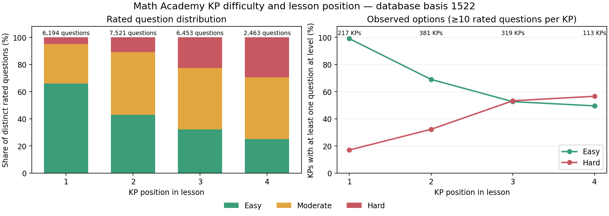

# KP difficulty options and lesson position

**Best estimate: many KPs have a restricted difficulty range, and that range is strongly associated with lesson position.** Early KPs favor easy questions; later KPs favor moderate and hard questions. Position supplies a useful prior, but does not determine the allowed levels: hard first-position questions and easy final-position questions both exist.

At 20 or more distinct rated questions, **26 KPs likely lack hard questions, 13 likely lack easy questions, and 7 likely lack moderate questions**. These correspond to **35 distinct KPs with at least one likely unavailable level**. The four moderate-only KPs appear in both the no-easy and no-hard counts. The largest rated sample is **27**, so there are no 30-question cases in this snapshot.

## Database inventory first

This report analyzes practice questions linked to an identified KP. The analysis starts with the EDB `math` database at immutable basis **1522**, lineage `01a12a15-3e0a-75a1-9dac-f8b8c5d5c3f1`. All database reads use that basis. No database facts were changed.

| Inventory | Count |
|---|---:|
| KPs | 9,639 |
| Distinct questions in practice pools | 46,774 |
| KP–question memberships | 46,775 |
| Rated memberships | 30,479 |
| Unrated memberships | 16,296 |
| KPs with no rated questions | 5,716 |
| KPs with at least 10 rated questions | 1,168 |
| KPs with at least 20 rated questions | 51 |

One question is shared between two pools, so the membership count exceeds the distinct-question count by one. All 30,479 rated memberships have Math Academy source attribution. The strongest absence candidates therefore use source-observed ratings. Canonical worked examples are excluded: the inventory reads `:knowledge-point/questions`, not the canonical-example reference.

Raw zero counts are **6,831 KPs without easy, 6,835 without moderate, and 8,474 without hard**. These are database absences, not evidence that Math Academy lacks those options. Most have inadequate rated coverage.

Excluding the **5,716 KPs with no difficulty ratings across all three levels** leaves **3,923 KPs**. Each KP appears exactly once below, grouped by its missing levels. These are gaps in the collected ratings, before estimating whether those levels likely exist.

| Missing levels | Count |
|---|---:|
| None | 452 |
| Easy | 520 |
| Moderate | 39 |
| Hard | 1,391 |
| Easy–moderate | 154 |
| Moderate–hard | 926 |
| Easy–hard | 441 |
| **Total** | **3,923** |

## Position and distribution

Full captured lesson inventories assign positions to **2,538 KPs**. The evidence contains **955 lesson captures**, covering **789 distinct topics**. Positions count KPs, starting at 1; tutorials do not occupy KP positions. Modern captures use explicit lesson-definition order. Legacy captures use completed-lesson checkpoint order, checked against numbered history labels. Every legacy lesson used passed that order check. No matched KP changed numerical position across its captured lessons.



| KP position | KPs with known position | Rated questions | Easy | Moderate | Hard |
|---|---:|---:|---:|---:|---:|
| 1 | 789 | 6,194 | 66.0% | 29.0% | 5.0% |
| 2 | 789 | 7,521 | 42.9% | 46.3% | 10.8% |
| 3 | 682 | 6,453 | 32.2% | 45.2% | 22.6% |
| 4 | 274 | 2,463 | 25.2% | 45.5% | 29.4% |
| 5 | 4 | 38 | 34.2% | 34.2% | 31.6% |

The fifth-position sample has only four KPs. The first four positions provide the useful pattern. Giving each KP equal weight produces the same progression, rather than allowing a few larger pools to drive it.

Availability also changes with position. Restricting this comparison to KPs with at least 10 rated questions:

| Position | KPs | Easy observed | Hard observed |
|---|---:|---:|---:|
| 1 | 217 | 99.1% | 17.1% |
| 2 | 381 | 69.0% | 32.3% |
| 3 | 319 | 52.7% | 53.3% |
| 4 | 113 | 49.6% | 56.6% |

### Comparison within the same lesson

For each topic, select its latest complete captured lesson, then compare its first and final KP. Give each topic equal weight. Among **197 topics** where both endpoints have at least 10 rated questions:

| Final KP minus first KP | Difference | Topic-bootstrap 95% interval |
|---|---:|---:|
| Easy question share | -41.0 percentage points | -46.9 to -35.1 |
| Moderate question share | +17.3 percentage points | +12.3 to +22.2 |
| Hard question share | +23.8 percentage points | +19.4 to +28.0 |

The final KP is also **45.7 percentage points more likely to have at least one observed hard question**, and **52.3 points less likely to have an observed easy question**. The direction persists in two-, three-, and four-KP lessons and across sample-size cutoffs of 1, 5, 10 and 15 questions. At 20 questions, few matched endpoint pairs remain; that subgroup is not suitable for a precise position estimate. Intervals resample captured topics 4,000 times with seed 20261012; they measure stability within these observations, not a random sample of the entire Math Academy curriculum.

### Position does not impose a fixed level

Examples with actual database counts:

| KP | Position | Easy / Moderate / Hard |
|---|---:|---:|
| Classifying a Given Critical Point Using the Second Derivative Test (`e-3744`) | 1 of 2 | 7 / 2 / 11 |
| Finding the Cartesian Equation of a Curve Defined Parametrically (`e-5087`) | 1 of 2 | 11 / 6 / 3 |
| Evaluating Definite Integrals (`e-14422`) | 3 of 3 | 16 / 5 / 6 |
| Finding a Derivative Using Properties of Inverse Functions (`e-14722`) | 4 of 4 | 4 / 9 / 12 |

The likely explanation is instructional sequencing: lessons begin with simpler procedures and progress to more demanding variants. The procedure demonstrated by a KP drives its question repertoire. Our captures do not move the same KP between positions, so they cannot isolate position itself from the mathematical content.

## Distinguishing missing collection from likely unavailable options

Count **distinct practice questions with source-observed ratings**, not repeated appearances, attempts, or canonical examples. Use only rated questions as the sampling denominator. Unrated questions stay visible in the inventory; they are not counted as easy, moderate or hard.

For every KP and level, apply this practical decision rule:

| Evidence | Classification |
|---|---|
| At least one question at the level in EDB | Observed in database |
| No question at the level in EDB, but one exists in captures | Exists; database pool incomplete |
| Zero at the level and at least 20 distinct source-rated questions | Best guess: unavailable |
| Zero at the level and 10–19 rated questions | Tentative absence |
| Zero at the level and fewer than 10 rated questions | Insufficient sampling |

All KPs remain in the evidence files, including zero-question and four-question cases. The cutoffs classify strength; they do not exclude observations. Future 30-question cases with multiple captured tasks receive a stronger label. No current KP meets that threshold.

For a missing level with n rated questions, a simple sampling diagnostic is:

```text
P(no observations | level selected with probability p) = (1 - p)^n
```

| n | p = 5% | p = 10% | p = 15% |
|---|---:|---:|---:|
| 4 | 81.5% | 65.6% | 52.2% |
| 10 | 59.9% | 34.9% | 19.7% |
| 20 | 35.8% | 12.2% | 3.9% |
| 27 | 25.0% | 5.8% | 1.2% |
| 30 | 21.5% | 4.2% | 0.8% |

This is an illustrative sampling calculation, not a posterior probability that an option exists. Distinct scraped questions are selected adaptively, and difficulty levels need not be equally common. A rare level can remain unseen even with a substantial sample. The best-guess classifications also gain support from the strong position pattern, recurring single-level or two-level pools, multiple captured tasks, and neighboring KPs that did receive the supposedly missing level.

### Absence confidence measure

**Absence confidence (a heuristic score): how likely we would have been to observe at least one question at this difficulty, if it occurred at the expected rate.** When a KP has zero observations at a level, a high score means that absence is surprising under the assumed distribution.

For a missing level, let n be the number of distinct rated practice questions in the KP and p be the expected share of that level:

```text
P_zero = (1 - p)^n
Absence confidence score = 100 × (1 - P_zero)
```

Equivalently, subtract the zero-observation likelihood expressed as a percentage from 100. The score ranges from 0 to 100. Unrated questions and repeat appearances do not increase n. KPs with no rated questions are excluded. An observed question at the level, whether in the database or captures, establishes that it exists and takes precedence over an absence score.

The baseline uses **30,478 distinct rated practice questions**, deduplicated by question entity rather than KP membership:

| Level | Distinct questions | Expected share p | First n with P_zero below 1% |
|---|---:|---:|---:|
| Easy | 13,601 | 44.6256% | 8 |
| Moderate | 12,347 | 40.5112% | 9 |
| Hard | 4,530 | 14.8632% | 29 |

For moderate, p = 12347 / 30478 ≈ 0.405111884. Its zero-observation likelihood first falls below 1% at **9 rated questions**, giving an absence confidence score of **99.07**.

| Rated questions n | Chance of zero moderate | Absence confidence score |
|---|---:|---:|
| 1 | 59.488812% | 40.511188 |
| 2 | 35.389187% | 64.610813 |
| 3 | 21.052607% | 78.947393 |
| 4 | 12.523946% | 87.476054 |
| 5 | 7.4503464% | 92.549654 |
| 6 | 4.4321225% | 95.567877 |
| 7 | 2.636617% | 97.363383 |
| 8 | 1.5684921% | 98.431508 |
| 9 | 0.93307733% | 99.066923 |
| 10 | 0.55507662% | 99.444923 |
| 15 | 0.041355131% | 99.958645 |
| 20 | 0.0030811005% | 99.996919 |
| 25 | 0.00022955266% | 99.99977 |
| 30 | 1.7102468e-05% | 99.999983 |

**Interpretation:** with 9 rated questions, a sample would detect at least one moderate question 99.07% of the time under the assumed distribution, yet this KP has none observed. That supplies evidence for absence; it is not a literal 99.07% probability that moderate questions do not exist for that KP.

The calculation assumes independent draws and the same expected difficulty share for the KP as the reference distribution. Lesson position, mathematical content, adaptive selection, and deduplication of repeated draws can affect that assumption. The overall shares provide a consistent benchmark; position-specific shares can supply an alternative reference. A posterior probability of true unavailability would additionally require a model of how often KPs lack a level and how existing levels are sampled.

For a KP missing multiple levels, report a separate score for each missing level rather than multiplying the confidence scores. This continuous measure supplements the sample-size classifications above.

All **13 likely no-easy KPs** have easy questions in other KPs of the same captured lesson. **12 of the 26 likely no-hard KPs** have hard questions elsewhere in the same captured lesson. This makes a general lack of easy or hard sampling an inadequate explanation for those cases. It does not rule out KP-specific adaptive selection.

Of the 51 KPs with at least 20 rated questions: **7 are easy-only, 4 moderate-only, 15 easy/moderate, 9 moderate/hard, and 16 have all three levels**. Persistent restricted repertoires are therefore common in our best-sampled group.

### Full list of best-guess restricted KPs

Counts below are the fixed-basis EDB inventory. “Unrated” is retained explicitly. Capture links point to the latest lesson providing position evidence.

| KP | Position | E | M | H | Unrated | Likely unavailable | Captured tasks |
|---|---:|---:|---:|---:|---:|---|---:|
| [Solving a 2x2 System of Equations Using an Inverse Matrix](reference/mathacademy/question-capture/14080115/content.json) (`e-4508`) | 1/2 | 27 | 0 | 0 | 0 | moderate, hard | 8 |
| [Calculating the Cross Product Using Determinants](reference/mathacademy/question-capture/14076277/content.json) (`e-4341`) | 1/2 | 26 | 0 | 0 | 1 | moderate, hard | 6 |
| [Counting the Number of Possible Rational Roots of a Polynomial](reference/mathacademy/capture/differential/14132540/content.json) (`e-5767`) | 3/4 | 0 | 11 | 15 | 0 | easy | 11 |
| [Calculating the Derivative of an Inverse Function Using a Table](reference/mathacademy/question-capture/14083756/content.json) (`e-14721`) | 3/4 | 14 | 11 | 0 | 1 | hard | 8 |
| [Calculating the Limit of a Rational Function with a Radical in the Numerator](reference/mathacademy/question-capture/14093433/content.json) (`e-74`) | 1/2 | 10 | 15 | 0 | 0 | hard | 4 |
| [Finding Particular Solutions of Differential Equations by First Rearranging and Then Separating](reference/mathacademy/question-capture/14013233/content.json) (`e-541`) | 2/2 | 11 | 13 | 0 | 0 | hard | 4 |
| [Calculating a Limit Using L'Hopital's Rule Twice](reference/mathacademy/question-capture/13948006/content.json) (`e-301`) | 2/4 | 0 | 18 | 5 | 1 | easy | 5 |
| [Calculating a Scalar Projection Using Components](reference/mathacademy/question-capture/14098324/content.json) (`e-15607`) | 2/3 | 14 | 9 | 0 | 1 | hard | 5 |
| [Computing a Definite Integral Using Integration by Parts](reference/mathacademy/capture/differential/14131879/content.json) (`e-6209`) | 3/3 | 0 | 23 | 0 | 0 | easy, hard | 5 |
| [Solving for a Variable in a Singular Matrix](reference/mathacademy/question-capture/13975082/content.json) (`e-4504`) | 3/3 | 13 | 10 | 0 | 1 | hard | 5 |
| [Calculating the Scalar Triple Product Using a Determinant](reference/mathacademy/capture/foundations/14140986/content.json) (`e-4348`) | 2/3 | 11 | 11 | 0 | 1 | hard | 6 |
| [Determining the Center and Lengths of the Major and Minor Axes Given the Equation of an Ellipse](reference/mathacademy/capture/differential/14134399/content.json) (`e-5223`) | 3/3 | 11 | 11 | 0 | 1 | hard | 8 |
| [Determining the Lengths of the Major and Minor Axes Given the Equation of an Ellipse](reference/mathacademy/question-capture/14095310/content.json) (`e-5073`) | 3/3 | 22 | 0 | 0 | 1 | moderate, hard | 7 |
| [Expressing a Vector That Satisfies a Ratio in Terms of Known Vectors](reference/mathacademy/question-capture/14073957/content.json) (`e-4288`) | 4/4 | 0 | 22 | 0 | 1 | easy, hard | 7 |
| [Projecting a Vector Onto a Perpendicular Vector](reference/mathacademy/question-capture/14098324/content.json) (`e-15608`) | 3/3 | 0 | 22 | 0 | 0 | easy, hard | 4 |
| [Solving a 2x2 System of Equations Using an Inverse Matrix With Reorganization](reference/mathacademy/question-capture/14080115/content.json) (`e-4509`) | 2/2 | 0 | 9 | 13 | 0 | easy | 7 |
| [Calculating a Vector Projection Using Components](reference/mathacademy/question-capture/13977621/content.json) (`e-14618`) | 2/3 | 12 | 9 | 0 | 2 | hard | 5 |
| [Calculating the Arc Length of a Smooth Curve Using the Arc Length Formula](reference/mathacademy/question-capture/14082094/content.json) (`e-560`) | 2/3 | 0 | 13 | 8 | 0 | easy | 6 |
| [Determining the Equation of a Tall Ellipse](reference/mathacademy/capture/differential/14134399/content.json) (`e-5222`) | 2/3 | 21 | 0 | 0 | 1 | moderate, hard | 8 |
| [Determining the Equation of a Tall Ellipse](reference/mathacademy/question-capture/14095310/content.json) (`e-5072`) | 2/3 | 14 | 7 | 0 | 1 | hard | 6 |
| [Determining the Range of a Parametric Equation](reference/mathacademy/question-capture/14073429/content.json) (`e-5099`) | 3/4 | 0 | 21 | 0 | 2 | easy, hard | 7 |
| [Finding Two Scalar Factors in a Linear Combination](reference/mathacademy/question-capture/14073957/content.json) (`e-4287`) | 3/4 | 2 | 19 | 0 | 0 | hard | 8 |
| [Finding the Center of a Vertical Hyperbola Given an Equation in Expanded Form](reference/mathacademy/question-capture/14094078/content.json) (`e-5354`) | 4/4 | 0 | 15 | 6 | 1 | easy | 6 |
| [Simplifying Definite Integrals of Odd Functions](reference/mathacademy/question-capture/14014138/content.json) (`e-10911`) | 3/3 | 12 | 9 | 0 | 1 | hard | 5 |
| [Calculating a Limit at Positive or Negative Infinity Using L'Hopital's Rule](reference/mathacademy/question-capture/13948006/content.json) (`e-303`) | 4/4 | 9 | 11 | 0 | 1 | hard | 4 |
| [Calculating an Element of the Inverse of a 3x3 Matrix](reference/mathacademy/capture/differential/14130016/content.json) (`e-4516`) | 2/3 | 20 | 0 | 0 | 0 | moderate, hard | 7 |
| [Calculating an Indeterminate Limit of the Form Infinity Divided by Infinity Using L'Hopital's Rule](reference/mathacademy/question-capture/13948006/content.json) (`e-302`) | 3/4 | 0 | 15 | 5 | 1 | easy | 4 |
| [Calculating the Area of the Image of an Object Under a Linear Transformation Given a Diagram](reference/mathacademy/question-capture/14095768/content.json) (`e-5470`) | 2/3 | 20 | 0 | 0 | 1 | moderate, hard | 5 |
| [Calculating the Cofactor Method To Solve for an Unknown Quantity](reference/mathacademy/capture/differential/14130016/content.json) (`e-4515`) | 3/3 | 0 | 10 | 10 | 1 | easy | 6 |
| [Calculating the Limit of a Rational Function with a Radical in the Denominator](reference/mathacademy/question-capture/14093433/content.json) (`e-75`) | 2/2 | 10 | 10 | 0 | 1 | hard | 4 |
| [Determining the Equation of a Wide Ellipse](reference/mathacademy/capture/differential/14134399/content.json) (`e-5219`) | 1/3 | 20 | 0 | 0 | 0 | moderate, hard | 5 |
| [Finding the Amplitude-Phase Form for Sine](reference/mathacademy/question-capture/14095807/content.json) (`e-3543`) | 3/4 | 0 | 13 | 7 | 2 | easy | 5 |
| [Finding the Cartesian Equation of the Plane Perpendicular To a Given Line](reference/mathacademy/capture/differential/14118277/content.json) (`e-4937`) | 2/4 | 13 | 7 | 0 | 0 | hard | 6 |
| [Perpendicular Vectors](reference/mathacademy/question-capture/13977621/content.json) (`e-14619`) | 3/3 | 7 | 13 | 0 | 0 | hard | 5 |
| [Solving for an Unknown in an Equation Involving the Cross Product](reference/mathacademy/question-capture/14076277/content.json) (`e-4343`) | 2/2 | 0 | 9 | 11 | 1 | easy | 6 |

Every listed KP has position evidence and multiple captured tasks. The most decisive matched example is the two-KP lesson with **Solving a 2x2 System of Equations Using an Inverse Matrix** first (27 easy, no moderate or hard), followed by **…With Reorganization** (9 moderate, 13 hard, no easy). Hard and easy questions both occur within its captured lessons, in different KPs.

### Capture evidence that overturns a database zero

Captures demonstrate an easy option for **15** database-zero KPs, a moderate option for **16**, and a hard option for **6**. These counts can overlap. None belongs to the 20-question restricted-KP list. Across all KPs, **139 captured question–KP pairs are absent from the corresponding fixed-basis database pool**. These are collection/import or snapshot gaps, rather than evidence that a difficulty option cannot exist. No matched question had conflicting captured difficulty labels.

### Scores for surfaced candidate KPs

The saved [find_candidates.py](generate/scripts/find_candidates.py) discovery at **2026-10-12T19:34:48.863Z** surfaces **384 distinct KPs across 120 topics**, at the same database basis **1522** as this report. Of these, **358 have rated questions** and **26 have no rated evidence**. Each KP appears in exactly one missing-level group below.

Every missing level receives the separate absence score defined above. A **hybrid score** also measures the entire missing-level pattern. Let M be the set of missing levels and p_M the sum of their expected shares:

```text
p_M = sum(p_level for level in M)
P_zero_pattern = (1 - p_M)^n
Hybrid absence score = 100 × (1 - P_zero_pattern)
```

For two missing levels A and B, this uses the probability of observing neither: (1 − p_A − p_B)ⁿ. For one missing level, the hybrid equals the separate score. With no missing levels or no rated evidence, no hybrid is assigned. The same global shares and independent-draw assumptions apply.

A high hybrid means the combined gap is surprising under the reference distribution. It does not imply equally strong evidence for each missing level, or a posterior probability that both levels are unavailable. Keep the separate scores alongside it.

The table shows **medians of individual KP scores within each group**, not pooled group confidences. Scores range from 0 to 100; — means no applicable absence score.

| Missing levels | KPs | Median easy score | Median moderate score | Median hard score | Median hybrid score |
|---|---:|---:|---:|---:|---:|
| None | 38 | — | — | — | — |
| Easy | 67 | 99.5105 | — | — | 99.5105 |
| Moderate | 6 | — | 94.0588 | — | 94.0588 |
| Hard | 124 | — | — | 72.3981 | 72.3981 |
| Easy–moderate | 14 | 99.3132 | 98.7492 | — | >99.9999 |
| Moderate–hard | 73 | — | 98.4315 | 72.3981 | 99.8427 |
| Easy–hard | 36 | 99.7289 | — | 79.9934 | 99.9881 |
| No rated evidence | 26 | — | — | — | — |

**320 KPs** have at least one missing level, yielding **443 separate level scores and 320 hybrid scores**. The other **38 rated KPs** have all three levels observed. Values that would round to 100.0000 are shown as >99.9999; the saved JSON retains the zero-observation probabilities.

[Every KP’s counts and separate/hybrid scores, organized by group](generate/reports/kp-absence-2026-10-12/report.md) · [Full-precision scores and group summaries](generate/reports/kp-absence-2026-10-12/scores.json) · [Saved discovery output](generate/reports/kp-absence-2026-10-12/candidates.json).

Reproduce these scores from the saved discovery and fixed-basis inventory:

```bash
python3 generate/scripts/score_absence.py \
  --candidates generate/reports/kp-absence-2026-10-12/candidates.json \
  --output generate/reports/kp-absence-2026-10-12
```

### Content pilot: can we invent the missing level?

Three surfaced KPs with individual missing-level scores between 80 and 95 were examined using [Classify](generate/docs/3-classify.md) and [Template Extraction](generate/docs/4-template-extraction.md), with one missing-easy, one missing-moderate, and one missing-hard case. All 26 practice records were read at basis 1522, with complete choice mappings and available worked solutions preserved.

| KP | Missing level | Absence score | Design result |
|---|---|---:|---|
| Finding an Entry of a Matrix | Moderate | 92.5497 | Narrow scope: a fractional entry in a 5×4 matrix still requires one lookup. A convincing moderate family was not found without adding other skills. |
| Computing a Reciprocal Ratio Using the Pythagorean Identity | Easy | 94.7935 | Natural easy family: Pythagorean-triple coordinates preserve identity recovery and inversion while removing rationalization. An unrated original and the canonical example already support simpler in-scope cases. |
| Calculating the Determinant of a 2x2 Matrix With Non-Integer Entries | Hard | 85.4986 | Feasible authored hard family: compound radical fractions add conjugate-product and fraction algebra while retaining the same 2×2 determinant procedure. |

Best judgment: retain easy lookup variants; propose an easy reciprocal family; allow a harder determinant family with its prerequisite-algebra burden documented. Absence scores prioritize investigation; content scope and meaningful difficulty separation decide whether to invent a missing level. Authored labels remain distinct from source-observed labels.

[Full three-KP analysis, classifications, and template extractions](generate/reports/missing-level-pilot-2026-10-12/report.md) · [Concrete probes and worked solutions](generate/reports/missing-level-pilot-2026-10-12/probes.md) · [Exact verification](generate/reports/missing-level-pilot-2026-10-12/probe-verification.json). No database facts were changed.

## Account and selection effects

The question catalog is shared content, so its availability evidence can combine distinct question identities collected across accounts. Learner progress is not merged. Selection distributions below are calculated separately for each account, with the legacy archive kept explicitly unlabelled.

The first two distinct lesson questions per KP reduce the influence of later remediation. They still represent selected practice, rather than a uniform sample of a question bank. A separate order audit checked 1,284 identified current-capture KP sample pointers, all matching captured question order.

| Account | First-position questions | First-position hard | Third-position questions | Third-position hard |
|---|---:|---:|---:|---:|
| differential | 264 | 4.2% | 238 | 20.6% |
| foundations | 158 | 1.9% | 146 | 26.7% |
| linear | 164 | 6.1% | 142 | 9.2% |
| multivariable | 214 | 4.7% | 184 | 23.9% |
| legacy-unlabelled | 1110 | 5.1% | 926 | 20.5% |

The direction appears separately in every current account and the legacy archive. Linear has a weaker first-to-third change, which is a useful reminder that subject matter affects the repertoire. The detailed evidence also retains distributions separately for lessons, reviews, assessments and diagnostics; those activity types have different selection behavior.

## Engine implications

Use **per-KP available levels** when selecting questions. Position is a fallback prior for under-collected KPs; it should not declare a level impossible. Keep inferred unavailability distinct from the levels currently present in our database, so a newly scraped hard question can immediately overturn a no-hard estimate.

The current selector already renormalizes policy weights over nonempty eligible rated bands in [question_selection.rs](engine/rust/question_selection.rs:173). With initial weights 45/40/15, an easy/moderate-only pool uses **52.94% easy and 47.06% moderate**; a moderate-only pool uses **100% moderate**. That behavior fits this evidence. Aggregate proportions by position cannot directly identify the underlying global policy weights.

Topic workload calibration currently applies one global expected difficulty distribution to all KPs. These findings identify a possible refinement: calculate each KP’s expected workload from its effective available-band weights before fitting the topic multiplier. Existing topic multipliers already absorb some of those repertoire differences. Changing that expectation would require recalculating multipliers to preserve captured lesson denominators; this analysis does not change the current calibration or policy.

## Evidence and reproduction

- [Full KP inventory, counts, classifications and capture links](reference/mathacademy/kp-difficulty-analysis-2026-10-12/kp-inventory.json)
- [Missing-level candidates with at least 10 rated questions](reference/mathacademy/kp-difficulty-analysis-2026-10-12/missing-level-candidates.json)
- [Position comparisons, account distributions and bootstrap results](reference/mathacademy/kp-difficulty-analysis-2026-10-12/position-comparisons.json)
- [Fixed-basis EDB pool inventory](reference/mathacademy/kp-difficulty-analysis-2026-10-12/database/pool-inventory.json)
- [KP-linked captured question occurrences](reference/mathacademy/kp-difficulty-analysis-2026-10-12/capture-occurrences.json)
- [Analysis script](capture/scripts/analyze_kp_difficulty.py), [position-comparison script](capture/scripts/analyze_kp_position.py), and [report/figure generator](capture/scripts/write_kp_difficulty_report.py)

The EDB export uses explicit Pull patterns in bounded 40-KP batches, with `--as-of 1522` on every read. The saved query and input files preserve those requests. Difficulty provenance is checked independently against `:org/Math-Academy`. Capture KP identity uses the canonical example ID or the stable database KP UUID, never a title-only match.

Rerun the analysis against the frozen database export and capture projections:

```bash
python3 capture/scripts/analyze_kp_difficulty.py analyze
/home/jake/Developer/MA/.venv/bin/python capture/scripts/analyze_kp_position.py
```

Running `collect` replaces capture projections with a fresh local snapshot. A new analysis of live data should also export a fresh EDB basis. Do not combine new capture counts with an old database snapshot without explicitly recording that difference.
