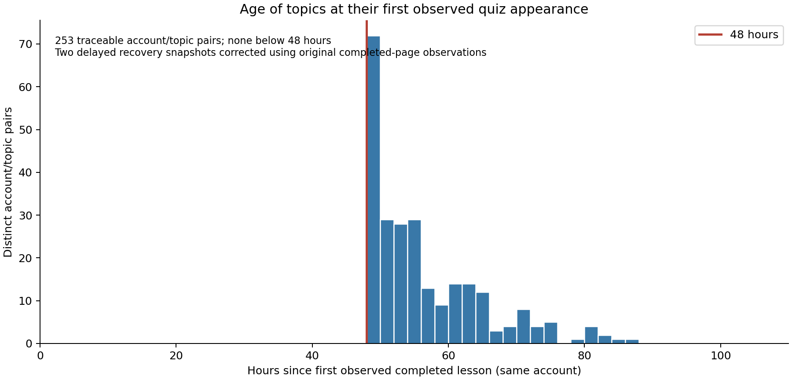

# Topic age and Math Academy quiz eligibility

Read-only analysis, October 11, 2026. No runners were started; no original captures, capture engine code, website settings, or database facts were changed. All times below are elapsed wall-clock time unless labeled otherwise. “Assessment” here means the website's ordinary quiz activity; this analysis does not establish rules for placement diagnostics or formal midterms/finals.

## Finding

**The saved captures strongly support a roughly 48-hour age condition on individual learned topics, including topics selected for later quizzes.** Every traceable quiz question satisfies that boundary after two delayed recovery timestamps are checked against the original completion evidence. The youngest traceable topic was at least **48 hours, 2 minutes, 8 seconds** old when its quiz was first observed offered.

This refines the earlier course-level inference in `report.md`. It is not simply “wait two days after the diagnostic” or “wait two days between quizzes.” Topics can mature while the account continues working. Later quizzes can draw on that older inventory as soon as their XP and other eligibility conditions permit.

The exact backend rule is not published in the sources reviewed. A hard 48-hour cutoff is the best explanation of the observed boundary, but an age-dependent selection policy or a related scheduling threshold could produce a similar pattern. **We have evidence of an apparent necessary age condition in the matched sample, not proof that age is sufficient or that the service stores the same timestamps we do.**

## Coverage and method

The comparison uses 458 question appearances in 54 completed quiz tasks. All 458 topic IDs were checked against the original question's `/topics/<id>#<kp>` attribution link; none depended solely on an inferred topic title.

- 325 appearances have an earlier successful captured lesson for the **same account and topic**, across course switches.
- Those cover 43 quizzes and 253 distinct account/topic pairs: 295 ordinary-quiz appearances and 30 retake appearances. Repeated appearances are not independent additional topics.
- 133 appearances have no captured earlier lesson. Their ages remain unknown; missing history is not treated as a recent lesson or as compliance with the rule. Much of this missing coverage is in earlier Foundations captures.
- All 325 matched anchors have successful lesson-completion evidence. Their saved state says `lesson_complete: true`; newer outcome fields say `passed`, while some legacy states have no outcome field.
- All 458 comparisons use the first **saved quiz offer**, not quiz completion. A first saved offer is an observation bound, not the precise server-side creation time.

The age anchor is the earliest observed successful lesson completion for that account/topic. A post-completion snapshot can be later than real completion, so these ages generally underestimate elapsed time since learning. Conversely, an unobserved earlier lesson may exist. Historical first learning is not necessarily the current acquisition event after a diagnostic or relearning.

| Enrolled course at quiz | Matched / all question appearances | Youngest traceable topic age |
|---|---:|---:|
| Mathematical Foundations II | 0 / 65 | Unknown |
| Mathematical Foundations III | 169 / 237 | 48.109 hours |
| Mathematical Methods for the Physical Sciences I | 12 / 12 | 48.160 hours |
| Multivariable Calculus | 38 / 38 | 48.036 hours |
| Linear Algebra | 28 / 28 | 48.088 hours |
| Differential Equations | 28 / 28 | 48.069 hours |
| Methods of Proof | 50 / 50 | 48.455 hours |

The chart counts each account/topic once, using its first observed quiz appearance. The concentration immediately above 48 hours is more informative than merely finding many old topics in quizzes.

## The two apparent exceptions were late recovery snapshots

Using only saved post-completion snapshot timestamps gives 323 matches above 48 hours and two below it. Both snapshots explicitly say they were recovered after interruption. The original logs and saved completion pages resolve both without changing the source records.

| Lesson → quiz | Age using recovery snapshot | Conservative age using original completion evidence |
|---|---:|---:|
| Foundations lesson 13945962, Speed-Time Graphs → Quiz 11, 14006735 | 42.687 hours | **48.537 hours** |
| Multivariable lesson 14041552, Interiors and Boundaries of Sets → Quiz 1, 14093183 | 47.948 hours | **48.036 hours** |

For Speed-Time Graphs, the last answer was accepted October 4 at 19:30:45 PDT. The original error capture already displayed lesson completion and an XP award by 19:31:35.217. The October 5 recovery snapshot was almost six hours later. The failure involved exiting an already-completed lesson; it did not establish that learning occurred at recovery time.

For Interiors and Boundaries, the final answer was accepted October 8 at 01:11:02.696 PDT. The interruption capture already displayed lesson completion by 01:11:06.326. Recovery created the snapshot about five minutes later. The quiz was first observed October 10 at 01:13:14.767 PDT.

The replacements are **latest-known completion bounds**, not guessed exact backend completion times. Original evidence:

- `.local/question_capture/logs/run-1791153525223349569.log` and `reference/mathacademy/question-capture/13945962/diagnostics/1791167494997836945/page.html`.
- `.local/question_capture-workers/multivariable/logs/run-1791446683540264702.log` and `reference/mathacademy/question-capture-workers/multivariable/14041552/diagnostics/1791447066125888643/page.html`.

`topic_age.py` retains both snapshot-based and original-bound ages, and verifies the saved HTML's completion text. The derived correction does not overwrite either capture.

## Which clock fits?

### Successful learning fits much better than diagnostic completion

Methods I Quiz 1, task 14116310, used six topics learned during the first session after its final diagnostic. Their ages at the first saved offer were tightly clustered:

| Topic | Captured lesson | Age at offer |
|---|---:|---:|
| Cardinality of Finite Sets | 14071099 | 48.853 hours |
| Introduction to First-Order Linear ODEs | 14071102 | 48.728 hours |
| Systems of Equations as Augmented Matrices | 14071100 | 48.577 hours |
| Eigenvalues and Eigenvectors of a 2×2 Matrix | 14071103 | 48.420 hours |
| Elementary Row Operations | 14071448 | 48.272 hours |
| Set Complements | 14071504 | 48.160 hours |

All six were white, band 0, in the saved final diagnostic progress observation (`question-capture/14070857/knowledge-state/diagnostic-completed.json`). This strengthens the interpretation that these were newly learned eligible topics, rather than arbitrary older material.

Proof Quiz 1, task 14097922, appeared only about **2.52 hours after the Proof diagnostic**. All seven selected topics had been learned under the **same account's earlier Linear Algebra enrollment**, **48.45–62.33 hours** before the offer. The account/topic history carries across courses in this example; a new enrollment did not require every selected topic to wait another two days.

### A recent review does not restart the apparent clock

245 matched appearances have a recorded intervening review. Of those, **223** had their latest observed review less than 48 hours before the quiz, and **77** less than 24 hours before it. Four ordinary-quiz appearances had a review within one hour, so this is not explained solely by retakes.

For example, Foundations III Quiz 19, task 14043368, tested topic 2162, Solving an Expanded Polynomial Inequality, about **49.47 hours after its lesson but only 22 minutes after review 14042986**. A rule requiring 48 hours since the latest direct practice would exclude that topic. Our evidence instead points toward learning/acquisition age or another longer-lived eligibility timestamp.

### Later quizzes still use aged topics

The same boundary holds across later quizzes, including all 50 traceable Proof question appearances. The earlier timing analysis found subsequent quizzes offered about 85–88 minutes after the preceding quiz completed. There is no contradiction: the next quiz's topics were already days old. The XP counter controls quiz cadence while topic ages constrain the available material.

### A clean negative observation favors 48 hours over 24

At 35.03 hours after the Linear Algebra diagnostic, the saved queue after task 14072172 had no quiz and no in-progress activity. The observed history already contained 214 distinct successfully learned topics, including **74 at least 24 hours old**, **43 of them native to Linear Algebra**. None of those observed lesson anchors was 48 hours old yet.

This is useful because neither an unfinished activity nor an absence of day-old learned material explains that particular queue. It is consistent with a two-day threshold and less consistent with a simple one-day threshold. It does not prove that every other quiz requirement had been satisfied or rule out unobserved older knowledge.

## Why 48 hours does not explain every absence

Current displayed knowledge, past lessons, and quiz eligibility are different facts.

After the Machine Learning diagnostic, five native topics had captured lessons more than 48 hours earlier, but **all five were white** in the new post-diagnostic observation. Old learning history alone therefore overstates the currently known pool. Its new post-diagnostic lessons were still much younger than 48 hours when capture stopped.

Methods II is the stronger unresolved case. By its last captured activity, 78 native topics had historical lesson anchors at least 48 hours old. In the immediate post-diagnostic observation, 48 were white and 30 were blue. **25 of the older blue topics had not appeared in our saved quizzes**, yet the course still had no quiz. Also, **27 of its 55 captured lesson activities were relearning topics with earlier captured lessons**.

Therefore even “historically learned, old enough, blue, and not previously quizzed in our records” is not a sufficient eligibility test. Possible additional factors include the current acquisition timestamp after diagnosis/relearning, mastery requirements, encompassing-topic exclusions, usable question coverage, and course configuration. Display bands are observations, not the service's complete internal knowledge state. We cannot identify the missing condition from these records, and we cannot establish whether relearning resets the age clock.

The official description says quizzes prioritize enrolled-course material and deprioritize topics already quizzed or encompassed by other quizable topics. That supports additional selection rules, but does **not** publish a numeric 48-hour eligibility rule. [Math Academy's algorithm description](https://mathacademy.com/how-our-ai-works).

## Best working model and rationale

A useful hypothesis is:

1. Successful learning/acquisition starts a topic age clock for the account.
2. Around 48 hours later, that topic can join a quiz pool if its current knowledge state and other filters qualify it.
3. Sufficient qualifying material plus the XP counter permits a quiz; the earlier ledger analysis supports optional availability near 120 learning XP and a required boundary at 150 in fully covered later intervals.
4. Activity completion can trigger a fresh queue decision. A pause lets topics age, but stopping activity is not itself demonstrated to be a requirement.

This is a conceptual model, not recovered service code. It does not assume a fixed number of eligible topics: the observed Methods I quiz had six questions, while other quizzes had more, and their expected solving times differ.

The learning-design rationale is plausible: immediate success can reflect familiarity with the just-seen procedure; a later unaided quiz checks whether it remains retrievable. Frequent low-stakes quizzes, spaced retrieval, and varied topics are principles Math Academy's expert Justin Skycak discusses publicly. A two-day constant would be a straightforward scheduling choice, but psychology does not establish an exact universal 48-hour biological threshold. [Frequent low-stakes quizzes](https://www.justinmath.com/frequent-low-stakes-quizzes-are-such-a-powerful-learning-tool/).

Direct review is not necessarily required before every quiz; Skycak also describes implicit reviews through related material. That is consistent with our observation that a latest-review timestamp is a poor eligibility clock. [Interleaving and implicit review](https://www.justinmath.com/cognitive-science-of-learning-interleaving/).

## Next discriminating observation

Without starting anything, the saved post-diagnostic timestamps predict the first six newly captured native learning events cross 48 hours on **October 13, PDT**:

- Machine Learning: approximately **04:00–04:50**.
- Methods II: approximately **05:15–05:43**; the first two are relearning events, making them useful for checking the acquisition-clock hypothesis.

These are conditional topic-age crossings, **not promised quiz appearance times**. At a future authorized session, observe a clean queue before activity, then after one completed activity, and record any offered quiz's actual selected topics. An older topic newly relearned less than 48 hours before selection would help distinguish first-ever learning age from current acquisition age. Continued absence after enough new topics age would strengthen the case for additional eligibility/configuration conditions. No such experiment was initiated here.

## Reproducible evidence

- `topic_age.py`: topic-link verification, same-account lesson/review matching, conservative completion bounds, CSV and chart generation.
- `topic-age-evidence.json`: per-question sources, both age calculations, lesson status, latest reviews, and summary.
- `topic-ages.csv`: 458 question appearances; unknown ages remain blank.
- `topic_age_controls.py` and `topic-age-controls.json`: clean negative queue, post-diagnostic bands, repeated lessons, and conditional crossings.
- Earlier `evidence.json`, `new-dashboard-offers.json`, and `quiz-time-intervals.json`: original audit inputs and quiz cadence evidence.

Run the scripts from the repository root after `analyze.py` and `details.py`. `topic_age.py` generates JSON/CSV without extra dependencies; the optional chart uses Matplotlib and NumPy. All outputs are derived audit artifacts under `reference/`, consistent with keeping original observations and our inference separate.
