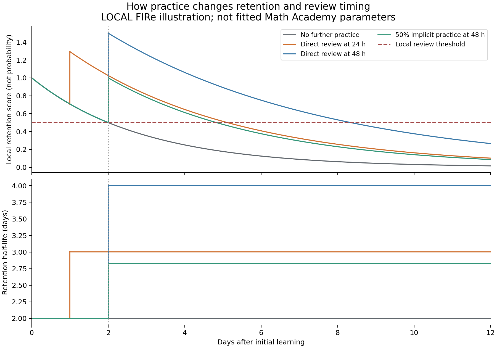

# Timed delay in Math Academy quiz eligibility

Read-only analysis, October 11, 2026. No runners were started; no original captures, capture engine code, website settings, or database facts were changed. All times below are elapsed wall-clock time unless labeled otherwise. “Assessment” here means the website's ordinary quiz activity; this analysis does not establish rules for placement diagnostics or formal midterms/finals.

## Finding

**The saved captures strongly support a roughly 48-hour age condition on individual learned topics, including topics selected for later quizzes.** Every traceable quiz question satisfies that boundary after two delayed recovery timestamps are checked against the original completion evidence. The youngest traceable topic was at least **48 hours, 2 minutes, 8 seconds** old when its quiz was first observed offered.

The [FIRe follow-up below](#follow-up-interplay-between-lessons-reviews-and-assessments) treats the 48-hour boundary as a possible **ordinary-assessment eligibility condition**, separate from the variable timing of reviews. It does not extend that condition to reviews.

The [assessment-pool follow-up](#follow-up-what-moves-a-topic-into-the-assessment-pool) now supports a more specific working rule: **successful acquisition, still treated as known, and roughly 48 hours of learning age**. We found no evidence that every topic must first complete a direct review or advance beyond its initial post-lesson display band. This is a candidate-admission model; course context and assessment history still affect which candidates are selected and whether a whole quiz is offered.

This refines the earlier course-level inference in [the earlier availability report](reference/mathacademy/capture-audits/2026-10-11-assessment-patterns/report.md). It is not simply “wait two days after the diagnostic” or “wait two days between quizzes.” Topics can mature while the account continues working. Later quizzes can draw on that older inventory as soon as their XP and other eligibility conditions permit.

The exact backend rule is not published in the sources reviewed. A hard 48-hour cutoff is the best explanation of the observed boundary, but an age-dependent selection policy or a related scheduling threshold could produce a similar pattern. **We have evidence of an apparent necessary age condition in the matched sample, not proof that age is sufficient or that the service stores the same timestamps we do.**

## Coverage and method

The comparison uses 458 question appearances in 54 completed quiz tasks. All 458 topic IDs were checked against the original question's `/topics/<id>#<kp>` attribution link; none depended solely on an inferred topic title.

- 325 appearances have an earlier successful captured lesson for the **same account and topic**, across course switches.
- Those cover 43 quizzes and 253 distinct account/topic pairs: 295 ordinary-quiz appearances and 30 retake appearances. Repeated appearances are not independent additional topics.
- 133 appearances have no captured earlier lesson. Their ages remain unknown; missing history is not treated as a recent lesson or as compliance with the rule. Much of this missing coverage is in earlier Foundations captures.
- All 325 matched anchors have successful lesson-completion evidence. Their saved state says `lesson_complete: true`; newer outcome fields say `passed`, while some legacy states have no outcome field.
- All 458 comparisons use the first **saved quiz offer**, not quiz completion. A first saved offer is an observation bound, not the precise server-side creation time.

The age anchor is the earliest observed successful lesson completion for that account/topic. A post-completion snapshot can be later than real completion, so these ages generally underestimate elapsed time since learning. Conversely, an unobserved earlier lesson may exist. Historical first learning is not necessarily the current acquisition event after a diagnostic or relearning.

| Enrolled course at quiz | Matched / all question appearances | Youngest traceable topic age |
|---|---:|---:|
| Mathematical Foundations II | 0 / 65 | Unknown |
| Mathematical Foundations III | 169 / 237 | 48.109 hours |
| Mathematical Methods for the Physical Sciences I | 12 / 12 | 48.160 hours |
| Multivariable Calculus | 38 / 38 | 48.036 hours |
| Linear Algebra | 28 / 28 | 48.088 hours |
| Differential Equations | 28 / 28 | 48.069 hours |
| Methods of Proof | 50 / 50 | 48.455 hours |

The chart counts each account/topic once, using its first observed quiz appearance. The concentration immediately above 48 hours is more informative than merely finding many old topics in quizzes.

## The two apparent exceptions were late recovery snapshots

Using only saved post-completion snapshot timestamps gives 323 matches above 48 hours and two below it. Both snapshots explicitly say they were recovered after interruption. The original logs and saved completion pages resolve both without changing the source records.

| Lesson → quiz | Age using recovery snapshot | Conservative age using original completion evidence |
|---|---:|---:|
| Foundations lesson 13945962, Speed-Time Graphs → Quiz 11, 14006735 | 42.687 hours | **48.537 hours** |
| Multivariable lesson 14041552, Interiors and Boundaries of Sets → Quiz 1, 14093183 | 47.948 hours | **48.036 hours** |

For Speed-Time Graphs, the last answer was accepted October 4 at 19:30:45 PDT. The original error capture already displayed lesson completion and an XP award by 19:31:35.217. The October 5 recovery snapshot was almost six hours later. The failure involved exiting an already-completed lesson; it did not establish that learning occurred at recovery time.

For Interiors and Boundaries, the final answer was accepted October 8 at 01:11:02.696 PDT. The interruption capture already displayed lesson completion by 01:11:06.326. Recovery created the snapshot about five minutes later. The quiz was first observed October 10 at 01:13:14.767 PDT.

The replacements are **latest-known completion bounds**, not guessed exact backend completion times. Original evidence:

- `.local/question_capture/logs/run-1791153525223349569.log` and `reference/mathacademy/question-capture/13945962/diagnostics/1791167494997836945/page.html`.
- `.local/question_capture-workers/multivariable/logs/run-1791446683540264702.log` and `reference/mathacademy/question-capture-workers/multivariable/14041552/diagnostics/1791447066125888643/page.html`.

[topic_age.py](reference/mathacademy/capture-audits/2026-10-11-assessment-patterns/topic_age.py) retains both snapshot-based and original-bound ages, and verifies the saved HTML's completion text. The derived correction does not overwrite either capture.

## Which clock fits?

### Successful learning fits much better than diagnostic completion

Methods I Quiz 1, task 14116310, used six topics learned during the first session after its final diagnostic. Their ages at the first saved offer were tightly clustered:

| Topic | Captured lesson | Age at offer |
|---|---:|---:|
| Cardinality of Finite Sets | 14071099 | 48.853 hours |
| Introduction to First-Order Linear ODEs | 14071102 | 48.728 hours |
| Systems of Equations as Augmented Matrices | 14071100 | 48.577 hours |
| Eigenvalues and Eigenvectors of a 2×2 Matrix | 14071103 | 48.420 hours |
| Elementary Row Operations | 14071448 | 48.272 hours |
| Set Complements | 14071504 | 48.160 hours |

All six were white, band 0, in the saved final diagnostic progress observation ([saved diagnostic snapshot](reference/mathacademy/question-capture/14070857/knowledge-state/diagnostic-completed.json)). This strengthens the interpretation that these were newly learned eligible topics, rather than arbitrary older material.

Proof Quiz 1, task 14097922, appeared only about **2.52 hours after the Proof diagnostic**. All seven selected topics had been learned under the **same account's earlier Linear Algebra enrollment**, **48.45–62.33 hours** before the offer. The account/topic history carries across courses in this example; a new enrollment did not require every selected topic to wait another two days.

### A recent review does not restart the apparent clock

245 matched appearances have a recorded intervening review. Of those, **223** had their latest observed review less than 48 hours before the quiz, and **77** less than 24 hours before it. Four ordinary-quiz appearances had a review within one hour, so this is not explained solely by retakes.

For example, Foundations III Quiz 19, task 14043368, tested topic 2162, Solving an Expanded Polynomial Inequality, about **49.47 hours after its lesson but only 22 minutes after review 14042986**. A rule requiring 48 hours since the latest direct practice would exclude that topic. Our evidence instead points toward learning/acquisition age or another longer-lived eligibility timestamp.

### Later quizzes still use aged topics

The same boundary holds across later quizzes, including all 50 traceable Proof question appearances. The earlier timing analysis found subsequent quizzes offered about 85–88 minutes after the preceding quiz completed. There is no contradiction: the next quiz's topics were already days old. The XP counter controls quiz cadence while topic ages constrain the available material.

### A clean negative observation favors 48 hours over 24

At 35.03 hours after the Linear Algebra diagnostic, the saved queue after task 14072172 had no quiz and no in-progress activity. The observed history already contained 214 distinct successfully learned topics, including **74 at least 24 hours old**, **43 of them native to Linear Algebra**. None of those observed lesson anchors was 48 hours old yet.

This is useful because neither an unfinished activity nor an absence of day-old learned material explains that particular queue. It is consistent with a two-day threshold and less consistent with a simple one-day threshold. It does not prove that every other quiz requirement had been satisfied or rule out unobserved older knowledge.

## Why 48 hours does not explain every absence

Current displayed knowledge, past lessons, and quiz eligibility are different facts.

After the Machine Learning diagnostic, five native topics had captured lessons more than 48 hours earlier, but **all five were white** in the new post-diagnostic observation. Old learning history alone therefore overstates the currently known pool. Its new post-diagnostic lessons were still much younger than 48 hours when capture stopped.

Methods II is the stronger unresolved case. By its last captured activity, 78 native topics had historical lesson anchors at least 48 hours old. In the immediate post-diagnostic observation, 48 were white and 30 were blue. **25 of the older blue topics had not appeared in our saved quizzes**, yet the course still had no quiz. Also, **27 of its 55 captured lesson activities were relearning topics with earlier captured lessons**.

Therefore even “historically learned, old enough, blue, and not previously quizzed in our records” does not guarantee that a whole quiz will be offered. This does not establish that those individual topics were ineligible. Possible additional factors include current acquisition history after diagnosis/relearning, previous assessment coverage, encompassing-topic preferences, usable question coverage, and course configuration. The additional analysis below weakens a high mastery threshold as the explanation: low-band topics were selected elsewhere, while many of these unselected topics had high bands and successful direct reviews. We still cannot establish whether relearning resets the age clock.

The official description says quizzes prioritize enrolled-course material and deprioritize topics already quizzed or encompassed by other quizable topics. That supports additional selection rules, but does **not** publish a numeric 48-hour eligibility rule. [Math Academy's algorithm description](https://mathacademy.com/how-our-ai-works).

## Best working model and rationale

A useful hypothesis is:

1. Successful learning/acquisition starts a topic age clock for the account.
2. Around 48 hours later, that topic can join a quiz pool if its current knowledge state and other filters qualify it.
3. Sufficient qualifying material plus the XP counter permits a quiz; the earlier ledger analysis supports optional availability near 120 learning XP and a required boundary at 150 in fully covered later intervals.
4. Activity completion can trigger a fresh queue decision. A pause lets topics age, but stopping activity is not itself demonstrated to be a requirement.

This is a conceptual model, not recovered service code. It does not assume a fixed number of eligible topics: the observed Methods I quiz had six questions, while other quizzes had more, and their expected solving times differ.

The learning-design rationale is plausible: immediate success can reflect familiarity with the just-seen procedure; a later unaided quiz checks whether it remains retrievable. Frequent low-stakes quizzes, spaced retrieval, and varied topics are principles Math Academy's expert Justin Skycak discusses publicly. A two-day constant would be a straightforward scheduling choice, but psychology does not establish an exact universal 48-hour biological threshold. [Frequent low-stakes quizzes](https://www.justinmath.com/frequent-low-stakes-quizzes-are-such-a-powerful-learning-tool/).

Direct review is not necessarily required before every quiz; Skycak also describes implicit reviews through related material. That is consistent with our observation that a latest-review timestamp is a poor eligibility clock. [Interleaving and implicit review](https://www.justinmath.com/cognitive-science-of-learning-interleaving/).

## Next discriminating observation

Without starting anything, the saved post-diagnostic timestamps predict the first six newly captured native learning events cross 48 hours on **October 13, PDT**:

- Machine Learning: approximately **04:00–04:50**.
- Methods II: approximately **05:15–05:43**; the first two are relearning events, making them useful for checking the acquisition-clock hypothesis.

These are conditional topic-age crossings, **not promised quiz appearance times**. At a future authorized session, observe a clean queue before activity, then after one completed activity, and record any offered quiz's actual selected topics. An older topic newly relearned less than 48 hours before selection would help distinguish first-ever learning age from current acquisition age. Continued absence after enough new topics age would strengthen the case for additional eligibility/configuration conditions. No such experiment was initiated here.

## Reproducible evidence

- [topic_age.py](reference/mathacademy/capture-audits/2026-10-11-assessment-patterns/topic_age.py): topic-link verification, same-account lesson/review matching, conservative completion bounds, CSV and chart generation.
- [topic-age-evidence.json](reference/mathacademy/capture-audits/2026-10-11-assessment-patterns/topic-age-evidence.json): per-question sources, both age calculations, lesson status, latest reviews, and summary.
- [topic-ages.csv](reference/mathacademy/capture-audits/2026-10-11-assessment-patterns/topic-ages.csv): 458 question appearances; unknown ages remain blank.
- [topic_age_controls.py](reference/mathacademy/capture-audits/2026-10-11-assessment-patterns/topic_age_controls.py) and [topic-age-controls.json](reference/mathacademy/capture-audits/2026-10-11-assessment-patterns/topic-age-controls.json): clean negative queue, post-diagnostic bands, repeated lessons, and conditional crossings.
- Earlier [evidence.json](reference/mathacademy/capture-audits/2026-10-11-assessment-patterns/evidence.json), [new-dashboard-offers.json](reference/mathacademy/capture-audits/2026-10-11-assessment-patterns/new-dashboard-offers.json), and [quiz-time-intervals.json](reference/mathacademy/capture-audits/2026-10-11-assessment-patterns/quiz-time-intervals.json): original audit inputs and quiz cadence evidence.

Run the scripts from the repository root after [analyze.py](reference/mathacademy/capture-audits/2026-10-11-assessment-patterns/analyze.py) and [details.py](reference/mathacademy/capture-audits/2026-10-11-assessment-patterns/details.py). [topic_age.py](reference/mathacademy/capture-audits/2026-10-11-assessment-patterns/topic_age.py) generates JSON/CSV without extra dependencies; the optional chart uses Matplotlib and NumPy. The supporting outputs are derived audit artifacts under `reference/`; this report is saved at the repository root. Original observations and our inference remain separate.

## Follow-up: interplay between lessons, reviews, and assessments

Continued October 11, 2026, using the documented FIRe mechanisms and the user's suggestion that the age condition may be exclusive to exams. Here “exam” means an ordinary timed quiz/assessment. Formal midterm/final eligibility remains unexamined.

### The strongest current explanation is two interacting systems

**Review scheduling maintains knowledge; assessment scheduling audits it.** They share the learner's knowledge profile but need not use the same eligibility rule or clock. An exam-specific age floor can coexist with early reviews, expanding review intervals, and immediate remediation.

| Activity | Main role | Relevant change to the learner model |
|---|---|---|
| Lesson | Establish the topic through scaffolded practice | Admission to learned knowledge, initial retention and ability evidence; advanced work can also practice already learned components |
| Review | Maintain and consolidate previously learned skills | Direct or implicit repetition credit, a retention boost, and potentially a longer future retention interval |
| Ordinary assessment | Audit independent performance across varied learned topics | Assessment accuracy evidence, possible retention credit, and immediate remedial work on misses; topic selection has additional eligibility/preferences |
| Remedial review and retake | Repair and recheck demonstrated weaknesses | Overrides ordinary due scheduling; a retake may follow promptly after the required reviews |

The lesson → review → assessment sequence is not necessarily a rigid three-task chain for every topic. Advanced lessons and reviews can implicitly maintain components, allowing some direct reviews to be omitted. Nor is a quiz necessarily restricted to topics currently due for review. Math Academy separately describes compressed review selection and quizzes that audit a varied sample of previously learned material. [Official algorithm description](https://mathacademy.com/how-our-ai-works).

### What the cited policy establishes

[schema/engine/1-fire-policy.edn](schema/engine/1-fire-policy.edn) defines the settings and their meanings. It contains no assessment-age parameter and no numeric 48-hour rule. [4-default-fire-policy.edn](schema/engine/4-default-fire-policy.edn) supplies explicit **local reconstruction defaults**, not recovered Math Academy parameters. [engine/rust/core.rs](engine/rust/core.rs) implements those choices.

The distinction matters: a 48-hour result generated by our default policy is not independent evidence that Math Academy uses that numerical policy.

The supplied [technical chapter](reference/The%20Math%20Academy%20Way/V-TECHNICAL-DEEP-DIVES/29-Technical-Deep-Dive-on-Spaced-Repetition/29-Technical-Deep-Dive-on-Spaced-Repetition.md) and [source-evidence review](reference/fire-source-evidence.md) establish the qualitative mechanisms. They leave the exact interval family, initial memory, threshold, early-discount curve, failure multiplier, and event-order convention unresolved.

### Three state quantities that should remain distinct

1. **Learned status and learning age:** whether the account has learned the topic and how long ago acquisition occurred. A candidate 48-hour exam rule would act here, although the exact timestamp after diagnosis/relearning remains unknown.
2. **Accumulated repetition credit:** fractional progress earned by sufficiently effective practice. It can increase through direct or implicit practice and decrease after failure. It is not an integer count of completed tasks.
3. **Current retention:** the model's estimate of how available the knowledge is now. It falls between practice events. Practice can raise it, while increased repetition credit can make its future decline slower.

A topic can therefore be old enough for an exam, recently reviewed, and not due for its next ordinary review. It can also be old enough but poorly learned, overdue, or awaiting remediation. Those cases need different scheduling decisions.

### How reviews and elapsed time interact

Our local implementation stores post-event retention `M0` and a retention half-life `H`. Between relevant practice events:

$$M(t)=M_0\,2^{-\Delta t/H}.$$

The local half-life schedule is:

$$H(r)=\min(H_{\max},H_{\mathrm{base}}\,g^r),$$

where `r` is accumulated repetition credit and `g` is interval growth. A review becomes due when current retention reaches the configured threshold. Starting with `M0` above threshold `T`, its remaining due time is:

$$\Delta t_{\mathrm{due}}=H\log_2(M_0/T).$$

This is why a half-life is not automatically the full time until the next review: the post-practice retention level also matters. Our model permits retention above one; it is a score, not a recall probability.

In this model, waiting reduces retention. It does not itself increase repetition credit or lengthen the half-life. Successful, effectively spaced practice increases repetition credit, which generally lengthens retention and the next review wait. This is the important sense in which review spacing expands: knowledge decays more slowly as it becomes better consolidated, rather than forgetting continually accelerating after every successful review.

An early review receives less credit because the skill is still readily available. The local early-practice factor is:

$$D(M)=\left[\operatorname{clamp}\left(\frac{M_{\mathrm{initial}}-M}{M_{\mathrm{initial}}-T},0,1\right)\right]^p.$$

For successful practice, local repetition credit is approximately:

$$\Delta r = \text{target speed}\times\text{event quality}\times\text{coverage}\times D(M).$$

Direct practice has coverage one; implicit practice uses the receiving component's coverage and retention state. The target's current state matters independently of the source's state: practice can be early for the advanced topic but useful for an older component. The documented slow-topic gate can withhold positive implicit credit and require direct reviews instead. The precise numerical credit and discount functions remain reconstruction choices.

### The second meaning of “decay”: a penalty after overdue failure

The published recurrence also has a variable named `decay` multiplying negative repetition credit **when a repetition fails**. This is distinct from continuous retention loss over calendar time. Its purpose is to move the learner farther backward after evidence of severe forgetting. Merely taking a break does not automatically subtract repetition credit in that recurrence.

Consequently, a pause can simultaneously let new topics pass an exam-age threshold and make older topics due for review. If the learner then fails badly on overdue material, stronger penalties or relearning can follow. “Waiting makes exams available” does not imply that waiting always improves the learner's readiness.

### A concrete local illustration, independently replayed

The following values come from isolated JSON replays through the local Rust FIRe binary. They start with a successful lesson, quality one, speed fixed at one, and the local defaults: base half-life one day, growth two, initial retention one, and threshold 0.5. Speed was fixed using an explicit experimental exponent override; no operational policy was changed. The 50% encompassing relation below is hypothetical, not an imported empirical weight.

| Practice after the lesson | Repetition credit after practice | Half-life after practice | Next review due, measured from original learning |
|---|---:|---:|---:|
| None | 1.000 | 2.000 days | Day 2.000 |
| Direct review on day 1 | 1.586 | 3.002 days | Day 5.114 |
| Direct review on day 2 | 2.000 | 4.000 days | Day 8.340 |
| Half-coverage implicit practice on day 2 | 1.500 | 2.828 days | Day 4.828 |

The first row explains why two days can emerge from this particular local policy. The other rows show that review timing promptly diverges from a fixed 48-hour schedule. The longer delay after the day-2 review reflects both the new half-life and the post-event retention boost, not a universal doubling of actual review waits. These numbers illustrate our implementation; they do not estimate the deployed service's due dates.

### What the captures say about the interplay

I reduced repeated quiz appearances to each account/topic's first observed quiz and checked intervening reviews. Among **253 traceable account/topic pairs**:

- **195** had a captured successful direct review after the observed lesson and before the first observed quiz.
- **165** had their first captured successful review within 24 hours of that lesson; **191** within 48 hours. The median first recorded review was **10.95 hours** after the captured lesson.
- **58** had no recorded direct review in that interval. Implicit practice and uncaptured history remain possible.

The early reviews demonstrate that the observed 48-hour quiz boundary is not a minimum delay applying to all review activities. They also weaken the explanation that quizzes appear simply when every selected topic first becomes review-due at two days. We have no internal due timestamps, so they do not identify the review scheduler's exact thresholds.

Methods I Quiz 1 is particularly useful because its six topics were white immediately after the diagnostic. Two had captured direct reviews: First-Order Linear ODEs approximately **7.91 hours after its lesson**, and Eigenvalues/Eigenvectors approximately **26.37 hours after its lesson**. Four had no captured direct review. Nevertheless, all six entered the first observed quiz at lesson ages **48.16–48.85 hours**. That favors an assessment-age condition that can survive intervening practice, with any further readiness condition satisfied in different ways.

Recent successful reviews also occur before later ordinary quizzes. The previously documented polynomial-inequality topic was successfully reviewed about **22 minutes** before its first observed Quiz 19 offer. Four ordinary-quiz appearances had a successful direct review less than an hour before the offer. A universal 48-hour clock restarted by every review is inconsistent with these observations. A strict “only currently review-due topics can appear in a quiz” model is less persuasive, although unknown credit magnitudes and earlier question reservation prevent a definitive rejection from these records alone.

### Assessments feed back into the review process

In a January 2026 discussion, Skycak and Math Academy founder Jason Roberts describe maintaining assessment and non-assessment accuracy separately, then averaging them so abundant practice answers do not overwhelm the quiz signal. They also describe topic-specific estimates. That supplies a concrete feedback mechanism: successful scaffolded practice need not imply the same unaided performance, and assessment evidence helps calibrate subsequent learning speed and practice needs. [Primary podcast transcript, 21:33–23:42](https://www.justinmath.com/math-academy-podcast-6-part-3/).

Lower calibrated speed can make the learner progress more slowly through repetitions and can make explicit review necessary under the documented slow-implicit gate. This is not evidence of a special diagnostic-percentage switch controlling quiz access, nor does a raw 60% score on one task establish the receiving topic's complete speed estimate.

Missed assessment topics also trigger immediate remedial review rather than waiting for the ordinary decay threshold. Our [retake analysis](reference/analysis/assessment-selection-2026-10-11/retake-behavior.md) found four fully traced automated sequences where the retake appeared immediately after the final required-topic review, without another XP cycle or observed cooldown. This separates ordinary spaced maintenance, urgent repair, and rechecking. It rules out requiring a fresh 48-hour wait after every assessment or remedial review in those sequences; it does not rule out a learning-age floor already satisfied by the original topics.

### Revised working model

The most useful current model is:

- **Lessons** establish a learned topic and start its possible exam-age clock; they may also implicitly practice older skills.
- **Direct and implicit practice** maintain retention and accumulate fractional spaced credit. Timing, performance, receiving-topic speed, and coverage determine effectiveness.
- **Ordinary reviews** become useful as retention falls; compression can replace them with related activities. Successful practice expands future retention intervals.
- **Ordinary exams** audit a sample of sufficiently learned material, possibly subject to a 48-hour topic-age floor plus other readiness/selection conditions and the XP cadence. Current review-due status is not established as a requirement.
- **Exam outcomes** recalibrate ability and trigger immediate targeted repair; retakes then recheck the repaired material.

This preserves the strong observed age boundary while recognizing that review history changes the topic's current state. The assessment-pool follow-up below narrows the uncertainty: neither a direct review nor advancement to a darker displayed band after the lesson is universally necessary. An undisclosed fractional-state threshold remains possible. Methods II's older blue topics without an offered quiz remain an important counterexample to age alone predicting whole-quiz availability.

### Local implementation boundary and next evidence

The local [assessment scheduler](engine/rust/retrieval.rs) is a separate implementation: it currently contains a hard-coded **24-hour** maturity check and requires a recorded retrieval event. Neither comes from the FIRe policy file, and neither verifies Math Academy's rules. This investigation did not change that scheduler, policy, schema, or prepared encompassing transaction.

The next useful comparison is exam inclusion among similarly aged topics with (a) no recorded direct review, (b) a recent successful review, and (c) substantial older practice, while preserving account, diagnostic/relearning episode, and course context. Record actual selection, prior offers, and which reviews are remedial. Reliable encompassing links could add implicit-practice evidence; the disputed frequency weights must not be used as confirmed values to reconstruct an exact hidden memory trajectory.

The new [analysis script](reference/mathacademy/capture-audits/2026-10-11-assessment-patterns/fire_timing_followup.py) and [structured observations/replay results](reference/mathacademy/capture-audits/2026-10-11-assessment-patterns/fire-timing-followup.json) preserve the calculations, source references, policy and binary hashes, assumptions, and isolated replay inputs/outputs. No runners were restarted and no live account or database operations were performed.

## Follow-up: what moves a topic into the assessment pool?

Continued October 11, 2026. The practical question is whether the apparent 48-hour age boundary also requires additional repetitions or a higher mastery level.

### Best judgment

**Passing the lesson appears to establish the required baseline mastery. The strongest additional requirement we can identify is learning age, not a fixed number of reviews or a required rise in color band.** For a working reconstruction, use successful acquisition and a still-known state, with an approximately 48-hour ordinary-assessment age floor. Do not add a mandatory direct review or an extra band advancement on the strength of the present evidence.

This does not say the lesson contained only one practice attempt: passing it already requires successful practice. It also does not prove zero subsequent implicit credit. It says we have not found evidence for a separate, universally required consolidation milestone after passing the lesson.

### Tests against the captured history

The new analysis inspected **3,076 saved knowledge snapshots**, keeping accounts separate. It used each course page's capture time and selected only observations at or before the first saved quiz offer. Assessment results therefore cannot become evidence for their own admission. Retakes were excluded from the band comparison.

Of 416 ordinary quiz question appearances, **368 had a numeric band observed within the preceding hour**:

| Band immediately before first observed offer | Question appearances |
|---|---:|
| White / 0 | 0 |
| Lightest blue / 1 | 36 |
| 2 | 175 |
| 3 | 34 |
| 4 | 14 |
| 5 | 16 |
| Darkest blue / 6 | 93 |

All **36 lightest-blue cases** are distinct account/topic pairs at their first observed ordinary quiz appearance, across 14 quizzes. Ten are native to the enrolled course and 26 are prerequisite material, using actual course topic lists. A current displayed-band minimum above 1 fails in both groups. The absence of white topics is consistent with requiring a known state, but does not identify the exact backend flag.

The earlier review audit found **58 of 253 traceable first-quiz topics without a recorded intervening direct review**. Four especially clear examples had this entire observed trajectory: **white → successful lesson → constant lightest blue → first quiz**, with no direct review:

| Topic | Account | Lesson → quiz task | Age at first saved offer |
|---|---|---|---:|
| Properties of Transformed Exponential Functions (1609) | foundations | 13943819 → 14003941 | 49.17 h |
| Finding Zeros and Extrema of Transformed Sine and Cosine Functions (5088) | foundations | 13944893 → 14006735 | 50.55 h |
| Combining Graph Transformations of Exponential Functions (6351) | foundations | 13943741 → 14006735 | 51.94 h |
| The Pythagorean Theorem and the Triangle Inequality (2153) | differential | 14040753 → 14096983 | 55.97 h |

Each has 356–390 saved band observations between the lesson and offer; the final observations were 62–79 seconds before the offer. Original completion states, pre-lesson white observations, and the actual light-blue RGB in the initial and final saved HTML were independently checked. These repeated observations improve coverage; they are not hundreds of independent trials.

All four are prerequisite topics in their quiz's enrolled course. A fifth prerequisite topic, 2979, initially remained white after completion and then had 411 observations at band 1, never higher, before selection. This rejects a universal requirement to have reached displayed band 2 at some earlier point.

The native-course check reaches the same conclusion about that historical threshold: **six native account/topic pairs never exceeded band 1 before their first quiz**—Linear Algebra 1735; Multivariable Calculus 1999, 1898, and 3235; Differential Equations 2522 and 3235. These six did have direct reviews, so they do not independently rule out fractional credit earned through those reviews. They do rule out requiring native topics to have reached a darker displayed band.

Native topics also show that **additional visible progress beyond the lesson is unnecessary**: Differential Equations topics 290 and 650, Foundations III topic 1535, and Methods I topic 1738 were already band 2 immediately after their lessons, remained at band 2 throughout their captured histories, and reached their first quizzes without a recorded direct review. Native topic 1989 was selected at band 1 without a recorded direct review, but had previously reached band 2; it is weaker evidence against a historical threshold.

The [band report](reference/mathacademy/capture-audits/2026-10-11-assessment-patterns/assessment-band-report.md), [per-question observations](reference/mathacademy/capture-audits/2026-10-11-assessment-patterns/assessment-band-evidence.json), [all 58 no-review histories](reference/mathacademy/capture-audits/2026-10-11-assessment-patterns/assessment-band-no-review-histories.json), and [native low-band histories](reference/mathacademy/capture-audits/2026-10-11-assessment-patterns/assessment-band-native-low-histories.json) preserve source paths and timestamps. The [main reproducer](reference/mathacademy/capture-audits/2026-10-11-assessment-patterns/assessment-band-analysis.py) and [native-course check](reference/mathacademy/capture-audits/2026-10-11-assessment-patterns/assessment-band-native-analysis.py) read original captures without changing them.

### What the published descriptions add

The saved [practice FAQ](reference/The%20Math%20Academy%20Way/VI-FREQUENTLY-ASKED-QUESTIONS/FAQ-The-Practice-Experience/FAQ-The-Practice-Experience.md) describes passing a lesson as demonstrating the baseline mastery needed before interleaved reviews and quizzes. It also describes quiz material as sufficiently practiced for reasonable automaticity. These are qualitative readiness statements, not a published number of repetitions.

Skycak explicitly discusses allowing topics to reach quizzes without first receiving their own direct review, because advanced lessons and reviews can supply implicit practice. That agrees with the captured no-review cases. [Primary explanation of interleaving and implicit review](https://www.justinmath.com/cognitive-science-of-learning-interleaving/).

The official algorithm description separately says quizzes favor the enrolled course and reduce priority for topics already quizzed or encompassed by other quizzable topics. Those are selection preferences; they should not all be converted into hard admission rules. [Math Academy's algorithm description](https://mathacademy.com/how-our-ai-works).

### Why some old, well-practiced topics still did not produce a quiz

The [selected-versus-unselected comparison](reference/mathacademy/capture-audits/2026-10-11-assessment-patterns/assessment-pool-unselected-evidence.json), produced by [this script](reference/mathacademy/capture-audits/2026-10-11-assessment-patterns/assessment_pool_unselected.py), makes a high repetition requirement a less useful explanation:

- **Methods I:** its first quiz selected the first six newly learned native topics after the diagnostic. Four had no recorded direct review; one selected topic was currently band 1. Eight older native topics that stayed blue and had no earlier saved quiz were left out. All eight were either correctly probed in the diagnostic or prerequisite ancestors of correctly answered probes.
- **Methods II:** 25 historically aged native topics were blue immediately after the diagnostic and still blue at the latest snapshot, with no saved previous quiz appearance. Eighteen had an explicitly passed direct review; eight were currently band 6. Yet no whole quiz appeared. Twenty-two were directly or ancestrally related to correctly answered diagnostic probes. The other three were band 1.
- **Machine Learning:** all five historically old native topics were white after the diagnostic. Their old lesson dates therefore do not demonstrate a currently known, aged pool.

My best guess is that **what still needs assessment, given diagnostic and earlier assessment history**, plus having enough suitable material to assemble a quiz, matters more here than requiring darker bands. This is an inference, not a recovered selection rule. Prerequisite ancestry does not establish encompassing credit or prove that the diagnostic marked every ancestor as assessed. In fact, Proof's first quiz selected two native topics that were prerequisite ancestors of a correctly answered diagnostic probe, so a blanket diagnostic-ancestry exclusion is contradicted by our own records.

### Practical interpretation and remaining uncertainty

The evidence supports this sequence: a lesson establishes baseline mastery; the topic ages toward ordinary assessment eligibility while direct or implicit practice maintains it; an eligible topic is then considered alongside other topics according to assessment history, course preferences, coverage, and the quiz's XP/assembly conditions. Recent reviews do not restart the observed 48-hour clock, and their main demonstrated role is maintaining and calibrating knowledge.

We cannot measure exact continuous repetition credit from colors. A small hidden threshold already met by lesson completion, or crossed by fractional implicit practice without a color change, remains possible. Current versus historical band tests are also different. Nevertheless, **there is no good empirical reason to impose an additional fixed review count or visible mastery advancement in our working explanation**. The next useful observation is an ordinary quiz's actual selection after the newly learned Methods II/Machine Learning topics age, rather than treating another missing quiz as proof of a particular topic-level mastery gate.

This follow-up changes the report and adds derived analysis artifacts only. It does not modify the local assessment scheduler, FIRe policy, capture engine, source records, database, or runner state.

